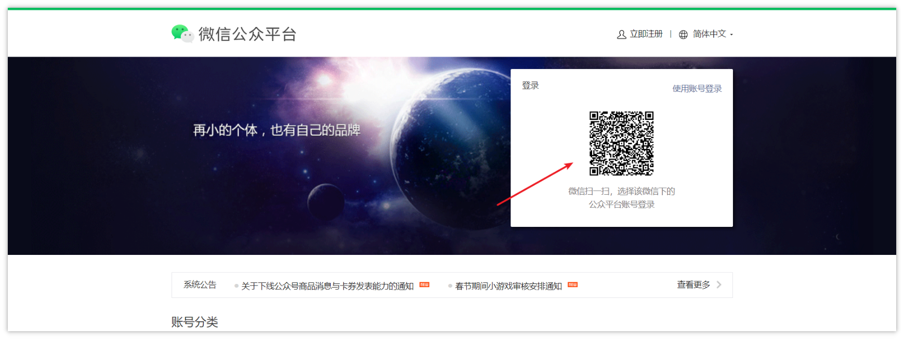
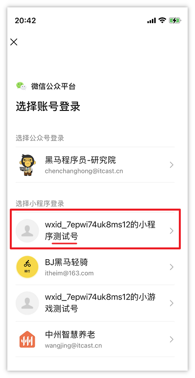
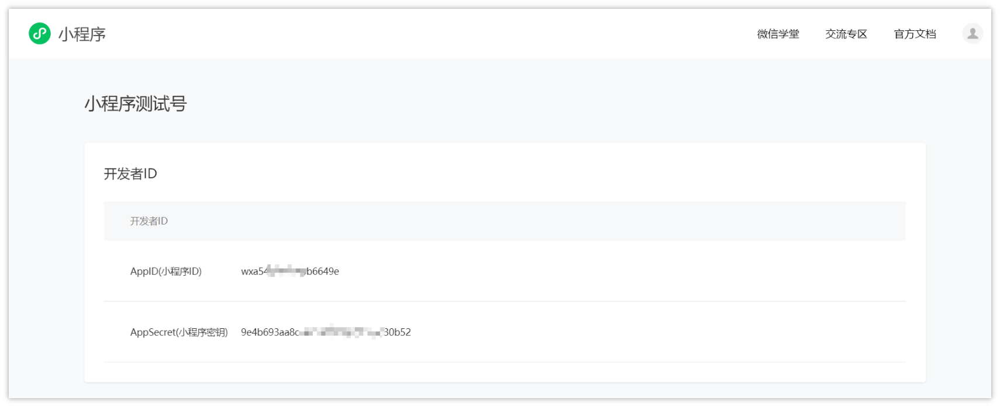

# 小程序AppId申请

- **前提：确保自己的微信与手机号已经绑定**
- 申请小程序测试号：[https://mp.weixin.qq.com/wxamp/sandbox?doc=1](https://mp.weixin.qq.com/wxamp/sandbox?doc=1)
- 打开手机微信，扫描二维码，申请小程序测试号
- 注册成功以后，打开以下页面进行扫码登录

    [https://mp.weixin.qq.com/](https://mp.weixin.qq.com/)

**特别注意**：扫码之后，在手机中选择**小程序测试号**

登录成功之后，就可以看到小程序的开发者ID，包含两部分，如下图

- AppID(**小程序ID**)
- AppSecret(**小程序秘钥**)

**注意：建议大家单独记录下来，保存到一个文件中，后期需要在项目开发中使用**

其他问题：

<cite doc-id="UaUdwpz3UiIcF2k5vpUcMRaengb" file-type="wiki" title="注册测试号遇到的bug" type="doc"></cite>

---
> 来源：飞书技术知识库（脱敏版） · 07 业务组件方案集 / 中州养老项目（若依+AI） / 第三章-AI辅助快速完成登录认证 / 小程序AppId申请 · [原文](https://ccn8v2zngwsm.feishu.cn/wiki/Q5uxwuE3QiEOsnksOBAcWL5qnLm)
