# 02-数据处理和展示

## 目标

前一天我们已经完成了设备的管理，今天，我们就来处理设备联网之后上报数据的处理。

我们再来回顾一下IOT基本的工作原理

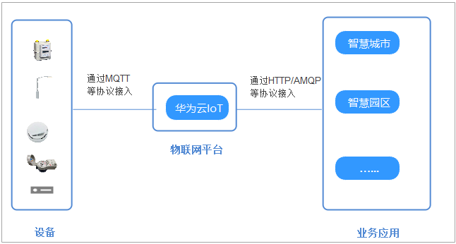

从图中，我们可以看到，当设备上报数据到IOT平台之后，业务系统可以从IOT平台中拉取数据到自己的数据库，方便在业务应用中去展示。

今天的目标：

- 能够熟悉AMQP协议的特点
- 能够完成使用AMQP消费IOT中设备上报的数据
- 能够清楚线程池的使用方式及使用场景

## 异步处理基础概念

在接收设备数据之前，我们需要先来熟悉一些基本的概念，来方便大家理解接收设备数据的基本思路

### 同步和异步

同步和异步的概念，在我们之前讲解js课程的时候已经学习过，基本的思路是一样的

- 同步（Background Synchronous）是指任务在后台进行处理，但需要等待任务完成后才能继续执行其他操作
- 异步（Asynchronous）是指任务的提交和执行是相互独立的，任务的执行不会阻塞程序的继续执行

<whiteboard token="Kst9wFgTAh3dEtbmxc7cYVhsnXc"></whiteboard>

- 同步模式下，任务1完成后才能执行任务2，任务2需要等待任务1的完成。这种顺序执行的方式称为同步。
- 异步模式下，任务1和任务2可以并行执行，彼此之间相互独立，不需要等待对方的完成。这种并行执行的方式称为异步。

优缺点：

- 好处：

  - 提高系统的并发性
  - 改善系统的响应性
- 缺点：

  - 复杂性增加
  - 资源消耗增加

### 消息队列的基本概念

我们知道了同步和异步的区别之后，我们来理解一下**消息队列**的概念，消息队列都是以异步的方式进行请求

<whiteboard token="OlNFwIvZfhAGESbOauLcdpC3nMe"></whiteboard>

- 生产者：负责将消息发送到消息队列中
- 消费者：负责从消息队列中获取消息并进行处理
- 队列：存储消息
- broker：负责接收、存储和分发消息的中间件组件，实现了发送者和接收者之间的解耦和**异步**通信
- topic：消息的分类


在IOT中数据流转是这样的，如下图

<whiteboard token="MR4pw7yzZhrgUsbT61ecsLJtnLf"></whiteboard>

- 生产者：设备负责将消息发送到IOT中（队列）
- 每个产品可以绑定不同的topic来进行消息分类，比如有手表topic、烟雾topic
- IOT本身相当于是一个队列
- 消费者可以从指定的topic中获取数据
- 如果有多个消费者都要接收同一类消息，可以设置多个消费者，称为消费者组

### 什么是AMQP

我们现在已经清楚了消息队列的基础概念，在IOT中数据接收用到的是AMQP来处理消息。


AMQP全称Advanced Message Queuing Protocol，是一种网络协议，用于在应用程序之间传递消息。它是一种开放标准的消息传递协议，可以在不同的系统之间实现可靠、安全、高效的消息传递。

AMQP协议的实现包括多种消息队列软件，例如RabbitMQ、Apache ActiveMQ、**Apache Qpid**等。这些软件提供了可靠、高效的消息传递服务，广泛应用于分布式系统、云计算、物联网等领域。

> 我们这次课程并不会详细讲解这些软件的使用，其中关于RabbitMQ我们后期的课程中会详细的，重点的去讲解。

今天我们会在课程中快速使用Apache Qpid软件来接收IOT中的数据，如下图

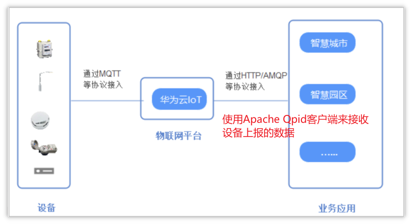


## 设备数据转发

在IOT官方文档中，已经提供了对应的数据转发的解决方案，如下链接：[AMQP转发](https://support.huaweicloud.com/usermanual-iothub/iot_01_00100.html)

### **官网Java SDK接入**

#### 创建数据转发规则

设备接入物联网平台后，可以通过自定义Topic或产品模型将数据上报给平台。在控制台上设置订阅后，平台会将包括设备生命周期变更、**属性上报**、消息上报及状态变更等信息，通过订阅推送的方式转发到您指定的服务器。

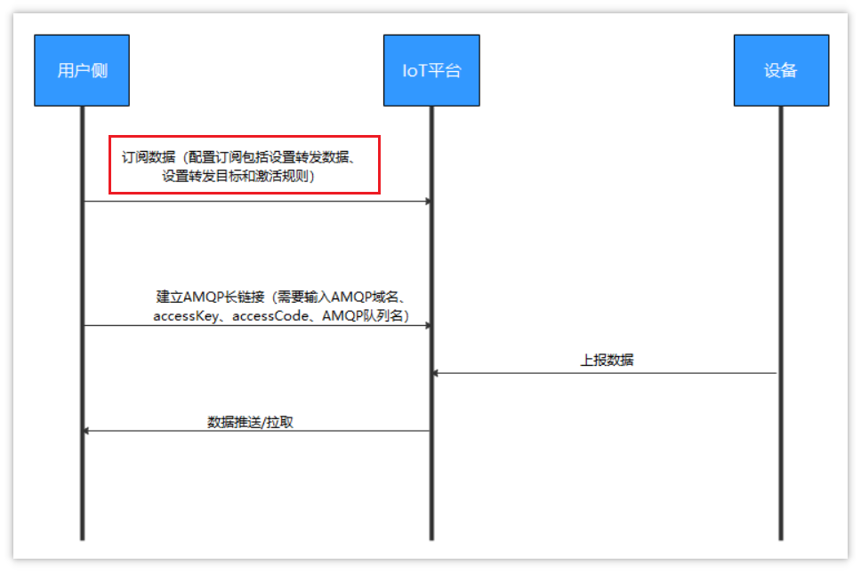

- 订阅（AMQP）： 用户可以通过控制台或调用API创建订阅，以获取设备的变更信息，如设备状态、**数据上报**等。订阅时需要指定具体的AMQP消息通道。
- 推送： 一旦订阅成功，物联网平台会根据用户选择的数据类型，**自动将相关变更推送到指定的AMQP消息队列中**。用户使用AMQP客户端（**Apache Qpid**）连接到IoT平台即可接收这些更新信息。

按照上述流程，**我们需要在IOT平台中创建转发规则，才能让AMQP客户端接收到数据**

配置规则参考官方说明：https://support.huaweicloud.com/usermanual-iothub/iot_01_00101.html

1. 找到**规则**->**数据转发**->**创建规则**

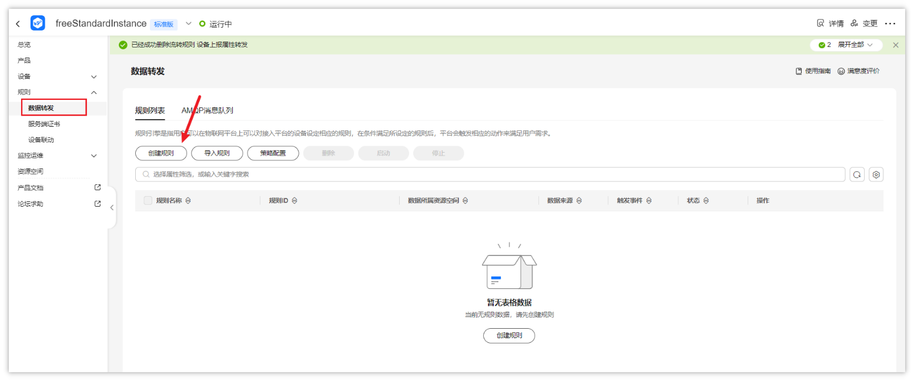

1. 创建规则，其中数据来源为：**设备属性**

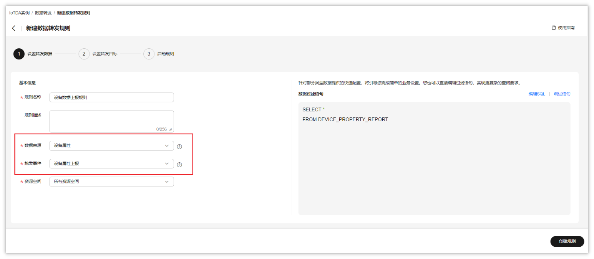

配置完成后，点击右下角的 [创建规则]

1. 添加转发目标，转发目标选择：**AMQP推送消息队列**

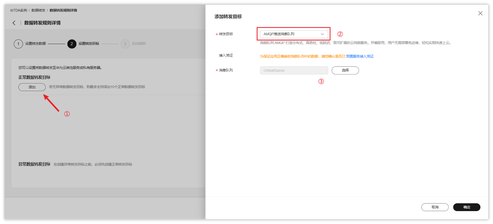

1. 上述操作完成后，可以启动规则

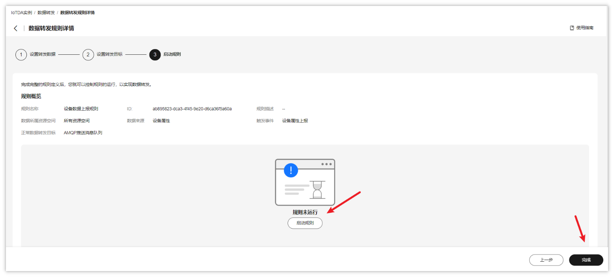


#### Java SDK接入示例（可选）

1. 下载sdk代码

下载地址：https://developer.obs.myhuaweicloud.com/manage/amqp/amqp-demo.zip

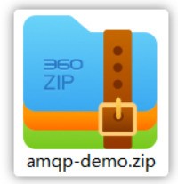

代码包可以在当天资料中找到

`项目一：中州养老\中州养老-智能检测系统-华为云\资料\华为SDK\amqp-demo.zip`


官网说明参考：https://support.huaweicloud.com/usermanual-iothub/iot_01_00100_3.html

1. 使用idea打开刚刚下载的amqp-demo中的**amqp-client-examples**代码目录，如下图


1. 修改连接参数

可以直接到AmqpConstants类中进行修改，以下参数的获取都可以通过对应链接说明找到

```Java
package com.iot.amqp;


public interface AmqpConstants {
    /**
     * AMQP接入域名
     * 参考：https://support.huaweicloud.com/usermanual-iothub/iot_01_00100_2.html#section2
     */
    String HOST = "38e7abedbf.st1.iotda-app.cn-east-3.myhuaweicloud.com";   // eg: "****.iot-amqps.cn-north-4.myhuaweicloud.com";

    /**
     * AMQP接入端口
     * 参考：https://support.huaweicloud.com/usermanual-iothub/iot_01_00100_2.html#section2
     */
    int PORT = 5671;

    /**
     * 接入凭证键值
     * 参考：https://support.huaweicloud.com/usermanual-iothub/iot_01_00100_2.html#section3
     */
    String ACCESS_KEY = "S2DSSeTC5";

    /**
     * 接入凭证密钥
     * 参考：https://support.huaweicloud.com/usermanual-iothub/iot_01_00100_2.html#section3
     */
    String ACCESS_CODE = "61xLTVTzppmBi62h5my2TT2LIXpU";

    /**
     * 默认队列，无需改动
     */
    String DEFAULT_QUEUE = "DefaultQueue";
}
```

1. 放开AbstractAmqpExample中的打印消息的代码，如下图：


1. 启动测试，可以正常在控制台看到设备上报的数据

![图片展示了使用Java SDK接入示例中amqp-client-examples代码目录下的代码界面。左侧为项目结构，选中“amqp-client-examples”代码目录。右侧代码中，红箭头指向“public static void main(String\[\] args)”处，下方代码部分有红框突出显示，内容为“AbstractAmqpExample - receive a message, content={“resource”:“device.property”,“event”:“report”,“event_time”:“20250217T080894848Z”}”。该图片与文档中Java SDK接入示例内容相关，用于说明在IDEA中打开amqp-demo代码目录及代码中关键代码位置。](https://feishu.cn/file/IQiXbfktQoR1VjxMsIvcod1Wnch)


### SDK改造

#### 改造思路

SDK提供好的这个工具类，只是官网给提供的参考，我们需要进行改造，改造思路如下：

- 导入对应的依赖
- 所有的可变参数，如*HOST、ACCESS_KEY*、*ACCESS_CODE*、*DEFAULT_QUEUE*这些统一在配置文件中维护
- 在项目中根据项目需求配置线程池
- 让spring进行管理和监听，一旦有数据变化之后，就可以马上消费，可以让这个类实现ApplicationRunner接口，重新run方法

#### 导入pom依赖

在`zzyl-nursing-platform`模块中导入依赖，参考官网提供的pom依赖，如下：

```XML
<!-- amqp 1.0 qpid client -->
<dependency>
    <groupId>org.apache.qpid</groupId>
    <artifactId>qpid-jms-client</artifactId>
    <version>0.61.0</version>
</dependency>
```

#### application.yml文件添加iot配置

前一天已经创建过了，可以直接使用

#### 实现ApplicationRunner接口之后的AmqpClient

让AmqpClient 实现ApplicationRunner接口，重写run方法，然后调用处理数据方法（由main方法改造而来）


```Java
package com.zzyl.nursing.mq.listener;

import cn.hutool.core.text.CharSequenceUtil;
import com.zzyl.framework.config.properties.HuaWeiIotConfigProperties;
import lombok.extern.slf4j.Slf4j;
import org.apache.qpid.jms.*;
import org.apache.qpid.jms.message.JmsInboundMessageDispatch;
import org.apache.qpid.jms.transports.TransportOptions;
import org.apache.qpid.jms.transports.TransportSupport;
import org.springframework.beans.factory.annotation.Autowired;
import org.springframework.boot.ApplicationArguments;
import org.springframework.boot.ApplicationRunner;
import org.springframework.scheduling.concurrent.ThreadPoolTaskExecutor;
import org.springframework.stereotype.Component;

import javax.jms.*;
import java.net.InetAddress;
import java.net.URI;
import java.net.UnknownHostException;
import java.text.MessageFormat;
import java.util.HashMap;
import java.util.Map;
import java.util.UUID;
import java.util.stream.Collectors;

/**
 * @author itcast
 */
@Slf4j
@Component
public class AmqpClient implements ApplicationRunner {

    @Autowired
    private HuaWeiIotConfigProperties huaWeiIotConfigProperties;

    //业务处理异步线程池，线程池参数可以根据您的业务特点调整，或者您也可以用其他异步方式处理接收到的消息。
    @Autowired
    private ThreadPoolTaskExecutor threadPoolTaskExecutor;

    //控制台服务端订阅中消费组状态页客户端ID一栏将显示clientId参数。
    //建议使用机器UUID、MAC地址、IP等唯一标识等作为clientId。便于您区分识别不同的客户端。
    private static String clientId;

    static {
        try {
            clientId = InetAddress.getLocalHost().getHostAddress();
        } catch (UnknownHostException e) {
            e.printStackTrace();
        }
    }

    /**
     * spring容器启动后执行
     * @param args incoming application arguments
     * @throws Exception
     */
    @Override
    public void run(ApplicationArguments args) throws Exception {
        start();
    }

    public void start() throws Exception {
        //参数说明，请参见AMQP客户端接入说明文档。
        for (int i = 0; i < huaWeiIotConfigProperties.getConnectionCount(); i++) {
            //创建amqp连接
            Connection connection = getConnection();

            //加入监听者
            ((JmsConnection) connection).addConnectionListener(myJmsConnectionListener);
            // 创建会话。
            // Session.CLIENT_ACKNOWLEDGE: 收到消息后，需要手动调用message.acknowledge()。
            // Session.AUTO_ACKNOWLEDGE: SDK自动ACK（推荐）。
            Session session = connection.createSession(false, Session.AUTO_ACKNOWLEDGE);
            connection.start();

            // 创建Receiver连接。
            MessageConsumer consumer = newConsumer(session, connection, huaWeiIotConfigProperties.getQueueName());
            consumer.setMessageListener(messageListener);
        }

        log.info("amqp  is started successfully, and will exit after server shutdown ");
    }

    /**
     * 创建amqp连接
     *
     * @return amqp连接
     */
    private Connection getConnection() throws Exception {
        String connectionUrl = generateConnectUrl();
        JmsConnectionFactory cf = new JmsConnectionFactory(connectionUrl);
        // 信任服务端
        TransportOptions to = new TransportOptions();
        to.setTrustAll(true);
        cf.setSslContext(TransportSupport.createJdkSslContext(to));
        String userName = "accessKey=" + huaWeiIotConfigProperties.getAccessKey();
        cf.setExtension(JmsConnectionExtensions.USERNAME_OVERRIDE.toString(), (connection, uri) -> {
            // IoTDA的userName组成格式如下：“accessKey=${accessKey}|timestamp=${timestamp}”
            String newUserName = userName;
            if (connection instanceof JmsConnection) {
                newUserName = ((JmsConnection) connection).getUsername();
            }
            return newUserName + "|timestamp=" + System.currentTimeMillis();
        });

        // 创建连接。
        return cf.createConnection(userName, huaWeiIotConfigProperties.getAccessCode());
    }

    /**
     * 生成amqp连接地址
     *
     * @return amqp连接地址
     */
    public String generateConnectUrl() {
        String uri = MessageFormat.format("{0}://{1}:{2}",
                (huaWeiIotConfigProperties.isUseSsl() ? "amqps" : "amqp"),
                huaWeiIotConfigProperties.getHost(),
                String.valueOf(huaWeiIotConfigProperties.getPort()));
        Map<String, String> uriOptions = new HashMap<>();
        uriOptions.put("amqp.vhost", huaWeiIotConfigProperties.getVhost());
        uriOptions.put("amqp.idleTimeout", String.valueOf(huaWeiIotConfigProperties.getIdleTimeout()));
        uriOptions.put("amqp.saslMechanisms", huaWeiIotConfigProperties.getSaslMechanisms());

        Map<String, String> jmsOptions = new HashMap<>();
        jmsOptions.put("jms.prefetchPolicy.queuePrefetch", String.valueOf(huaWeiIotConfigProperties.getQueuePrefetch()));
        if (CharSequenceUtil.isNotBlank(clientId)) {
            jmsOptions.put("jms.clientID", clientId);
        } else {
            jmsOptions.put("jms.clientID", UUID.randomUUID().toString());
        }
        jmsOptions.put("failover.reconnectDelay", String.valueOf(huaWeiIotConfigProperties.getReconnectDelay()));
        jmsOptions.put("failover.maxReconnectDelay", String.valueOf(huaWeiIotConfigProperties.getMaxReconnectDelay()));
        if (huaWeiIotConfigProperties.getMaxReconnectAttempts() > 0) {
            jmsOptions.put("failover.maxReconnectAttempts", String.valueOf(huaWeiIotConfigProperties.getMaxReconnectAttempts()));
        }
        if (huaWeiIotConfigProperties.getExtendedOptions() != null) {
            for (Map.Entry<String, String> option : huaWeiIotConfigProperties.getExtendedOptions().entrySet()) {
                if (option.getKey().startsWith("amqp.") || option.getKey().startsWith("transport.")) {
                    uriOptions.put(option.getKey(), option.getValue());
                } else {
                    jmsOptions.put(option.getKey(), option.getValue());
                }
            }
        }
        StringBuilder stringBuilder = new StringBuilder();
        stringBuilder.append(uriOptions.entrySet().stream()
                .map(option -> MessageFormat.format("{0}={1}", option.getKey(), option.getValue()))
                .collect(Collectors.joining("&", "failover:(" + uri + "?", ")")));
        stringBuilder.append(jmsOptions.entrySet().stream()
                .map(option -> MessageFormat.format("{0}={1}", option.getKey(), option.getValue()))
                .collect(Collectors.joining("&", "?", "")));
        return stringBuilder.toString();
    }

    /**
     * 创建消费者
     *
     * @param session    session
     * @param connection amqp连接
     * @param queueName  队列名称
     * @return 消费者
     */
    public MessageConsumer newConsumer(Session session, Connection connection, String queueName) throws Exception {
        if (connection == null || !(connection instanceof JmsConnection) || ((JmsConnection) connection).isClosed()) {
            throw new Exception("create consumer failed,the connection is disconnected.");
        }

        return session.createConsumer(new JmsQueue(queueName));
    }

    private final MessageListener messageListener = message -> {
        try {
            //异步处理收到的消息，确保onMessage函数里没有耗时逻辑
            threadPoolTaskExecutor.submit(() -> processMessage(message));
        } catch (Exception e) {
            log.error("submit task occurs exception ", e);
        }
    };

    /**
     * 在这里处理您收到消息后的具体业务逻辑。
     */
    private void processMessage(Message message) {
        String contentStr;
        try {
            contentStr = message.getBody(String.class);
            String topic = message.getStringProperty("topic");
            String messageId = message.getStringProperty("messageId");
            log.info("receive message,\n topic = {},\n messageId = {},\n content = {}", topic, messageId, contentStr);
        } catch (JMSException e) {
            throw new RuntimeException("服务器错误");
        }

    }

    private final JmsConnectionListener myJmsConnectionListener = new JmsConnectionListener() {
        /**
         * 连接成功建立。
         */
        @Override
        public void onConnectionEstablished(URI remoteURI) {
            log.info("onConnectionEstablished, remoteUri:{}", remoteURI);
        }

        /**
         * 尝试过最大重试次数之后，最终连接失败。
         */
        @Override
        public void onConnectionFailure(Throwable error) {
            log.error("onConnectionFailure, {}", error.getMessage());
        }

        /**
         * 连接中断。
         */
        @Override
        public void onConnectionInterrupted(URI remoteURI) {
            log.info("onConnectionInterrupted, remoteUri:{}", remoteURI);
        }

        /**
         * 连接中断后又自动重连上。
         */
        @Override
        public void onConnectionRestored(URI remoteURI) {
            log.info("onConnectionRestored, remoteUri:{}", remoteURI);
        }

        @Override
        public void onInboundMessage(JmsInboundMessageDispatch envelope) {
        }

        @Override
        public void onSessionClosed(Session session, Throwable cause) {
        }

        @Override
        public void onConsumerClosed(MessageConsumer consumer, Throwable cause) {
        }

        @Override
        public void onProducerClosed(MessageProducer producer, Throwable cause) {
        }
    };
}
```

特别说明：在目前若依的项目中已经提供了线程池的配置`ThreadPoolTaskExecutor `

类的位置：`com.zzyl.framework.config.ThreadPoolConfig`

```Java
package com.zzyl.framework.config;

import com.zzyl.common.utils.Threads;
import org.apache.commons.lang3.concurrent.BasicThreadFactory;
import org.springframework.context.annotation.Bean;
import org.springframework.context.annotation.Configuration;
import org.springframework.scheduling.concurrent.ThreadPoolTaskExecutor;
import java.util.concurrent.ScheduledExecutorService;
import java.util.concurrent.ScheduledThreadPoolExecutor;
import java.util.concurrent.ThreadPoolExecutor;

/**
 * 线程池配置
 *
 * @author ruoyi
 **/
@Configuration
public class ThreadPoolConfig
{
    // 核心线程池大小
    private int corePoolSize = 50;

    // 最大可创建的线程数
    private int maxPoolSize = 200;

    // 队列最大长度
    private int queueCapacity = 1000;

    // 线程池维护线程所允许的空闲时间
    private int keepAliveSeconds = 300;

    @Bean(name = "threadPoolTaskExecutor")
    public ThreadPoolTaskExecutor threadPoolTaskExecutor()
    {
        ThreadPoolTaskExecutor executor = new ThreadPoolTaskExecutor();
        executor.setMaxPoolSize(maxPoolSize);
        executor.setCorePoolSize(corePoolSize);
        executor.setQueueCapacity(queueCapacity);
        executor.setKeepAliveSeconds(keepAliveSeconds);
        // 线程池对拒绝任务(无线程可用)的处理策略
        executor.setRejectedExecutionHandler(new ThreadPoolExecutor.CallerRunsPolicy());
        return executor;
    }

    /**
     * 执行周期性或定时任务
     */
    @Bean(name = "scheduledExecutorService")
    protected ScheduledExecutorService scheduledExecutorService()
    {
        return new ScheduledThreadPoolExecutor(corePoolSize,
                new BasicThreadFactory.Builder().namingPattern("schedule-pool-%d").daemon(true).build(),
                new ThreadPoolExecutor.CallerRunsPolicy())
        {
            @Override
            protected void afterExecute(Runnable r, Throwable t)
            {
                super.afterExecute(r, t);
                Threads.printException(r, t);
            }
        };
    }
}
```

线程池核心参数和原理

- corePoolSize 核心线程数目
- maximumPoolSize 最大线程数目 = (核心线程+救急线程的最大数目)
- keepAliveTime 生存时间 - 救急线程的生存时间，生存时间内没有新任务，此线程资源会释放
- unit 时间单位 - 救急线程的生存时间单位，如秒、毫秒等
- workQueue - 当没有空闲核心线程时，新来任务会加入到此队列排队，队列满会创建救急线程执行任务
- threadFactory 线程工厂 - 可以定制线程对象的创建，例如设置线程名字、是否是守护线程等
- handler 拒绝策略 - 当所有线程都在繁忙，workQueue 也放满时，会触发拒绝策略

  - AbortPolicy：直接抛出异常，默认策略；
  - CallerRunsPolicy：用调用者所在的线程来执行任务；
  - DiscardOldestPolicy：丢弃阻塞队列中靠最前的任务，并执行当前任务；
  - DiscardPolicy：直接丢弃任务；
- 执行流程（原理）

<whiteboard token="Fk3xwP2zHho15qb7E7LccgB7nif"></whiteboard>


#### 测试

当所有都配置完成后，启动模拟设备上报，同时启动后端项目，查看日志中是否打印上报之后的数据


## 接收设备端数据

### 思路分析

整体的接收数据思路如下：

<whiteboard token="IkgLwJ0q6h5gHTbseOzcj00NnRf"></whiteboard>

### 表结构

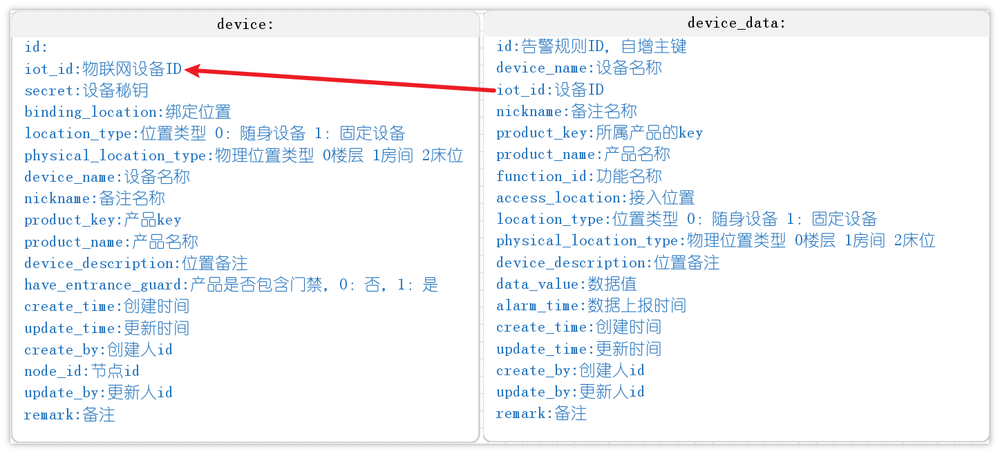

### 基础代码生成

们使用代码生成的功能，来生成代码

- 包名:`com.zzyl.nursing`
- 模块名：`nursing`
- 除了主键之外的Long类型，改为Integer
- 数据上报时间字段改为LocalDateTime类型
- 生成业务名称：data
- 生成功能名称：设备数据

**只拷贝后端代码到idea中**

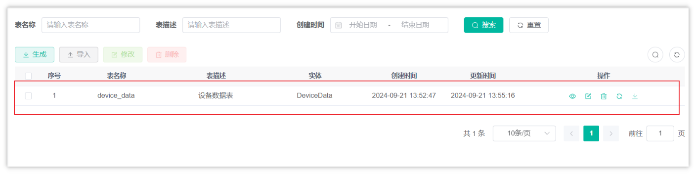

修改DeviceData表，添加三个注解，方便使用**构建者设计模式**来构建对象，如下图：

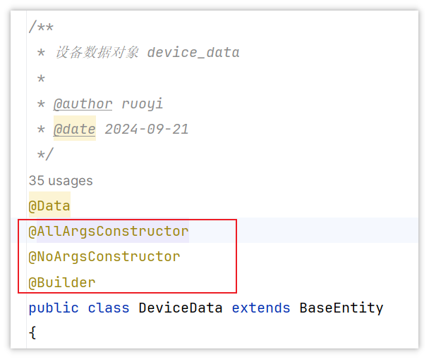


### 功能实现

1. 思路分析

接收到的数据格式如下，是一个json字符串，我们可以定义一个类来转换接收数据

```JSON
{
  "resource": "device.property",
  "event": "report",
  "event_time": "20250217T083248Z",
  "event_time_ms": "2025-02-17T08:32:48.938Z",
  "request_id": "57f53c8e-9f20-4ce8-aceb-83953391c6c2",
  "notify_data": {
    "header": {
      "app_id": "d51bfac701644b9daa4363cf76c661af",
      "device_id": "67ad95860c504e29c72b2436_watch88",
      "node_id": "watch88",
      "product_id": "67ad95860c504e29c72b2436",
      "gateway_id": "67ad95860c504e29c72b2436_watch88"
    },
    "body": {
      "services": [
        {
          "service_id": "watch_services",
          "properties": {
            "BodyTemp": 1,
            "HeartRate": 87.6276,
            "xueyang": 93.12909,
            "BatteryPercentage": 6.9553375
          },
          "event_time": "20250217T083248Z"
        }
      ]
    }
  }
}
```

上述json的数据结构中，已经标明颜色的是重点要解析的，由于嵌套层级较多，需要定义多个类来进行接收，对应的类可以在当天资料中找到，如下图


放到zzyl-nursing-platform\src\main\java\com\zzyl\nursing\mq\listener\vo


在设备数据表中，一次上报需要保存一个设备的多个物模型数据

> 比如，烟雾报警有三个物模型，那么当接收到一个数据上报的时候，就要保存三条数据到设备数据中


**流程**

<whiteboard token="QLy7wEZnXhiyYkbRk2AcfHS6nhh"></whiteboard>


1. 在设备数据的业务层定义批量添加的方法

在IDeviceDataService中定义新的方法：

```Java
/**
 * 批量保存数据
 * @param iotMsgNotifyData
 */
void batchInsertDeviceData(IotMsgNotifyData iotMsgNotifyData);
```

实现方法：

```Java
@Autowired
private DeviceMapper deviceMapper;

/**
 * 批量保存数据
 * @param iotMsgNotifyData
 */
@Override
public void batchInsertDeviceData(IotMsgNotifyData iotMsgNotifyData) {
    //判断设备是否存在
    String iotId = iotMsgNotifyData.getHeader().getDeviceId();
    Device device = deviceMapper.selectOne(Wrappers.<Device>lambdaQuery().eq(Device::getIotId, iotId));
    if(device == null){
        //日志的记录，方便后期查找问题
        log.error("设备不存在，iotId:{}",iotId);
        return;
    }
    //获取到设备上报的数据，一个设备可以有多个service
    iotMsgNotifyData.getBody().getServices().forEach(s->{

        //所有数据都已经装入到map中
        Map<String, Object> properties = s.getProperties();
        if (ObjectUtil.isEmpty(properties)){
            return;
        }
        //处理上报时间日期
        LocalDateTime eventTime =  LocalDateTimeUtil.parse(s.getEventTime(), "yyyyMMdd'T'HHmmss'Z'");
        //日期时区转换
        LocalDateTime alarmTime = eventTime.atZone(ZoneId.from(ZoneOffset.UTC))
                .withZoneSameInstant(ZoneId.of("Asia/Shanghai"))
                .toLocalDateTime();

        //转入多个设备数据
        List<DeviceData> deviceDataList = new ArrayList<>();

        //遍历map集合，批量新增数据
        properties.forEach((key, value)->{
            DeviceData deviceData = DeviceData.builder()
                    .iotId(iotId)
                    .deviceName(device.getDeviceName())
                    .productKey(device.getProductKey())
                    .productName(device.getProductName())
                    .functionId(key)
                    .accessLocation(device.getRemark())
                    .locationType(device.getLocationType())
                    .physicalLocationType(device.getPhysicalLocationType())
                    .deviceDescription(device.getDeviceDescription())
                    .alarmTime(alarmTime)
                    .dataValue(value + "")
                    .build();
            deviceDataList.add(deviceData);

        });

        //批量保存
        saveBatch(deviceDataList);

    });

}
```


1. 修改AmqpClient类，解析json数据并调用设备数据的业务层，批量添加数据

```Java
package com.zzyl.nursing.job;

import cn.hutool.core.text.CharSequenceUtil;
import cn.hutool.core.util.ObjectUtil;
import cn.hutool.json.JSONObject;
import cn.hutool.json.JSONUtil;
import com.zzyl.framework.config.properties.HuaWeiIotConfigProperties;
import com.zzyl.nursing.job.vo.IotMsgNotifyData;
import com.zzyl.nursing.service.IDeviceDataService;
import lombok.extern.slf4j.Slf4j;
import org.apache.qpid.jms.*;
import org.apache.qpid.jms.message.JmsInboundMessageDispatch;
import org.apache.qpid.jms.transports.TransportOptions;
import org.apache.qpid.jms.transports.TransportSupport;
import org.springframework.beans.factory.annotation.Autowired;
import org.springframework.boot.ApplicationArguments;
import org.springframework.boot.ApplicationRunner;
import org.springframework.stereotype.Component;

import javax.annotation.Resource;
import javax.jms.*;
import java.net.InetAddress;
import java.net.URI;
import java.net.UnknownHostException;
import java.text.MessageFormat;
import java.util.HashMap;
import java.util.Map;
import java.util.UUID;
import java.util.concurrent.ExecutorService;
import java.util.stream.Collectors;

/**
 * @author itcast
 */
@Slf4j
@Component
public class AmqpClient implements ApplicationRunner {

    @Resource
    private HuaWeiIotConfigProperties huaWeiIotConfigProperties;

    //业务处理异步线程池，线程池参数可以根据您的业务特点调整，或者您也可以用其他异步方式处理接收到的消息。
    @Resource
    private ExecutorService executorService;

    //控制台服务端订阅中消费组状态页客户端ID一栏将显示clientId参数。
    //建议使用机器UUID、MAC地址、IP等唯一标识等作为clientId。便于您区分识别不同的客户端。
    private static String clientId;

    static {
        try {
            clientId = InetAddress.getLocalHost().getHostAddress();
        } catch (UnknownHostException e) {
            e.printStackTrace();
        }
    }

    @Override
    public void run(ApplicationArguments args) throws Exception {
        start();
    }

    public void start() throws Exception {
        //参数说明，请参见AMQP客户端接入说明文档。
        for (int i = 0; i < huaWeiIotConfigProperties.getConnectionCount(); i++) {
            //创建amqp连接
            Connection connection = getConnection();

            //加入监听者
            ((JmsConnection) connection).addConnectionListener(myJmsConnectionListener);
            // 创建会话。
            // Session.CLIENT_ACKNOWLEDGE: 收到消息后，需要手动调用message.acknowledge()。
            // Session.AUTO_ACKNOWLEDGE: SDK自动ACK（推荐）。
            Session session = connection.createSession(false, Session.AUTO_ACKNOWLEDGE);
            connection.start();

            // 创建Receiver连接。
            MessageConsumer consumer = newConsumer(session, connection, huaWeiIotConfigProperties.getQueueName());
            consumer.setMessageListener(messageListener);
        }

        log.info("amqp  is started successfully, and will exit after server shutdown ");
    }

    /**
     * 创建amqp连接
     *
     * @return amqp连接
     */
    private Connection getConnection() throws Exception {
        String connectionUrl = generateConnectUrl();
        JmsConnectionFactory cf = new JmsConnectionFactory(connectionUrl);
        // 信任服务端
        TransportOptions to = new TransportOptions();
        to.setTrustAll(true);
        cf.setSslContext(TransportSupport.createJdkSslContext(to));
        String userName = "accessKey=" + huaWeiIotConfigProperties.getAccessKey();
        cf.setExtension(JmsConnectionExtensions.USERNAME_OVERRIDE.toString(), (connection, uri) -> {
            // IoTDA的userName组成格式如下：“accessKey=${accessKey}|timestamp=${timestamp}”
            String newUserName = userName;
            if (connection instanceof JmsConnection) {
                newUserName = ((JmsConnection) connection).getUsername();
            }
            return newUserName + "|timestamp=" + System.currentTimeMillis();
        });

        // 创建连接。
        return cf.createConnection(userName, huaWeiIotConfigProperties.getAccessCode());
    }

    /**
     * 生成amqp连接地址
     *
     * @return amqp连接地址
     */
    public String generateConnectUrl() {
        String uri = MessageFormat.format("{0}://{1}:{2}",
                (huaWeiIotConfigProperties.isUseSsl() ? "amqps" : "amqp"),
                huaWeiIotConfigProperties.getHost(),
                String.valueOf(huaWeiIotConfigProperties.getPort()));
        Map<String, String> uriOptions = new HashMap<>();
        uriOptions.put("amqp.vhost", huaWeiIotConfigProperties.getVhost());
        uriOptions.put("amqp.idleTimeout", String.valueOf(huaWeiIotConfigProperties.getIdleTimeout()));
        uriOptions.put("amqp.saslMechanisms", huaWeiIotConfigProperties.getSaslMechanisms());

        Map<String, String> jmsOptions = new HashMap<>();
        jmsOptions.put("jms.prefetchPolicy.queuePrefetch", String.valueOf(huaWeiIotConfigProperties.getQueuePrefetch()));
        if (CharSequenceUtil.isNotBlank(clientId)) {
            jmsOptions.put("jms.clientID", clientId);
        } else {
            jmsOptions.put("jms.clientID", UUID.randomUUID().toString());
        }
        jmsOptions.put("failover.reconnectDelay", String.valueOf(huaWeiIotConfigProperties.getReconnectDelay()));
        jmsOptions.put("failover.maxReconnectDelay", String.valueOf(huaWeiIotConfigProperties.getMaxReconnectDelay()));
        if (huaWeiIotConfigProperties.getMaxReconnectAttempts() > 0) {
            jmsOptions.put("failover.maxReconnectAttempts", String.valueOf(huaWeiIotConfigProperties.getMaxReconnectAttempts()));
        }
        if (huaWeiIotConfigProperties.getExtendedOptions() != null) {
            for (Map.Entry<String, String> option : huaWeiIotConfigProperties.getExtendedOptions().entrySet()) {
                if (option.getKey().startsWith("amqp.") || option.getKey().startsWith("transport.")) {
                    uriOptions.put(option.getKey(), option.getValue());
                } else {
                    jmsOptions.put(option.getKey(), option.getValue());
                }
            }
        }
        StringBuilder stringBuilder = new StringBuilder();
        stringBuilder.append(uriOptions.entrySet().stream()
                .map(option -> MessageFormat.format("{0}={1}", option.getKey(), option.getValue()))
                .collect(Collectors.joining("&", "failover:(" + uri + "?", ")")));
        stringBuilder.append(jmsOptions.entrySet().stream()
                .map(option -> MessageFormat.format("{0}={1}", option.getKey(), option.getValue()))
                .collect(Collectors.joining("&", "?", "")));
        return stringBuilder.toString();
    }

    /**
     * 创建消费者
     *
     * @param session    session
     * @param connection amqp连接
     * @param queueName  队列名称
     * @return 消费者
     */
    public MessageConsumer newConsumer(Session session, Connection connection, String queueName) throws Exception {
        if (connection == null || !(connection instanceof JmsConnection) || ((JmsConnection) connection).isClosed()) {
            throw new Exception("create consumer failed,the connection is disconnected.");
        }

        return session.createConsumer(new JmsQueue(queueName));
    }

    private final MessageListener messageListener = message -> {
        try {
            //异步处理收到的消息，确保onMessage函数里没有耗时逻辑
            executorService.submit(() -> processMessage(message));
        } catch (Exception e) {
            log.error("submit task occurs exception ", e);
        }
    };

    @Autowired
    private IDeviceDataService deviceDataService;

    /**
     * 在这里处理您收到消息后的具体业务逻辑。
     */
    private void processMessage(Message message) {
        String contentStr;
        try {
            contentStr = message.getBody(String.class);
            String topic = message.getStringProperty("topic");
            String messageId = message.getStringProperty("messageId");
            log.info("receive message,\n topic = {},\n messageId = {},\n content = {}", topic, messageId, contentStr);
        } catch (JMSException e) {
            throw new RuntimeException("服务器错误");
        }

        //将消息转换为json格式，数据为空，直接返回
        JSONObject jsonMsg = JSONUtil.parseObj(contentStr);

        //取出消息中的notify_data字段，数据为空，直接返回
        JSONObject jsonNotifyData = jsonMsg.getJSONObject("notify_data");
        if (ObjectUtil.isEmpty(jsonMsg)) {
            return;
        }

        //json格式转换为对象，如果属性上报为空，程序结束
        IotMsgNotifyData iotMsgNotifyData = JSONUtil.toBean(jsonNotifyData, IotMsgNotifyData.class);
        if (ObjectUtil.isEmpty(iotMsgNotifyData.getBody()) || ObjectUtil.isEmpty(iotMsgNotifyData.getBody().getServices())) {
            return;
        }

        deviceDataService.batchInsertDeviceData(iotMsgNotifyData);

    }

    private final JmsConnectionListener myJmsConnectionListener = new JmsConnectionListener() {
        /**
         * 连接成功建立。
         */
        @Override
        public void onConnectionEstablished(URI remoteURI) {
            log.info("onConnectionEstablished, remoteUri:{}", remoteURI);
        }

        /**
         * 尝试过最大重试次数之后，最终连接失败。
         */
        @Override
        public void onConnectionFailure(Throwable error) {
            log.error("onConnectionFailure, {}", error.getMessage());
        }

        /**
         * 连接中断。
         */
        @Override
        public void onConnectionInterrupted(URI remoteURI) {
            log.info("onConnectionInterrupted, remoteUri:{}", remoteURI);
        }

        /**
         * 连接中断后又自动重连上。
         */
        @Override
        public void onConnectionRestored(URI remoteURI) {
            log.info("onConnectionRestored, remoteUri:{}", remoteURI);
        }

        @Override
        public void onInboundMessage(JmsInboundMessageDispatch envelope) {
        }

        @Override
        public void onSessionClosed(Session session, Throwable cause) {
        }

        @Override
        public void onConsumerClosed(MessageConsumer consumer, Throwable cause) {
        }

        @Override
        public void onProducerClosed(MessageProducer producer, Throwable cause) {
        }
    };
}
```


**其他注意事项：**

由于是异步接收数据，并不能获取当前登录人的信息，所以在自动填充里面是是接收不到具体的请求对象的，所以在异步请求中（定时任务或当前的线程池中）需要放弃用户自动填充

修改MyMetaObjectHandler类中isExclude的方法，如果request对象为空，则直接返回false，表示放弃填充用户

```Java
@SneakyThrows
public boolean isExclude() {
    try {
        String requestURI = request.getRequestURI();
        if(requestURI.startsWith("/member")) {
            return true;
        }
        return false;
    } catch (Exception e) {
        return true;
    }
}
```


### 测试

- 启动模拟设备进行上报
- 启动后端项目，查看数据库是否保存数据成功

### bug修复

当设备增多之后，数据库连接池可能会很快耗尽，可以适当增加连接数数量和等待时间

可能的错误提示：

```Bash
wait millis 60003, active 20, maxActive 20, creating 0
```

- 数据库连接池耗尽，活跃连接数已达上限(maxActive=20)，无可用连接且等待超时(60秒)，导致新请求无法获取连接。


修改application.yml文件关于数据库的配置，如下标颜色内容

```YAML
spring:
  datasource:
    type: com.alibaba.druid.pool.DruidDataSource
    driverClassName: com.mysql.cj.jdbc.Driver
    druid:
      # 主库数据源
      master:
        url: jdbc:mysql://192.168.100.168:3306/zzyl?useUnicode=true&characterEncoding=utf8&zeroDateTimeBehavior=convertToNull&useSSL=true&serverTimezone=GMT%2B8
        username: root
        password: heima123
      # 从库数据源
      slave:
        # 从数据源开关/默认关闭
        enabled: false
        url:
        username:
        password:
      # 初始连接数
      initialSize: 5
      # 最小连接池数量
      minIdle: 10
      # 最大连接池数量
      maxActive: 60   # 提升最大连接数
      # 配置获取连接等待超时的时间
      maxWait: 120000   # 延长等待时间至2分钟
      # 配置连接超时时间
      connectTimeout: 30000
      # 配置网络超时时间
      socketTimeout: 60000
      # 配置间隔多久才进行一次检测，检测需要关闭的空闲连接，单位是毫秒
      timeBetweenEvictionRunsMillis: 60000
      # 配置一个连接在池中最小生存的时间，单位是毫秒
      minEvictableIdleTimeMillis: 300000
      # 配置一个连接在池中最大生存的时间，单位是毫秒
      maxEvictableIdleTimeMillis: 900000
      # 配置检测连接是否有效
      validationQuery: SELECT 1 FROM DUAL
      testWhileIdle: true
      testOnBorrow: true  # 借出连接时校验有效性
      testOnReturn: false
      webStatFilter:
        enabled: true
      statViewServlet:
        enabled: true
        # 设置白名单，不填则允许所有访问
        allow:
        url-pattern: /druid/*
        # 控制台管理用户名和密码
        login-username: ruoyi
        login-password: 123456
      filter:
        stat:
          enabled: true
          # 慢SQL记录
          log-slow-sql: true
          slow-sql-millis: 1000
          merge-sql: true
        wall:
          config:
            multi-statement-allow: true
```

## 查询设备的物模型数据(已实现)

### 需求分析

我们先打开原型图，如下：

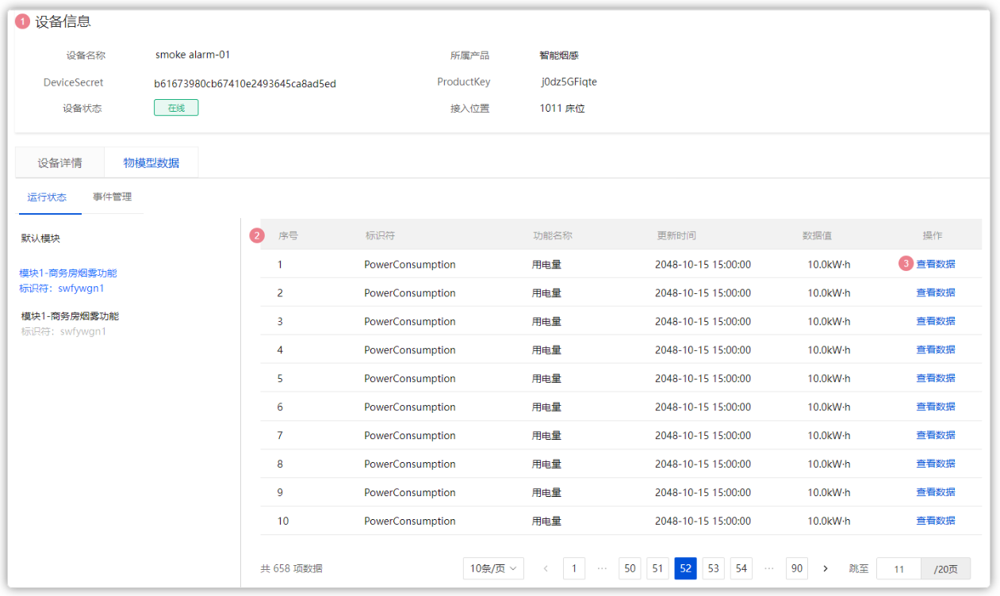

其中的数据值，是从IOT平台实时获取到的数据值

当点击了某个功能（物模型）的**查看数据**按钮，则会显示这个功能的历史数据，可以按照时间范围进行检索，如下图：

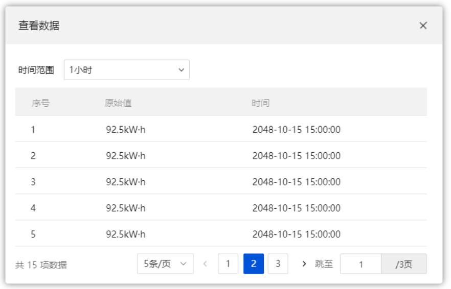

时间范围=1小时、24小时、7天


### 接口定义

参考接口文档：<cite doc-id="ZE21wkv5QiuaWzkbjejcYZIDnvf" file-type="wiki" title="智能监测-接口文档" type="doc"></cite>

### 功能实现

#### 接口定义

在DeviceDataController ，改造查询数据的方法，如下：

```Java
/**
 * 查询设备数据列表
 */
@PreAuthorize("@ss.hasPermi('elder:data:list')")
@GetMapping("/list")
@ApiOperation("查询设备数据列表")
public TableDataInfo list(DeviceDataPageReqDto deviceDataPageReqDto)
{
    return deviceDataService.selectDeviceDataList(deviceDataPageReqDto);
}

/**
 * 导出设备数据列表   删除这个方法
 */
@ApiOperation("导出设备数据列表")
@PreAuthorize("@ss.hasPermi('nursing:deviceData:export')")
@Log(title = "设备数据", businessType = BusinessType.EXPORT)
@PostMapping("/export")
public void export(HttpServletResponse response, DeviceData deviceData)
{
    List<DeviceData> list = deviceDataService.selectDeviceDataList(deviceData);
    ExcelUtil<DeviceData> util = new ExcelUtil<DeviceData>(DeviceData.class);
    util.exportExcel(response, list, "设备数据数据");
}
```

DeviceDataPageReqDto 

```Java
package com.zzyl.nursing.dto;

import io.swagger.annotations.ApiModel;
import io.swagger.annotations.ApiModelProperty;
import lombok.Data;
import org.springframework.format.annotation.DateTimeFormat;

import java.time.LocalDateTime;

@Data
@ApiModel("设备数据分页查询请求模型")
public class DeviceDataPageReqDto {

    @ApiModelProperty(value = "设备名称", required = false)
    private String deviceName;

    @ApiModelProperty(value = "功能ID", required = false)
    private String functionId;

    @ApiModelProperty(value = "开始时间", required = false)
    @DateTimeFormat(pattern = "yyyy-MM-dd HH:mm:ss")
    private LocalDateTime startTime;

    @ApiModelProperty(value = "结束时间", required = false)
    @DateTimeFormat(pattern = "yyyy-MM-dd HH:mm:ss")
    private LocalDateTime endTime;

    @ApiModelProperty(value = "页码", required = true, example = "1")
    private Integer pageNum;

    @ApiModelProperty(value = "页面大小", required = true, example = "10")
    private Integer pageSize;

}
```

#### 业务层

在IDeviceDataService接口，改造分页查询方法，代码如下：

```Java
/**
 * 查询设备数据列表
 * 
 * @param deviceDataPageReqDto 设备数据
 * @return 设备数据集合
 */
public TableDataInfo selectDeviceDataList(DeviceDataPageReqDto deviceDataPageReqDto);
```

实现方法：

```Java
/**
 * 查询设备数据列表
 * 
 * @param dto 设备数据
 * @return 设备数据
 */
@Override
public TableDataInfo selectDeviceDataList(DeviceDataPageReqDto dto){

    LambdaQueryWrapper<DeviceData> lambdaQueryWrapper =  new LambdaQueryWrapper<>();
    Page<DeviceData> page = new Page(dto.getPageNum(),dto.getPageSize());
    //模糊查询设备名称
    if(StringUtils.isNotEmpty(dto.getDeviceName())){
        lambdaQueryWrapper.eq(DeviceData::getDeviceName,dto.getDeviceName());
    }
    //精确查询功能名称
    if (StringUtils.isNotEmpty(dto.getFunctionId())) {
        lambdaQueryWrapper.eq(DeviceData::getFunctionId, dto.getFunctionId());
    }
    //时间范围查询
    if(ObjectUtils.isNotEmpty(dto.getStartTime()) && ObjectUtils.isNotEmpty(dto.getEndTime())){
        lambdaQueryWrapper.between(DeviceData::getAlarmTime,dto.getStartTime(),dto.getEndTime());
    }

    //分页查询
    page = page(page,lambdaQueryWrapper);

    //封装分页对象
    return getTableDataInfo(page);

}

/**
 * 封装分页对象
 * @param page
 * @return
 */
@NotNull
private static TableDataInfo getTableDataInfo(Page<DeviceData> page) {
    TableDataInfo tableData = new TableDataInfo();
    tableData.setCode(HttpStatus.SUCCESS);
    tableData.setMsg("查询成功");
    tableData.setRows(page.getRecords());
    tableData.setTotal(page.getTotal());
    return tableData;
}
```

#### 测试

找到设备详情-->物模型数据-->点击**查看数据**按钮

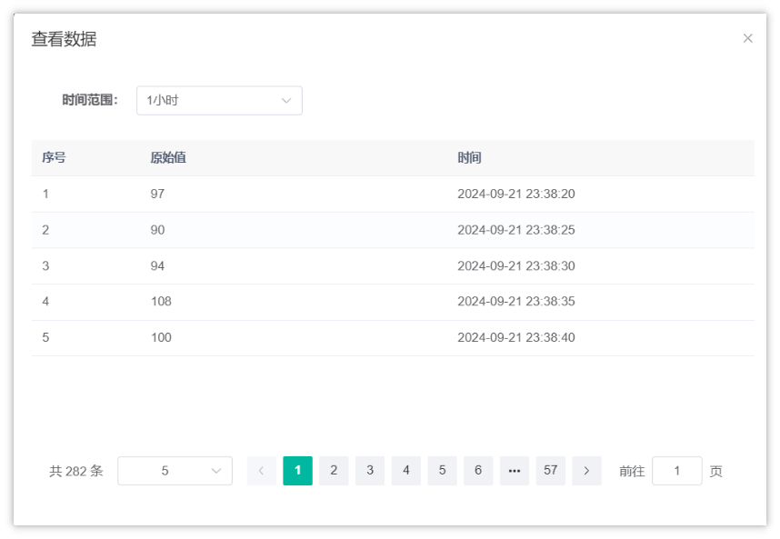

### 数据清理（作业）

- 要求：只保留最近两周的数据
- 定时任务，每天删除，删除大于15天的数据

---
> 来源：飞书技术知识库（脱敏版） · 07 业务组件方案集 / 中州养老项目（若依+AI） / 第四章-智能监测系统（华为云） / 02-数据处理和展示 · [原文](https://ccn8v2zngwsm.feishu.cn/wiki/UDm9w4JSJiPJmek1uLQcDe8Lncf)
