# 报警通知提醒

## 需求说明

当设备中的数据触发了报警规则之后，需要及时提醒相关人员来进行处理，为了更快的让相对应的负责人收到消息，一旦监测到有异常数据，可以在当前后台管理系统中进行通知，如下效果：

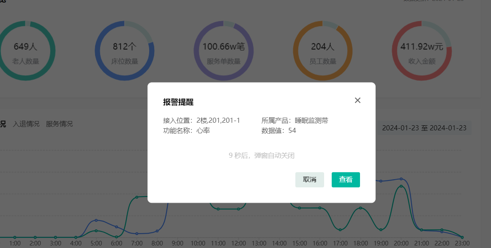

要想实现这个功能，我们需要使用一个符合该场景的技术来解决，就是下面要讲的websocket

## Websocket

### 概述

WebSocket 是基于 TCP 的一种新的**网络协议**。它实现了浏览器与服务器全双工通信——浏览器和服务器只需要完成一次握手，两者之间就可以创建**持久性**的连接， 并进行**双向**数据传输。

**HTTP协议和WebSocket协议对比：**

- HTTP是**短连接**
- WebSocket是**长连接**
- HTTP通信是**单向**的，基于请求响应模式
- WebSocket支持**双向**通信
- HTTP和WebSocket底层都是TCP连接

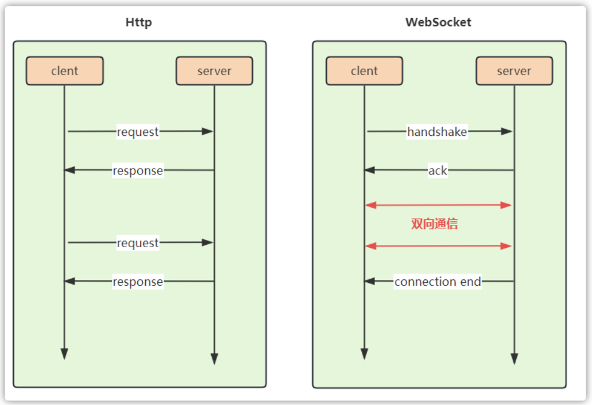

**思考：**既然WebSocket支持双向通信，功能看似比HTTP强大，那么我们是不是可以基于WebSocket开发所有的业务功能？

**WebSocket缺点：**

服务器长期维护长连接需要一定的成本

各个浏览器支持程度不一

WebSocket 是长连接，受网络限制比较大，需要处理好重连

**结论：**WebSocket并不能完全取代HTTP，它只适合在特定的场景下使用

### 使用场景

1). 视频弹幕

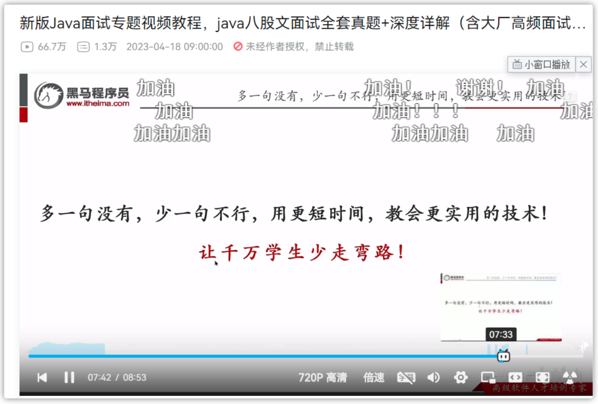

2). 网页聊天

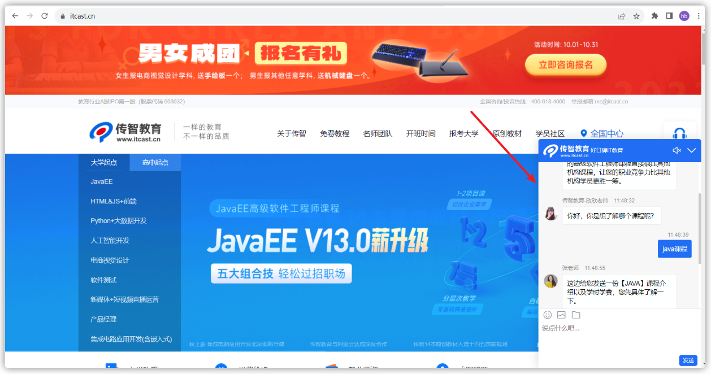

3). 体育实况更新

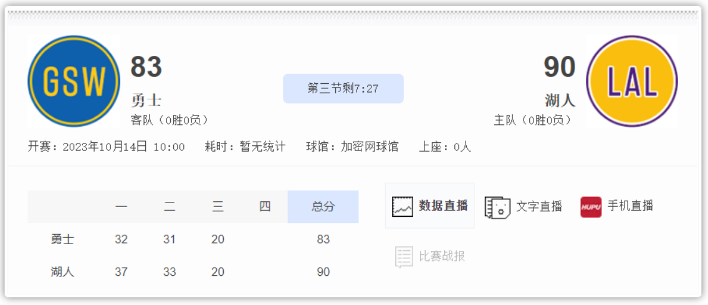

### 入门案例

（1）需求说明

实现浏览器与服务器全双工通信。浏览器既可以向服务器发送消息，服务器也可主动向浏览器推送消息。

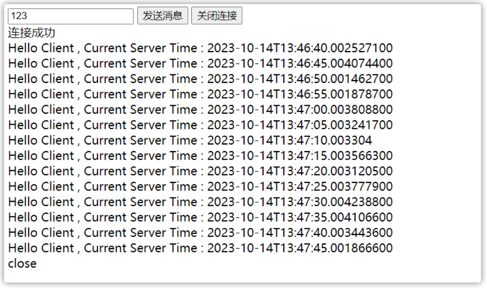

（2）流程如下

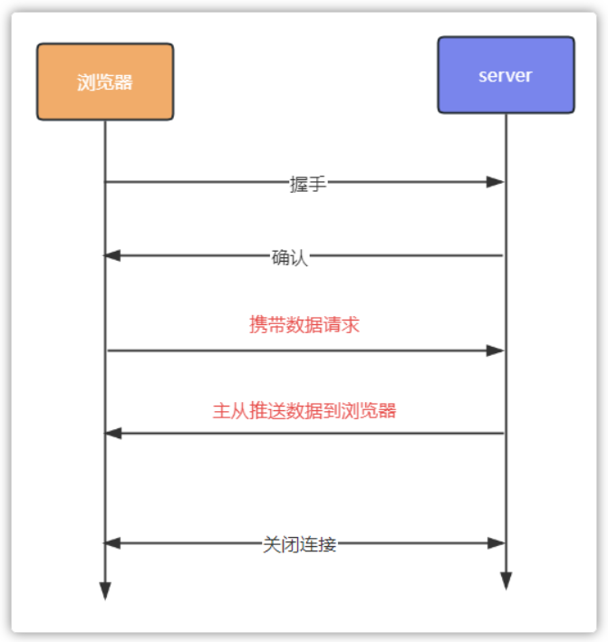

- 需要准备客户端，可以在浏览器上编写客户端
- 服务端，使用java代码实现，启动一个服务
- 客户端与服务端连接成功以后

  - 客户端可以发送数据到服务器端
  - 服务器端也可以发送数据到客户端（浏览器）

（3）功能实现

**客户端**

定义websocket.html页面充当客户端（资料中已提供）

```HTML
<!DOCTYPE HTML>
<html>
<head>
    <meta charset="UTF-8">
    <title>WebSocket Demo</title>
</head>
<body>
    <input id="text" type="text" />
    <button onclick="send()">发送消息</button>
    <button onclick="closeWebSocket()">关闭连接</button>
    <div id="message">
    </div>
</body>
<script type="text/javascript">
    var websocket = null;
    var clientId = Math.random().toString(36).substr(2);

    // 判断当前浏览器是否支持WebSocket
    if('WebSocket' in window) {
        // 连接WebSocket节点
        websocket = new WebSocket("ws://localhost:8080/ws/" + clientId);
    }
    else {
        alert('Not support websocket');
    }

    // 连接发生错误的回调方法
    websocket.onerror = function() {
        setMessageInnerHTML("error");
    };

    // 连接成功建立的回调方法
    websocket.onopen = function() {
        setMessageInnerHTML("连接成功");
    }

    // 接收到消息的回调方法
    websocket.onmessage = function(event) {
        setMessageInnerHTML(event.data);
    }

    // 连接关闭的回调方法
    websocket.onclose = function() {
        setMessageInnerHTML("close ");
    }

    // 监听窗口关闭事件，当窗口关闭时，主动去关闭websocket连接，防止连接还没断开就关闭窗口，server端会抛异常。
    window.onbeforeunload = function() {
        websocket.close();
    }

    // 将消息显示在网页上
    function setMessageInnerHTML(innerHTML) {
        document.getElementById('message').innerHTML += innerHTML + '<br/>';
    }

    // 发送消息
    function send() {
        var message = document.getElementById('text').value;
        websocket.send(message);
    }
        
    // 关闭连接
    function closeWebSocket() {
        websocket.close();
    }
</script>
</html>
```

**服务端**

然后导入依赖

```XML
<dependency>
    <groupId>org.springframework.boot</groupId>
    <artifactId>spring-boot-starter-websocket</artifactId>
</dependency>
```

定义配置类，注册WebSocket的服务端组件(从资料中直接导入即可)

```Java
package com.itheima.config;

import org.springframework.context.annotation.Bean;
import org.springframework.context.annotation.Configuration;
import org.springframework.web.socket.server.standard.ServerEndpointExporter;

@Configuration
public class WebSocketConfig {

    /**
     * 注册基于@ServerEndpoint声明的Websocket Endpoint
     * @return
     */
    @Bean
    public ServerEndpointExporter serverEndpointExporter() {
        return new ServerEndpointExporter();
    }

}
```

定义WebSocket服务端组件(资料中已提供)

```Java
package com.itheima.config;

import lombok.extern.slf4j.Slf4j;
import org.springframework.stereotype.Component;
import org.springframework.util.CollectionUtils;

import javax.websocket.*;
import javax.websocket.server.PathParam;
import javax.websocket.server.ServerEndpoint;
import java.io.IOException;
import java.util.Collection;
import java.util.HashMap;
import java.util.Map;

@Slf4j
@Component
@ServerEndpoint("/ws/{sid}")
public class WebSocketServer {

    private static Map<String,Session> sessionMap = new HashMap<>();

    /**
     * 连接建立时触发
     * @param session
     * @param sid
     */
    @OnOpen
    public void onOpen(Session session , @PathParam("sid") String sid) {
        log.info("有客户端连接到了服务器 , {}", sid);
        sessionMap.put(sid, session);
    }

    /**
     * 服务端接收到消息时触发
     * @param session
     * @param message
     * @param sid
     */
    @OnMessage
    public void onMessage(Session session , String message, @PathParam("sid") String sid) {
        log.info("接收到了客户端 {} 发来的消息 : {}", sid ,message);
    }

    /**
     * 连接关闭时触发
     * @param session
     * @param sid
     */
    @OnClose
    public void onClose(Session session , @PathParam("sid") String sid) {
        System.out.println("连接断开:" + sid);
        sessionMap.remove(sid);
    }

    /**
     * 通信发生错误时触发
     * @param session
     * @param sid
     * @param throwable
     */
    @OnError
    public void onError(Session session , @PathParam("sid") String sid , Throwable throwable) {
        System.out.println("出现错误:" + sid);
        throwable.printStackTrace();
    }

    /**
     * 广播消息
     * @param message
     * @throws IOException
     */
    public void sendMessageToAll(String message) throws IOException {
        Collection<Session> sessions = sessionMap.values();
        if(!CollectionUtils.isEmpty(sessions)) {
            for (Session session : sessions) {
                // 服务器向客户端发送消息
                session.getBasicRemote().sendText(message);
            }
        }
    }
}
```

定义定时任务类，定时向客户端推送数据

```Java
package com.itheima.job;

import com.itheima.config.WebSocketServer;
import org.springframework.beans.factory.annotation.Autowired;
import org.springframework.scheduling.annotation.Scheduled;
import org.springframework.stereotype.Component;

import java.io.IOException;
import java.time.LocalDateTime;

/**
 * @author sjqn
 */
@Component
public class MessageTask {

    @Autowired
    private WebSocketServer webSocketServer;

    @Scheduled(cron = "0/5 * * * * ?")
    public void sendMessageToAllClient() throws IOException {
        webSocketServer.sendMessageToAll("Hello Client , Current Server Time : " + LocalDateTime.now());
    }
}
```

**测试**

启动后端服务，打开浏览器即可成功，在浏览器中可以看到服务器端推送的数据，浏览器也可以发送数据到服务器端

客户端的效果：

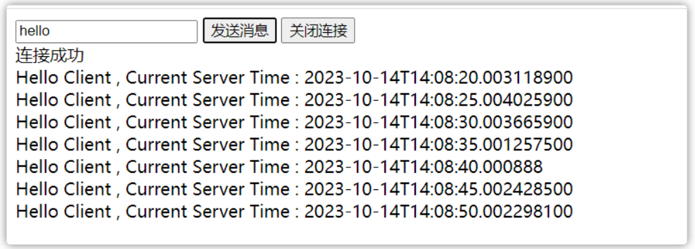

服务端接收到的数据，在控制台打印

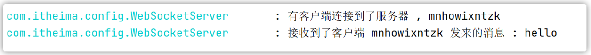

## 功能实现

### 实现思路

<whiteboard token="UnBqwFzWahL9WubYbrZcVWFLnEe"></whiteboard>

### 环境集成

依据我们刚才做过的websocket入门案例，把websocket集成到我们的项目中

#### 导入依赖

在zzyl-nursing-platform中如导入以下依赖

```Java
 <dependency>
     <groupId>org.springframework.boot</groupId>
     <artifactId>spring-boot-starter-websocket</artifactId>
 </dependency>
```

#### 定义WebSocket服务和注册WebSocket

配置类：

```Java
package com.zzyl.nursing.config;

import org.springframework.context.annotation.Bean;
import org.springframework.context.annotation.Configuration;
import org.springframework.web.socket.server.standard.ServerEndpointExporter;

@Configuration
public class WebSocketConfig {

    /**
     * 注册基于@ServerEndpoint声明的Websocket Endpoint
     * @return
     */
    @Bean
    public ServerEndpointExporter serverEndpointExporter() {
        return new ServerEndpointExporter();
    }

}
```

WebSocketServer 

```Java
package com.zzyl.nursing.config;

import cn.hutool.core.collection.CollUtil;
import cn.hutool.core.util.ObjectUtil;
import cn.hutool.json.JSONUtil;
import com.zzyl.common.exception.base.BaseException;
import com.zzyl.nursing.vo.AlertNotifyVo;
import lombok.extern.slf4j.Slf4j;
import org.springframework.stereotype.Component;
import org.springframework.util.CollectionUtils;
import org.springframework.web.socket.config.annotation.EnableWebSocket;

import javax.websocket.*;
import javax.websocket.server.PathParam;
import javax.websocket.server.ServerEndpoint;
import java.io.IOException;
import java.util.Collection;
import java.util.HashMap;
import java.util.List;
import java.util.Map;

@Slf4j
@Component
@EnableWebSocket
@ServerEndpoint("/ws/{sid}")
public class WebSocketServer {

    private static Map<String, Session> sessionMap = new HashMap<>();

    /**
     * 连接建立时触发
     *
     * @param session
     * @param sid
     */
    @OnOpen
    public void onOpen(Session session, @PathParam("sid") String sid) {
        log.info("有客户端连接到了服务器 , {}", sid);
        sessionMap.put(sid, session);
    }

    /**
     * 服务端接收到消息时触发
     *
     * @param session
     * @param message
     * @param sid
     */
    @OnMessage
    public void onMessage(Session session, String message, @PathParam("sid") String sid) {
        log.info("接收到了客户端 {} 发来的消息 : {}", sid, message);
    }

    /**
     * 连接关闭时触发
     *
     * @param session
     * @param sid
     */
    @OnClose
    public void onClose(Session session, @PathParam("sid") String sid) {
        System.out.println("连接断开:" + sid);
        sessionMap.remove(sid);
    }

    /**
     * 通信发生错误时触发
     *
     * @param session
     * @param sid
     * @param throwable
     */
    @OnError
    public void onError(Session session, @PathParam("sid") String sid, Throwable throwable) {
        System.out.println("出现错误:" + sid);
        throwable.printStackTrace();
    }

    /**
     * 广播消息
     *
     * @param message
     * @throws IOException
     */
    public void sendMessageToAll(String message) throws IOException {
        Collection<Session> sessions = sessionMap.values();
        if (!CollectionUtils.isEmpty(sessions)) {
            for (Session session : sessions) {
                //服务器向客户端发送消息
                session.getBasicRemote().sendText(message);
            }
        }
    }

    /**
     * 发送websocket消息给指定消费者
     *
     * @param alertNotifyVo 报警消息
     * @param userIds   报警数据map
     * @throws IOException io异常
     */
    public void sendMessageToConsumer(AlertNotifyVo alertNotifyVo, Collection<Long> userIds) {
        // 如果消费者为空，程序结束
        if (CollUtil.isEmpty(userIds)) {
            return;
        }

        // 如果websoket客户端为空，程序结束
        if (ObjectUtil.isEmpty(sessionMap)) {
            return;
        }

        // 遍历消费者，发送消息
        // key为消息接收人id，value为报警数据id
        userIds.forEach(userId -> {
            // 获取该消费者的websocket连接，如果不存在，跳出本次循环
            Session session = sessionMap.get(String.valueOf(userId));
            if (ObjectUtil.isEmpty(session)) {
                return;
            }
            // 获取该消费者的websocket连接，并发送消息
            try {
                session.getBasicRemote().sendText(JSONUtil.toJsonStr(alertNotifyVo));
            } catch (IOException e) {
                throw new BaseException("websocket推送消息失败");
            }
        });
    }

}
```

消息通知vo

```Java
package com.zzyl.nursing.vo;

import lombok.AllArgsConstructor;
import lombok.Builder;
import lombok.Data;
import lombok.NoArgsConstructor;

/**
 * 报警通知消息对象
 *
 **/
@Data
@Builder
@NoArgsConstructor
@AllArgsConstructor
public class AlertNotifyVo {
    /**
     * 报警数据id
     */
    private Long id;

    /**
     * 接入位置
     */
    private String accessLocation;

    /**
     * 位置类型 0：随身设备 1：固定设备
     */
    private Integer locationType;

    /**
     * 物理位置类型 0楼层 1房间 2床位
     */
    private Integer physicalLocationType;

    /**
     * 设备位置
     */
    private String deviceDescription;

    /**
     * 产品名称
     */
    private String productName;

    /**
     * 功能名称
     */
    private String functionName;

    /**
     * 数据值
     */
    private String dataValue;

    /**
     * 报警数据类型，0：老人异常数据，1：设备异常数据
     */
    private Integer alertDataType;

    /**
     * 语音通知状态，0：关闭，1：开启
     */
    private Integer voiceNotifyStatus;

    /**
     * 报警通知类型，0：解除报警，1：报警
     */
    private Integer notifyType;

    /**
     * 是否全员通知<br>
     * 智能床位的报警消息是全员通知，对于护理员和固定设备维护人员不是全员通知
     */
    private Boolean isAllConsumer;
}
```


#### 报警数据推送到前端

修改AlertRuleServiceImpl类，添加推送数据逻辑

```Java
/**
 * 设备数据匹配过滤规则
 * @param deviceData
 * @param rule
 */
private void deviceDataAlarmHandler(DeviceData deviceData, AlertRule rule) {

    // 判断上报的数据是否在生效时段内  00:00:00~23:59:59    00:05:00~22:59:59
    String[] split = rule.getAlertEffectivePeriod().split("~");
    LocalTime startTime = LocalTime.parse(split[0]);
    LocalTime endTime = LocalTime.parse(split[1]);
    // 数据上报的时间
    LocalTime localTime = deviceData.getAlarmTime().toLocalTime();
    // 如果上报的时间不在生效时段内，则结束请求
    if(localTime.isBefore(startTime) || localTime.isAfter(endTime)){
        return;
    }

    // 统计次数的key
    String aggCountKey = CacheConstants.IOT_COUNT_ALERT+deviceData.getIotId()+":"+deviceData.getFunctionId()+":"+rule.getId();

    // 判断上报的数据是否达到了规则的阈值
    Double dataValue = Double.valueOf(deviceData.getDataValue());
    Double value = rule.getValue();
    // 工具类x,y（顺序有要求，左边是上报的数据，后边是规则定义的数据）  x等于y 返回0  x>y  返回大于0的值   x<y  返回小于0的值
    int compare = NumberUtil.compare(dataValue, value);
    if((rule.getOperator().equals(">=") && compare >= 0) || (rule.getOperator().equals("<") && compare < 0)) {
        // 符合上报的规则，产生了异常数据
        log.info("当前数据符合报警规则");
    } else {
        log.info("正常上报的数据");
        redisTemplate.delete(aggCountKey);
        return;
    }

    // 沉默周期  持续周期
    // 设计一个redis的可以，必须唯一，代表的当前的设备、物模型、规则ID
    String silentKey = CacheConstants.IOT_SILENT_ALERT+deviceData.getIotId()+":"+deviceData.getFunctionId()+":"+rule.getId();
    // 获取沉默周期
    String silentData = redisTemplate.opsForValue().get(silentKey);
    if(StringUtils.isNotEmpty(silentData)) {
        return;
    }
    // 持续周期

    String aggCountData = redisTemplate.opsForValue().get(aggCountKey);
    Integer count = StringUtils.isEmpty(aggCountData)? 1 : (Integer.parseInt(aggCountData) + 1);
    // 当前count不等于持续周期，就累加数据，并且结束请求
    if(ObjectUtil.notEqual(count,rule.getDuration())) {
        // 累加数据
        redisTemplate.opsForValue().set(aggCountKey,count+"");
        return;
    }
    // 到了报警的条件了，保存一份沉默周期
    redisTemplate.opsForValue().set(silentKey,"1", rule.getAlertSilentPeriod(), TimeUnit.MINUTES);
    // 删除统计的次数
    redisTemplate.delete(aggCountKey);

    // 保存异常数据
    // 判断上报数据的设备的类型，如果老人的异常数据（手表、睡眠检测带） 设备异常（烟雾报警）
    List<Long> userIds = new ArrayList<>();
    if(rule.getAlertDataType().equals(0)) {
        // 老人异常（手表、睡眠检测带）  设备id-->设备-->老人id--->护理员
        if(deviceData.getLocationType().equals(0)) {
            // 随身设备
            userIds = deviceMapper.selectNursingIdsByIotIdWithElder(deviceData.getIotId());
        }else if(deviceData.getLocationType().equals(1) && deviceData.getPhysicalLocationType().equals(2)){
            // 床位设备  设备id-->设备-->床位-->老人id--->护理员
            userIds = deviceMapper.selectNursingIdsByIotIdWithBed(deviceData.getIotId());
        }
    }else {
        // 设备异常  找维修人员   通过角色名称（维修工）   用户  角色  用户角色中间表
        userIds = sysUserRoleMapper.selectByRoleName("维修工");
    }
    // 找到超级管理员
    List<Long> managerIds = sysUserRoleMapper.selectByRoleName("超级管理员");
    // 合并两份用户id
    Collection<Long> allUserIds = CollUtil.addAll(userIds, managerIds);
    // 去重
    allUserIds = CollUtil.distinct(allUserIds);

    // 批量保存异常数据
    List<AlertData> alertDataList = insertAlertData(allUserIds, deviceData, rule);

    // websocket推送消息
    websocketNotity(alertDataList.get(0), rule, allUserIds);


}

@Autowired
private WebSocketServer webSocketServer;

/**
 * websocket推送消息
 * @param alertData
 * @param rule
 * @param allUserIds
 */
private void websocketNotity(AlertData alertData, AlertRule rule, Collection<Long> allUserIds) {

    // 属性拷贝
    AlertNotifyVo alertNotifyVo = BeanUtil.toBean(alertData, AlertNotifyVo.class);
    alertNotifyVo.setFunctionName(rule.getFunctionName());
    alertNotifyVo.setAlertDataType(rule.getAlertDataType());
    alertNotifyVo.setNotifyType(1);
    // 向指定的人推送消息
    webSocketServer.sendMessageToConsumer(alertNotifyVo, allUserIds);

}

@Autowired
private IAlertDataService alertDataService;

/**
 * 保存异常数据
 * @param allUserIds
 * @param deviceData
 * @param rule
 */
private List<AlertData> insertAlertData(Collection<Long> allUserIds, DeviceData deviceData, AlertRule rule) {

    // 属性拷贝，从deviceData拷贝到alertData
    AlertData alertData = BeanUtil.toBean(deviceData, AlertData.class);
    // 关于规则的数据都拷贝不过去
    alertData.setAlertRuleId(rule.getId());
    // 功能名称+运算符+阈值+持续周期+聚合周期
    String reason = CharSequenceUtil.format("{}{}{},持续了{}周期，就报警",rule.getFunctionId(),
            rule.getOperator(),rule.getValue(),rule.getDuration());
    alertData.setAlertReason(reason);
    // 报警状态
    alertData.setStatus(0);
    alertData.setType(rule.getAlertDataType());
    // 批量保存数据了，由于多个人
    List<AlertData> list = allUserIds.stream().map(userId -> {
        // 再次拷贝
        AlertData dBalertData = BeanUtil.toBean(alertData, AlertData.class);
        dBalertData.setUserId(userId);
        dBalertData.setId(null);
        return dBalertData;

    }).collect(Collectors.toList());
    // 批量保存
    alertDataService.saveBatch(list);

    return list;
}
```

由于前端也要发请求到后端建立连接，需要在spring security中对于**ws**的请求放行

放行代码

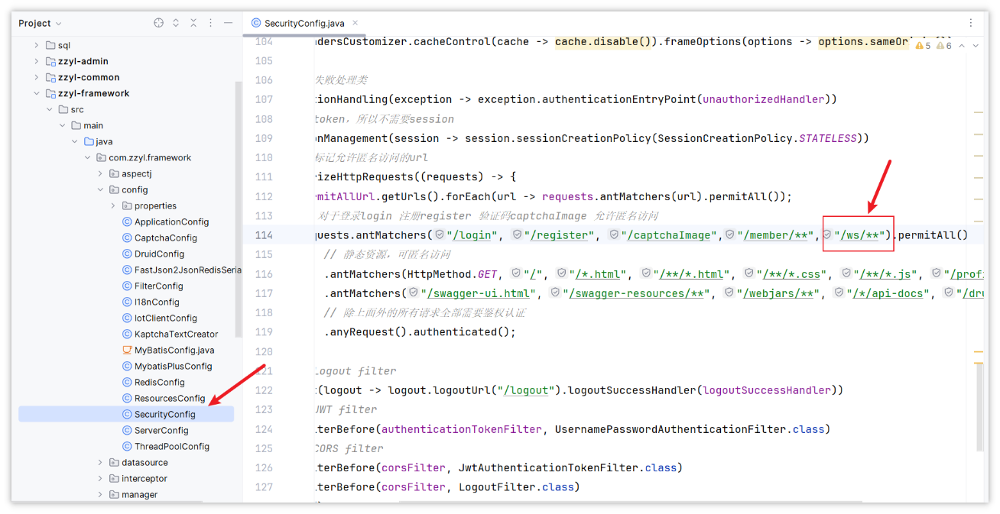


#### 前端环境配置

用资料中提供的index.vue替换src/layout目录下的index.vue，

修改前端的ws的连接地址：

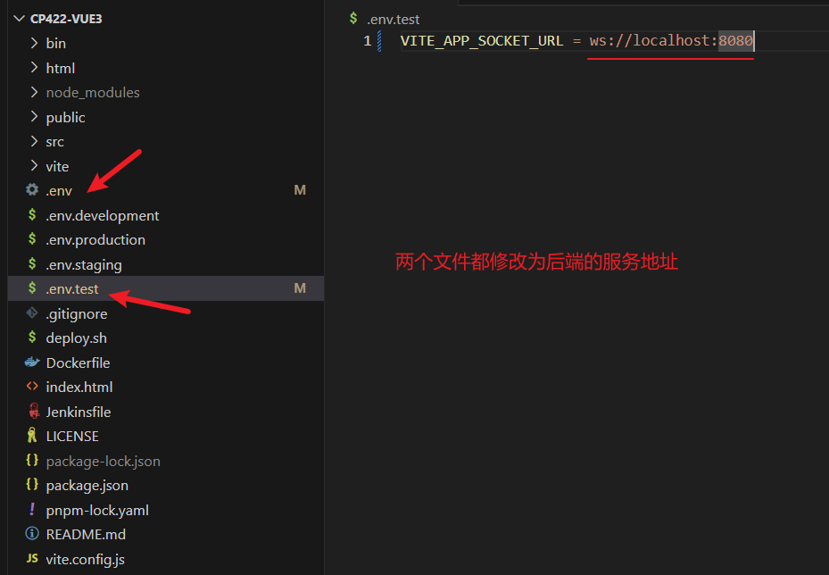

**注意：是ws不是wss**

#### 测试

- 创建一个报警规则，启动模拟上报符合规则的物模型数据
- 查看上报数据需要通知的人

  - 使用任意一个被通知的人登录后台管理系统
  - 当有异常数据之后会在前端进行弹窗提示

---
> 来源：飞书技术知识库（脱敏版） · 07 业务组件方案集 / 中州养老项目（若依+AI） / 第四章-智能监测系统（华为云） / 报警通知提醒 · [原文](https://ccn8v2zngwsm.feishu.cn/wiki/SDN9wC9lyiQZFHkI6FxcbvIXnad)
