# 第五章-分组实战

## 实战要求

### 分组规则

- 大组拆为小组，小组人数：不超过5人（最多5人，至少4人）
- 就近原则：优先同桌临近，然后前后桌临近，不允许跨排分组
- 组长：组内自行选举一名组长，如果选举不出来，找老师进行指定
- 其他情况，由大组长解决或找老师协调解决
- 每个小组都要完成苍穹外卖和中州的代码

### 组长责任

- 管理和协调组内成员，组织团队成员业务或技术讨论
- 合理安排任务，推进业务开发
- 制定开发计划，参考开发计划：<cite doc-id="Xo8Xw0ac0iQwubkY3Bic7nerndd" file-type="wiki" title="开发计划" type="doc"></cite>

### git仓库要求

- 由组长在gitee中创建一个仓库，上传基础代码（今天资料已提供）
- 添加组内成员对仓库拥有开发权限或者管理权限（一个账号最多可以添加5人进行开发）
- 分支管理

  - 组内开发人员每人基于master分支创建一个分支，以自己的名字命名（例子：dev-lichuanbo）
  - 组内开发人员完成任务后提交代码到自己的分支，所有成员完成开发后，合并分支代码到dev-nursing
  - 合并分支dev-nursing之后，小组内部进行测试（功能测试，代码测试），测试都通过后，把dev-nursing分支合并到master分支

<whiteboard token="L76iwr6Mlhmo0IbB8sZcn5R3nPf"></whiteboard>

### 小组提交物料及答辩

- 代码：gitee代码仓库地址（需开源）

### 其他要求

- 老师就是产品经理，同学们有任何有疑惑的需求，都可以找老师沟通
- 技术求助：优先团队内部解决，原则上老师不帮助任何团队解决技术问题及bug


## 小程序端需求

### 需求说明

1. 绑定家人


**家人姓名**和**身份证号**必须是养老院入住的老人


1. 家人列表


- 其中展示**健康数据**按钮的前提是，该老人必须绑定手表设备
- 点击**解绑**按钮，可以解绑老人


1. 健康数据

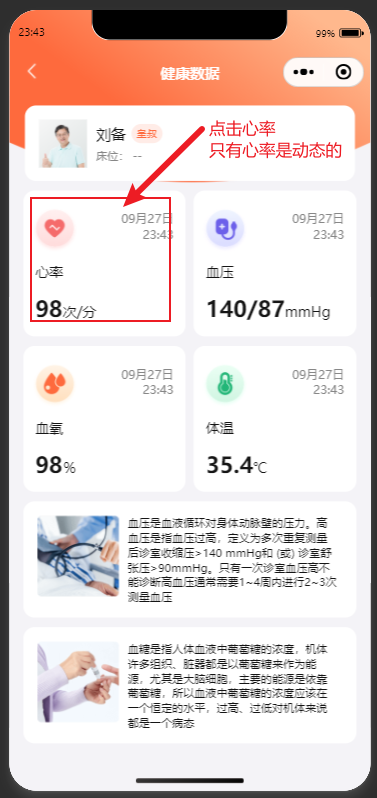


1. 按天统计查询指标数据

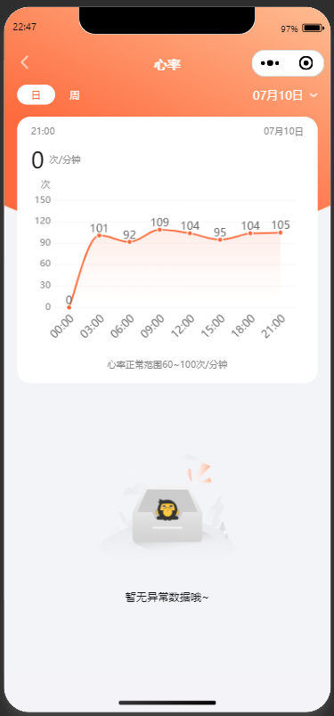


1. 按周统计查询指标数据

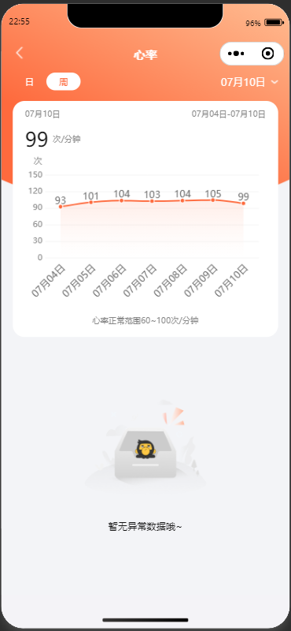


### 表结构

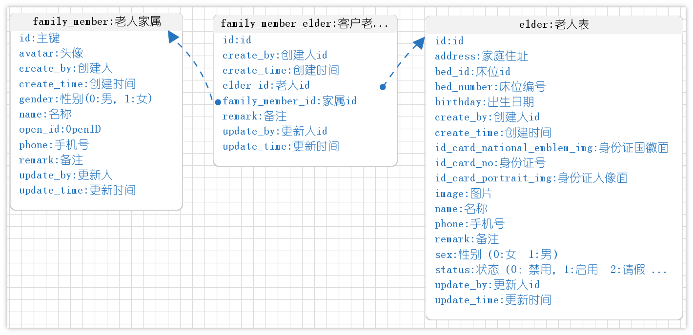

### 接口文档

<cite doc-id="D1dLwl8EOiuXZSk2wlOcYfxznvg" file-type="wiki" title="接口文档" type="doc"></cite>


## 后台管理系统-报警数据

### 需求说明

1. 列表展示

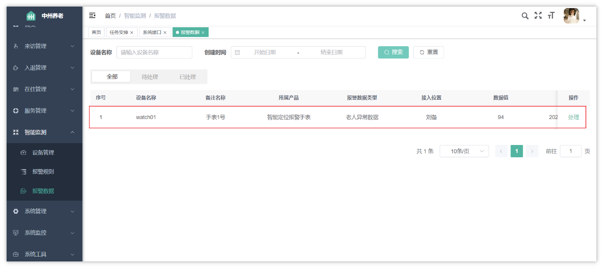

- 注意：只有负责该老人的护理员才能看到报警数据


1. 处理数据

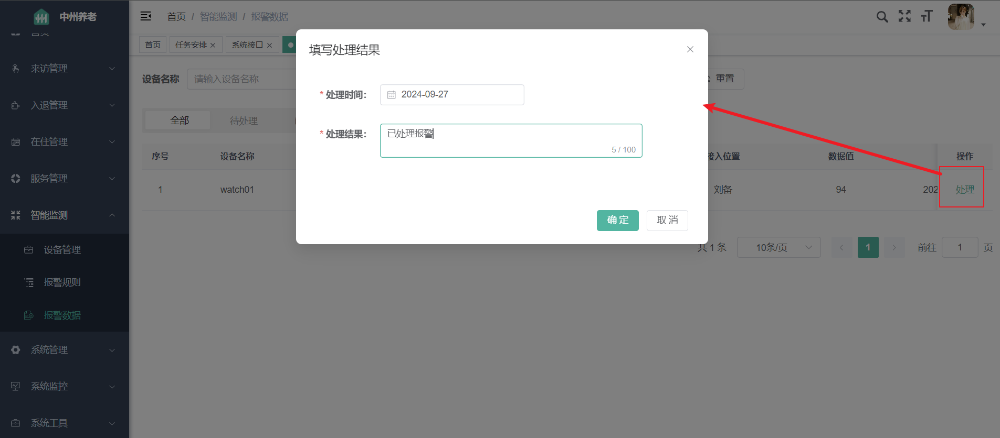

处理后的效果：

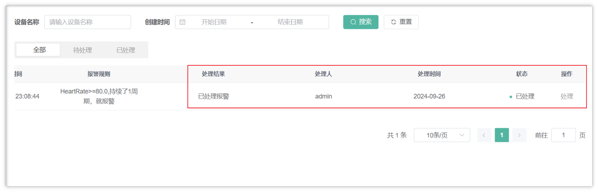

- 如果老人被多个护理员负责，那么多个护理员都可以看到这条数据
- 当其中一个护理员处理数据之后，其他负责的护理员也会展示**已处理**

### 接口文档

<cite doc-id="D1dLwl8EOiuXZSk2wlOcYfxznvg" file-type="wiki" title="接口文档" type="doc"></cite>

## 后台管理系统-护理任务

### 需求说明

护理任务的来源是服务计划内的任务，服务计划内的任务是根据老人所属服务等级的服务计划，每日自动生成的任务；护理人员可在任务安排页面查看指定日期，待执行/已执行的任务，若有特殊情况可取消任务，执行完任务后，可上传执行图片并填写执行记录；


1. 护理任务查询

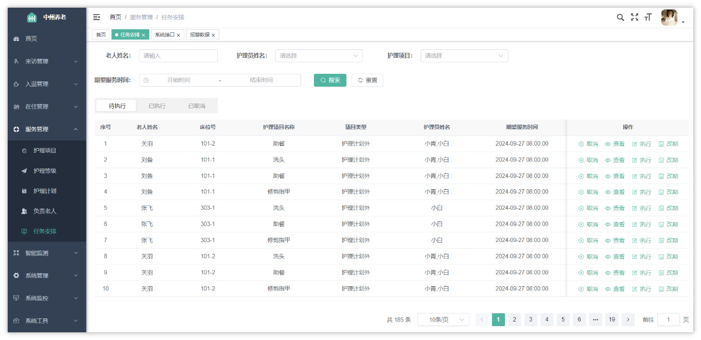

- 在这个页面中，条件众多，并且在列表的返回值中，需要重点分析所要展示的字段（结合接口文档）
- 对于任务，可以**取消、查看、执行、改期**


1. 取消

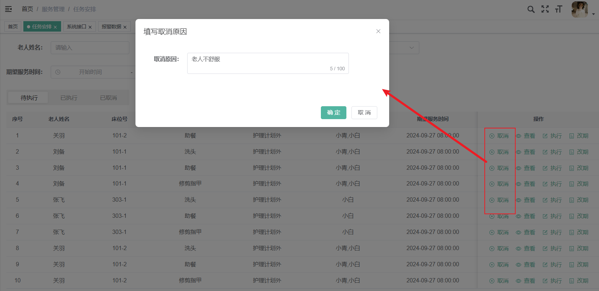

1. 执行

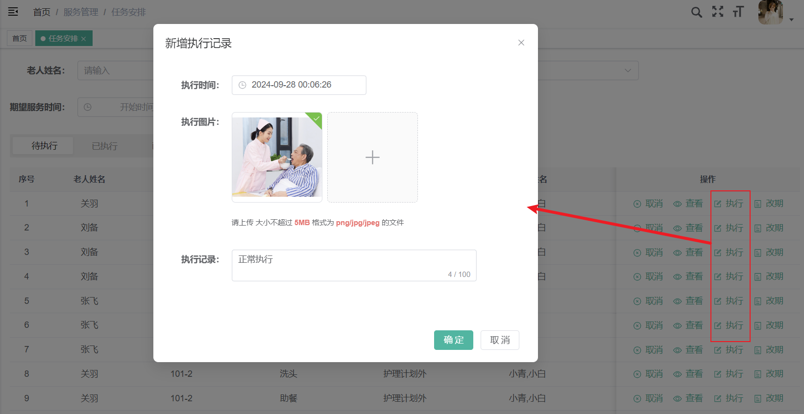

1. 改期

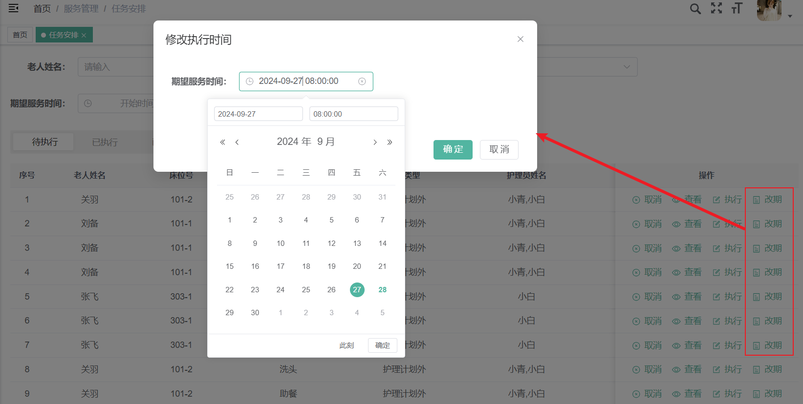

1. 查看

查看了分了多种情况，根据不同的状态展示的内容有差别

- 待执行的任务

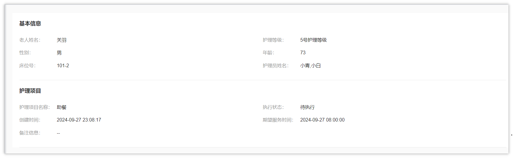

- 执行后的任务

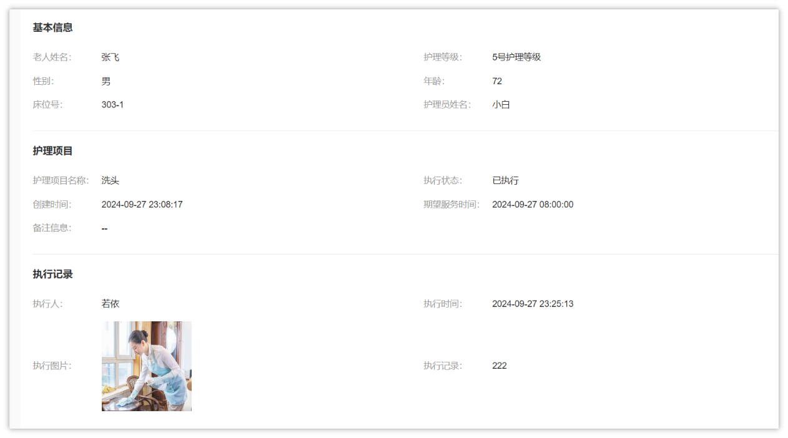

- 取消的任务

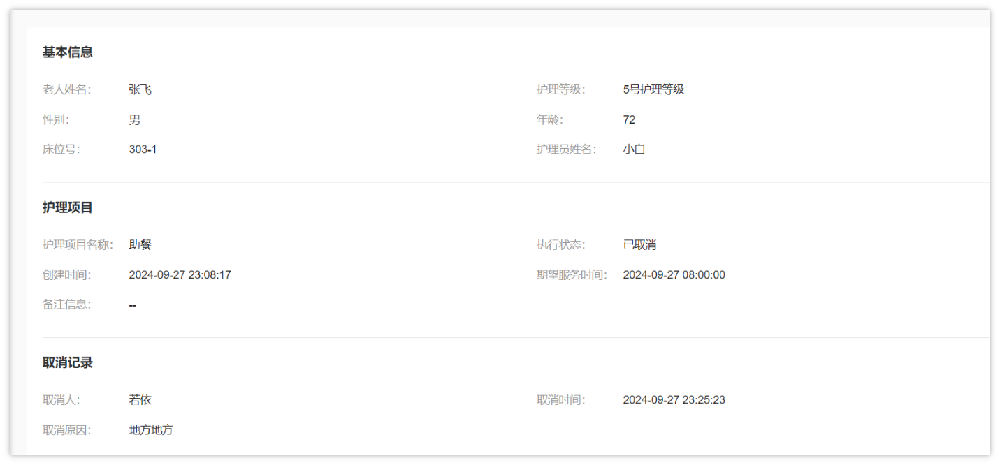

### 表结构

护理任务表结构

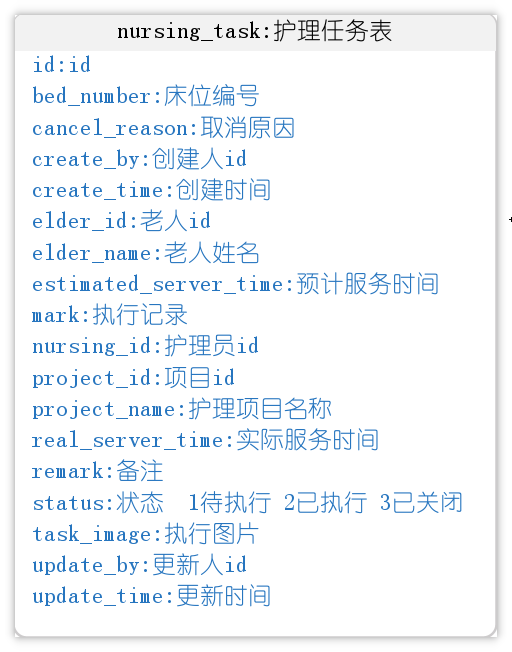

注意：其中字段nursing_id类型为字符串，可以存多个护理员ID,比如：`103,104`

护理任务建表语句（提供的全量SQL脚本中已包含，无需再次执行）：

```SQL
DROP TABLE IF EXISTS `nursing_task`;

CREATE TABLE `nursing_task` (
  `id` bigint NOT NULL AUTO_INCREMENT COMMENT 'id',
  `nursing_id` varchar(50) DEFAULT NULL COMMENT '护理员id',
  `project_id` int NOT NULL COMMENT '项目id',
  `project_name` varchar(100) CHARACTER SET utf8mb4 COLLATE utf8mb4_0900_ai_ci DEFAULT NULL COMMENT '护理项目名称',
  `elder_id` bigint DEFAULT NULL COMMENT '老人id',
  `elder_name` varchar(50) CHARACTER SET utf8mb4 COLLATE utf8mb4_0900_ai_ci DEFAULT NULL COMMENT '老人姓名',
  `bed_number` varchar(255) CHARACTER SET utf8mb4 COLLATE utf8mb4_0900_ai_ci DEFAULT NULL COMMENT '床位编号',
  `estimated_server_time` datetime DEFAULT NULL COMMENT '预计服务时间',
  `real_server_time` datetime DEFAULT NULL COMMENT '实际服务时间',
  `mark` varchar(2000) CHARACTER SET utf8mb4 COLLATE utf8mb4_0900_ai_ci DEFAULT NULL COMMENT '执行记录',
  `cancel_reason` varchar(2000) CHARACTER SET utf8mb4 COLLATE utf8mb4_0900_ai_ci DEFAULT NULL COMMENT '取消原因',
  `status` int DEFAULT NULL COMMENT '状态  1待执行 2已执行 3已关闭 ',
  `task_image` varchar(255) CHARACTER SET utf8mb4 COLLATE utf8mb4_0900_ai_ci DEFAULT NULL COMMENT '执行图片',
  `task_type` tinyint unsigned NOT NULL COMMENT '任务类型 1护理计划外 2护理计划内',
  `create_time` datetime NOT NULL COMMENT '创建时间',
  `update_time` datetime DEFAULT NULL COMMENT '更新时间',
  `create_by` bigint DEFAULT NULL COMMENT '创建人id',
  `update_by` bigint DEFAULT NULL COMMENT '更新人id',
  `remark` varchar(255) CHARACTER SET utf8mb4 COLLATE utf8mb4_0900_ai_ci DEFAULT NULL COMMENT '备注',
  PRIMARY KEY (`id`) USING BTREE
) ENGINE=InnoDB AUTO_INCREMENT=37 DEFAULT CHARSET=utf8mb4 COLLATE=utf8mb4_0900_ai_ci ROW_FORMAT=DYNAMIC COMMENT='护理任务表';
```

### 接口文档

<cite doc-id="D1dLwl8EOiuXZSk2wlOcYfxznvg" file-type="wiki" title="接口文档" type="doc"></cite>


### 护理任务生成

在今天提供的代码中，已经包含了自动生成护理任务的逻辑和代码，大家可以执行系统中的定时任务

**护理任务定时生成，**就可以自动生成当前养老院中已入住老人的护理任务。如下图：

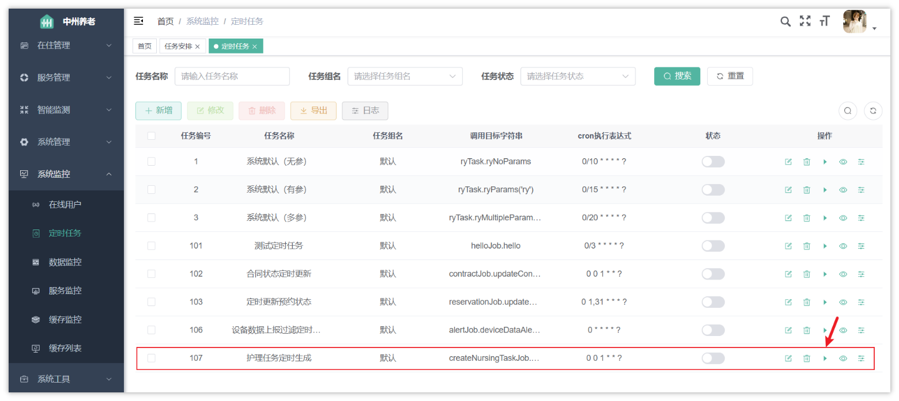

这个定时任务是每月的1号零点执行，现在的cron表达式都是为了测试使用，也可以点击立即执行按钮来生成任务。

注意：每次都点击执行，都会生成当前养老院已入住老人的护理任务，最好不要频繁点击，或者清空表之后再点击


实战要求：

- 找到当前定时任务对应的代码，并阅读代码，画出详细的流程图（飞书文档）


## 表关系

<whiteboard token="MZSlwA5UShnnFjbZlcVcxVminuc"></whiteboard>


## 苍穹外卖任务

---
> 来源：飞书技术知识库（脱敏版） · 07 业务组件方案集 / 中州养老项目（若依+AI） / 第五章-分组实战 · [原文](https://ccn8v2zngwsm.feishu.cn/wiki/FQcxw29hViQPsgk2ca4cNn3dnkg)
