# 定制化UI界面

## logo、背景图更换

如果使用若依框架项目做为脚手架，那么我们肯定需要在页面显示中，使用符合自己公司或者项目的标识才行，需要更换的地方很多，我们依次来解决它

- 浏览器标签页logo标识、标题
- 系统页面中的logo标识、标题
- 登录名称及背景图
- 去除源码地址 & 文档地址 &若依官网标识

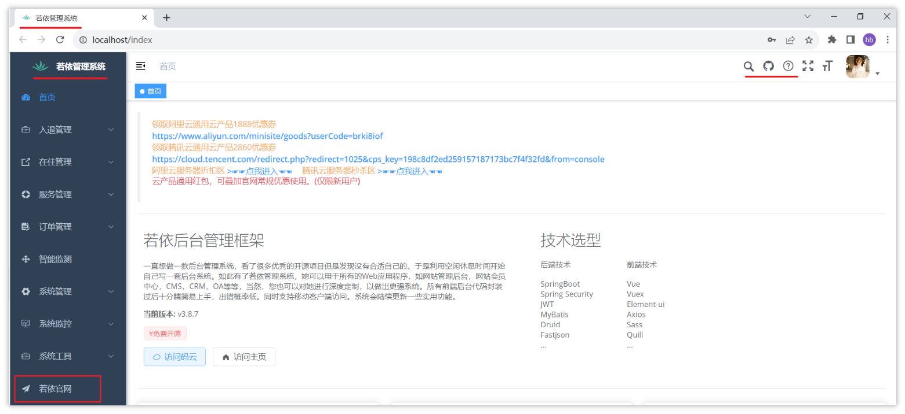

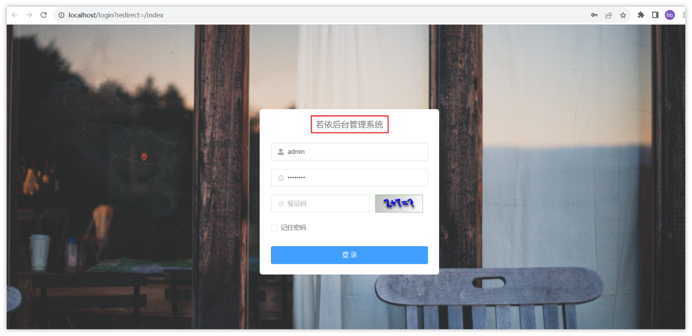

### 浏览器标签页logo标识、标题

- logo替换

找到资料中UI资料目录下的logo图标，替换前端项目中的public文件夹，删除原有的favicon.ico，把新拷贝过来的logo更名为favicon.ico即可

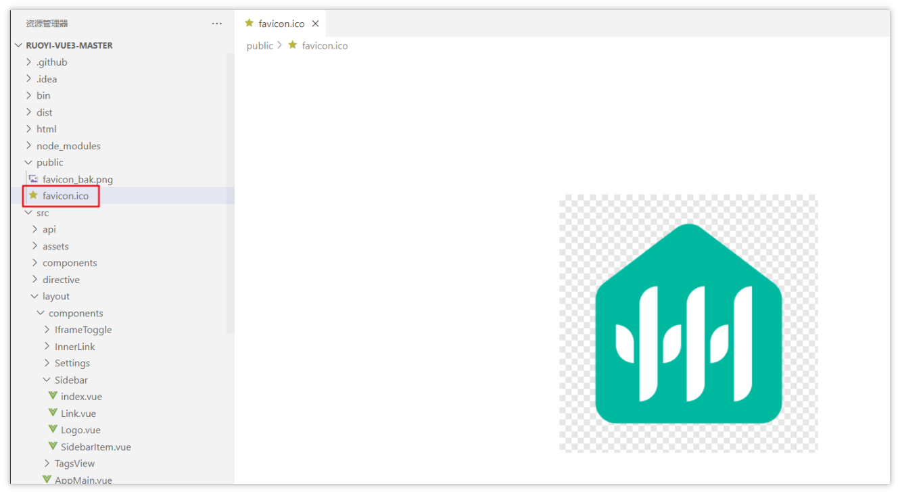

- 标题更换

找到根目录下的index.html文件，把title更换为自己想要的内容即可

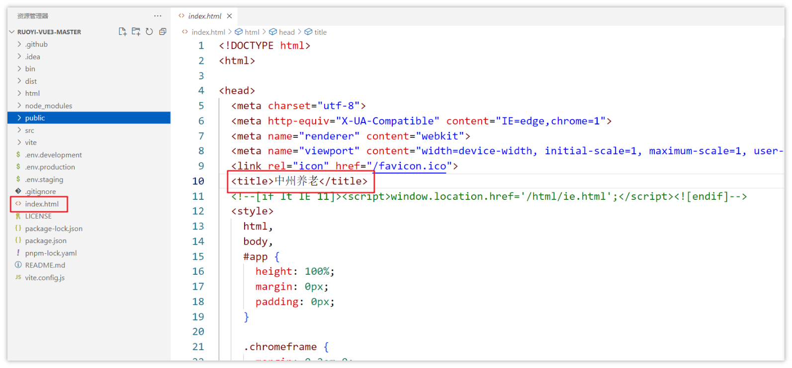

- 标题替换

若依的系统页面标题引用的是开发环境的配置，我们只需要修改开发的环境的VITE_APP_TITLE属性即可

如下图：

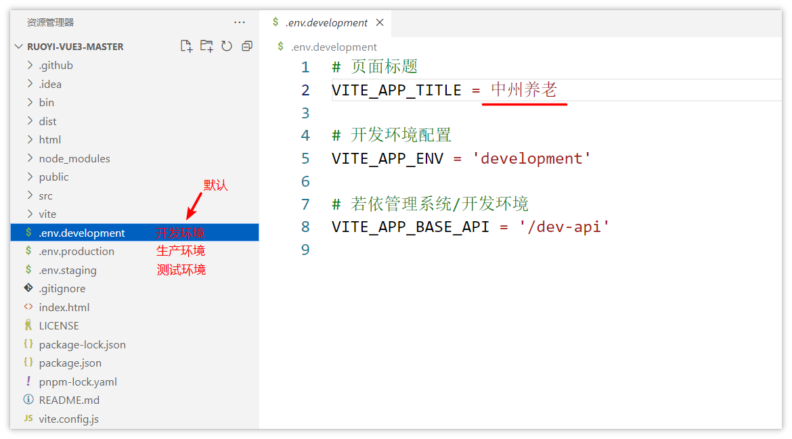

<callout emoji="🐸">
扩展阅读：
关于环境的文件一般有三个
- .env.development   开发环境的配置，默认的环境
- .env.production   生产环境
- .env.staging   测试环境
> 在打包或启动项目的时候，可以加参数来使用不同的环境，需要参考package.json中的配置
</callout>

- logo替换

找到当天资料中的logo文件，替换 src/assets/logo/logo.png文件

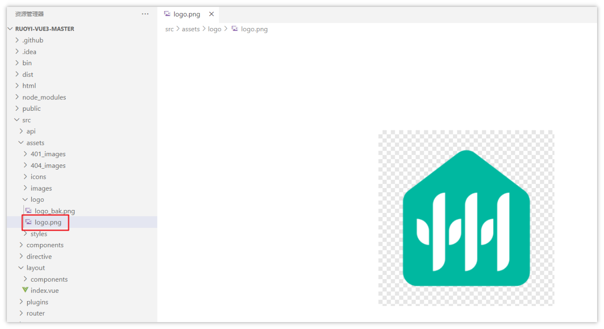

最终效果：

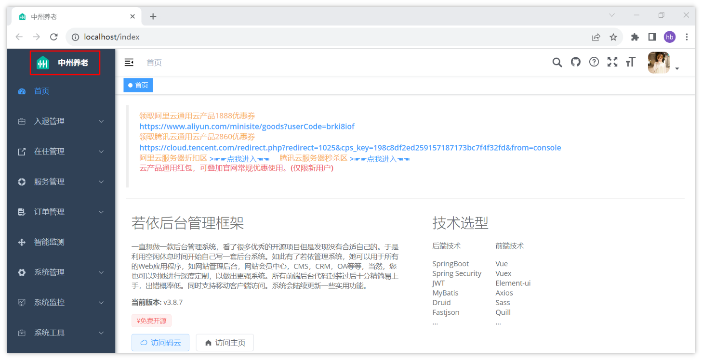

### 登录名称及背景图

登录名称和背景图，我们可以直接找到登录的组件进行修改即可

组件位置：src/views/login.vue

- 登录名称

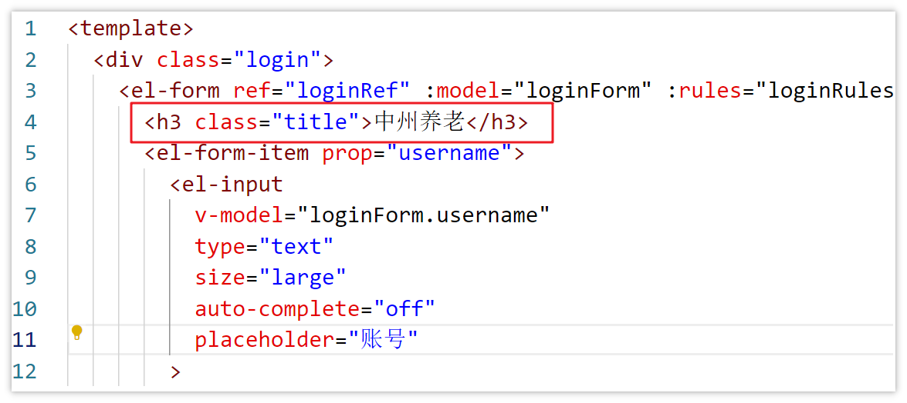

- 背景图

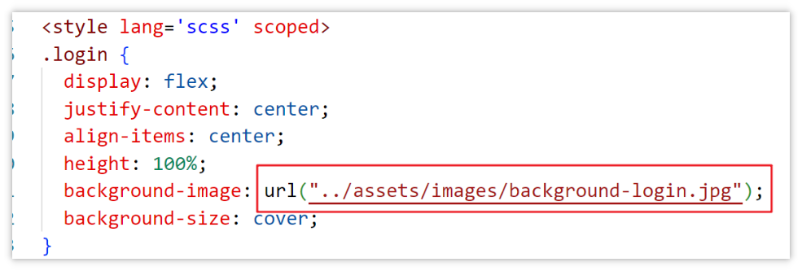

> 资料中已经提供了背景图，可以自行命名更换

最终效果图：

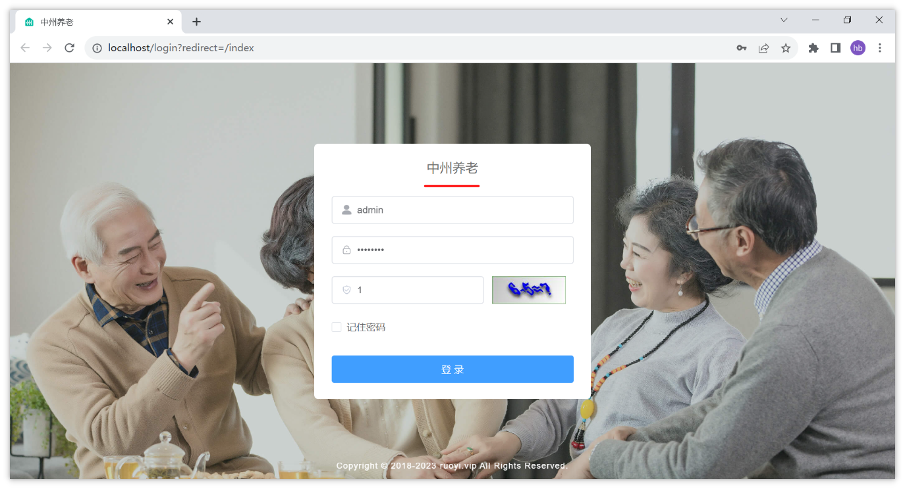

### 去除源码地址 & 文档地址 & 若依官网标识

- 利用菜单功能，去除**若依官网**菜单项目
- 使用VS Code全局搜索功能，去除右上角的**源码地址**和**文档地址**
- 最终效果：

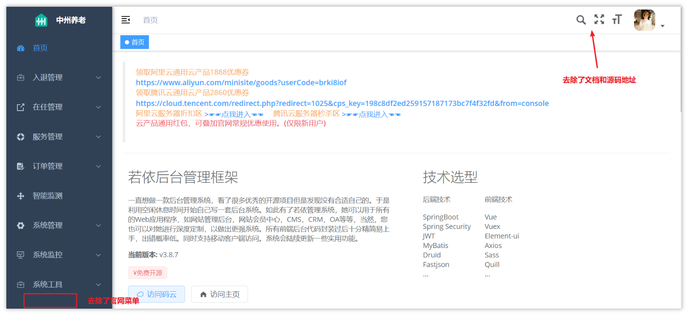

## 主题UI风格调整

在目前的前端项目中，已经提供了非常便利的操作方式，可以切换主题的风格

操作：点击右上角的头像，可以找到**布局设置，**如下操作

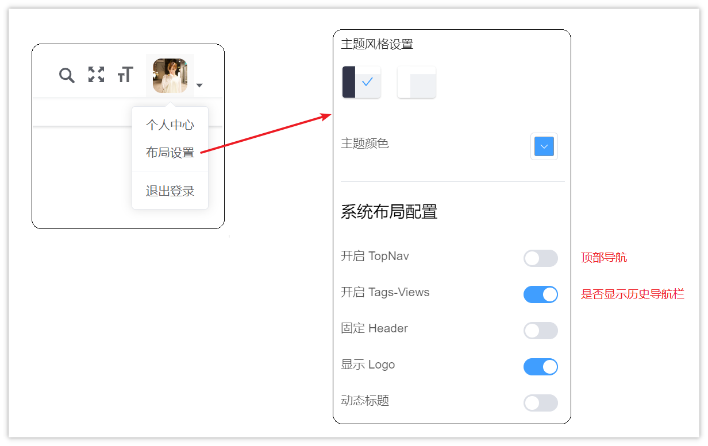

在前端代码中也有对应的操作，文件位置：src/setting.js

```JavaScript
export default {
  /**
   * 网页标题
   */
  title: import.meta.env.VITE_APP_TITLE,
  /**
   * 侧边栏主题 深色主题theme-dark，浅色主题theme-light
   */
  sideTheme: 'theme-dark',
  /**
   * 是否系统布局配置
   */
  showSettings: true,

  /**
   * 是否显示顶部导航
   */
  topNav: false,

  /**
   * 是否显示 tagsView
   */
  tagsView: true,

  /**
   * 是否固定头部
   */
  fixedHeader: false,

  /**
   * 是否显示logo
   */
  sidebarLogo: true,

  /**
   * 是否显示动态标题
   */
  dynamicTitle: false,

  /**
   * @type {string | array} 'production' | ['production', 'development']
   * @description Need show err logs component.
   * The default is only used in the production env
   * If you want to also use it in dev, you can pass ['production', 'development']
   */
  errorLog: 'production'
}

```

更换主题颜色：

文件位置：src/store/modules/settings.js

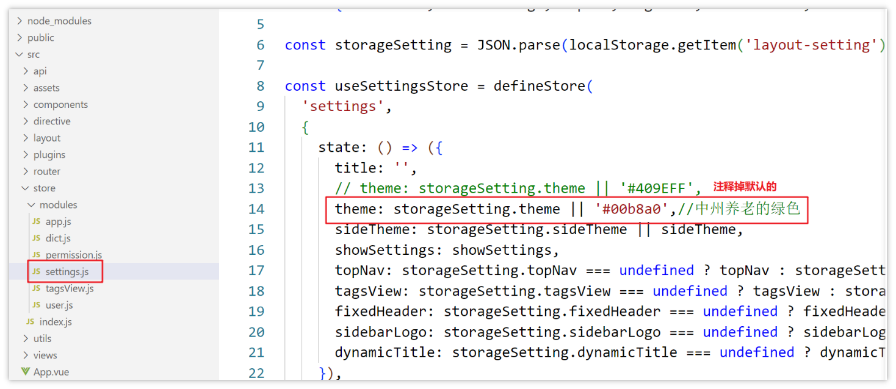

```JavaScript
theme: storageSetting.theme || '#00b8a0',
```

更换后的效果：

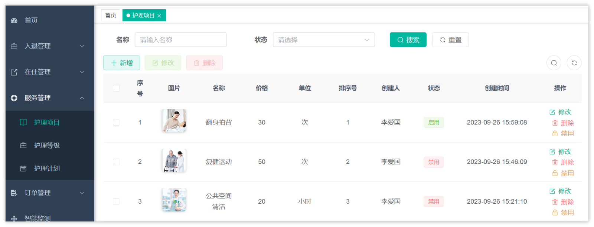

---
> 来源：飞书技术知识库（脱敏版） · 07 业务组件方案集 / 中州养老项目（若依+AI） / 第一章-若依+AI快速开发新项目 / 01-从0开始用若依 / 定制化UI界面 · [原文](https://ccn8v2zngwsm.feishu.cn/wiki/MbWlweTmOid5V9kb2CPcARXznAe)
