# 在线接口文档

目前我们测试都是基于前端项目完成的，如果后期开发中，前端还未开发完成，我们也需要对后端的接口进行测试，这个怎么做呢？

- 使用postman或者apifox来进行测试
- 使用在线接口工具进行测试（常用）

如果使用postman或者是apifox，那么必须要清楚地知道接口的路径，请求方式，出参和入参，并手动在apifox中添加请求路径、请求方法、请求参数，才能很好的进行测试。

现在如果我们与前端对接，需要提供详细的接口文档才行，不过在开发的过程中，接口文档可能不能及时的提供，或者是更新不及时，就会造成信息闭塞，造成不必要的效率降低。

所以，一般的前后端分离的项目，都会采用在线的接口工具进行调试，可以实时的展示接口的详细数据，也可以很方便的对接口进行测试。

### Swagger介绍

Swagger 是一个规范和完整的框架，用于生成、描述、调用和可视化 RESTful 风格的 Web 服务

官网：https://swagger.io/。 

它的主要作用是：

- 使得前后端分离开发更加方便，有利于团队协作
- 接口的文档在线自动生成，降低后端开发人员编写接口文档的负担
- 功能测试 

   

Spring已经将Swagger纳入自身的标准，建立了Spring-swagger项目，现在叫Springfox。通过在项目中引入Springfox ，就可以非常简单快捷的使用Swagger啦。


### 项目中集成

目前若依框架已经集成了swagger，核心配置有如下几个：

1. 关键依赖

   
2. 核心配置类

   - 位置：com.ruoyi.web.core.config.SwaggerConfig
   - 请设计prompt提示词，来阅读以下代码

   ```Java
   package com.ruoyi.web.core.config;
   
   import java.util.ArrayList;
   import java.util.List;
   import org.springframework.beans.factory.annotation.Autowired;
   import org.springframework.beans.factory.annotation.Value;
   import org.springframework.context.annotation.Bean;
   import org.springframework.context.annotation.Configuration;
   import com.ruoyi.common.config.RuoYiConfig;
   import io.swagger.annotations.ApiOperation;
   import io.swagger.models.auth.In;
   import springfox.documentation.builders.ApiInfoBuilder;
   import springfox.documentation.builders.PathSelectors;
   import springfox.documentation.builders.RequestHandlerSelectors;
   import springfox.documentation.service.ApiInfo;
   import springfox.documentation.service.ApiKey;
   import springfox.documentation.service.AuthorizationScope;
   import springfox.documentation.service.Contact;
   import springfox.documentation.service.SecurityReference;
   import springfox.documentation.service.SecurityScheme;
   import springfox.documentation.spi.DocumentationType;
   import springfox.documentation.spi.service.contexts.SecurityContext;
   import springfox.documentation.spring.web.plugins.Docket;
   
   /**
    * Swagger2的接口配置
    * 
    * @author ruoyi
    */
   @Configuration
   public class SwaggerConfig
   {
       /** 系统基础配置 */
       @Autowired
       private RuoYiConfig ruoyiConfig;
   
       /** 是否开启swagger */
       @Value("${swagger.enabled}")
       private boolean enabled;
   
       /** 设置请求的统一前缀 */
       @Value("${swagger.pathMapping}")
       private String pathMapping;
   
       /**
        * 创建API
        */
       @Bean
       public Docket createRestApi()
       {
           return new Docket(DocumentationType.OAS_30)
                   // 是否启用Swagger
                   .enable(enabled)
                   // 用来创建该API的基本信息，展示在文档的页面中（自定义展示的信息）
                   .apiInfo(apiInfo())
                   // 设置哪些接口暴露给Swagger展示
                   .select()
                   // 扫描所有有注解的api，用这种方式更灵活
                   .apis(RequestHandlerSelectors.withMethodAnnotation(ApiOperation.class))
                   // 扫描指定包中的swagger注解
                   // .apis(RequestHandlerSelectors.basePackage("com.ruoyi.project.tool.swagger"))
                   // 扫描所有 .apis(RequestHandlerSelectors.any())
                   .paths(PathSelectors.any())
                   .build()
                   /* 设置安全模式，swagger可以设置访问token */
                   .securitySchemes(securitySchemes())
                   .securityContexts(securityContexts())
                   .pathMapping(pathMapping);
       }
   
       /**
        * 安全模式，这里指定token通过Authorization头请求头传递
        */
       private List<SecurityScheme> securitySchemes()
       {
           List<SecurityScheme> apiKeyList = new ArrayList<SecurityScheme>();
           apiKeyList.add(new ApiKey("Authorization", "Authorization", In.HEADER.toValue()));
           return apiKeyList;
       }
   
       /**
        * 安全上下文
        */
       private List<SecurityContext> securityContexts()
       {
           List<SecurityContext> securityContexts = new ArrayList<>();
           securityContexts.add(
                   SecurityContext.builder()
                           .securityReferences(defaultAuth())
                           .operationSelector(o -> o.requestMappingPattern().matches("/.*"))
                           .build());
           return securityContexts;
       }
   
       /**
        * 默认的安全上引用
        */
       private List<SecurityReference> defaultAuth()
       {
           AuthorizationScope authorizationScope = new AuthorizationScope("global", "accessEverything");
           AuthorizationScope[] authorizationScopes = new AuthorizationScope[1];
           authorizationScopes[0] = authorizationScope;
           List<SecurityReference> securityReferences = new ArrayList<>();
           securityReferences.add(new SecurityReference("Authorization", authorizationScopes));
           return securityReferences;
       }
   
       /**
        * 添加摘要信息
        */
       private ApiInfo apiInfo()
       {
           // 用ApiInfoBuilder进行定制
           return new ApiInfoBuilder()
                   // 设置标题
                   .title("标题：若依管理系统_接口文档")
                   // 描述
                   .description("描述：用于管理集团旗下公司的人员信息,具体包括XXX,XXX模块...")
                   // 作者信息
                   .contact(new Contact(ruoyiConfig.getName(), null, null))
                   // 版本
                   .version("版本号:" + ruoyiConfig.getVersion())
                   .build();
       }
   }
   ```
3. 访问地址

   - 方式一：系统内部访问

   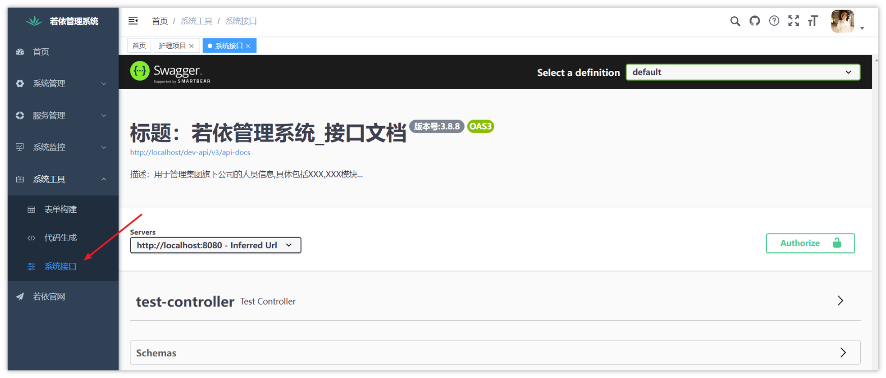

   - 方式二：服务地址+/swagger-ui/index.html  --- >  http://localhost:8080/swagger-ui/index.html

   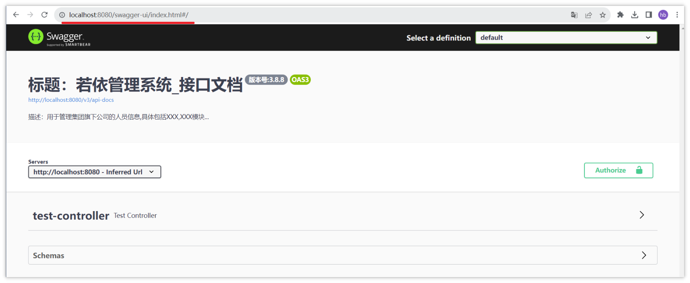

### 集成Knife4j

knife4j是为Java MVC框架集成Swagger生成Api文档的增强解决方案,前身是swagger-bootstrap-ui,取名knife4j是希望它能像一把匕首一样小巧,轻量,并且功能强悍!

目前，一般都使用knife4j框架。

集成方式参考链接：

<bookmark name="# 插件集成" href="https://doc.ruoyi.vip/ruoyi-vue/document/cjjc.html#%E9%9B%86%E6%88%90knife4j%E5%AE%9E%E7%8E%B0swagger%E6%96%87%E6%A1%A3%E5%A2%9E%E5%BC%BA"></bookmark>

#### 导入依赖

在zzyl-admin模块的pom.xml


#### 修改前端页面为knife4j的页面

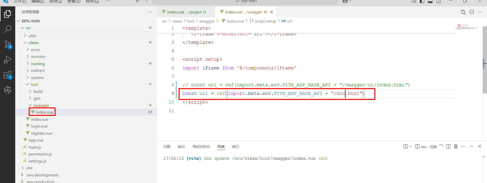

实现后的效果

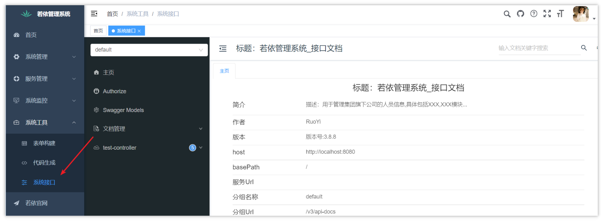

- 可以设置全局参数

由于若依中的所有接口都已经做了安全校验，在访问之前，我们必须设置一个全局参数来获取到登录之后的token才可以正常访问，不然会报一个401错误

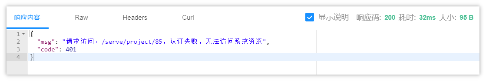

解决：

当我们正常登录系统之后，就可以在后端获取一个jwt生成的token，这个token是登录成功的标识，后期其他请求都需要携带这个token才能正常访问

我们可以在浏览器中打开F12，查看网络，当登录成功后可以查看返回的token

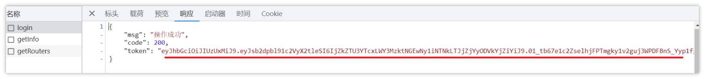

有了token以后，就可以把这个token设置到全局参数中

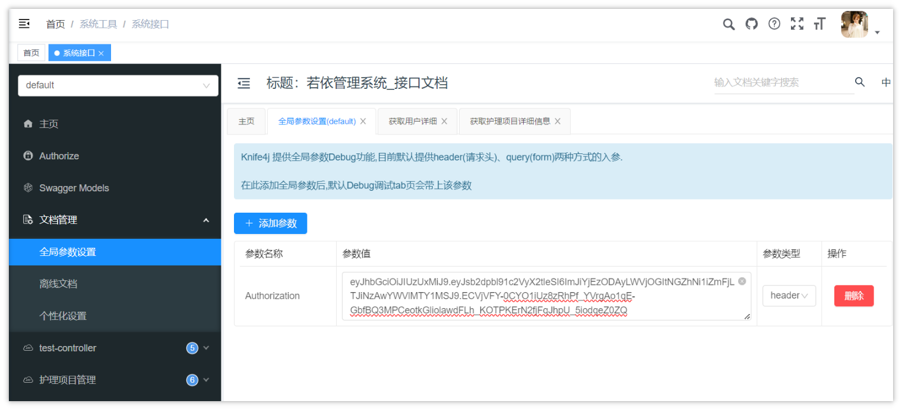

- 可以下载离线文档

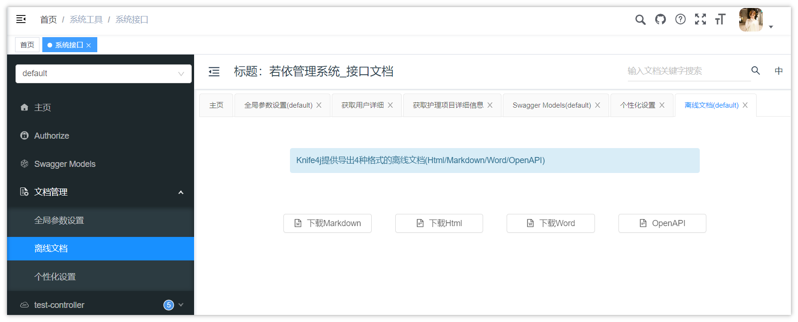

- 提供了更好的接口文档阅读界面
- 提供了更方便的接口测试

### 项目中使用

如果现在想要测试护理项目，我们发现在swagger中并没有护理项目相关的接口，如果想要展示这些接口，我们需要添加上必要的注解来进行说明才能阅读和访问。

#### 常见注解

通过注解可以控制生成的接口文档，使接口文档拥有更好的可读性，常用注解如下：

| **注解** | **说明** |
|-|-|
| @Api | 用在类上，描述Controller的作用 |
| @ApiOperation | 用在方法上，说明方法的用途、作用 |
| @ApiParam | 用在方法的参数上，描述单个形参的含义，适用于简单场景 |
| @ApiImplicitParam | 用在方法上，描述单个形参的含义，适用于参数复杂或者详细描述参数的场景 |
| @ApiModel | 用在类上，用对象来接收参数或者返回参数，描述类的含义 |
| @ApiModelProperty | 用在类的属性上，用对象来接收参数或者返回参数，描述字段的含义 |

#### Controller的方法参数说明

我们熟悉了这些注解之后，我们可以让AI协助我们快速完成注解的编写：

<callout emoji="🤖">
**Prompt**
把整个NursingProjectController类给AI，然后在最后添加上一句话：
帮我给上述代码添加上swagger注解说明，要求每个参数也要进行说明，如：@Api、@ApiOperation、@ApiParam
</callout>

生成后的代码如下：

```Java
package com.ruoyi.serve.controller;

import java.util.List;
import javax.servlet.http.HttpServletResponse;
import org.springframework.security.access.prepost.PreAuthorize;
import org.springframework.beans.factory.annotation.Autowired;
import org.springframework.web.bind.annotation.GetMapping;
import org.springframework.web.bind.annotation.PostMapping;
import org.springframework.web.bind.annotation.PutMapping;
import org.springframework.web.bind.annotation.DeleteMapping;
import org.springframework.web.bind.annotation.PathVariable;
import org.springframework.web.bind.annotation.RequestBody;
import org.springframework.web.bind.annotation.RequestMapping;
import org.springframework.web.bind.annotation.RestController;
import com.ruoyi.common.annotation.Log;
import com.ruoyi.common.core.controller.BaseController;
import com.ruoyi.common.core.domain.AjaxResult;
import com.ruoyi.common.enums.BusinessType;
import com.ruoyi.serve.domain.NursingProject;
import com.ruoyi.serve.service.INursingProjectService;
import com.ruoyi.common.utils.poi.ExcelUtil;
import com.ruoyi.common.core.page.TableDataInfo;
import io.swagger.annotations.Api;
import io.swagger.annotations.ApiOperation;
import io.swagger.annotations.ApiParam;
import io.swagger.annotations.ApiImplicitParam;
import io.swagger.annotations.ApiImplicitParams;

/**
 * 护理项目Controller
 * 
 * @author ruoyi
 * @date 2024-06-09
 */
@Api(tags = "护理项目控制器")
@RestController
@RequestMapping("/serve/nursingProject")
public class NursingProjectController extends BaseController
{
    @Autowired
    private INursingProjectService nursingProjectService;

    /**
     * 查询护理项目列表
     */
    @ApiOperation("查询护理项目列表")
    @PreAuthorize("@ss.hasPermi('serve:nursingProject:list')")
    @GetMapping("/list")
    public TableDataInfo list(NursingProject nursingProject)
    {
        startPage();
        List<NursingProject> list = nursingProjectService.selectNursingProjectList(nursingProject);
        return getDataTable(list);
    }

    /**
     * 导出护理项目列表
     */
    @ApiOperation("导出护理项目列表")
    @PreAuthorize("@ss.hasPermi('serve:nursingProject:export')")
    @Log(title = "护理项目", businessType = BusinessType.EXPORT)
    @PostMapping("/export")
    public void export(HttpServletResponse response, NursingProject nursingProject)
    {
        List<NursingProject> list = nursingProjectService.selectNursingProjectList(nursingProject);
        ExcelUtil<NursingProject> util = new ExcelUtil<NursingProject>(NursingProject.class);
        util.exportExcel(response, list, "护理项目数据");
    }

    /**
     * 获取护理项目详细信息
     */
    @ApiOperation("获取护理项目详细信息")
    @PreAuthorize("@ss.hasPermi('serve:nursingProject:query')")
    @GetMapping(value = "/{id}")
    public AjaxResult getInfo(@ApiParam("护理项目ID") @PathVariable("id") Long id)
    {
        return success(nursingProjectService.selectNursingProjectById(id));
    }

    /**
     * 新增护理项目
     */
    @ApiOperation("新增护理项目")
    @PreAuthorize("@ss.hasPermi('serve:nursingProject:add')")
    @Log(title = "护理项目", businessType = BusinessType.INSERT)
    @PostMapping
    public AjaxResult add(@ApiParam("护理项目对象") @RequestBody NursingProject nursingProject)
    {
        return toAjax(nursingProjectService.insertNursingProject(nursingProject));
    }

    /**
     * 修改护理项目
     */
    @ApiOperation("修改护理项目")
    @PreAuthorize("@ss.hasPermi('serve:nursingProject:edit')")
    @Log(title = "护理项目", businessType = BusinessType.UPDATE)
    @PutMapping
    public AjaxResult edit(@ApiParam("护理项目对象") @RequestBody NursingProject nursingProject)
    {
        return toAjax(nursingProjectService.updateNursingProject(nursingProject));
    }

    /**
     * 删除护理项目
     */
    @ApiOperation("删除护理项目")
    @PreAuthorize("@ss.hasPermi('serve:nursingProject:remove')")
    @Log(title = "护理项目", businessType = BusinessType.DELETE)
        @DeleteMapping("/{ids}")
    public AjaxResult remove(@ApiParam("护理项目ID数组") @PathVariable Long[] ids)
    {
        return toAjax(nursingProjectService.deleteNursingProjectByIds(ids));
    }
}

```

直接替换我们自己的NursingProjectController类即可，然后进行测试，效果如下：


#### 请求体参数

一般的形参，如：id，status等这些，在controller的方法可以使用@ApiParam或者@ApiImplicitParam注解进行描述，如果接口是post、put请求，可能接收的是一个对象作为请求体参数，上面两个注解并不能很好的进行描述，这个时候需要使用新的注解：@ApiModel和@ApiModelProperty

比如，在新增护理项目的时候，接收的参数为NursingProject实体类，我们可以用这些注解在实体类中进行描述

如下代码：

```Java
package com.ruoyi.serve.domain;

import java.math.BigDecimal;

import io.swagger.annotations.ApiModel;
import io.swagger.annotations.ApiModelProperty;
import org.apache.commons.lang3.builder.ToStringBuilder;
import org.apache.commons.lang3.builder.ToStringStyle;
import com.ruoyi.common.annotation.Excel;
import com.ruoyi.common.core.domain.BaseEntity;

/**
 * 护理项目对象 nursing_project
 * 
 * @author ruoyi
 * @date 2024-06-09
 */
@ApiModel("护理项目实体")
public class NursingProject extends BaseEntity
{
    private static final long serialVersionUID = 1L;

    /** 编号 */
    @ApiModelProperty(value = "主键ID")
    private Long id;

    /** 名称 */
    @Excel(name = "名称")
    @ApiModelProperty(value = "名称")
    private String name;

    /** 排序号 */
    @Excel(name = "排序号")
    @ApiModelProperty(value = "排序号")
    private Long orderNo;

    /** 单位 */
    @Excel(name = "单位")
    @ApiModelProperty(value = "单位")
    private String unit;

    /** 价格 */
    @Excel(name = "价格")
    @ApiModelProperty(value = "价格")
    private BigDecimal price;

    /** 图片 */
    @Excel(name = "图片")
    @ApiModelProperty(value = "图片")
    private String image;

    /** 护理要求 */
    @Excel(name = "护理要求")
    @ApiModelProperty(value = "护理要求")
    private String nursingRequirement;

    /** 状态（0：禁用，1：启用） */
    @Excel(name = "状态", readConverterExp = "0：禁用，1：启用")
    @ApiModelProperty(value = "0：禁用，1：启用")
    private Integer status;

    // set  get 方法省略
}
```

由于这个类继承了BaseEntity，我们也可以通过上面两个注解对BaseEntity进行描述

<callout emoji="📌">
注意：由于目前的swagger相关的依赖都在ruoyi-admin中，而BaseEntity类在ruoyi-common模块中，所以我们需要把swagger相关的所有依赖，从ruoyi-admin模块中拷贝到ruoyi-common模块中，删除ruoyi-admin中swagger相关的依赖，因为ruoyi-admin模块依赖了ruoyi-common
</callout>

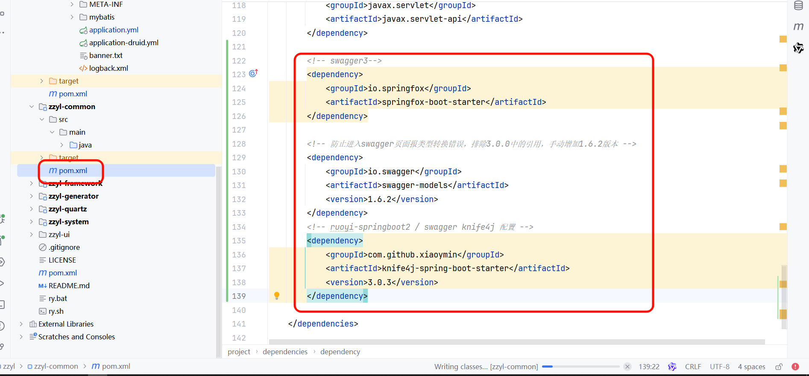

添加注解之后的效果：

```Java
package com.ruoyi.common.core.domain;

import java.io.Serializable;
import java.util.Date;
import java.util.HashMap;
import java.util.Map;
import com.fasterxml.jackson.annotation.JsonFormat;
import com.fasterxml.jackson.annotation.JsonIgnore;
import com.fasterxml.jackson.annotation.JsonInclude;
import io.swagger.annotations.ApiModel;
import io.swagger.annotations.ApiModelProperty;

/**
 * Entity基类
 * 
 * @author ruoyi
 */
@ApiModel("Entity基类")
public class BaseEntity implements Serializable
{
    private static final long serialVersionUID = 1L;

    /** 搜索值 */
    @JsonIgnore
    private String searchValue;

    /** 创建者 */
    @ApiModelProperty(value = "创建者")
    private String createBy;

    /** 创建时间 */
    @JsonFormat(pattern = "yyyy-MM-dd HH:mm:ss")
    @ApiModelProperty(value = "创建时间")
    private Date createTime;

    /** 更新者 */
    @ApiModelProperty(value = "更新者")
    private String updateBy;

    /** 更新时间 */
    @JsonFormat(pattern = "yyyy-MM-dd HH:mm:ss")
    @ApiModelProperty(value = "更新时间")
    private Date updateTime;

    /** 备注 */
    @ApiModelProperty(value = "备注")
    private String remark;

    /** 请求参数 */
    @JsonInclude(JsonInclude.Include.NON_EMPTY)
    @ApiModelProperty(value = "请求参数")
    private Map<String, Object> params;

}
```

在线文档展示的效果：

- 新增或修改


- 查询一个


#### 响应体参数

当我们去查询护理项目的时候，并不能展示详细的返回结果，如下图

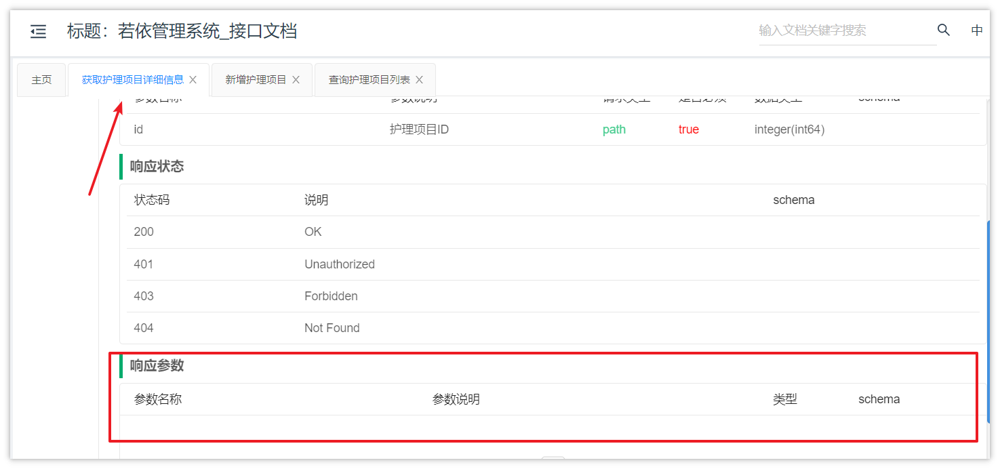

想要解决这个问题，有两步操作

- 使用@ApiModel和@ApiModelProperty注解对返回值的类型进行说明（已完成）
- 需要在controller类的方法上指定返回值类型

  - 返回一个对象
  - 返回数据列表（分页或不分页）

1. 返回一个对象

在目前的代码中，返回一个对象的接口代码，是根据id查询对应的对象，并返回

详细代码如下：

```Java
@ApiOperation("获取护理项目详细信息")
@PreAuthorize("@ss.hasPermi('serve:nursingProject:query')")
@GetMapping(value = "/{id}")
public AjaxResult getInfo(@ApiParam("护理项目ID") @PathVariable("id") Long id)
{
    return success(nursingProjectService.selectNursingProjectById(id));
}
```

这个代码并不能在swagger中去展示详细的返回结果说明，因为目前的返回值是一个AjaxResult，并没有指定泛型

我们需要使用若依框架中提供的另外一个返回值类型


> 在R这个类中也提供了详细的返回值的方法，比如有成功的，有失败的等等

修改NursingProjectController类中的方法返回值：

```Java
/**
 * 获取护理项目详细信息
 */
@PreAuthorize("@ss.hasPermi('serve:project:query')")
@GetMapping(value = "/{id}")
@ApiOperation(value = "获取护理项目详细信息", notes = "根据ID获取护理项目详细信息")
@ApiImplicitParam(name = "id", value = "护理项目ID", required = true, dataType = "Long", paramType = "path")
public R<NursingProject> getInfo(@PathVariable("id") Long id)
{
    NursingProject nursingProject = nursingProjectService.selectNursingProjectById(id);
    return R.ok(nursingProject);
}
```

最终的效果如下：

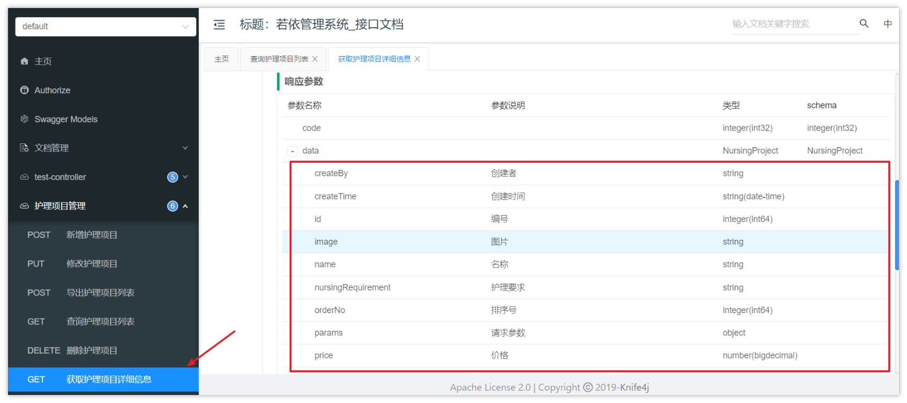


1. 返回分页对象

目前的分页列表查询的返回值是TableDataInfo这个类，我们需要改造下这个类，让它具备接收泛型的能力

- 定义类中的泛型**T**
- 把类中的所有问号改为**T**

```Java
/**
 * 表格分页数据对象
 * 
 * @author ruoyi
 */
public class TableDataInfo<T> implements Serializable
{
    private static final long serialVersionUID = 1L;

    /** 总记录数 */
    private long total;

    /** 列表数据 */
    private List<T> rows;

    /** 消息状态码 */
    private int code;

    /** 消息内容 */
    private String msg;

    /**
     * 表格数据对象
     */
    public TableDataInfo()
    {
    }

    /**
     * 分页
     * 
     * @param list 列表数据
     * @param total 总记录数
     */
    public TableDataInfo(List<T> list, int total)
    {
        this.rows = list;
        this.total = total;
    }


    public List<T> getRows()
    {
        return rows;
    }

    public void setRows(List<T> rows)
    {
        this.rows = rows;
    }
    
    //其他代码略...
   
}
```

修改controller中分页列表查询的返回值

```Java
/**
 * 查询护理项目列表
 */
@PreAuthorize("@ss.hasPermi('serve:project:list')")
@GetMapping("/list")
@ApiOperation(value = "查询护理项目列表", notes = "根据护理项目条件查询护理项目列表")
public TableDataInfo<NursingProject> list(
    @ApiParam(value = "护理项目查询条件", required = false) NursingProject nursingProject)
{
    startPage();
    List<NursingProject> list = nursingProjectService.selectNursingProjectList(nursingProject);
    return getDataTable(list);
}
```

重启服务，查看分页接口的返回值效果：

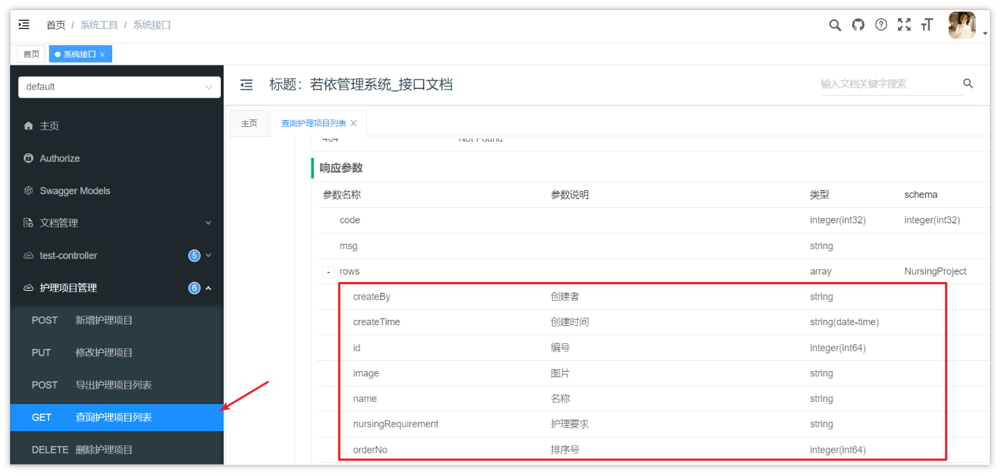

---
> 来源：飞书技术知识库（脱敏版） · 07 业务组件方案集 / 中州养老项目（若依+AI） / 第一章-若依+AI快速开发新项目 / 01-从0开始用若依 / 在线接口文档 · [原文](https://ccn8v2zngwsm.feishu.cn/wiki/UmrlwwCsiihTwVkxiJXc1JxSnkb)
