# 03-前后端快速开发

## 目标

今天的目标为：

- 能够使用Element Plus组件改造护理项目的列表展示
- 能够使用若依框架的字典功能配合Element Plus组件展示状态数据
- 能够使用Element Plus组件改造护理项目的新增和修改的弹窗
- 能够独立完成OSS集成到项目中
- 能够独立完成护理计划的接口开发

## 护理项目页面改造

### 列表查询

#### 问题分析

护理项目中的效果图：

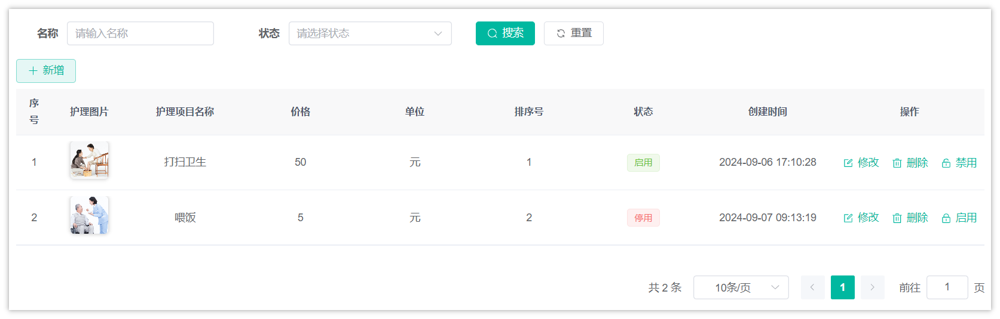

目前使用若依快速代码生成的效果图：

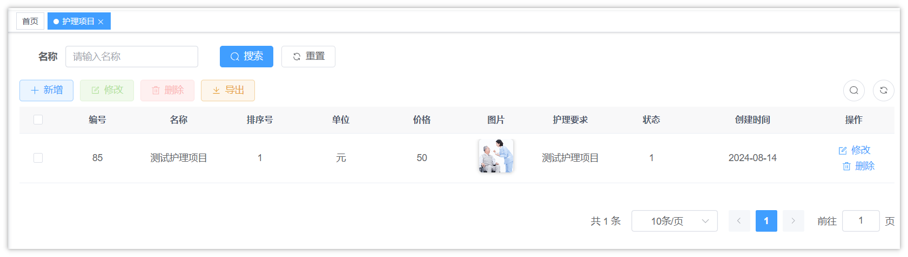

经过我们的对比，有以下几点不同

- 搜索栏缺少**状态**条件
- 状态展示为数字，应该展示**禁用**或**启用**
- 缺少**禁用**按钮和功能，多了几个不需要的按钮
- 没有序号，多了一列编号，显示的是数据库表中的id
- 创建时间没有展示**时分秒**


#### 前端代码阅读

找到src/views/nursing/project/index.vue文件，护理项目的前端代码已经添加了详细的注释，如下：

```JavaScript
<template>
  <div class="app-container">

    <!-- 搜索表单  start -->
    <el-form :model="queryParams" ref="queryRef" :inline="true" v-show="showSearch" label-width="68px">
      <el-form-item label="名称" prop="name">
        <el-input
          v-model="queryParams.name"
          placeholder="请输入名称"
          clearable
          @keyup.enter="handleQuery"
        />
      </el-form-item>
      <el-form-item>
        <el-button type="primary" icon="Search" @click="handleQuery">搜索</el-button>
        <el-button icon="Refresh" @click="resetQuery">重置</el-button>
      </el-form-item>
    </el-form>
    <!-- 搜索表单 end -->

    <!-- 按钮区域 start -->
    <el-row :gutter="10" class="mb8">
      <el-col :span="1.5">
        <el-button
          type="primary"
          plain
          icon="Plus"
          @click="handleAdd"
          v-hasPermi="['nursing:project:add']"
        >新增</el-button>
      </el-col>
      <el-col :span="1.5">
        <el-button
          type="success"
          plain
          icon="Edit"
          :disabled="single"
          @click="handleUpdate"
          v-hasPermi="['nursing:project:edit']"
        >修改</el-button>
      </el-col>
      <el-col :span="1.5">
        <el-button
          type="danger"
          plain
          icon="Delete"
          :disabled="multiple"
          @click="handleDelete"
          v-hasPermi="['nursing:project:remove']"
        >删除</el-button>
      </el-col>
      <el-col :span="1.5">
        <el-button
          type="warning"
          plain
          icon="Download"
          @click="handleExport"
          v-hasPermi="['nursing:project:export']"
        >导出</el-button>
      </el-col>
      <right-toolbar v-model:showSearch="showSearch" @queryTable="getList"></right-toolbar>
    </el-row>
    <!-- 按钮区域 end -->

    <!-- 数据展示区域 start -->
    <el-table v-loading="loading" :data="projectList" @selection-change="handleSelectionChange">
      <el-table-column type="selection" width="55" align="center" />
      <el-table-column label="编号" align="center" prop="id" />
      <el-table-column label="名称" align="center" prop="name" />
      <el-table-column label="排序号" align="center" prop="orderNo" />
      <el-table-column label="单位" align="center" prop="unit" />
      <el-table-column label="价格" align="center" prop="price" />
      <el-table-column label="图片" align="center" prop="image" width="100">
        <template #default="scope">
          <image-preview :src="scope.row.image" :width="50" :height="50"/>
        </template>
      </el-table-column>
      <el-table-column label="护理要求" align="center" prop="nursingRequirement" />
      <el-table-column label="状态" align="center" prop="status" />
      <el-table-column label="创建时间" align="center" prop="createTime" width="180">
        <template #default="scope">
          <span>{{ parseTime(scope.row.createTime, '{y}-{m}-{d}') }}</span>
        </template>
      </el-table-column>
      <el-table-column label="操作" align="center" class-name="small-padding fixed-width">
        <template #default="scope">
          <el-button link type="primary" icon="Edit" @click="handleUpdate(scope.row)" v-hasPermi="['nursing:project:edit']">修改</el-button>
          <el-button link type="primary" icon="Delete" @click="handleDelete(scope.row)" v-hasPermi="['nursing:project:remove']">删除</el-button>
        </template>
      </el-table-column>
    </el-table>
    <!-- 数据展示区域 end -->
    

    <!-- 分页组件 start -->
    <pagination
      v-show="total>0"
      :total="total"
      v-model:page="queryParams.pageNum"
      v-model:limit="queryParams.pageSize"
      @pagination="getList"
    />
    <!-- 分页组件 end -->

    <!-- 新增或修改弹窗  start -->
    <!-- 添加或修改护理项目对话框 -->
    <el-dialog :title="title" v-model="open" width="500px" append-to-body>
      <el-form ref="projectRef" :model="form" :rules="rules" label-width="80px">
        <el-form-item label="名称" prop="name">
          <el-input v-model="form.name" placeholder="请输入名称" />
        </el-form-item>
        <el-form-item label="排序号" prop="orderNo">
          <el-input v-model="form.orderNo" placeholder="请输入排序号" />
        </el-form-item>
        <el-form-item label="单位" prop="unit">
          <el-input v-model="form.unit" placeholder="请输入单位" />
        </el-form-item>
        <el-form-item label="价格" prop="price">
          <el-input v-model="form.price" placeholder="请输入价格" />
        </el-form-item>
        <el-form-item label="图片" prop="image">
          <image-upload v-model="form.image"/>
        </el-form-item>
        <el-form-item label="护理要求" prop="nursingRequirement">
          <el-input v-model="form.nursingRequirement" placeholder="请输入护理要求" />
        </el-form-item>
      </el-form>
      <template #footer>
        <div class="dialog-footer">
          <el-button type="primary" @click="submitForm">确 定</el-button>
          <el-button @click="cancel">取 消</el-button>
        </div>
      </template>
    </el-dialog>
    <!-- 新增或修改弹窗  end -->
  </div>
</template>

<script setup name="Project">
// 引入后端接口
import { listProject, getProject, delProject, addProject, updateProject } from "@/api/nursing/project";
// 获取当前实例代理对象，用于访问组件的数据、方法等属性。
const { proxy } = getCurrentInstance();

// 列表数据
const projectList = ref([]);
// 是否显示弹窗
const open = ref(false);
// 加载状态
const loading = ref(true);
// 是否显示搜索栏
const showSearch = ref(true);
//记录被选中的id集合
const ids = ref([]);
//是否是单选，用于是否高亮修改按钮
const single = ref(true);
//是否是多选，用于是否高亮删除按钮
const multiple = ref(true);
//总条数
const total = ref(0);
// 标题
const title = ref("");

const data = reactive({
  // 新增或修改表单数据
  form: {},
  // 查询参数
  queryParams: {
    pageNum: 1,
    pageSize: 10,
    name: null,
    status: null,
  },
  // 表单校验
  rules: {
    status: [
      { required: true, message: "状态不能为空", trigger: "change" }
    ],
  }
});
//toRefs将传入的数据对象的特定属性转换为响应式对象
const { queryParams, form, rules } = toRefs(data);

/** 查询护理项目列表 */
function getList() {
  loading.value = true;
  listProject(queryParams.value).then(response => {
    projectList.value = response.rows;
    total.value = response.total;
    loading.value = false;
  });
}

// 取消按钮
function cancel() {
  open.value = false;
  reset();
}

// 表单重置
function reset() {
  form.value = {
    id: null,
    name: null,
    orderNo: null,
    unit: null,
    price: null,
    image: null,
    nursingRequirement: null,
    status: null,
    createBy: null,
    updateBy: null,
    remark: null,
    createTime: null,
    updateTime: null
  };
  proxy.resetForm("projectRef");
}

/** 搜索按钮操作 */
function handleQuery() {
  queryParams.value.pageNum = 1;
  getList();
}

/** 重置按钮操作 */
function resetQuery() {
  proxy.resetForm("queryRef");
  handleQuery();
}

// 多选框选中数据
function handleSelectionChange(selection) {
  ids.value = selection.map(item => item.id);
  single.value = selection.length != 1;
  multiple.value = !selection.length;
}

/** 新增按钮操作 */
function handleAdd() {
  reset();
  open.value = true;
  title.value = "添加护理项目";
}

/** 修改按钮操作 */
function handleUpdate(row) {
  reset();
  const _id = row.id || ids.value
  getProject(_id).then(response => {
    form.value = response.data;
    open.value = true;
    title.value = "修改护理项目";
  });
}

/** 提交按钮 */
function submitForm() {
  proxy.$refs["projectRef"].validate(valid => {
    if (valid) {
      if (form.value.id != null) {
        updateProject(form.value).then(response => {
          proxy.$modal.msgSuccess("修改成功");
          open.value = false;
          getList();
        });
      } else {
        addProject(form.value).then(response => {
          proxy.$modal.msgSuccess("新增成功");
          open.value = false;
          getList();
        });
      }
    }
  });
}

/** 删除按钮操作 */
function handleDelete(row) {
  const _ids = row.id || ids.value;
  proxy.$modal.confirm('是否确认删除护理项目编号为"' + _ids + '"的数据项？').then(function() {
    return delProject(_ids);
  }).then(() => {
    getList();
    proxy.$modal.msgSuccess("删除成功");
  }).catch(() => {});
}

/** 导出按钮操作 */
function handleExport() {
  proxy.download('nursing/project/export', {
    ...queryParams.value
  }, `project_${new Date().getTime()}.xlsx`)
}

getList();
</script>

```

#### 字段处理-序号和时间

##### 序号处理

目前的代码中，如下代码

```JavaScript

<!-- 数据展示区域 start -->
    <el-table v-loading="loading" :data="projectList" @selection-change="handleSelectionChange">
      <el-table-column type="selection" width="55" align="center" />  <!-- 多了一个复选框 -->
      <el-table-column label="编号" align="center" prop="id" />  <!-- 是序号不是编号 -->
      <!-- 其他代码略 -->
    </el-table>
<!-- 数据展示区域 end -->
```

目前在页面中展示的编号，接口中对应的字段是id（表中的主键值，并不能保证是连续的）

解决：

在Table表格组件中，提供了在表格中展示序号的方案：

参考链接：https://element-plus.org/zh-CN/component/table.html

修改之后的代码：

```JavaScript
<!-- 数据展示区域 start -->
    <el-table v-loading="loading" :data="projectList" @selection-change="handleSelectionChange">
      <el-table-column type="selection" width="55" align="center" />
      <el-table-column label="序号" type="index" align="center" />
      <!-- 其他代码略 -->
    </el-table>
<!-- 数据展示区域 end -->
```

最终效果：

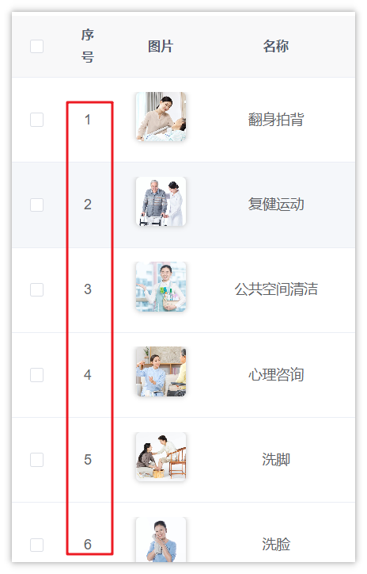


##### 时间展示处理

目前的代码：

```JavaScript
<!-- 数据展示区域 start -->
    <el-table v-loading="loading" :data="projectList" @selection-change="handleSelectionChange">
      <el-table-column type="selection" width="55" align="center" />
      <el-table-column label="创建时间" align="center" prop="createTime" width="180">
         <template #default="scope">
           <span>{{ parseTime(scope.row.createTime, '{y}-{m}-{d}') }}</span>
         </template>
      </el-table-column>
      <!-- 其他代码略 -->
    </el-table>
<!-- 数据展示区域 end -->
```

很显然，目前在页面中显示就是年月日，我们需要在后边添加参数就可以了

> parseTime方法的作用就是来格式化日期字段的，方法中有两个参数
> 
> - 第一个参数，需要格式化的日期字段
> - 第二个参数，格式化之后字符串展示效果
> 
> 如果想要展示 年月日 时分秒 则可以修改第二个参数：`{y}-{m}-{d} {h}:{i}:{s}`

修改之后的代码

```JavaScript
<!-- 数据展示区域 start -->
    <el-table v-loading="loading" :data="projectList" @selection-change="handleSelectionChange">
      <el-table-column type="selection" width="55" align="center" />
      <el-table-column label="创建时间" align="center" prop="createTime" width="180">
        <template #default="scope">
          <span>{{ parseTime(scope.row.createTime, '{y}-{m}-{d} {h}:{i}:{s}') }}</span>
        </template>
      </el-table-column>
      <!-- 其他代码略 -->
    </el-table>
<!-- 数据展示区域 end -->
```

最终效果：

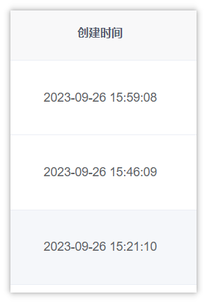

#### 状态样式调整

目前的状态显示中，都是数值表示，0或者1，我们想要的效果是**启用**或**禁用**

在数据展示部分，我们可以对某一个字段使用<template>标签来重构某个字段的显示

完成后的代码如下：

```JavaScript
<!-- 数据展示区域 start -->
<el-table v-loading="loading" :data="projectList" @selection-change="handleSelectionChange">
  <el-table-column type="selection" width="55" align="center" />
  <el-table-column label="状态" align="center" prop="status" >
    <template #default="scope">
      <el-tag :type="scope.row.status === 1 ? 'success' : 'danger'">{{ scope.row.status === 1 ? '启用' : '禁用' }}</el-tag>
    </template>
  </el-table-column>
  <!-- 其他代码略... -->
</el-table>
<!-- 数据展示区域 end -->
```

> - <template #default="scope"> 这是一个Vue模板插槽的语法。`#default`表示默认插槽，`scope`是作用域参数，通过`scope`可以访问到父组件传递给插槽的任何数据
> - scope.row 代表的是这一行数据
> - :type=success | danger 表示显示不同的样式   success:成功   danger:危险

#### 新增查询条件

在目前的后端代码中已经对状态的条件进行了检索，我们只需要修改前端的代码，在搜索的表单中添加一个新的条件即可。完成后的效果如下：

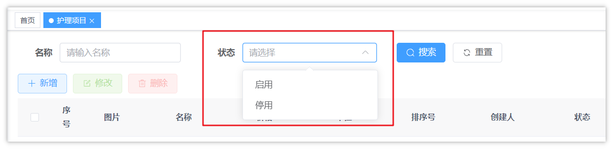

这里需要使用的是下拉选择的组件`<el-select>`

参考链接：https://element-plus.org/zh-CN/component/select.html

完成后的代码：

```JavaScript
<!-- 搜索表单  start -->
<el-form :model="queryParams" ref="queryRef" :inline="true" v-show="showSearch" label-width="68px">
  <el-form-item label="名称" prop="name">
    <el-input v-model="queryParams.name" placeholder="请输入名称" clearable @keyup.enter="handleQuery" />
  </el-form-item>
  <el-form-item label="状态" prop="status">
    <el-select v-model="queryParams.status" placeholder="请选择" clearable>
      <el-option v-for="item in options" :key="item.value" :label="item.label" :value="item.value" />
    </el-select>
  </el-form-item>
  <el-form-item>
    <el-button type="primary" icon="Search" @click="handleQuery">搜索</el-button>
    <el-button icon="Refresh" @click="resetQuery">重置</el-button>
  </el-form-item>
</el-form>
<!-- 搜索表单 end -->

<script setup name="Project">

//下拉选择框的选择项
const options = ref([
  {
    value: 1,
    label: "启用"
  },
  {
    value: 0,
    label: "停用"
  }
])
</script>
```

> - 后端需要的状态数据，可以参考已经提供的接口文档
> - 选择下拉选择组件之后，选择后的值需要绑定到查询的参数变量**queryParams**中

#### 禁用功能开发

在目前的操作栏目中，只有两个按钮，分别是**修改**和**删除，**我们需要参考这两个按钮，新增一个**禁用**按钮，并且需要给这个按钮绑定事件，方便提交数据到后端进行修改

> 注意：我们无需新增后端的禁用接口，可直接使用**修改**接口

- 新增按钮

```JavaScript
<!-- 数据展示区域 start -->
<el-table v-loading="loading" :data="projectList" @selection-change="handleSelectionChange">
  <el-table-column type="selection" width="55" align="center" />
  <!-- 其他代码略... -->
  <el-table-column label="操作" align="center" class-name="small-padding fixed-width">
    <template #default="scope">
      <el-button link type="primary" icon="Edit" @click="handleUpdate(scope.row)"
        v-hasPermi="['nursing:project:edit']">修改</el-button>
      <el-button link type="danger" icon="Delete" @click="handleDelete(scope.row)"
        v-hasPermi="['nursing:project:remove']">删除</el-button>
      <el-button link type="primary" :icon="scope.row.status == 0 ? 'Lock' : 'Unlock'" @click="handleEnable(scope.row)" >{{ scope.row.status == 0 ? '启用' : '禁用' }}</el-button>
    </template>
  </el-table-column>
</el-table>
<!-- 数据展示区域 end -->
```

图标组件链接：https://element-plus.org/zh-CN/component/icon.html


- 按钮中绑定方法handleEnable(scope.row)，调用后端接口

```JavaScript
/* 启用禁用按钮操作 */
function handleEnable(row) {
  // 获取当前状态
  const status = row.status;
  // 提示信息
  const msg = status === 1 ? '禁用' : '启用';

  // 构建参数
  const params = {
    id: row.id,
    status: status === 1 ? 0 : 1
  };
  
  proxy.$modal.confirm(`是否确认${msg}该护理项目的数据项？`).then(function() {
    return updateProject(params);
  }).then(() => {
    getList();
    proxy.$modal.msgSuccess(`${msg}成功`);
  }).catch(() => {});
}
```

最终效果：

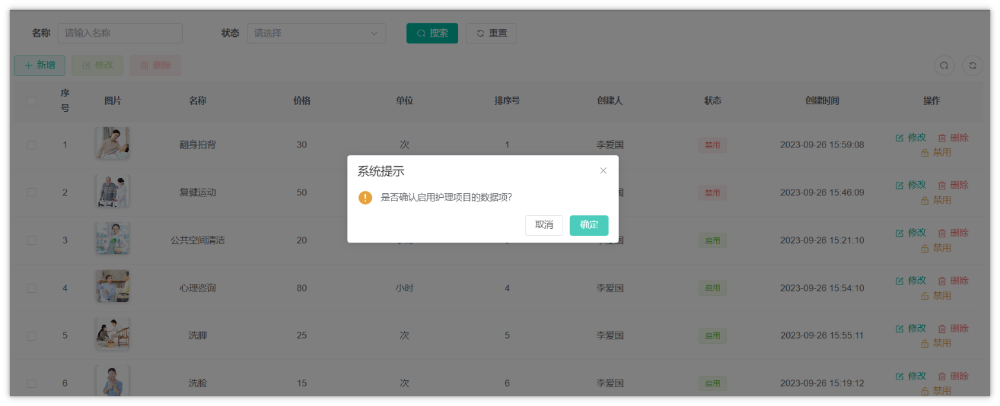

#### 其他调整

如下图：

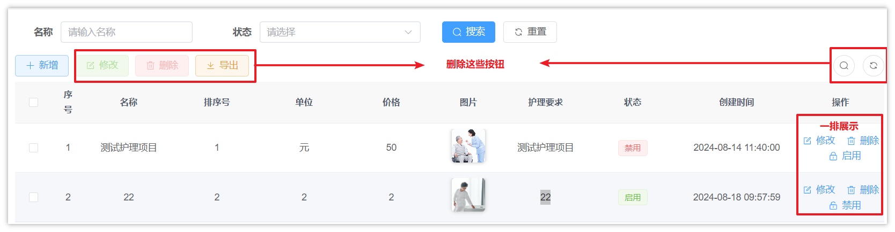

1. 删除一些没用的按钮
2. 调整列宽，让修改、删除、启用/禁用按钮在一行展示
3. 固定操作列


##### 删除无关按钮

如下图，把对应的按钮代码注释掉或删除即可

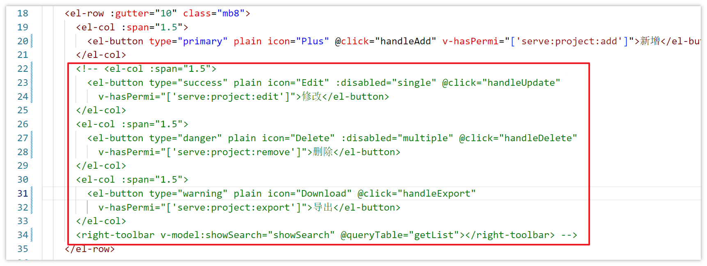

- 其中的导出的操作，也可以找到对应的handleExport方法，进行注释或删除


##### 操作列固定展示

如果想要按钮一排展示，我们还需要参考Element Plus官网文档的Table组件的说明

https://element-plus.org/zh-CN/component/table.html

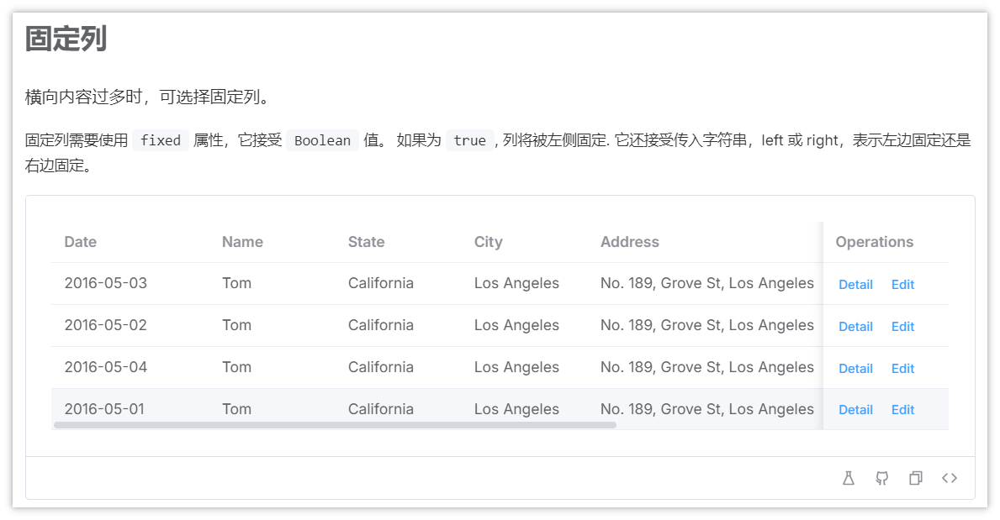

代码修改如下：

```HTML
<el-table v-loading="loading" :data="projectList" @selection-change="handleSelectionChange">
      
      <!-- 其他字段省略.... -->
      
      <el-table-column label="操作" fixed="right" width="200" align="center" class-name="small-padding fixed-width">
        <template #default="scope">
          <el-button link type="primary" icon="Edit" @click="handleUpdate(scope.row)"
            v-hasPermi="['nursing:project:edit']">修改</el-button>
          <el-button link type="primary" icon="Delete" @click="handleDelete(scope.row)"
            v-hasPermi="['nursing:project:remove']">删除</el-button>
          <el-button link type="primary" :icon="scope.row.status == 0 ? 'Lock' : 'Unlock'" @click="handleEnable(scope.row)"
            v-hasPermi="['nursing:project:edit']">{{ scope.row.status == 0 ? '启用':'禁用' }}</el-button>
        </template>
      </el-table-column>
    </el-table>
```

- fixed  列是否固定在左侧或者右侧。  left | right
- width  对应列的宽度

### 数据字典

#### 什么是数据字典

字典管理用来维护字典类型的数据，例如：状态的启用、禁用；性别的男、女；订单的已下单、支付中、已完成；通常用在如下拉框、单选按钮、复选框、树选择中的数据中，方便系统管理员维护。

主要功能包括：**字典分类管理**、**字典数据管理**

> 简单的理解：数据字典就是企业中对一些**常量**的统一管理


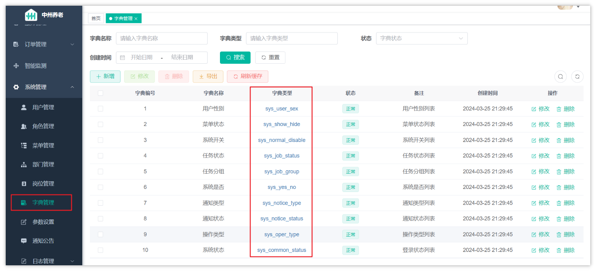

每个字典类型，可能会有多个值，比如，下面是用户**性别**的字典数据

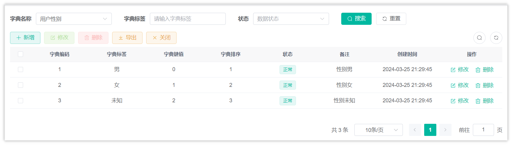

- 表关系

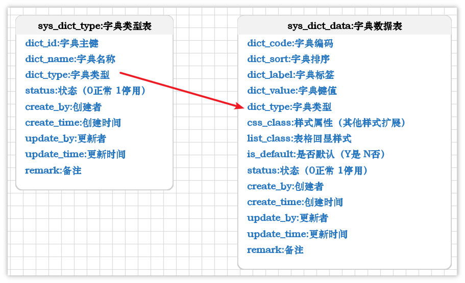

#### 使用方式

在刚刚开发的护理项目中，状态下拉列表就可以使用数据字典来完成数据的展示，如下图

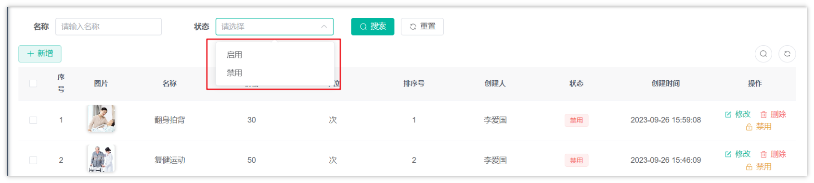

在展示查询条件状态的时候，有两个选项值，目前代码中是写死的内容，我们定义了一个options，如果使用字典可以先定义护理项目的状态字典，然后在组件中引用字典数据即可。下面是详细的操作步骤。


1. 新增数据字典

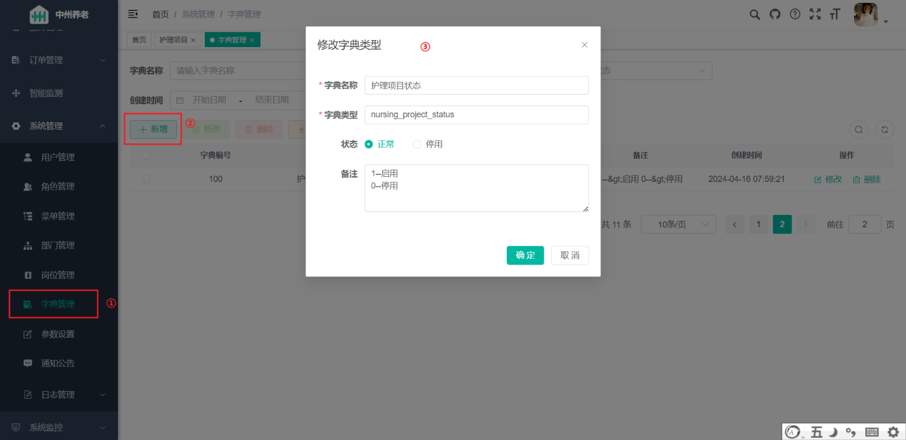

1. 新增字典数据

选中字典类型，可以进入字典数据页面，对字典数据进行新增

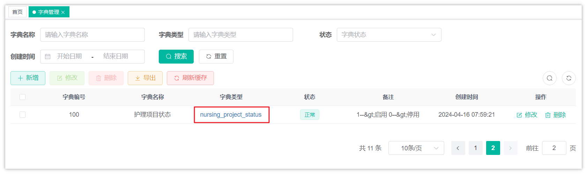

新增字典数据，添加两条数据

- 启用 1
- 禁用 0

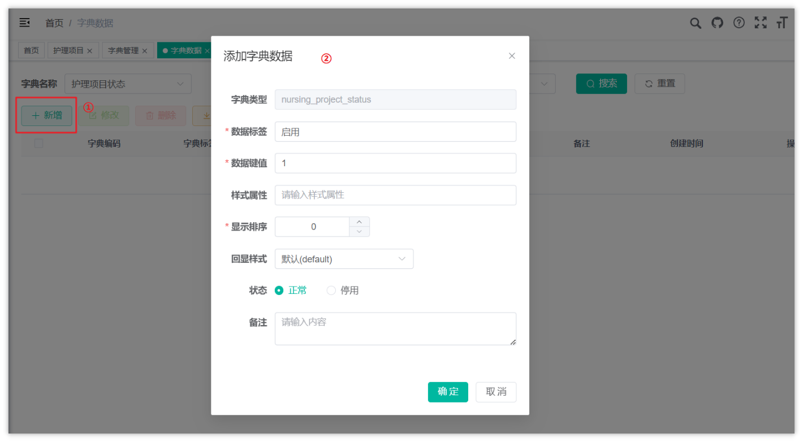

在护理项目的组件中引用字典并使用

```JavaScript
<template>
  <div class="app-container">
    <el-form :model="queryParams" ref="queryRef" :inline="true" v-show="showSearch" label-width="68px">
      <el-form-item label="名称" prop="name">
        <el-input v-model="queryParams.name" placeholder="请输入名称" clearable @keyup.enter="handleQuery" />
      </el-form-item>
      <el-form-item label="状态" prop="name">
        <el-select v-model="queryParams.status" placeholder="请选择" clearable>
          <el-option 
          v-for="item in nursing_project_status" 
          :key="item.value" 
          :label="item.label" 
          :value="item.value" />
        </el-select>
      </el-form-item>
     
      <el-form-item>
        <el-button type="primary" icon="Search" @click="handleQuery">搜索</el-button>
        <el-button icon="Refresh" @click="resetQuery">重置</el-button>
      </el-form-item>
    </el-form>
    <!-- 其他代码略 -->
  </div>
</template>

<script setup name="Project">
import { listProject, getProject, delProject, addProject, updateProject } from "@/api/nursing/project";

//获取当前组件的实例
const { proxy } = getCurrentInstance();

//引用数据字典
const { nursing_project_status } = proxy.useDict("nursing_project_status");

/* 
const options = ref([
  {
    value: 1,
    label: "启用"
  },
  {
    value: 0,
    label: "停用"
  }
]) */
</script>
```

> - 注释掉或删除options 
> - 使用proxy调用全局方法**useDict**,传入**字典类型，**返回值就是我们想要的数据
> - 在el-option标签中，循环获取字典数据
> - 使用数据字典之后，如果页面上没有生效，需要重启前端项目

### 护理项目-新增弹窗改造

目前若依框架给提供的新增或修改的弹窗效果如下：

这个很显然不太符合我们的需求

<grid>
<column width-ratio="0.500000">
目前生成好的效果
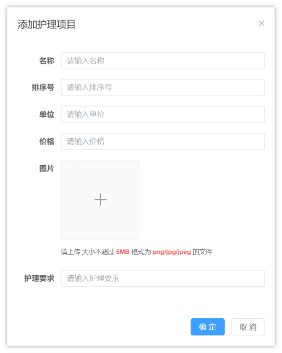
</column>
<column width-ratio="0.500000">
期望达到的效果
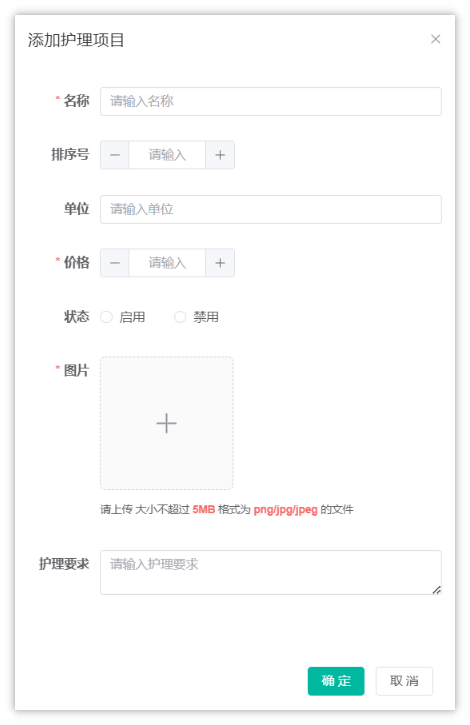
</column>
</grid>

经过对比，需要修复的内容如下：

- **排序号**和**价格**字段修改为数字输入框

  - 数字输入框  https://element-plus.org/zh-CN/component/input-number.html
- 新增一个状态字段，这个字段是一个单选框

  - 单选框  https://element-plus.org/zh-CN/component/radio.html

最终的代码，标颜色的部分是修改后的代码：

```HTML
<!-- 添加或修改护理项目对话框 -->
<el-dialog :title="title" v-model="open" width="500px" append-to-body>
  <el-form ref="projectRef" :model="form" :rules="rules" label-width="80px">
    <el-form-item label="名称" prop="name">
      <el-input v-model="form.name" placeholder="请输入名称" />
    </el-form-item>

    <el-form-item label="排序号" prop="orderNo">
      <el-input-number v-model="form.orderNo" 
      placeholder="请输入" 
      :min="1" 
      :max="20" />
    </el-form-item>
    <el-form-item label="单位" prop="unit">
      <el-input v-model="form.unit" placeholder="请输入单位" />
    </el-form-item>
    <el-form-item label="价格" prop="price">
      <el-input-number v-model="form.price" 
      placeholder="请输入" 
      :min="1" 
      :max="100" 
      :step="1" />
    </el-form-item>

    <el-form-item label="状态" prop="status">
      <el-radio-group v-model="form.status">
        <el-radio v-for="dict in nursing_project_status" 
        :key="dict.value" 
        :label="dict.value"
        >{{ dict.label}}</el-radio>
      </el-radio-group>
    </el-form-item>

    <el-form-item label="图片" prop="image">
      <image-upload v-model="form.image" />
    </el-form-item>
    <el-form-item label="护理要求" prop="nursingRequirement">
      <el-input v-model="form.nursingRequirement" placeholder="请输入护理要求" type="textarea"/>
    </el-form-item>
  </el-form>
  <template #footer>
    <div class="dialog-footer">
      <el-button type="primary" @click="submitForm">确 定</el-button>
      <el-button @click="cancel">取 消</el-button>
    </div>
  </template>
</el-dialog>
```

### 护理项目修改数据回显不全（状态）

修改护理项目的index组件，把状态改为字符串类型

```JavaScript
/** 修改按钮操作 */
function handleUpdate(row) {
  reset();
  const _id = row.id || ids.value
  getProject(_id).then(response => {
    form.value = response.data;
    form.value.status = String(form.value.status)
    open.value = true;
    title.value = "修改护理项目";
  });
}
```


## OSS集成

### 问题分析

在若依框架目前的实现中，是把图片存储到了服务器本地的目录，通过服务进行访问，这样做存储的是比较省事，但是缺点也有很多：

- **硬件与网络要求**：服务器通常需要高性能的硬件和稳定的网络环境，以保证文件传输的效率和稳定性。这可能会增加硬件和网络资源的成本和维护难度。
- **管理难度**：服务器目录需要管理员进行配置和管理，包括权限设置、备份策略等。如果管理不善或配置不当，可能会引发一些安全问题和性能问题。
- **性能瓶颈**：如果服务器处理能力不足或网络带宽不够，可能会导致性能瓶颈，影响文件上传、下载和访问的速度。
- **单点故障风险**：服务器故障可能导致所有存储在其上的文件无法访问，尽管可以通过备份和冗余措施来降低这种风险，但单点故障的风险仍然存在。

基于以上原因，企业中很多的文件都会存储到OSS中，OSS可以解决以上所有的问题，并且成本也不高，下面我们就把阿里的OSS集成到若依项目中。


目前实现的方案，对应的代码如下：

位置：zzyl-admin模块下，com.zzyl.web.controller.common.CommonController.uploadFile

```Java
/**
 * 通用上传请求（单个）
 */
@PostMapping("/upload")
public AjaxResult uploadFile(MultipartFile file) throws Exception
{
    try
    {
        // 上传文件路径
        String filePath = RuoYiConfig.getUploadPath();
        // 上传并返回新文件名称，保存到本地的目录中
        String fileName = FileUploadUtils.upload(filePath, file);
        String url = nursingrConfig.getUrl() + fileName;
        AjaxResult ajax = AjaxResult.success();
        ajax.put("url", url);
        ajax.put("fileName", fileName);
        ajax.put("newFileName", FileUtils.getName(fileName));
        ajax.put("originalFilename", file.getOriginalFilename());
        return ajax;
    }
    catch (Exception e)
    {
        return AjaxResult.error(e.getMessage());
    }
}
```


### 创建OSS模块

#### 方案说明

- 第一：把它集成到zzyl-framework模块中
- 第二：单独创建一个模块，专门来管理OSS（推荐使用）

  - 好处：可以实现模块化、解耦、复用和依赖管理，提高开发效率和代码质量

#### 集成步骤

1. 在父工程的pom文件中引入oss的依赖

```XML
<?xml version="1.0" encoding="UTF-8"?>
<project xmlns="http://maven.apache.org/POM/4.0.0"
         xmlns:xsi="http://www.w3.org/2001/XMLSchema-instance"
         xsi:schemaLocation="http://maven.apache.org/POM/4.0.0 http://maven.apache.org/xsd/maven-4.0.0.xsd">
    <modelVersion>4.0.0</modelVersion>
    
    <groupId>com.zzyl</groupId>
    <artifactId>zzyl</artifactId>
    <version>3.8.8</version>

    <name>zzyl</name>
    <url>http://www.ruoyi.vip</url>
    <description>中州养老后台管理系统</description>
    
    <properties>
        <aliyun.sdk.oss>3.17.4</aliyun.sdk.oss>
    </properties>

    <!-- 依赖声明 -->
    <dependencyManagement>
        <dependencies>
            <!-- 其他依赖省略... -->
            <dependency>
                <groupId>com.aliyun.oss</groupId>
                <artifactId>aliyun-sdk-oss</artifactId>
                <version>${aliyun.sdk.oss}</version>
            </dependency>
        </dependencies>
    </dependencyManagement>
</project>
```


1. 在父工程中创建子模块为：zzyl-oss，如下图所示

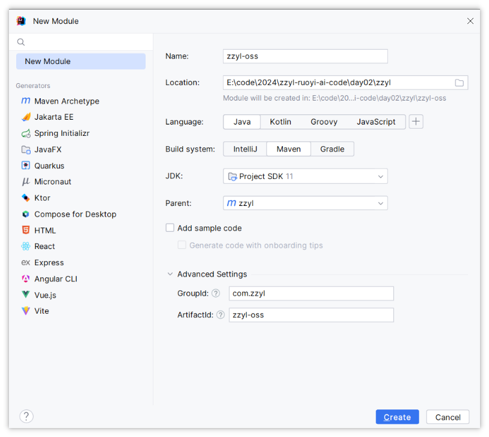

在zzyl-oss模块中引入新的依赖

```XML
<?xml version="1.0" encoding="UTF-8"?>
<project xmlns="http://maven.apache.org/POM/4.0.0"
         xmlns:xsi="http://www.w3.org/2001/XMLSchema-instance"
         xsi:schemaLocation="http://maven.apache.org/POM/4.0.0 http://maven.apache.org/xsd/maven-4.0.0.xsd">
    <modelVersion>4.0.0</modelVersion>
    <parent>
        <groupId>com.zzyl</groupId>
        <artifactId>zzyl</artifactId>
        <version>3.8.8</version>
    </parent>

    <artifactId>zzyl-oss</artifactId>

    <properties>
        <maven.compiler.source>11</maven.compiler.source>
        <maven.compiler.target>11</maven.compiler.target>
        <project.build.sourceEncoding>UTF-8</project.build.sourceEncoding>
    </properties>

    <dependencies>
        <dependency>
            <groupId>com.aliyun.oss</groupId>
            <artifactId>aliyun-sdk-oss</artifactId>
        </dependency>

        <dependency>
            <groupId>com.zzyl</groupId>
            <artifactId>zzyl-common</artifactId>
        </dependency>
    </dependencies>

</project>
```


1. 创建oss配置类及客户端

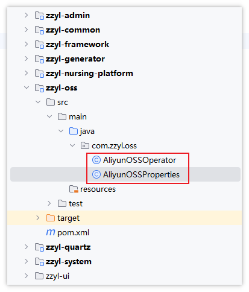

上面的两个类，可以从课程资料中直接拷贝，或者从web课程资料中获取（目前资料中已提供）

- AliyunOSSProperties：配置类，读取aliyun.oss为前缀的属性值（桶名称，域名站点）
- AliyunOSSOperator：通过OSSClient对oss进行交互，提供了**上传**和**删除**两个方法


1. zzyl-admin模块引入并配置

先把zzyl-oss模块注册到父工程中，在zzyl父工程的pom文件添加以下内容：

```XML
<!-- 依赖声明 -->
<dependencyManagement>
    <dependencies>

        <!-- 其他依赖配置省略...-->
       
        <!-- OSS模块 -->
        <dependency>
            <groupId>com.zzyl</groupId>
            <artifactId>zzyl-oss</artifactId>
            <version>${zzyl.version}</version>
        </dependency>
    </dependencies>
</dependencyManagement>
```

在zzyl-admin模块中引入zzyl-oss

```XML
<dependency>
    <groupId>com.zzyl</groupId>
    <artifactId>zzyl-oss</artifactId>
</dependency>
```

在application.yml文件中添加对oss的配置

```YAML
# 阿里云OSS相关配置
aliyun:
  oss:
    endpoint: https://oss-cn-beijing.aliyuncs.com
    bucketName: java110-ai
```

注意：需要将bucketName改成自己的哦


1. 修改上传的接口

找到zzyl-admin模块中的com.zzyl.web.controller.common.CommonController类，修改单个文件上传的方法

```Java
@Autowired
private AliyunOSSOperator aliyunOSSOperator;

/**
 * 通用上传请求（单个）
 */
@PostMapping("/upload")
public AjaxResult uploadFile(MultipartFile file) throws Exception
{
    try
    {
        // 上传文件路径
        String filePath = RuoYiConfig.getUploadPath();
        // 上传并返回新文件名称
//            String fileName = FileUploadUtils.upload(filePath, file);
        String url = aliyunOSSOperator.upload(file.getBytes(), file.getOriginalFilename());

//            String url = serverConfig.getUrl() + fileName;
        AjaxResult ajax = AjaxResult.success();
        ajax.put("url", url);
        ajax.put("fileName", url);
        ajax.put("newFileName", FileUtils.getName(url));
        ajax.put("originalFilename", file.getOriginalFilename());
        return ajax;
    }
    catch (Exception e)
    {
        return AjaxResult.error(e.getMessage());
    }
}
```

### 前端改造使用

由于之前的图片访问是本地的路径和服务，需要向后端发起请求才能获取图片，现在我们使用了OSS，图片可以直接通过互联网访问，无需再次访问后端服务，所以需要修改前端的图片访问逻辑

- 修改文件位置：src/components/imageUpload/index.vue
- 如果图片路径是以http开头的，则不走后台服务访问，直接访问OSS，之前的不变，如下图

```JavaScript
watch(() => props.modelValue, val => {
  if (val) {
    // 首先将值转为数组
    const list = Array.isArray(val) ? val : props.modelValue.split(",");
    // 然后将数组转为对象数组
    fileList.value = list.map(item => {
      if (typeof item === "string") {
        /* if (item.indexOf(baseUrl) === -1) {
          item = { name: baseUrl + item, url: baseUrl + item };
        } else {
          item = { name: item, url: item };
        } */
        if (item.indexOf("http") === -1) {
          item = { name: baseUrl + item, url: baseUrl + item };
        } else {
          item = { name: item, url: item };
        }
      }
      return item;
    });
  } else {
    fileList.value = [];
    return [];
  }
},{ deep: true, immediate: true });
```

测试是否能上传图片并展示

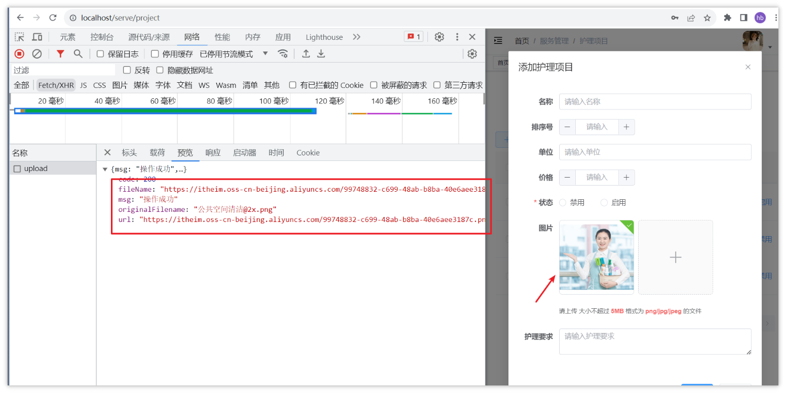

## 护理计划功能开发

到目前为止，我们已经完成了一个表的增删改查，并且也做了相应的优化，接下来，我们开始做一个跟护理项目相关的模块：护理计划

### 需求说明

我们打开原型来看：

- 列表查询

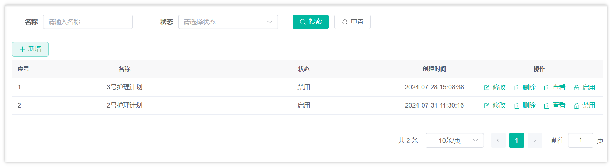

在这个页面中，同时也有一些按钮：新增、修改、删除、查看、禁用

- 新增或修改的弹窗

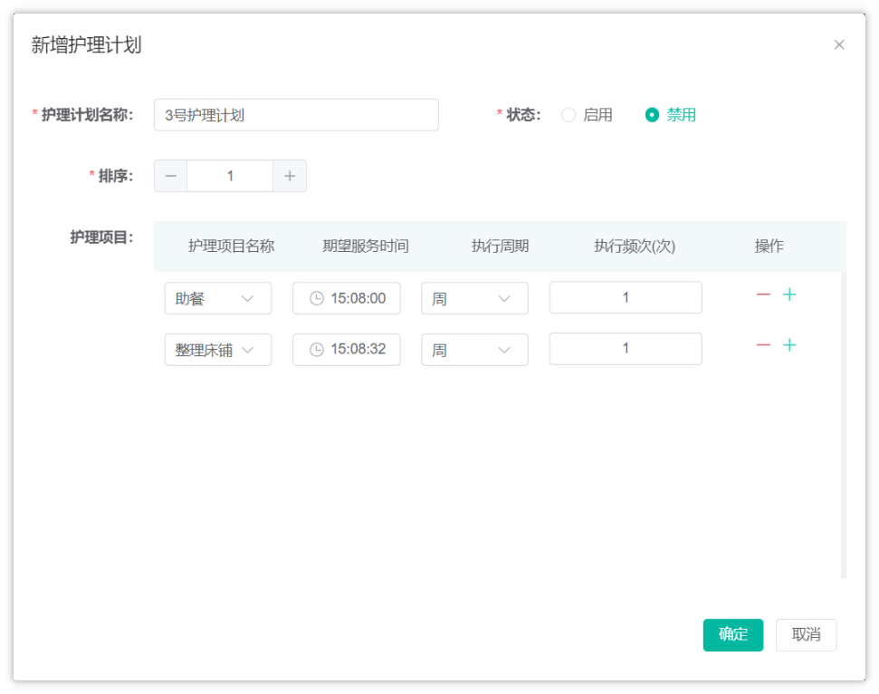

- 查看详情

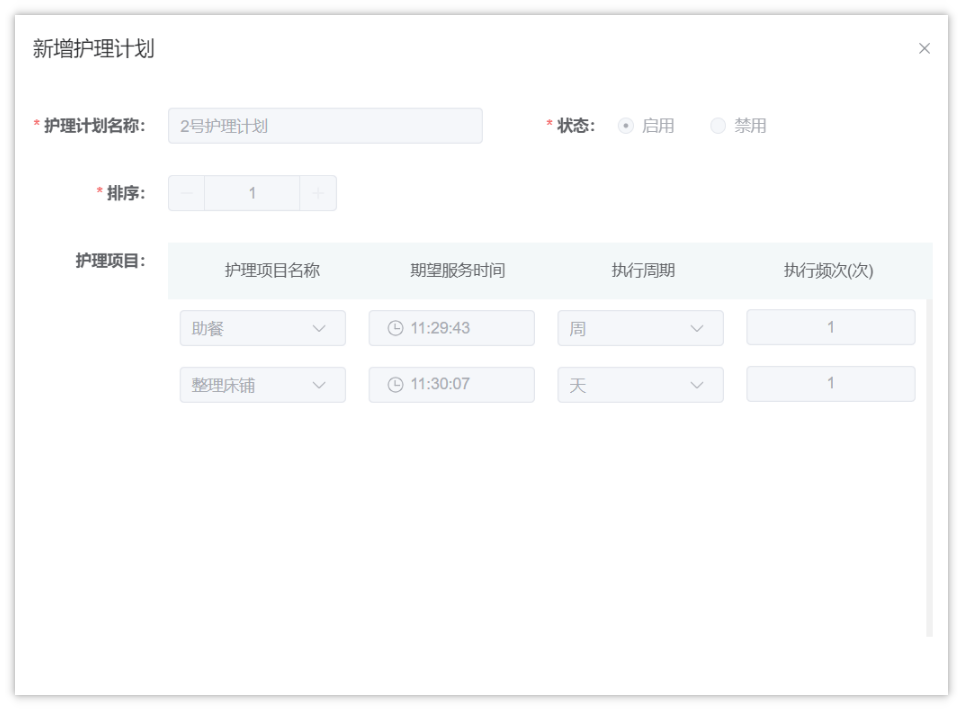


### 表关系说明

护理计划与护理项目的关系为**多对多，**需要有一张中间表nursing_project_plan

- 一个护理项目可以被多个护理计划引用
- 一个护理计划中也可以引用多个护理项目
- 具体的表关系，如下图：

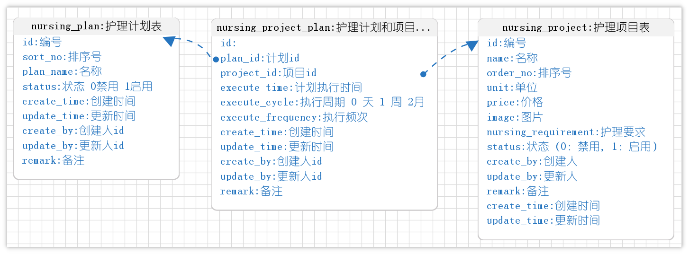

<callout emoji="✍️">
需求
服务管理：护理项目、护理计划、护理等级
后期给老人选配使用的，老人办理入住，要根据老人的健康情况、年龄推荐配置（护理等级）
不同的护理等级所关联的护理计划是不一样的，不同的护理计划，包含的护理项目是不同的，因此价格也是不同的
</callout>

### 接口说明

详细的接口文档，请查看：<cite doc-id="Dn9wwiXBvik60GkY3eFcSRQOnuc" file-type="wiki" title="护理模块-接口文档" type="doc"></cite>


### 功能实现

#### 准备工作

在前面的课程中，我们使用若依框架完成了护理计划和护理等级相关的代码生成，但是生成的代码并不能完全符合我们的业务需求，所以我们需要在生成代码的基础上进行**改造**

<callout emoji="📌">
后期的开发套路也都差不多，都是对生成之后的代码进行**改造**
</callout>

改造分为两部分，分别是前端代码和后端代码。在护理计划这个模块，**大家重点开发改造后端的代码**

##### 前端代码准备

前端代码可以使用当天资料中提供好的代码：

在这个文件夹中，分别包含了四个文件，大家需要拷贝到前端的对应目录下：

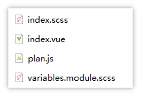

1. 拷贝index.scss和index.vue到之前护理计划所对应的目录下，替换掉之前的

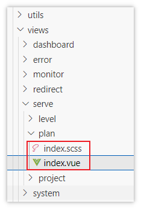

1. 拷贝plan.js到api/nursing目录下并替换掉之前的（可根据自己的实际情况选择目录进行拷贝）

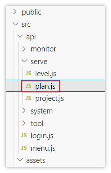

**特别注意：在plan.js文件中，定义了后端接口的路径，要保证与后端一致（如与自己的后端不一致，需要进行修正）**

1. 拷贝variables.module.scss到src/assets/styles目录下，替换原有的文件

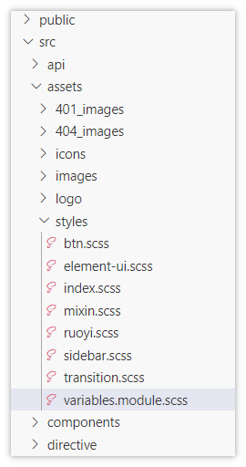

1. 在@/api/nursing/project.js中新增一个接口，查询所有的护理项目（稍后会开发这个接口）

```JavaScript
//查询所有护理项目
export function getProjectAll() {
  return request({
    url: '/nursing/project/all',
    method: 'get'
  })
}
```

1. 修复导入的路径和api请求路径

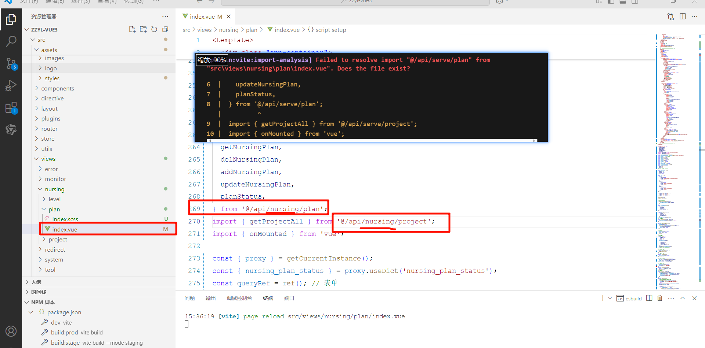

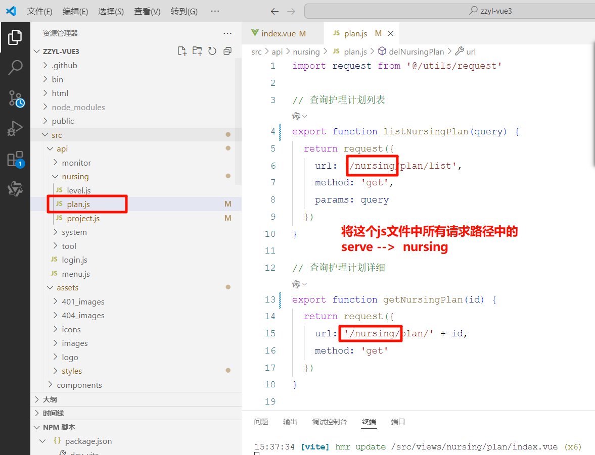

集成之后，报错属于正常现象，因为还没有提供对应的后端接口

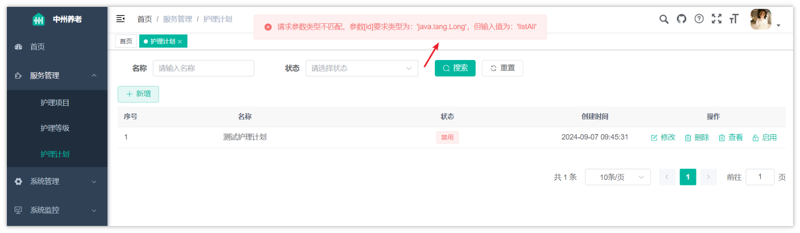


##### 后端代码准备

在这个模块需要操作两张表，分别是：

- **护理计划表（nursing_plan）**  该表的代码已生成（前一天已完成，修改若依代码生成模板后重新生成并替换掉原始的后端代码，资料中也提供了对应的代码）
- **护理项目计划关系表(nursing_project_plan)**  该表的代码需要借助若依生成**部分文件（实体类、mapper.java、mapper.xml）**


1. 打开后台管理系统，找到**代码生成**的菜单，导入**nursing_project_plan**表，然后直接预览，如下图

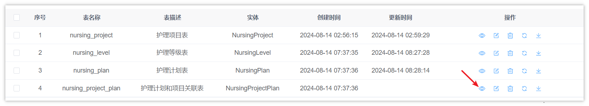

1. 拷贝内容如下图所示（实体类和mapper相关）

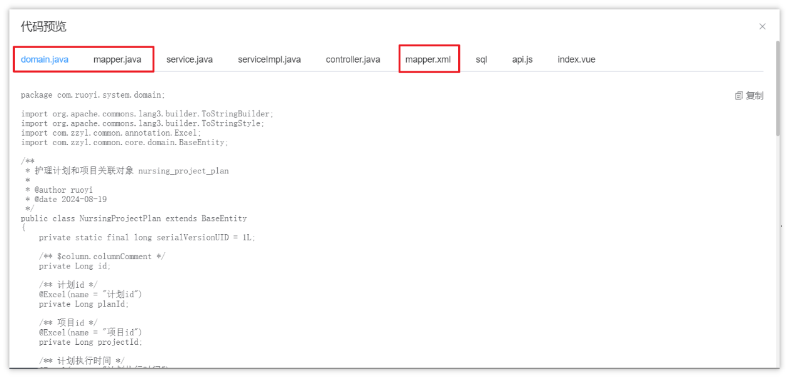

拷贝到项目中，如下：

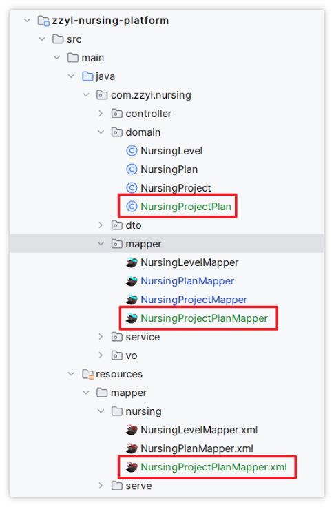

替换完前后端代码后，一定要重启后端测试护理计划页面是否能正常工作，如果有问题，先修改正确后再继续后面的内容哦。

#### 创建护理计划数据字典  

在护理计划列表中，有一个状态选项，是从数据字典（nursing_plan_status）获取数据的，效果如下：

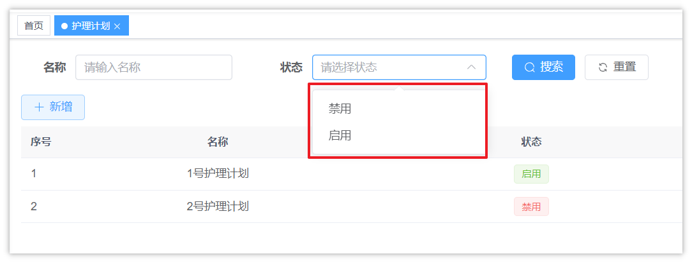

在**系统管理/字典管理**菜单中定义新的数据字典，详细定义如下：

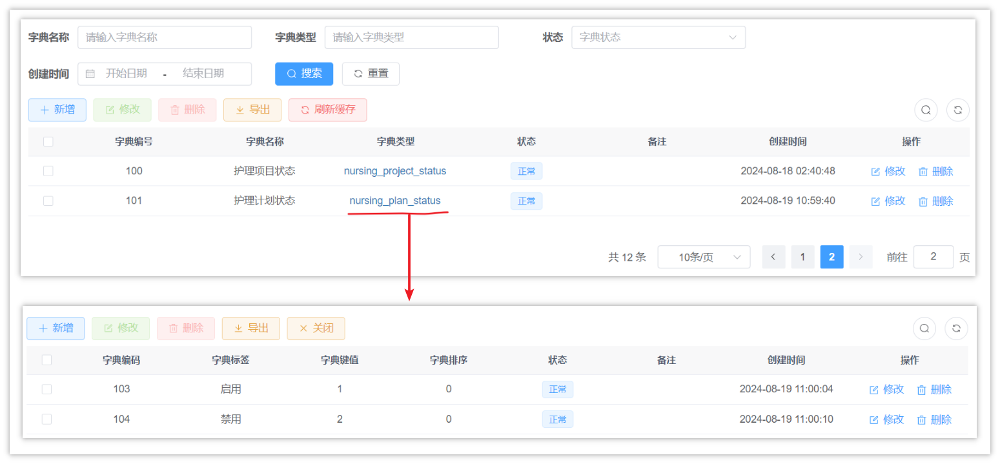

#### 查询所有护理项目

在新增计划对话框中，需要选择关联护理项目的列表，如下图

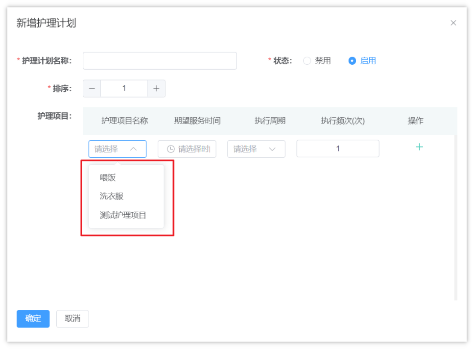

这个需要在护理项目的模块中定义一个查询的接口来查询所有的护理项目进行展示（需要结合<cite doc-id="Dn9wwiXBvik60GkY3eFcSRQOnuc" file-type="wiki" title="护理模块-接口文档" type="doc"></cite>中的定义）


1. 控制层

在NursingProjectController中定义新的方法，如下：

```Java
/**
 * 查询护理项目列表
 */
@GetMapping("/all")
@ApiOperation(value = "查询所有护理项目")
public AjaxResult listAll()
{
    List<NursingProjectVo> list = nursingProjectService.selectAll();
    return success(list);
}
```

NursingProject**Vo**

<callout emoji="📌">
**vo**即“Value Object”的缩写，通常用于封装数据，便于数据的传输和访问。
使用“**vo**”作为方法返回值的命名后缀，主要目的是明确该方法返回一个值对象，而不是一个实体（Entity）或者数据访问对象（DAO）等。这样做的好处包括：
1. 提高代码的可读性：其他开发者在阅读代码时，可以快速理解该方法返回一个值对象，而不是其他类型的对象。
2. 明确对象的用途：值对象通常用于封装数据，以便在应用程序的不同部分之间传输。通过命名约定，可以清晰地表明这些对象的用途。
3. 促进代码的一致性：在团队开发中，遵循共同的命名约定有助于保持代码的一致性，使得代码更易于维护和扩展。
4. 一般用作前端返回结果的封装
</callout>


**依据接口文档中定义的返回值**，该Vo具体的内容如下：

```Java
package com.zzyl.nursing.vo;

import lombok.Data;

@Data
public class NursingProjectVo {
    /**
     * 项目名称
     */
    private String label;

    /**
     * 项目ID
     */
    private String value;
}
```


1. 业务层

在INursingProjectService定义新的方法，如下：

```Java
/**
 * 查询所有护理项目
 * @return
 */
List<NursingProjectVo> selectAll();
```

对应的实现方法：

```Java
/**
 * 查询所有护理项目
 *
 * @return
 */
@Override
public List<NursingProjectVo> selectAll() {
    return nursingProjectMapper.selectAll();
}
```


1. 持久层

在NursingProjectMapper中定义新的方法，注意sql的返回值，要与接口文档中保持一致，如下：

```Java
@Select("select id value,name label from nursing_project where status = 1 ")
List<NursingProjectVo> selectAll();
```


1. 测试

重启服务，点击新增护理计划，检查是否能查看到所有的护理项目列表


#### 新增护理计划

1. 实现思路

接收到前端的参数包含了两部分内容，分别是：

- 护理计划相关的数据
- 护理计划绑定的护理项目列表（需要保存到nursing_project_plan中间表中）
- 由于涉及到了多张表操作，需要让多次数据库操作处于同一个事务下（保证数据一致性）
- 整体的处理逻辑如下：

<whiteboard token="AdTtwRIBXhSPv1byfzGcEgeFn6d"></whiteboard>


1. 控制层

在NursingPlanController中修改add方法，按照接口定义的参数 来创建对应的Dto参数，如下：

```Java
/**
 * 新增护理计划
 */
@PreAuthorize("@ss.hasPermi('nursing:nursingPlan:add')")
@Log(title = "护理计划", businessType = BusinessType.INSERT)
@PostMapping
public AjaxResult add(@RequestBody NursingPlanDto dto)
{
    return toAjax(nursingPlanService.insertNursingPlan(dto));
}
```

NursingPlan**Dto**

<callout emoji="📌">
DTO（Data Transfer Object）用于封装数据，以便在不同的软件应用程序之间传输数据，是一种开发规范
一般是接收前端参数
</callout>

根据接口文档中参数的定义，类的内容如下：

```Java
package com.zzyl.nursing.dto;

import com.zzyl.nursing.domain.NursingProjectPlan;
import io.swagger.annotations.ApiModelProperty;
import lombok.Data;

import java.util.List;

@Data
public class NursingPlanDto {


    private Long id;

    /**
     * 排序号
     */
    @ApiModelProperty(value = "排序号")
    private Integer sortNo;

    /**
     * 计划名称
     */
    @ApiModelProperty(value = "计划名称")
    private String planName;

    /**
     * 状态（0：禁用，1：启用）
     */
    @ApiModelProperty(value = "状态（0：禁用，1：启用）")
    private Integer status;

    /**
     * 护理计划关联项目列表
     */
    List<NursingProjectPlan> projectPlans;
}
```


1. 业务层

修改`INursingPlanService`中的`insertNursingPlan`方法，修改其参数，接收`NursingPlanDto`，详细如下：

```Java
/**
 * 新增护理计划
 * 
 * @param dto 护理计划
 * @return 结果
 */
public int insertNursingPlan(NursingPlanDto dto);
```

修改对应的实现类：

```Java
@Autowired
private NursingProjectPlanMapper nursingProjectPlanMapper;

/**
 * 新增护理计划
 * @param dto 护理计划
 * @return 结果
 */
@Transactional
@Override
public int insertNursingPlan(NursingPlanDto dto)
{
    // 保存护理计划
    // 属性拷贝
    NursingPlan nursingPlan = new NursingPlan();
    BeanUtils.copyProperties(dto, nursingPlan);
    nursingPlan.setCreateTime(DateUtils.getNowDate());
    nursingPlanMapper.insertNursingPlan(nursingPlan);

    // 批量保存护理项目计划关系
    int count = nursingProjectPlanMapper.batchInsert(dto.getProjectPlans(), nursingPlan.getId());
    return count == 0 ? 0 : 1;
}
```

<callout emoji="📌">
**代码说明**
1. `BeanUtils.`*`copyProperties`*`(dto, nursingPlan);`
含义是使用`BeanUtils`工具类将`dto`对象中的属性值拷贝到nursingPlan对象中，要求就是属性名和类型必须相同
1. 在当前方法上添加了一个`@Transactional`，保存方法内的多个表操作具备事务的特性，这个注解也可以定义在类上，表示当前类中的所有方法，都具备事务特性
</callout>


1. 持久层

我们需要在NursingProjectPlanMapper中提供一个批量插入的方法，代码如下：

```Java
int batchInsert(@Param("list") List<NursingProjectPlan> projectPlans, @Param("planId") Long planId);
```

- `@Param` 主要用于在方法参数中使用**多个**参数时，**明确参数名称**，以便在[SQL映射文件](https://www.baidu.com/s?wd=SQL%E6%98%A0%E5%B0%84%E6%96%87%E4%BB%B6&rsv_idx=2&tn=62095104_26_oem_dg&usm=2&ie=utf-8&rsv_pq=a3fcde4d008c032c&oq=mybatis%E7%9A%84%40param%E6%B3%A8%E8%A7%A3&rsv_t=83a2iiI4IaABo8Bz%2FtjC6GEnN%2B3GnuNCCGEzNo3EYB86s6AunLizwt7BOZkCJXUcKk%2Bsf%2Ba6NDvk&sa=re_dqa_generate)中通过`#{参数名}`的方式来引用这些参数。

对应的xml映射文件

```XML
<insert id="batchInsert">
    insert into nursing_project_plan (plan_id, project_id, execute_time, execute_cycle, execute_frequency,
                                      create_time)
    values
    <foreach collection="list" item="item" separator=",">
        (#{planId}, #{item.projectId}, #{item.executeTime}, #{item.executeCycle}, #{item.executeFrequency},
        sysdate())
    </foreach>
</insert>
```


#### 根据id查询护理计划

1. 思路说明

在修改护理计划或者是查看护理计划的时候，都需要查询护理计划的详细数据，并且这里面需要包含两部分内容：护理计划和护理计划关联的护理项目

<whiteboard token="WGVewn7NQhPg0YbFPSecfZGAnQg"></whiteboard>


1. 定义返回结果类：

NursingPlanVo 

```Java
package com.zzyl.nursing.vo;

import io.swagger.annotations.ApiModel;
import io.swagger.annotations.ApiModelProperty;
import lombok.Data;

import java.util.List;

@Data
@ApiModel(description = "护理计划")
public class NursingPlanVo {

    /**
     * 护理计划id
     */
    private Long id;

    /**
     * 排序号
     */
    @ApiModelProperty(value = "护理计划排序号")
    private Integer sortNo;

    @ApiModelProperty(value = "护理计划名称")
    private String planName;

    @ApiModelProperty(value = "状态（0：禁用，1：启用）")
    private Integer status;

    @ApiModelProperty(value = "护理计划项目计划列表")
    List<NursingProjectPlanVo> projectPlans;

}
```

NursingProjectPlanVo 这个类就是把projectId改为了字符串类型，方便前端回显

```Java
package com.zzyl.nursing.vo;

import com.zzyl.common.annotation.Excel;
import lombok.Data;

@Data
public class NursingProjectPlanVo {

    /** 项目id */
    private String projectId;

    /** $column.columnComment */
    private Long id;

    /** 计划id */
    @Excel(name = "计划id")
    private Long planId;

    /** 计划执行时间 */
    @Excel(name = "计划执行时间")
    private String executeTime;

    /** 执行周期 0 天 1 周 2月 */
    @Excel(name = "执行周期 0 天 1 周 2月")
    private String executeCycle;

    /** 执行频次 */
    @Excel(name = "执行频次")
    private Long executeFrequency;
}
```

1. 控制层

将返回值类型改为NursingPlanVo：

```SCSS
/**
 * 获取护理计划详细信息
 */
@PreAuthorize("@ss.hasPermi('nursing:plan:query')")
@GetMapping(value = "/{id}")
@ApiOperation("获取护理计划详细信息")
public R<NursingPlanVo> getInfo(@ApiParam(value = "护理计划ID", required = true)
        @PathVariable("id") Long id)
{
    return R.ok(nursingPlanService.selectNursingPlanById(id));
}
```

1. 业务层

修改INursingPlanService中的selectNursingPlanById，定义符合接口规范的返回值

```Java
/**
 * 查询护理计划
 * 
 * @param id 护理计划主键
 * @return 护理计划
 */
public NursingPlanVo selectNursingPlanById(Long id);
```


修改其实现方法返回值，以及详细的实现逻辑如下：

```Java
/**
 * 查询护理计划
 * 
 * @param id 护理计划主键
 * @return 护理计划
 */
@Override
public NursingPlanVo selectNursingPlanById(Long id)
{
    // 1.根据id查询护理计划
    NursingPlan nursingPlan = nursingPlanMapper.selectNursingPlanById(id);
    NursingPlanVo nursingPlanVo = new NursingPlanVo();
    BeanUtils.copyProperties(nursingPlan, nursingPlanVo);

    // 2.根据护理计划id查询关联的所有护理项目
    List<NursingProjectPlanVo> list = nursingProjectPlanMapper.selectByPlanId(id);

    nursingPlanVo.setProjectPlans(list);
    return nursingPlanVo;
}
```


1. 持久层

在NursingProjectPlanMapper定义按照护理计划ID查询列表的方法，如下

```Java
/**
 * 根据计划id查询项目计划
 * @param id
 * @return
 */
List<NursingProjectPlanVo> selectByPlanId(Long id);
```

对应的映射文件：

```XML
<select id="selectByPlanId" resultType="com.zzyl.nursing.vo.NursingProjectPlanVo">
    select id, plan_id, project_id, execute_time, execute_cycle, execute_frequency
        from nursing_project_plan
        where plan_id = #{id}
</select>
```


#### 修改护理计划

**实现思路**

修改护理计划的时候，也是操作两张表，基本的思路如下图：

<whiteboard token="L8ymwWUYthPlWhb19XfcQfm2nBg"></whiteboard>

1. 控制层

修改控制层的edit方法的参数，接收NursingPlanDto类

```Java
/**
 * 修改护理计划
 */
@PreAuthorize("@ss.hasPermi('nursing:plan:edit')")
@Log(title = "护理计划", businessType = BusinessType.UPDATE)
@PutMapping
@ApiOperation("修改护理计划")
public AjaxResult edit(@ApiParam(value = "护理计划实体", required = true) @RequestBody NursingPlanDto dto)
{
    return toAjax(nursingPlanService.updateNursingPlan(dto));
}
```

1. 业务层

基于提供的思路流程图，修改INursingPlanService接口中的修改的方法的参数，代码如下：

```Java
/**
 * 修改护理计划
 * 
 * @param dto 护理计划
 * @return 结果
 */
public int updateNursingPlan(NursingPlanDto dto);
```

实现类中的方法：

```Java
/**
 * 修改护理计划
 * 
 * @param dto 护理计划
 * @return 结果
 */
@Override
public int updateNursingPlan(NursingPlanDto dto)
{
    try {
        // 属性拷贝
        NursingPlan nursingPlan = new NursingPlan();
        BeanUtils.copyProperties(dto, nursingPlan);

        // 判断dto中的项目列表为空，如果不为空，则先删除护理计划与护理项目的关系，然后重新批量添加
        if (dto.getProjectPlans() != null || !dto.getProjectPlans().isEmpty()) {
            // 删除护理计划对应的护理项目列表
            nursingProjectPlanMapper.deleteByPlanId(nursingPlan.getId());
            // 补全护理计划id
            List<NursingProjectPlan> projectPlans = dto.getProjectPlans();
            projectPlans.forEach(nursingProjectPlan -> nursingProjectPlan.setPlanId(nursingPlanDto.getId()));
            // 批量保存护理计划对应的护理项目列表
            nursingProjectPlanMapper.batchInsert(projectPlans, nursingPlan.getId());
        }

        // 不管项目列表是否为空，都要修改护理计划
        return nursingPlanMapper.updateNursingPlan(nursingPlan);
    } catch (BeansException e) {
        throw new RuntimeException(e);
    }
}
```

1. 持久层

在NursingProjectPlanMapper中定义根据护理计划ID删除的方法和SQL

```Java
@Delete("delete from nursing_project_plan where plan_id = #{planId}")
void deleteByPlanId(Long planId);
```

1. 其他补充，由于新增、修改、删除都是操作两张表，都需要事务的控制，可以在NursingPlanServiceImpl上添加事务的注解`@Transactional`

```Java
@Transactional
@Service
public class NursingPlanServiceImpl implements INursingPlanService 
{
//其他代码省略...
}
```

#### 删除护理计划

**实现思路**

删除护理计划的时候，也要操作两张表，基本的思路是如下图：

<whiteboard token="ME13wo0XDhkOMNbjV0Ecmi9Sn5g"></whiteboard>

1. 控制层

在NursingPlanController修改删除的方法，如下：

```Java
/**
 * 删除护理计划
 */
@PreAuthorize("@ss.hasPermi('nursing:plan:remove')")
@Log(title = "护理计划", businessType = BusinessType.DELETE)
@DeleteMapping("/{id}")
@ApiOperation("删除护理计划")
public AjaxResult remove(@ApiParam(value = "要删除的数据id") @PathVariable Long id)
{
    return toAjax(nursingPlanService.deleteNursingPlanById(id));
}
```

1. 业务层，只需要修改deleteNursingPlanById即可，需要在两张表中都删除

```Java
/**
 * 删除护理计划信息
 * 
 * @param id 护理计划主键
 * @return 结果
 */
@Override
public int deleteNursingPlanById(Long id)
{
    // 删除护理计划与护理项目的关系
    nursingProjectPlanMapper.deleteByPlanId(id);
    // 删除护理计划
    return removeById(id) ? 1 : 0;
}
```

## 微实战-护理等级

### 需求说明

下图是实现后的护理等级查询列表

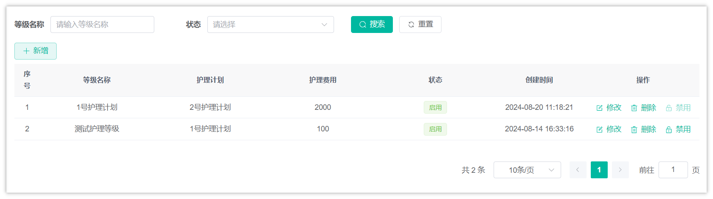

在这个列表中有一些按钮：新增、修改、删除、启用|禁用


下图是新增和修改的弹窗，其中的护理计划是一个下拉列表

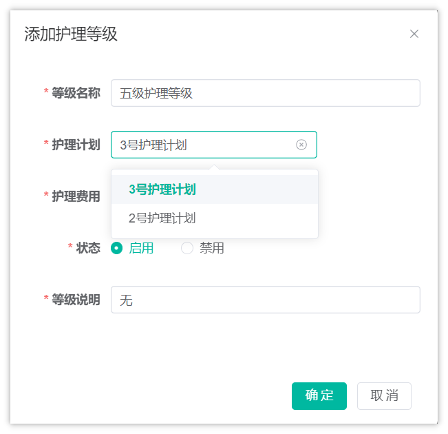

下拉框组件：https://element-plus.org/zh-CN/component/select.html

### 要求

请利用自己开发护理项目和护理计划的经验来开发护理等级模块。

重点提示：

- 首要任务是读懂需求
- 根本是熟悉表中每一个字段含义
- 一定要结合接口文档


### 提示

服务管理共有4张表

<whiteboard token="SDzKw8xw4hnUSubfZ8gc1m4knde"></whiteboard>


## 写完作业后，准备明天的初始代码

参考

<cite doc-id="EUXKwZci8iyMAFkMkYWcYPf9nEf" file-type="wiki" title="初始代码-环境准备" type="doc"></cite>

---
> 来源：飞书技术知识库（脱敏版） · 07 业务组件方案集 / 中州养老项目（若依+AI） / 第一章-若依+AI快速开发新项目 / 03-前后端快速开发 · [原文](https://ccn8v2zngwsm.feishu.cn/wiki/TzGMwl98ricc4Zk2AtccdvtBnrf)
