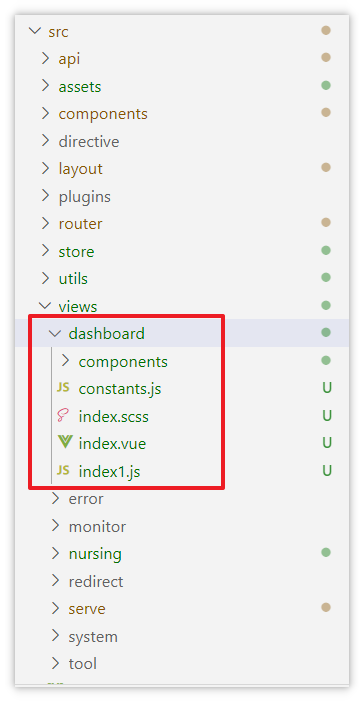
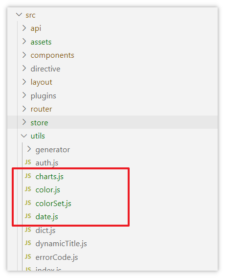
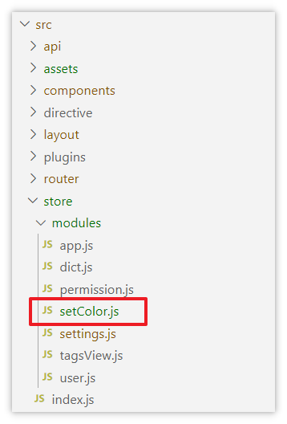
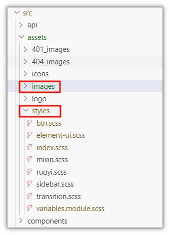
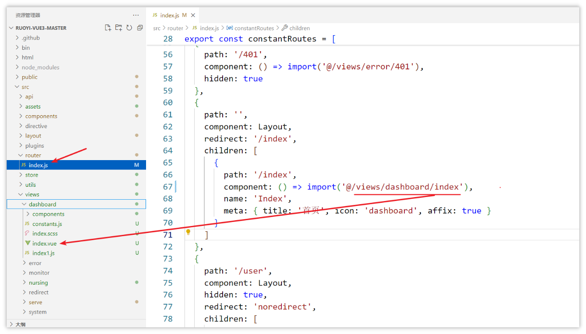
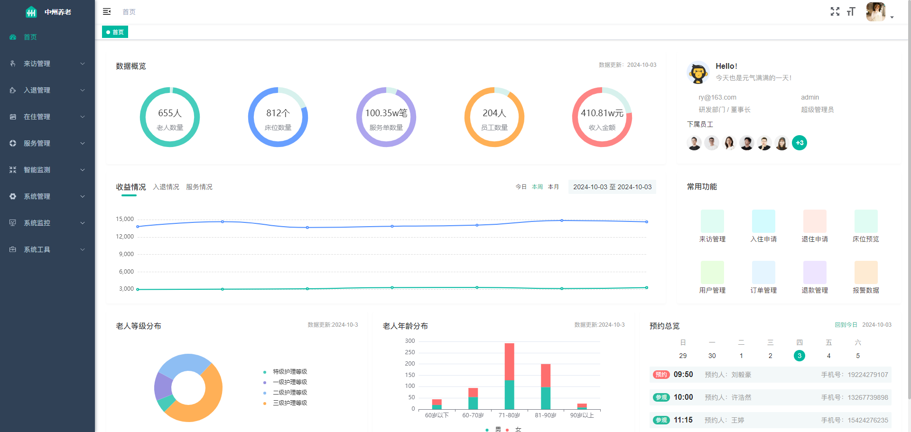

# 首页组件集成

1，代码拷贝资料中的**dashboard**目录到src/views目录中

拷贝后的效果如下：

1. 拷贝js依赖

拷贝资料中的utils文件夹中的内容到src/utils目录中

拷贝后的效果：

拷贝资料中的modules中的文件到src/store/modules目录中

拷贝后的效果如下：

1. 拷贝样式和图片

拷贝资料中的**images**文件夹到src/asserts目录中，替换原有内容

拷贝后的效果如下：

1. 修改路由

修改src/router/index.js文件，把首页的配置改为自己的首页路径，详细代码如下：

集成成功后的效果：

---
> 来源：飞书技术知识库（脱敏版） · 07 业务组件方案集 / 中州养老项目（若依+AI） / 第一章-若依+AI快速开发新项目 / 03-前后端快速开发 / 首页组件集成 · [原文](https://ccn8v2zngwsm.feishu.cn/wiki/Pt3TwyjTyiNJDsk2fSPcfHIPnHg)
