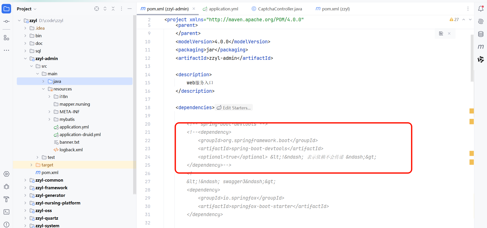
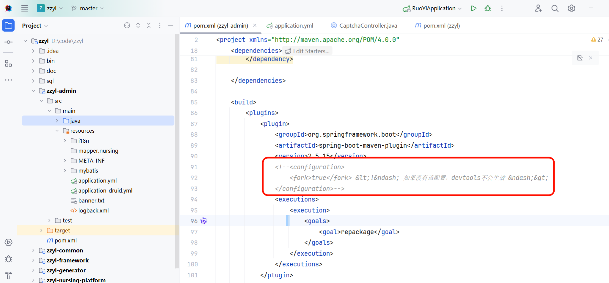
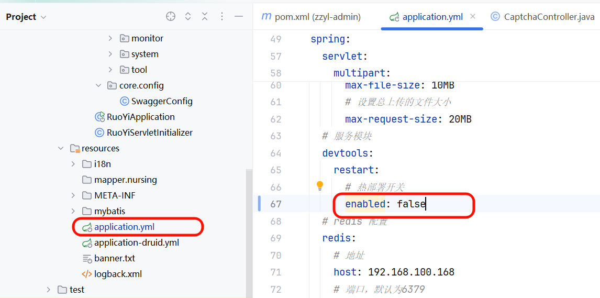
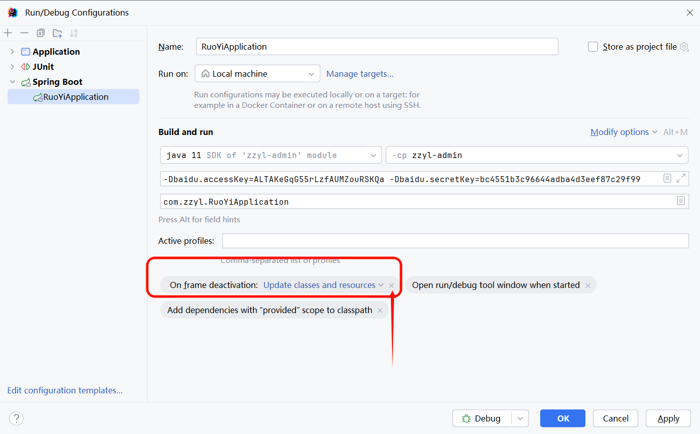

# 若依项目取消热部署(可选)

1. 在admin模块删除依赖

1. 在admin的yml配置文件里面把热部署开关给删除配置

1. 修改启动项配置

1. 刷新maven，重启项目就不会自动热部署了

---
> 来源：飞书技术知识库（脱敏版） · 07 业务组件方案集 / 中州养老项目（若依+AI） / 第一章-若依+AI快速开发新项目 / 若依项目取消热部署(可选) · [原文](https://ccn8v2zngwsm.feishu.cn/wiki/GAnywDzV0i1CRJkasShcp2YOn8c)
