# 项目笔记·01

### 整体业务流程

中州养老系统是为**养老院**量身定制开发的专业的养老管理软件产品；涵盖来访管理、入退管理、在住管理、服务管理、财务管理等功能模块，涉及从来访参观到退住办理的完整流程。

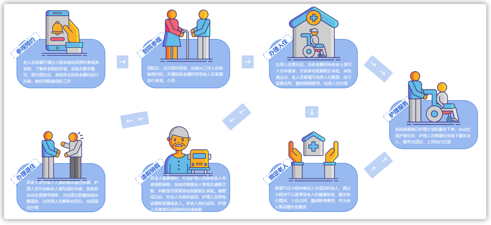

**项目原型**访问地址：https://codesign.qq.com/s/459277624064324   密码: FSTI

中州养老项目分为两端，一个是管理后台，另外一个是家属端

- 管理后台：养老院员工使用，入住、退住，给老人服务记录等等
- 家属端：养老院的老人家属使用，查看老人信息，缴费，下订单等等

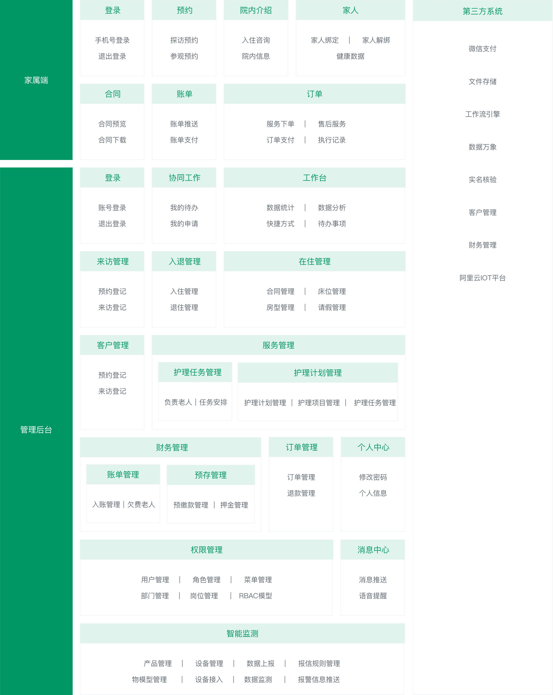

业务主页效果：

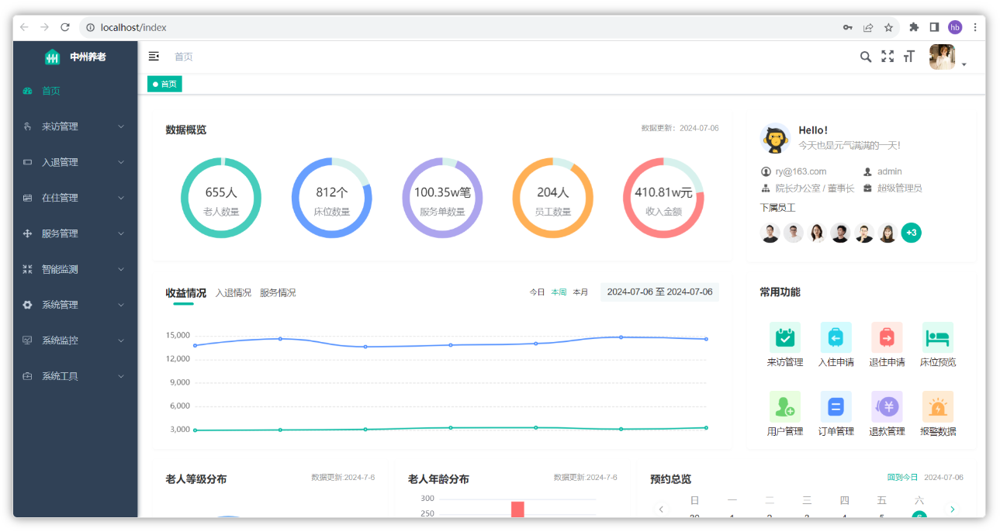


> 教育公司无养老相关资质，小程序无法正式上架，无法体验。在课程的对应阶段，我们会进行调试开发

### 技术架构

下图展现了中州养老项目主要使用的技术：

<whiteboard token="WKn2wLMDAhpkl3bWH9qcqkzWnEf"></whiteboard>

- 前端主要使用的Vue3+Element Plus
- 后端主要使用的是若依作为基础架构，当然后端也集成了很多其他的技术，比如有Springboot、Mybatis、Swagger、Spring cache、Spring Security、**Mybatis-Plus**等
- 数据存储主要使用到了MySQL和Redis
- 使用了nginx来作为反向代理和前端的静态服务器
- 其他技术：华为云物联网平台IOT、对象存储OSS、微信登录、千帆大模型、AI工具辅助开发等

## 若依框架

### 基本介绍

若依（RuoYi）框架是一款基于Spring Boot、Spring Cloud等开源框架搭建的企业级开发平台。它的主要目标是提供全面的解决方案，以简化企业级应用开发，**提高开发效率**。以下是对若依框架的详细介绍：

1. **模块化设计**：若依框架采用模块化的设计，使得应用可以根据需求进行灵活的扩展和定制。每个模块都可以独立部署和升级，这大大提高了系统的可维护性和可扩展性。
2. **前后端分离**：框架采用前后端分离的开发模式，后端专注于数据处理和API接口的提供，前端则负责页面的展示和用户交互。这种模式使得前后端职责明确，进一步提高了开发效率和代码的可维护性。
3. **权限管理**：若依框架提供了完善的用户权限管理功能，包括角色管理、菜单授权、部门管理等，便于对系统权限进行灵活的配置和管理。
4. **代码生成器**：框架内置代码生成器，能够快速生成前后端代码，减少重复劳动，提高开发效率。通过简单的配置即可生成基础的增删改查代码。
5. **定时任务**：若依框架集成了定时任务模块，支持动态添加定时任务，可以通过界面对定时任务进行管理与调度。此外，框架还能实时查看系统运行日志和在线用户信息，监控服务状态和性能。
6. **易于集成**：若依框架可以轻松地与其他常用技术栈集成，如MySQL、Redis、消息队列等。这使得开发者可以根据项目需求灵活地选择合适的技术组件，降低技术门槛和成本。

此外，若依框架还集成了许多常用功能模块，如文件上传下载、消息推送、数据字典、日志管理等。

总的来说，若依框架是一款功能丰富、易于扩展和定制的企业级开发平台，适用于各种Web应用程序的开发。它能够帮助开发者快速构建功能完备的应用，提高开发效率，降低维护成本。


若依官网地址：

<bookmark name="RuoYi 若依官方网站 |后台管理系统|权限管理系统|快速开发框架|企业管理系统|开源框架|微服务框架|前后端分离框架|开源后台系统|RuoYi|RuoYi-Vue|RuoYi-Cloud|RuoY" href="https://ruoyi.vip/"></bookmark>

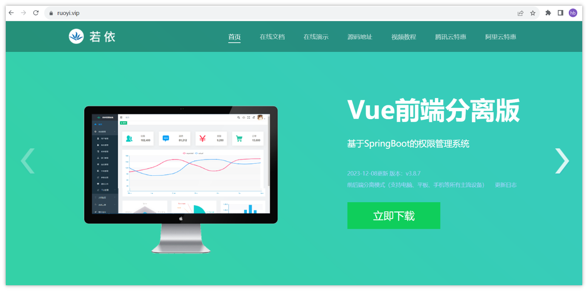

若依框架分为四个版本：

- 前后端不分离版本RuoYi（单体）
- 前后端分离版RuoYi-Vue（单体）本项目使用版本
- 微服务版本RuoYi-Cloud
- 移动端版RuoYi-App

<callout emoji="🌲">
前三个都提供了前后端的项目，移动版可以适配RuoYi-Vue和RuoYi-Cloud
</callout>


### RuoYi-Vue前后端分离版

我们课程中重点讲解的是RuoYi-Vue前后端分离版本，

文档地址：

<bookmark name="介绍 | RuoYi" href="https://doc.ruoyi.vip/ruoyi-vue/"></bookmark>

#### 概述

RuoYi-Vue 是一个 Java EE 企业级快速开发平台，基于经典技术组合（Spring Boot、Spring Security、MyBatis、Jwt、Vue），内置模块如：部门管理、角色用户、菜单及按钮授权、数据权限、系统参数、日志管理、代码生成等。在线定时任务配置；支持集群，支持多数据源，支持分布式事务。

演示地址：

<bookmark name="若依管理系统" href="http://vue.ruoyi.vip"></bookmark>

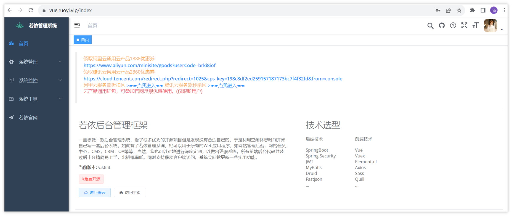

#### 技术选型

1、系统环境

- Java EE 8   ---> jdk 11
- Servlet 3.0
- Apache Maven 3

2、主框架

- Spring Boot 2.5.x
- Spring Framework 5.2.x
- Spring Security 5.2.x   安全框架

3、持久层

- Apache MyBatis 3.5.x  ---> MyBatis Plus
- Hibernate Validation 6.0.x   校验框架
- Alibaba Druid 1.2.x

4、视图层

- Vue 2.6.x   ---->  Vue3
- Axios 0.21.x
- Element 2.15.x     ---->  Element Plus


## 环境搭建

熟悉了若依的基本情况之后，下面，我们就快速上手，来把这个框架搭建起来，并且需要顺利跑起来

### 准备工作

基础软件准备

| 官方推荐 | 优化升级 |
|-|-|
| JDK >= 1.8 (推荐1.8版本)  | 升级为JDK 11  资料中提供了安装包 |
| Maven >= 3.0 | 不需要安装，直接使用IDEA中自带的Maven即可 |
| Node >= 12 | 前端代码由vue2升级为vue3，需要Node 18及以上的版本 |
| Mysql >= 5.7.0 (推荐5.7版本)  | 升级为MySQL 8 |
| Redis >= 3.0 | 本地启动 |

一般企业中服务器都是部署了一些项目中公用的基础环境，比如MySQL、Redis等这些。这些服务都是部署在linux服务器中，这些服务可能是部署在公司的一个**机房**中，也有可能是**云服务器**（中小企业居多）。

在我们教学的过程中，为了还原更真实的企业环境，我们可以在VMWare软件中来部署linux服务器，当做我们开发中的公用服务器，具体的VMWare的服务配置

请参考如下链接：<cite doc-id="QdGXwSbphih6xOkvsNBckwsvnob" file-type="wiki" title="虚拟机环境说明" type="doc"></cite>


在目前提供的虚拟机环境中已经使用docker安装了对应的基础环境

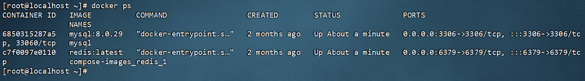

详细说明如下：

| **软件名称** | **说明** |
|-|-|
| MySQL | 默认用户名：root，默认密码：heima123，端口：3306 |
| Redis | 默认密码：123456，端口：6379 |

> 运行中州养老项目，需要使用到MySQL和Redis，因此，这两个服务已经设置了开机自启，过几天咱们的课程中会详细讲解和使用Redis


### 运行后端项目

#### 下载代码

- 代码下载地址：[https://gitee.com/y_project/RuoYi-Vue](https://gitee.com/y_project/RuoYi-Vue)[ ](https://gitee.com/y_project/RuoYi-Vue)

  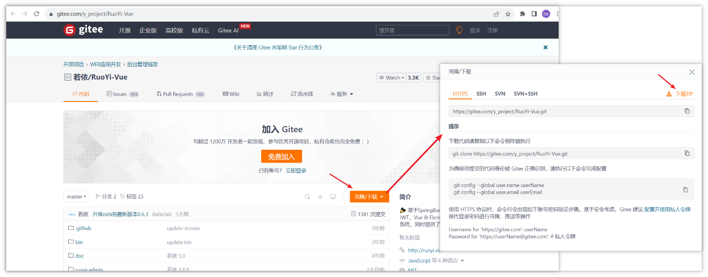

由于若依提供的代码的包名和项目名和咱们的需求不一致，因此这里暂时不要采用Git克隆的方式下载代码，直接下载ZIP包到本地，然后先替换所有的包名和项目名，再使用idea打开项目

#### 包名全局替换

- 从官方下载的代码中所有包名都为com.rouyi，且数据库连接信息需要修改，此时，咱们可以借助于若依框架修改器来一键修改：
- 参考链接：https://gitee.com/lpf_project/RuoYi-MT/releases
- 可以使用资料中提供的包名修改器


请参考下方截图进行修改哦

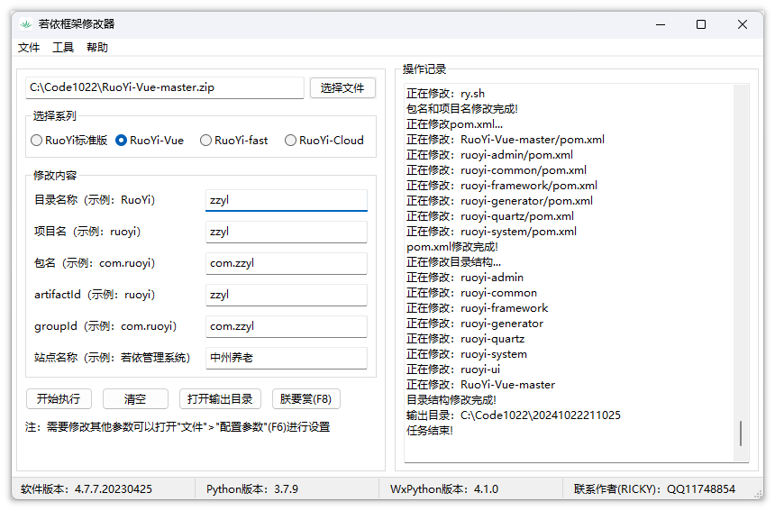

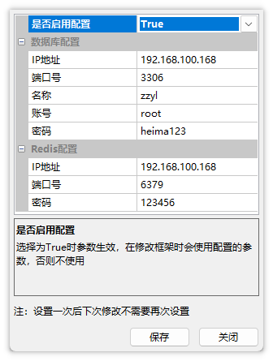

- 修改完成之后，修改器会自动导出一个新的目录，将目录复制到你的代码目录中，然后使用idea打开即可：

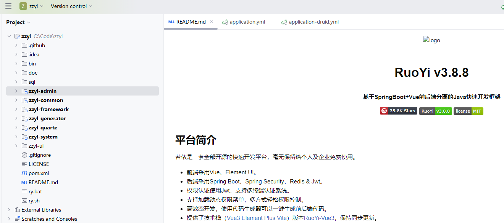

打开项目后，先修改项目和模块使用的JDK版本为11。

- 修改pom.xml文件中JDK的版本为11

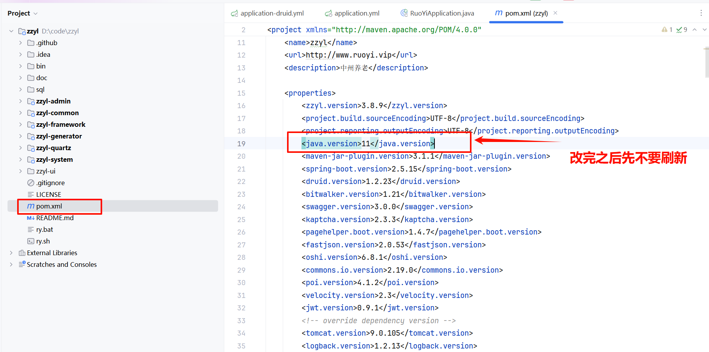

注意：先不要刷新

#### JDK配置

1. 解压资料中提供的jdk11, 到非中文没有特殊字符的目录

`项目搭建、从0开始用若依\资料\JDK11、NodeJS\jdk-11.0.20_windows-x64_bin.zip`

1. 配置环境变量

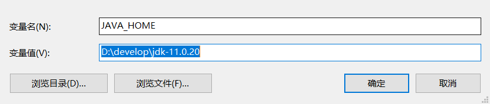


#### maven配置

打开之后，需要配置maven的本地仓库，建议将资料中的本地仓库先解压到自己的Maven仓库中（初次下载较慢）

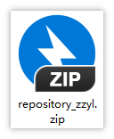

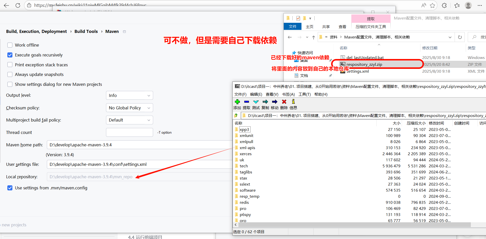


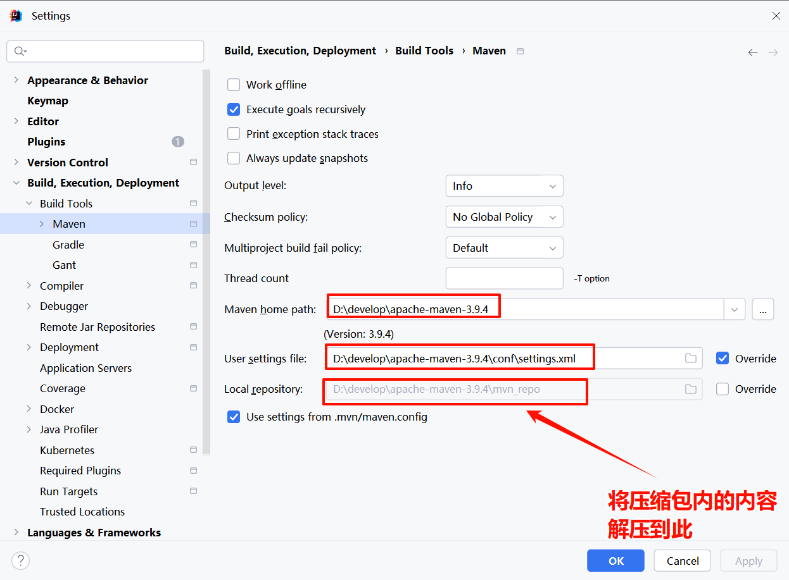

改完之后刷新maven。

idea中的配置

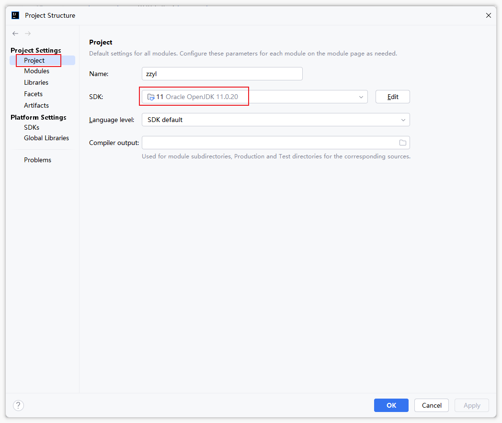

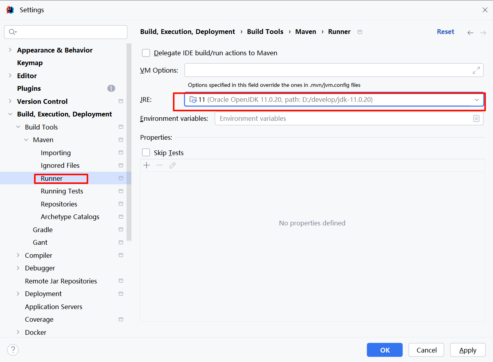

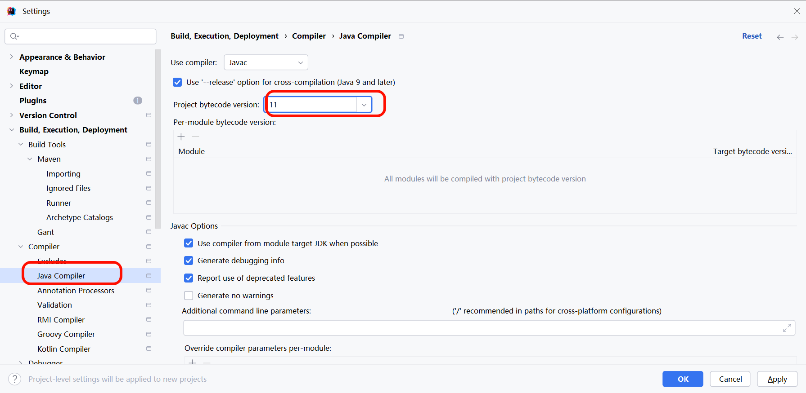

- 修改idea中的项目编码为utf-8

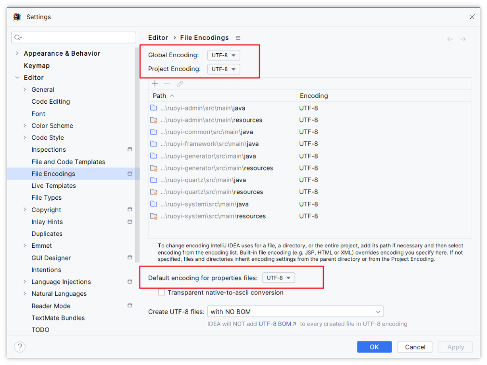

#### 数据库准备和配置

- 数据库使用的MySQL 8

  - 默认的用户名：root
  - 默认的密码：heima123

在idea中创建数据库并导入项目中的基础表结构和数据

- 创建数据库 **zzyl （可以打开项目根目录下的sql/ry_2024xxxx.sql文件，在最上方添加以下内容）**

```Java
create database if not exists zzyl;
use zzyl;
```

- 导入项目根目录下的sql/ry_2024xxxx.sql文件，如下图

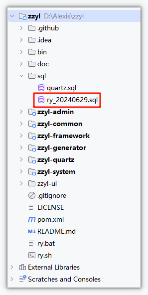

sql执行成功以后，修改数据库连接，找到ruoyi-admin模块中的`resources`目录下的`application-druid.yml`

```YAML
# 数据源配置
spring:
    datasource:
        type: com.alibaba.druid.pool.DruidDataSource
        driverClassName: com.mysql.cj.jdbc.Driver
        druid:
            # 主库数据源
            master:
                url: jdbc:mysql://192.168.100.168:3306/zzyl?useUnicode=true&characterEncoding=utf8&zeroDateTimeBehavior=convertToNull&useSSL=true&serverTimezone=GMT%2B8
                username: root
                password: heima123
```

#### Redis配置

找到ruoyi-admin模块中的`resources`目录下的`application.yml`，如下配置：

```YAML
# Spring配置
spring:
  redis:
    # 地址
    host: 192.168.100.168
    # 端口，默认为6379
    port: 6379
    # 数据库索引
    database: 0
    # 密码
    password: 123456
    # 连接超时时间
    timeout: 10s
    lettuce:
      pool:
        # 连接池中的最小空闲连接
        min-idle: 0
        # 连接池中的最大空闲连接
        max-idle: 8
        # 连接池的最大数据库连接数
        max-active: 8
        # #连接池最大阻塞等待时间（使用负值表示没有限制）
        max-wait: -1ms
```


#### 运行项目

找到ruoyi-admin模块中的运行`com.zzyl.RuoYiApplication.java`，出现如下图表示启动成功。

```Bash
(♥◠‿◠)ﾉﾞ  若依启动成功   ლ(´ڡ`ლ)ﾞ  
 .-------.       ____     __        
 |  _ _   \      \   \   /  /    
 | ( ' )  |       \  _. /  '       
 |(_ o _) /        _( )_ .'         
 | (_,_).' __  ___(_ o _)'          
 |  |\ \  |  ||   |(_,_)'         
 |  | \ `'   /|   `-'  /           
 |  |  \    /  \      /           
 ''-'   `'-'    `-..-'    
```

---
> 来源：飞书技术知识库（脱敏版） · 07 业务组件方案集 / 中州养老项目（若依+AI） / 项目笔记·01 · [原文](https://ccn8v2zngwsm.feishu.cn/wiki/QhMIwXvGxiPUqwkRzo4cVNxdnJe)
