# 01-从0开始用若依

## 目标

各位同学，大家好，今天开始，我们正式进入项目内容的学习，咱们要完成的是一个基于若依框架+AI的养老项目

<callout emoji="🍓">
为什么要基于若依框架开发？
1. 快速开发：若依框架提供了许多现成的模块和工具，能够快速搭建起一个基本的应用框架，从而减少了开发的时间和工作量。
2. 高度可定制性：若依框架提供了丰富的插件和扩展点，可以根据项目的需求进行定制和扩展，满足不同项目的特定需求。
3. 简化开发流程：若依框架提供了许多常用的功能模块，如权限管理、数据字典、定时任务等，能够简化开发流程，提高开发效率。
4. 易于维护和管理：若依框架采用了模块化的设计，代码结构清晰，易于维护和管理，有助于降低项目的维护成本。
5. 社区支持和更新迭代：若依框架有一个活跃的开发社区，能够及时提供技术支持和更新迭代，保证项目的稳定性和安全性。
6. **已毕业学员的强烈需要**
</callout>

综上所述，大家就能大概知道了我们为什么要使用若依框架来开发项目了，所以，今天的主题就是完成基于若依框架的前后端项目开发环境的搭建，熟悉若依框架前后端代码的结构并进行简单的二次开发。

具体的学习目标如下：

- 掌握中州养老项目核心业务流程、系统架构、技术架构
- 能够熟悉若依框架的基本信息，包括它的功能、版本、特性等
- 能够独立完成若依框架的前后端项目的环境搭建
- 能够掌握前后端代码的结构以及它们的作用
- 能够独立完成若依框架的代码生成的功能，完成单表的增删改查
- 能够使用AI工具阅读代码

在正式开始搭建开发环境前，先回顾一下项目的背景、整体业务流程和项目中需要用到的技术框架

## 项目介绍

各位同学，大家好，从今天开始，我们就正式开始项目阶段的学习之旅了哦，咱们要一起完成一个基于若依框架+AI的养老项目。

在项目开始前，咱们先来聊一聊为什么选择做养老项目。

### 行业背景

中国老龄化程度加深，我国老龄事业和养老服务体系的发展得到了国家的高度重视，在国家政策的支持下，我国智慧养老产业主体持续增多，产业链不断整合，发展前景较好。我国正在形成一个多元化“互联网+养老”的智慧老年护理服务系统，智慧养老是我国的必然趋势

**市场规模及预测**

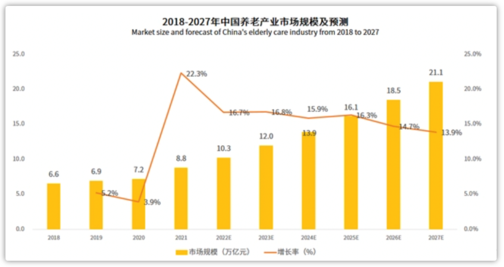
> 图注：这是一张2018-2027年中国养老产业市场规模及预测图表，其中黄色柱形代表市场规模（单位：万亿元），红色折线代表增长率（单位：%）。2018年至2027年的市场规模依次为6.6万亿元、6.9万亿元、7.2万亿元、8.8万亿元、10.3万亿元、12.0万亿元、13.9万亿元、16.1万亿元、18.5万亿元、21.1万亿元，整体呈持续增长趋势；增长率在2011年达到峰值22.3%，2009年为2.9%、2020年为3.9%，后续逐步回落，2027年预测为13.9%，直观体现了中国养老产业的市场规模及增长变化，贴合文档中提及的2023年中国养老产业市场规模达12万亿元、同比增长16.8%的相关数据背景。

- 2023年中国养老产业市场规模达到12万亿元，同比增长16.8%。
- 预计2023-2027年中国养老产业迎来较快速增长。预计2027年中国养老产业市场规模达21.1万亿元

### 整体业务流程

中州养老系统是为**养老院**量身定制开发的专业的养老管理软件产品；涵盖来访管理、入退管理、在住管理、服务管理、财务管理等功能模块，涉及从来访参观到退住办理的完整流程。

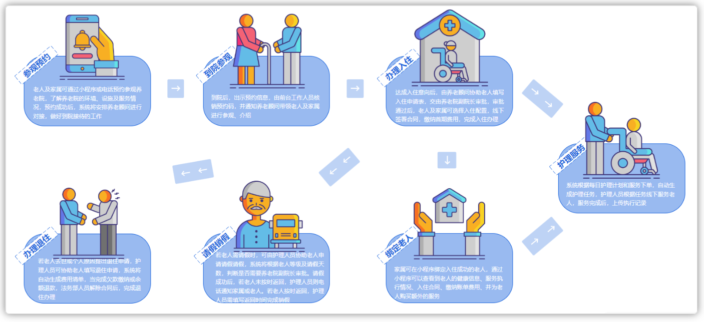
> 图注：图片展示了中州养老项目业务流程。老人及家属通过小程序进行参观养老院、到院身访、办理入住、护理服务等操作。流程包括参观养老院时了解环境、设施及护理人员，到院身访时与护理人员沟通，办理入住时填写入住申请表、缴纳押金，护理服务时根据护理计划进行。流程还涉及家属缴纳护理费用、指定护理人员、办理住院等环节，体现了项目从参观到入住、护理服务的全流程。

**项目原型**访问地址：https://codesign.qq.com/s/459277624064324   密码: FSTI

中州养老项目分为两端，一个是管理后台，另外一个是家属端

- 管理后台：养老院员工使用，入住、退住，给老人服务记录等等
- 家属端：养老院的老人家属使用，查看老人信息，缴费，下订单等等

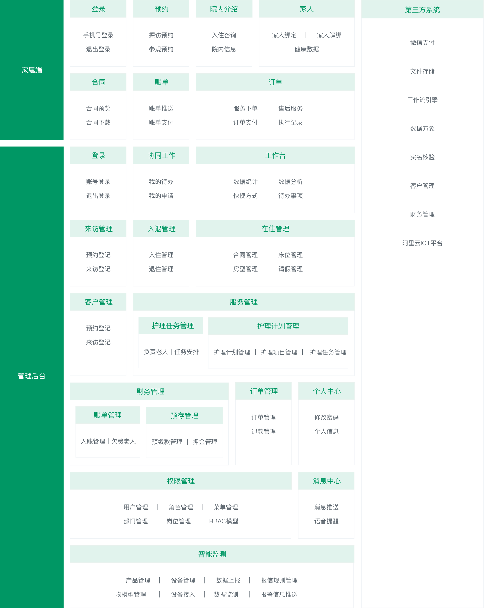
> 图注：图片展示了中州养老项目管理后台的业务主页效果。左侧为管理后台，包含登录、合同、登录、来访管理、资产管理、财务管理、账单管理、权限管理、智能监管等板块，每个板块下有具体功能选项。右侧为第三方系统，有文件存储、工作台引擎、支付管理、客户管理、财务管理、阿里云CT平台等板块，同样列出具体功能。

业务主页效果：

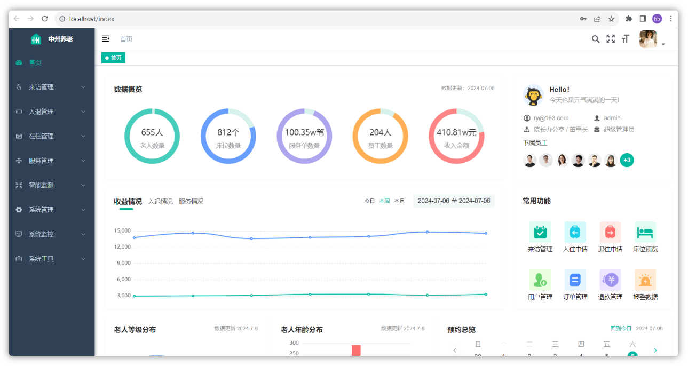
> 图注：这是中州养老项目管理后台的业务主页界面，页面左侧为功能导航栏，包含入退管理、床位管理、考勤管理等多项功能选项。页面上方的概览区域展示了核心业务数据，分别是655人、812个床位数量、100.35w笔服务单数据、204人员工数量以及410.81万元的收入金额。中间区域为收益情况折线图，可切换不同时段查看数据走势，下方还有老人年龄分布、预约总监等相关板块。页面右侧设有问候语，还列出了常用功能模块，包含床位申请、用户管理、订单管理等8个功能入口。


> 图注：图片展示的是中州养老小程序的业务主页效果。上方有“把温暖送给父母，让情爱陪伴家人”的宣传语，配有养老院员工与老人互动的图片。中部有“入住咨询”“探访预约”“参观预约”等功能选项，以及“养老院介绍”“绑定家人”“我的订单”“我的账单”等服务按钮。下方展示了“单人套房”的房间图片，配有介绍文字。底部有“首页”“家人”“服务”“账单”四个导航栏。该图片直观呈现了小程序业务主页的布局和功能。

> 教育公司无养老相关资质，小程序无法正式上架，无法体验。在课程的对应阶段，我们会进行调试开发

### 技术架构

下图展现了中州养老项目主要使用的技术：

<whiteboard token="YeFywEZjTh2v3zbG0gpcan27nFf"></whiteboard>

- 前端主要使用的Vue3+Element Plus
- 后端主要使用的是若依作为基础架构，当然后端也集成了很多其他的技术，比如有Springboot、Mybatis、Swagger、Spring cache、Spring Security、**Mybatis-Plus**等
- 数据存储主要使用到了MySQL和Redis
- 使用了nginx来作为反向代理和前端的静态服务器
- 其他技术：华为云物联网平台IOT、对象存储OSS、微信登录、千帆大模型、AI工具辅助开发等

###  课程安排

中州养老课程共11天，具体安排如下：

| day01 | 认识若依框架，环境搭建、AI协助快速熟悉项目、通义灵码代码生成、模块开发-代码生成 |
|-|-|
| day02 | 使用AI改造若依框架前后端代码和代码生成模板 |
| day03 | 数据字典、集成OSS，入住办理-模块后端设计，通义灵码协助接口代码开发 |
| day04 | 入住办理-基于动态表单快速构建表单项，通义灵码协助完成养老项目中的入住办理功能 |
| day05 | 健康评估-大模型技术调研、对接千帆大模型，设计Prompt、大模型智能评估体检报告 |
| day06 | AI协助项目阶段性部署，代码质量检查、开发模式、jenkins、docker、日志管理（ELK） |
| day07 | 后台登录和鉴权、Spring Security入门、核心配置、小程序家属端，微信登录、定时任务 |
| day08 | IOT产品设备管理，账号开通、设备管理、模拟上报 |
| day09  | IOT消息采集和处理 |
| day10  | 智能床位模块开发、家属端报表展示，AI协助编写sql以及优化、MySQL索引 |
| day11  | 报警规则开发、报警数据过滤、报警提醒（websocket） |

## 若依框架

### 基本介绍

若依（RuoYi）框架是一款基于Spring Boot、Spring Cloud等开源框架搭建的企业级开发平台。它的主要目标是提供全面的解决方案，以简化企业级应用开发，**提高开发效率**。以下是对若依框架的详细介绍：

1. **模块化设计**：若依框架采用模块化的设计，使得应用可以根据需求进行灵活的扩展和定制。每个模块都可以独立部署和升级，这大大提高了系统的可维护性和可扩展性。
2. **前后端分离**：框架采用前后端分离的开发模式，后端专注于数据处理和API接口的提供，前端则负责页面的展示和用户交互。这种模式使得前后端职责明确，进一步提高了开发效率和代码的可维护性。
3. **权限管理**：若依框架提供了完善的用户权限管理功能，包括角色管理、菜单授权、部门管理等，便于对系统权限进行灵活的配置和管理。
4. **代码生成器**：框架内置代码生成器，能够快速生成前后端代码，减少重复劳动，提高开发效率。通过简单的配置即可生成基础的增删改查代码。
5. **定时任务**：若依框架集成了定时任务模块，支持动态添加定时任务，可以通过界面对定时任务进行管理与调度。此外，框架还能实时查看系统运行日志和在线用户信息，监控服务状态和性能。
6. **易于集成**：若依框架可以轻松地与其他常用技术栈集成，如MySQL、Redis、消息队列等。这使得开发者可以根据项目需求灵活地选择合适的技术组件，降低技术门槛和成本。

此外，若依框架还集成了许多常用功能模块，如文件上传下载、消息推送、数据字典、日志管理等。

总的来说，若依框架是一款功能丰富、易于扩展和定制的企业级开发平台，适用于各种Web应用程序的开发。它能够帮助开发者快速构建功能完备的应用，提高开发效率，降低维护成本。


若依官网地址：

<bookmark name="RuoYi 若依官方网站 |后台管理系统|权限管理系统|快速开发框架|企业管理系统|开源框架|微服务框架|前后端分离框架|开源后台系统|RuoYi|RuoYi-Vue|RuoYi-Cloud|RuoY" href="https://ruoyi.vip/"></bookmark>

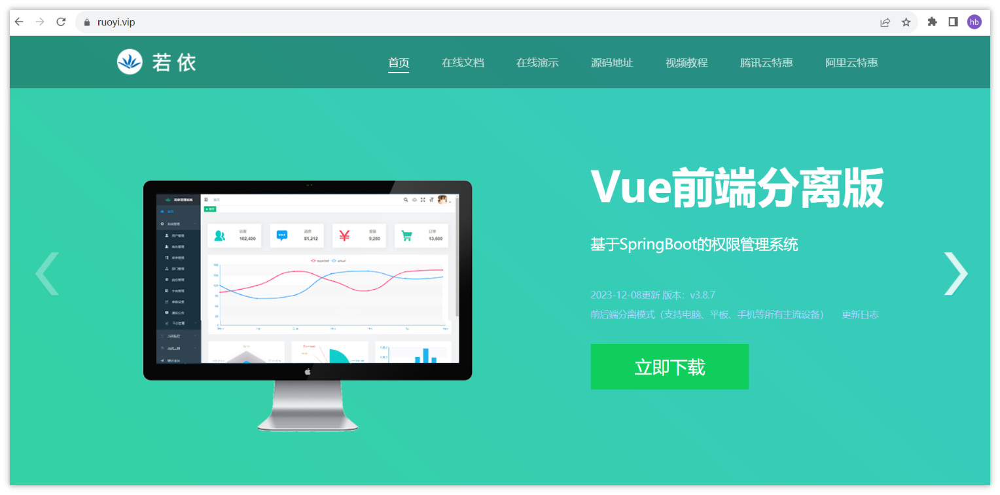
> 图注：图片展示的是若依框架的Vue前端分离版页面。页面背景为绿色，左侧有若依标志及导航栏，右侧突出显示“Vue前端分离版”及“基于SpringBoot的权限管理系统”字样，下方有“2021-12-01正式版 版本：v1.0.7”等信息，还标注了支持的终端。页面底部有一个绿色的“立即下载”按钮。该图片与文档中介绍若依框架版本的内容相关，直观呈现了Vue前端分离版的界面样式。

若依框架分为四个版本：

- 前后端不分离版本RuoYi（单体）
- 前后端分离版RuoYi-Vue（单体）本项目使用版本
- 微服务版本RuoYi-Cloud
- 移动端版RuoYi-App

<callout emoji="🌲">
前三个都提供了前后端的项目，移动版可以适配RuoYi-Vue和RuoYi-Cloud
</callout>


### RuoYi-Vue前后端分离版

我们课程中重点讲解的是RuoYi-Vue前后端分离版本，

文档地址：

<bookmark name="介绍 | RuoYi" href="https://doc.ruoyi.vip/ruoyi-vue/"></bookmark>

#### 概述

RuoYi-Vue 是一个 Java EE 企业级快速开发平台，基于经典技术组合（Spring Boot、Spring Security、MyBatis、Jwt、Vue），内置模块如：部门管理、角色用户、菜单及按钮授权、数据权限、系统参数、日志管理、代码生成等。在线定时任务配置；支持集群，支持多数据源，支持分布式事务。

演示地址：

<bookmark name="若依管理系统" href="http://vue.ruoyi.vip"></bookmark>

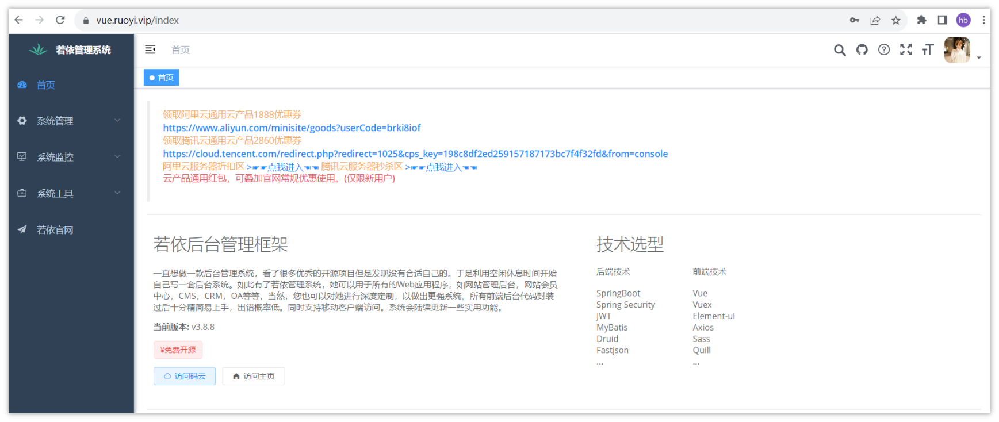
> 图注：图片展示了若依框架RuoYi-Vue前后端分离版的演示地址页面。页面左侧为系统管理导航栏，有首页、系统管理、系统监控、系统工具、若依官网等选项。右侧上方显示“首页”，下方有登录、注册等操作按钮，还展示了若依后台管理框架的相关信息，包括版本v3.8.8及技术选型，如后端技术有Spring Boot、Spring Security等，前端技术有Vue、Element Plus等。该图片与文档中介绍若依框架技术选型的内容相关，直观呈现了框架的前端和后端技术栈。

#### 技术选型

1、系统环境

- Java EE 8   ---> jdk 11
- Servlet 3.0
- Apache Maven 3

2、主框架

- Spring Boot 2.5.x
- Spring Framework 5.2.x
- Spring Security 5.2.x   安全框架

3、持久层

- Apache MyBatis 3.5.x  ---> MyBatis Plus
- Hibernate Validation 6.0.x   校验框架
- Alibaba Druid 1.2.x

4、视图层

- Vue 2.6.x   ---->  Vue3
- Axios 0.21.x
- Element 2.15.x     ---->  Element Plus


## 环境搭建

熟悉了若依的基本情况之后，下面，我们就快速上手，来把这个框架搭建起来，并且需要顺利跑起来

### 准备工作

基础软件准备

| 官方推荐 | 优化升级 |
|-|-|
| JDK >= 1.8 (推荐1.8版本)  | 升级为JDK 11  资料中提供了安装包 |
| Maven >= 3.0 | 不需要安装，直接使用IDEA中自带的Maven即可 |
| Node >= 12 | 前端代码由vue2升级为vue3，需要Node 18及以上的版本 |
| Mysql >= 5.7.0 (推荐5.7版本)  | 升级为MySQL 8 |
| Redis >= 3.0 | 本地启动 |

一般企业中服务器都是部署了一些项目中公用的基础环境，比如MySQL、Redis等这些。这些服务都是部署在linux服务器中，这些服务可能是部署在公司的一个**机房**中，也有可能是**云服务器**（中小企业居多）。

在我们教学的过程中，为了还原更真实的企业环境，我们可以在VMWare软件中来部署linux服务器，当做我们开发中的公用服务器，具体的VMWare的服务配置

请参考如下链接：<cite doc-id="Hjdzw1J7Qis9O9kQSxXc6i3Onpg" file-type="wiki" title="虚拟机环境说明" type="doc"></cite>


在目前提供的虚拟机环境中已经使用docker安装了对应的基础环境

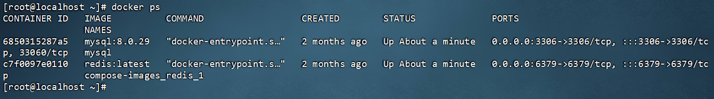
> 图注：图片展示的是在Linux服务器上使用docker ps命令查看容器运行情况的结果。显示了两个容器信息，分别为mysql:8.0.29和redis:latest，它们分别运行于2个月前，状态为运行中，且运行时间约为1分钟。mysql容器的端口映射为0.0.0.0:3306->3306/tcp，:::3306->3306/tcp；redis容器的端口映射为0.0.0.0:6379->6379/tcp，:::6379->6379/tcp。该图片与文档中介绍在VMWare软件中部署linux服务器，使用docker安装基础环境的内容相关，直观呈现了已安装的MySQL和Redis服务状态。

详细说明如下：

| **软件名称** | **说明** |
|-|-|
| MySQL | 默认用户名：root，默认密码：heima123，端口：3306 |
| Redis | 默认密码：123456，端口：6379 |

> 运行中州养老项目，需要使用到MySQL和Redis，因此，这两个服务已经设置了开机自启，过几天咱们的课程中会详细讲解和使用Redis


### 运行后端项目

#### 下载代码

- 代码下载地址：[https://gitee.com/y_project/RuoYi-Vue](https://gitee.com/y_project/RuoYi-Vue)[ ](https://gitee.com/y_project/RuoYi-Vue)

  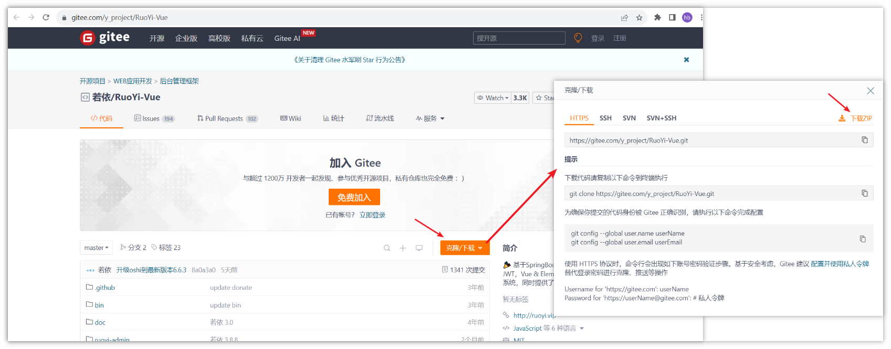
> 图注：图片展示了若依框架在Gitee平台的代码下载页面。页面左侧显示了若依/RuoYi-Vue项目的代码分支、提交记录等信息。右侧弹出“右键下载”窗口，有HTTPS、SSH、SVN、SVN+SSH等多种下载方式，其中HTTPS方式被红色箭头指向。该图片与文档中下载代码部分内容相关，直观呈现了从Gitee平台下载若依框架代码的操作界面，为后续借助包名修改器进行包名全局替换等操作提供参考。

由于若依提供的代码的包名和项目名和咱们的需求不一致，因此这里暂时不要采用Git克隆的方式下载代码，直接下载ZIP包到本地，然后先替换所有的包名和项目名，再使用idea打开项目

#### 包名全局替换

- 从官方下载的代码中所有包名都为com.rouyi，且数据库连接信息需要修改，此时，咱们可以借助于若依框架修改器来一键修改：
- 参考链接：https://gitee.com/lpf_project/RuoYi-MT/releases
- 可以使用资料中提供的包名修改器


> 图注：图片展示的是若依框架修改器的图标。图标为一个白色文件夹，左侧有绿色的植物图案，右侧有橙色的齿轮和播放按钮。该修改器用于若依框架代码包名和项目名的全局替换，可借助其一键修改从官方下载代码中的包名，使其与需求一致。修改完成后，修改器会自动导出新目录，将此目录复制到代码目录中，再使用idea打开即可。

请参考下方截图进行修改哦

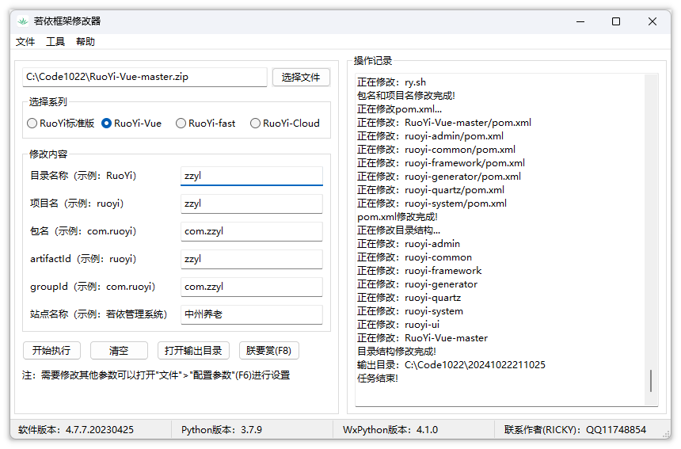
> 图注：图片展示的是若依框架修改器界面。界面上方显示软件版本、Python版本、WxPython版本等信息。左侧有选择文件、选择系列、修改内容等选项，其中“系列”下选中“RuoYi-Vue”，“修改内容”中“目录名称”“项目名”“包名”等处已填写“zzyl”等信息。右侧为操作记录，记录了修改包名、项目名等操作。该图片与文档中介绍使用若依框架修改器修改代码包名等内容相关，用于辅助说明修改操作。

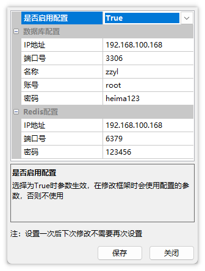
> 图注：该界面是若依框架修改器的配置设置窗口，核心功能为修改数据库与Redis的相关配置信息。界面中“是否启用配置”选项设为True，此时选中的配置参数会生效；数据库配置部分包含IP地址、端口号、名称、账号、密码，分别为192.168.100.168、3306、zzyl、root、heima123；Redis配置部分包含IP地址、端口号、密码，分别为192.168.100.168、6379、123456。界面下方标注该设置在修改框架时会使用对应参数，且仅需设置一次后无需再次修改，右下角设有“保存”与“关闭”按钮。

- 修改完成之后，修改器会自动导出一个新的目录，将目录复制到你的代码目录中，然后使用idea打开即可：

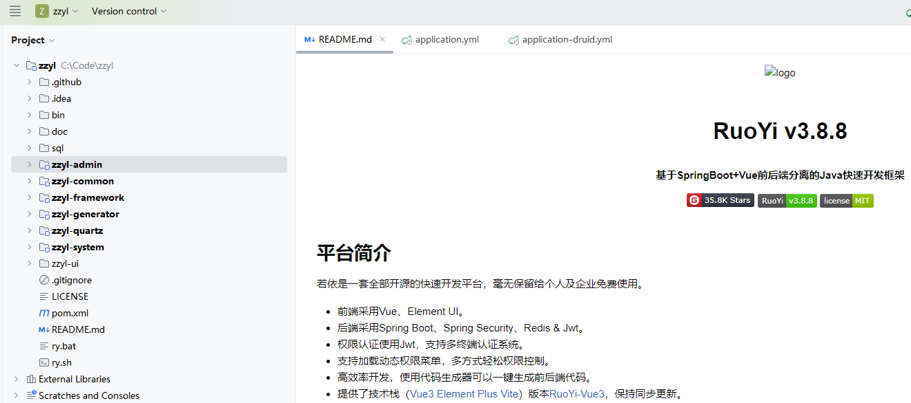
> 图注：图片展示了若依框架v3.8.8的项目结构及平台简介。左侧为项目文件夹，包含zyyl、zyyl-admin等子文件夹，以及github、bin、doc、sql等文件。右侧是平台简介，介绍若依为基于Spring Boot + Vue前后端分离的Java快速开发框架，采用Vue、Element UI等技术，支持多种认证系统、权限控制等，还提供了技术栈（Vue3 Element Plus Vue）。

打开项目后，先修改项目和模块使用的JDK版本为11。

- 修改pom.xml文件中JDK的版本为11

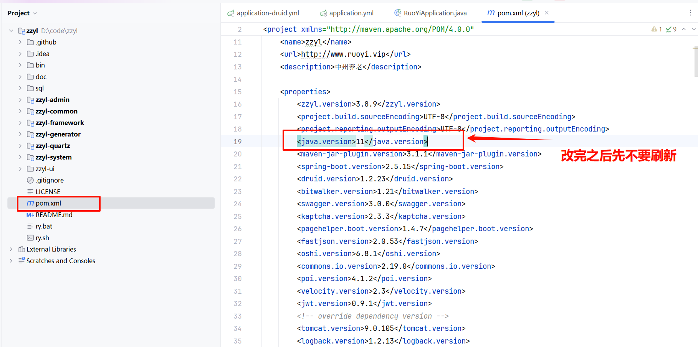
> 图注：这张图片对应文档中修改pom.xml文件的操作步骤，展示了IDEA开发工具的代码编辑界面。左侧项目结构中，pom.xml文件被红色框选中，右侧代码编辑区域的properties标签内，标注了要修改的java.version属性，当前值为11，该属性行被红色框和箭头突出显示，图片右侧标注了“改完之后先不要刷新”的提示，与文档上下文的要求完全对应，直观呈现了修改JDK版本的核心操作内容。

注意：先不要刷新

#### JDK配置

1. 解压资料中提供的jdk11, 到非中文没有特殊字符的目录

`项目搭建、从0开始用若依\资料\JDK11、NodeJS\jdk-11.0.20_windows-x64_bin.zip`

1. 配置环境变量

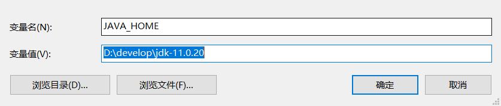
> 图注：这张图片展示了Windows系统环境变量的配置窗口，该内容对应文档中JDK配置步骤里的环境变量配置环节。窗口内，变量名被设置为“JAVA_HOME”，变量值被填写为JDK11的解压路径“D:\\develop\\jdk-11.0.20”，窗口还提供了“浏览目录”“浏览文件”的选择按钮，以及“确定”“取消”的操作按钮，用于完成或放弃本次环境变量的设置操作。


#### maven配置

打开之后，需要配置maven的本地仓库，建议将资料中的本地仓库先解压到自己的Maven仓库中（初次下载较慢）

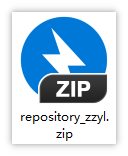
> 图注：这张图片展示了一个名为“repository_zzyl.zip”的压缩文件，图标为蓝色圆形背景内搭配白色闪电符号，右下角配有“ZIP”标识，表明这是一个ZIP格式的压缩包文件。该文件对应文档中提及的Maven本地仓库相关内容，即需要从指定资料路径解压出来、用于配置maven的本地仓库的文件。

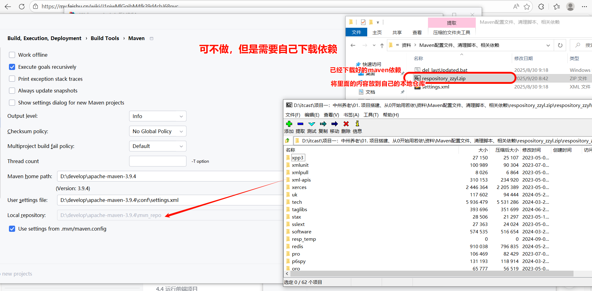
> 图注：图片展示了Maven配置界面及相关文件夹内容。界面中“User settings file”处显示为“D:\\develop\\apache-maven-3.5.4\\conf\\settings.xml”，“Local repository”处显示为“D:\\develop\\apache-maven-3.5.4\\repository”。右侧文件夹中，有“repository_zyl.zip”文件，其内容被复制到自己的本地仓库。图片与上文“maven配置”内容相关，说明了配置Maven本地仓库的操作，以及将下载的maven依赖内容复制到本地仓库的操作步骤。


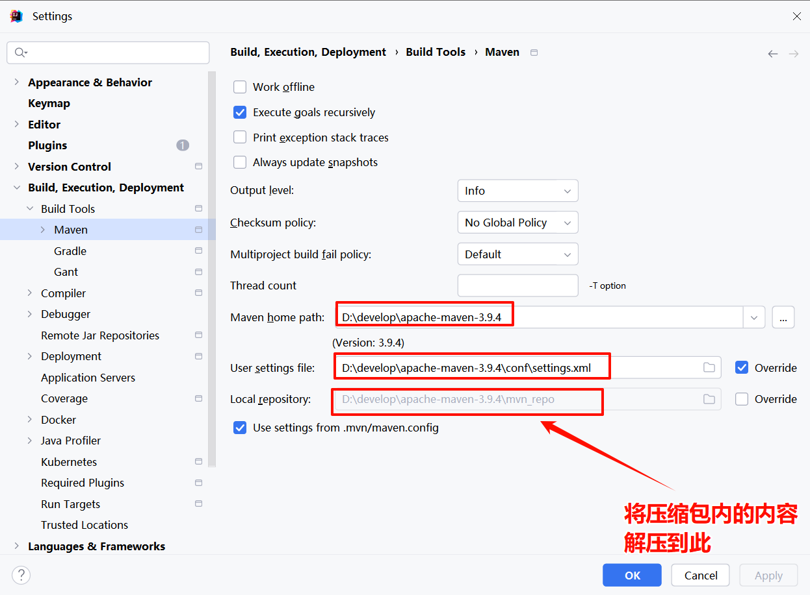
> 图注：图片展示的是IntelliJ IDEA中Maven设置界面。左侧导航栏选中“Maven”选项，右侧显示Maven相关设置，包括Maven home path、User settings file、Local repository等。其中，Maven home path指向D:\\develop\\apache-maven-3

改完之后刷新maven。

idea中的配置

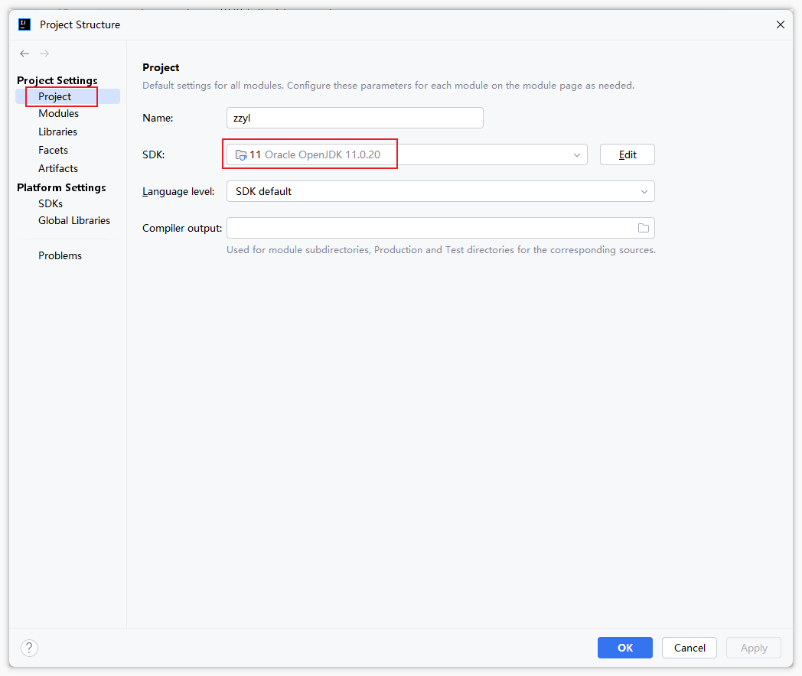
> 图注：这是IDEA的“Project Structure”设置界面，左侧选中“Project Settings”下的“Project”选项，右侧对应项目名称为“zzyl”，SDK栏处高亮显示为“11 Oracle OpenJDK 11.0.20”，该界面用于配置项目的JDK版本，是搭建若依项目时JDK配置步骤中的核心设置界面，对应文档里修改pom.xml JDK版本为11后，在IDEA中配置JDK的相关操作。

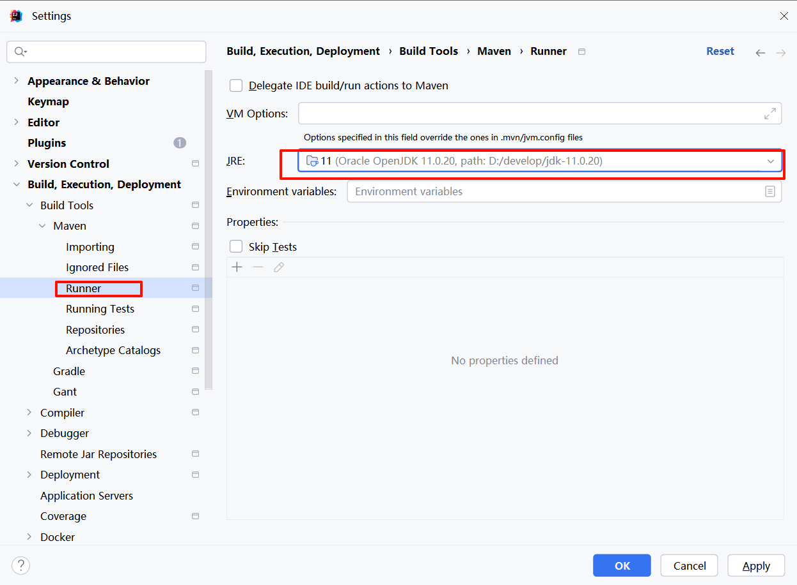
> 图注：这张图片展示的是IDE的设置界面，左侧导航栏中“Build, Execution, Deployment”分类下的“Runner”选项被红色方框标注突出显示，对应右侧主区域的“Build, Execution, Deployment > Build Tools > Maven > Runner”配置页，这里是JDK配置的关键操作位置。该页的JRE选项中，已选中的JDK为Oracle OpenJDK 11.0.20，路径为本地的JDK11安装目录，对应文档中“JDK配置”步骤里的JDK11设置要求，整体界面用于完成IDE中运行环境的相关配置。

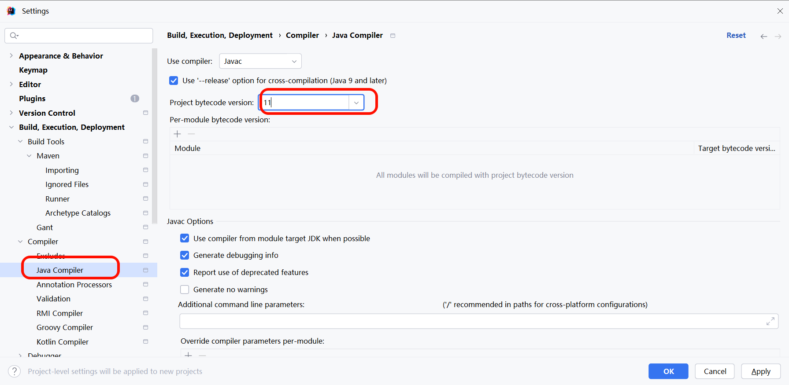
> 图注：图片展示了IntelliJ IDEA中“Settings”设置界面的“Compiler”下的“Java Compiler”选项卡。关键信息有：左侧导航栏中“Java Compiler”被红色框突出显示；右侧“Project bytecode version”处的下拉框被红色框圈出，显示版本为11；下方“Javac Options”区域中，“Use compiler from module target JDK when possible”选项被勾选。该图片与文档中“JDK配置”部分相关，用于指导用户在IntelliJ IDEA中配置Java编译器版本等设置。

- 修改idea中的项目编码为utf-8

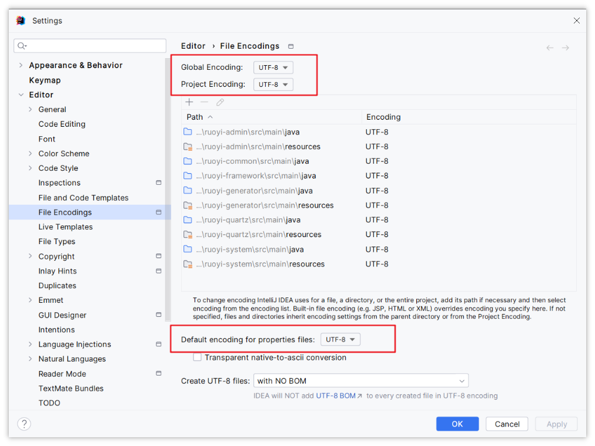
> 图注：这张图片是IntelliJ IDEA的Settings设置窗口，展示了Editor（编辑器）分类下的File Encodings（文件编码）配置页面，对应文档中修改项目编码为UTF-8的操作说明。页面中用红框标注了关键配置项：一是全局编码（Global Encoding）设置为UTF-8，二是项目编码（Project Encoding）设置为UTF-8，三是属性文件的默认编码（Default encoding for properties files）也设置为UTF-8，下方还附带相关编码设置的提示信息，页面底部有OK、Cancel、Apply三个操作按钮。该图片直观呈现了修改Idea项目编码为UTF-8的具体设置界面，与文档中对应配置步骤相匹配。

#### 数据库准备和配置

- 数据库使用的MySQL 8

  - 默认的用户名：root
  - 默认的密码：heima123

在idea中创建数据库并导入项目中的基础表结构和数据

- 创建数据库 **zzyl （可以打开项目根目录下的sql/ry_2024xxxx.sql文件，在最上方添加以下内容）**

```Java
create database if not exists zzyl;
use zzyl;
```

- 导入项目根目录下的sql/ry_2024xxxx.sql文件，如下图

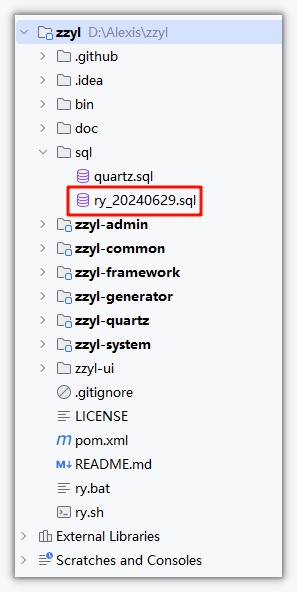
> 图注：图片展示了若依框架项目文件夹结构中的“sql”文件夹内容。其中，“ry_20240629.sql”文件被红色框突出显示。该图片与文档中“在idea中创建数据库并导入项目中的基础表结构和数据”部分内容相关，用于说明在项目根目录下的“sql”文件夹中找到并打开“ry_20240629.sql”文件，以导入项目基础表结构和数据的操作步骤。

sql执行成功以后，修改数据库连接，找到ruoyi-admin模块中的`resources`目录下的`application-druid.yml`

```YAML
# 数据源配置
spring:
    datasource:
        type: com.alibaba.druid.pool.DruidDataSource
        driverClassName: com.mysql.cj.jdbc.Driver
        druid:
            # 主库数据源
            master:
                url: jdbc:mysql://192.168.100.168:3306/zzyl?useUnicode=true&characterEncoding=utf8&zeroDateTimeBehavior=convertToNull&useSSL=true&serverTimezone=GMT%2B8
                username: root
                password: heima123
```

#### Redis配置

找到ruoyi-admin模块中的`resources`目录下的`application.yml`，如下配置：

```YAML
# Spring配置
spring:
  redis:
    # 地址
    host: 192.168.100.168
    # 端口，默认为6379
    port: 6379
    # 数据库索引
    database: 0
    # 密码
    password: 123456
    # 连接超时时间
    timeout: 10s
    lettuce:
      pool:
        # 连接池中的最小空闲连接
        min-idle: 0
        # 连接池中的最大空闲连接
        max-idle: 8
        # 连接池的最大数据库连接数
        max-active: 8
        # #连接池最大阻塞等待时间（使用负值表示没有限制）
        max-wait: -1ms
```


#### 运行项目

找到ruoyi-admin模块中的运行`com.zzyl.RuoYiApplication.java`，出现如下图表示启动成功。

```Bash
(♥◠‿◠)ﾉﾞ  若依启动成功   ლ(´ڡ`ლ)ﾞ  
 .-------.       ____     __        
 |  _ _   \      \   \   /  /    
 | ( ' )  |       \  _. /  '       
 |(_ o _) /        _( )_ .'         
 | (_,_).' __  ___(_ o _)'          
 |  |\ \  |  ||   |(_,_)'         
 |  | \ `'   /|   `-'  /           
 |  |  \    /  \      /           
 ''-'   `'-'    `-..-'    
```

### 将后端项目上传到gitee

项目运行起来后，要将代码托管到gitee仓库中，方便维护，同时，每天的业务开发都要在master分支上创建出一个子分支，子分支的命名规则为：dev+当天日期，例如今天的子分支为dev1023，明天的为dev1025。

当天的代码在子分支测试完毕后，合并到master分支，第二天再从master分支创建出一个新的分支。

### 运行前端项目

#### 前提

官方推荐的前端项目，使用的是vue3，需要使用node 18版本以上

> 如果没有安装node18或者更高版本的同学，可以在资料中找到对应的安装包进行安装

#### 代码下载

目前下载的代码中，其中ruoyi-ui这个目录就是前端的代码，不过这个代码是基于vue2开发的

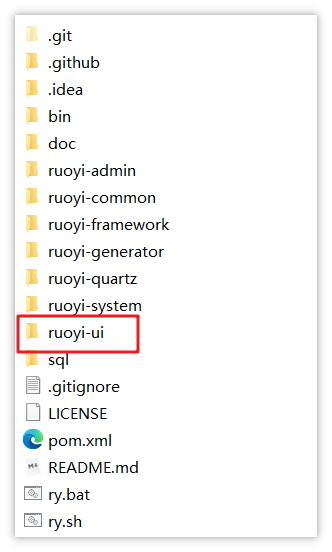
> 图注：图片展示了若依项目代码目录结构。其中，红色框突出显示的“ruoyi-ui”目录是前端代码所在，基于vue2开发。该图片与文档中“代码下载”部分内容相关，用于说明下载的代码中“ruoyi-ui”目录是前端代码，若需使用基于vue2开发的前端，可使用此代码，运行方式与文档后续描述相同。


<callout emoji="🌲">
如果需要使用vue2为基础开发语言的前端，就可以使用上述的代码，运行方式跟下方描述相同
</callout>


我们需要使用基于vue3开发的代码，官方推荐的地址：https://github.com/yangzongzhuan/RuoYi-Vue3

由于从github下载代码速度比较慢，已经将当前代码同步了一份到gitee中，地址如下：https://gitee.com/alexisyang/ruo-yi-vue3.git

也可以在当天的资料中找到，解压到代码目录，并将目录名改为**zzyl-vue3**，然后使用VSCode打开即可：

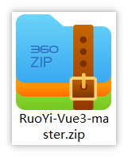
> 图注：图片展示的是一个名为“RuoYi-Vue3-master.zip”的文件图标。图标上方有蓝色背景，中间是360的标志，下方是绿色背景，中间有棕色的皮带和扣子图案。该文件是基于vue3开发的若依前端代码，可通过解压改名为zzyl-vue3后用VSCode打开，用于后续运行前端项目，是文档中介绍将后端项目上传到gitee、运行前端项目步骤中提到的代码文件。


#### 安装依赖和项目运行(可选)

进入到代码的根目录，然后执行以下命令：

```Bash
npm install 
```

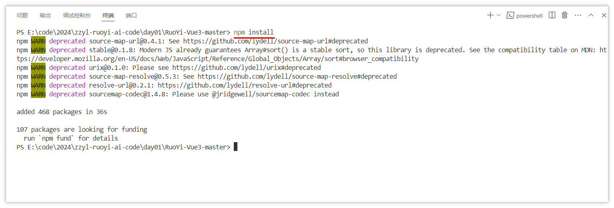
> 图注：图片展示了在VSCode中运行npm install命令的终端界面。命令执行后，显示了468个包已添加，365秒内完成，107个包正在寻找资金。界面中还列出了多个被废弃的npm包及其原因，如source-map-url@0.4.1、stable@0.1.8等。该图片与文档中“安装依赖和项目运行(可选)”部分对应，直观呈现了安装依赖时终端的反馈情况，帮助用户了解安装进度及依赖包状态。

资料已经提供好安装好依赖的前端项目

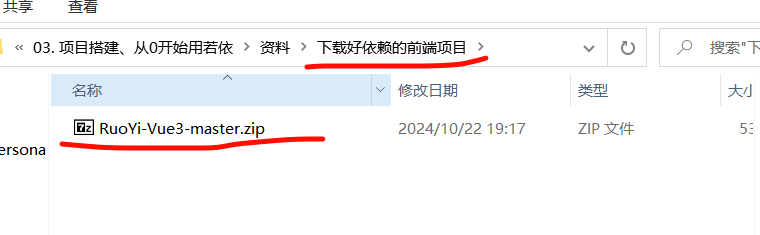
> 图注：图片展示了下载好的前端项目文件夹内容。文件夹中有一个名为“RuoYi-Vue3-master.zip”的ZIP文件，其修改日期为2024年10月22日19:17，类型为ZIP文件，大小为53.2MB。图片中“下载好依赖的前端项目”及“RuoYi-Vue3-master.zip”部分被红色箭头突出显示。该图片与文档中“代码下载”部分内容相关，说明了下载好依赖的前端项目文件情况，为后续解压改名并用VSCode打开等操作提供参考。

解压好改名为zzyl-vue3之后用vscode打开

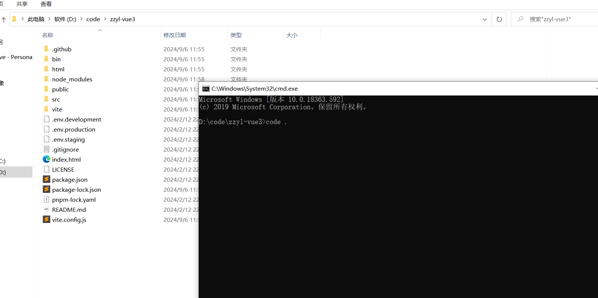
> 图注：图片展示了在Windows系统下，打开“此电脑 - 软件”文件夹，进入“code”文件夹，再进入“zyyl-vue3”文件夹的文件夹界面。其中，vite文件夹被高亮显示。该图片与文档中“运行前端项目”部分相关，对应“解压好改名为zzyl-vue3之后用vscode打开”这一操作步骤，直观呈现了前端项目代码解压后的文件结构，帮助用户确认文件夹位置，以便后续进行项目运行等操作。

#### 修改配置

打开前端根目录下的**vite.config.js**文件，把目标地址改为若依后端的服务地址，如下图：

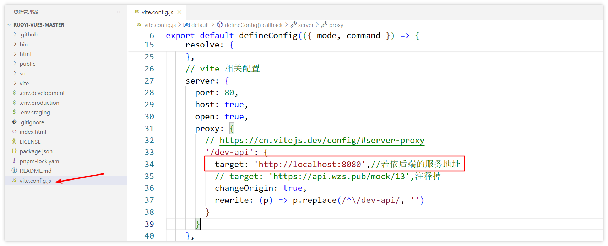
> 图注：图片展示了若依前端项目中vite.config.js文件的内容。文件中定义了vite相关配置，包括server配置，如端口、主机、是否开启等，以及proxy配置，其中target字段被红色箭头突出显示，其值为“http://localhost:8080”，即若依后端的服务地址。该图片与上下文紧密相关，上下文提到需打开前端根目录下的vite.config.js文件，将目标地址改为若依后端的服务地址，此图直观呈现了操作内容。

#### 启动项目

如果依赖已经安装完成，配置也已修改，则可以直接启动项目

```Bash
npm run dev
```

启动成功之后的效果：

```Bash
PS D:\workspace\project-ry-zzyl-vue3> npm run dev

  VITE v5.0.4  ready in 1247 ms

  ➜  Local:   http://localhost:80/
  ➜  Network: http://169.254.117.147:80/
  ➜  Network: http://192.168.200.1:80/
  ➜  Network: http://172.16.17.191:80/
  ➜  press h + enter to show help
```

启动前后端成功后，可以访问页面，地址：http://localhost:80/

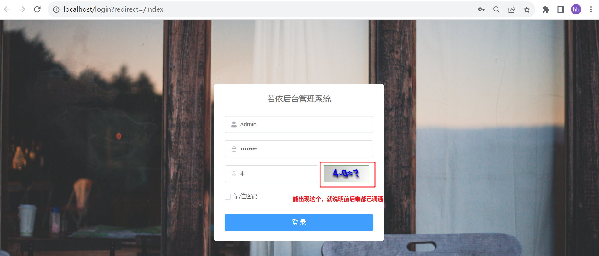
> 图注：图片展示的是若依后台管理系统登录页面。页面背景为室内场景，有窗户、窗帘等元素。页面上方显示“若依后台管理系统”，下方有用户名、密码、验证码等输入框，用户名为“admin”，密码为“123456”，验证码为“4-4=?”。页面底部有“登录”按钮，还有“记住密码”选项。该图片与文档中“启动项目”部分对应，展示了若依后端项目启动成功后的登录界面，说明启动成功后可访问页面，地址为http://localhost:80/。

也可以通过脚本启动。如果显示的是pnpm run dev。则需要先安装`npm install pnpm`

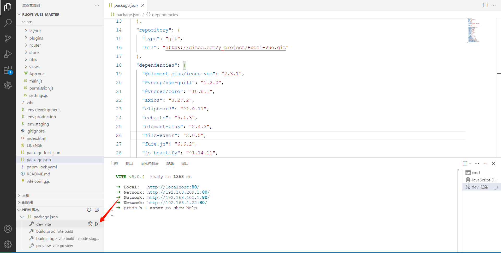
> 图注：这张图片展示的是VS Code编辑器界面，左侧为项目文件目录，当前选中名为package.json的配置文件，该文件的dependencies部分包含多个依赖包的版本信息，其中repository字段标识了代码的Git地址。图片中用红色箭头指向了左侧文件列表里package.json右侧的运行按钮。界面底部的终端区域显示VITE已成功启动，输出了服务运行的本地网络地址。结合所在上下文，这是若依前端项目配置启动相关的操作界面，对应修改配置或启动项目的步骤场景。

### 将前端项目上传到gitee

项目运行起来后，要将代码托管到gitee仓库中，方便维护，同时，每天的业务开发都要在master分支上创建出一个子分支，子分支的命名规则为：dev+当天日期，例如今天的子分支为dev0926，明天的为dev0927。

当天的代码在子分支测试完毕后，合并到master分支，第二天再从master分支创建出一个新的分支。


## 前后端项目结构

环境搭建完毕之后，接下来，我们深入熟悉一下若依这个框架，我们主要从代码的层面来熟悉项目

- 前后端的代码结构
- 阅读部分代码，熟悉开发流程和规范
- 所以，接下来，咱们分两步来熟悉项目代码，一是后端的代码结构及配置，二是前端的代码结构及执行流程

### 后端代码

#### 代码结构

下面是idea打开项目后的截图

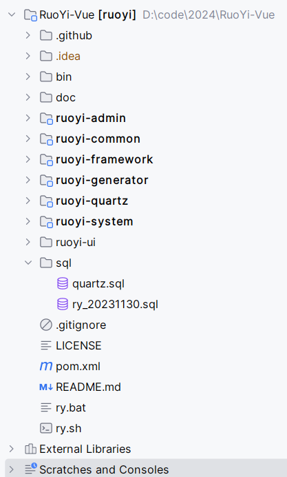
> 图注：图片展示了idea打开的RuoYi-Vue项目结构。左侧目录栏中，ruoyi-admin、ruoyi-common、ruoyi-framework等模块被展开显示，ruoyi-admin下有多个文件夹，如bin、doc等。此外，还有sql文件夹，包含quartz.sql和ry_20231130.sql文件。下方还有.gitignore、LICENSE、pom.xml、README.md等文件。

官方文档的介绍

```Bash
com.ruoyi 
├── ruoyi-admin       // 后台服务   存放 controller    
├── common            // 工具类
│       └── annotation                    // 自定义注解
│       └── config                        // 全局配置
│       └── constant                      // 通用常量
│       └── core                          // 核心控制
│       └── enums                         // 通用枚举
│       └── exception                     // 通用异常
│       └── filter                        // 过滤器处理
│       └── utils                         // 通用类处理
├── framework         // 框架核心
│       └── aspectj                       // 注解实现 aop相关
│       └── config                        // 系统配置
│       └── datasource                    // 数据权限
│       └── interceptor                   // 拦截器
│       └── manager                       // 异步处理
│       └── security                      // 权限控制
│       └── web                           // 前端控制
├── ruoyi-generator   // 代码生成（可移除）
├── ruoyi-quartz      // 定时任务（可移除）
├── ruoyi-system      // 系统代码   存放 domain，mapper，service
├── ruoyi-xxxxxx      // 其他模块
```

模块间的依赖关系

<whiteboard token="G6J0weh3GhCqXlbloNLc9Somnrb"></whiteboard>


#### 项目中的配置

项目中的配置文件都在ruoyi-admin模块下，如下图：

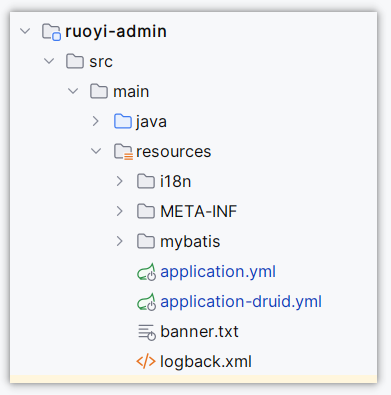
> 图注：图片展示了若依前后端项目结构中ruoyi-admin模块下的配置文件。在resources文件夹下，有i18n、META-INF、mybatis等文件夹，其中mybatis文件夹内有application.yml和application-druid.yml两个配置文件，还有banner.txt和logback.xml文件。

- i18n：国际化处理
- META-INF：存储了项目的元信息（*描述数据的数据*），无需修改
- mybatis：mybatis相关的配置信息
- application.yml：项目中的核心配置
- application-druid.yml：数据库连接配置
- banner.txt：默认的banner图标信息，项目启动，控制台打印显示
- logback.xml：日志配置


最主要的两个配置文件：application.yml和application-druid.yml

- application.yml

```YAML
# 项目相关配置
ruoyi:
  # 名称
  name: RuoYi
  # 版本
  version: 3.8.7
  # 版权年份
  copyrightYear: 2024
  # 文件路径 示例（ Windows配置D:/ruoyi/uploadPath，Linux配置 /home/ruoyi/uploadPath）
  profile: D:/ruoyi/uploadPath
  # 获取ip地址开关
  addressEnabled: false
  # 验证码类型 math 数字计算 char 字符验证
  captchaType: math

# 开发环境配置
server:
  # 服务器的HTTP端口，默认为8080
  port: 8080
  servlet:
    # 应用的访问路径
    context-path: /
  tomcat:
    # tomcat的URI编码
    uri-encoding: UTF-8
    # 连接数满后的排队数，默认为100
    accept-count: 1000
    threads:
      # tomcat最大线程数，默认为200
      max: 800
      # Tomcat启动初始化的线程数，默认值10
      min-spare: 100

# 日志配置
logging:
  level:
    com.ruoyi: debug
    org.springframework: warn

# 用户配置
user:
  password:
    # 密码最大错误次数
    maxRetryCount: 5
    # 密码锁定时间（默认10分钟）
    lockTime: 10

# Spring配置
spring:
  # 资源信息
  messages:
    # 国际化资源文件路径
    basename: i18n/messages
  profiles:
    active: druid
  # 文件上传
  servlet:
    multipart:
      # 单个文件大小
      max-file-size: 10MB
      # 设置总上传的文件大小
      max-request-size: 20MB
  # 服务模块
  devtools:
    restart:
      # 热部署开关
      enabled: true
  # redis 配置
  redis:
    # 地址
    host: 192.168.100.168
    # 端口，默认为6379
    port: 6379
    # 数据库索引
    database: 0
    # 密码
    password: 123456
    # 连接超时时间
    timeout: 10s
    lettuce:
      pool:
        # 连接池中的最小空闲连接
        min-idle: 0
        # 连接池中的最大空闲连接
        max-idle: 8
        # 连接池的最大数据库连接数
        max-active: 8
        # #连接池最大阻塞等待时间（使用负值表示没有限制）
        max-wait: -1ms

# token配置
token:
  # 令牌自定义标识
  header: Authorization
  # 令牌密钥
  secret: abcdefghijklmnopqrstuvwxyz
  # 令牌有效期（默认30分钟）
  expireTime: 30

# MyBatis配置
mybatis:
  # 搜索指定包别名
  typeAliasesPackage: com.ruoyi.**.domain
  # 配置mapper的扫描，找到所有的mapper.xml映射文件
  mapperLocations: classpath*:mapper/**/*Mapper.xml
  # 加载全局的配置文件
  configLocation: classpath:mybatis/mybatis-config.xml

# PageHelper分页插件
pagehelper:
  helperDialect: mysql
  supportMethodsArguments: true
  params: count=countSql

# Swagger配置
swagger:
  # 是否开启swagger
  enabled: true
  # 请求前缀
  pathMapping: /dev-api

# 防止XSS攻击
xss:
  # 过滤开关
  enabled: true
  # 排除链接（多个用逗号分隔）
  excludes: /system/notice
  # 匹配链接
  urlPatterns: /system/*,/monitor/*,/tool/*
```

- application-druid.yml

```YAML
# 数据源配置
spring:
    datasource:
        type: com.alibaba.druid.pool.DruidDataSource
        driverClassName: com.mysql.cj.jdbc.Driver
        druid:
            # 主库数据源
            master:
                url: jdbc:mysql://192.168.100.168:3306/zzyl?useUnicode=true&characterEncoding=utf8&zeroDateTimeBehavior=convertToNull&useSSL=true&serverTimezone=GMT%2B8
                username: root
                password: heima123
            # 从库数据源
            slave:
                # 从数据源开关/默认关闭
                enabled: false
                url: 
                username: 
                password: 
            # 初始连接数
            initialSize: 5
            # 最小连接池数量
            minIdle: 10
            # 最大连接池数量
            maxActive: 20
            # 配置获取连接等待超时的时间
            maxWait: 60000
            # 配置连接超时时间
            connectTimeout: 30000
            # 配置网络超时时间
            socketTimeout: 60000
            # 配置间隔多久才进行一次检测，检测需要关闭的空闲连接，单位是毫秒
            timeBetweenEvictionRunsMillis: 60000
            # 配置一个连接在池中最小生存的时间，单位是毫秒
            minEvictableIdleTimeMillis: 300000
            # 配置一个连接在池中最大生存的时间，单位是毫秒
            maxEvictableIdleTimeMillis: 900000
            # 配置检测连接是否有效
            validationQuery: SELECT 1 FROM DUAL
            testWhileIdle: true
            testOnBorrow: false
            testOnReturn: false
            webStatFilter: 
                enabled: true
            statViewServlet:
                enabled: true
                # 设置白名单，不填则允许所有访问
                allow:
                url-pattern: /druid/*
                # 控制台管理用户名和密码
                login-username: ruoyi
                login-password: 123456
            filter:
                stat:
                    enabled: true
                    # 慢SQL记录
                    log-slow-sql: true
                    slow-sql-millis: 1000
                    merge-sql: true
                wall:
                    config:
                        multi-statement-allow: true
```

#### 表结构

刚才我们已经导入了关于若依的表结构，目前已经提供了19张表，我们可以先简单熟悉一下每个表代表的含义：

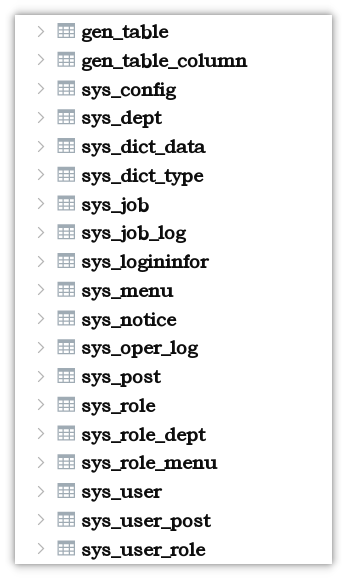
> 图注：这张图片展示的是一组列表形式的数据库表结构列表，内容与前后端项目的后端表结构相关。列表里包含19张表的表名，从上到下依次为gen_table、gen_table_column、sys_config、sys_dept、sys_dict_data、sys_dict_type、sys_job、sys_job_log、sys_logininfor、sys_menu、sys_notice、sys_oper_log、sys_post、sys_role、sys_role_dept、sys_role_menu、sys_user、sys_user_post、sys_user_role，这些表名和文档中提及的若依项目已导入的19张表完全对应，用于供用户熟悉表结构。

表结构说明及关系

<sheet sheet-id="QzRFKA" token="KpTQsrlskhJdAot8sCEc4WIjnFd"></sheet>


### 前端代码

#### 代码结构

如下图：

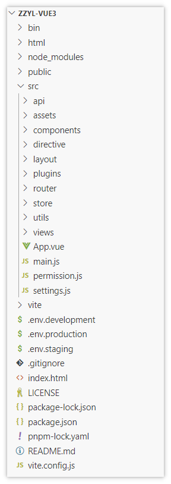
> 图注：这张图片展示了名为ZZYL-VUE3的前端项目代码结构目录，各类目录与文件按层级清晰呈现，包含bin、html、node_modules、public等一级目录；src目录下又细分了api、assets、components、directive、layout、plugins、router、store、utils、views等子目录，还有App.vue、main.js等多个JS和Vue文件；此外还包含vite相关配置文件、不同环境的环境变量文件，以及.gitignore、index.html、LICENSE、package.json、pnpm相关文件、README.md、vite.config.js等项目相关文件，该目录结构可对应文档中提及的前端代码结构内容。

详细目录或文件说明：

```Bash
├── bin                        // 执行脚本
├── public                     // 公共文件
│   ├── favicon.ico            // favicon图标
├── src                        // 源代码
│   ├── api                    // 所有请求,后台的api接口，后期开发重点目录
│   ├── assets                 // 主题 字体等静态资源
│   ├── components             // 全局公用组件
│   ├── directive              // 全局指令
│   ├── layout                 // 布局
│   ├── plugins                // 通用方法
│   ├── router                 // 路由
│   ├── store                  // 全局 store管理
│   ├── utils                  // 全局公用方法
│   ├── views                  // view，存储vue组件，后期开发重点目录
│   ├── App.vue                // 入口页面
│   ├── main.js                // 入口 加载组件 初始化等
│   ├── permission.js          // 权限管理
│   └── settings.js            // 系统配置
├── vite                       // 前端构建工具
├── .env.development           // 开发环境配置
├── .env.production            // 生产环境配置
├── .env.staging               // 测试环境配置
├── .gitignore                 // git 忽略项
├── LICENSE                    // 许可证
├── package-lock.json          // 锁定项目依赖的具体版本号
├── package.json               // 配置项目的信息、名称、版本号、描述信息等
├── pnpm-lock.yaml             // 锁定项目依赖的具体版本号
└── vite.config.js             // 用于配置 Vue.js 项目的全局选项，可修改后台访问接口路径
```

#### 核心配置

在开发阶段，配置的修改是较少的，主要关于一个配置文件即可--->vite.config.js

```JavaScript
import { defineConfig, loadEnv } from 'vite'
import path from 'path'
import createVitePlugins from './vite/plugins'

// https://vitejs.dev/config/
export default defineConfig(({ mode, command }) => {
  const env = loadEnv(mode, process.cwd())
  const { VITE_APP_ENV } = env
  return {
    // 部署生产环境和开发环境下的URL。
    // 默认情况下，vite 会假设你的应用是被部署在一个域名的根路径上
    // 例如 https://www.ruoyi.vip/。如果应用被部署在一个子路径上，你就需要用这个选项指定这个子路径。例如，如果你的应用被部署在 https://www.ruoyi.vip/admin/，则设置 baseUrl 为 /admin/。
    base: VITE_APP_ENV === 'production' ? '/' : '/',
    plugins: createVitePlugins(env, command === 'build'),
    resolve: {
      // https://cn.vitejs.dev/config/#resolve-alias
      alias: {
        // 设置路径
        '~': path.resolve(__dirname, './'),
        // 设置别名
        '@': path.resolve(__dirname, './src')
      },
      // https://cn.vitejs.dev/config/#resolve-extensions
      extensions: ['.mjs', '.js', '.ts', '.jsx', '.tsx', '.json', '.vue']
    },
    // vite 相关配置
    server: {
      port: 80,
      host: true,
      open: true,
      proxy: {
        // https://cn.vitejs.dev/config/#server-proxy
        '/dev-api': {
          target: 'http://localhost:8080',
          // target: 'https://api.wzs.pub/mock/13',
          changeOrigin: true,
          rewrite: (p) => p.replace(/^\/dev-api/, '')
        }
      }
    },
    //fix:error:stdin>:7356:1: warning: "@charset" must be the first rule in the file
    css: {
      postcss: {
        plugins: [
          {
            postcssPlugin: 'internal:charset-removal',
            AtRule: {
              charset: (atRule) => {
                if (atRule.name === 'charset') {
                  atRule.remove();
                }
              }
            }
          }
        ]
      }
    }
  }
})

```

- 别名

  - `~` 代表 `./`
  - `@`代表src目录
- 前端服务端口---> `port: 80`
- 后端服务地址---> `target: '``http://localhost:8080``'`
- 路径重写---> `rewrite: (p) => p.replace(/^\/dev-api/, '')`

  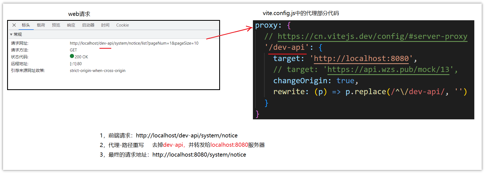
> 图注：图片展示了前端请求与vite.config.js中代理部分代码的关系。左侧是web请求界面，显示请求地址为http://localhost/dev-api/system/notice，请求方法为GET，状态代码200 OK。右侧是vite.config.js中的代理部分代码，包含target指向localhost:8080，rewrite规则去除dev_api并转发至localhost:8080服务器，最终请求地址为http://localhost:8080/system/notice。该图直观呈现了前端请求与代理配置的对应关系。


## 功能快速开发

熟悉了项目的基本信息之后，接下来，我们来快速感受一下若依框架的代码生成的功能

若依提供的代码生成功能，可以基于表结构快速生成前后端的代码，下面，我们快速感受一下单表的**代码生成**

### 准备工作

我们首先开发的是护理项目模块，我们需要准备两部分内容，一个是一级菜单，第二个是表结构

#### 菜单

我们要开发的模块是护理项目模块，而护理项目是子菜单，我们需要先在若依项目中创建一个服务管理的主菜单，方便对服务管理下的功能进行分类

最终的效果：

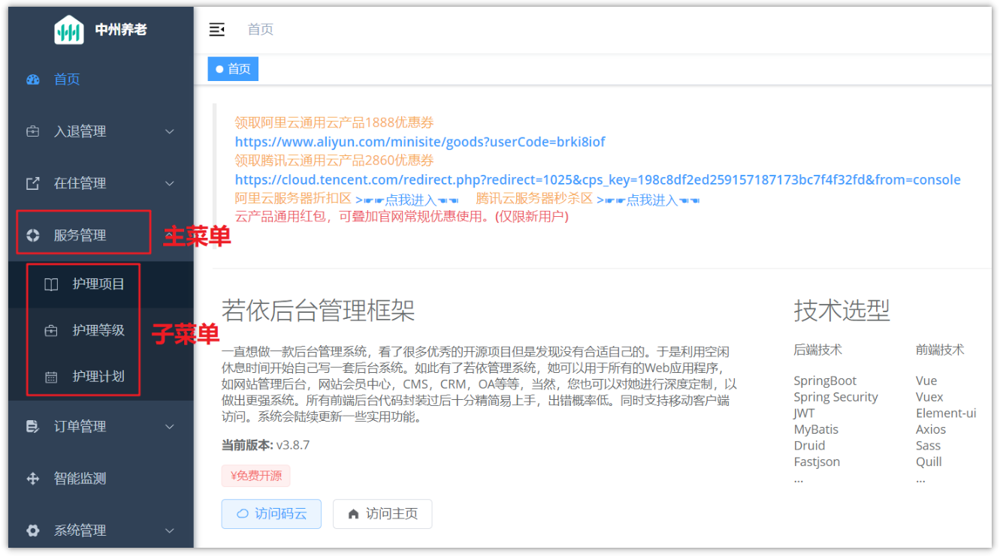
> 图注：这张图展示的是中州养老系统的后台管理界面，重点呈现了左侧的菜单结构。其中用红框标注的“服务管理”是主菜单，其下方的“护理项目”“护理等级”“护理计划”是对应的子菜单，清晰体现了护理项目模块的菜单层级。该界面属于若依后台管理框架，界面顶部有“首页”选项，右侧区域有相关阿里云、腾讯云的优惠推广内容，还标注了该框架的技术选型，后端技术包含Spring Boot、MyBatis等，前端技术包含Vue、ElementUI等，明确了框架的技术组成。

只新建**服务管理** 主菜单即可，子菜单将来由代码生成实现

准备主菜单-->**服务管理，**详细配置，如下：

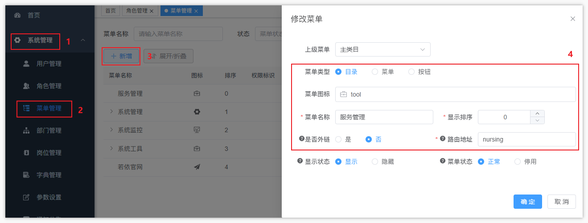
> 图注：这张图是若依系统创建“服务管理”主菜单的界面，左侧系统管理栏的“菜单管理”被蓝色框标注，作为操作入口；上方“新增”按钮被红色框标注，是添加菜单的操作按钮；右侧“修改菜单”面板被红色框标注，其中已填写关键配置信息，包括菜单类型选为“目录”，菜单图标为“tool”，菜单名称为“服务管理”，显示排序设为0，是否外链选“否”，路由地址为“nursing”。


#### 表结构

护理项目表结构定义如下：

```SQL
CREATE TABLE `nursing_project` (
  `id` bigint NOT NULL AUTO_INCREMENT COMMENT '编号',
  `name` varchar(100) CHARACTER SET utf8mb4 COLLATE utf8mb4_0900_ai_ci DEFAULT NULL COMMENT '名称',
  `order_no` int DEFAULT NULL COMMENT '排序号',
  `unit` varchar(50) CHARACTER SET utf8mb4 COLLATE utf8mb4_0900_ai_ci DEFAULT NULL COMMENT '单位',
  `price` decimal(10,2) DEFAULT NULL COMMENT '价格',
  `image` varchar(255) CHARACTER SET utf8mb4 COLLATE utf8mb4_0900_ai_ci DEFAULT NULL COMMENT '图片',
  `nursing_requirement` varchar(255) CHARACTER SET utf8mb4 COLLATE utf8mb4_0900_ai_ci DEFAULT NULL COMMENT '护理要求',
  `status` int NOT NULL DEFAULT '1' COMMENT '状态（0：禁用，1：启用）',
  `create_by` varchar(50) CHARACTER SET utf8mb4 COLLATE utf8mb4_0900_ai_ci DEFAULT NULL COMMENT '创建人',
  `update_by` varchar(50) CHARACTER SET utf8mb4 COLLATE utf8mb4_0900_ai_ci DEFAULT NULL COMMENT '更新人',
  `remark` varchar(255) CHARACTER SET utf8mb4 COLLATE utf8mb4_0900_ai_ci DEFAULT NULL COMMENT '备注',
  `create_time` datetime DEFAULT CURRENT_TIMESTAMP COMMENT '创建时间',
  `update_time` datetime DEFAULT CURRENT_TIMESTAMP ON UPDATE CURRENT_TIMESTAMP COMMENT '更新时间',
  PRIMARY KEY (`id`) USING BTREE,
  UNIQUE KEY `name` (`name`) USING BTREE
) ENGINE=InnoDB AUTO_INCREMENT=84 DEFAULT CHARSET=utf8mb4 COLLATE=utf8mb4_0900_ai_ci ROW_FORMAT=DYNAMIC COMMENT='护理项目表';
```

把以上sql导入到若依对应的数据库中即可

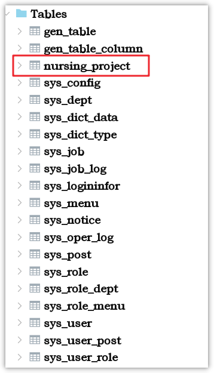
> 图注：图片展示了若依框架中“Tables”文件夹下的表结构列表。其中，“nursing_project”表被红色框突出显示。该图片与文档中“表结构”部分内容相关，文档提到护理项目表结构定义，需把相关sql导入到若依对应的数据库中，此图直观呈现了数据库中已有的表结构，帮助理解后续代码生成操作的表基础。

### 代码生成

找到**系统工具**-->**代码生成**，然后点击**导入**按钮

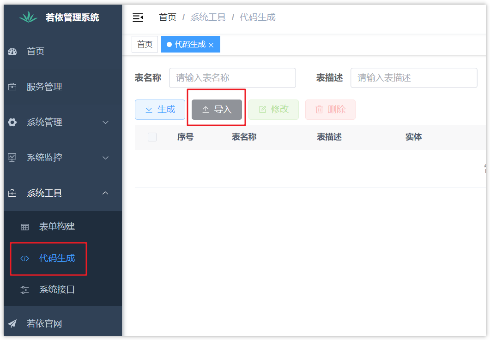
> 图注：这是若依管理系统的代码生成页面，左侧侧边栏选中“代码生成”选项，页面顶部路径显示为“首页 / 系统工具 / 代码生成”，页面内核心区域用红色框突出显示了“导入”按钮，该操作对应上下文所述的找到系统工具下的代码生成后点击导入按钮的指引，页面还呈现了表名称、表描述输入框，以及生成、修改、删除等功能按钮，整体界面和上下文的代码生成操作步骤相契合，可辅助使用者完成代码生成的导入相关操作。

选中**nursing_project**表结构，点击确定

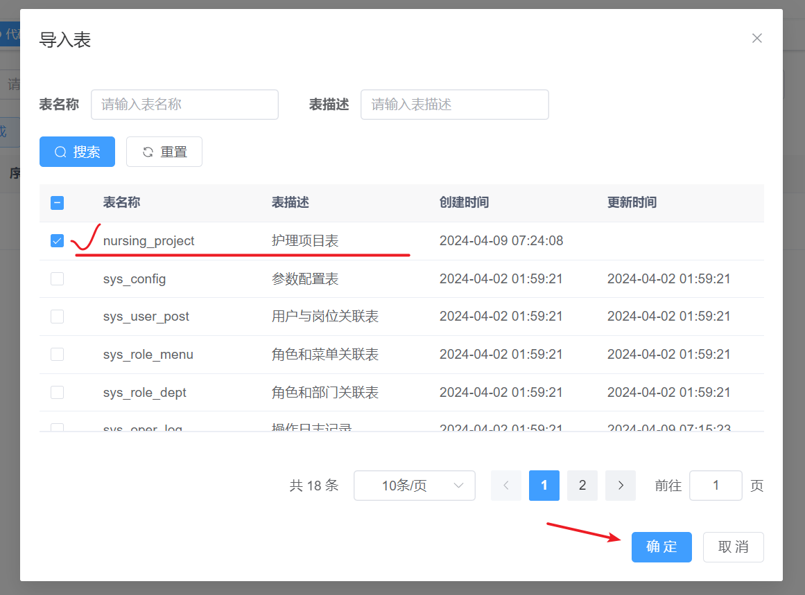
> 图注：这张图是若依代码生成功能里的“导入表”页面，页面上方设有“表名称”“表描述”两个输入框，旁侧配有“搜索”“重置”功能按钮。中间的表格展示了可导入的表结构列表，其中nursing_project表被勾选，其表描述为护理项目表，该表的创建时间为2024-04-09 07:24:08。页面底部标注共有18条数据，支持分页查看，最下方有蓝色的“确定”按钮与“取消”按钮，有红色箭头指向“确定”按钮，符合文档中选中nursing_project表后点击确定的操作要求。

目前在代码生成列表中，可以看到需要生成的数据

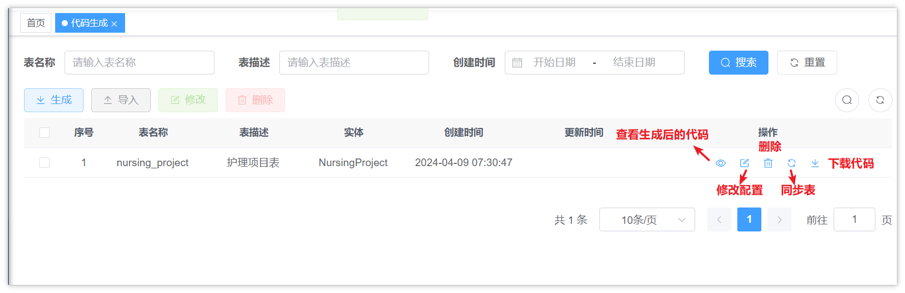
> 图注：图片展示的是若依框架代码生成列表界面。界面中显示了“nursing_project”表的相关信息，包括表名称、表描述、实体、创建时间、更新时间等。右侧有“查看生成后的代码”“修改配置”“同步表”“删除”“下载代码”等操作按钮。该图片与文档中介绍代码生成操作的上下文相关，直观呈现了代码生成列表中数据及操作按钮的布局情况。

> 该数据对应了5个按钮
> 
> - 预览生成后的代码
> - 修改代码生成的配置（常用）
> - 删除代码生成
> - 同步表结构（导入之后改动表的情况）
> - 下载离线代码包


在生成之前，我们需要对代码生成做一些配置，我们可以点击**修改**按钮，可以看到有三部分的配置

- 基本信息
- 字段信息
- 生成信息


下图是**基本信息，**可以根据自己的需求修改：表、实体、表描述、作者相关的数据

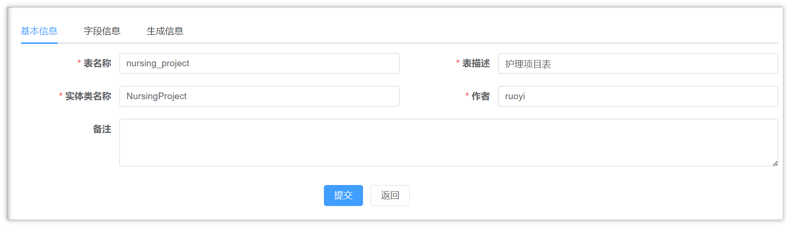
> 图注：这是代码生成配置里的基本信息页面，属于若依框架开发流程中的代码生成配置环节。页面分为三个部分标签，当前选中的是“基本信息”标签，页面内带有红色星号标注的必填项包括表名称（对应导入的nursing_project表）、实体类名称（NursingProject）、表描述（护理项目表）和作者（ruoyi），还有非必填的备注输入框，页面底部设有“提交”和“返回”两个操作按钮，用户可在此处修改代码生成的基础相关配置。


下图是**字段信息**，详细描述如下图：

| 字段信息 | 描述 |
|-|-|
| 字段列名 | 表中的字段列名称 |
| 字段描述 | 字段的描述，读取的comment信息，可根据实际情况更改 |
| 物理类型 | 数据库所对应的字段类型 |
| Java类型 | Java实体类中属性的类型，可改，例如，状态字段：Long类型可以修改为Integer |
| Java属性 | Java实体类中所对应的属性名称 |
| 插入 | 新增的时候，需要插入的字段 |
| 编辑 | 修改的时候，需要插入的字段 |
| 列表 | 列表查询需要展示的字段 |
| 查询 | 列表查询，需要的条件字段 |
| 查询方式 | 与上面查询条件配合，选择对应的查询方式 |
| 必填 | 在插入和新增的时候，这个字段是否是必填项，可生成校验 |
| 显示类型 | 前端代码使用的组件，可根据实际情况选择 |
| 字典类型 | 字典管理是用来维护数据类型的数据，如下拉框、单选按钮等，可自定义 |

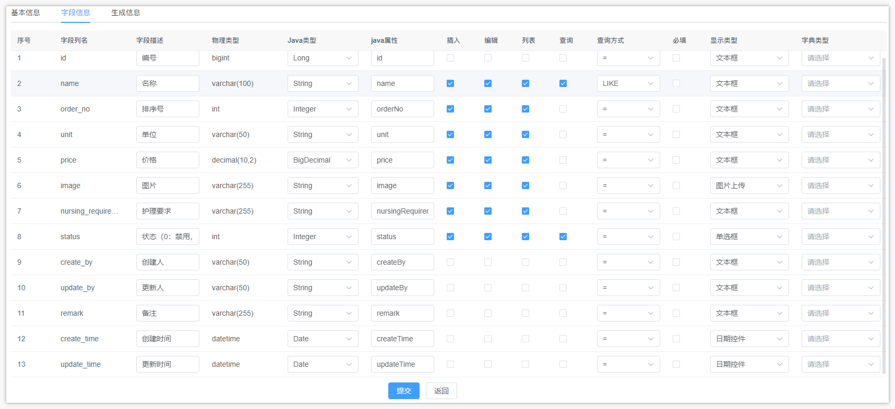
> 图注：图片展示的是若依框架代码生成功能中的字段信息页面。页面分为基本信息、字段信息、生成信息三个标签页，当前显示字段信息。列出了id、name等13个字段，包括字段列名、字段描述、物理类型、Java类型等信息。部分字段有插入、编辑、列表、查询等操作选项，如name字段可进行插入、编辑、列表、查询操作。页面底部有“提交”和“返回”按钮。该图与上下文介绍的若依框架代码生成功能相关，展示了字段信息的填写与操作界面。

下图是**生成信息，**可以按照自己的实际情况，来修改包路径，模块名称，上级菜单

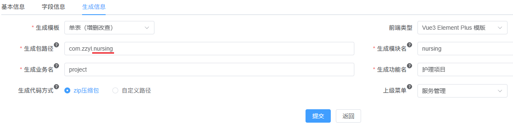
> 图注：图片展示的是若依框架代码生成功能中的生成信息页面。页面左侧有基本信息、字段信息、生成信息三个选项卡，当前选中生成信息。页面右侧有生成模板、生成包路径、生成业务名等必填项，以及前端类型、生成模块名、生成功能名、上级菜单等可选项。其中生成包路径处显示“com.zzyl.nursing”，前端类型为“Vue3 Element Plus 模版”，生成模块名是“nursing”，生成功能名是“护理项目”，上级菜单为“服务管理”。该页面用于设置生成代码的相关信息，后续可点击提交按钮进行提交。

修改完成后，点击**提交**按钮

等我们修改完毕后，回到了列表页，这个时候就可以点击**下载**按钮，去下载代码包

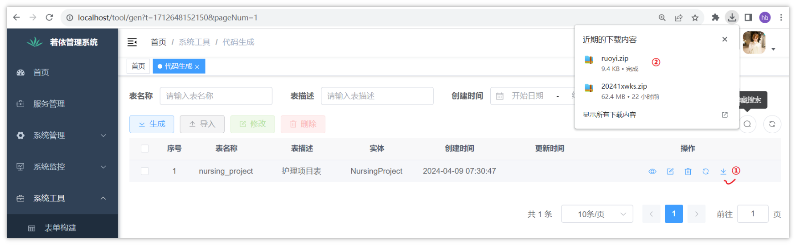
> 图注：这是若依系统的代码生成页面，页面顶部为系统导航栏，左侧是包含系统管理、系统工具等功能的侧边栏。主区域的代码生成界面设有表名称、表描述等输入项，支持生成、导入等操作，下方展示了名为nursing_project的护理项目表信息。页面右上角的通知弹窗显示了近期的下载内容，包含ruoyi.zip和20241wbs.zip两个文件，提示用户完成代码修改后可下载对应代码包。

下载后的代码包，解压后，包含了三部分，如下图：

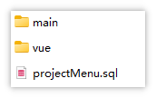
> 图注：图片展示了下载代码包后解压内容，包含三个文件夹及一个SQL文件。左侧是“main”和“vue”两个文件夹，右侧是“projectMenu.sql”SQL文件。该图片与文档中介绍下载代码包后内容相关，直观呈现了下载后的代码包结构，与文档中提到的下载代码包解压后包含三部分的内容相呼应，帮助理解代码包的组成。


> - main 后端的代码
> - vue  前端的代码
> - projectMenu.sql  菜单关系的sql数据


执行projectMenu.sql文件中的内容，内容为菜单的数据

```SQL
-- 菜单 SQL
insert into sys_menu (menu_name, parent_id, order_num, path, component, is_frame, is_cache, menu_type, visible, status, perms, icon, create_by, create_time, update_by, update_time, remark)
values('护理项目', '2000', '1', 'project', 'nursing/project/index', 1, 0, 'C', '0', '0', 'nursing:project:list', '#', 'admin', sysdate(), '', null, '护理项目菜单');

-- 按钮父菜单ID
SELECT @parentId := LAST_INSERT_ID();

-- 按钮 SQL
insert into sys_menu (menu_name, parent_id, order_num, path, component, is_frame, is_cache, menu_type, visible, status, perms, icon, create_by, create_time, update_by, update_time, remark)
values('护理项目查询', @parentId, '1',  '#', '', 1, 0, 'F', '0', '0', 'nursing:project:query',        '#', 'admin', sysdate(), '', null, '');

insert into sys_menu (menu_name, parent_id, order_num, path, component, is_frame, is_cache, menu_type, visible, status, perms, icon, create_by, create_time, update_by, update_time, remark)
values('护理项目新增', @parentId, '2',  '#', '', 1, 0, 'F', '0', '0', 'nursing:project:add',          '#', 'admin', sysdate(), '', null, '');

insert into sys_menu (menu_name, parent_id, order_num, path, component, is_frame, is_cache, menu_type, visible, status, perms, icon, create_by, create_time, update_by, update_time, remark)
values('护理项目修改', @parentId, '3',  '#', '', 1, 0, 'F', '0', '0', 'nursing:project:edit',         '#', 'admin', sysdate(), '', null, '');

insert into sys_menu (menu_name, parent_id, order_num, path, component, is_frame, is_cache, menu_type, visible, status, perms, icon, create_by, create_time, update_by, update_time, remark)
values('护理项目删除', @parentId, '4',  '#', '', 1, 0, 'F', '0', '0', 'nursing:project:remove',       '#', 'admin', sysdate(), '', null, '');

insert into sys_menu (menu_name, parent_id, order_num, path, component, is_frame, is_cache, menu_type, visible, status, perms, icon, create_by, create_time, update_by, update_time, remark)
values('护理项目导出', @parentId, '5',  '#', '', 1, 0, 'F', '0', '0', 'nursing:project:export',       '#', 'admin', sysdate(), '', null, '');
```

把main目录拷贝后，找到后端ruoyi-admin模块，在**main目录上点右键**，选择Paste进行拷贝，效果如下：

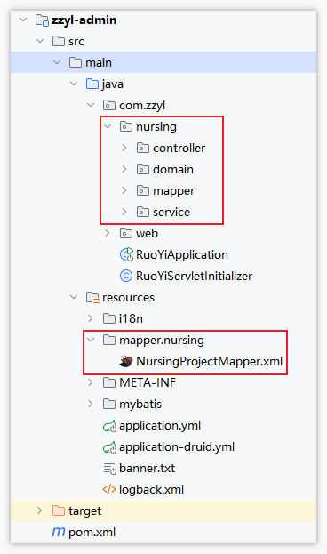
> 图注：这张图片展示了若依项目后端模块的文件目录结构，目录层级为zzyl-admin下的src/main目录。其中两处核心内容被红色方框标注，一处是main目录下com.zzyl包内的nursing包，该包下包含controller、domain、mapper、service四个子包；另一处是resources目录下的mapper.nursing包内的NursingProjectMapper.xml文件，对应上下文里代码生成后端相关的操作内容。

打开vue文件夹，里面包含了两部分内容

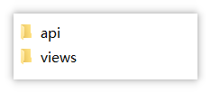
> 图注：图片展示了打开vue文件夹后的内容，包含两个文件夹，分别是“api”和“views”。其中，“api”文件夹用于存放后端接口定义代码，“views”文件夹包含vue组件的前端代码。该图片与文档中介绍前端项目结构的内容相关，直观呈现了vue文件夹下的这两部分内容，为后续代码拷贝操作提供参考。

> - api是指后端的接口定义代码
> - views中包含了vue组件的前端代码

**选中这两个文件夹**，打开前端项目，**选中src目录**进行拷贝，效果如下：

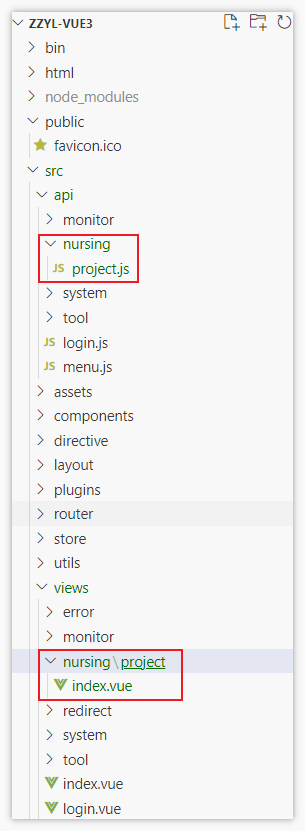
> 图注：图片展示了前端项目文件结构。左侧为文件夹列表，右侧是文件内容。在“src”目录下，“api”文件夹内有“nursing”文件夹，其中包含“project.js”文件；“views”文件夹内也有“nursing”文件夹，其中“project”文件夹下有“index.vue”文件。这些文件与文档中提到的将“api”和“views”文件夹选中进行前端项目src目录拷贝的内容相关，是代码生成后前端项目的部分结构展示。

等代码拷贝完成后，重新启动前后端项目，打开页面，可以在**服务管理**中看到子菜单**护理项目**，如下图

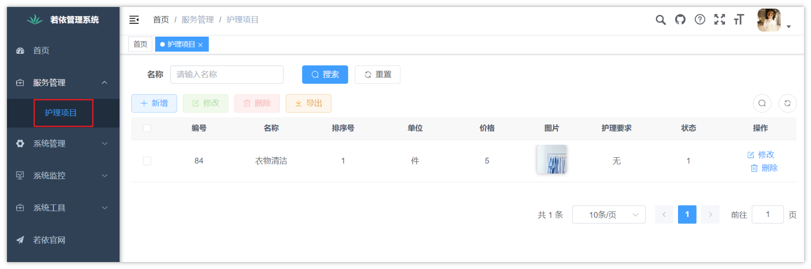
> 图注：图片展示的是若依管理系统中“服务管理”下的“护理项目”页面。左侧导航栏中“护理项目”被红色框突出显示。页面上方有“首页”“服务管理”“护理项目”等导航选项。中部显示护理项目列表，包含编号、名称、排序号、单位、价格、图片、护理要求、状态等信息，如编号84的衣物清洁等。底部有分页导航和每页显示条数选择。该图与上文提到的在服务管理中看到子菜单护理项目，可对护理项目进行操作等内容相呼应。

可以对护理项目进行一些操作，比如，新增、修改、删除、查询等

### 代码阅读

刚才自动生成的代码，我们已经测试过了，可以做到基本的增删改查，我们是不需要修改任何代码的，当然生成的代码也不是很完美，后面，我们还会进行修改调整。

在修改优化之前，我们先来读一下自动生成的代码长什么样子，共分为两部分：后端和前端

#### 后端代码

下面这个是控制层的代码NursingProjectController ，详细如下：

```Java
package com.zzyl.nursing.controller;

import java.util.List;
import javax.servlet.http.HttpServletResponse;
import org.springframework.security.access.prepost.PreAuthorize;
import org.springframework.beans.factory.annotation.Autowired;
import org.springframework.web.bind.annotation.GetMapping;
import org.springframework.web.bind.annotation.PostMapping;
import org.springframework.web.bind.annotation.PutMapping;
import org.springframework.web.bind.annotation.DeleteMapping;
import org.springframework.web.bind.annotation.PathVariable;
import org.springframework.web.bind.annotation.RequestBody;
import org.springframework.web.bind.annotation.RequestMapping;
import org.springframework.web.bind.annotation.RestController;
import com.zzyl.common.annotation.Log;
import com.zzyl.common.core.controller.BaseController;
import com.zzyl.common.core.domain.AjaxResult;
import com.zzyl.common.enums.BusinessType;
import com.zzyl.nursing.domain.NursingProject;
import com.zzyl.nursing.service.INursingProjectService;
import com.zzyl.common.utils.poi.ExcelUtil;
import com.zzyl.common.core.page.TableDataInfo;

/**
 * 护理项目Controller
 * 
 * @author ruoyi
 * @date 2024-10-31
 */
@RestController
@RequestMapping("/nursing/project")
public class NursingProjectController extends BaseController
{
    @Autowired
    private INursingProjectService nursingProjectService;

    /**
     * 查询护理项目列表
     */
    @PreAuthorize("@ss.hasPermi('nursing:project:list')")
    @GetMapping("/list")
    public TableDataInfo list(NursingProject nursingProject)
    {
        startPage();
        List<NursingProject> list = nursingProjectService.selectNursingProjectList(nursingProject);
        return getDataTable(list);
    }

    /**
     * 导出护理项目列表
     */
    @PreAuthorize("@ss.hasPermi('nursing:project:export')")
    @Log(title = "护理项目", businessType = BusinessType.EXPORT)
    @PostMapping("/export")
    public void export(HttpServletResponse response, NursingProject nursingProject)
    {
        List<NursingProject> list = nursingProjectService.selectNursingProjectList(nursingProject);
        ExcelUtil<NursingProject> util = new ExcelUtil<NursingProject>(NursingProject.class);
        util.exportExcel(response, list, "护理项目数据");
    }

    /**
     * 获取护理项目详细信息
     */
    @PreAuthorize("@ss.hasPermi('nursing:project:query')")
    @GetMapping(value = "/{id}")
    public AjaxResult getInfo(@PathVariable("id") Long id)
    {
        return success(nursingProjectService.selectNursingProjectById(id));
    }

    /**
     * 新增护理项目
     */
    @PreAuthorize("@ss.hasPermi('nursing:project:add')")
    @Log(title = "护理项目", businessType = BusinessType.INSERT)
    @PostMapping
    public AjaxResult add(@RequestBody NursingProject nursingProject)
    {
        return toAjax(nursingProjectService.insertNursingProject(nursingProject));
    }

    /**
     * 修改护理项目
     */
    @PreAuthorize("@ss.hasPermi('nursing:project:edit')")
    @Log(title = "护理项目", businessType = BusinessType.UPDATE)
    @PutMapping
    public AjaxResult edit(@RequestBody NursingProject nursingProject)
    {
        return toAjax(nursingProjectService.updateNursingProject(nursingProject));
    }

    /**
     * 删除护理项目
     */
    @PreAuthorize("@ss.hasPermi('nursing:project:remove')")
    @Log(title = "护理项目", businessType = BusinessType.DELETE)
    @DeleteMapping("/{ids}")
    public AjaxResult remove(@PathVariable Long[] ids)
    {
        return toAjax(nursingProjectService.deleteNursingProjectByIds(ids));
    }
}
```

我们可以使用AI协助我们来阅读以上代码，我们可以让AI为每一行代码添加上注释，方便我们阅读

<callout emoji="🤖">
**Prompt**
我们可以把整个类的代码给AI，然后在最后添加一句话：  
你是一个资深的Java开发工程师，帮我给上述代码的每一行都添加上注释进行说明
</callout>

AI解释后就可以很方便的阅读代码，详细如下：

```Java
// 包含护理项目管理功能的控制器类
package com.ruoyi.serve.controller;

// 引入相关注解和依赖
import ...; // 这里省略了具体的导入语句，实际使用时需根据上下文补全

/**
 * 护理项目Controller
 * 负责处理与护理项目相关的HTTP请求。
 * 
 * @author ruoyi
 * @date 2024-06-09
 */
@RestController // 标识为RESTful风格的控制器
@RequestMapping("/nursing/project") // 设置此控制器处理URL的前缀
public class NursingProjectController extends BaseController {

    // 自动注入NursingProjectService服务层实例
    @Autowired
    private INursingProjectService nursingProjectService;

    /**
     * 查询护理项目列表
     * 需要权限许可，响应为分页后的护理项目列表数据。
     */
    @PreAuthorize("@ss.hasPermi('nursing:project:list')")
    @GetMapping("/list")
    public TableDataInfo list(NursingProject nursingProject) {
        // 开始分页
        startPage();
        // 调用服务层方法获取护理项目列表
        List<NursingProject> list = nursingProjectService.selectNursingProjectList(nursingProject);
        // 封装返回数据
        return getDataTable(list);
    }

    /**
     * 导出护理项目列表至Excel文件
     * 需要导出权限，接收查询参数并导出数据。
     */
    @PreAuthorize("@ss.hasPermi('nursing:project:export')")
    @Log(title = "护理项目", businessType = BusinessType.EXPORT) // 记录操作日志
    @PostMapping("/export")
    public void export(HttpServletResponse response, NursingProject nursingProject) {
        // 查询护理项目列表数据
        List<NursingProject> list = nursingProjectService.selectNursingProjectList(nursingProject);
        // 创建Excel工具类实例
        ExcelUtil<NursingProject> util = new ExcelUtil<>(NursingProject.class);
        // 执行导出操作
        util.exportExcel(response, list, "护理项目数据");
    }

    /**
     * 根据ID获取护理项目详细信息
     * 需要查询权限，响应包含单个护理项目的详细信息。
     */
    @PreAuthorize("@ss.hasPermi('nursing:project:query')")
    @GetMapping(value = "/{id}")
    public AjaxResult getInfo(@PathVariable("id") Long id) {
        // 查询并返回指定ID的护理项目信息
        return success(nursingProjectService.selectNursingProjectById(id));
    }

    /**
     * 新增护理项目
     * 需要新增权限，接收JSON格式的护理项目数据并保存。
     */
    @PreAuthorize("@ss.hasPermi('nursing:project:add')")
    @Log(title = "护理项目", businessType = BusinessType.INSERT) // 记录插入操作日志
    @PostMapping
    public AjaxResult add(@RequestBody NursingProject nursingProject) {
        // 执行添加操作并返回结果
        return toAjax(nursingProjectService.insertNursingProject(nursingProject));
    }

    /**
     * 修改护理项目信息
     * 需要修改权限，接收JSON格式的更新数据并执行更新操作。
     */
    @PreAuthorize("@ss.hasPermi('nursing:project:edit')")
    @Log(title = "护理项目", businessType = BusinessType.UPDATE) // 记录更新操作日志
    @PutMapping
    public AjaxResult edit(@RequestBody NursingProject nursingProject) {
        // 执行更新操作并返回结果
        return toAjax(nursingProjectService.updateNursingProject(nursingProject));
    }

    /**
     * 删除护理项目
     * 需要删除权限，支持批量删除，通过ID数组指定要删除的记录。
     */
    @PreAuthorize("@ss.hasPermi('nursing:project:remove')")
    @Log(title = "护理项目", businessType = BusinessType.DELETE) // 记录删除操作日志
    @DeleteMapping("/{ids}")
    public AjaxResult remove(@PathVariable Long[] ids) {
        // 执行批量删除操作并返回结果
        return toAjax(nursingProjectService.deleteNursingProjectByIds(ids));
    }
}
```

**说明**

1. 继承了BaseController，其中BaseController详细定义如下图：

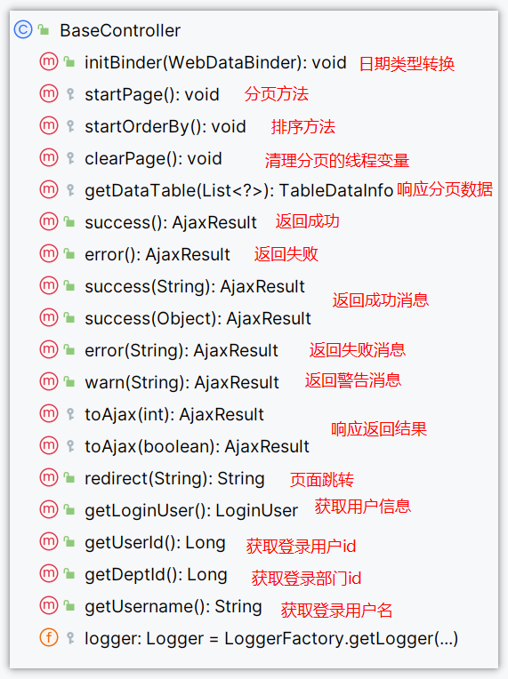
> 图注：图片展示了若依框架中BaseController类的部分方法。其中，`initBinder(WebDataBinder): void`用于日期类型转换；`startPage(): void`是分页方法；`startOrderBy(): void`用于排序方法；`clearPage(): void`清理分页的线程变量；`getDataTable(List<?>): TableDataInfo`响应分页数据；`success(): AjaxResult`返回成功；`error(): AjaxResult`返回失败；`success(String): AjaxResult`返回成功消息；`success(Object): AjaxResult`返回成功对象；`error(String): AjaxResult`返回失败消息；`warn(String): AjaxResult`返回警告消息；`toAjax(int): AjaxResult`响应返回结果；`toAjax(boolean): AjaxResult`响应返回布尔结果；`redirect(String): String`页面跳转；`getLoginUser(): LoginUser`获取用户信息；`getUserId(): Long`获取登录用户id；`getDeptId(): Long`获取登录部门id；`getUsername(): String`获取登录用户名；`logger: Logger = LoggerFactory.getLogger(...)`获取日志器。该图与上文介绍的NursingProjectController继承自BaseController相关，辅助理解其方法功能。

1. 符合RestFul请求风格
2. 返回值有两个：TableDataInfo 和  AjaxResult   

   1. TableDataInfo 返回**分页**相关数据
   
      ```JSON
      {
          "total": 2,
          "rows": [
              {
                  "createBy": "admin",
                  "createTime": "2024-03-25 21:29:45",
                  "updateBy": "",
                  "updateTime": null,
                  "remark": "管理员",
                  "noticeId": "2",
                  "noticeTitle": "维护通知：2018-07-01 若依系统凌晨维护",
                  "noticeType": "1",
                  "noticeContent": "维护内容",
                  "status": "0"
              }
          ],
          "code": 200,
          "msg": "查询成功"
      }
      ```
   2. AjaxResult   继承了HashMap，有标准的接口响应结构
   
      ```JSON
      {"msg":"操作成功","code":200}
      
      
      {
          "msg": "操作成功",
          "code": 200,
          "data": {
              "createBy": "admin",
              "createTime": "2024-03-25 21:29:45",
              "remark": "管理员",
              "noticeId": "1",
              "noticeTitle": "温馨提醒：2018-07-01 若依新版本发布啦",
              "noticeType": "2",
              "noticeContent": "新版本内容",
              "status": "0"
          }
      }
      ```
3. 陌生注解

   1. `@PreAuthorize`  在方法上使用，主要作用判断当前登录人是否有权限访问该方法   ps:后期会细讲
   2. `@Log`在方法上使用，作用是把操作这个方法的行为做一个日志记录      ps:后期会细讲
4. 后端其他代码比如service、mapper，这些代码都是基础的CRUD，操作数据使用的mybatis，详细请阅读代码
5. 分页逻辑详细分页逻辑如下图：

   
> 图注：图片展示了NursingProjectController中list方法的代码及startPage()方法的实现。list方法继承了BaseController，符合RestFul请求风格，返回TableDataInfo和AjaxResult。startPage()方法从请求参数中获取pageNum和pageSize参数，调用PageHelper.startPage()进行分页处理。其中，PageHelper.startPage()方法接收pageNum、pageSize、orderBy参数，还设置了reasonable属性。该图片与上文介绍的分页逻辑相关，直观呈现了分页处理的代码实现。

当调用了startPage()方法后主要干了两件事：

1. 从请求参数中获取到pageNum和pageSize两个参数，如果有其他参数也会获取，比如是orderBy参数
2. 调用了PageHelper.startPage()方法，来进行分页处理

#### 前端代码

1. 菜单路由规则，映射关系

> 知识回顾：
> 
> 路由：实现不同页面间的导航和视图切换，是路径与组件的对应关系

我们来看一下目前**护理项目**这个菜单的配置项，如下图


> 图注：这是若依系统中“修改菜单”的配置界面，对应上下文里提及的“护理项目”菜单配置项。界面显示上级菜单为“服务管理”，菜单类型选择了“菜单”，菜单名称为“护理项目”，显示排序设为1。父菜单路由为“nursing”，界面用红色箭头和文字标注了这一信息，同时用红框突出标注了两项核心配置：路由地址为“project”、组件路径为“nursing/project/index”，其余配置还包括菜单图标、是否外链、权限字符等，底部有“确定”“取消”按钮用于保存或放弃修改。

- 这个菜单的类型为**菜单，**菜单需要有对应的**组件路径**
- 父菜单的路由地址+当前菜单的路由地址 就可以访问组件路径对应的组件即： nursing/project     加载组件为     @/views/nursing/project/index.vue

---

**测试案例**

在服务管理中新增一个菜单(护理计划)，配置如下:

- 路由地址：nursingPlan
- 组件路径：nursing/nursingPlan/index


> 图注：这是添加菜单的配置界面，对应在服务管理中新增“护理计划”菜单的操作配置项。界面中上级菜单已选择“服务管理”，菜单类型选中“菜单”，菜单名称填写为“护理计划”，路由地址设置为“nursingPlan”，组件路径填写为“nursing/nursingPlan/index”。界面还显示了其他配置选项，如菜单图标、显示排序、是否外链、权限字符、是否缓存、显示与菜单状态等，最后设有“确定”和“取消”按钮用于完成或放弃本次菜单配置。

在@/views/nursing/nursingPlan目录中新增一个index.vue组件


> 图注：这张图片展示了若依项目的前端代码结构与对应文件内容，左侧资源管理器栏中高亮选中了`src/views/nursing/nursingPlan`路径下的`index.vue`文件，对应测试案例中新增菜单“护理计划”要求的组件路径。右侧的编辑栏呈现了该`index.vue`的代码模板，仅包含基础的`<script>`、`<template>`标签，模板内标注了“这是护理计划组件”的文本内容，符合测试案例里要求在对应目录新增组件的操作步骤。

测试是否能正常访问这个组件


> 图注：图片展示了若依管理系统中护理计划组件的访问情况。左侧导航栏选中“护理计划”菜单，对应路由地址为“localhost/nursing/nursingPlan”。右侧导航栏显示“护理计划”处于选中状态。页面上方地址栏显示完整路由地址。底部文字说明加载的组件为“@/views/nursing/nursingPlan/index.vue”。该图片与上文测试案例内容相关，直观呈现了在服务管理中新增护理计划菜单后，通过路由地址访问对应组件的场景。

1. 代码阅读

刚才生成代码中包含了两部分内容，第一个是api，第二个是组件

我们先来看@/api/nursing/project.js

```JavaScript
import request from '@/utils/request'

// 查询护理项目列表
export function listProject(query) {
  return request({
    url: '/nursing/project/list',
    method: 'get',
    params: query
  })
}

// 查询护理项目详细
export function getProject(id) {
  return request({
    url: '/nursing/project/' + id,
    method: 'get'
  })
}

// 新增护理项目
export function addProject(data) {
  return request({
    url: '/nursing/project',
    method: 'post',
    data: data
  })
}

// 修改护理项目
export function updateProject(data) {
  return request({
    url: '/nursing/project',
    method: 'put',
    data: data
  })
}

// 删除护理项目
export function delProject(id) {
  return request({
    url: '/nursing/project/' + id,
    method: 'delete'
  })
}

```

- 这里面的5个接口定义，与后台提供的接口是一一对应的
- 其中`@/utils/request`这个js封装了拦截器和工具函数，实现了对HTTP请求和响应的统一处理和管理


我们接下来再来看组件的代码，地址：src\views\nursing\project\index.vue

为了更方便阅读这个代码，我们依然可以使用通义灵码或者是AI大模型添加注释或者解释代码

<callout emoji="🤖">
**Prompt**
把这个组件的代码给大模型，然后跟上一句话
你是一个资深的前端开发工程师，帮我给解读一下上述代码，并且给每行代码上添加注释说明
</callout>

解释后的代码如下：

```JavaScript
<template>
  <div class="app-container">
    <el-form :model="queryParams" ref="queryRef" :inline="true" v-show="showSearch" label-width="68px">
      <el-form-item label="名称" prop="name">
        <el-input
          v-model="queryParams.name"
          placeholder="请输入名称"
          clearable
          @keyup.enter="handleQuery"
        />
      </el-form-item>
      <el-form-item>
        <el-button type="primary" icon="Search" @click="handleQuery">搜索</el-button>
        <el-button icon="Refresh" @click="resetQuery">重置</el-button>
      </el-form-item>
    </el-form>

    <el-row :gutter="10" class="mb8">
      <el-col :span="1.5">
        <el-button
          type="primary"
          plain
          icon="Plus"
          @click="handleAdd"
          v-hasPermi="['nursing:project:add']"
        >新增</el-button>
      </el-col>
      <el-col :span="1.5">
        <el-button
          type="success"
          plain
          icon="Edit"
          :disabled="single"
          @click="handleUpdate"
          v-hasPermi="['nursing:project:edit']"
        >修改</el-button>
      </el-col>
      <el-col :span="1.5">
        <el-button
          type="danger"
          plain
          icon="Delete"
          :disabled="multiple"
          @click="handleDelete"
          v-hasPermi="['nursing:project:remove']"
        >删除</el-button>
      </el-col>
      <el-col :span="1.5">
        <el-button
          type="warning"
          plain
          icon="Download"
          @click="handleExport"
          v-hasPermi="['nursing:project:export']"
        >导出</el-button>
      </el-col>
      <right-toolbar v-model:showSearch="showSearch" @queryTable="getList"></right-toolbar>
    </el-row>

    <el-table v-loading="loading" :data="projectList" @selection-change="handleSelectionChange">
      <el-table-column type="selection" width="55" align="center" />
      <el-table-column label="编号" align="center" prop="id" />
      <el-table-column label="名称" align="center" prop="name" />
      <el-table-column label="排序号" align="center" prop="orderNo" />
      <el-table-column label="单位" align="center" prop="unit" />
      <el-table-column label="价格" align="center" prop="price" />
      <el-table-column label="图片" align="center" prop="image" width="100">
        <template #default="scope">
          <image-preview :src="scope.row.image" :width="50" :height="50"/>
        </template>
      </el-table-column>
      <el-table-column label="护理要求" align="center" prop="nursingRequirement" />
      <el-table-column label="状态" align="center" prop="status" />
      <el-table-column label="创建时间" align="center" prop="createTime" width="180">
        <template #default="scope">
          <span>{{ parseTime(scope.row.createTime, '{y}-{m}-{d}') }}</span>
        </template>
      </el-table-column>
      <el-table-column label="操作" align="center" class-name="small-padding fixed-width">
        <template #default="scope">
          <el-button link type="primary" icon="Edit" @click="handleUpdate(scope.row)" v-hasPermi="['nursing:project:edit']">修改</el-button>
          <el-button link type="primary" icon="Delete" @click="handleDelete(scope.row)" v-hasPermi="['nursing:project:remove']">删除</el-button>
        </template>
      </el-table-column>
    </el-table>
    
    <pagination
      v-show="total>0"
      :total="total"
      v-model:page="queryParams.pageNum"
      v-model:limit="queryParams.pageSize"
      @pagination="getList"
    />

    <!-- 添加或修改护理项目对话框 -->
    <el-dialog :title="title" v-model="open" width="500px" append-to-body>
      <el-form ref="projectRef" :model="form" :rules="rules" label-width="80px">
        <el-form-item label="名称" prop="name">
          <el-input v-model="form.name" placeholder="请输入名称" />
        </el-form-item>
        <el-form-item label="排序号" prop="orderNo">
          <el-input v-model="form.orderNo" placeholder="请输入排序号" />
        </el-form-item>
        <el-form-item label="单位" prop="unit">
          <el-input v-model="form.unit" placeholder="请输入单位" />
        </el-form-item>
        <el-form-item label="价格" prop="price">
          <el-input v-model="form.price" placeholder="请输入价格" />
        </el-form-item>
        <el-form-item label="图片" prop="image">
          <image-upload v-model="form.image"/>
        </el-form-item>
        <el-form-item label="护理要求" prop="nursingRequirement">
          <el-input v-model="form.nursingRequirement" placeholder="请输入护理要求" />
        </el-form-item>
      </el-form>
      <template #footer>
        <div class="dialog-footer">
          <el-button type="primary" @click="submitForm">确 定</el-button>
          <el-button @click="cancel">取 消</el-button>
        </div>
      </template>
    </el-dialog>
  </div>
</template>

<script setup name="Project">
import { listProject, getProject, delProject, addProject, updateProject } from "@/api/nursing/project";

const { proxy } = getCurrentInstance();

const projectList = ref([]);
const open = ref(false);
const loading = ref(true);
const showSearch = ref(true);
const ids = ref([]);
const single = ref(true);
const multiple = ref(true);
const total = ref(0);
const title = ref("");

const data = reactive({
  form: {},
  queryParams: {
    pageNum: 1,
    pageSize: 10,
    name: null,
    status: null,
  },
  rules: {
    name: [
      { required: true, message: "名称不能为空", trigger: "blur" }
    ],
    price: [
      { required: true, message: "价格不能为空", trigger: "blur" }
    ],
    image: [
      { required: true, message: "图片不能为空", trigger: "blur" }
    ],
    nursingRequirement: [
      { required: true, message: "护理要求不能为空", trigger: "blur" }
    ],
  }
});

const { queryParams, form, rules } = toRefs(data);

/** 查询护理项目列表 */
function getList() {
  loading.value = true;
  listProject(queryParams.value).then(response => {
    projectList.value = response.rows;
    total.value = response.total;
    loading.value = false;
  });
}

// 取消按钮
function cancel() {
  open.value = false;
  reset();
}

// 表单重置
function reset() {
  form.value = {
    id: null,
    name: null,
    orderNo: null,
    unit: null,
    price: null,
    image: null,
    nursingRequirement: null,
    status: null,
    createBy: null,
    updateBy: null,
    remark: null,
    createTime: null,
    updateTime: null
  };
  proxy.resetForm("projectRef");
}

/** 搜索按钮操作 */
function handleQuery() {
  queryParams.value.pageNum = 1;
  getList();
}

/** 重置按钮操作 */
function resetQuery() {
  proxy.resetForm("queryRef");
  handleQuery();
}

// 多选框选中数据
function handleSelectionChange(selection) {
  ids.value = selection.map(item => item.id);
  single.value = selection.length != 1;
  multiple.value = !selection.length;
}

/** 新增按钮操作 */
function handleAdd() {
  reset();
  open.value = true;
  title.value = "添加护理项目";
}

/** 修改按钮操作 */
function handleUpdate(row) {
  reset();
  const _id = row.id || ids.value
  getProject(_id).then(response => {
    form.value = response.data;
    open.value = true;
    title.value = "修改护理项目";
  });
}

/** 提交按钮 */
function submitForm() {
  proxy.$refs["projectRef"].validate(valid => {
    if (valid) {
      if (form.value.id != null) {
        updateProject(form.value).then(response => {
          proxy.$modal.msgSuccess("修改成功");
          open.value = false;
          getList();
        });
      } else {
        addProject(form.value).then(response => {
          proxy.$modal.msgSuccess("新增成功");
          open.value = false;
          getList();
        });
      }
    }
  });
}

/** 删除按钮操作 */
function handleDelete(row) {
  const _ids = row.id || ids.value;
  proxy.$modal.confirm('是否确认删除护理项目编号为"' + _ids + '"的数据项？').then(function() {
    return delProject(_ids);
  }).then(() => {
    getList();
    proxy.$modal.msgSuccess("删除成功");
  }).catch(() => {});
}

/** 导出按钮操作 */
function handleExport() {
  proxy.download('nursing/project/export', {
    ...queryParams.value
  }, `project_${new Date().getTime()}.xlsx`)
}

getList();
</script>

```

- 组件主要使用Vue3+Element plus组件进行开发
- 完成了护理项目的增删改查


## 作业

### 跑通功能快速开发章节的代码

### 在项目中集成Knife4j

### 学习在若依项目中创建新模块

参考链接：

<bookmark name="后台手册 | RuoYi" href="http://doc.ruoyi.vip/ruoyi/document/htsc.html#%E6%96%B0%E5%BB%BA%E5%AD%90%E6%A8%A1%E5%9D%97"></bookmark>

要求：

- 创建**zzyl-nursing-platform**模块，如下效果


> 图注：图片展示了若依项目中zzyl-nursing-platform模块的文件结构。在E:\\code\\2024\\zzyl-ruoyi-ai-code目录下，zzyl-nursing-platform模块被红色框突出显示。该模块包含.gitignore、LICENSE、pom.xml、README.md等文件，以及bin、doc、sql等文件夹。该图片与文档中“创建zzyl-nursing-platform模块，如下效果”上下文对应，直观呈现了新创建模块在项目中的位置及结构。

- 在父模块中管理zzyl-nursing-platform模块的版本：

```JavaScript
<!-- 业务模块-->
<dependency>
    <groupId>com.zzyl</groupId>
    <artifactId>zzyl-nursing-platform</artifactId>
    <version>${zzyl.version}</version>
</dependency>
```

- 在zzyl-nursing-platform模块中引入zzyl-common模块

```XML
<dependencies>
    <dependency>
        <groupId>com.zzyl</groupId>
        <artifactId>zzyl-common</artifactId>
    </dependency>
</dependencies>
```

- 在zzyl-admin模块中引入新创建的zzyl-nursing-platform模块

```JavaScript
<!-- 护理业务模块-->
<dependency>
    <groupId>com.zzyl</groupId>
    <artifactId>zzyl-nursing-platform</artifactId>
</dependency>
```

- 把**护理项目**相关的代码，都移动到新模块中  zzyl-nursing-platform

  - 统一修改包名为`com.zzyl.nursing`

  
> 图注：图片展示了若依项目中zzyl-nursing-platform模块的目录结构。红色框内为关键部分，显示了包名为`com.zzyl.nursing`的目录，包含controller、domain、mapper、service等子目录，其中`NursingProjectController`和`NursingProjectMapper.xml`被高亮显示。该图片与文档中“把护理项目相关的代码，都移动到新模块中zzyl-nursing-platform，统一修改包名为`com.zzyl.nursing`”的内容相关，直观呈现了代码迁移后的目录及文件情况。

修改完成后，重启后端程序，完成测试。


### 护理计划&护理等级-

#### 需求说明

服务管理->护理计划包含：护理等级、护理计划、护理项目共3个子模块。

- **护理项目**作为护理模块的基础数据，主要是由护理员给老人提供护理服务，常见的有：洗头、助餐、复健运动等，护理项目分为护理计划内与护理计划外，两者之间的区别是：前者是根据护理计划产生的，后者是由家属从用户端进行下单支付产生的
- **护理计划**作为护理模块的基础数据，护理计划主要是与护理等级和护理项目进行绑定，后台管理人员在创建计划时，可选择该计划要执行哪些任护理项目；后台管理人员可以对护理计划进行增删改，修改状态等操作
- **护理等级**作为护理模块的基础数据，主要是用于识别老人的身体健康状况，护理等级与护理计划进行绑定，管理员可对护理计划进行增删改、修改状态等操作
- **三者关系**

<whiteboard token="FOIAwxA1EhIR6ebJynVcEKSCnEg"></whiteboard>

#### 表结构

```SQL
use zzyl;
-- 护理项目护理计划关系表
CREATE TABLE "nursing_project_plan" (
  "id" bigint NOT NULL AUTO_INCREMENT,
  "plan_id" bigint NOT NULL COMMENT '计划id',
  "project_id" bigint NOT NULL COMMENT '项目id',
  "execute_time" varchar(50) CHARACTER SET utf8mb4 COLLATE utf8mb4_0900_ai_ci NOT NULL COMMENT '计划执行时间',
  "execute_cycle" int NOT NULL COMMENT '执行周期 0 天 1 周 2月',
  "execute_frequency" int NOT NULL COMMENT '执行频次',
  "create_time" datetime DEFAULT CURRENT_TIMESTAMP COMMENT '创建时间',
  "update_time" datetime DEFAULT CURRENT_TIMESTAMP COMMENT '更新时间',
  "create_by" bigint DEFAULT NULL COMMENT '创建人id',
  "update_by" bigint DEFAULT NULL COMMENT '更新人id',
  "remark" varchar(255) CHARACTER SET utf8mb4 COLLATE utf8mb4_0900_ai_ci DEFAULT NULL COMMENT '备注',
  PRIMARY KEY ("id") USING BTREE
) ENGINE=InnoDB AUTO_INCREMENT=1727 DEFAULT CHARSET=utf8mb4 COLLATE=utf8mb4_0900_ai_ci ROW_FORMAT=DYNAMIC COMMENT='护理计划和项目关联表';

-- 护理计划表
CREATE TABLE "nursing_plan" (
  "id" bigint NOT NULL AUTO_INCREMENT COMMENT '编号',
  "sort_no" int DEFAULT NULL COMMENT '排序号',
  "plan_name" varchar(255) CHARACTER SET utf8mb4 COLLATE utf8mb4_0900_ai_ci NOT NULL DEFAULT '' COMMENT '名称',
  "status" tinyint NOT NULL DEFAULT '0' COMMENT '状态 0禁用 1启用',
  "create_time" datetime DEFAULT CURRENT_TIMESTAMP COMMENT '创建时间',
  "update_time" datetime DEFAULT CURRENT_TIMESTAMP COMMENT '更新时间',
  "create_by" bigint DEFAULT NULL COMMENT '创建人id',
  "update_by" bigint DEFAULT NULL COMMENT '更新人id',
  "remark" varchar(255) CHARACTER SET utf8mb4 COLLATE utf8mb4_0900_ai_ci DEFAULT NULL COMMENT '备注',
  PRIMARY KEY ("id") USING BTREE,
  UNIQUE KEY "plan_name" ("plan_name") USING BTREE
) ENGINE=InnoDB AUTO_INCREMENT=129 DEFAULT CHARSET=utf8mb4 COLLATE=utf8mb4_0900_ai_ci ROW_FORMAT=DYNAMIC COMMENT='护理计划表';

-- 护理等级表
CREATE TABLE "nursing_level" (
  "id" bigint NOT NULL AUTO_INCREMENT COMMENT '主键ID',
  "name" varchar(50) CHARACTER SET utf8mb4 COLLATE utf8mb4_0900_ai_ci NOT NULL COMMENT '等级名称',
  "lplan_id" bigint NOT NULL COMMENT '护理计划ID',
  "fee" decimal(10,2) NOT NULL COMMENT '护理费用',
  "status" tinyint(1) NOT NULL DEFAULT '1' COMMENT '状态（0：禁用，1：启用）',
  "description" varchar(255) CHARACTER SET utf8mb4 COLLATE utf8mb4_0900_ai_ci DEFAULT NULL COMMENT '等级说明',
  "remark" varchar(255) CHARACTER SET utf8mb4 COLLATE utf8mb4_0900_ai_ci DEFAULT NULL COMMENT '备注',
  "create_time" datetime DEFAULT CURRENT_TIMESTAMP COMMENT '创建时间',
  "update_time" datetime DEFAULT CURRENT_TIMESTAMP ON UPDATE CURRENT_TIMESTAMP COMMENT '更新时间',
  "create_by" bigint DEFAULT NULL COMMENT '创建人id',
  "update_by" bigint DEFAULT NULL COMMENT '更新人id',
  PRIMARY KEY ("id") USING BTREE,
  UNIQUE KEY "name" ("name") USING BTREE
) ENGINE=InnoDB AUTO_INCREMENT=76 DEFAULT CHARSET=utf8mb4 COLLATE=utf8mb4_0900_ai_ci ROW_FORMAT=DYNAMIC COMMENT='护理等级表';

```

#### 实现要求

1. 把所有代码的都存储在`zzyl-nursing-platform`模块下
2. 请使用若依的代码快速生成的功能，完成护理等级和护理计划的功能开发，最终效果图


> 图注：这张图是若依管理系统中护理等级模块的页面，左侧导航栏的“服务管理”类目下，“护理项目”子菜单中，“护理等级”和“护理计划”被红色框标注，是当前的功能入口。页面主体为护理等级列表，上方可切换“护理等级”和“护理计划”标签页，还有搜索、重置功能，以及新增、修改、删除、导出的操作按钮；下方列表展示了一条测试护理等级的信息，包含主键ID、等级名称、护理计划ID、护理费用、状态、等级说明、创建时间等字段，右下角为分页控件，当前共1条数据，显示在第1页。

### 定制化UI

<cite doc-id="Q9euw26YYi5ekqk18XocUTtknIf" file-type="wiki" title="定制化UI界面" type="doc"></cite>

---
> 来源：飞书技术知识库（脱敏版） · 07 业务组件方案集 / 中州养老项目（若依+AI） / 第一章-若依+AI快速开发新项目 / 01-从0开始用若依 · [原文](https://ccn8v2zngwsm.feishu.cn/wiki/EvDnwuBwGiXHdskVKphcoxgmn4d)
