# 02-代码模板改造

## 引入

- 为了能够更好地通过swagger进行接口测试，咱们手动修改了若依生成的Controller层代码和实体类代码，加上了swagger相关注解，未来还要让若依生成很多页面，难道每个页面都需要手动修改Controller和实体类吗？
- 若依生成的实体类中书写了大量的getter、setter、toString方法，看上去特别不优雅，能不能在若依生成的基础代码上也优化一下？
- 若依生成的Mapper层代码采用的还是MyBatis框架，能不能改造成它的好搭档MyBatisPlus呢？

答案是可以的，那就是修改若依的代码生成模块，而若依的代码生成模块背后采用的是Velocity模板引擎。

今天的目标：

- 能够清楚velocity的使用场景
- 能够了解velocity的常见指令有哪些
- 能够使用velocity改造若依框架的代码生成模板

## 代码生成模块

### 问题分析

目前，我们多次使用了若依框架提供的代码生成功能，该功能为单表的增删改查提供了极大的便利，增加了开发的效率，不过，不同的公司不同的项目组，倾向的技术栈可能会有不同，比如，目前代码生成的持久层使用的是mybatis，我们想换成mybatis-plus行不行呢？答案是肯定的，一定可以，但是，需要我们去改造若依框架提供的代码生成功能。

我们最终想要改造之后的效果内容，如下：

- 支持Lombok
- 支持mybatis-plus
- 支持自动添加Swagger的注解
- 支持LocalDateTime


其实在若依框架中，主要生成代码的模块是zzyl-generator模块

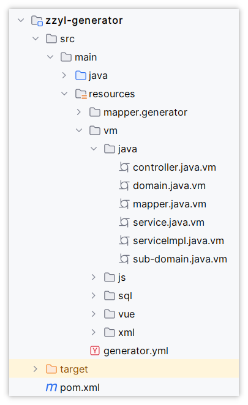
> 图注：这张图片展示的是zzyl-generator模块的目录结构，其中resources目录下的vm目录存放的是velocity模板文件，包含controller.java.vm、domain.java.vm、mapper.java.vm等多个以java.vm为后缀的模板文件，这些是用于代码生成的核心模板。该目录结构对应文档中提到的代码生成相关内容，能帮助理解要改造代码生成效果所需修改的velocity模板文件的所在位置。


上述代码中，以`vm`为后缀的文件，其实是velocity模板引擎的对应的模板文件，如果想要改造代码生成的内容，我们必须要先学习velocity，而后再回来看懂这些代码，才能支撑我们去改造这些模板文件，来生成我们想要的内容

### Velocity模板引擎

#### 概述

Velocity是一个基于Java的模板引擎，可以通过特定的语法获取java对象的数据 , 填充到模板中，从而实现界面和java代码的分离 !

<whiteboard token="SSi1weNC4h1xKcbvdGFcPqsqnqg"></whiteboard>

常见的应用场景：

- Web应用程序 : 作为应用程序的视图, 展示数据。
- 源代码生成  : Velocity可用于基于模板生成Java源代码。
- 自动电子邮件 : 网站注册 , 认证等的电子邮件模板。
- 网页静态化  : 基于velocity模板 , 生成静态网页。

常见的模板引擎：

- Velocity
- SpringBoot默认的模板引擎Thymeleaf
- FreeMarker
- jsp


#### 快速入门

- 需求：根据下面html模板，完成对数据的填充

```HTML
<!DOCTYPE html>
<html lang="en">
<head>
    <meta charset="UTF-8">
    <meta name="viewport" content="width=device-width, initial-scale=1.0">
    <title>velocity快速入门</title>
</head>
<body>

    <h3>心怀梦想，坚持不懈，成功即在前方。加油少年！</h3>
    
</body>
</html>
```

- 要求：**加油少年，**这几个字，需要使用动态填充进来

> 加油同学！！！
> 
> 加油女孩！！！
> 
> 加油朋友！！！


**入门案例实现步骤**

1. 准备模板

把上面提供的html文档，拷贝一份到若依项目中的ruoyi-generator模块下的reources目录中

模板文件命名：`index.html.``vm`

如下图

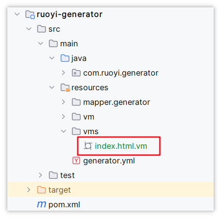
> 图注：这张图片展示的是若依项目ruoyi-generator模块的目录结构，呈现了该模块下的文件层级关系，清晰标注了resources目录下的vms子文件夹内，有一个被红色框突出显示的文件，名称为index.html.vm，该文件正是入门案例中需要准备的Velocity模板文件，对应文档里提到的模板文件，是代码生成模块使用的Velocity模板引擎的入门案例所需的模板文件，它存放在ruoyi-generator模块的resources目录下的vms子目录中。

模板文件内容：

```HTML
<!DOCTYPE html>
<html lang="en">
<head>
    <meta charset="UTF-8">
    <meta name="viewport" content="width=device-width, initial-scale=1.0">
    <title>velocity快速入门</title>
</head>
<body>

<h3>心怀梦想，坚持不懈，成功即在前方。${message}</h3>

</body>
</html>
```

<callout emoji="🎄">
**注意**：上述代码中的 加油少年  修改为了  \${message}  这是一个动态变量，方便**动态**填充数据
</callout>


1. 编写java代码实现数据填充，并生成文件

```Java
import com.zzyl.common.constant.Constants;
import org.apache.velocity.Template;
import org.apache.velocity.VelocityContext;
import org.apache.velocity.app.Velocity;

import java.io.FileWriter;
import java.io.IOException;
import java.util.Properties;

public class VelocityDemoTest {

    public static void main(String[] args) throws IOException {

        Properties p = new Properties();
        // velocity资源加载器，告诉模板引擎到类路径下寻找资源（比如模板）
        p.setProperty("resource.loader.file.class", "org.apache.velocity.runtime.resource.loader.ClasspathResourceLoader");
        // 定义字符集
        p.setProperty(Velocity.INPUT_ENCODING, Constants.UTF8);
        // 初始化velocity引擎
        Velocity.init(p);

        // 创建velocity上下文对象
        VelocityContext context = new VelocityContext();
        // 数据模型，这里的key需要跟模板中的变量对应上，不然填充不了数据
        context.put("message", "加油朋友！！！");
        // 获取模板
        Template template = Velocity.getTemplate("vms/index.html.vm", "UTF-8");
        // 输出
        FileWriter fileWriter = new FileWriter("zzyl-generator\\src\\main\\resources\\index.html");
        // 合并模板和数据模型
        template.merge(context, fileWriter);
        // 关闭流
        fileWriter.close();
    }
}
```

最终的效果：

在指定的目录中生成index.html文件

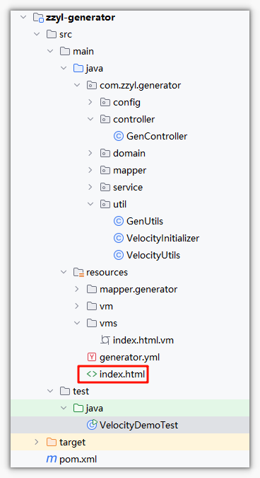
> 图注：这张图片展示了项目目录结构，其中突出标注了ruoyi-generator模块下resources目录中vm子目录内的index.html.vm模板文件，以及生成后的index.html文件，与文档中介绍的Velocity模板引擎入门案例步骤相关，该案例步骤为将指定的HTML文档拷贝至该路径并重命名为index.html.vm，后续通过编写Java代码填充数据可在指定目录生成index.html文件，该图片直观呈现了案例相关的文件路径与结构。

打开之后的效果：

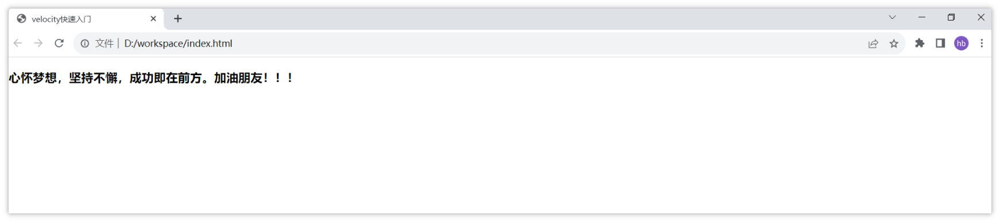
> 图注：图片展示了在浏览器中打开index.html文件后的效果。页面显示“心怀梦想，坚持不懈，成功即在前方。加油朋友！！！”字样。该图片与文档中“入门案例实现步骤”部分对应，是对步骤2中“最终的效果：在指定的目录中生成index.html文件，打开之后的效果”这一内容的直观呈现，直观呈现了使用Velocity模板引擎进行数据填充后生成的HTML文件在浏览器中的显示效果。


#### AI辅助解读Velocity语法

我们可以找一个有代表性的模板文件来解读一下，比如：domain.java.vm

<callout emoji="🤖">
**Prompt**
可以把整个domain.java.vm文件中的内容，都给大模型，然后在最后添加上一句话来要求，内容如下：
帮我给这个类上的所有代码都添加注释，特别是对velocity语法做一些特别的说明
</callout>

大模型解读后的代码如下：

```Java
// Velocity模板开始，定义包名
package ${packageName}.domain;

// 循环导入所需的类库
#foreach ($import in $importList)
import ${import};
#end

// 导入其他必要的类库
import org.apache.commons.lang3.builder.ToStringBuilder;
import org.apache.commons.lang3.builder.ToStringStyle;
import com.zzyl.common.annotation.Excel;
#if($table.crud || $table.sub)
import com.zzyl.common.core.domain.BaseEntity;
#elseif($table.tree)
import com.zzyl.common.core.domain.TreeEntity;
#end

/**
 * ${functionName}对象 ${tableName}
 *
 * @author ${author}
 * @date ${datetime}
 */
#if($table.crud || $table.sub)
#set($Entity="BaseEntity")
#elseif($table.tree)
#set($Entity="TreeEntity")
#end

// 定义Java类，继承自BaseEntity或TreeEntity
public class ${ClassName} extends ${Entity}
{
    // 序列化版本ID
    private static final long serialVersionUID = 1L;

    // 循环定义类中的属性
    #foreach ($column in $columns)
    #if(!$table.isSuperColumn($column.javaField))
        // 添加属性的注释
        /** $column.columnComment */

        // 根据属性是否为列表类型，决定是否添加Excel注解
        #if($column.list)
        #set($parentheseIndex=$column.columnComment.indexOf("（"))
        #if($parentheseIndex != -1)
        #set($comment=$column.columnComment.substring(0, $parentheseIndex))
        #else
        #set($comment=$column.columnComment)
        #end
        #if($parentheseIndex != -1)
        // 如果属性名中有括号，则截取括号前的内容作为Excel注解的名字
        @Excel(name = "${comment}", readConverterExp = "$column.readConverterExp()")
        #else
        // 如果是日期类型，添加JSON格式化注解
        #elseif($column.javaType == 'Date')
        @JsonFormat(pattern = "yyyy-MM-dd")
        @Excel(name = "${comment}", width = 30, dateFormat = "yyyy-MM-dd")
        #else
        // 其他情况直接添加Excel注解
        @Excel(name = "${comment}")
        #end
        #end

        // 定义属性
        private $column.javaType $column.javaField;

    #end
    #end

    // 如果是子表，添加子表的集合属性
    #if($table.sub)
        /** $table.subTable.functionName信息 */
        private List<${subClassName}> ${subclassName}List;

    #end

    // 生成getter和setter方法
    #foreach ($column in $columns)
    #if(!$table.isSuperColumn($column.javaField))
        #if($column.javaField.length() > 2 && $column.javaField.substring(1,2).matches("[A-Z]"))
        #set($AttrName=$column.javaField)
        #else
        #set($AttrName=$column.javaField.substring(0,1).toUpperCase() + ${column.javaField.substring(1)})
        #end

        // setter方法
        public void set${AttrName}($column.javaType $column.javaField)
        {
            this.$column.javaField = $column.javaField;
        }

        // getter方法
        public $column.javaType get${AttrName}()
        {
            return $column.javaField;
        }
    #end
    #end

    // 如果是子表，生成子表集合的getter和setter方法
    #if($table.sub)
        public List<${subClassName}> get${subClassName}List()
        {
            return ${subclassName}List;
        }

        public void set${subClassName}List(List<${subClassName}> ${subclassName}List)
        {
            this.${subclassName}List = ${subclassName}List;
        }

    #end

    // 重写toString方法
    @Override
    public String toString() {
        return new ToStringBuilder(this,ToStringStyle.MULTI_LINE_STYLE)
        #foreach ($column in $columns)
        #if($column.javaField.length() > 2 && $column.javaField.substring(1,2).matches("[A-Z]"))
        #set($AttrName=$column.javaField)
        #else
        #set($AttrName=$column.javaField.substring(0,1).toUpperCase() + ${column.javaField.substring(1)})
        #end
            .append("${column.javaField}", get${AttrName}())
        #end
        #if($table.sub)
            .append("${subclassName}List", get${subClassName}List())
        #end
            .toString();
    }
}
```

- Velocity语法解释

  - `${variable}`: 表示插入变量值。
  - `#foreach` 和 `#end`: 循环结构，用于遍历列表。
  - `#if` 和 `#end`: 条件判断结构。
  - `#set`: 设置变量。
  - `#elseif`: 条件分支。
- Java类结构说明

  - 包声明: 定义类所在的包。
  - 导入语句: 导入类所需要的类库。
  - 类注释: 描述类的功能和作者信息。
  - 类定义: 定义类并继承自`BaseEntity`或`TreeEntity`。
  - 属性定义: 根据模板参数定义类的属性。
  - 属性注释: 对属性进行描述。
  - Excel注解: 标记属性以方便导出Excel。
  - getter和setter方法: 自动生成属性的访问方法。
  - 子表集合: 如果是子表，则定义子表集合。
  - 重写toString方法: 提供类实例的字符串表示形式。


### 代码生成流程

目前，我们已经基本熟悉了velocity的作用和一些语法，那接下来，我们就通过这些知识来去改造若依框架的代码生成部分，在改造之前，我们先来阅读一下代码生成功能的核心代码：

代码位置：com.zzyl.generator.service.GenTableServiceImpl.generatorCode()

```Java
/**
 * 生成代码
 * @param tableName 表名
 * @param zip       压缩输出流
 */
private void generatorCode(String tableName, ZipOutputStream zip)
{
    // 查询表信息
    GenTable table = genTableMapper.selectGenTableByName(tableName);
    // 设置主子表信息
    setSubTable(table);
    // 设置主键列信息
    setPkColumn(table);

    // 初始化Velocity引擎
    VelocityInitializer.initVelocity();

    // 准备Velocity上下文   获取详细的该表的数据，并设置模板所需要的数据模型
    VelocityContext context = VelocityUtils.prepareContext(table);

    // 获取模板列表   读取resources/vm目录中的定义的模板文件
    List<String> templates = VelocityUtils.getTemplateList(table.getTplCategory(), table.getTplWebType());
    for (String template : templates)
    {
        // 渲染模板
        StringWriter sw = new StringWriter();
        Template tpl = Velocity.getTemplate(template, Constants.UTF8);
        // 合并模板和数据模型
        tpl.merge(context, sw);
        try
        {
            // 将渲染结果添加到zip文件
            zip.putNextEntry(new ZipEntry(VelocityUtils.getFileName(template, table)));
            IOUtils.write(sw.toString(), zip, Constants.UTF8);
            IOUtils.closeQuietly(sw);
            zip.flush();
            zip.closeEntry();
        }
        catch (IOException e)
        {
            // 记录日志
            log.error("渲染模板失败，表名：" + table.getTableName(), e);
        }
    }
}
```


### Lombok集成

我们先来改造一个比较简单的内容，在生成的实体类中，使用Lombok，详细的实现步骤如下：

#### 依赖导入

1. 在父工程的pom文件中引入lombok的依赖

```JavaScript
<?xml version="1.0" encoding="UTF-8"?>
<project xmlns="http://maven.apache.org/POM/4.0.0"
         xmlns:xsi="http://www.w3.org/2001/XMLSchema-instance"
         xsi:schemaLocation="http://maven.apache.org/POM/4.0.0 http://maven.apache.org/xsd/maven-4.0.0.xsd">
    <modelVersion>4.0.0</modelVersion>
    
    <groupId>com.zzyl</groupId>
    <artifactId>zzyl</artifactId>
    <version>3.8.8</version>

    <name>zzyl</name>
    <url>http://www.ruoyi.vip</url>
    <description>中州养老后台管理系统</description>
    
    <properties>
        <lombok.version>1.18.22</lombok.version>
    </properties>

    <!-- 依赖声明 -->
    <dependencyManagement>
        <dependencies>
            <!-- 其他依赖省略... -->
            <dependency>
                <groupId>org.projectlombok</groupId>
                <artifactId>lombok</artifactId>
                <version>${lombok.version}</version>
            </dependency>
        </dependencies>
    </dependencyManagement>
</project>
```

在zzyl-common模块中引入lombok的依赖（通用，其他模块如需要用，只需要依赖common即可）

```XML
<dependency>
    <groupId>org.projectlombok</groupId>
    <artifactId>lombok</artifactId>
</dependency>
```

先在实体类中手动加上注解，进行测试，通过没有问题后再按照实体类改模板

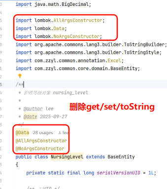
> 图注：图片展示了NursingLevel实体类的部分代码。其中，关键部分被红色框突出显示，包括导入lombok相关注解的三行代码（lombok.AllArgsConstructor、lombok.Data、lombok.NoArgsConstructorArgsConstructor），以及类中添加的三个lombok注解（@Data、@AllArgsConstructor、@NoArgsConstructor）。此外，还删除了get、set、toString等方法。该图片与上下文紧密相关，是对修改模板后生成实体类代码的展示，直观呈现了Lombok注解的添加及部分方法的删除情况。

#### 修改模板

我们主要修改的模板为 `domain.java.vm`，让它支持lombok

修改模板如下：

```Java
package ${packageName}.domain;

#foreach ($import in $importList)
import ${import};
#end
import org.apache.commons.lang3.builder.ToStringBuilder;  ## 用不到了，可删
import org.apache.commons.lang3.builder.ToStringStyle;  ## 用不到了，可删
import com.zzyl.common.annotation.Excel;
#if($table.crud || $table.sub)
import com.zzyl.common.core.domain.BaseEntity;
#elseif($table.tree)
import com.zzyl.common.core.domain.TreeEntity;
#end
import lombok.Data;  ## 导入lombok的依赖
import lombok.AllArgsConstructor;
import lombok.NoArgsConstructor;

/**
 * ${functionName}对象 ${tableName}
 * 
 * @author ${author}
 * @date ${datetime}
 */
#if($table.crud || $table.sub)
#set($Entity="BaseEntity")
#elseif($table.tree)
#set($Entity="TreeEntity")
#end
@Data  ## 添加lombok的注解
@NoArgsConstructor
@AllArgsConstructor
public class ${ClassName} extends ${Entity}
{
    private static final long serialVersionUID = 1L;

#foreach ($column in $columns)
#if(!$table.isSuperColumn($column.javaField))
    /** $column.columnComment */
#if($column.list)
#set($parentheseIndex=$column.columnComment.indexOf("（"))
#if($parentheseIndex != -1)
#set($comment=$column.columnComment.substring(0, $parentheseIndex))
#else
#set($comment=$column.columnComment)
#end
#if($parentheseIndex != -1)
    @Excel(name = "${comment}", readConverterExp = "$column.readConverterExp()")
#elseif($column.javaType == 'Date')
    @JsonFormat(pattern = "yyyy-MM-dd")
    @Excel(name = "${comment}", width = 30, dateFormat = "yyyy-MM-dd")
#else
    @Excel(name = "${comment}")
#end
#end
    private $column.javaType $column.javaField;

#end
#end
#if($table.sub)
    /** $table.subTable.functionName信息 */
    private List<${subClassName}> ${subclassName}List;

#end

## 以下是生成属性的get/set方法  start....  删除这部分内容
#foreach ($column in $columns)
#if(!$table.isSuperColumn($column.javaField))
#if($column.javaField.length() > 2 && $column.javaField.substring(1,2).matches("[A-Z]"))
#set($AttrName=$column.javaField)
#else
#set($AttrName=$column.javaField.substring(0,1).toUpperCase() + ${column.javaField.substring(1)})
#end
    public void set${AttrName}($column.javaType $column.javaField) 
    {
        this.$column.javaField = $column.javaField;
    }

    public $column.javaType get${AttrName}() 
    {
        return $column.javaField;
    }
#end
#end

## 以下是生成属性的get/set方法  end....  删除这部分内容

## 如果是主子表，生成子表相关的get/set方法，start....  删除这部分内容
#if($table.sub)
    public List<${subClassName}> get${subClassName}List()
    {
        return ${subclassName}List;
    }

    public void set${subClassName}List(List<${subClassName}> ${subclassName}List)
    {
        this.${subclassName}List = ${subclassName}List;
    }

#end

## 如果是主子表，生成子表相关的get/set方法，end....  删除这部分内容


##以下代码生成 toString方法， start....  删除这部分内容
    @Override
    public String toString() {
        return new ToStringBuilder(this,ToStringStyle.MULTI_LINE_STYLE)
#foreach ($column in $columns)
#if($column.javaField.length() > 2 && $column.javaField.substring(1,2).matches("[A-Z]"))
#set($AttrName=$column.javaField)
#else
#set($AttrName=$column.javaField.substring(0,1).toUpperCase() + ${column.javaField.substring(1)})
#end
            .append("${column.javaField}", get${AttrName}())
#end
#if($table.sub)
            .append("${subclassName}List", get${subClassName}List())
#end
            .toString();
    }
##以下代码生成 toString方法， end....  删除这部分内容

}
```

最终的代码如下：

```JavaScript
package ${packageName}.domain;

#foreach ($import in $importList)
import ${import};
#end
import lombok.Data;
import lombok.AllArgsConstructor;
import lombok.NoArgsConstructor;
import org.apache.commons.lang3.builder.ToStringBuilder;
import org.apache.commons.lang3.builder.ToStringStyle;
import com.zzyl.common.annotation.Excel;
#if($table.crud || $table.sub)
import com.zzyl.common.core.domain.BaseEntity;
#elseif($table.tree)
import com.zzyl.common.core.domain.TreeEntity;
#end

/**
 * ${functionName}对象 ${tableName}
 *
 * @author ${author}
 * @date ${datetime}
 */
#if($table.crud || $table.sub)
#set($Entity="BaseEntity")
#elseif($table.tree)
#set($Entity="TreeEntity")
#end
@Data
@NoArgsConstructor
@AllArgsConstructor
public class ${ClassName} extends ${Entity}
{
    private static final long serialVersionUID = 1L;

#foreach ($column in $columns)
    #if(!$table.isSuperColumn($column.javaField))
    /** $column.columnComment */
#if($column.list)
    #set($parentheseIndex=$column.columnComment.indexOf("（"))
    #if($parentheseIndex != -1)
        #set($comment=$column.columnComment.substring(0, $parentheseIndex))
    #else
        #set($comment=$column.columnComment)
    #end
    #if($parentheseIndex != -1)
    @Excel(name = "${comment}", readConverterExp = "$column.readConverterExp()")
    #elseif($column.javaType == 'Date')
    @JsonFormat(pattern = "yyyy-MM-dd")
    @Excel(name = "${comment}", width = 30, dateFormat = "yyyy-MM-dd")
    #else
    @Excel(name = "${comment}")
    #end
#end
    private $column.javaType $column.javaField;

    #end
    #end
    #if($table.sub)
        /** $table.subTable.functionName信息 */
        private List<${subClassName}> ${subclassName}List;

    #end
}
```

#### 生成后的效果

修改完成之后，重启项目，找到代码生成的功能，通过**代码预览**可以查看实体类的代码：

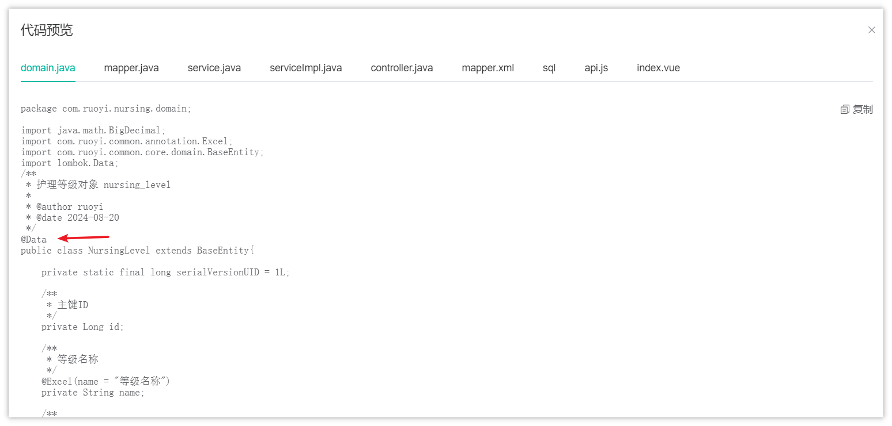
> 图注：图片展示的是若依框架代码生成模块中代码预览界面。界面上方有多个选项卡，当前选中“domain.java”。下方代码区域显示了NursingLevel实体类代码，其中“@Data”注解被红色箭头突出显示，表明这是Lombok集成后新增的注解。代码还包含主键ID、等级名称等字段定义，以及部分注释。该图片与上下文紧密相关，直观呈现了修改模板后生成的代码效果，验证了Lombok集成的实现情况。

> - 正常添加了关于lombok的注解
> - 删除了setter、 getter  、toString 等方法

**测试**

可以把生成后的代码，拷贝到项目中，如果护理项目能够正常访问和操作，就算修改成功了，后期再次生成的代码，全部都支持lombok


### Mybatis-Plus集成

我们改造主要参考的是官方推荐的项目：https://gitee.com/tellsea/ruoyi-vue-plus（目前已集成mybatis-plus）

#### 添加依赖

在父工程中的pom文件中添加mybatis-plus的依赖，如下：

```XML
<properties>
    <mybatis-plus-spring-boot.version>3.5.2</mybatis-plus-spring-boot.version>
</properties>

<!-- 依赖声明 -->
<dependencyManagement>
    <dependencies>
        <!-- mybatis-plus 增强CRUD -->
        <dependency>
            <groupId>com.baomidou</groupId>
            <artifactId>mybatis-plus-boot-starter</artifactId>
            <version>${mybatis-plus-spring-boot.version}</version>
        </dependency>
        <dependency>
            <groupId>com.baomidou</groupId>
            <artifactId>mybatis-plus-annotation</artifactId>
            <version>${mybatis-plus-spring-boot.version}</version>
        </dependency>
    </dependencies>
</dependencyManagement>
```

在zzyl-common模块中新增mybatis-plus的依赖

```XML
<!--MyBatisPlus-->
<dependency>
    <groupId>com.baomidou</groupId>
    <artifactId>mybatis-plus-boot-starter</artifactId>
</dependency>
<dependency>
    <groupId>com.baomidou</groupId>
    <artifactId>mybatis-plus-annotation</artifactId>
</dependency>
```


#### 核心配置

appliation.yml文件中新增MyBatisPlus配置，同时**删除Mybatis相关的配置**

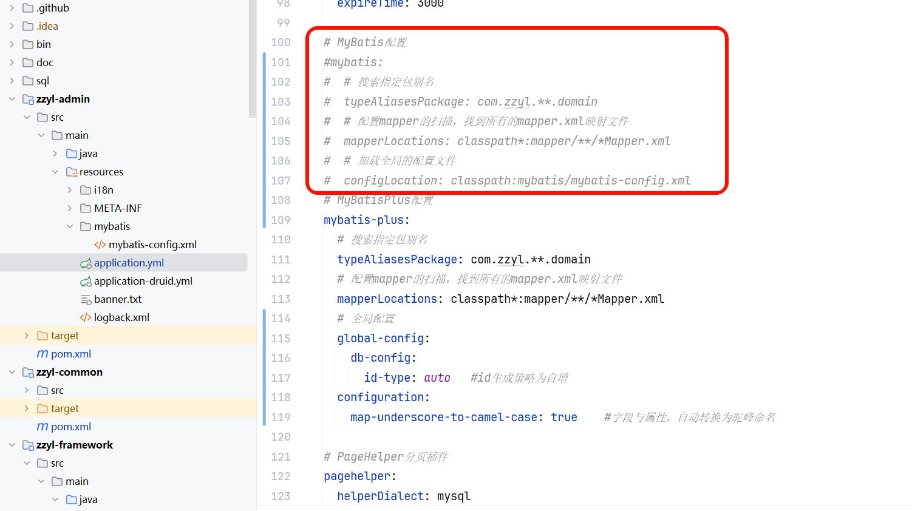
> 图注：这张图片展示了项目配置文件application.yml里的MyBatis和MyBatis-Plus相关配置内容，其中红框标注了#MyBatis配置相关的内容。在该配置区域内，设置了MyBatis的类型别名扫描包为com.zzyl.**domain，指定了Mapper文件的扫描路径，还配置了MyBatis的全局配置文件位置；而红框下方是MyBatis-Plus的配置内容，包含类型别名扫描包、Mapper扫描路径、主键生成策略以及驼峰命名转换等配置项，这和文档中提到的在application.yml文件中新增MyBatisPlus配置并删除Mybatis相关配置的内容相呼应。

```YAML
# MyBatisPlus配置
mybatis-plus:
  # 搜索指定包别名
  typeAliasesPackage: com.zzyl.**.domain
  # 配置mapper的扫描，找到所有的mapper.xml映射文件
  mapperLocations: classpath*:mapper/**/*Mapper.xml
  # 全局配置
  global-config:
    db-config:
      id-type: auto   #id生成策略为自增
  configuration: 
    map-underscore-to-camel-case: true    #字段与属性，自动转换为驼峰命名
```

新增核心配置类，**删除MyBatisConfig**

```Java
package com.zzyl.framework.config;

import com.baomidou.mybatisplus.annotation.DbType;
import com.baomidou.mybatisplus.extension.plugins.MybatisPlusInterceptor;
import com.baomidou.mybatisplus.extension.plugins.inner.BlockAttackInnerInterceptor;
import com.baomidou.mybatisplus.extension.plugins.inner.OptimisticLockerInnerInterceptor;
import com.baomidou.mybatisplus.extension.plugins.inner.PaginationInnerInterceptor;
import org.springframework.context.annotation.Bean;
import org.springframework.context.annotation.Configuration;
import org.springframework.transaction.annotation.EnableTransactionManagement;

/**
 * Mybatis Plus 配置
 *
 * @author ruoyi
 */
@EnableTransactionManagement(proxyTargetClass = true)
@Configuration
public class MybatisPlusConfig {

    @Bean
    public MybatisPlusInterceptor mybatisPlusInterceptor() {
        MybatisPlusInterceptor interceptor = new MybatisPlusInterceptor();
        // 分页插件
        interceptor.addInnerInterceptor(paginationInnerInterceptor());
        // 乐观锁插件
        interceptor.addInnerInterceptor(optimisticLockerInnerInterceptor());
        // 阻断插件
        interceptor.addInnerInterceptor(blockAttackInnerInterceptor());
        return interceptor;
    }

    /**
     * 分页插件，自动识别数据库类型 https://baomidou.com/guide/interceptor-pagination.html
     */
    public PaginationInnerInterceptor paginationInnerInterceptor() {
        PaginationInnerInterceptor paginationInnerInterceptor = new PaginationInnerInterceptor();
        // 设置数据库类型为mysql
        paginationInnerInterceptor.setDbType(DbType.MYSQL);
        // 设置最大单页限制数量，默认 500 条，-1 不受限制
        paginationInnerInterceptor.setMaxLimit(-1L);
        return paginationInnerInterceptor;
    }

    /**
     * 乐观锁插件 https://baomidou.com/guide/interceptor-optimistic-locker.html
     */
    public OptimisticLockerInnerInterceptor optimisticLockerInnerInterceptor() {
        return new OptimisticLockerInnerInterceptor();
    }

    /**
     * 如果是对全表的删除或更新操作，就会终止该操作 https://baomidou.com/guide/interceptor-block-attack.html
     */
    public BlockAttackInnerInterceptor blockAttackInnerInterceptor() {
        return new BlockAttackInnerInterceptor();
    }

}
```

#### 使用MyBatisPlus改造服务项目代码

为了方便稍后改造代码生成模板，先手动改造一下服务项目的代码，将MyBatisPlus集成到服务项目模块中使用，方便稍后参考服务项目模块改造后的代码来改造代码生成模板

##### 改造NursingProjectMapper

```JavaScript
package com.zzyl.serve.mapper;

import java.util.List;

import com.baomidou.mybatisplus.core.mapper.BaseMapper;
import com.zzyl.serve.domain.NursingProject;
import org.apache.ibatis.annotations.Mapper;

/**
 * 护理项目Mapper接口
 * 
 * @author ruoyi
 * @date 2024-09-26
 */
@Mapper
public interface NursingProjectMapper extends BaseMapper<NursingProject>
{
    /**
     * 查询护理项目
     * 
     * @param id 护理项目主键
     * @return 护理项目
     */
    public NursingProject selectNursingProjectById(Long id);

    /**
     * 查询护理项目列表
     * 
     * @param nursingProject 护理项目
     * @return 护理项目集合
     */
    public List<NursingProject> selectNursingProjectList(NursingProject nursingProject);

    /**
     * 新增护理项目
     * 
     * @param nursingProject 护理项目
     * @return 结果
     */
    public int insertNursingProject(NursingProject nursingProject);

    /**
     * 修改护理项目
     * 
     * @param nursingProject 护理项目
     * @return 结果
     */
    public int updateNursingProject(NursingProject nursingProject);

    /**
     * 删除护理项目
     * 
     * @param id 护理项目主键
     * @return 结果
     */
    public int deleteNursingProjectById(Long id);

    /**
     * 批量删除护理项目
     * 
     * @param ids 需要删除的数据主键集合
     * @return 结果
     */
    public int deleteNursingProjectByIds(Long[] ids);
}
```

##### 改造NursingProjectService

```JavaScript
package com.zzyl.serve.service;

import java.util.List;

import com.baomidou.mybatisplus.extension.service.IService;
import com.zzyl.serve.domain.NursingProject;

/**
 * 护理项目Service接口
 * 
 * @author ruoyi
 * @date 2024-09-26
 */
public interface INursingProjectService extends IService<NursingProject>
{
    /**
     * 查询护理项目
     * 
     * @param id 护理项目主键
     * @return 护理项目
     */
    public NursingProject selectNursingProjectById(Long id);

    /**
     * 查询护理项目列表
     * 
     * @param nursingProject 护理项目
     * @return 护理项目集合
     */
    public List<NursingProject> selectNursingProjectList(NursingProject nursingProject);

    /**
     * 新增护理项目
     * 
     * @param nursingProject 护理项目
     * @return 结果
     */
    public int insertNursingProject(NursingProject nursingProject);

    /**
     * 修改护理项目
     * 
     * @param nursingProject 护理项目
     * @return 结果
     */
    public int updateNursingProject(NursingProject nursingProject);

    /**
     * 批量删除护理项目
     * 
     * @param ids 需要删除的护理项目主键集合
     * @return 结果
     */
    public int deleteNursingProjectByIds(Long[] ids);

    /**
     * 删除护理项目信息
     * 
     * @param id 护理项目主键
     * @return 结果
     */
    public int deleteNursingProjectById(Long id);
}
```


##### 改造NursingProjectServiceImpl

```JavaScript
package com.zzyl.serve.service.impl;

import java.util.Arrays;
import java.util.List;

import com.baomidou.mybatisplus.extension.service.impl.ServiceImpl;
import com.zzyl.common.utils.DateUtils;
import org.springframework.beans.factory.annotation.Autowired;
import org.springframework.stereotype.Service;
import com.zzyl.serve.mapper.NursingProjectMapper;
import com.zzyl.serve.domain.NursingProject;
import com.zzyl.serve.service.INursingProjectService;

/**
 * 护理项目Service业务层处理
 * 
 * @author ruoyi
 * @date 2024-09-26
 */
@Service
public class NursingProjectServiceImpl extends ServiceImpl<NursingProjectMapper, NursingProject> implements INursingProjectService
{
    @Autowired
    private NursingProjectMapper nursingProjectMapper;

    /**
     * 查询护理项目
     * 
     * @param id 护理项目主键
     * @return 护理项目
     */
    @Override
    public NursingProject selectNursingProjectById(Long id)
    {
//        return nursingProjectMapper.selectNursingProjectById(id);
        return getById(id);
    }

    /**
     * 查询护理项目列表
     * 
     * @param nursingProject 护理项目
     * @return 护理项目
     */
    @Override
    public List<NursingProject> selectNursingProjectList(NursingProject nursingProject)
    {
        return nursingProjectMapper.selectNursingProjectList(nursingProject);
    }

    /**
     * 新增护理项目
     * 
     * @param nursingProject 护理项目
     * @return 结果
     */
    @Override
    public int insertNursingProject(NursingProject nursingProject)
    {
        nursingProject.setCreateTime(DateUtils.getNowDate());
//        return nursingProjectMapper.insertNursingProject(nursingProject);
        return save(nursingProject) ? 1 : 0;
    }

    /**
     * 修改护理项目
     * 
     * @param nursingProject 护理项目
     * @return 结果
     */
    @Override
    public int updateNursingProject(NursingProject nursingProject)
    {
        nursingProject.setUpdateTime(DateUtils.getNowDate());
//        return nursingProjectMapper.updateNursingProject(nursingProject);
        return updateById(nursingProject) ? 1 : 0;
    }

    /**
     * 批量删除护理项目
     * 
     * @param ids 需要删除的护理项目主键
     * @return 结果
     */
    @Override
    public int deleteNursingProjectByIds(Long[] ids)
    {
//        return nursingProjectMapper.deleteNursingProjectByIds(ids);
        return removeByIds(Arrays.asList(ids)) ? 1 : 0;
    }

    /**
     * 删除护理项目信息
     * 
     * @param id 护理项目主键
     * @return 结果
     */
    @Override
    public int deleteNursingProjectById(Long id)
    {
//        return nursingProjectMapper.deleteNursingProjectById(id);
        return removeById(id) ? 1 : 0;
    }
}
```

**其他必要修改**

集成MP之后，项目中的BaseEntity类中的字段有些会受影响，需要添加如下注解

由于这几个字段，并不会跟数据库中的表字段进行映射，必须要添加@TableField(exist = false)表示，表示该字段不存在于数据库表中

```Java
/**
 * Entity基类
 * 
 * @author ruoyi
 */
public class BaseEntity implements Serializable
{
    private static final long serialVersionUID = 1L;

    /** 搜索值 */
    @JsonIgnore
    @TableField(exist = false)
    private String searchValue;

    /** 请求参数 */
    @JsonInclude(JsonInclude.Include.NON_EMPTY)
    @TableField(exist = false)
    private Map<String, Object> params;

}
```

#### 改造代码生成模板

在目前的模板文件中，我们需要修改的模板共有3个，分别是：

- mapper.java.vm   继承BaseMapper 
- service.java.vm   继承IService<T> 
- serviceImpl.java.vm    继承ServiceImpl<XxxMapper, T>  常见方法的使用（单表的增删改查）

> - domain.java.vm  无需修改，类名与表名一致，会自动映射，主键已经在yaml文件中配置
> - controller.java.vm 无需修改，保留原有的接口方法和命名

**mapper.java.vm**

```Java
package ${packageName}.mapper;

import com.baomidou.mybatisplus.core.mapper.BaseMapper;
import org.apache.ibatis.annotations.Mapper;
import java.util.List;
import ${packageName}.domain.${ClassName};
#if($table.sub)
import ${packageName}.domain.${subClassName};
#end

/**
 * ${functionName}Mapper接口
 * 
 * @author ${author}
 * @date ${datetime}
 */
@Mapper
public interface ${ClassName}Mapper extends BaseMapper<${ClassName}>
{
    /**
     * 查询${functionName}
     * 
     * @param ${pkColumn.javaField} ${functionName}主键
     * @return ${functionName}
     */
    public ${ClassName} select${ClassName}By${pkColumn.capJavaField}(${pkColumn.javaType} ${pkColumn.javaField});

    /**
     * 查询${functionName}列表
     * 
     * @param ${className} ${functionName}
     * @return ${functionName}集合
     */
    public List<${ClassName}> select${ClassName}List(${ClassName} ${className});

    /**
     * 新增${functionName}
     * 
     * @param ${className} ${functionName}
     * @return 结果
     */
    public int insert${ClassName}(${ClassName} ${className});

    /**
     * 修改${functionName}
     * 
     * @param ${className} ${functionName}
     * @return 结果
     */
    public int update${ClassName}(${ClassName} ${className});

    /**
     * 删除${functionName}
     * 
     * @param ${pkColumn.javaField} ${functionName}主键
     * @return 结果
     */
    public int delete${ClassName}By${pkColumn.capJavaField}(${pkColumn.javaType} ${pkColumn.javaField});

    /**
     * 批量删除${functionName}
     * 
     * @param ${pkColumn.javaField}s 需要删除的数据主键集合
     * @return 结果
     */
    public int delete${ClassName}By${pkColumn.capJavaField}s(${pkColumn.javaType}[] ${pkColumn.javaField}s);
#if($table.sub)

    /**
     * 批量删除${subTable.functionName}
     * 
     * @param ${pkColumn.javaField}s 需要删除的数据主键集合
     * @return 结果
     */
    public int delete${subClassName}By${subTableFkClassName}s(${pkColumn.javaType}[] ${pkColumn.javaField}s);
    
    /**
     * 批量新增${subTable.functionName}
     * 
     * @param ${subclassName}List ${subTable.functionName}列表
     * @return 结果
     */
    public int batch${subClassName}(List<${subClassName}> ${subclassName}List);
    

    /**
     * 通过${functionName}主键删除${subTable.functionName}信息
     * 
     * @param ${pkColumn.javaField} ${functionName}ID
     * @return 结果
     */
    public int delete${subClassName}By${subTableFkClassName}(${pkColumn.javaType} ${pkColumn.javaField});
#end
}
```

**service.java.vm**

```Java
package ${packageName}.service;

import com.baomidou.mybatisplus.extension.service.IService;
import java.util.List;
import ${packageName}.domain.${ClassName};

/**
 * ${functionName}Service接口
 * 
 * @author ${author}
 * @date ${datetime}
 */
public interface I${ClassName}Service extends IService<${ClassName}>
{
    /**
     * 查询${functionName}
     * 
     * @param ${pkColumn.javaField} ${functionName}主键
     * @return ${functionName}
     */
    public ${ClassName} select${ClassName}By${pkColumn.capJavaField}(${pkColumn.javaType} ${pkColumn.javaField});

    /**
     * 查询${functionName}列表
     * 
     * @param ${className} ${functionName}
     * @return ${functionName}集合
     */
    public List<${ClassName}> select${ClassName}List(${ClassName} ${className});

    /**
     * 新增${functionName}
     * 
     * @param ${className} ${functionName}
     * @return 结果
     */
    public int insert${ClassName}(${ClassName} ${className});

    /**
     * 修改${functionName}
     * 
     * @param ${className} ${functionName}
     * @return 结果
     */
    public int update${ClassName}(${ClassName} ${className});

    /**
     * 批量删除${functionName}
     * 
     * @param ${pkColumn.javaField}s 需要删除的${functionName}主键集合
     * @return 结果
     */
    public int delete${ClassName}By${pkColumn.capJavaField}s(${pkColumn.javaType}[] ${pkColumn.javaField}s);

    /**
     * 删除${functionName}信息
     * 
     * @param ${pkColumn.javaField} ${functionName}主键
     * @return 结果
     */
    public int delete${ClassName}By${pkColumn.capJavaField}(${pkColumn.javaType} ${pkColumn.javaField});
}
```

**serviceImpl.java.vm**

```Java
package ${packageName}.service.impl;

import java.util.List;
#foreach ($column in $columns)
#if($column.javaField == 'createTime' || $column.javaField == 'updateTime')
import com.zzyl.common.utils.DateUtils;
#break
#end
#end
import org.springframework.beans.factory.annotation.Autowired;
import org.springframework.stereotype.Service;
#if($table.sub)
import java.util.ArrayList;
import com.zzyl.common.utils.StringUtils;
import org.springframework.transaction.annotation.Transactional;
import ${packageName}.domain.${subClassName};
#end
import ${packageName}.mapper.${ClassName}Mapper;
import ${packageName}.domain.${ClassName};
import ${packageName}.service.I${ClassName}Service;
import com.baomidou.mybatisplus.extension.service.impl.ServiceImpl;
import java.util.Arrays;

/**
 * ${functionName}Service业务层处理
 * 
 * @author ${author}
 * @date ${datetime}
 */
@Service
public class ${ClassName}ServiceImpl extends ServiceImpl<${ClassName}Mapper, ${ClassName}> implements I${ClassName}Service
{
    @Autowired
    private ${ClassName}Mapper ${className}Mapper;

    /**
     * 查询${functionName}
     * 
     * @param ${pkColumn.javaField} ${functionName}主键
     * @return ${functionName}
     */
    @Override
    public ${ClassName} select${ClassName}By${pkColumn.capJavaField}(${pkColumn.javaType} ${pkColumn.javaField})
    {
        ##return ${className}Mapper.select${ClassName}By${pkColumn.capJavaField}(${pkColumn.javaField});
        return getById(${pkColumn.javaField});
    }

    /**
     * 查询${functionName}列表
     * 
     * @param ${className} ${functionName}
     * @return ${functionName}
     */
    @Override
    public List<${ClassName}> select${ClassName}List(${ClassName} ${className})
    {
        return ${className}Mapper.select${ClassName}List(${className});
    }

    /**
     * 新增${functionName}
     * 
     * @param ${className} ${functionName}
     * @return 结果
     */
#if($table.sub)
    @Transactional
#end
    @Override
    public int insert${ClassName}(${ClassName} ${className})
    {
#foreach ($column in $columns)
#if($column.javaField == 'createTime')
        ${className}.setCreateTime(DateUtils.getNowDate());
#end
#end
#if($table.sub)
        int rows = ${className}Mapper.insert${ClassName}(${className});
        insert${subClassName}(${className});
        return rows;
#else
        ##return ${className}Mapper.insert${ClassName}(${className});
        return save(${className}) ? 1 : 0;
#end
    }

    /**
     * 修改${functionName}
     * 
     * @param ${className} ${functionName}
     * @return 结果
     */
#if($table.sub)
    @Transactional
#end
    @Override
    public int update${ClassName}(${ClassName} ${className})
    {
#foreach ($column in $columns)
#if($column.javaField == 'updateTime')
        ${className}.setUpdateTime(DateUtils.getNowDate());
#end
#end
#if($table.sub)
        ${className}Mapper.delete${subClassName}By${subTableFkClassName}(${className}.get${pkColumn.capJavaField}());
        insert${subClassName}(${className});
#end
##        return ${className}Mapper.update${ClassName}(${className});
        return updateById(${className}) ? 1 : 0;
    }

    /**
     * 批量删除${functionName}
     * 
     * @param ${pkColumn.javaField}s 需要删除的${functionName}主键
     * @return 结果
     */
#if($table.sub)
    @Transactional
#end
    @Override
    public int delete${ClassName}By${pkColumn.capJavaField}s(${pkColumn.javaType}[] ${pkColumn.javaField}s)
    {
#if($table.sub)
        ${className}Mapper.delete${subClassName}By${subTableFkClassName}s(${pkColumn.javaField}s);
#end
##        return ${className}Mapper.delete${ClassName}By${pkColumn.capJavaField}s(${pkColumn.javaField}s);
        return removeByIds(Arrays.asList(${pkColumn.javaField}s)) ? 1 : 0;
    }

    /**
     * 删除${functionName}信息
     * 
     * @param ${pkColumn.javaField} ${functionName}主键
     * @return 结果
     */
#if($table.sub)
    @Transactional
#end
    @Override
    public int delete${ClassName}By${pkColumn.capJavaField}(${pkColumn.javaType} ${pkColumn.javaField})
    {
#if($table.sub)
        ${className}Mapper.delete${subClassName}By${subTableFkClassName}(${pkColumn.javaField});
#end
##        return ${className}Mapper.delete${ClassName}By${pkColumn.capJavaField}(${pkColumn.javaField});
        return removeById(${pkColumn.javaField}) ? 1 : 0;
    }
#if($table.sub)

    /**
     * 新增${subTable.functionName}信息
     * 
     * @param ${className} ${functionName}对象
     */
    public void insert${subClassName}(${ClassName} ${className})
    {
        List<${subClassName}> ${subclassName}List = ${className}.get${subClassName}List();
        ${pkColumn.javaType} ${pkColumn.javaField} = ${className}.get${pkColumn.capJavaField}();
        if (StringUtils.isNotNull(${subclassName}List))
        {
            List<${subClassName}> list = new ArrayList<${subClassName}>();
            for (${subClassName} ${subclassName} : ${subclassName}List)
            {
                ${subclassName}.set${subTableFkClassName}(${pkColumn.javaField});
                list.add(${subclassName});
            }
            if (list.size() > 0)
            {
                ${className}Mapper.batch${subClassName}(list);
            }
        }
    }
#end
}
```

**其他必要修改**

集成MP之后，项目中的BaseEntity类中的字段有些会受影响，需要添加如下注解

由于这几个字段，并不会跟数据库中的表字段进行映射，必须要添加@TableField(exist = false)表示，表示该字段不存在于数据库表中

```Java
/**
 * Entity基类
 * 
 * @author ruoyi
 */
public class BaseEntity implements Serializable
{
    private static final long serialVersionUID = 1L;

    /** 搜索值 */
    @JsonIgnore
    @TableField(exist = false)
    private String searchValue;

    /** 请求参数 */
    @JsonInclude(JsonInclude.Include.NON_EMPTY)
    @TableField(exist = false)
    private Map<String, Object> params;

}
```

改造完成后，重新查看若依生成的代码：

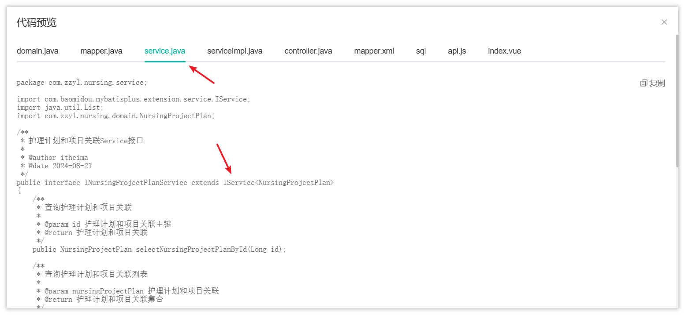
> 图注：图片展示的是若依框架代码生成模块中“service.java.vm”模板生成的代码内容。代码位于“service.java”标签下，定义了护理计划和项目关联Service接口，继承了IService<NursingProjectPlan>，包含查询护理计划和项目关联、按id查询护理计划和项目关联主键、查询护理计划和项目关联主键等方法。图片与上文改造代码生成模板的内容相关，直观呈现了改造后service接口的实现情况。

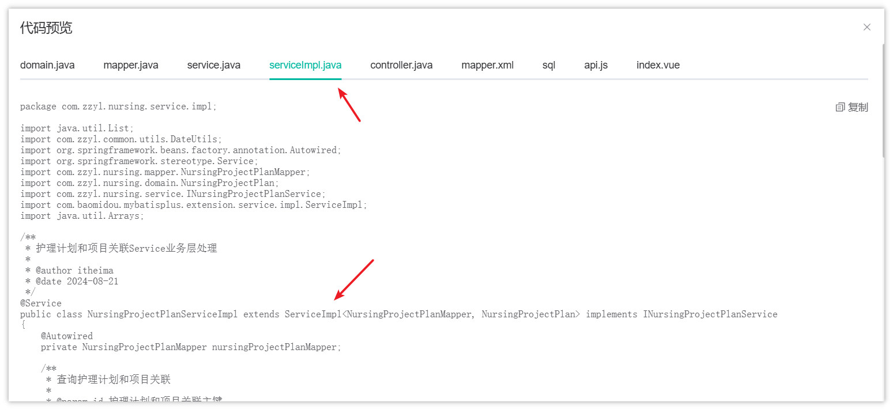
> 图注：这张代码预览界面展示的是MyBatis-Plus改造后的serviceImpl代码内容，顶部选项卡高亮显示的是`serviceImpl.java`文件，箭头指向的类定义明确标注该类继承了MP相关的ServiceImpl类，同时保留了所需的Mapper与Service接口实现，还包含了业务层的基础导包、注解及方法注释，用于管理护理计划与项目关联的相关业务逻辑，这对应了改造代码生成模板中对`serviceImpl.java.vm`继承逻辑的修改要求，呈现了替换改造后三层架构代码的实际效果。

接下来，先用代码生成功能重新生成一次三层架构的代码，替换到项目中，测试通过后再接着往下操作。


#### 字段自动填充

MyBatis-Plus 提供的字段自动填充功能是一种非常实用的特性，它能够在插入或更新数据库记录时自动填充一些公共字段，如创建时间（createTime）、更新时间（updateTime）、创建人（createBy）、更新人（updateBy）等。这一功能极大地简化了开发过程，减少了重复的代码编写，提高了开发效率。

<whiteboard token="UjJSwuBEUhcxo7bvpX5cex3cnNG"></whiteboard>

官网链接：https://baomidou.com/guides/auto-fill-field/


在MybatisPlus中通过两步可以实现这个功能：

1. 在实体类中，使用`@TableField`注解，来标明哪些字段是需要自动填充的，并且需要指定填充策略

```Java
package com.zzyl.common.core.domain;

import java.io.Serializable;
import java.util.Date;
import java.util.HashMap;
import java.util.Map;

import com.baomidou.mybatisplus.annotation.FieldFill;
import com.baomidou.mybatisplus.annotation.TableField;
import com.fasterxml.jackson.annotation.JsonFormat;
import com.fasterxml.jackson.annotation.JsonIgnore;
import com.fasterxml.jackson.annotation.JsonInclude;
import io.swagger.annotations.ApiModel;
import io.swagger.annotations.ApiModelProperty;

/**
 * Entity基类
 * 
 * @author ruoyi
 */
@ApiModel("Entity基类")
public class BaseEntity implements Serializable
{
    private static final long serialVersionUID = 1L;

    /** 搜索值 */
    @JsonIgnore
    @TableField(exist = false)
    private String searchValue;

    /** 创建者 */
    @ApiModelProperty(value = "创建者")
    @TableField(fill = FieldFill.INSERT)
    private String createBy;

    /** 创建时间 */
    @JsonFormat(pattern = "yyyy-MM-dd HH:mm:ss")
    @ApiModelProperty(value = "创建时间")
    @TableField(fill = FieldFill.INSERT)
    private Date createTime;

    /** 更新者 */
    @ApiModelProperty(value = "更新者")
    @TableField(fill = FieldFill.UPDATE)
    private String updateBy;

    /** 更新时间 */
    @JsonFormat(pattern = "yyyy-MM-dd HH:mm:ss")
    @ApiModelProperty(value = "更新时间")
    @TableField(fill = FieldFill.UPDATE)
    private Date updateTime;

    /** 备注 */
    @ApiModelProperty(value = "备注")
    private String remark;

    /** 请求参数 */
    @JsonInclude(JsonInclude.Include.NON_EMPTY)
    @ApiModelProperty(value = "请求参数")
    @TableField(exist = false)
    private Map<String, Object> params;
    
}
```

1. 在zzyl-framework模块中新增MyMetaObjectHandler 来处理字段自动填充

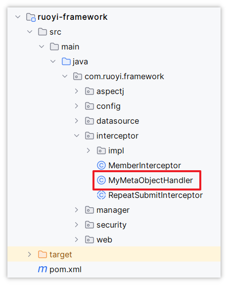
> 图注：这张图片展示了名为ruoyi-framework的项目的Java模块目录结构，其中interceptor目录下有一个红框标出的MyMetaObjectHandler类，这正是文档中提到的用于处理字段自动填充的类，符合文档中“在zzyl-framework模块中新增MyMetaObjectHandler来处理字段自动填充”的相关说明，该目录路径为ruoyi-framework > src > main > java > com.ruoyi.framework > interceptor，且该目录下还包含MemberInterceptor、RepeatSubmitInterceptor等其他拦截器类。

详细的代码如下：

```Java
package com.zzyl.framework.interceptor;

import com.baomidou.mybatisplus.core.handlers.MetaObjectHandler;
import com.zzyl.common.core.domain.model.LoginUser;
import com.zzyl.common.utils.SecurityUtils;
import org.apache.ibatis.reflection.MetaObject;
import org.springframework.stereotype.Component;

import java.util.Date;

@Component
public class MyMetaObjectHandler implements MetaObjectHandler {
    @Override
    public void insertFill(MetaObject metaObject) {
        strictInsertFill(metaObject, "createTime", Date.class, new Date());
        strictInsertFill(metaObject, "createBy", String.class, String.valueOf(loadUserId()));
    }

    @Override
    public void updateFill(MetaObject metaObject) {
        strictUpdateFill(metaObject, "updateTime", Date.class, new Date());
        strictUpdateFill(metaObject, "updateBy", String.class, String.valueOf(loadUserId()));
    }

    /**
     * 获取当前登录人的ID
     * @return  登录人ID
     */
    public Long loadUserId() {
        LoginUser loginUser = SecurityUtils.getLoginUser();
        if (loginUser != null) {
            return loginUser.getUserId();
        }
        return 1L;
    }
}
```

#### 测试

**测试：**

以上所有内容修改完成以后，重启后端项目，来测试代码的有效性

集成MP之后，新增或修改数据，检查是否能够自动填充数据。

如果测试修改发现没有自动修改数据库表中的updateTime和updateBy字段，原因在官网中说明了：

> `MetaObjectHandler` 提供的默认方法策略是：如果属性有值则不覆盖，如果填充值为 `null` 则不填充。

此时，需要换一种更新方式，修改后的代码如下：

```SCSS
package com.zzyl.framework.interceptor;

import com.baomidou.mybatisplus.core.handlers.MetaObjectHandler;
import com.zzyl.common.core.domain.model.LoginUser;
import com.zzyl.common.utils.SecurityUtils;
import org.apache.ibatis.reflection.MetaObject;
import org.springframework.stereotype.Component;

import java.util.Date;

@Component
public class MyMetaObjectHandler implements MetaObjectHandler {
    @Override
    public void insertFill(MetaObject metaObject) {
        this.strictInsertFill(metaObject, "createTime", Date.class, new Date());
        // 自动填充创建人
        this.strictInsertFill(metaObject, "createBy", String.class, String.valueOf(getLoginUser()));
    }

    @Override
    public void updateFill(MetaObject metaObject) {
        this.setFieldValByName("updateTime", new Date(), metaObject);
        this.setFieldValByName("updateBy", String.valueOf(getLoginUser()), metaObject);
//        this.strictUpdateFill(metaObject, "updateTime", Date.class, new Date());
//        this.strictUpdateFill(metaObject, "updateBy", String.class, String.valueOf(getLoginUser()));
    }

    public Long getLoginUser() {
        LoginUser loginUser = SecurityUtils.getLoginUser();

        if (loginUser != null) {
            return loginUser.getUserId();
        }
        return 1L;
    }
}
```

修改后，再次重启测试，就能够自动更新数据库中的updateTime和updateBy了。

测试通过后，能够自动填充数据了。那么，接下来，继续修改模板，去掉新增方法和修改方法补全字段属性的代码，修改后的模板为（绿色背景是需要删除或者注释掉的代码）：

```JavaScript
package ${packageName}.service.impl;

import java.util.List;
#foreach ($column in $columns)
#if($column.javaField == 'createTime' || $column.javaField == 'updateTime')
import com.zzyl.common.utils.DateUtils;
#break
#end
#end
import org.springframework.beans.factory.annotation.Autowired;
import org.springframework.stereotype.Service;
#if($table.sub)
import java.util.ArrayList;
import com.zzyl.common.utils.StringUtils;
import org.springframework.transaction.annotation.Transactional;
import ${packageName}.domain.${subClassName};
#end
import ${packageName}.mapper.${ClassName}Mapper;
import ${packageName}.domain.${ClassName};
import ${packageName}.service.I${ClassName}Service;
import com.baomidou.mybatisplus.extension.service.impl.ServiceImpl;
import java.util.Arrays;

/**
 * ${functionName}Service业务层处理
 * 
 * @author ${author}
 * @date ${datetime}
 */
@Service
public class ${ClassName}ServiceImpl extends ServiceImpl<${ClassName}Mapper, ${ClassName}> implements I${ClassName}Service
{
    @Autowired
    private ${ClassName}Mapper ${className}Mapper;

    /**
     * 查询${functionName}
     * 
     * @param ${pkColumn.javaField} ${functionName}主键
     * @return ${functionName}
     */
    @Override
    public ${ClassName} select${ClassName}By${pkColumn.capJavaField}(${pkColumn.javaType} ${pkColumn.javaField})
    {
##        return ${className}Mapper.select${ClassName}By${pkColumn.capJavaField}(${pkColumn.javaField});
        return getById(${pkColumn.javaField});
    }

    /**
     * 查询${functionName}列表
     * 
     * @param ${className} ${functionName}
     * @return ${functionName}
     */
    @Override
    public List<${ClassName}> select${ClassName}List(${ClassName} ${className})
    {
        return ${className}Mapper.select${ClassName}List(${className});
    }

    /**
     * 新增${functionName}
     * 
     * @param ${className} ${functionName}
     * @return 结果
     */
#if($table.sub)
    @Transactional
#end
    @Override
    public int insert${ClassName}(${ClassName} ${className})
    {
###foreach ($column in $columns)
###if($column.javaField == 'createTime')
##        ${className}.setCreateTime(DateUtils.getNowDate());
###end
###end
#if($table.sub)
        int rows = ${className}Mapper.insert${ClassName}(${className});
        insert${subClassName}(${className});
        return rows;
#else
##        return ${className}Mapper.insert${ClassName}(${className});
        return save(${className}) ? 1 : 0;
#end
    }

    /**
     * 修改${functionName}
     * 
     * @param ${className} ${functionName}
     * @return 结果
     */
#if($table.sub)
    @Transactional
#end
    @Override
    public int update${ClassName}(${ClassName} ${className})
    {
###foreach ($column in $columns)
###if($column.javaField == 'updateTime')
##        ${className}.setUpdateTime(DateUtils.getNowDate());
###end
###end
#if($table.sub)
        ${className}Mapper.delete${subClassName}By${subTableFkClassName}(${className}.get${pkColumn.capJavaField}());
        insert${subClassName}(${className});
#end
##        return ${className}Mapper.update${ClassName}(${className});
        return updateById(${className}) ? 1 : 0;
    }

    /**
     * 批量删除${functionName}
     * 
     * @param ${pkColumn.javaField}s 需要删除的${functionName}主键
     * @return 结果
     */
#if($table.sub)
    @Transactional
#end
    @Override
    public int delete${ClassName}By${pkColumn.capJavaField}s(${pkColumn.javaType}[] ${pkColumn.javaField}s)
    {
#if($table.sub)
        ${className}Mapper.delete${subClassName}By${subTableFkClassName}s(${pkColumn.javaField}s);
#end
##        return ${className}Mapper.delete${ClassName}By${pkColumn.capJavaField}s(${pkColumn.javaField}s);
        return removeByIds(Arrays.asList(${pkColumn.javaField}s)) ? 1 : 0;
    }

    /**
     * 删除${functionName}信息
     * 
     * @param ${pkColumn.javaField} ${functionName}主键
     * @return 结果
     */
#if($table.sub)
    @Transactional
#end
    @Override
    public int delete${ClassName}By${pkColumn.capJavaField}(${pkColumn.javaType} ${pkColumn.javaField})
    {
#if($table.sub)
        ${className}Mapper.delete${subClassName}By${subTableFkClassName}(${pkColumn.javaField});
#end
##        return ${className}Mapper.delete${ClassName}By${pkColumn.capJavaField}(${pkColumn.javaField});
        return removeById(${pkColumn.javaField}) ? 1 : 0;
    }
#if($table.sub)

    /**
     * 新增${subTable.functionName}信息
     * 
     * @param ${className} ${functionName}对象
     */
    public void insert${subClassName}(${ClassName} ${className})
    {
        List<${subClassName}> ${subclassName}List = ${className}.get${subClassName}List();
        ${pkColumn.javaType} ${pkColumn.javaField} = ${className}.get${pkColumn.capJavaField}();
        if (StringUtils.isNotNull(${subclassName}List))
        {
            List<${subClassName}> list = new ArrayList<${subClassName}>();
            for (${subClassName} ${subclassName} : ${subclassName}List)
            {
                ${subclassName}.set${subTableFkClassName}(${pkColumn.javaField});
                list.add(${subclassName});
            }
            if (list.size() > 0)
            {
                ${className}Mapper.batch${subClassName}(list);
            }
        }
    }
#end
}
```


### Swagger集成

在我们定义的所有controller中，为了更好的展示接口文档，我们都需要添加swagger注解才可以。这些注解我们也可以通过代码的模板来生成，节省我们的开发工作


我们需要修改2个模板文件：**controller.java.vm**和**domain.java.vm，**先来修改**controller.java.vm**文件，具体的修改的内容如下：

```Java
package ${packageName}.controller;

import com.zzyl.common.core.domain.R;
import io.swagger.annotations.Api;
import io.swagger.annotations.ApiOperation;
import io.swagger.annotations.ApiParam;
import java.util.List;
import javax.servlet.http.HttpServletResponse;
import org.springframework.security.access.prepost.PreAuthorize;
import org.springframework.beans.factory.annotation.Autowired;
import org.springframework.web.bind.annotation.GetMapping;
import org.springframework.web.bind.annotation.PostMapping;
import org.springframework.web.bind.annotation.PutMapping;
import org.springframework.web.bind.annotation.DeleteMapping;
import org.springframework.web.bind.annotation.PathVariable;
import org.springframework.web.bind.annotation.RequestBody;
import org.springframework.web.bind.annotation.RequestMapping;
import org.springframework.web.bind.annotation.RestController;
import com.zzyl.common.annotation.Log;
import com.zzyl.common.core.controller.BaseController;
import com.zzyl.common.core.domain.AjaxResult;
import com.zzyl.common.enums.BusinessType;
import ${packageName}.domain.${ClassName};
import ${packageName}.service.I${ClassName}Service;
import com.zzyl.common.utils.poi.ExcelUtil;
#if($table.crud || $table.sub)
import com.zzyl.common.core.page.TableDataInfo;
#elseif($table.tree)
#end

/**
 * ${functionName}Controller
 * 
 * @author ${author}
 * @date ${datetime}
 */
@RestController
@RequestMapping("/${moduleName}/${businessName}")
@Api(tags = "${functionName}相关接口")
public class ${ClassName}Controller extends BaseController
{
    @Autowired
    private I${ClassName}Service ${className}Service;

    /**
     * 查询${functionName}列表
     */
    @PreAuthorize("@ss.hasPermi('${permissionPrefix}:list')")
    @GetMapping("/list")
    @ApiOperation("查询${functionName}列表")
#if($table.crud || $table.sub)
    public TableDataInfo<${ClassName}> list(@ApiParam(value = "${functionName}查询条件") ${ClassName} ${className})
    {
        startPage();
        List<${ClassName}> list = ${className}Service.select${ClassName}List(${className});
        return getDataTable(list);
    }
#elseif($table.tree)
    public AjaxResult list(${ClassName} ${className})
    {
        List<${ClassName}> list = ${className}Service.select${ClassName}List(${className});
        return success(list);
    }
#end

    /**
     * 导出${functionName}列表
     */
    @PreAuthorize("@ss.hasPermi('${permissionPrefix}:export')")
    @Log(title = "${functionName}", businessType = BusinessType.EXPORT)
    @PostMapping("/export")
    @ApiOperation("导出${functionName}列表")
    public void export(HttpServletResponse response, @ApiParam(value = "${functionName}查询条件") ${ClassName} ${className})
    {
        List<${ClassName}> list = ${className}Service.select${ClassName}List(${className});
        ExcelUtil<${ClassName}> util = new ExcelUtil<${ClassName}>(${ClassName}.class);
        util.exportExcel(response, list, "${functionName}数据");
    }
    
    /**
     * 获取${functionName}详细信息
     */
    @PreAuthorize("@ss.hasPermi('${permissionPrefix}:query')")
    @GetMapping(value = "/{${pkColumn.javaField}}")
    @ApiOperation("获取${functionName}详细信息")
    public R<${ClassName}> getInfo(@ApiParam(value = "${functionName}ID", required = true)
                                  @PathVariable("${pkColumn.javaField}") ${pkColumn.javaType} ${pkColumn.javaField})
    {
##        return success(${className}Service.select${ClassName}By${pkColumn.capJavaField}(${pkColumn.javaField}));
        return R.ok(${className}Service.select${ClassName}By${pkColumn.capJavaField}(${pkColumn.javaField}));
    }

    /**
     * 新增${functionName}
     */
    @PreAuthorize("@ss.hasPermi('${permissionPrefix}:add')")
    @Log(title = "${functionName}", businessType = BusinessType.INSERT)
    @PostMapping
    @ApiOperation("新增${functionName}")
    public AjaxResult add(@ApiParam(value = "${functionName}实体", required = true) @RequestBody ${ClassName} ${className})
    {
        return toAjax(${className}Service.insert${ClassName}(${className}));
    }

    /**
     * 修改${functionName}
     */
    @PreAuthorize("@ss.hasPermi('${permissionPrefix}:edit')")
    @Log(title = "${functionName}", businessType = BusinessType.UPDATE)
    @PutMapping
    @ApiOperation("修改${functionName}")
    public AjaxResult edit(@ApiParam(value = "${functionName}实体", required = true)  @RequestBody ${ClassName} ${className})
    {
        return toAjax(${className}Service.update${ClassName}(${className}));
    }

    /**
     * 删除${functionName}
     */
    @PreAuthorize("@ss.hasPermi('${permissionPrefix}:remove')")
    @Log(title = "${functionName}", businessType = BusinessType.DELETE)
    @DeleteMapping("/{${pkColumn.javaField}s}")
    @ApiOperation("删除${functionName}")
    public AjaxResult remove(@ApiParam(value = "${functionName}ID数组", required = true) @PathVariable ${pkColumn.javaType}[] ${pkColumn.javaField}s)
    {
        return toAjax(${className}Service.delete${ClassName}By${pkColumn.capJavaField}s(${pkColumn.javaField}s));
    }
}
```

接下来，修改domain.java.vm文件，具体的修改的内容如下：

```SCSS
package ${packageName}.domain;

#foreach ($import in $importList)
import ${import};
#end
import io.swagger.annotations.ApiModel;
import io.swagger.annotations.ApiModelProperty;
import lombok.AllArgsConstructor;
import lombok.Data;
import lombok.NoArgsConstructor;
##import org.apache.commons.lang3.builder.ToStringBuilder;
##import org.apache.commons.lang3.builder.ToStringStyle;
import com.zzyl.common.annotation.Excel;
#if($table.crud || $table.sub)
import com.zzyl.common.core.domain.BaseEntity;
#elseif($table.tree)
import com.zzyl.common.core.domain.TreeEntity;
#end

/**
 * ${functionName}对象 ${tableName}
 * 
 * @author ${author}
 * @date ${datetime}
 */
#if($table.crud || $table.sub)
#set($Entity="BaseEntity")
#elseif($table.tree)
#set($Entity="TreeEntity")
#end
@Data
@NoArgsConstructor
@AllArgsConstructor
@ApiModel("${functionName}实体")
public class ${ClassName} extends ${Entity}
{
    private static final long serialVersionUID = 1L;

#foreach ($column in $columns)
#if(!$table.isSuperColumn($column.javaField))
    /** $column.columnComment */
#if($column.list)
#set($parentheseIndex=$column.columnComment.indexOf("（"))
#if($parentheseIndex != -1)
#set($comment=$column.columnComment.substring(0, $parentheseIndex))
#else
#set($comment=$column.columnComment)
#end
#if($parentheseIndex != -1)
    @Excel(name = "${comment}", readConverterExp = "$column.readConverterExp()")
#elseif($column.javaType == 'Date')
    @JsonFormat(pattern = "yyyy-MM-dd")
    @Excel(name = "${comment}", width = 30, dateFormat = "yyyy-MM-dd")
#else
    @Excel(name = "${comment}")
#end
#end
    @ApiModelProperty("${column.columnComment}")
    private $column.javaType $column.javaField;
    
#end
#end
###if($table.sub)
##    /** $table.subTable.functionName信息 */
##    private List<${subClassName}> ${subclassName}List;
##
###end
###foreach ($column in $columns)
###if(!$table.isSuperColumn($column.javaField))
###if($column.javaField.length() > 2 && $column.javaField.substring(1,2).matches("[A-Z]"))
###set($AttrName=$column.javaField)
###else
###set($AttrName=$column.javaField.substring(0,1).toUpperCase() + ${column.javaField.substring(1)})
###end
##    public void set${AttrName}($column.javaType $column.javaField)
##    {
##        this.$column.javaField = $column.javaField;
##    }
##
##    public $column.javaType get${AttrName}()
##    {
##        return $column.javaField;
##    }
###end
###end
###if($table.sub)
##    public List<${subClassName}> get${subClassName}List()
##    {
##        return ${subclassName}List;
##    }
##
##    public void set${subClassName}List(List<${subClassName}> ${subclassName}List)
##    {
##        this.${subclassName}List = ${subclassName}List;
##    }
##
###end
##    @Override
##    public String toString() {
##        return new ToStringBuilder(this,ToStringStyle.MULTI_LINE_STYLE)
###foreach ($column in $columns)
###if($column.javaField.length() > 2 && $column.javaField.substring(1,2).matches("[A-Z]"))
###set($AttrName=$column.javaField)
###else
###set($AttrName=$column.javaField.substring(0,1).toUpperCase() + ${column.javaField.substring(1)})
###end
##            .append("${column.javaField}", get${AttrName}())
###end
###if($table.sub)
##            .append("${subclassName}List", get${subClassName}List())
###end
##            .toString();
##    }
}
```

重启服务之后，我们可以预览生成后的效果：

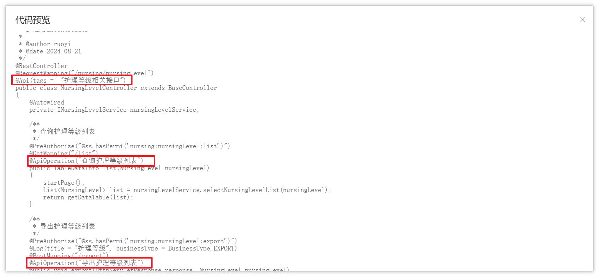
> 图注：这是代码模板改造中代码生成模块Swagger集成相关的预览界面，展示了Controller层代码，包含NursingLevel相关的类定义、方法注释与注解内容。界面中用红色框标注了多处核心内容，包括类定义处的NursingLevelController类声明、“查询护理等级列表”方法上的@Operation注解（带有对应操作描述），以及“导出护理等级列表”方法上的@Operation注解，这些标注对应了代码模板改造中需生成的Swagger相关注解，可直观预览修改后的效果。


### 由Date类型改为LocalDateTime

若依目前提供的代码中，如果遇到日期类型则使用的是Date，由于目前使用比较流行的日期时间类型是LocalDateTime类型，我们也可以把它改为该类型进行使用。

> **知识扩展**
> 
> Date类型与LocalDateTime的区别？
> 
> 1. 不可变性与线程安全性 
> 
>    1. Date一旦创建Date对象，可以通过setTime(long time)进行修改，多线程下存在线程安全问题
>    2. LocalDateTime是不可变的，线程安全
> 2. 时间精度
> 
>    1. Date可以表示到毫秒的时间值
>    2. LocalDateTime可以表示到纳秒的时间值
> 3. 易用性：LocalDateTime的API设计的更现代化，易于使用


在目前代码生成中，其中字段详细这一栏中的Java类型并不支持LocalDateTime类型，所以我们需要在前端也要修改其内容，让它支持LocalDateTime

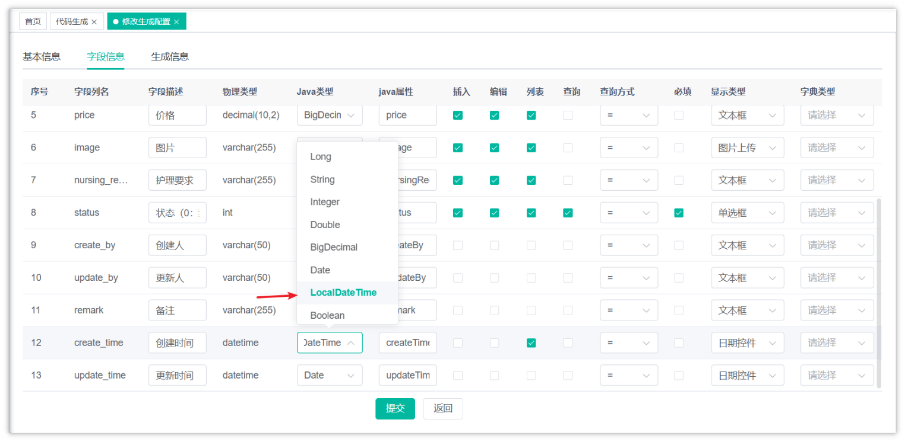
> 图注：图片展示的是代码生成模块中字段信息的编辑界面。界面中有多个字段信息展示，如序号、字段列名、物理类型、Java类型等。其中，字段列名“create_time”对应的Java类型为“LocalDateTime”，下方显示其对应的Java属性为“createTim”。该图片与上下文紧密相关，上下文提到在前端选择了LocalDateTime类型后，后端代码生成中需导入对应包并修改代码，此图直观呈现了前端字段信息中Java类型为“LocalDateTime”的情况，辅助理解上下文内容。

打开前端项目，找到src/views/tool/gen/editTable.vue文件，在这个文件添加中以上一行代码，如下：

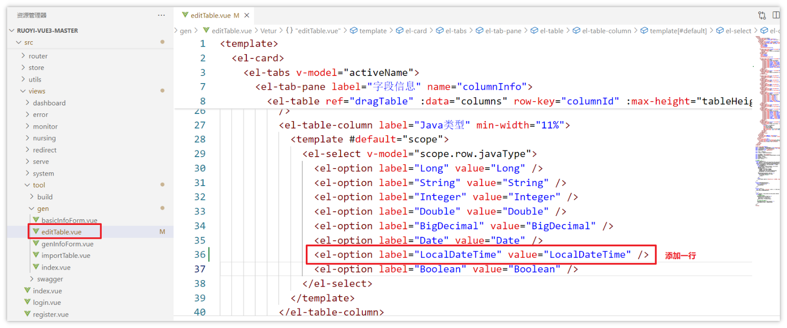
> 图注：图片展示了前端项目中editTable.vue文件的代码内容，该文件位于src/views/tool/gen路径下，是文档中说明需修改以支持LocalDateTime类型的目标文件。图片里的表格包含“Java类型”列，对应的选项中原本有Date、String、Integer等类型，其中Date选项被红色框标注，另有一行被红色框标注并添加的选项，是label为LocalDateTime、value为LocalDateTime的项，也就是文档提及的新增代码行，用于让该前端文件支持LocalDateTime类型。

当前端选择了LocalDateTime类型之后，在后端的代码生成中，需要导入对应的包才可以，后端的代码也需要修改

我们打开VelocityUtils类，这里面有处理导入包的逻辑，找到getImportList方法，在其中添加对应的包导入

```Java
/**
 * 根据列类型获取导入包
 * 
 * @param genTable 业务表对象
 * @return 返回需要导入的包列表
 */
public static HashSet<String> getImportList(GenTable genTable)
{
    List<GenTableColumn> columns = genTable.getColumns();
    GenTable subGenTable = genTable.getSubTable();
    HashSet<String> importList = new HashSet<String>();
    if (StringUtils.isNotNull(subGenTable))
    {
        importList.add("java.util.List");
    }
    for (GenTableColumn column : columns)
    {
        if (!column.isSuperColumn() && GenConstants.TYPE_DATE.equals(column.getJavaType()))
        {
            importList.add("java.util.Date");
            importList.add("com.fasterxml.jackson.annotation.JsonFormat");
        }
        else if (!column.isSuperColumn() && GenConstants.TYPE_BIGDECIMAL.equals(column.getJavaType()))
        {
            importList.add("java.math.BigDecimal");
        }
        // 如果字段类型在前端选择的是LocalDateTime，则导入对应的包
        if (!column.isSuperColumn() && GenConstants.TYPE_LOCAL_DATE_TYPE.equals(column.getJavaType()))
        {
            importList.add("java.time.LocalDateTime");
            // 导入这个是为了格式化日期
            importList.add("com.fasterxml.jackson.annotation.JsonFormat");
        }
    }
    return importList;
}
```

新增代码中的 *TYPE_LOCAL_DATE_TYPE*需要定义在 `GenConstants `常量类中。

```Java
/** JDK8时间类型 */
public static final String TYPE_LOCAL_DATE_TYPE= "LocalDateTime";
```

修改模块文件domain.java.vm文件，修改的内容如下：

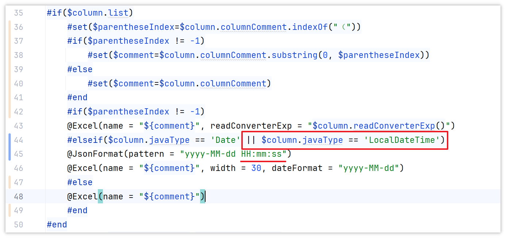
> 图注：图片展示的是代码生成模块中domain.java.vm文件的部分代码。其中，红框突出显示了判断语句，当$column.javaType为“Date”或“LocalDateTime”时，readConverterExp赋值为“$column.readConverterExp()”，并使用@JsonFormat(pattern = “yyyy-MM-dd HH:mm:ss”)注解。该代码与上下文紧密相关，是在前端选择了LocalDateTime类型后，对后端代码生成进行修改，确保导入相应包并修改代码生成内容，以支持LocalDateTime类型。

## 其他修改

### 修改生成包路径和生成模块名

若依默认生成的包路径和模块名都是system，效果如下：

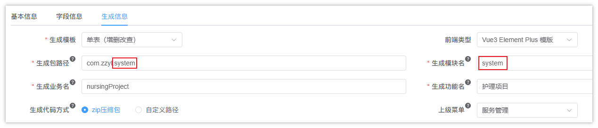
> 图注：图片展示的是若依框架中生成信息配置界面。界面中有基本信息、字段信息和生成信息三个选项卡，当前选中生成信息。生成包路径为“com.zzy.system”，生成模块名为“system”，生成业务名为“nursingProject”，生成功能名为“护理项目”，上级菜单为“服务管理”，前端类型为“Vue3 Element Plus 模版”。该图片与上下文内容相关，用于说明若依默认生成的包路径和模块名都是system的情况。

而咱们项目中用到的包路径和模块名都是nursing，如果要将这里的默认值改为nursing，只需要修改配置文件即可：

修改zzyl-generator模块下的generator.yml配置文件，修改后的内容如下：

```YAML
# 代码生成
gen:
  # 作者
  author: alexis
  # 默认生成包路径 system 需改成自己的模块名称 如 system monitor tool
  packageName: com.zzyl.nursing
  # 自动去除表前缀，默认是false
  autoRemovePre: false
  # 表前缀（生成类名不会包含表前缀，多个用逗号分隔）
  tablePrefix: sys_
```

### 修改物理类型对应的Java类型

若依默认生成的字段信息中很多数据库中的`int`类型和`tinyint`类型对应的Java类型都是`Long`，如下图所示：

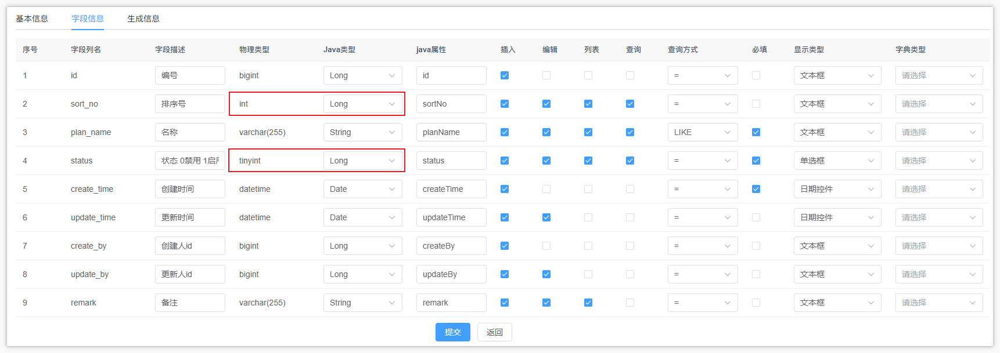
> 图注：图片展示的是数据库字段信息配置界面。界面中有字段序号、字段名称、字段描述、物理类型、Java类型、插入、编辑、判表、查询、查询方式、必填、显示类型、字典类型等列。其中，字段序号1的物理类型为bigint，Java类型为Long；字段序号2的物理类型为int，Java类型为Long；字段序号4的物理类型为tinyint，Java类型为Long。这些字段信息与文档中修改物理类型对应的Java类型的内容相关，直观呈现了字段对应的物理类型和Java类型情况。

可以通过修改zzyl-generator模块下的GenUtils工具类中的代码来将其统一改为INTEGER类型，具体的修改位置为：

```Java
/**
 * 初始化列属性字段
 */
public static void initColumnField(GenTableColumn column, GenTable table)
{
    String dataType = getDbType(column.getColumnType());
    String columnName = column.getColumnName();
    column.setTableId(table.getTableId());
    column.setCreateBy(table.getCreateBy());
    // 设置java字段名
    column.setJavaField(StringUtils.toCamelCase(columnName));
    // 设置默认类型
    column.setJavaType(GenConstants.TYPE_STRING);
    column.setQueryType(GenConstants.QUERY_EQ);

    if (arraysContains(GenConstants.COLUMNTYPE_STR, dataType) || arraysContains(GenConstants.COLUMNTYPE_TEXT, dataType))
    {
        // 字符串长度超过500设置为文本域
        Integer columnLength = getColumnLength(column.getColumnType());
        String htmlType = columnLength >= 500 || arraysContains(GenConstants.COLUMNTYPE_TEXT, dataType) ? GenConstants.HTML_TEXTAREA : GenConstants.HTML_INPUT;
        column.setHtmlType(htmlType);
    }
    else if (arraysContains(GenConstants.COLUMNTYPE_TIME, dataType))
    {
        // 将日期时间类型改为LocalDateTime
        column.setJavaType(GenConstants.TYPE_LOCAL_DATE_TIME);
        column.setHtmlType(GenConstants.HTML_DATETIME);
    }
    else if (arraysContains(GenConstants.COLUMNTYPE_NUMBER, dataType))
    {
        column.setHtmlType(GenConstants.HTML_INPUT);

        // 如果是浮点型 统一用BigDecimal
        String[] str = StringUtils.split(StringUtils.substringBetween(column.getColumnType(), "(", ")"), ",");
        if (str != null && str.length == 2 && Integer.parseInt(str[1]) > 0)
        {
            column.setJavaType(GenConstants.TYPE_BIGDECIMAL);
        }
        // 如果是整形
        else if (str != null && str.length == 1 && Integer.parseInt(str[0]) <= 10
                || GenConstants.MYSQL_TINYINT.equals(column.getColumnType()) || GenConstants.MYSQL_INT.equals(column.getColumnType()))
        {
            column.setJavaType(GenConstants.TYPE_INTEGER);
        }
        // 长整形
        else
        {
            column.setJavaType(GenConstants.TYPE_LONG);
        }
    }
    ......省略了后续代码
}
```

> 新增代码中的 tinyint 和 int 类型需要定义在 `GenConstants `常量类中。

```Java
/** MySql tinyint 类型 */
public static final String MYSQL_TINYINT = "tinyint";

/** MySql int 类型 */
public static final String MYSQL_INT = "int";
```

这样，在系统中导入表结构后，数据库中的`tinyint`类型和`int`类型对应的默认Java类型就都是`Integer`类型啦。

## 作业

1.使用改造之后的代码生成模板，重新生成目前已完成的三个页面的前后端代码

- 护理项目
- 护理计划
- 护理等级

2. 完成其他修改

- 修改生成包路径和生成模块名
- 修改物理类型对应的Java类型

---
> 来源：飞书技术知识库（脱敏版） · 07 业务组件方案集 / 中州养老项目（若依+AI） / 第一章-若依+AI快速开发新项目 / 02-代码模板改造 · [原文](https://ccn8v2zngwsm.feishu.cn/wiki/RrDkwDQ4SiezXhkzmV7cDUyunlT)
