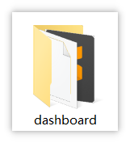
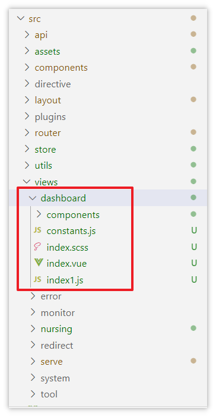
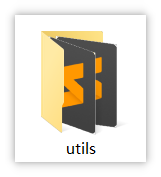
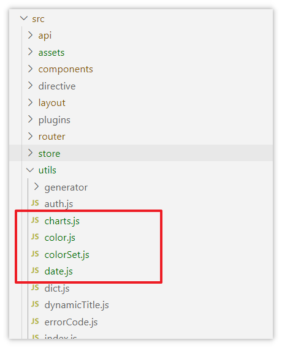
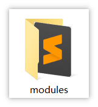
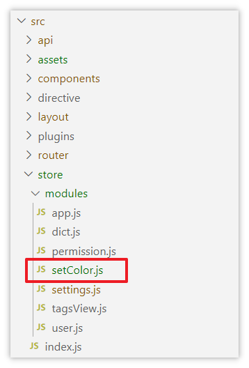
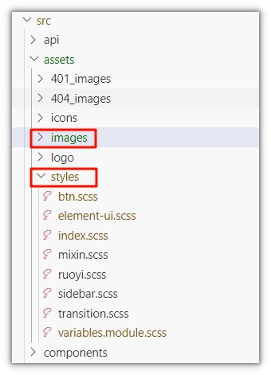
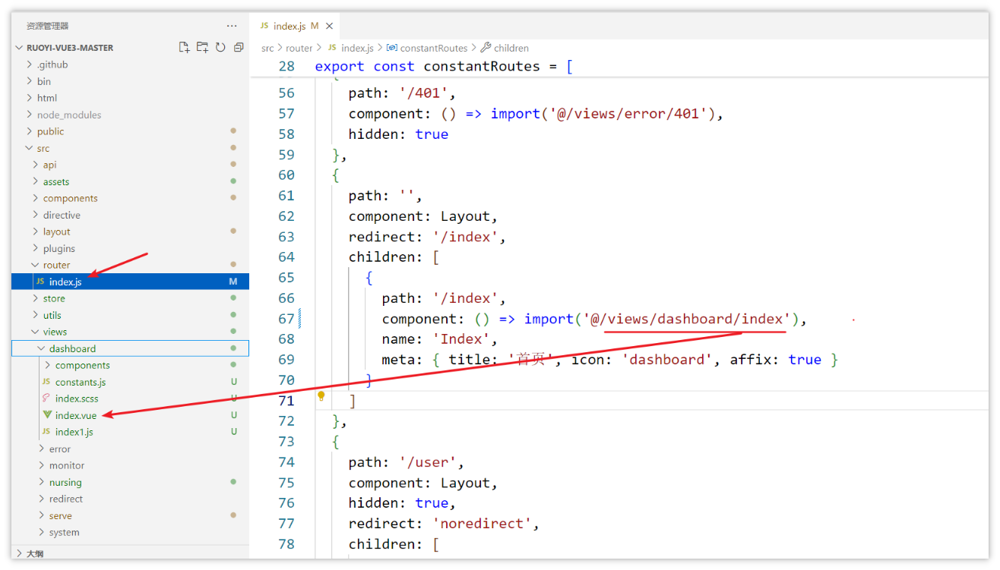
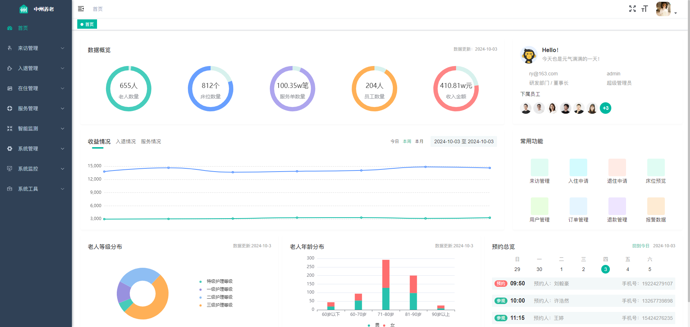

# 首页组件集成

1，代码拷贝资料中的**dashboard**目录到src/views目录中

> 图注：这是“首页组件集成”流程的第一步内容配图，对应第一步“代码拷贝”的操作要求，该图展示了名为“dashboard”的文件夹图标，图中文件夹外观包含黄色、黑色的部分，其中黄色半露出的文件夹内还有白色的文件样式图形，下方标注有文字“dashboard”，用来直观体现第一步要拷贝的对象，即资料中的dashboard目录，为开发者清晰呈现需拷贝的目标内容。

拷贝后的效果如下：

> 图注：图片展示了Vue项目中views目录下的dashboard文件夹内容。该文件夹下有components、constants.js、index.scss、index.vue、index1.js等文件。其中，index.vue和index1.js文件被红色框突出显示。此图对应文档中“代码拷贝资料中的**dashboard**目录到src/views目录中”步骤，直观呈现了该目录下文件情况，辅助理解代码集成操作。

1. 拷贝js依赖

拷贝资料中的utils文件夹中的内容到src/utils目录中

> 图注：这张图对应文档中“拷贝js依赖”步骤里的utils文件夹拷贝操作。图中展示了一个展开的文件夹，文件夹主体为深灰色，上面有醒目的橙色字母“3S”标识，文件夹的衬页为浅黄色，下方标注有黑色的“utils”字样，该图片直观呈现了拷贝流程中需要处理的目标文件夹，对应文档中拷贝utils文件夹内容到指定目录的操作环节。

拷贝后的效果：

> 图注：这张图展示了项目src目录下的utils文件夹内的文件结构，结合上下文可知这是执行首页组件集成第二步“拷贝js依赖”后的效果。utils文件夹内包含generator、auth.js等多个文件，其中被红色框标注突出显示的是charts.js、color.js、colorSet.js、date.js这四个JS文件，这些是从资料的utils文件夹中拷贝到项目对应目录的依赖文件，直观呈现了该步骤完成后相关JS文件的存放情况。

拷贝资料中的modules中的文件到src/store/modules目录中

> 图注：图片展示的是一个文件夹图标，文件夹为黄色，图标为橙色和黑色，图标形状类似字母“S”。文件夹下方有黑色文字“modules”。该图片位于文档中“拷贝资料中的modules中的文件到src/store/modules目录中”步骤之后，是该步骤操作后的效果展示，表明已将资料中的modules文件夹内容拷贝到src/store/modules目录中。

拷贝后的效果如下：

> 图注：图片展示了Vue项目中src目录下的store文件夹及modules文件夹下的文件结构。其中，modules文件夹下有多个js文件，如app.js、dict.js、permission.js等，还有一文件被红色框线突出显示，其名称为setColor.js。该图片与文档中“拷贝js依赖”部分内容相关，对应将资料中utils文件夹内容拷贝到src/utils目录后，此文件夹下的setColor.js文件被突出显示，用于说明文件拷贝后的效果。

1. 拷贝样式和图片

拷贝资料中的**images**文件夹到src/asserts目录中，替换原有内容

拷贝后的效果如下：

> 图注：图片展示了Vue项目中src目录下的assets文件夹内容。其中，images文件夹被红色框突出显示，其下有401_images、404_images、icons等子文件夹；styles文件夹也被红色框突出显示，内含btn.scss、element-ui.scss等样式文件。该图片与文档中“拷贝样式和图片”部分内容对应，直观呈现了将资料中images文件夹内容拷贝到src/assets目录中，替换原有内容后的文件结构情况。

1. 修改路由

修改src/router/index.js文件，把首页的配置改为自己的首页路径，详细代码如下：

> 图注：这张图片展示了Vue项目的路由配置文件index.js的代码内容，清晰呈现了constantRoutes的路由配置逻辑。其中用红色箭头重点标注了两个关键内容：一是左侧文件目录中被选中的src/router/index.js文件，二是代码内标注的首页路由相关配置，该路由配置设置了路径为"/index"，指向dashboard目录下的首页组件，并设置了对应标题、图标等路由元信息。该图片是修改首页路由步骤的直观示例，对应文档中修改src/router/index.js配置首页路径的操作内容。

集成成功后的效果：

> 图注：图片展示了中邦养老平台首页界面。左侧有“首页”“来往管理”“入住管理”等导航栏。中部上方显示数据概况，如655人、812个房间、100.35w笔、204人、410.81w元等。下方有“收益情况”“入住情况”“服务情况”图表。右侧是“常用功能”区域，有“来往管理”“入住申请”等选项，下方显示预约信息，如9:09预约人王磊、10:00预约人许婷等。

---
> 来源：飞书技术知识库（脱敏版） · 07 业务组件方案集 / 中州养老项目（若依+AI） / 第一章-若依+AI快速开发新项目 / 03-前后端快速开发 / 首页组件集成 · [原文](https://ccn8v2zngwsm.feishu.cn/wiki/Pt3TwyjTyiNJDsk2fSPcfHIPnHg)
