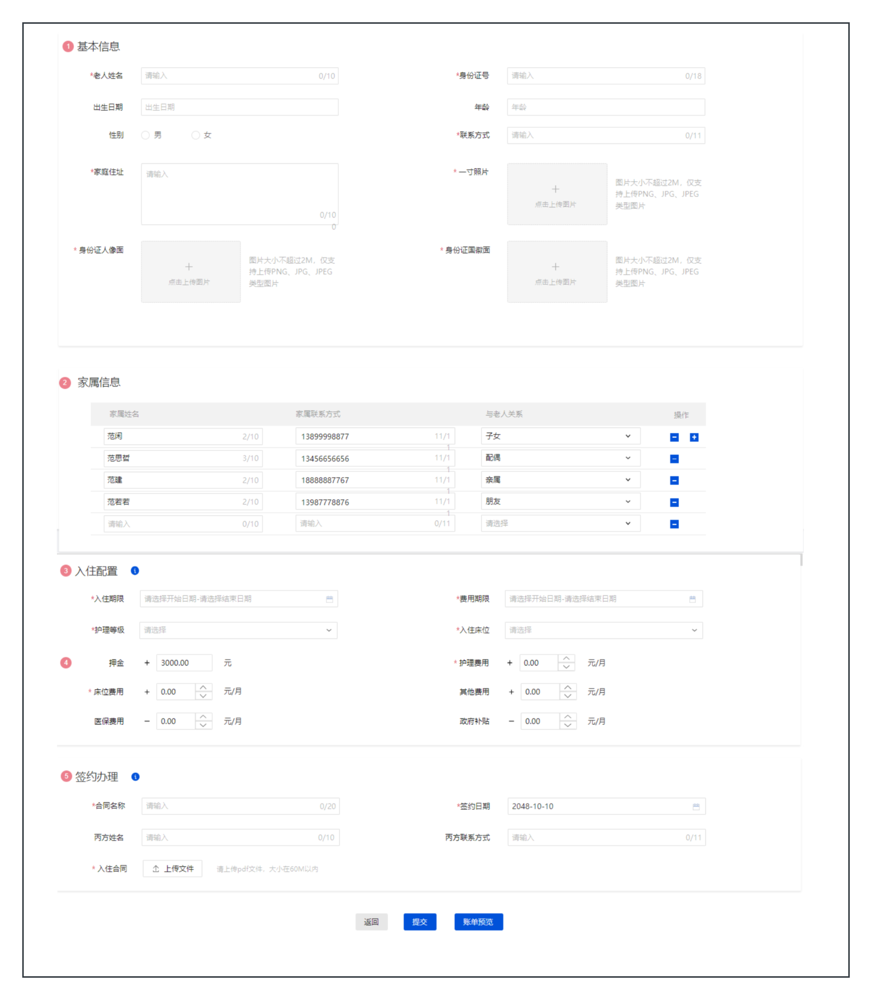
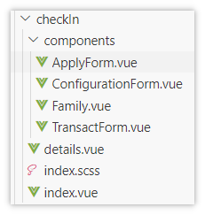
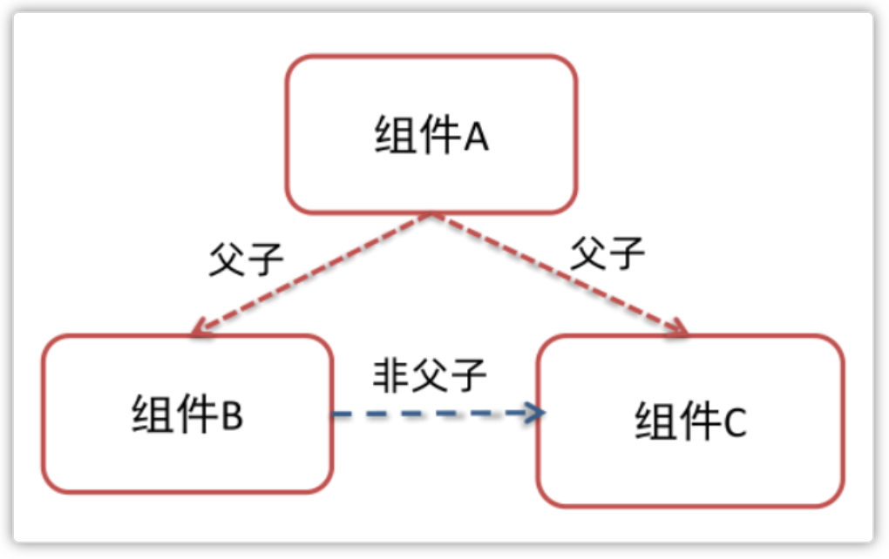
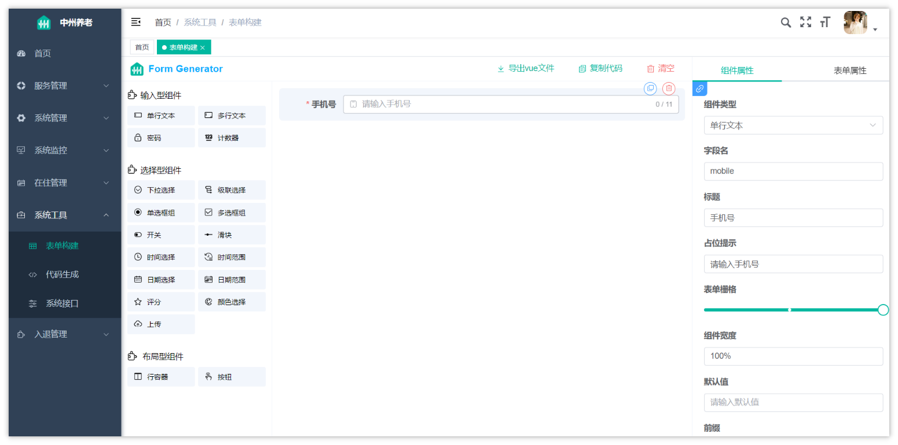
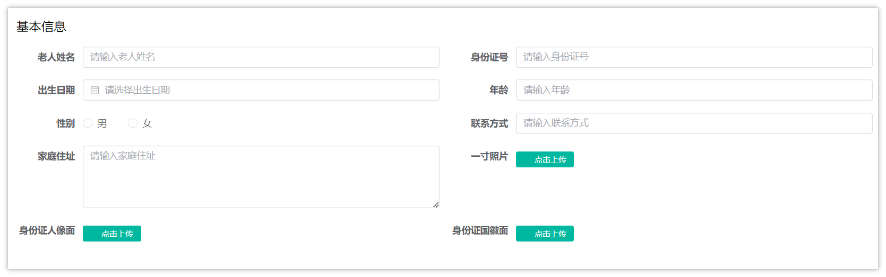
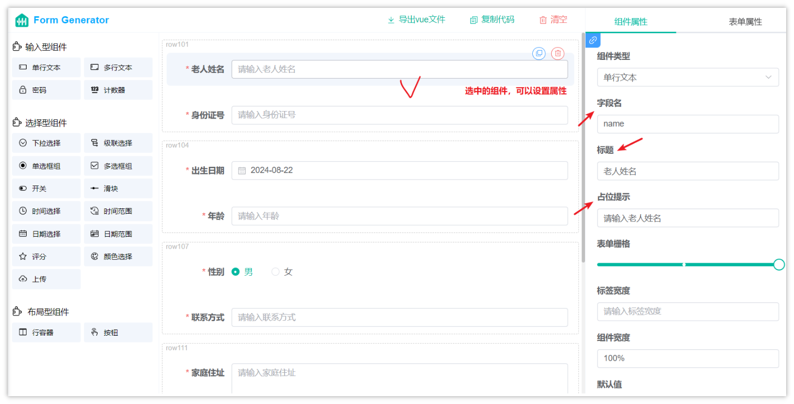
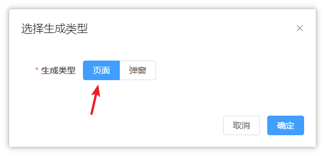

# 解读前端申请入住表单

## 功能说明

用户在前端页面点击发起入住申请或者查看详情，会进入到入住详情页面，下图是需要用入住详情页面的前端效果图：


> 图注：这张图是前端入住详情页面的效果图，该页面分为四个核心部分，分别为基本信息、家属信息、入住配置、签约办理。页面左上角的“基本信息”区域包含多类输入项，用于填写基础资料；其下方的“家属信息”区域以列表形式呈现，包含多条条目，每条配有复选框，可支持填写多条家属相关信息；再下方的“入住配置”区域设置了价格、周期等配置类选项；最下方的“签约办理”区域则含日期填写等相关内容，页面底部还设有操作按钮。该页面是前端入住申请流程中的详情展示界面，为后续组件拆分开发提供了视觉参考。

从效果图上可以看出来，这个页面共分为了四部分

- 基本信息
- 家属信息，可能会有多个
- 入住配置
- 签约办理

由于表单内容较多，如果把代码都写在一起，维护起来非常麻烦，一般企业中会抽取组件进行开发，最后抽取出来的组件需要父组件之间进行通信。

## 设计思路

整体的组件设计思路如下：

<whiteboard token="OMA5wkfrJhjYhObakhEcZ9UrnAb"></whiteboard>

- 在入住列表页面index.vue点击按钮发起入住申请，进入到details.vue详情页，由于details.vue中的内容过多，因此将其拆分成4个单独的页面，然后在details.vue中统一引入，最终前端效果如下：


> 图注：图片展示了checkin组件下的文件结构。在components文件夹中，有ApplyForm.vue、ConfigurationForm.vue、Family.vue、TransactForm.vue四个子组件，它们分别对应入住申请表单、配置表单、家庭成员表单、交易表单。此外，还有details.vue、index.scss、index.vue文件。该图片与文档中介绍前端申请入住表单设计思路的内容相关，直观呈现了父组件引用子组件后，子组件与父组件间数据通信的组件层级关系。

- 其中details.vue是父组件，components目录下的四个组件是子组件，最终四个子组件表单中的数据需要统一收集到父组件中，因此这里就涉及到了组件之间的通信

  - 父组件引用子组件
  - 子组件传数据到父组件

## 父子组件通信

先来通过下面这张图片认识一下什么是父子组件，图中有三个组件，组件A的子组件是B和C，其中B和C是兄弟关系。咱们重点研究是父子组件的通信，如果想要实现B和C的通信，需要使用第三方组件pinia才行（不是课程重点）


> 图注：图片展示了三个组件A、B、C的关系。组件A的子组件是B和C，其中B和C是兄弟关系。图中用红色实线箭头表示组件A与B、C之间的父子关系，用蓝色虚线箭头表示B和C之间的非父子关系。该图与上下文紧密相关，用于直观呈现父子组件的概念，为后续讲解父组件向子组件传递数据等内容提供可视化参考。

在 Vue中，父子组件间的通信是通过属性传递（props）和事件（events）的方式来进行的。

### 父组件向子组件传递数据

父组件向子组件传递数据通常是通过 props 来实现的。在 Vue 3 中，props 的定义和使用变得更加简洁。

**示例代码：**

1. 父组件传递数据：

```JavaScript
<template>
  <div>
    <child :message="parentMessage"></child>
  </div>
</template>

<script setup>
import child from './child.vue';

const parentMessage = '来自父组件的消息';
</script>
```

在这个例子中，父组件通过 `message` 属性将数据传递给子组件 `ChildComponent`。

1. 子组件接收数据：

```JavaScript
<template>
  <div>{{ message }}</div>
</template>

<script setup>
defineProps({
  message: String,
});
</script>
```

子组件通过 `defineProps` 钩子来声明它期望接收的 prop，并且在模板中使用这个 prop。

### 子组件向父组件传递数据

子组件向父组件传递数据通常是通过自定义事件来实现的。

示例代码：

1. 子组件触发事件：

```JavaScript
<template>
  <button @click="sendMessage">给父组件发消息</button>
</template>

<script setup>
const emit = defineEmits(['message-sent']);
function sendMessage() {
  emit('message-sent', '来自子组件的消息');
}
</script>
```

在这个例子中，子组件定义了一个自定义事件 `message-sent`，并在按钮点击时触发这个事件，并传递一个消息。

1. 父组件监听事件：

```JavaScript
<template>
  <div>
    <child @message-sent="handleMessage"></child>
  </div>
</template>

<script setup>
import child from './child.vue';

function handleMessage(message) {
  console.log('接收到了子组件的消息:', message);
}
</script>
```

父组件通过 `@message-sent` 监听子组件触发的事件，并定义了一个处理函数 `handleMessage` 来接收和处理子组件传递过来的消息。


## 若依框架-表单构建

我们打开菜单中的**系统工具**-->**表单构建**


> 图注：这张图片展示的是若依框架的表单构建功能界面，具体为“表单生成器（Form Generator）”页面。界面左侧是功能导航栏，高亮选中的是“系统工具”下的“表单构建”选项；中间区域是表单配置主操作区，当前正在编辑手机号输入字段，对应输入框提示“请输入手机号”；右侧是该输入字段的属性配置面板，显示该字段类型为单行文本，字段名是mobile，标题为手机号，还设置了占位提示、表单缩略、组件密度等相关配置项，同时界面顶部还有导入Excel、复制代码、清空、组件属性、表单属性等操作按钮。

使用**表单构建**的优点：

- **可视化操作与配置**：表单构建功能提供了直观的可视化界面，开发者无需编写繁琐的代码，即可通过拖拽、配置等方式快速构建表单。这大大降低了开发难度，提高了开发效率。
- **高度自定义**：若依框架支持丰富的表单字段类型，如文本框、下拉框、单选框、复选框等，并允许开发者根据需求自定义字段类型。同时，框架还提供了灵活的布局和样式设置，使得开发者能够构建出符合业务需求的个性化表单
- **数据校验与验证**：表单构建功能内置了强大的数据校验和验证机制，能够确保表单数据的准确性和完整性。开发者可以为表单字段设置校验规则，如必填项、格式验证等，从而在用户提交表单时自动进行校验，减少错误数据的产生。
- **多类型导出：**可根据业务情况，选择生成页面组件或者是弹窗组件


### 基本信息组件

接下来，以**基本信息组件**为例，演示一下怎样使用若依提供的表单构建功能。

效果图：


> 图注：图片展示的是若依框架表单构建中基本信息组件的示例效果。左侧为老人姓名、出生日期、性别、家庭住址等输入框，右侧为身份证号、年龄、联系方式等输入框，以及一寸照片、身份证人像面、身份证国徽面的上传区域。其中，性别处有“男”“女”两个单选按钮，家庭住址处有输入框和一行容器，身份证相关区域有“点击上传”按钮。该图与上文介绍基本信息组件的字段及所用组件内容相呼应，直观呈现了组件效果。

基于上图，我们可以使用**表单生成**来生成代码，每个组件的属性值可参考接口文档

| **字段描述** | **字段名** | **所用组件** |
|-|-|-|
| 老人姓名 | name | 单行文本 |
| 身份证号 | idCardNo | 单行文本 |
| 出生日期 | birthday | 日期选择 |
| 年龄 | age | 单行文本 |
| 性别 | sex | 单选框组 |
| 联系方式 | phone | 单行文本 |
| 家庭住址 | address | 多行文本 |
| 一寸照片 | image | 上传 |
| 身份证人像面 | idCardPortraitImg | 上传 |
| 身份证国徽面 | idCardNationalEmblemImg | 上传 |

> - 相同颜色的字段为一组，它们属于一行，用到了**行容器**组件
> - 字段名称可以参考接口文档或者elder表结构的字段名称


选择组件的效果如下图，只展示了部分


> 图注：图片展示的是若依框架表单构建中基本信息组件的表单生成界面。左侧为表单组件选择栏，有输入型、选择型、布局型等组件分类。右侧是表单填写区域，包含老人姓名、身份证号、出生日期等字段，部分字段有红色星号标注必填。右侧还显示了选中组件的属性设置区域，如字段名、标题、占位提示等。该图与上下文紧密相关，直观呈现了表单构建中基本信息组件的样式及组件属性设置情况。

表单构建完成以后，找到**导出vue文件**，生成类型选择**页面**，把文件下载到本地备用


> 图注：这张图是前端申请入住表单相关的表单构建操作中的类型选择弹窗，标题为“选择生成类型”，核心是“生成类型”选项，其中“页面”选项被蓝色高亮选中，红色箭头指向该选项，未选中的相邻选项为“弹窗”。弹窗右下角有“取消”和“确定”两个操作按钮，用于确认或取消当前的生成类型选择操作，该图对应文档中表单构建完成后导出vue文件时选择生成类型的步骤内容。

生成后的代码：

```JSON
<template>
  <div>
    <el-form ref="formRef" :model="formData" :rules="rules" size="default" label-width="100px">
      <el-row gutter="15">
        <el-form-item label="老人姓名" prop="name">
          <el-input v-model="formData.name" type="text" placeholder="请输入老人姓名" clearable
            :style="{width: '100%'}"></el-input>
        </el-form-item>
        <el-form-item label="身份证号" prop="idCardNo">
          <el-input v-model="formData.idCardNo" type="text" placeholder="请输入身份证号" clearable
            :style="{width: '100%'}"></el-input>
        </el-form-item>
      </el-row>
      <el-row gutter="15">
        <el-form-item label="出生日期" prop="birthday">
          <el-date-picker v-model="formData.birthday" format="YYYY-MM-DD" value-format="YYYY-MM-DD"
            :style="{width: '100%'}" placeholder="请选择出生日期" clearable></el-date-picker>
        </el-form-item>
        <el-form-item label="年龄" prop="age">
          <el-input v-model="formData.age" type="text" placeholder="请输入年龄" clearable
            :style="{width: '100%'}"></el-input>
        </el-form-item>
      </el-row>
      <el-row gutter="15">
        <el-form-item label="性别" prop="sex">
          <el-radio-group v-model="formData.sex" size="default">
            <el-radio v-for="(item, index) in sexOptions" :key="index" :label="item.value"
              :disabled="item.disabled">{{item.label}}</el-radio>
          </el-radio-group>
        </el-form-item>
        <el-form-item label="联系方式" prop="phone">
          <el-input v-model="formData.phone" type="text" placeholder="请输入联系方式" clearable
            :style="{width: '100%'}"></el-input>
        </el-form-item>
      </el-row>
      <el-row gutter="15">
        <el-form-item label="家庭住址" prop="address">
          <el-input v-model="formData.address" type="textarea" placeholder="请输入家庭住址"
            :autosize="{minRows: 4, maxRows: 4}" :style="{width: '100%'}"></el-input>
        </el-form-item>
        <el-form-item label="一寸照片" prop="image" required>
          <el-upload ref="image" :file-list="imagefileList" :action="imageAction"
            :before-upload="imageBeforeUpload">
            <el-button size="small" type="primary" icon="el-icon-upload">点击上传</el-button>
          </el-upload>
        </el-form-item>
      </el-row>
      <el-row gutter="15">
        <el-form-item label="身份证人像面" prop="idCardPortraitImg" required>
          <el-upload ref="idCardPortraitImg" :file-list="idCardPortraitImgfileList"
            :action="idCardPortraitImgAction" :before-upload="idCardPortraitImgBeforeUpload">
            <el-button size="small" type="primary" icon="el-icon-upload">点击上传</el-button>
          </el-upload>
        </el-form-item>
        <el-form-item label="身份证国徽面" prop="idCardNationalEmblemImg" required>
          <el-upload ref="idCardNationalEmblemImg" :file-list="idCardNationalEmblemImgfileList"
            :action="idCardNationalEmblemImgAction" :before-upload="idCardNationalEmblemImgBeforeUpload">
            <el-button size="small" type="primary" icon="el-icon-upload">点击上传</el-button>
          </el-upload>
        </el-form-item>
      </el-row>
      <el-form-item>
        <el-button type="primary" @click="submitForm">提交</el-button>
        <el-button @click="resetForm">重置</el-button>
      </el-form-item>
    </el-form>
  </div>
</template>
<script setup>
import {
  ElMessage
}
from 'element-plus'
const formRef = ref()
const data = reactive({
  formData: {
    name: undefined,
    idCardNo: undefined,
    birthday: '2024-08-22',
    age: undefined,
    sex: 1,
    phone: undefined,
    address: undefined,
    image: null,
    idCardPortraitImg: null,
    idCardNationalEmblemImg: null,
  },
  rules: {
    name: [{
      required: true,
      message: '请输入老人姓名',
      trigger: 'blur'
    }],
    idCardNo: [{
      required: true,
      message: '请输入身份证号',
      trigger: 'blur'
    }],
    birthday: [{
      required: true,
      message: '请选择出生日期',
      trigger: 'change'
    }],
    age: [{
      required: true,
      message: '请输入年龄',
      trigger: 'blur'
    }],
    sex: [{
      required: true,
      message: '性别不能为空',
      trigger: 'change'
    }],
    phone: [{
      required: true,
      message: '请输入联系方式',
      trigger: 'blur'
    }],
    address: [{
      required: true,
      message: '请输入家庭住址',
      trigger: 'blur'
    }],
  }
})
const {
  formData,
  rules
} = toRefs(data)
const sexOptions = ref([{
  "label": "男",
  "value": 1
}, {
  "label": "女",
  "value": 0
}])
// 上传请求路径
const imageAction = ref('https://jsonplaceholder.typicode.com/posts/')
// 上传文件列表
const imagefileList = ref([])
// 上传请求路径
const idCardPortraitImgAction = ref('https://jsonplaceholder.typicode.com/posts/')
// 上传文件列表
const idCardPortraitImgfileList = ref([])
// 上传请求路径
const idCardNationalEmblemImgAction = ref('https://jsonplaceholder.typicode.com/posts/')
// 上传文件列表
const idCardNationalEmblemImgfileList = ref([])
/**
 * @name: 上传之前的文件判断
 * @description: 上传之前的文件判断，判断文件大小文件类型等
 * @param {*} file
 * @return {*}
 */
function imageBeforeUpload(file) {
  let isRightSize = file.size / 1024 / 1024 < 2
  if (!isRightSize) {
    ElMessage.error('文件大小超过 2MB')
  }
  return isRightSize
}
/**
 * @name: 上传之前的文件判断
 * @description: 上传之前的文件判断，判断文件大小文件类型等
 * @param {*} file
 * @return {*}
 */
function idCardPortraitImgBeforeUpload(file) {
  let isRightSize = file.size / 1024 / 1024 < 2
  if (!isRightSize) {
    ElMessage.error('文件大小超过 2MB')
  }
  return isRightSize
}
/**
 * @name: 上传之前的文件判断
 * @description: 上传之前的文件判断，判断文件大小文件类型等
 * @param {*} file
 * @return {*}
 */
function idCardNationalEmblemImgBeforeUpload(file) {
  let isRightSize = file.size / 1024 / 1024 < 2
  if (!isRightSize) {
    ElMessage.error('文件大小超过 2MB')
  }
  return isRightSize
}
/**
 * @name: 表单提交
 * @description: 表单提交方法
 * @return {*}
 */
function submitForm() {
  formRef.value.validate((valid) => {
    if (!valid) return
    // TODO 提交表单
  })
}
/**
 * @name: 表单重置
 * @description: 表单重置方法
 * @return {*}
 */
function resetForm() {
  formRef.value.resetFields()
}

</script>
<style>
.el-upload__tip {
  line-height: 1.2;
}

</style>

```

生成后的代码样式不太美观，可以稍作调整：

```JavaScript
<template>
  <div>  
    <el-form ref="formRef" :model="formData" :rules="rules" size="default" label-width="100px">
      <el-row gutter="15">
        <el-col :span="12">
          <el-form-item label="老人姓名" prop="name">
            <el-input v-model="formData.name" type="text" placeholder="请输入老人姓名" clearable
              :style="{width: '100%'}"></el-input>
          </el-form-item>
        </el-col>
        <el-col :span="12">
          <el-form-item label="身份证号" prop="idCardNo">
            <el-input v-model="formData.idCardNo" type="text" placeholder="请输入身份证号" clearable
              :style="{width: '100%'}"></el-input>
          </el-form-item>
        </el-col>
      </el-row>
      <el-row gutter="15">
        <el-col :span="12">
          <el-form-item label="出生日期" prop="birthday">
            <el-date-picker v-model="formData.birthday" format="YYYY-MM-DD" value-format="YYYY-MM-DD"
              :style="{width: '100%'}" placeholder="请选择出生日期" clearable></el-date-picker>
          </el-form-item>
        </el-col>
        <el-col :span="12">
          <el-form-item label="年龄" prop="age">
            <el-input v-model="formData.age" type="text" placeholder="请输入年龄" clearable
              :style="{width: '100%'}"></el-input>
          </el-form-item>          
        </el-col>
      </el-row>
      <el-row gutter="15">
        <el-col :span="12">
          <el-form-item label="性别" prop="gender">
            <el-radio-group v-model="formData.gender" size="default">
              <el-radio v-for="(item, index) in genderOptions" :key="index" :label="item.value"
                :disabled="item.disabled">{{item.label}}</el-radio>
            </el-radio-group>
          </el-form-item>
        </el-col>
        <el-col :span="12">
          <el-form-item label="联系方式" prop="phoneNo">
            <el-input v-model="formData.phoneNo" type="text" placeholder="请输入联系方式" clearable
              :style="{width: '100%'}"></el-input>
          </el-form-item>
        </el-col>
        
      </el-row>
      <el-row gutter="15">
        <el-col :span="12">
          <el-form-item label="家庭住址" prop="adderss">
            <el-input v-model="formData.adderss" type="textarea" placeholder="请输入家庭住址"
              :autosize="{minRows: 4, maxRows: 4}" :style="{width: '100%'}"></el-input>
          </el-form-item> 
        </el-col>
        <el-col :span="12">
          <el-form-item label="一寸照片" prop="photo" required>
            <el-upload ref="photo" :file-list="photofileList" :action="photoAction"
              :before-upload="photoBeforeUpload">
              <el-button size="small" type="primary" icon="el-icon-upload">点击上传</el-button>
            </el-upload>
          </el-form-item>
        </el-col>
      </el-row>
      <el-form-item>
        <el-button type="primary" @click="submitForm">提交</el-button>
        <el-button @click="resetForm">重置</el-button>
      </el-form-item>
    </el-form>
  </div>
</template>
<script setup>
import {
  ElMessage
}
from 'element-plus'
const formRef = ref()
const data = reactive({
  formData: {
    name: undefined,
    idCardNo: undefined,
    birthday: null,
    age: undefined,
    gender: 0,
    phoneNo: undefined,
    adderss: undefined,
    photo: null,
  },
  rules: {
    name: [{
      required: true,
      message: '请输入老人姓名',
      trigger: 'blur'
    }],
    idCardNo: [{
      required: true,
      message: '请输入身份证号',
      trigger: 'blur'
    }],
    birthday: [{
      required: true,
      message: '请选择出生日期',
      trigger: 'change'
    }],
    age: [{
      required: true,
      message: '请输入年龄',
      trigger: 'blur'
    }],
    gender: [{
      required: true,
      message: '性别不能为空',
      trigger: 'change'
    }],
    phoneNo: [{
      required: true,
      message: '请输入联系方式',
      trigger: 'blur'
    }],
    adderss: [{
      required: true,
      message: '请输入家庭住址',
      trigger: 'blur'
    }],
  }
})
const {
  formData,
  rules
} = toRefs(data)
const genderOptions = ref([{
  "label": "男",
  "value": 1
}, {
  "label": "女",
  "value": 2
}])
// 上传请求路径
const photoAction = ref('https://jsonplaceholder.typicode.com/posts/')
// 上传文件列表
const photofileList = ref([])
/**
 * @name: 上传之前的文件判断
 * @description: 上传之前的文件判断，判断文件大小文件类型等
 * @param {*} file
 * @return {*}
 */
function photoBeforeUpload(file) {
  let isRightSize = file.size / 1024 / 1024 < 2
  if (!isRightSize) {
    ElMessage.error('文件大小超过 2MB')
  }
  return isRightSize
}
/**
 * @name: 表单提交
 * @description: 表单提交方法
 * @return {*}
 */
function submitForm() {
  formRef.value.validate((valid) => {
    if (!valid) return
    // TODO 提交表单
  })
}
/**
 * @name: 表单重置
 * @description: 表单重置方法
 * @return {*}
 */
function resetForm() {
  formRef.value.resetFields()
}

</script>
<style>
.el-upload__tip {
  line-height: 1.2;
}

</style>

```

---
> 来源：飞书技术知识库（脱敏版） · 07 业务组件方案集 / 中州养老项目（若依+AI） / 第二章-入住办理+AI大模型提升业务能力 / 解读前端申请入住表单 · [原文](https://ccn8v2zngwsm.feishu.cn/wiki/GcwEwDqZRiLqg7kzfEXcDqAmnSf)
