# 03-智能床位&MySQL索引

## 目标

- 能够完成智能床位的功能开发
- 能够掌握MySQL创建索引的方式
- 能够掌握MySQL索引的底层原理
- 能够掌握MySQL索引失效的检查方式
- 能够理解报警规则的业务及流程

## 智能床位

### 需求说明

我们打开原型图

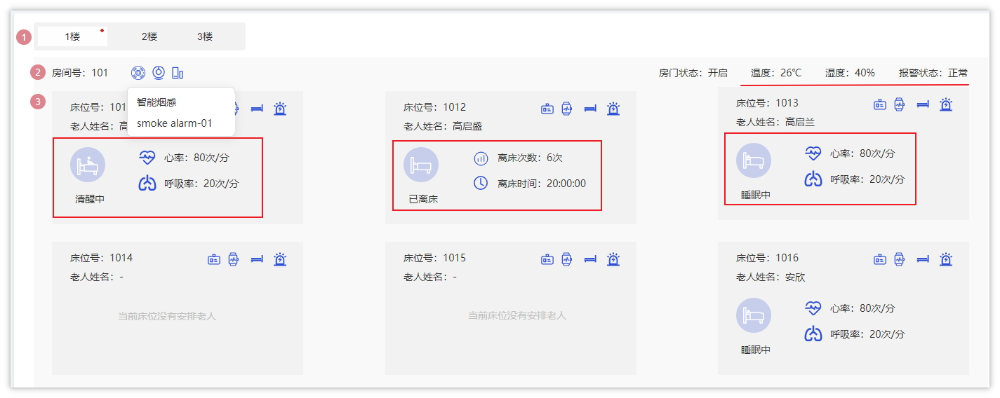
> 图注：图片展示了智能床位管理界面。界面中显示了多个床位信息，每个床位有床位号、老人姓名、心率、呼吸率等数据。其中，床位号1012显示“已离床”，离床次数6次，离床时间20:00:00。其他床位如1010、1013、1014、1015、1016等床位号、老人姓名、心率、呼吸率等信息也一目了然。

- 在床位管理里面有个智能床位，可以展示绑定智能设备的房间或床位以及设备对应的数据


### 接口说明

在智能床位这个模块中共分为了两个接口，

- 获取所有的包含智能设备的楼层
- 查询房间设备或床位设备的数据


参考接口文档：<cite doc-id="WVidwnWwtiHn2rkN2pvcBNUAn4c" file-type="wiki" title="智能监测-接口文档" type="doc"></cite>


### 产品设备数据准备

在智能床位模块，我们需要提前创建两个产品来进行演示和测试，分别是智能**烟雾报警器**和**睡眠监测带**

- 要保证在物联网平台创建了这两个产品（参考智能监测第一天的2.7章节：<cite doc-id="XkWhwZzx6ieXsmkWYAhcXLr4n8g" file-type="wiki" title="01-IOT产品设备管理" type="doc"></cite>）
- 所有设备的创建必须在本地创建，需要关联本地的**位置**
- 每个设备可以使用sdk进行上报数据<cite doc-id="V22ywPOluiFlNMkL9owcFzcJnOd" file-type="wiki" title="设备数据上报脚本" type="doc"></cite>

### 获取所有楼层（智能楼层）

#### 思路分析

目的**是为了展示哪个楼层中的房间或床位绑定了设备，需要展示的楼层编号**

比如下图中，只有3楼、4楼、5楼、1楼绑定了设备，那就只展示这些楼层

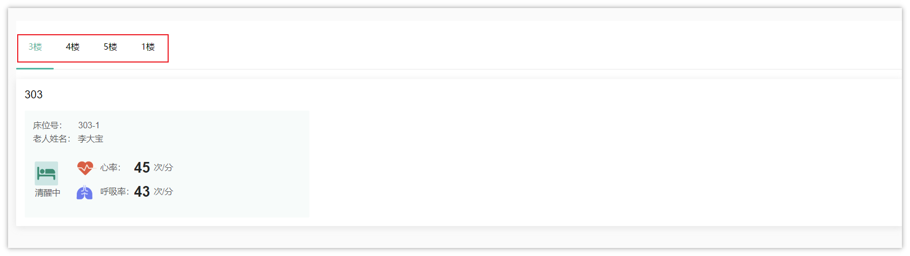
> 图注：图片展示了智能床位查看效果的前端页面。上方有“3楼”“4楼”“5楼”“1楼”四个标签，其中“3楼”标签被红色框线突出显示。下方是303床位信息，显示床位号为303 - 1，老人姓名为李大宝，心率45次/分，呼吸率43次/分，床铺状态为清醒中。该图片与文档中获取智能楼层的上下文相关，用于展示在智能床位查看页面中，当选择不同楼层标签时，对应的床位信息会显示出来。

表关系

<whiteboard token="Q0IKwtCDehF2G5bbdtxc1XeRnKg"></whiteboard>

目前设备的绑定都是**房间**或者是**床位**

> 比如：智能烟雾报警绑定的位置是房间，睡眠监测带绑定的位置是床位

在设备（device）表中同时有三个字段确定绑定的位置

- location_type  位置类型   0：随身设备 1：固定设备
- physical_location_type  物理位置类型   0楼层 1房间 2床位
- binding_location   具体位置对应的id值（如果是房间，则是房间id，如果是床位，则对应床位id）

5张表关联查询（floor、room、bed、device【房间|床位】），对应的sql

```SQL
select f.*
from floor f
         left join room r on f.id = r.floor_id
         left join bed b on r.id = b.room_id
         left join device d on d.binding_location = r.id and d.location_type = 1 and d.physical_location_type = 1
         left join device dd on dd.binding_location = b.id and dd.location_type = 1 and dd.physical_location_type = 2
where (d.id is not null  or dd.id is not null)
group by  f.id
order by f.code,f.create_time desc
```

> 上述sql中的group by f.id 是为了去除重复数据


#### 控制层

在FloorController中新增查询智能楼层的方法，如下：

```Java
@GetMapping("/getAllFloorsWithDevice")
@ApiOperation("查询所有楼层（智能设备）")
public R<List<FloorVo>> getAllFloorsWithDevice() {
    return R.ok(floorService.getAllFloorsWithDevice());
}
```


#### 业务层

在FloorService中新增查询智能楼层的方法，如下：

```Java
/**
 * 查询智能楼层
 * @return
 */
List<FloorVo> getAllFloorsWithDevice();
```

对应的实现方法：

```Java
/**
 * 查询智能楼层
 * @return
 */
@Override
public List<FloorVo> getAllFloorsWithDevice() {
    return floorMapper.getAllFloorsWithDevice();
}
```


#### 持久层

在FloorMapper中新增方法，无参

```Java
List<FloorVo> getAllFloorsWithDevice();
```

对应的映射文件：

```Java
<select id="getAllFloorsWithDevice" resultType="com.zzyl.nursing.vo.FloorVo">
    select f.* from floor f
                        left join room r on f.id = r.floor_id
                        left join bed b on r.id = b.room_id
                        left join device d on d.binding_location = r.id and d.location_type = 1 and d.physical_location_type = 1
                        left join device dd on dd.binding_location = b.id and dd.location_type = 1 and dd.physical_location_type = 2
    where (d.id is not null or dd.id is not null)
    group by  f.id
    order by f.code ,f.create_time desc
</select>
```

#### 测试

- 前提：必须在本地创建系统创建关于位置的IOT设备，比如**烟雾报警器**和**睡眠检测带**
- 测试：打开前端页面，找到智能床位查看效果

### 获取房间中的智能设备及数据

#### 思路分析

- 根据楼层查询房间或者是床位的设备数据（最新的一条数据）

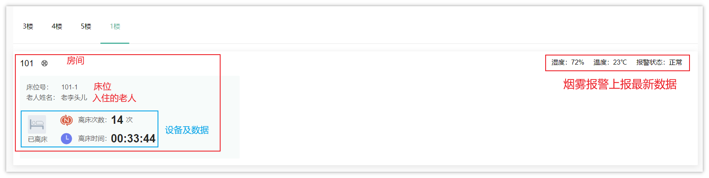
> 图注：该图片展示了智能床位相关的设备数据界面，当前选中的楼层为1楼，显示了编号101的房间详情，该房间内的床位为101-1，入住老人为李老头儿，设备及数据区域标注高床次数为14次，已高床时长为00:33:44，界面右侧标注了该设备上报的最新数据：湿度72%、温度23℃，报警状态为正常，这是智能床位设备采集的实时监测数据，与文档中智能床位获取设备及数据的实现思路相呼应，对应从redis获取最新设备数据的内容展示。

在这个接口中返回的数据较多，条件是选中的**楼层ID**

- 房间数据以及房间绑定的设备、设备上报的数据
- 床位数据以及床位入住的老人姓名、绑定的设备、设备上报的数据


**实现方案有两种**

- 方案一：通过楼层关联房间、床位、设备表2次、设备数据表2次共6张表查询对应的数据（设备数据表数据较多，效率不高），不推荐这种方案
- 方案二：使用缓存，因为只需要查询**最近一次**的设备数据，可以把最近一次采集的数据存储到redis中，然后让房间或者床位进行匹配按照这种思路实现，结合接口需要的响应结果，其中需要准备基础数据返回，基础数据就包括了房间、床位、老人、设备（房间或床位），其中的**设备数据**从redis中获取

  <whiteboard token="Ff2rwwNJxhVGFtbZjV9cWbNrnQf"></whiteboard>

**查询基础的sql**：

```SQL
select r.id ,  -- 房间数据
       r.code,
       b.id bid, -- 床位数据
       b.bed_number,
       b.bed_status,
       e.id eid,   -- 老人数据
       e.name ename,
       d.id did , -- 房间内的设备信息
       d.iot_id ,
       d.device_name,
       d.product_key,
       d.product_name,
       dd.id b_did , -- 床位的设备信息
       dd.iot_id  b_iot_id,
       dd.device_name b_device_name,
       dd.product_key b_product_key,
       dd.product_name b_product_name
from room r left join bed b on r.id = b.room_id
            left join  elder e on b.id = e.bed_id
            left join device d on d.binding_location = r.id and d.location_type = 1 and d.physical_location_type = 1
            left join device dd on dd.binding_location = b.id and dd.location_type = 1 and dd.physical_location_type = 2
where r.floor_id = 1 and  (d.id is not null or dd.id is not null)
```


#### 改造上报数据接收逻辑

找到DeviceDataServiceImpl类中的batchInsertDeviceData方法，把每次上报的数据存储到redis中，由于redis是可以覆盖旧数据，所以在redis中存储的永远都是最新的数据

详细代码，如下：

```Java
@Autowired
private RedisTemplate<String,String> redisTemplate;

@Autowired
private DeviceMapper deviceMapper;

/**
 * 批量保存数据
 * @param iotMsgNotifyData
 */
@Override
public void batchInsertDeviceData(IotMsgNotifyData iotMsgNotifyData) {
    //判断设备是否存在
    String iotId = iotMsgNotifyData.getHeader().getDeviceId();
    Device device = deviceMapper.selectOne(Wrappers.<Device>lambdaQuery().eq(Device::getIotId, iotId));
    if(device == null){
        //日志的记录，方便后期查找问题
        log.error("设备不存在，iotId:{}",iotId);
        return;
    }
    //获取到设备上报的数据，一个设备可以有多个service
    iotMsgNotifyData.getBody().getServices().forEach(s->{

        //所有数据都已经装入到map中
        Map<String, Object> properties = s.getProperties();
        if (ObjectUtil.isEmpty(properties)){
            return;
        }
        //处理上报时间日期
        LocalDateTime eventTime =  LocalDateTimeUtil.parse(s.getEventTime(), "yyyyMMdd'T'HHmmss'Z'");
        //日期时区转换
        LocalDateTime alarmTime = eventTime.atZone(ZoneId.from(ZoneOffset.UTC))
                .withZoneSameInstant(ZoneId.of("Asia/Shanghai"))
                .toLocalDateTime();

        //转入多个设备数据
        List<DeviceData> deviceDataList = new ArrayList<>();

        //遍历map集合，批量新增数据
        properties.forEach((key, value)->{
            DeviceData deviceData = DeviceData.builder()
                    .iotId(iotId)
                    .deviceName(device.getDeviceName())
                    .productKey(device.getProductKey())
                    .productName(device.getProductName())
                    .functionId(key)
                    .accessLocation(device.getRemark())
                    .locationType(device.getLocationType())
                    .physicalLocationType(device.getPhysicalLocationType())
                    .deviceDescription(device.getDeviceDescription())
                    .alarmTime(alarmTime)
                    .dataValue(value + "")
                    .build();
            deviceDataList.add(deviceData);

        });

        //批量保存
        saveBatch(deviceDataList);

        //存储到redis中deviceDataList
        //hash 结构来进行存储  大key  小key  value
        redisTemplate.opsForHash().put(CacheConstants.IOT_DEVICE_LAST_DATA,iotId, JSONUtil.toJsonStr(deviceDataList));

    });

}
```

> 需要在CacheConstants类中定义新的常量
> 
> `public static final String `*`IOT_DEVICE_LAST_DATA `*`= "iot:device_last_data";`


#### 控制层

根据接口中的路径分析，这个接口需要定义在RoomController中，代码如下：

```Java
@GetMapping("/getRoomsWithDeviceByFloorId/{floorId}")
@ApiOperation("获取所有房间（智能床位）")
public R<List<RoomVo>> getRoomsWithDeviceByFloorId(@PathVariable(name = "floorId") Long floorId){
    return R.ok(roomService.getRoomsWithDeviceByFloorId(floorId));
}
```


#### 持久层

这里需要使用MyBatis的多表查询，根据刚才的sql，其中房间、床位、老人、房间设备、床位设备数据都要返回

在RoomMapper中新增方法

```Java
List<RoomVo> getRoomsWithDeviceByFloorId(Long floorId);
```

对应的映射文件：

```XML
<resultMap id="roomVoDeviceByFloorIdResultMap" type="com.zzyl.nursing.vo.RoomVo">
    <id column="id" property="id"></id>
    <result column="code" property="code"></result>
    <collection property="bedVoList" ofType="com.zzyl.nursing.vo.BedVo">
        <id column="bid" property="id"/>
        <result column="bed_number" property="bedNumber"></result>
        <result column="bed_status" property="bedStatus"></result>
        <result column="eid" property="elderId"></result>
        <result column="ename" property="ename"></result>
        <collection property="deviceVos" ofType="com.zzyl.nursing.vo.DeviceInfo">
            <id column="b_did" property="id"/>
            <result column="b_iot_id" property="iotId"></result>
            <result column="b_device_name" property="deviceName"></result>
            <result column="b_product_key" property="productKey"></result>
            <result column="b_product_name" property="productName"></result>
        </collection>
    </collection>
    <collection property="deviceVos" ofType="com.zzyl.nursing.vo.DeviceInfo">
        <id column="did" property="id"/>
        <result column="iot_id" property="iotId"></result>
        <result column="device_name" property="deviceName"></result>
        <result column="product_key" property="productKey"></result>
        <result column="product_name" property="productName"></result>
    </collection>
</resultMap>
<select id="getRoomsWithDeviceByFloorId" resultMap="roomVoDeviceByFloorIdResultMap" >
    select r.id ,
           r.code,
           b.id bid,
           b.bed_number,
           b.bed_status,
           e.id eid,
           e.name ename,
           d.id did ,
           d.iot_id ,
           d.device_name,
           d.product_key,
           d.product_name,
           dd.id b_did ,
           dd.iot_id  b_iot_id,
           dd.device_name b_device_name,
           dd.product_key b_product_key,
           dd.product_name b_product_name
    from room r left join bed b on r.id = b.room_id
                left join  elder e on b.id = e.bed_id
                left join device d on d.binding_location = r.id and d.location_type = 1 and d.physical_location_type = 1
                left join device dd on dd.binding_location = b.id and dd.location_type = 1 and dd.physical_location_type = 2
    where r.floor_id = #{floorId} and  (d.id is not null or dd.id is not null)
</select>
```

**注意：**

在映射文件中使用到了多次<collection>标签，需要在对应的类中添加数据返回的类型才可以

- 新建`DeviceInfo`来存储设备数据

```Java
package com.zzyl.nursing.vo;

import com.zzyl.nursing.domain.DeviceData;
import io.swagger.annotations.ApiModel;
import io.swagger.annotations.ApiModelProperty;
import lombok.Data;

import java.util.List;

@ApiModel("设备信息响应模型")
@Data
public class DeviceInfo {

    @ApiModelProperty(value = "主键")
    private Long id;

    @ApiModelProperty(value = "物联网设备ID")
    private String iotId;

    @ApiModelProperty(value = "设备名称")
    private String deviceName;

    @ApiModelProperty(value = "产品key")
    public String productKey;

    @ApiModelProperty(value = "产品名称")
    public String productName;

    @ApiModelProperty(value = "设备数据")
    private List<DeviceData> deviceDataVos;
}
```

> 其中的设备数据`deviceDataVos`字段，是不需要从数据库中查询数据的，后期会到redis中进行匹配数据


- 在`RoomVo`和`BedVo`中两个类中分别添加一个`deviceVos`设备集合属性

```Java
/**
 * 关联的设备
 */
private List<DeviceInfo> deviceVos;
```


#### 业务层


```Java
/**
 * 获取所有房间（负责老人）
 * @param floorId
 * @return
 */
List<RoomVo> getRoomsWithDeviceByFloorId(Long floorId);
```

对应的实现方法，需要到redis中根据iotId匹配最新上报的设备数据

```Java
@Autowired
private RedisTemplate<String,String> redisTemplate;

/**
 * 查询智能楼层的基础数据和设备上报的数据
 *
 * @param floorId
 * @return
 */
@Override
public List<RoomVo> getRoomsWithDeviceByFloorId(Long floorId) {
//        redisTemplate.opsForHash().get(CacheConstants.IOT_DEVICE_LAST_DATA,"");
    //SQL返回的数据是基础数据，找到的是房间、床位、设备（房间|床位）
    List<RoomVo> roomVos = roomMapper.getRoomsWithDeviceByFloorId(floorId);
    roomVos.forEach(roomVo->{
        //遍历的是房间数据
        List<DeviceInfo> deviceVos = roomVo.getDeviceVos();
        //房间设备所对应的设备上报的数据
        deviceVos.forEach(deviceInfo -> {
            String jsonStr = (String) redisTemplate.opsForHash().get(CacheConstants.IOT_DEVICE_LAST_DATA, deviceInfo.getIotId());
            if(StringUtils.isEmpty(jsonStr)){
                return;//跳出本次循环，并不是结束方法
            }
            deviceInfo.setDeviceDataVos(JSONUtil.toList(jsonStr, DeviceData.class));
        });
        //遍历的是床位数据
        roomVo.getBedVoList().forEach(bedVo -> {
            //获取床位对应的设备列表
            bedVo.getDeviceVos().forEach(deviceInfo -> {
                String jsonStr = (String) redisTemplate.opsForHash().get(CacheConstants.IOT_DEVICE_LAST_DATA, deviceInfo.getIotId());
                if(StringUtils.isEmpty(jsonStr)){
                    return;//跳出本次循环，并不是结束方法
                }
                deviceInfo.setDeviceDataVos(JSONUtil.toList(jsonStr, DeviceData.class));
            });
        });
    });
    return roomVos;
}
```


#### 测试

测试准备：

- 创建一个智能烟雾报警器，绑定的是**房间，**启动设备进行数据上报
- 创建一个睡眠监测带设备，绑定的是**床位**，启动设备进行数据上报

> 特别提示：不要绑定老人，这里展示的都是位置设备数据

效果如下：

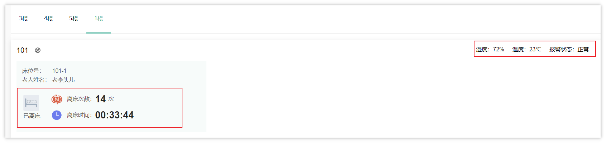
> 图注：这是智能床位相关的效果展示界面，顶部有3楼、4楼、5楼、1楼的楼层选项，当前选中1楼。界面展示了101房间的相关信息，右上角红框标注区域显示该房间设备的环境数据：湿度72%、温度23℃、报警状态正常；左侧红框为床位相关数据，床位号为101-1，对应老人姓名为老李头儿，显示该床位离床次数14次，当前已离床，离床时长为00:33:44。


## 性能优化-MySQL索引

### 为什么要使用索引？

使用索引是为了提高数据检索的效率。当数据量很大时，如果没有索引，数据库系统需要逐条扫描数据来找到符合条件的记录，这样会消耗大量的时间和资源。而使用索引可以通过创建特定的数据结构，将数据按照某种规则有序地组织起来，从而加快数据的查找速度。

索引可以在数据库表的一列或多列上创建，它们包含了对应列值的引用和指针，使得数据库系统可以快速定位到需要的数据。通过使用索引，数据库系统可以根据索引的排序和搜索算法，快速定位到符合查询条件的数据，提高查询的效率。

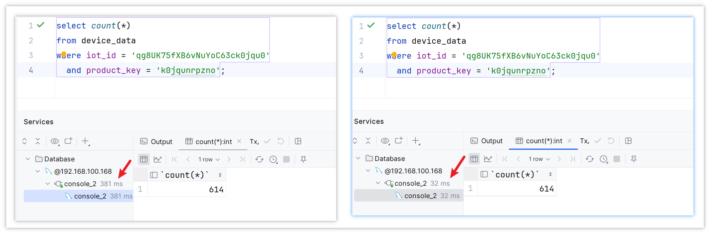
> 图注：图片展示了在MySQL中执行相同SQL查询，但未添加索引和添加索引后的效率对比。左侧未添加索引时，查询耗时381ms，右侧添加索引后，查询耗时32ms。两者执行的SQL语句相同，均为从device_data表中查询iot_id和product_key符合条件的数据数量。该图片直观呈现了索引使用前后的性能差异，与上下文提到的相同SQL执行效率差异10倍有余相呼应，强调了索引在提高查询效率、降低数据库IO成本方面的关键作用。

相同的SQL执行，左边没加索引，后边添加了索引，效率差了10倍有余（基础数据量为60万）


优点：

1. 提高数据查询的效率，降低数据库的IO成本。
2. 通过索引列对数据进行排序，降低数据排序的成本，降低CPU消耗。

缺点：

1. 索引会占用存储空间。
2. 索引大大提高了查询效率，同时却也降低了insert、update、delete的效率。


### MySQL索引-结构

MySQL数据库支持的索引结构有很多，如：Hash索引、**B+Tree**索引、Full-Text索引等。

我们平常所说的索引，如果没有特别指明，都是指默认的 B+Tree 结构组织的索引。

在没有了解B+Tree结构前，我们先回顾下之前所学习的树结构：

- 二叉树

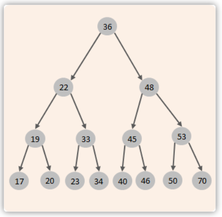
> 图注：图片展示了一棵二叉树结构，根节点为36，其左子节点为22，右子节点为48。22的左子节点是19，右子节点是33，19的左子节点是17，右子节点是20，33的左子节点是23，右子节点是34。48的左子节点是45，右子节点是53，45的左子节点是40，右子节点是46，53的左子节点是50，右子节点是70。该图与上下文介绍的二叉树结构相关，用于辅助说明二叉树的节点分布及连接关系。

> 二叉查找树：左边的子节点比父节点小，右边的子节点比父节点大

当我们向二叉查找树保存数据时，是按照从大到小(或从小到大)的顺序保存的，此时就会形成一个单向链表，搜索性能会打折扣。

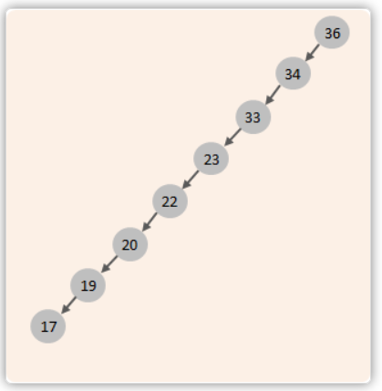
> 图注：这张图片展示了一个特殊结构的树，所有节点从下到上依次为17、19、20、22、23、33、34、36，箭头自上而下指向相邻较大的节点。该结构属于二叉查找树的一种特例，因数据按从小到大的顺序保存，最终形成单向链表形态，这类结构的搜索性能存在不足，这恰好对应上下文所描述的“当向二叉查找树按序保存数据时会形成单向链表，搜索性能会打折扣”的情况。

可以选择平衡二叉树或者是红黑树来解决上述问题。（红黑树也是一棵**平衡**的二叉树）

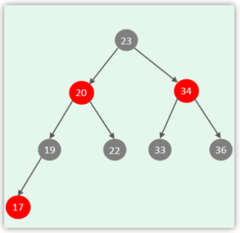
> 图注：图片展示了一个B+Tree结构示例。根节点为23，其下方有两个分支，分别指向20和34。20下方有19和17，34下方有33和36。20和34为非叶子节点，存储key和指针；19、22、33、36为叶子节点，存储数据。该图与上下文紧密相关，直观呈现了B+Tree结构中节点的分类及数据存储情况，帮助理解B+Tree如何避免二叉搜索树或红黑树在Mysql数据库中作为索引结构的问题。

但是在Mysql数据库中并没有使用二叉搜索数或二叉平衡数或红黑树来作为索引的结构。


下面我们来看看B+Tree(多路平衡搜索树)结构中如何避免这个问题：

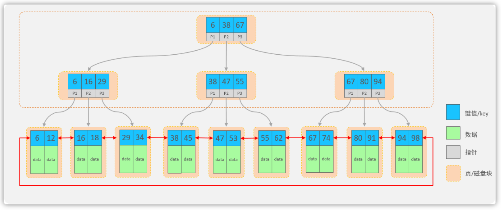
> 图注：这张图展示了MySQL索引所用的B+Tree结构，与上下文介绍的B+Tree结构内容对应。图中所有数据都存储在最下层的叶子节点，中间层为非叶子节点，顶层为根节点；节点以页/磁盘块为单位，每个节点可存储多个键值key和对应指针，且节点分为叶子节点与非叶子节点两类。图中所有叶子节点被红色箭头连成双向链表，以此实现数据的排序及区间范围查询，能直观体现该结构可优化查询性能的特点。

B+Tree结构：

- 每一个节点，可以存储多个key（有n个key，就有n个指针）
- 节点分为：叶子节点、非叶子节点

  - 叶子节点，就是最后一层子节点，所有的数据都存储在叶子节点上
  - 非叶子节点，不是树结构最下面的节点，用于索引数据，存储的的是：key+指针
- 为了提高范围查询效率，叶子节点形成了一个双向链表，便于数据的排序及区间范围查询

### MySQL索引-语法

什么字段适合添加索引？

- 作为查询条件的字段

#### 创建索引

创建索引语法如下：

```SQL
create  [ unique ]  index 索引名 on  表名 (字段名,... ) ;
```

案例：为device_data 表的iot_id和product_key字段建立一个索引

```SQL
create index idx_iot_id_product_key on device_data (iot_id, product_key);
```

在创建表时，如果添加了主键和唯一约束，就会默认创建：主键索引、唯一约束

> 创建索引的选择，一般情况下，使用那些字段查询的比较多，就使用那些字段来创建索引


#### 查看索引

查看索引的语法：

```SQL
show  index  from  表名;
```

#### 删除索引

语法：

```SQL
drop  index  索引名  on  表名;
```

案例：删除 tb_emp 表中name字段的索引

```SQL
drop index idx_iot_id_product_key on device_data ;
```


注意事项：

- 主键字段，在建表时，会自动创建主键索引
- 添加唯一约束时，数据库实际上会添加唯一索引

### MySQL索引-分类

在MySQL数据库，将索引的具体类型主要分为以下几类：主键索引、唯一索引、常规索引、全文索引。

<sheet sheet-id="a1tg8c" token="Ol3NsKN4Dh6iuhtgOVFcrUWEnta"></sheet>


而在在InnoDB存储引擎中，根据索引的存储形式，又可以分为以下两种：

<sheet sheet-id="JsnsoU" token="Ol3NsKN4Dh6iuhtgOVFcrUWEnta"></sheet>

聚集索引选取规则:

- 如果存在**主键**，主键索引就是聚集索引。
- 如果不存在主键，将使用第一个唯一（UNIQUE）索引作为聚集索引。
- 如果表没有主键，或没有合适的唯一索引，则InnoDB会自动生成一个rowid作为隐藏的聚集索引。


聚集索引和二级索引的具体结构如下： 

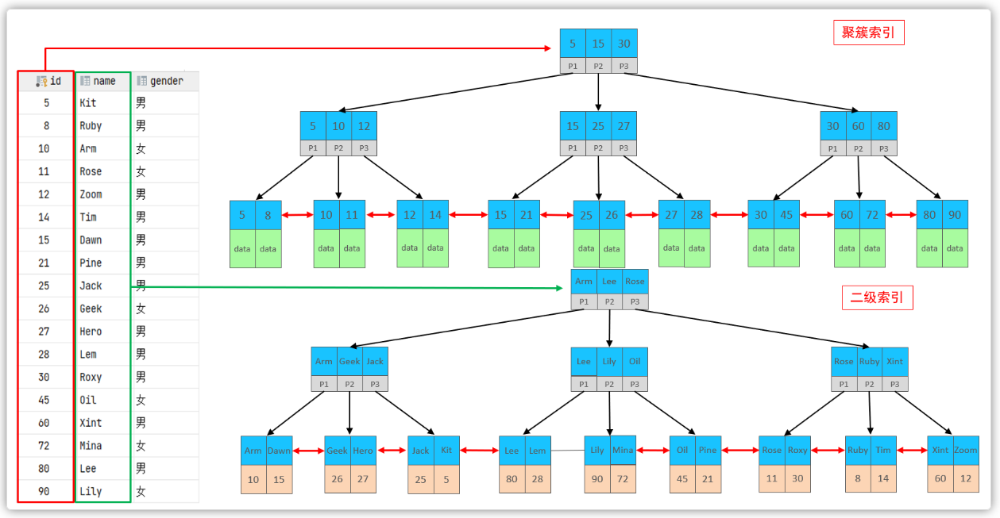
> 图注：图片展示了InnoDB存储引擎中聚集索引和二级索引的具体结构。上半部分为聚集索引，将数据存储与索引放在一起，索引结构的叶子节点保存行数据，必须有且只有一个。下半部分为二级索引，数据与索引分开存储，索引结构的叶子节点关联主键。图中以红色箭头标注了聚集索引和二级索引的位置，直观呈现了两种索引的存储形式，与上下文对聚集索引和二级索引的分类及特点介绍相呼应。

- 聚集索引的叶子节点下挂的是这一行的数据 。
- 二级索引的叶子节点下挂的是该字段值对应的主键值。


接下来，我们来分析一下，当我们执行如下的SQL语句时，具体的查找过程是什么样子的。

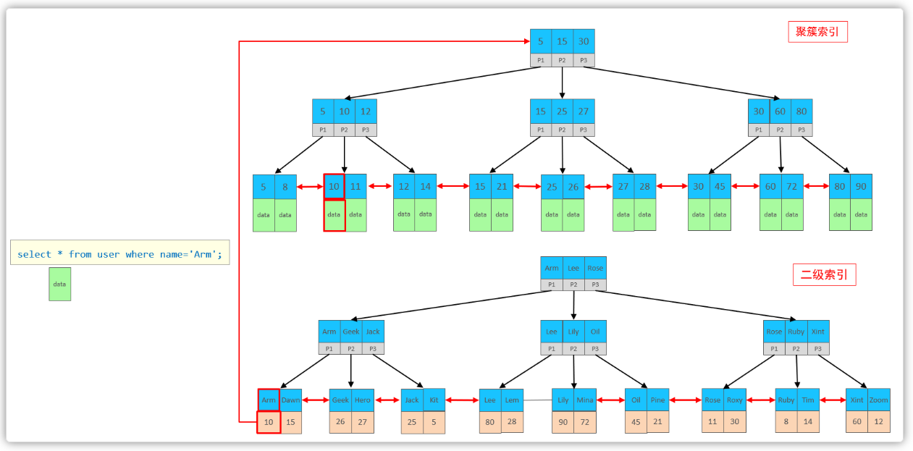
> 图注：图片展示了MySQL执行SQL语句“select * from user where name='Arm'”时的查找过程。图中用红色框突出显示了二级索引和聚集索引的查找路径。首先，根据name='Arm'在二级索引中匹配查找，查找到主键值10；然后，通过主10到聚集索引中查找10对应的记录，最终找到10对应的行row。该图与上下文紧密相关，直观呈现了文档中描述的SQL执行过程。

具体过程如下:


①. 由于是根据name字段进行查询，所以先根据name='Arm'到name字段的二级索引中进行匹配查找。但是在二级索引中只能查找到 Arm 对应的主键值 10。

②. 由于查询返回的数据是\*，所以此时，还需要根据主键值10，到聚集索引中查找10对应的记录，最终找到10对应的行row。 

③. 最终拿到这一行的数据，直接返回即可。 


**回表查询**： 这种先到二级索引中查找数据，找到主键值，然后再到聚集索引中根据主键值，获取数据的方式，就称之为回表查询。


### 索引失效检查

可以采用EXPLAIN 或者 DESC命令获取 MySQL 如何执行 SELECT 语句的信息

语法：

```SQL
EXPLAIN   SELECT   字段列表   FROM   表名   WHERE  条件 ;
```

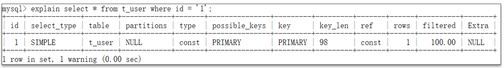
> 图注：图片展示了在MySQL中使用EXPLAIN命令获取SELECT语句执行信息的示例。执行语句为“explain select * from t_user where id = '1';”，返回结果包含id、select_type、table等字段信息。其中，type字段显示为“const”，表示根据主键查询；possible_keys和key字段均为“PRIMARY”，表明当前SQL可能会使用到的索引是主键；key_len为98，ref为“const”，rows为1，filtered为100.00，Extra字段为空。该图片与上下文介绍的MySQL索引失效检查相关，用于说明如何通过EXPLAIN命令获取SQL执行信息。

- possible_key  当前sql可能会使用到的索引
- **key 当前sql实际命中的索引**
- **key_len 索引占用的大小**
- Extra 额外的优化建议

  <sheet sheet-id="0WnIpl" token="Ol3NsKN4Dh6iuhtgOVFcrUWEnta"></sheet>
- **type 这条sql的连接的类型，性能由好到差为NULL、system、const、eq_ref、ref、range、 index、all**

  - **system：查询系统中的表**
  - **const：根据主键查询**
  - **eq_ref：主键索引查询或唯一索引查询**
  - **ref：索引查询**
  - **range：范围查询**
  - **index：索引树扫描**
  - **all：全盘扫描**
- 索引失效场景

  - 不符合最左匹配法则
  - 三个字段的索引（name,age,address）

## 报警规则

想要获取报警数据，我们首先必须先制定报警规则，会根据不同的设备，不同的物模型来定义报警规则

### 需求分析

#### 新增报警规则

我们先来分析需求，打开原型图

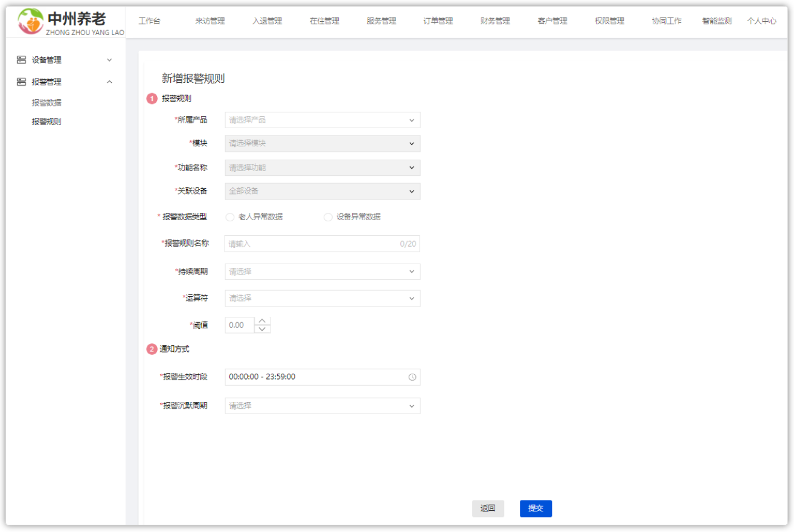
> 图注：这是中州养老系统的“新增报警规则”页面，页面左侧为系统功能导航栏，显示“设备管理”“报警管理”等选项，当前选中“报警规则”。页面主体区域是报警规则的配置表单，顶部标注“新增报警规则”，规则配置项包含报警规则名称、所属产品、关联设备、故障数据类型、报警触发条件等，还设置了通知方式相关的报警生效时间、报警沉默周期等参数，页面底部有“取消”和“确定”两个操作按钮。该页面是为智能养老设备制定报警规则的配置界面，用于实现设备异常时的报警管控需求。

数据来源：

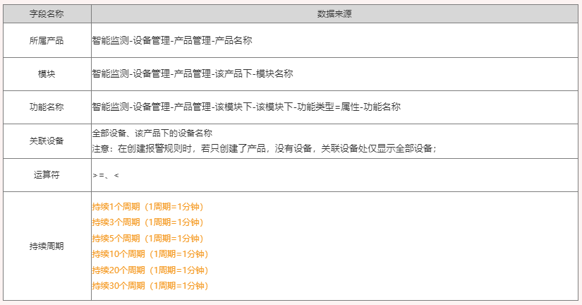
> 图注：这是一份智能床位报警规则相关的字段配置表，表中分为字段名称和数据来源两部分，明确了报警规则配置涉及的各类信息。所属产品的数据来源为智能监测-设备管理-产品管理-产品名称；模块的数据来源为同路径下该产品下的模块名称，功能名称来源为对应模块下功能类型的属性-功能名称。关联设备的默认状态为全部设备，仅创建产品未关联设备时该位置显示此内容。运算符支持等于、小于、小于等于三类符号，持续周期包含1分钟、3分钟、5分钟等多种时长选项，对应不同的周期触发要求，可用于配置报警规则的触发条件。

逻辑规则：

1）若多条报警规则是包含/互斥关系时，只要符合报警规则时，就会产生一条报警数据；

例如：规则1: 手表电量 >=10 ，规则2:手表电量< 50, 此时是包含关系，当手机电量=40时，符合两条报警规则，则产生两条报警数据；


2）报警数据见下方示例，1分钟（数据聚合周期）检查一次智能手表（所属产品）中的全部设备（关联设备）的血氧（功能名称），

监控值（统计字段）是否 < 90（运算符+阈值），当持续3个周期（持续周期）都满足这个规则时，触发报警；

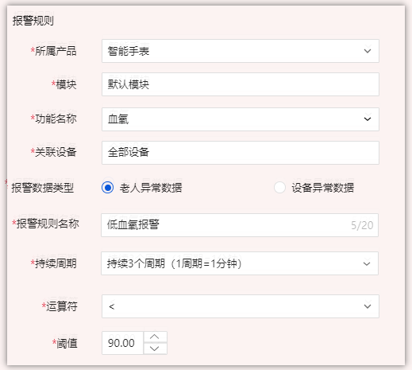
> 图注：图片展示的是智能床位&MySQL索引报警规则的创建界面。界面中“所属产品”为智能手表，“模块”为默认模块，“功能名称”为血氧，“关联设备”为全部设备，“报警数据类型”选择老人异常数据，“报警规则名称”为低血氧报警，“持续周期”为持续3个周期（1周期=1分钟），“运算符”为小于，“阈值”为90.00。该图片与上下文紧密相关，是对上下文中新增报警规则需求分析中报警规则创建操作的直观呈现。

**通知方式**：

1）报警生效时间：报警规则的生效时间，报警规则只在生效时间内才会检查监控数据是否需要报警；

2）报警沉默周期：指报警发生后如果未恢复正常，重复发送报警通知的时间间隔；

**报警方式：**

1）当触发报警规则时，则发送消息通知，

通知对象：设备数据类型=老人异常数据时，通知老人对应的护理员；设备数据类型=设备异常数据时，通知后勤部维修工；

渠道：站内信（见消息通知模块原型图）、短信；

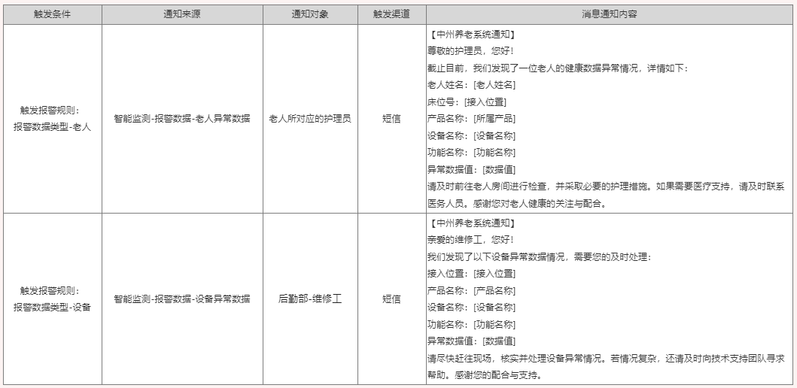
> 图注：这张图是智能床位报警规则对应的消息通知原型，清晰呈现了两类报警场景的通知模板。第一类是老人异常数据的触发场景，其触发规则为“报警数据类型=老人”，通知来源为“智能监测-报警数据-老人异常数据”，通知对象是老人对应的护理员，通知渠道为短信，消息内容涵盖异常提示、老人的个人信息（姓名、位置）、所属产品、设备名称、功能名称及异常数据等。第二类是设备异常数据的触发场景，触发规则为“报警数据类型=设备”，通知来源为“智能监测-报警数据-设备异常数据”，通知对象是后勤部维修工，渠道同样为短信，消息内容包含异常提示、设备位置、产品及设备信息、功能与异常数据，同时给出了现场处理的提示。该图明确了两类不同触发条件下的报警通知逻辑，呼应了文档中报警方式与通知对象的相关需求规则。

#### 报警规则其他需求

下面这个就是刚刚创建的报警规则查询列表

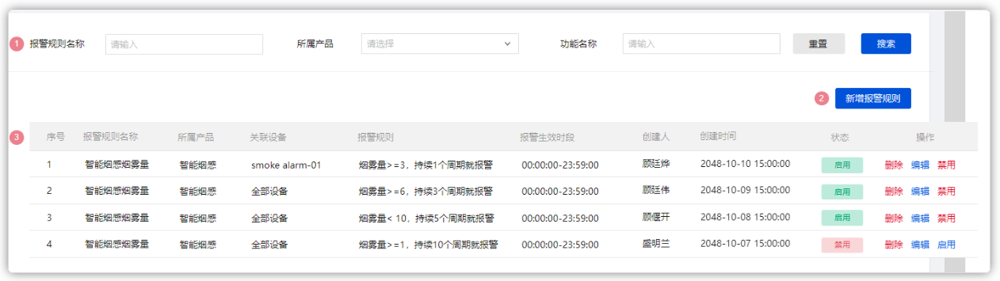
> 图注：图片展示的是智能设备报警规则查询列表界面。界面上方有“报警规则名称”“所属产品”“功能名称”等搜索框及“重置”“搜索”按钮。下方列表显示序号、报警规则名称、所属产品、关联设备、报警规则、报警生效时段、创建人、创建时间、状态、操作等信息，如智能烟感烟雾量报警规则等。列表中部分操作栏有“启用”“禁用”“删除”“编辑”按钮，其中“智能烟感烟雾量”规则状态为禁用。该图与上下文介绍的报警规则查询相关，呈现了具体查询结果。

其中在操作中可以处理报警规则（删除，编辑，启用禁用）


#### 表结构

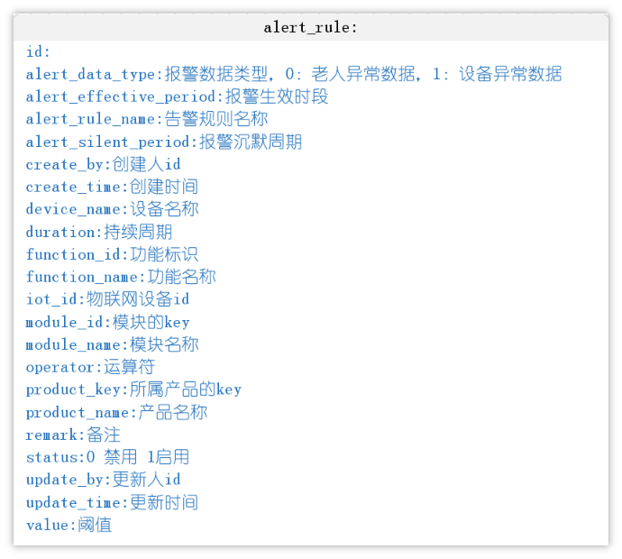
> 图注：图片展示了报警规则的表结构信息。其中，id为报警规则唯一标识；alert_data_type表示报警数据类型，0为老人异常数据，1为设备异常数据；alert_effective_period为报警生效时段；alert_rule_name是告警规则名称；alert_silent_period为报警沉默周期；create_by是创建人id；create_time为创建时间；device_name是设备名称；duration是持续周期；function_id为功能标识；function_name是功能名称；iot_id是物联网设备id；module_id为模块的key；module_name是模块名称；operator是运算符；product_key是所属产品的key；product_name是产品名称；remark是备注；status为0禁用1启用；update_by是更新人id；update_time是更新时间；value是阈值。该图片与上下文介绍的报警规则需求分析相关，是对报警规则表结构的说明。

**特别注意：重新导入表结构**

```SQL
CREATE TABLE "alert_rule" (
  "id" bigint NOT NULL AUTO_INCREMENT,
  "product_key" varchar(50) CHARACTER SET utf8mb4 COLLATE utf8mb4_unicode_ci DEFAULT NULL COMMENT '所属产品的key',
  "product_name" varchar(500) CHARACTER SET utf8mb4 COLLATE utf8mb4_unicode_ci DEFAULT NULL COMMENT '产品名称',
  "module_id" varchar(50) CHARACTER SET utf8mb4 COLLATE utf8mb4_unicode_ci DEFAULT NULL COMMENT '模块的key',
  "module_name" varchar(500) CHARACTER SET utf8mb4 COLLATE utf8mb4_unicode_ci DEFAULT NULL COMMENT '模块名称',
  "function_name" varchar(255) CHARACTER SET utf8mb4 COLLATE utf8mb4_unicode_ci DEFAULT NULL COMMENT '功能名称',
  "function_id" varchar(255) CHARACTER SET utf8mb4 COLLATE utf8mb4_unicode_ci DEFAULT NULL COMMENT '功能标识',
  "iot_id" varchar(255) CHARACTER SET utf8mb4 COLLATE utf8mb4_unicode_ci DEFAULT NULL COMMENT '物联网设备id',
  "device_name" varchar(255) CHARACTER SET utf8mb4 COLLATE utf8mb4_unicode_ci DEFAULT NULL COMMENT '设备名称',
  "alert_data_type" int DEFAULT NULL COMMENT '报警数据类型，0：老人异常数据，1：设备异常数据',
  "alert_rule_name" varchar(255) CHARACTER SET utf8mb4 COLLATE utf8mb4_unicode_ci DEFAULT NULL COMMENT '告警规则名称',
  "operator" varchar(255) CHARACTER SET utf8mb4 COLLATE utf8mb4_unicode_ci DEFAULT NULL COMMENT '运算符',
  "value" float DEFAULT NULL COMMENT '阈值',
  "duration" int DEFAULT NULL COMMENT '持续周期',
  "alert_effective_period" varchar(255) CHARACTER SET utf8mb4 COLLATE utf8mb4_unicode_ci DEFAULT NULL COMMENT '报警生效时段',
  "alert_silent_period" int DEFAULT NULL COMMENT '报警沉默周期',
  "status" int DEFAULT NULL COMMENT '0 禁用 1启用',
  "create_time" datetime NOT NULL COMMENT '创建时间',
  "update_time" datetime DEFAULT NULL COMMENT '更新时间',
  "create_by" bigint DEFAULT NULL COMMENT '创建人id',
  "update_by" bigint DEFAULT NULL COMMENT '更新人id',
  "remark" varchar(255) CHARACTER SET utf8mb4 COLLATE utf8mb4_0900_ai_ci DEFAULT NULL COMMENT '备注',
  PRIMARY KEY ("id") USING BTREE
) ENGINE=InnoDB AUTO_INCREMENT=53 DEFAULT CHARSET=utf8mb4 COLLATE=utf8mb4_unicode_ci ROW_FORMAT=DYNAMIC;

```


### 基础环境准备

#### 后端代码生成

**代码生成**

- 包名:`com.zzyl.nursing`
- 模块名：`nursing`
- 除了主键之外的Long类型，改为Integer
- 阈值字段的类型为：Double
- 生成业务名称：alertRule
- 生成功能名称：报警规则

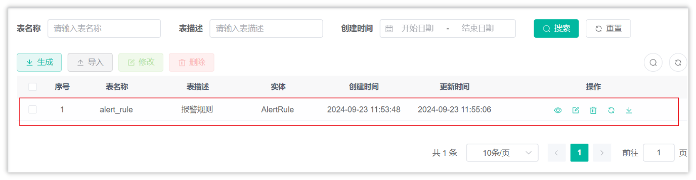
> 图注：图片展示的是智能床位系统中“报警规则”页面。页面上方有表名称、表描述、创建时间等输入框及搜索、重置按钮。下方列表显示序号、表名称、表描述、实体、创建时间、更新时间等信息，其中序号1对应的表名称为“alert_rule”，表描述为“报警规则”，实体为“AlertRule”，创建和更新时间为2024年9月23日11:53:48和11:55:06。页面底部有分页功能。该图片与上下文介绍的“报警规则”功能相关，直观呈现了其在系统中的展示情况。

由于报警规则，就是单表的增删改查，所有功能都已实现，大家无需编写代码。但是要充分理解业务。

## 报警数据过滤及处理

### 需求说明

基于前面的报警规则，一旦有不符合预期的数据就会触发报警，产生报警数据，通知相关的负责人解决。

这里的概念大家要搞清楚，才能梳理清楚报警数据的过滤流程。下面举个例子来说明一下

#### 案例一

详细报警规则，如下图：

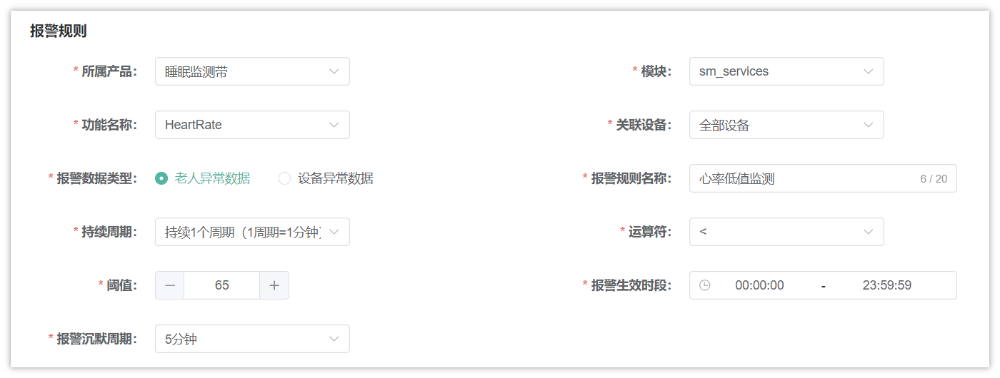
> 图注：图片展示的是“心率低值监测”报警规则设置界面。所属产品为睡眠监测带，功能名称是HeartRate，报警数据类型为老人异常数据，持续周期为持续1个周期（1周期=1分钟），阈值为65，运算符为<，报警生效时段为00:00:00 - 23:59:59，报警沉默周期为5分钟。模块为sm_services，关联设备是全部设备，报警规则名称为心率低值监测。该图片与上下文案例一中睡眠监测带心率异常数据报警规则的说明对应，直观呈现了设置界面及参数。

- 监测的产品为**睡眠监测带**，物模型为**心率，**过滤的是该产品下的**所有设备**
- 报警类型为老人异常数据（设备报警通知**老人绑定的护理员和超级管理员**）
- 持续周期：

  - 持续1个周期（1周期=1分钟）：表示触发报警之后，马上会保存报警数据
  - **持续3个周期（1周期=1分钟）：表示触发报警之后，连续三次都是异常数据才会保存报警数据**
  - 依此类推
- 阈值为65，运算符为**<：**表示采集的**心率数据如果小于65**就触发报警
- 沉默周期为5分钟，已经保存报警数据之后，如果后面有连续报警，5分钟之后再触发报警规则
- 报警生效时段为00:00:00\~23:59:59：表示任意时段都会采集数据

#### 案例二

报警规则如下图：

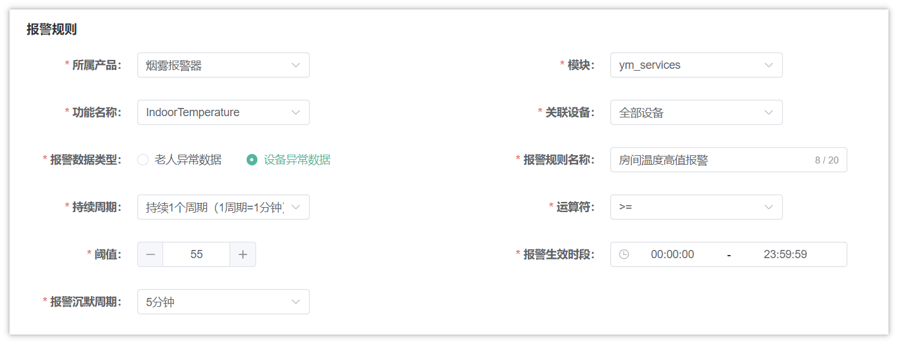
> 图注：图片展示的是烟雾报警器温度报警规则设置界面。所属产品为烟雾报警器，功能名称是IndoorTemperature，关联设备为全部设备，模块是ym_services。报警数据类型为设备异常数据，持续周期为持续1个周期（1周期=1分钟），阈值为55，运算符为>=，报警生效时段为00:00:00 - 23:59:59，报警沉默周期为5分钟。该图片与文档中案例二的报警规则说明对应，直观呈现了案例二中报警规则的设置情况。

- 监测的产品为**烟雾报警器**，物模型为**温度，**过滤的是该产品下的全部设备
- 报警类型为**设备异常数据**（设备报警通知**行政和超级管理员**）
- 持续周期为**持续1个周期（1后期=1分钟）：表示触发报警之后，马上会保存报警数据**
- 阈值为**55**，运算符为**>=：**表示采集的室内**温度数据大于等于55**就触发报警
- 沉默周期为5分钟，已经保存报警数据之后，如果后面有连续报警，5分钟之后再触发报警规则
- 报警生效时段为00:00:00\~23:59:59：表示任意时段都会采集数据

### 小组讨论

基于以上案例的理解，小组内讨论

- 在充分理解业务的前提下，讨论出实现的方案是什么
- 画出流程图

---
> 来源：飞书技术知识库（脱敏版） · 07 业务组件方案集 / 中州养老项目（若依+AI） / 第四章-智能监测系统（华为云） / 03-智能床位&MySQL索引 · [原文](https://ccn8v2zngwsm.feishu.cn/wiki/YtMcwUhcYijlQkk8uhJcbqVdnsh)
