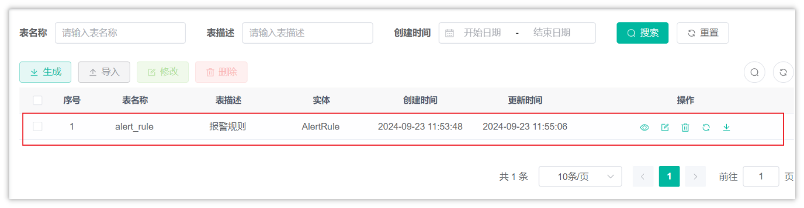
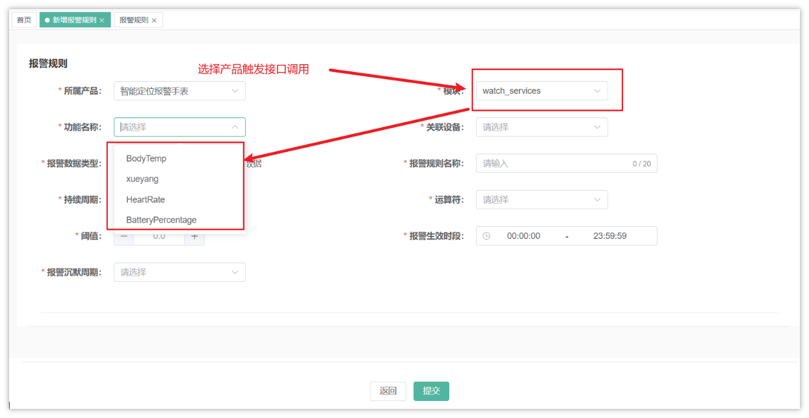
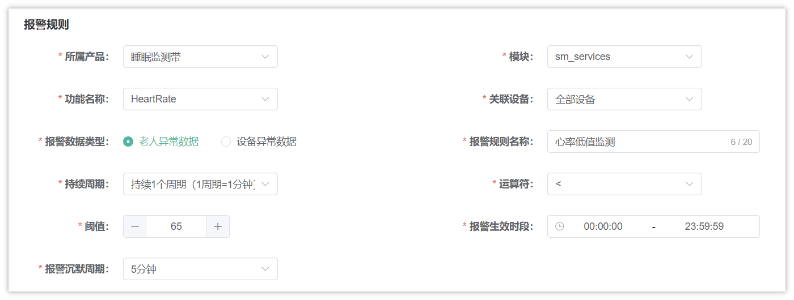
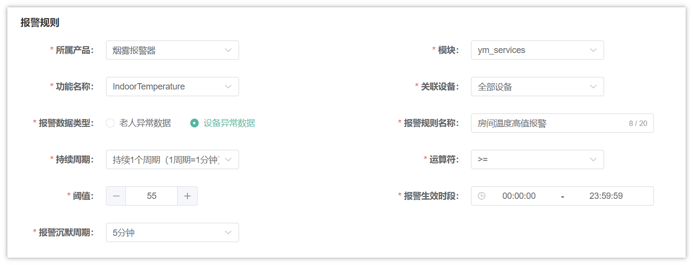
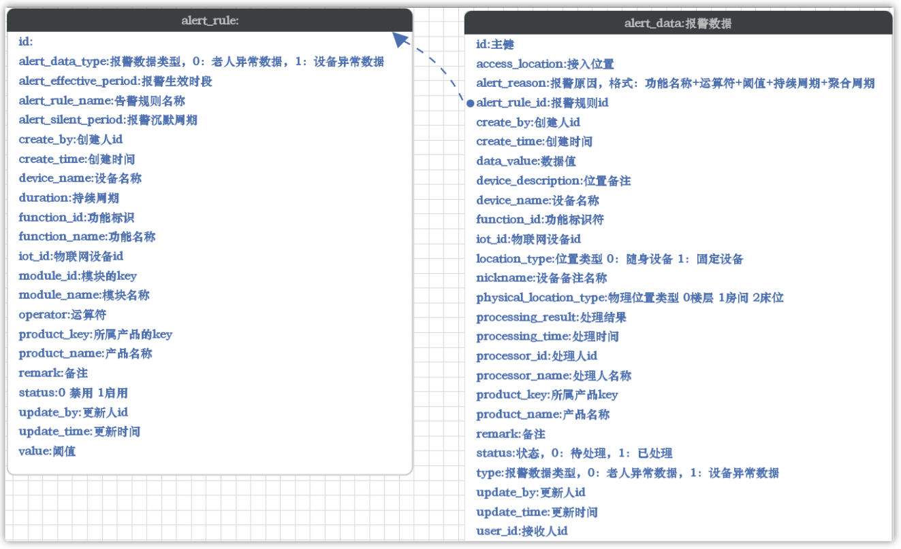
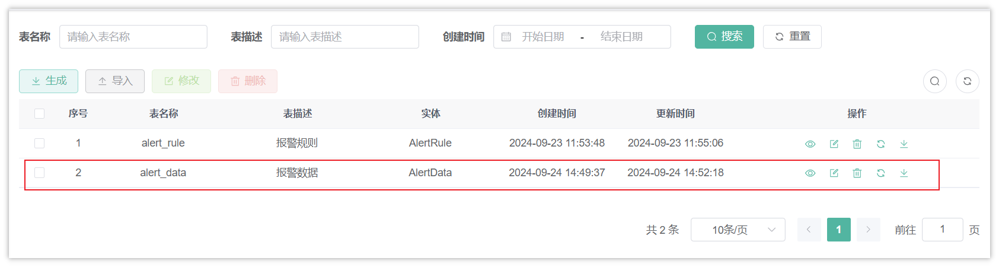
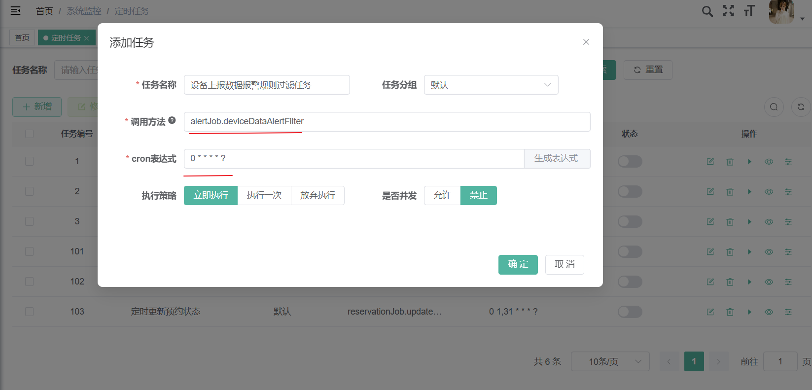
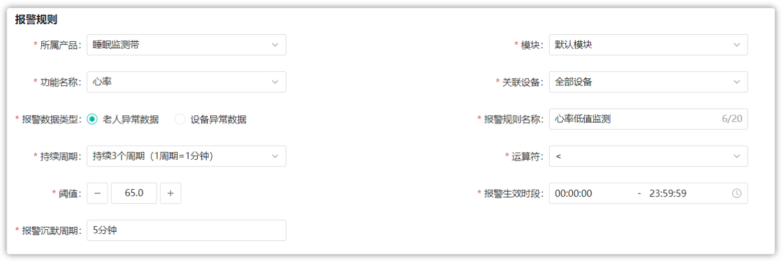

# 04-报警管理和通知

## 目标

目前我们已经完成智能监测的大部分功能，其中有一项尤为关键，就是设备数据如果监测到有异常数据之后，我们该如何找出这些异常数据，以及找到的异常数据又该如何处理呢？今天的内容我们重点就围绕数据报警来讲解。

目标：

- 能够理解创建报警的规则
- 能够独立完成数据报警模块的功能开发

## 报警数据过滤及处理

### 报警规则基础代码准备

- 包名:`com.zzyl.nursing`
- 模块名：`nursing`
- 除了主键之外的Long类型，改为Integer
- 阈值字段的类型为：Double
- 生成业务名称：alertRule
- 生成功能名称：报警规则


> 图注：图片展示的是“报警规则”管理界面。界面上方有表名称、表描述、创建时间等输入框及搜索、重置按钮。下方列表显示序号、表名称、表描述、实体、创建时间、更新时间等信息，其中序号1对应的表名称为“alert_rule”，表描述为“报警规则”，实体为“AlertRule”，创建和更新时间为2024年9月23日11:53:48和11:55:06。列表底部有分页功能，当前显示第1页，共1条记录。该图片与文档中“报警规则基础代码准备”内容相关，展示了生成的业务名称“alertRule”对应的表信息。

- 只需要拷贝后端代码
- 由于报警规则，就是单表的增删改查，所有功能都已实现，大家无需编写代码。但是要充分理解业务。


### 查询产品详情

#### 需求说明

当我们新增报警规则的时候，是需要选择产品中具体的功能的，所以在选择产品之后需要查询到该产品下具体的服务及物模型的属性


> 图注：图片展示的是智能定位报警手表的报警规则设置界面。界面中“所属产品”选择为智能定位报警手表，“模式”为watch_services，“报警数据类型”有BodyTemp、xueyang、HeartRate、BatteryPercentage等选项，“报警规则名称”“运算符”“报警生效时段”等字段可填写，还有“报警沉默周期”下拉选择。图片通过红色箭头和文字标注，突出显示了“选择产品触发接口调用”和“模式”为“watch_services”等关键信息，与上下文介绍的报警规则基础代码准备相关，辅助说明报警规则设置操作。

#### 接口定义

接口文档参考：<cite doc-id="WVidwnWwtiHn2rkN2pvcBNUAn4c" file-type="wiki" title="智能监测-接口文档" type="doc"></cite>

华为云接口：https://support.huaweicloud.com/api-iothub/iot_06_v5_0052.html#section7

在DeviceController定义新的方法，如下：

```Java
@GetMapping("/queryProduct/{productKey}")
@ApiOperation(value = "查询产品详情")
@ApiImplicitParams({
        @ApiImplicitParam(name = "productKey", value = "产品id", required = true, dataTypeClass = String.class)
})
public AjaxResult queryProduct(@PathVariable String productKey){
    return deviceService.queryProduct(productKey);
}
```

#### 业务层

在IDeviceService中定义新的方法，如下：

```Java
/**
 * 查询产品详情
 * @param productKey
 * @return
 */
AjaxResult queryProduct(String productKey);
```

实现方法：

```Java
/**
 * 查询产品详情
 * @param productKey
 * @return
 */
@Override
public AjaxResult queryProduct(String productKey) {
    //参数校验
    if(StringUtils.isEmpty(productKey)){
        throw new BaseException("请输入正确的参数");
    }
    //调用华为云物联网接口
    ShowProductRequest showProductRequest = new ShowProductRequest();
    showProductRequest.setProductId(productKey);
    ShowProductResponse response;

    try {
        response = client.showProduct(showProductRequest);
    } catch (Exception e) {
        throw new BaseException("查询产品详情失败");
    }
    //判断是否存在服务数据
    List<ServiceCapability> serviceCapabilities = response.getServiceCapabilities();
    if(CollUtil.isEmpty(serviceCapabilities)){
        return AjaxResult.success(Collections.emptyList());
    }

    return AjaxResult.success(serviceCapabilities);
}
```


### 需求说明

基于前面的报警规则，一旦有不符合预期的数据就会触发报警，产生报警数据，通知相关的负责人解决。

这里的概念大家要搞清楚，才能梳理清楚报警数据的过滤流程。下面举个例子来说明一下

#### 案例一

详细报警规则，如下图：


> 图注：图片展示的是“心率低值监测”的报警规则设置界面。所属产品为睡眠监测带，功能名称是HeartRate，报警数据类型为老人异常数据，持续周期为持续1个周期（1周期=1分钟），阈值为65，运算符为<，报警生效时段为00:00:00 - 23:59:59，报警沉默周期为5分钟。模块选择sm_services，关联设备为全部设备，报警规则名称为心率低值监测。该图片与上下文案例一中详细报警规则的说明对应，直观呈现了案例一中设置的报警规则参数。

- 监测的产品为**睡眠监测带**，物模型为**心率，**过滤的是该产品下的**所有设备**
- 报警类型为老人异常数据（设备报警通知**老人绑定的护理员和超级管理员**）
- 持续周期：

  - 持续1个周期（1周期=1分钟）：表示触发报警之后，马上会保存报警数据
  - **持续3个周期（1周期=1分钟）：表示触发报警之后，连续三次都是异常数据才会保存报警数据**
  - 依此类推
- 阈值为65，运算符为**<：**表示采集的**心率数据如果小于65**就触发报警
- 沉默周期为5分钟，已经保存报警数据之后，如果后面有连续报警，5分钟之后再触发报警规则
- 报警生效时段为00:00:00\~23:59:59：表示任意时段都会采集数据

#### 案例二

报警规则如下图：


> 图注：图片展示的是烟雾报警器的报警规则设置界面。所属产品为烟雾报警器，功能名称是IndoorTemperature，报警数据类型为设备异常数据，持续周期为持续1个周期（1周期=1分钟），阈值为55，运算符为>=，报警规则名称是房间温度高值报警，关联设备为全部设备，模块是ym_services，报警生效时段为00:00:00 - 23:59:59，报警沉默周期为5分钟。该图片与上下文案例二中烟雾报警器的报警规则设置内容对应，直观呈现了设置界面及参数。

- 监测的产品为**烟雾报警器**，物模型为**温度，**过滤的是该产品下的全部设备
- 报警类型为**设备异常数据**（设备报警通知**维修工和超级管理员**）
- 持续周期为**持续1个周期（1后期=1分钟）：表示触发报警之后，马上会保存报警数据**
- 阈值为**55**，运算符为**>=：**表示采集的室内**温度数据大于等于55**就触发报警
- 沉默周期为5分钟，已经保存报警数据之后，如果后面有连续报警，5分钟之后再触发报警规则
- 报警生效时段为00:00:00\~23:59:59：表示任意时段都会采集数据

### 执行流程

报警规则校验为定时任务拉取，每分钟拉取一次设备上报数据

<whiteboard token="CNGVwxswnhrn78bhQCtcx7Sln4f"></whiteboard>

### 准备工作

#### 批量保存报警数据

一旦有了报警数据之后，需要通知的人可能不是一个，对于报警数据需要批量保存给多人

告警数据表结构：alert_data（已提供）


> 图注：图片展示了报警规则表（alert_rule）和报警数据表（alert_data）的结构。左侧为报警规则表，包含id、alert_type、alert_effective_period、alert_rule_name等字段，如设备异常数据类型、生效周期、规则名称等。右侧为报警数据表，有id、access_location、alert_reason等字段，如主题、访问位置、报警原因等。该图片与上下文紧密相关，直观呈现了上下文提到的告警数据表结构，帮助理解报警规则与报警数据为一对多关系，以及重要字段提醒等内容。

- 报警规则与报警数据为一对多的关系
- 重要字段提醒

  - user_id：是指需要处理报警的用户

<whiteboard token="WGNww3eyuh2gfIbmThHcMppsnZc"></whiteboard>


- 报警数据基础代码准备

  - 包名:`com.zzyl.nursing`
  - 模块名：`nursing`
  - 数据库类型init，对应的Java类型为Integer
  - 生成业务名称：alertData
  - 生成功能名称：报警数据

  
> 图注：图片展示的是报警数据表的管理界面。界面中有表名称、表描述、创建时间等字段，以及生成、导入、修改、删除操作按钮。下方列表显示了两条记录，序号分别为1和2，表名称分别为alert_rule和alert_data，表描述分别为报警规则和报警数据，实体分别为AlertRule和AlertData，创建时间分别为2024 - 09 - 23 11:53:48和2024 - 09 - 24 14:49:37，更新时间分别为2024 - 09 - 23 11:55:06和2024 - 09 - 24 14:52:18。该图片与文档中报警数据基础代码准备部分内容相关，展示了alert_data表的管理情况。

  - 只需要拷贝后端代码

#### 查询报警通知人

在流程结束之后，如果出现了报警数据，基于不同的报警设备的类型，通知的人的也是不同的

- 设备异常数据，通知行政人员（维修工）及超级管理员(通知的用户ID在配置文件中维护)
- 老人异常数据，通知负责老人的护理员及超级管理员，需要通过老人绑定的设备关联找到负责该老人的护理员id
- 表关系（设备、老人、护理员的关系如下）

  - 如果是随身设备，可以通过设备找到老人，然后通过老人找到护理员的ID
  - 如果是固定设备（只有床位），则需要通过设备找到床位-->老人-->护理员
  - 如果固定设备不是床位，比如是房间或楼层，则不需要通知护理员，需要通知维修人员

##### 查询老人异常数据通知的护理员

表关系

<whiteboard token="InQrwueYHhzgXobYqspcVxHfnyf"></whiteboard>

在DeviceMapper中新增两个方法，都是通过iotId查询对应的护理员

```Java
List<Long> selectNursingIdsByIotIdWithElder(String iotId);

List<Long> selectNursingIdsByIotIdWithBed(String iotId);
```

对应的xml映射文件

```XML
<select id="selectNursingIdsByIotIdWithElder" resultType="java.lang.Long">
    select ne.nursing_id
    from device d
             left join elder e on e.id = d.binding_location
             left join nursing_elder ne on ne.elder_id = e.id
    where d.location_type = 0
      and d.iot_id = #{iotId}
</select>
<select id="selectNursingIdsByIotIdWithBed" resultType="java.lang.Long">
    select ne.nursing_id
    from device d
        left join bed b on b.id = d.binding_location
             left join elder e on b.id = e.bed_id
             left join nursing_elder ne on ne.elder_id = e.id
    where d.location_type = 1 and d.physical_location_type = 2
      and d.iot_id = #{iotId}
</select>
```

##### 通过角色查询用户id

表关系

<whiteboard token="RwGKw5OhvherqSbQolNcHWKSnvh"></whiteboard>

需要在SysUserRoleMapper中新增方法，通过角色名称查询用户id

```Java
@Select("select sur.user_id from sys_user_role sur left join sys_role sr on sur.role_id = sr.role_id where sr.role_name = #{roleName}")
List<Long> selectUserIdByRoleName(String roleName);
```

### 定时任务

在zzyl-nursing-platform中新增定时任务类，启动数据过滤

在编写代码的过程中，需要打开流程图，按图编写代码

```Java
package com.zzyl.nursing.job;

import com.zzyl.nursing.service.IAlertRuleService;
import lombok.extern.slf4j.Slf4j;
import org.springframework.beans.factory.annotation.Autowired;
import org.springframework.scheduling.annotation.Scheduled;
import org.springframework.stereotype.Component;

@Component
@Slf4j
public class AlertJob {

    @Autowired
    private IAlertRuleService alertRuleService;

    public void deviceDataAlertFilter(){
        alertRuleService.alertFilter();
    }
}
```

需要在后台管理系统中创建定时任务，并指定开启


> 图注：图片展示的是在后台管理系统中创建定时任务的界面。任务名称为“设备上报数据警规则过滤任务”，任务分组默认，调用方法为“alertJob.deviceDataAlertFilter”，cron表达式为“0****?”，执行策略有立即执行、执行一次、放弃执行，是否并发允许，状态为禁止。该图片与文档中“在后台管理系统中创建定时任务，并指定开启”的内容对应，直观呈现了创建定时任务时的参数设置界面。

> `0 * * * * ? ` 表示每分钟整执行一次

### 核心过滤逻辑

在AlertRuleService中新增方法，过滤数据，如下：

```Java
/**
 * 过滤报警
 */
void alertFilter();
```

实现方法：

```Java
@Autowired
private RedisTemplate<String, String> redisTemplate;

/**
 * 报警过滤
 */
@Override
public void alertFilter() {
    //查询所有规则，遍历规则
    long count = count(Wrappers.<AlertRule>lambdaQuery().eq(AlertRule::getStatus, 1));
    if (count <= 0) {
        return;
    }
    //查询所有上报的数据
    List<Object> values = redisTemplate.opsForHash().values(CacheConstants.IOT_DEVICE_LAST_DATA);
    if (CollUtil.isEmpty(values)) {
        return;
    }
    //解析上报的数据
    List<DeviceData> deviceDatas = new ArrayList<>();
    values.forEach(v -> deviceDatas.addAll(JSONUtil.toList(v.toString(), DeviceData.class)));

    //获取报警规则，进行匹配
    deviceDatas.forEach(d -> alertFilter(d));
}

/**
 * 逐条过滤报警数据
 *
 * @param deviceData 设备数据
 */
private void alertFilter(DeviceData deviceData) {
    //判断当前上报的数据是否超过了1分钟
    LocalDateTime alarmTime = deviceData.getAlarmTime();
    long between = LocalDateTimeUtil.between(alarmTime, LocalDateTime.now(), ChronoUnit.SECONDS);
    if (between > 60) {
        return;
    }
    //查询所有的该产品规则和该物模型的规则
    List<AlertRule> allRules = list(Wrappers.<AlertRule>lambdaQuery()
            .eq(AlertRule::getProductKey, deviceData.getProductKey())
            .eq(AlertRule::getFunctionId, deviceData.getFunctionId())
            .eq(AlertRule::getIotId, "-1")
            .eq(AlertRule::getStatus, 1));

    List<AlertRule> iotIdRules = list(Wrappers.<AlertRule>lambdaQuery()
            .eq(AlertRule::getProductKey, deviceData.getProductKey())
            .eq(AlertRule::getFunctionId, deviceData.getFunctionId())
            .eq(AlertRule::getIotId, deviceData.getIotId())
            .eq(AlertRule::getStatus, 1));
    //合并
    Collection<AlertRule> allArertRules = CollUtil.addAll(allRules, iotIdRules);
    //如何为空，则中断
    if (CollUtil.isEmpty(allArertRules)) {
        return;
    }
    //按照过滤规则和上报的数据进行匹配
    allArertRules.forEach(alertRule -> deviceDataAlarmHandler(alertRule, deviceData));

}

@Autowired
private SysUserRoleMapper userRoleMapper;

@Autowired
private DeviceMapper deviceMapper;

@Value("${alert.deviceMaintainerRole}")
private String deviceMaintainerRole;

@Value("${alert.deviceMaintainerRole}")
private String managerRole;

/**
 * 过滤数据是否触发报警规则
 *
 * @param rule
 * @param deviceData
 */
private void deviceDataAlarmHandler(AlertRule rule, DeviceData deviceData) {
    //判断上报时间是否在规则的生效时段内 00:00:00~23:59:59
    String[] split = rule.getAlertEffectivePeriod().split("~");
    LocalTime startTime = LocalTime.parse(split[0]);
    LocalTime endTime = LocalTime.parse(split[1]);
    //获取上报时间
    LocalTime time = LocalDateTimeUtil.of(deviceData.getAlarmTime()).toLocalTime();
    //不在上报时间内，则结束请求
    if (time.isBefore(startTime) || time.isAfter(endTime)) {
        return;
    }
    //获取IOTID
    String iotId = deviceData.getIotId();
    //统计次数的key
    String aggCountKey = CacheConstants.ALERT_TRIGGER_COUNT_PREFIX + iotId + ":" + deviceData.getFunctionId() + ":" + rule.getId();

    //数据对比，上报的数据与规则中的阈值进行对比
    //两个参数x,y(参数有顺序要求，左边是上报的数据，后边是规则的数据)  x==y 返回0  x>y 返回大于0  x<y 返回小于0的数值
    int compare = NumberUtil.compare(Double.valueOf(deviceData.getDataValue()), rule.getValue());
    if ((rule.getOperator().equals(">=") && compare >= 0) || (rule.getOperator().equals("<") && compare < 0)) {
        log.info("当前上报的数据符合规则异常");
    } else {
        //正常的数据
        redisTemplate.delete(aggCountKey);
        return;
    }
    //异常的数据会走到这里
    //判断是否在沉默周期内
    String silentKey = CacheConstants.ALERT_SILENT_PREFIX + iotId + ":" + deviceData.getFunctionId() + ":" + rule.getId();
    String silentData = redisTemplate.opsForValue().get(silentKey);
    if (StringUtils.isNotEmpty(silentData)) {
        return;
    }
    //持续周期的逻辑
    String aggData = redisTemplate.opsForValue().get(aggCountKey);
    int count = StringUtils.isEmpty(aggData) ? 1 : Integer.parseInt(aggData) + 1;
    //如果count与持续周期的值相等，则触发报警
    if (ObjectUtil.notEqual(count, rule.getDuration())) {
        //不相等
        redisTemplate.opsForValue().set(aggCountKey, count + "");
        return;
    }
    //删除redis的报警数据
    redisTemplate.delete(aggCountKey);
    //存储数据到沉默周期，设置一个过期时间，规则中的沉默周期
    redisTemplate.opsForValue().set(silentKey, "1", rule.getAlertSilentPeriod(), TimeUnit.MINUTES);

    //报警报警数据，需要找到对应的人
    List<Long> userIds = new ArrayList<>();
    if (rule.getAlertDataType().equals(0)) {
        //老人异常数据
        if (deviceData.getLocationType().equals(0)) {
            //说明是报警手表，直接可以找到老人的id,通过老人id,找到对应的护理员
            userIds = deviceMapper.selectNursingIdsByIotIdWithElder(iotId);
        } else if (deviceData.getLocationType().equals(1) && deviceData.getPhysicalLocationType().equals(2)) {
            //说明是床位设备，可以通过床位id找到老人，通过老人id,找到对应的护理员
            userIds = deviceMapper.selectNursingIdsByIotIdWithBed(iotId);
        }
    } else {
        //设备异常数据，找维修工，或者是行政人员
        userIds = userRoleMapper.selectUserIdByRoleName(deviceMaintainerRole);
    }
    //别管是哪种情况，都要通知超级管理员
    List<Long> managerIds = userRoleMapper.selectUserIdByRoleName(managerRole);
    Collection<Long> allUserIds = CollUtil.addAll(userIds, managerIds);
    //去重
    allUserIds = CollUtil.distinct(allUserIds);

    //保存报警数据
    insertAlertData(allUserIds, rule, deviceData);

}

@Autowired
private IAlertDataService alertDataService;

/**
 * 保存报警数据
 *
 * @param allUserIds
 * @param rule
 * @param deviceData
 */
private void insertAlertData(Collection<Long> allUserIds, AlertRule rule, DeviceData deviceData) {
    //对象拷贝
    AlertData alertData = BeanUtil.toBean(deviceData, AlertData.class);
    alertData.setAlertRuleId(rule.getId());
    //心率<60,持续3个周期就报警
    String alertReason = CharSequenceUtil.format("{}{}{},持续{}个周期就报警", rule.getFunctionName(), rule.getOperator(), rule.getValue(), rule.getDuration());
    alertData.setAlertReason(alertReason);
    alertData.setStatus(0);
    alertData.setType(rule.getAlertDataType());
    //遍历allUserIds
    List<AlertData> list = allUserIds.stream().map(userId -> {
        AlertData dbAlertData = BeanUtil.toBean(alertData, AlertData.class);
        dbAlertData.setUserId(userId);
        dbAlertData.setId(null);
        return dbAlertData;
    }).collect(Collectors.toList());

    //批量保存
    alertDataService.saveBatch(list);

}
```


上述代码中多次用到了redis，并且定义了常量来表示redis的key，需要在CacheConstants新增常量，如下：

```Java
/**
 * 报警规则连续触发次数，缓存前缀
 */
public static final String ALERT_TRIGGER_COUNT_PREFIX = "iot:alert_trigger_count:";
/**
 * 报警规则沉默周期，缓存前缀
 */
public static final String ALERT_SILENT_PREFIX = "iot:alert_silent:";
```

上述代码中，对于超级管理员和维修工是通过配置的方式读取的名字，需要在application-dev.yml文件中添加数据

```YAML
alert:
    deviceMaintainerRole: 维修工
    managerRole: 超级管理员
```

### 测试

- 前提

  - 创建一条规则，如下：

  
> 图注：图片展示的是心率异常报警规则的设置界面。所属产品为睡眠监测带，功能名称是心率，关联设备为全部设备，报警数据类型为老人异常数据，持续周期为持续3个周期（1周期=1分钟），阈值为65.0，运算符为小于，报警生效时段为00:00:00 - 23:59:59，报警沉默周期为5分钟。该图片与文档中创建报警规则的内容相关，是创建规则时需填写的参数界面。

  - 启动该设备的数据上报，手动改一下心率物模型的参数，需要保证上报的心率值地域65才行
- 启动后端项目

  - 查看redis中key：alert_trigger_count，查看统计数据的变化
  - 查看redis中key：alert_silent，沉默周期数据的变化
  - 如果已经触发了报警规则三次后，是否能保存数据到数据库中，查看通知人的个人，保存的数据的条数是否相同

---
> 来源：飞书技术知识库（脱敏版） · 07 业务组件方案集 / 中州养老项目（若依+AI） / 第四章-智能监测系统（华为云） / 04-报警管理和通知 · [原文](https://ccn8v2zngwsm.feishu.cn/wiki/PLy7wP349iZmGakJo6Bcu8Rrnsc)
