# 项目笔记·01

### 整体业务流程

中州养老系统是为**养老院**量身定制开发的专业的养老管理软件产品；涵盖来访管理、入退管理、在住管理、服务管理、财务管理等功能模块，涉及从来访参观到退住办理的完整流程。

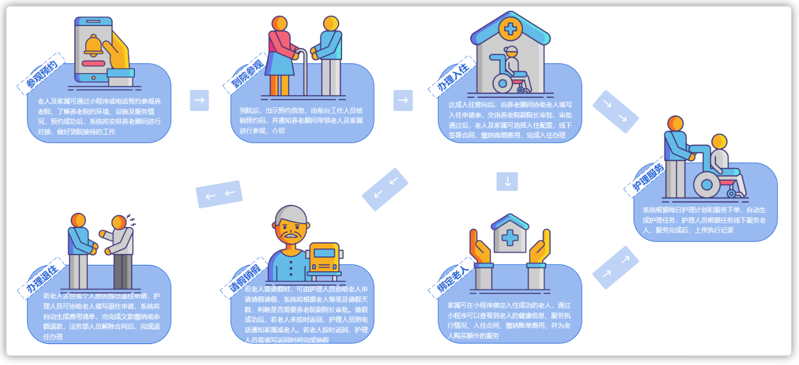
> 图注：图片展示了中州养老项目业务流程。老人及家属通过小程序进行参观养老院、到院身访、办理入住、护理服务等操作。流程包括：参观养老院时，可了解院内环境、活动及住宿情况；到院身访时，由院内工作人员带老人及家属参观、介绍；办理入住时，通过小程序填写相关信息，由工作人员安排入住；护理服务时，根据老人情况由专业护理人员提供。

**项目原型**访问地址：https://codesign.qq.com/s/459277624064324   密码: FSTI

中州养老项目分为两端，一个是管理后台，另外一个是家属端

- 管理后台：养老院员工使用，入住、退住，给老人服务记录等等
- 家属端：养老院的老人家属使用，查看老人信息，缴费，下订单等等

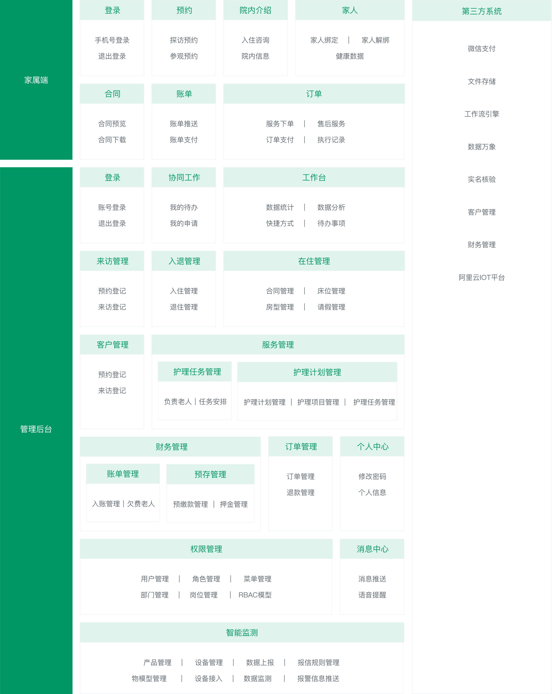
> 图注：这张图片是中州养老项目管理后台与家属端的功能模块划分图，清晰呈现了该项目两大端的功能布局。左侧绿色竖栏分别标注“家属端”与“管理后台”两大端口，家属端功能包括登录、预约、院内介绍、家人服务、合同、账单、订单等板块；管理后台的功能分区更丰富，涵盖协同工作、工作台、来访管理、入住管理、房间管理、客户管理、护理任务管理、护理计划管理、财务管理、订单管理、个人中心、权限管理、消息中心、智能监测等多个模块，右侧还标注了对接的第三方系统，包括微信支付、文件存储、工作流程引擎等多个平台。

业务主页效果：

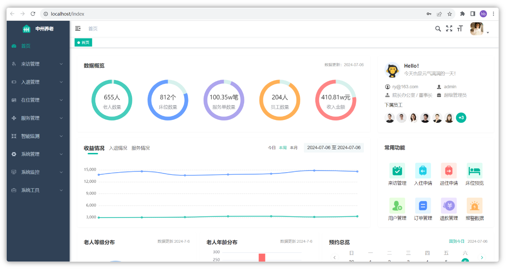
> 图注：这是中州养老管理后台的业务主页效果界面，整体以蓝绿色系为主。左侧是导航栏，包含会员管理、入住管理、运营管理等功能选项。中间区域是核心数据概览，显示老人总数655人、床位数量812个、服务单总数100.35w笔、员工数量204人、收入总额410.81万元等核心信息，下方还有收益情况的折线趋势图与老人年龄分布相关内容。右侧上方有工作人员的问候信息及头像列表，下方展示了常用功能模块，包含床位管理、入住申请、订单管理等快捷入口，界面顶部显示了访问路径及日期。


> 图注：这张图片展示的是中州养老项目的家属端业务主页效果，页面顶部为橙白配色的“中州养老”标题栏，配有小程序入口标识。主页设有宣传语“把温暖送给父母 让情爱陪伴家人”，下方排列有入驻咨询（含“立即咨询”按钮）、探访预约、参观预约等功能入口，还有养老院介绍、绑定家人、我的订单、我的账单这四项功能图标。页面下半部分展示了热门房型，其中重点呈现了单人套房的信息，附带房型实拍图并标注了该房型的优势。页面底部是包含“首页”“家人”“挂号”“我的”选项的导航栏。

> 教育公司无养老相关资质，小程序无法正式上架，无法体验。在课程的对应阶段，我们会进行调试开发

### 技术架构

下图展现了中州养老项目主要使用的技术：

<whiteboard token="WKn2wLMDAhpkl3bWH9qcqkzWnEf"></whiteboard>

- 前端主要使用的Vue3+Element Plus
- 后端主要使用的是若依作为基础架构，当然后端也集成了很多其他的技术，比如有Springboot、Mybatis、Swagger、Spring cache、Spring Security、**Mybatis-Plus**等
- 数据存储主要使用到了MySQL和Redis
- 使用了nginx来作为反向代理和前端的静态服务器
- 其他技术：华为云物联网平台IOT、对象存储OSS、微信登录、千帆大模型、AI工具辅助开发等

## 若依框架

### 基本介绍

若依（RuoYi）框架是一款基于Spring Boot、Spring Cloud等开源框架搭建的企业级开发平台。它的主要目标是提供全面的解决方案，以简化企业级应用开发，**提高开发效率**。以下是对若依框架的详细介绍：

1. **模块化设计**：若依框架采用模块化的设计，使得应用可以根据需求进行灵活的扩展和定制。每个模块都可以独立部署和升级，这大大提高了系统的可维护性和可扩展性。
2. **前后端分离**：框架采用前后端分离的开发模式，后端专注于数据处理和API接口的提供，前端则负责页面的展示和用户交互。这种模式使得前后端职责明确，进一步提高了开发效率和代码的可维护性。
3. **权限管理**：若依框架提供了完善的用户权限管理功能，包括角色管理、菜单授权、部门管理等，便于对系统权限进行灵活的配置和管理。
4. **代码生成器**：框架内置代码生成器，能够快速生成前后端代码，减少重复劳动，提高开发效率。通过简单的配置即可生成基础的增删改查代码。
5. **定时任务**：若依框架集成了定时任务模块，支持动态添加定时任务，可以通过界面对定时任务进行管理与调度。此外，框架还能实时查看系统运行日志和在线用户信息，监控服务状态和性能。
6. **易于集成**：若依框架可以轻松地与其他常用技术栈集成，如MySQL、Redis、消息队列等。这使得开发者可以根据项目需求灵活地选择合适的技术组件，降低技术门槛和成本。

此外，若依框架还集成了许多常用功能模块，如文件上传下载、消息推送、数据字典、日志管理等。

总的来说，若依框架是一款功能丰富、易于扩展和定制的企业级开发平台，适用于各种Web应用程序的开发。它能够帮助开发者快速构建功能完备的应用，提高开发效率，降低维护成本。


若依官网地址：

<bookmark name="RuoYi 若依官方网站 |后台管理系统|权限管理系统|快速开发框架|企业管理系统|开源框架|微服务框架|前后端分离框架|开源后台系统|RuoYi|RuoYi-Vue|RuoYi-Cloud|RuoY" href="https://ruoyi.vip/"></bookmark>

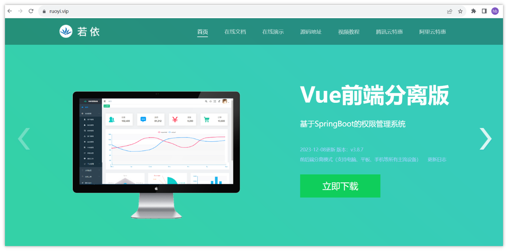
> 图注：这是若依官方网站的页面截图，页面顶部设有“首页”“在线文档”“在线演示”等导航选项，左上角带有“若依”标识。页面核心区域展示了一台显示管理系统界面的电脑样机，样机界面包含图表、功能图标等内容。页面右侧标注了“Vue前端分离版”“基于SpringBoot的权限管理系统”的信息，还显示了版本号“2021-12-08 版本：v3.8.7”，并设有“立即下载”按钮，这与文档中提及的若依框架的相关信息相呼应，直观呈现了该框架相关的演示与下载入口。

若依框架分为四个版本：

- 前后端不分离版本RuoYi（单体）
- 前后端分离版RuoYi-Vue（单体）本项目使用版本
- 微服务版本RuoYi-Cloud
- 移动端版RuoYi-App

<callout emoji="🌲">
前三个都提供了前后端的项目，移动版可以适配RuoYi-Vue和RuoYi-Cloud
</callout>


### RuoYi-Vue前后端分离版

我们课程中重点讲解的是RuoYi-Vue前后端分离版本，

文档地址：

<bookmark name="介绍 | RuoYi" href="https://doc.ruoyi.vip/ruoyi-vue/"></bookmark>

#### 概述

RuoYi-Vue 是一个 Java EE 企业级快速开发平台，基于经典技术组合（Spring Boot、Spring Security、MyBatis、Jwt、Vue），内置模块如：部门管理、角色用户、菜单及按钮授权、数据权限、系统参数、日志管理、代码生成等。在线定时任务配置；支持集群，支持多数据源，支持分布式事务。

演示地址：

<bookmark name="若依管理系统" href="http://vue.ruoyi.vip"></bookmark>

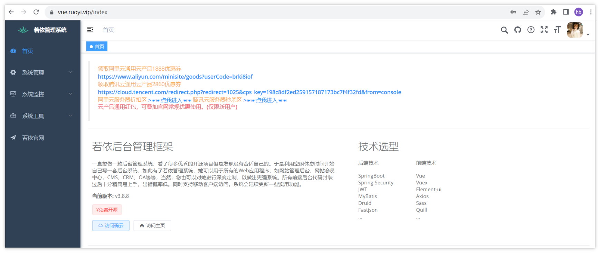
> 图注：图片展示了若依框架前后端分离版的演示地址页面。页面左侧为系统导航栏，有首页、系统管理、系统监控、系统工具、若依官网等选项。右侧上方显示“首页”，下方有登录、注册等操作按钮，还展示了若依后台管理框架的相关信息，如版本v3.8.8等。右侧下方列出技术选型，包括前端技术、后端技术、数据库、消息队列、缓存、安全、校验、框架、组件等，如前端技术为Vue3、后端技术为Spring Boot 2.5.x等。

#### 技术选型

1、系统环境

- Java EE 8   ---> jdk 11
- Servlet 3.0
- Apache Maven 3

2、主框架

- Spring Boot 2.5.x
- Spring Framework 5.2.x
- Spring Security 5.2.x   安全框架

3、持久层

- Apache MyBatis 3.5.x  ---> MyBatis Plus
- Hibernate Validation 6.0.x   校验框架
- Alibaba Druid 1.2.x

4、视图层

- Vue 2.6.x   ---->  Vue3
- Axios 0.21.x
- Element 2.15.x     ---->  Element Plus


## 环境搭建

熟悉了若依的基本情况之后，下面，我们就快速上手，来把这个框架搭建起来，并且需要顺利跑起来

### 准备工作

基础软件准备

| 官方推荐 | 优化升级 |
|-|-|
| JDK >= 1.8 (推荐1.8版本)  | 升级为JDK 11  资料中提供了安装包 |
| Maven >= 3.0 | 不需要安装，直接使用IDEA中自带的Maven即可 |
| Node >= 12 | 前端代码由vue2升级为vue3，需要Node 18及以上的版本 |
| Mysql >= 5.7.0 (推荐5.7版本)  | 升级为MySQL 8 |
| Redis >= 3.0 | 本地启动 |

一般企业中服务器都是部署了一些项目中公用的基础环境，比如MySQL、Redis等这些。这些服务都是部署在linux服务器中，这些服务可能是部署在公司的一个**机房**中，也有可能是**云服务器**（中小企业居多）。

在我们教学的过程中，为了还原更真实的企业环境，我们可以在VMWare软件中来部署linux服务器，当做我们开发中的公用服务器，具体的VMWare的服务配置

请参考如下链接：<cite doc-id="QdGXwSbphih6xOkvsNBckwsvnob" file-type="wiki" title="虚拟机环境说明" type="doc"></cite>


在目前提供的虚拟机环境中已经使用docker安装了对应的基础环境

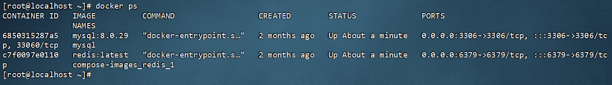
> 图注：这张图片是Linux系统的终端界面，展示了在命令行中执行`docker ps`命令后的结果。该命令用于查看当前运行中的Docker容器，界面中列出了两个正在运行的容器，分别是基于`mysql:8.0.29`镜像的容器和基于`redis:latest`镜像的容器，其中MySQL容器对应端口为3306，Redis容器对应端口为6379，这与文档中提到的虚拟机环境里的MySQL、Redis服务信息相匹配，直观呈现了对应服务的运行状态。

详细说明如下：

| **软件名称** | **说明** |
|-|-|
| MySQL | 默认用户名：root，默认密码：heima123，端口：3306 |
| Redis | 默认密码：123456，端口：6379 |

> 运行中州养老项目，需要使用到MySQL和Redis，因此，这两个服务已经设置了开机自启，过几天咱们的课程中会详细讲解和使用Redis


### 运行后端项目

#### 下载代码

- 代码下载地址：[https://gitee.com/y_project/RuoYi-Vue](https://gitee.com/y_project/RuoYi-Vue)[ ](https://gitee.com/y_project/RuoYi-Vue)

  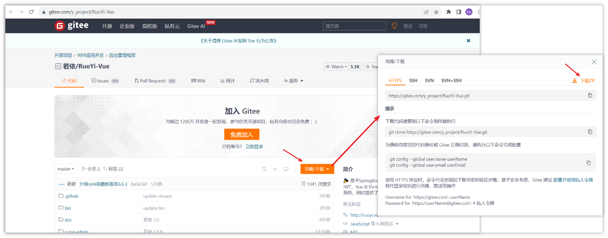
> 图注：图片展示了若依框架在Gitee平台的代码下载页面。页面左侧显示了若依框架的代码仓库信息，包括仓库名称、分支、提交数等。右侧弹出“右键下载”窗口，有HTTPS、SSH、SVN、SVN+SSH等多种下载方式，其中HTTPS方式被红色箭头指向。该图片与文档中“下载代码”部分内容相关，用于指导用户在Gitee平台下载若依框架代码，通过右键选择HTTPS方式获取代码地址，为后续代码替换包名和项目名等操作做准备。

由于若依提供的代码的包名和项目名和咱们的需求不一致，因此这里暂时不要采用Git克隆的方式下载代码，直接下载ZIP包到本地，然后先替换所有的包名和项目名，再使用idea打开项目

#### 包名全局替换

- 从官方下载的代码中所有包名都为com.rouyi，且数据库连接信息需要修改，此时，咱们可以借助于若依框架修改器来一键修改：
- 参考链接：https://gitee.com/lpf_project/RuoYi-MT/releases
- 可以使用资料中提供的包名修改器


> 图注：图片展示的是若依框架修改器的图标。图标为一个白色文件夹，左侧有绿色的植物图案，右侧有橙色的齿轮和播放图案。下方文字为“若依框架修改器”。该图片与文档中“借助于若依框架修改器来一键修改包名”的内容相关，用于直观呈现若依框架修改器的外观，帮助用户识别并使用该修改器进行包名全局替换操作。

请参考下方截图进行修改哦

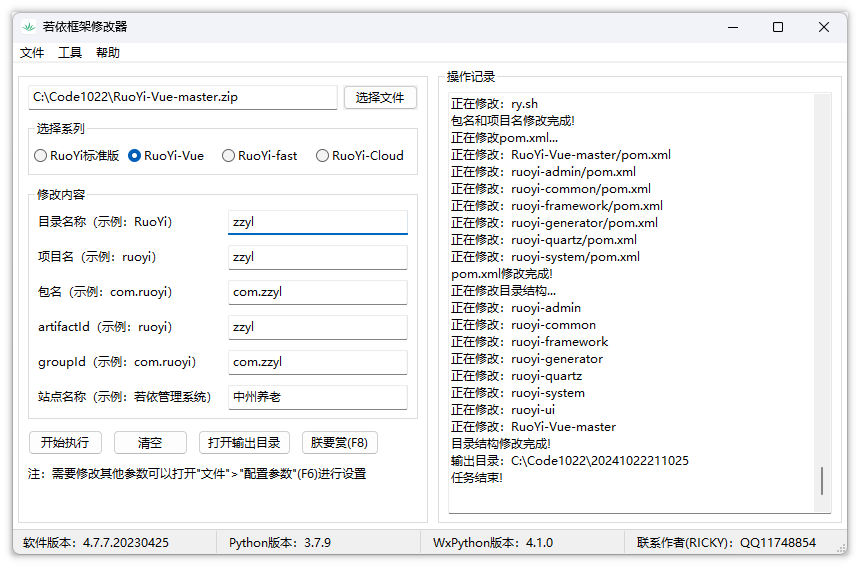
> 图注：图片展示的是若依框架修改器界面。左侧有选择文件按钮，可选择代码包文件。右侧有选择系列、修改内容等选项，当前选中“RuoYi-Vue”系列，目录名称、项目名、包名等处显示“zzyl”等信息。下方有开始执行、清空、打开输出目录、恢复默认（F6）等按钮。操作记录显示了修改过程，如正在修改RuoYi-Vue - master/pom.xml等。该图片与文档中介绍使用若依框架修改器修改代码包名和项目名的内容相关，用于辅助理解操作步骤。

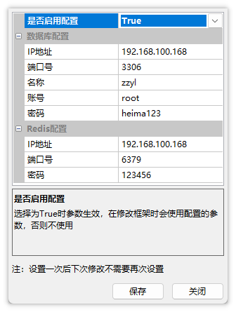
> 图注：图片展示的是若依框架修改器中配置数据库和Redis信息的界面。界面中有“是否启用配置”开关，当前为True。数据库配置部分显示IP地址为192.168.100.168，端口号3306，名称zzyl，账号root，密码heima123。Redis配置部分IP地址和端口号与数据库配置相同，密码为123456。界面底部提示设置一次后下次修改不需要再次设置，有“保存”和“关闭”按钮。该图片与文档中使用若依框架修改器修改代码包名和数据库连接信息的内容相关，用于指导用户进行配置操作。

- 修改完成之后，修改器会自动导出一个新的目录，将目录复制到你的代码目录中，然后使用idea打开即可：

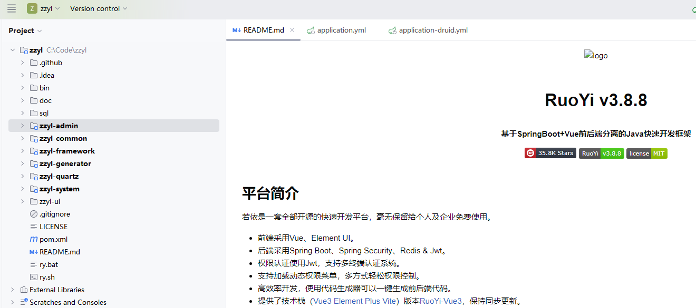
> 图注：图片展示了若依框架RuoYi v3.8.8的项目结构及平台简介。左侧为项目文件夹结构，包含zyyl、zyyl-admin等子文件夹。右侧是RuoYi平台简介，介绍其基于SpringBoot+Vue前后端分离，采用Vue、Element UI等技术，支持多终端认证、权限认证等，还提供代码生成器等。该图片与文档中下载代码后使用若依框架修改器修改包名及项目名等内容相关，用于辅助理解若依框架的项目结构及平台功能。

打开项目后，先修改项目和模块使用的JDK版本为11。

- 修改pom.xml文件中JDK的版本为11

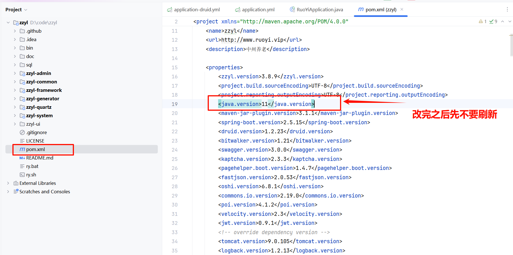
> 图注：图片展示了若依框架项目中pom.xml文件的部分内容。文件中红色框标注处显示了JDK版本信息，分别为“java.version=11”和“java.version=11.0.20”，且有“改完之后先不要刷新”的提示。这与文档中“运行后端项目”部分的“下载代码”步骤相关，对应修改pom.xml文件中JDK版本为11的操作，强调改完后先不要刷新。

注意：先不要刷新

#### JDK配置

1. 解压资料中提供的jdk11, 到非中文没有特殊字符的目录

`项目搭建、从0开始用若依\资料\JDK11、NodeJS\jdk-11.0.20_windows-x64_bin.zip`

1. 配置环境变量

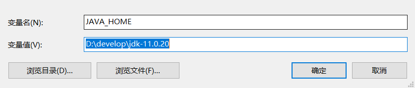
> 图注：这张图片展示了配置JAVA_HOME环境变量的窗口，是项目环境搭建中JDK配置环节的操作界面。窗口内“变量名”字段已填写为JAVA_HOME，“变量值”字段被高亮标记，内容为JDK解压后的路径D:\\develop\\jdk-11.0.20，窗口还设有“浏览目录”“浏览文件”“确定”“取消”操作按钮，对应文档中JDK配置步骤里的环境变量配置要求，需将JDK解压到非中文无特殊字符的目录后，在此处配置对应的路径。


#### maven配置

打开之后，需要配置maven的本地仓库，建议将资料中的本地仓库先解压到自己的Maven仓库中（初次下载较慢）

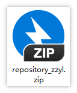
> 图注：图片展示的是一个名为“repository_zzyl.zip”的文件图标。图标由蓝色圆环和黑色闪电图案组成，闪电图案内有白色“ZIP”字样。该图片与文档中“maven配置”部分内容相关，上下文提到打开后需配置maven的本地仓库，建议将资料中的本地仓库先解压到自己的Maven仓库中，初次下载较慢，此图可能用于辅助说明解压后的仓库文件外观，帮助理解配置步骤。

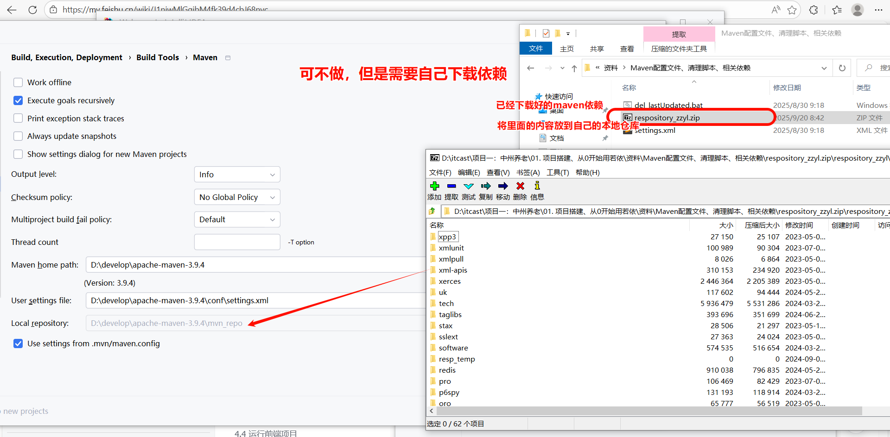
> 图注：图片展示了Maven配置界面及相关文件夹内容。界面中“User settings file”处显示为“D:\\develop\\apache-maven-3.5.4\\conf\\settings.xml”，“Local repository”处显示为“D:\\develop\\apache-maven-3.5.4\\repository”。右侧文件夹中，有“repository_zyl.zip”文件，其内容被复制到自己的本地仓库。图片与上下文关系为：在Maven配置中，需将资料中的本地仓库先解压到自己的Maven仓库中，此图展示了配置后的相关文件及仓库内容情况。


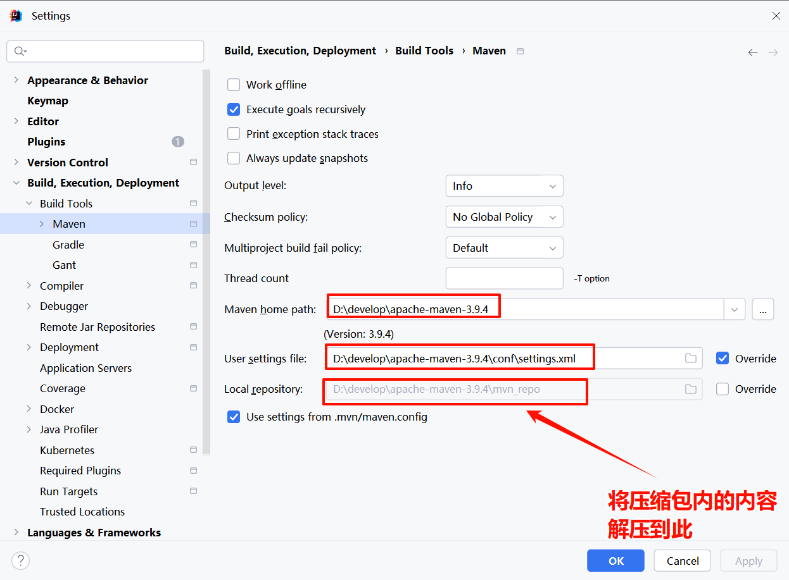
> 图注：图片展示的是IntelliJ IDEA中Maven设置界面。左侧导航栏选中“Maven”选项，右侧显示Maven相关设置，包括Maven home path、User settings file、Local repository等。其中，Maven home path指向D:\\develop\\apache-maven-3.9.4，User settings file指向D:\\develop\\apache-maven-3.9.4\\conf\\settings.xml，Local repository指向D:\\develop\\apache-maven-3.9.4\\repo。图片下方有红色箭头标注，提示“将压缩包内的内容解压到此”。该图片与文档中maven配置部分上下文对应，用于指导用户配置Maven相关路径。

改完之后刷新maven。

idea中的配置

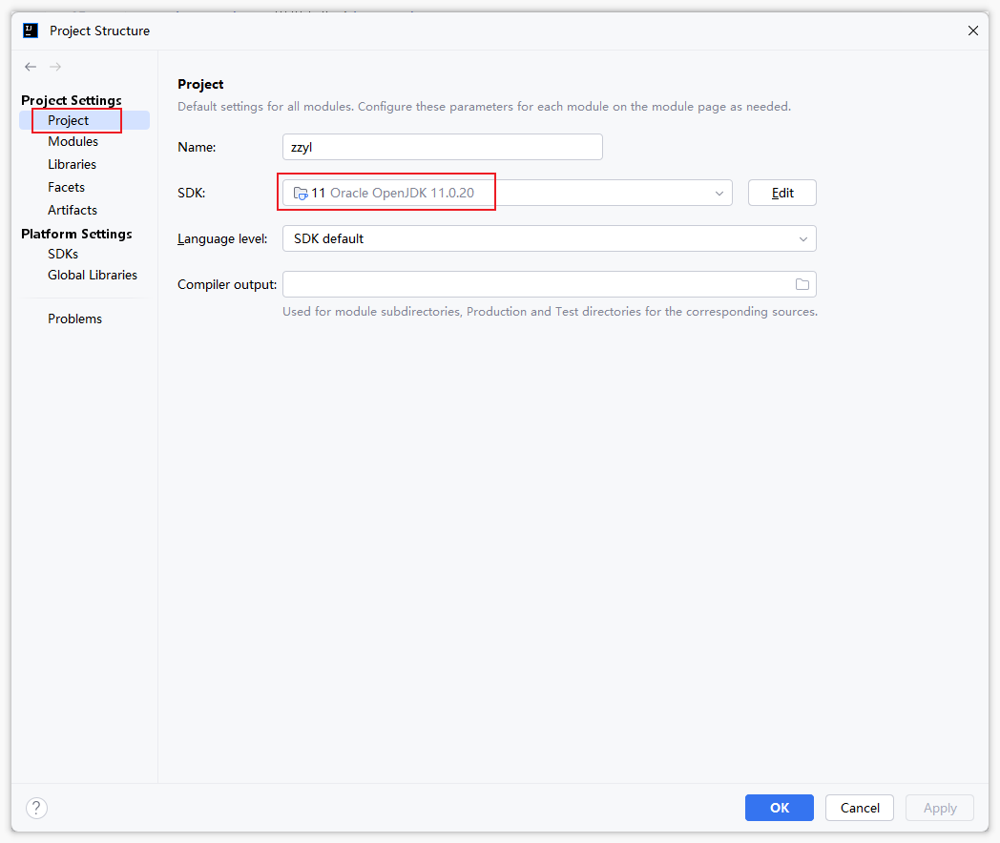
> 图注：这是IDEA的Project Structure窗口界面，对应文档中idea配置的内容。窗口左侧选中“Project”选项，右侧项目配置区域里，SDK项被红色框标注，当前设置为“11 Oracle OpenJDK 11.0.20”，完全契合文档中“JDK配置”步骤里要求的将JDK版本设为11的内容，该界面用于完成项目相关的JDK版本配置操作。

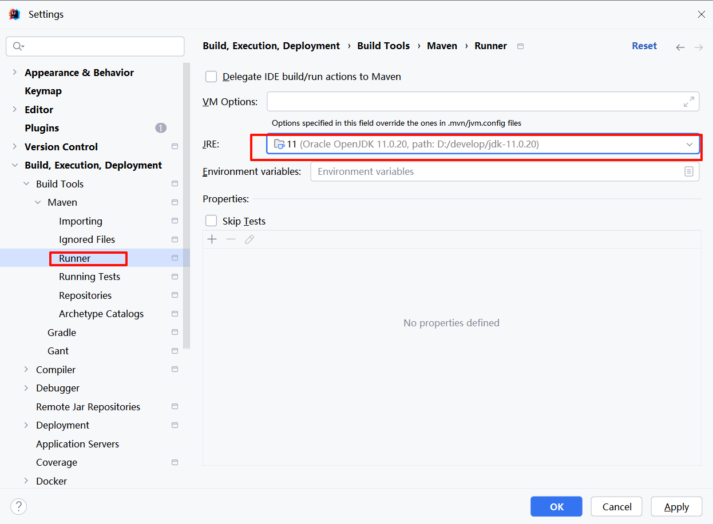
> 图注：这张图片是IDEA的设置界面，当前处于“Build, Execution, Deployment”分类下的“Maven”模块中的“Runner”页面，左侧“Runner”选项被红框高亮标注，是该页面的核心操作路径。在右侧设置区域，JRE选项也被红框标注，对应的配置为“11 (Oracle OpenJDK 11.0.20, path: E:\\develop\\jdk-11.0.20)”，这正是项目搭建JDK配置步骤中要求的内容。此界面用于配置运行Maven相关内容的JDK环境，对应文档中IDEA配置JDK环节的具体操作设置。

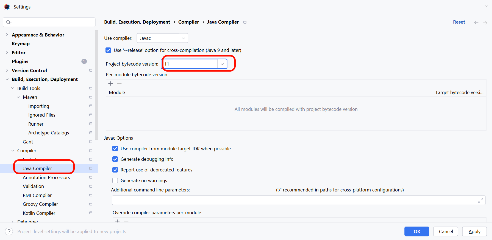
> 图注：图片展示了IntelliJ IDEA中“Settings”设置界面的“Compiler”下的“Java Compiler”选项卡。关键信息有：左侧导航栏中“Java Compiler”被红色框突出显示；右侧“Project bytecode version”处的下拉框被红色框圈出，显示版本为11；还有“Use compiler from module target JDK when possible”等选项被红色框标注。该图片与文档中“JDK配置”部分相关，用于指导用户在IntelliJ IDEA中配置Java编译器版本等设置。

- 修改idea中的项目编码为utf-8

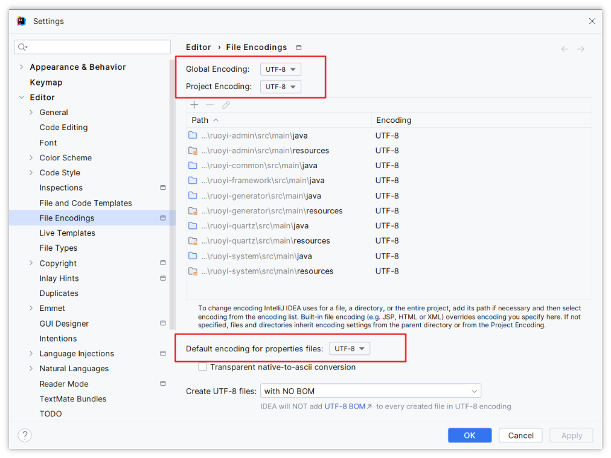
> 图注：这是IntelliJ IDEA的设置窗口界面，对应文档中“idea中的配置”这一步骤，核心展示了编辑器编码的配置内容。界面左侧选中“Editor”分类下的“File Encodings”选项，右侧的“Global Encoding”和“Project Encoding”均设置为UTF-8，下方“Default encoding for properties files”也设置为UTF-8，同时勾选了“Transparent native-to-ascii conversion”选项，整体内容是修改Idea项目编码为UTF-8的操作对应界面。

#### 数据库准备和配置

- 数据库使用的MySQL 8

  - 默认的用户名：root
  - 默认的密码：heima123

在idea中创建数据库并导入项目中的基础表结构和数据

- 创建数据库 **zzyl （可以打开项目根目录下的sql/ry_2024xxxx.sql文件，在最上方添加以下内容）**

```Java
create database if not exists zzyl;
use zzyl;
```

- 导入项目根目录下的sql/ry_2024xxxx.sql文件，如下图

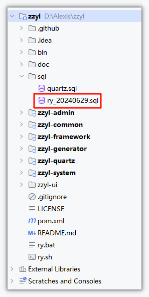
> 图注：图片展示了项目文件夹结构，红色框突出显示了“ry_20240629.sql”文件。该图片位于文档中“数据库准备和配置”部分，与导入项目根目录下的sql/ry_2024xxxx.sql文件的操作步骤相关，说明在idea中创建数据库并导入基础表结构和数据时，需找到并打开此文件。

sql执行成功以后，修改数据库连接，找到ruoyi-admin模块中的`resources`目录下的`application-druid.yml`

```YAML
# 数据源配置
spring:
    datasource:
        type: com.alibaba.druid.pool.DruidDataSource
        driverClassName: com.mysql.cj.jdbc.Driver
        druid:
            # 主库数据源
            master:
                url: jdbc:mysql://192.168.100.168:3306/zzyl?useUnicode=true&characterEncoding=utf8&zeroDateTimeBehavior=convertToNull&useSSL=true&serverTimezone=GMT%2B8
                username: root
                password: heima123
```

#### Redis配置

找到ruoyi-admin模块中的`resources`目录下的`application.yml`，如下配置：

```YAML
# Spring配置
spring:
  redis:
    # 地址
    host: 192.168.100.168
    # 端口，默认为6379
    port: 6379
    # 数据库索引
    database: 0
    # 密码
    password: 123456
    # 连接超时时间
    timeout: 10s
    lettuce:
      pool:
        # 连接池中的最小空闲连接
        min-idle: 0
        # 连接池中的最大空闲连接
        max-idle: 8
        # 连接池的最大数据库连接数
        max-active: 8
        # #连接池最大阻塞等待时间（使用负值表示没有限制）
        max-wait: -1ms
```


#### 运行项目

找到ruoyi-admin模块中的运行`com.zzyl.RuoYiApplication.java`，出现如下图表示启动成功。

```Bash
(♥◠‿◠)ﾉﾞ  若依启动成功   ლ(´ڡ`ლ)ﾞ  
 .-------.       ____     __        
 |  _ _   \      \   \   /  /    
 | ( ' )  |       \  _. /  '       
 |(_ o _) /        _( )_ .'         
 | (_,_).' __  ___(_ o _)'          
 |  |\ \  |  ||   |(_,_)'         
 |  | \ `'   /|   `-'  /           
 |  |  \    /  \      /           
 ''-'   `'-'    `-..-'    
```

---
> 来源：飞书技术知识库（脱敏版） · 07 业务组件方案集 / 中州养老项目（若依+AI） / 项目笔记·01 · [原文](https://ccn8v2zngwsm.feishu.cn/wiki/QhMIwXvGxiPUqwkRzo4cVNxdnJe)
