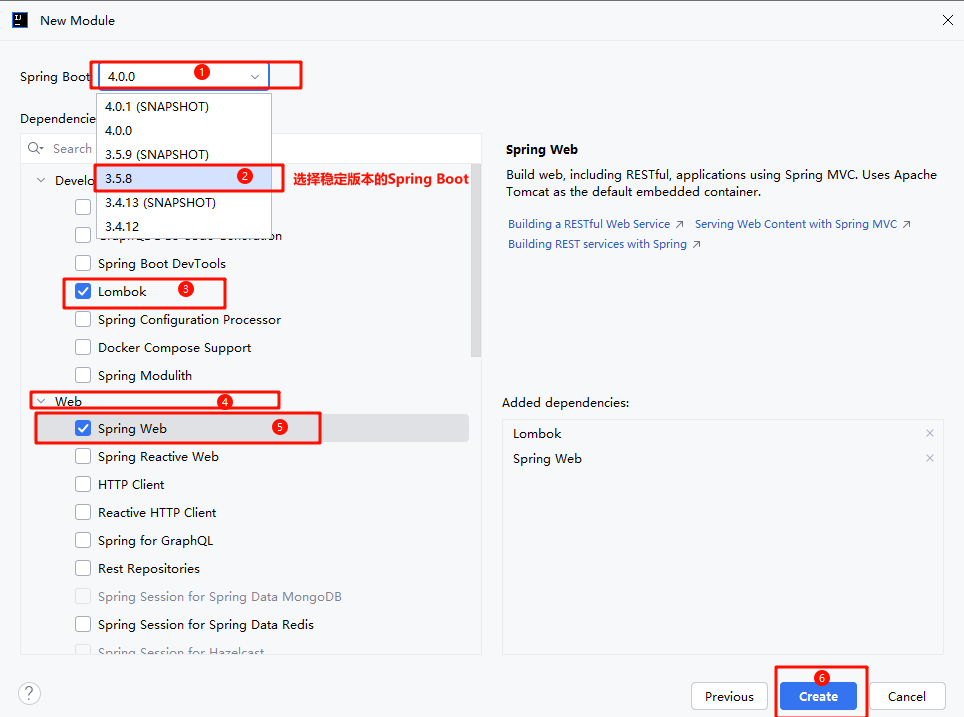
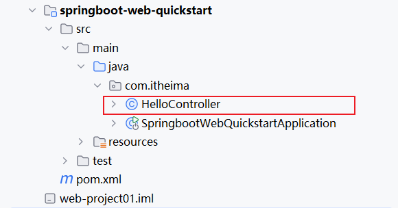
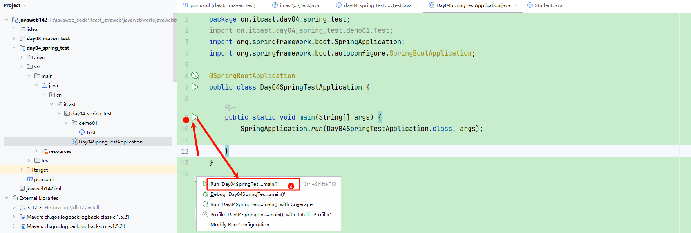
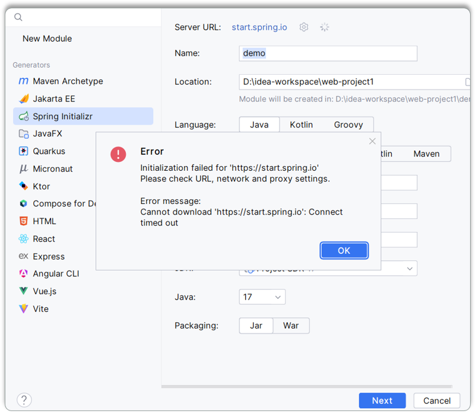
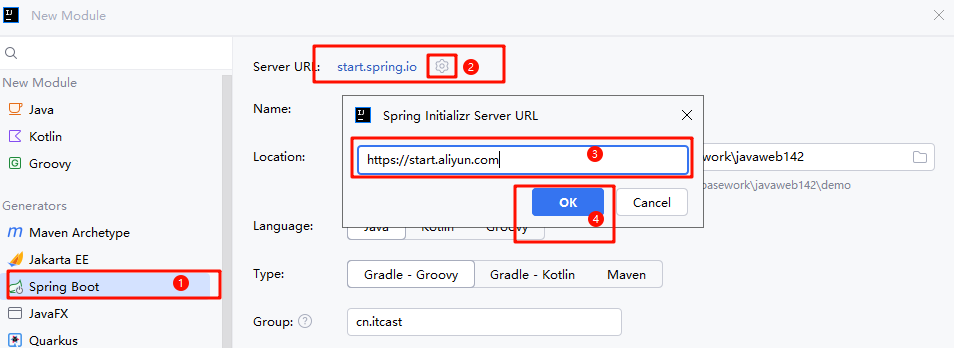
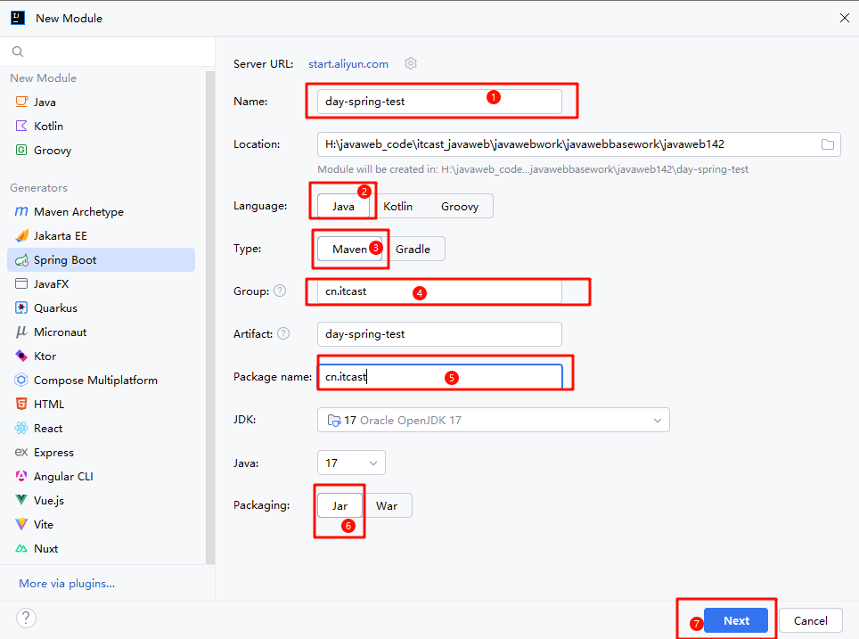
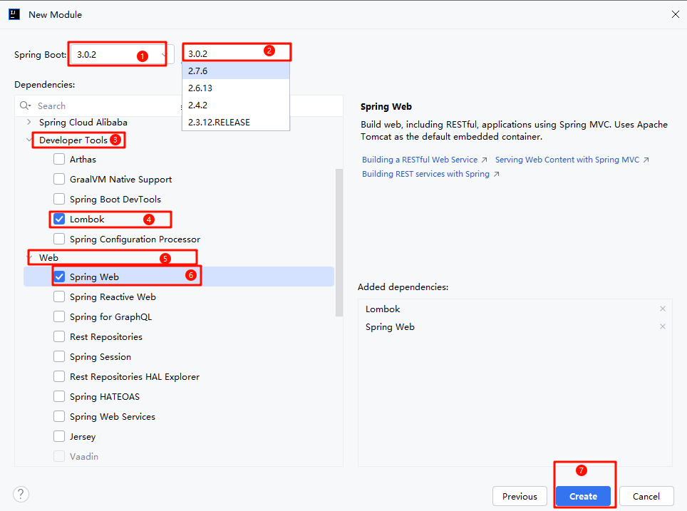
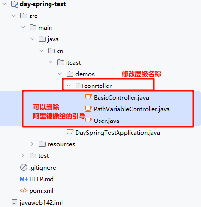
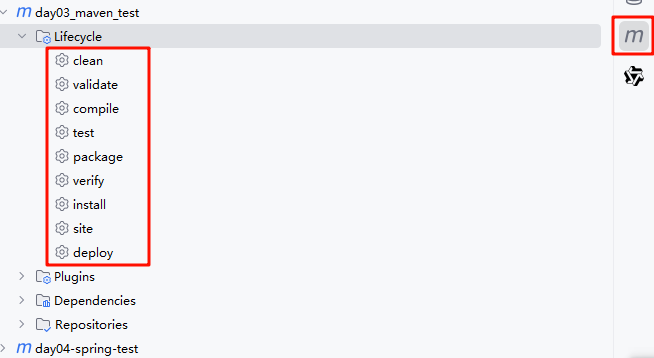
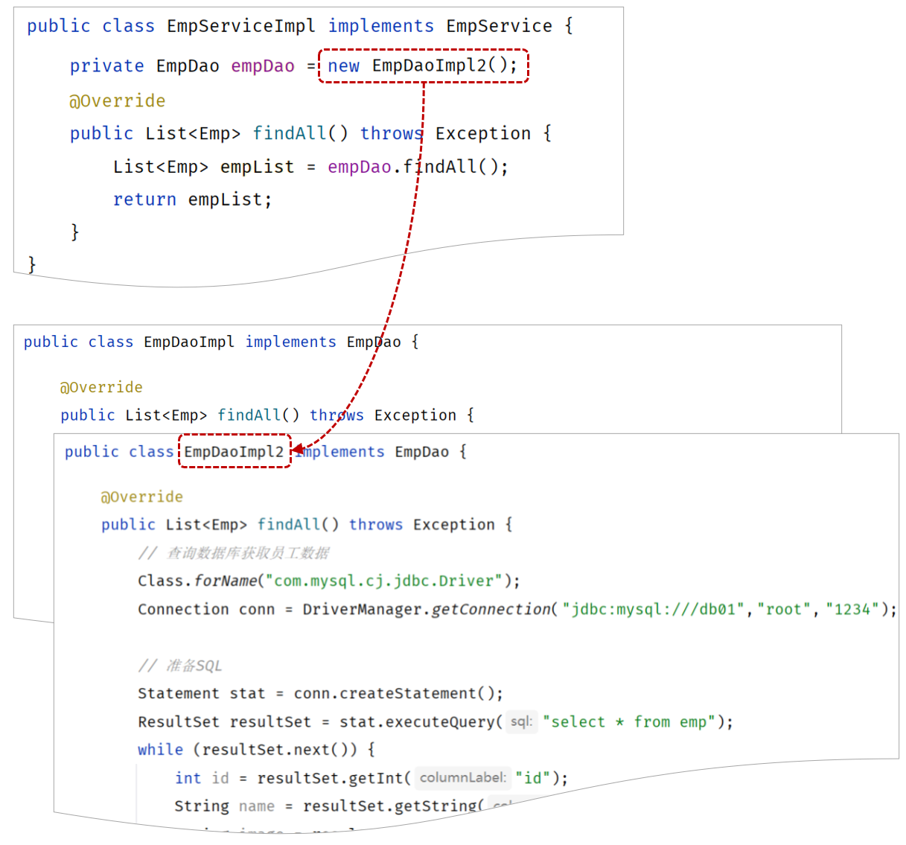

# 03 SpringBoot基础开发_三层架构_反射分层解耦

## 一、SpringBoot基础

### 初识Spring

后端开发中的 SpringBoot 基础、Web 入门程序、Web 案例、分层解耦等内容，旨在帮助开发者掌握 SpringBoot 开发及相关架构设计

#### **资源类型与架构模式**

介绍了静态资源（如 HTML、CSS、JS 等）和动态资源（如 Servlet、JSP 等，企业多基于 Spring 框架构建）

<callout emoji="🏕️">
BS 架构（Browser/Server，维护方便但体验一般）
 CS 架构（Client/Server，体验不错但开发维护麻烦）。
</callout>

#### **Spring 与 SpringBoot**：

Spring 形成了开发生态圈，由众多子项目组成“spring 全家桶”，核心是 SpringFramework，

但直接开发存在配置繁琐和入门难度大的问题。SpringBoot 可简化配置、快速开发，是企业开发主流。

## Web案例

### Web入门程序

##### SpringBoot开发步骤

第1步：创建SpringBoot工程，并勾选Web开发相关依赖

第2步：定义HelloController类，添加方法hello，并添加注解

创建Spring Boot 模块


选择Spring Boot版本 以及 勾选web开发相关依赖



<callout emoji="🌟">
SpringBoot官方提供的脚手架，里面只能够选择SpringBoot的几个最新的版本，如果要选择其他相对低一点的版本，可以在springboot项目创建完毕之后，修改项目的pom.xml文件中的版本号。
</callout>

可以删除 不需要的内容


**2). 定义HelloController类，添加方法hello，并添加注解**

在`com.itheima`这个包下新建一个类：`HelloController`



HelloController中的内容，具体如下：

```Java
package com.itheima;

import org.springframework.web.bind.annotation.RequestMapping;
import org.springframework.web.bind.annotation.RestController;

@RestController //标识当前类是一个请求处理类
public class HelloController {

    @RequestMapping("/hello") //标识请求路径
    public String hello(String name){
        System.out.println("HelloController ... hello: " + name);
        return "Hello " + name;
    }

}
```


**3). 运行测试**

运行SpringBoot自动生成的引导类 (标识有`@SpringBootApplication`注解的类)



创建一个应用接口


打开浏览器，输入 `http://localhost:8080/test/show`


##### SpringBoot常见问题

大伙儿在下来联系的时候，联网基于spring的脚手架创建SpringBoot项目，偶尔可能会因为网内网络的原因，链接不上SpringBoot的脚手架网站，此时会出现如下现象：



此时可以使用阿里云提供的脚手架，网址为：`https://start.aliyun.com`



然后按照项目创建的向导，一步一步的创建项目即可。



选择Spring Boot版本 以及 勾选web开发相关依赖



修改层级名称 删除无用类



当阿里云镜像创建项目时 如果模块失效，可以用下列步骤重新生效模块


### 依赖

#### 依赖管理

（1）从仓库下载jar包

<dependiceis>

（2）解决依赖冲突问题

<callout emoji="🥖">
如果直接依赖和间接依赖冲突了，以直接依赖为主
如果直接依赖和直接依赖冲突了，后面的将前面的覆盖
如果间接依赖和间接依赖冲突了，层级一样声明优先
如果间接依赖和间接依赖冲突了，层级不一样深度浅的优先
</callout>

（3）传递依赖 ===>当引入一个jar的时候，这个jar依赖的所有的jar都会依赖传递过来

<callout emoji="🌅">
A ==>CD
B ==>DE
</callout>

(4)排除依赖

<callout emoji="🎨">
如果我们引入一个坐标, 不想要的传递依赖的时候可以通过 **exclusions 标签** 排除
</callout>

#### 一键构造

<callout emoji="🏝️">
通过按钮的方式将编译，打包，测试，发布，安装..等功能按钮一键构建
</callout>



#### 统一项目目录

<whiteboard token="K1InwfCpehEu50bpehVcqtSnnNf"></whiteboard>

```SQL
Maven项目的目录结构:
maven-project01
        |---  src  (源代码目录和测试代码目录)
               |---  main (源代码目录)
                        |--- java (源代码java文件目录)
                        |--- resources (源代码配置文件目录)
              |---  test (测试代码目录)
                        |--- java (测试代码java目录)
                        |--- resources (测试代码配置文件目录)
        |--- target (编译、打包生成文件存放目录)
```


### 三层架构


即：


控制层（Controller）

<callout emoji="👍">
1. 接收前端请求参数
2. 封装请求参数
3. 调用 Service 层处理业务
4. 将处理结果响应给前端
</callout>

业务层（Service）

<callout emoji="🎉">
1. 接收 Controller 层传递的数据
2. 进行业务逻辑处理（校验、补全、组织数据）
3. 调用 Dao 层进行数据持久化操作
4. 将处理结果返回给 Controller 层
</callout>

持久层（Dao）

<callout emoji="🥖">
1. 接收 Service 层传递的数据
2. 执行数据库的增删改查操作
3. 将数据库操作结果返回给 Service 层
</callout>

#### 代码示例

```Java
package cn.itcast.controller;

import cn.itcast.service.ProductsService;
import org.springframework.web.bind.annotation.RequestMapping;
import org.springframework.web.bind.annotation.RestController;

@RestController
@RequestMapping("/products")
public class ProductsController {
    ProductsService ps = new ProductsService();
    @RequestMapping("/findAll")
    public void findAll(){
        System.out.println("1.接受前端传入的参数");
        System.out.println("2.封装参数");
        System.out.println("3.调用service层的功能 处理封装好的数据并得到结果");
        System.out.println("==========================");
        ps.findAll();
        System.out.println("==========================");
        System.out.println("4.将结果相应给前端");
    };
}
```

```Java
package cn.itcast.service;

import cn.itcast.dao.ProductsDao;

public class ProductsService {
    ProductsDao pd = new ProductsDao();
    public void findAll(){
        System.out.println("1.接受Controller层给的数据");
        System.out.println("2.处理数据 补全数据 校验数据 组织数据");
        System.out.println("3.调用Dao层将数据持久化或者更新得到Dao层的结果");
        System.out.println("==========================");
        pd.findAll();
        System.out.println("==========================");
        System.out.println("4.将结果返回controller层");
    }
}
```

```Java
package cn.itcast.dao;

public class ProductsDao {
    public void findAll(){
        System.out.println("1.接受Service层处理好的数据");
        System.out.println("2.持久化操作数据库 更新");
        System.out.println("3.将结果返回Service层");
    }
}
```

### 反射

#### 反射的作用

<callout emoji="🎉">
在运行期间动态获取方法区的字节码对象，并且解剖字节码每一部分并操作的一种技术
土话：操作类的另外一种方式
</callout>

#### 普通方式操作类

<callout emoji="📌">
（1）创建对象
（2）访问对象的属性
（3）访问对象方法
</callout>

#### 反射方式操作类

前提

<callout emoji="🍞">
**须先获取方法区才能反射**
</callout>

##### 获取字节码对象的三种方式

```Java
类名.class;
对象.getClass();
Class.forName("全限定类名");
    全限定类名：
        包名 + "." + 类名
```

代码示例：

```Java
    private static void demo01() throws ClassNotFoundException {
        // 获取字节码对象的方式
        Class<Student> stu1 = Student.class;
        //获取字节码的第二种方式 对象.getClass()
        Student stu = new Student();
        Class<? extends Student> stu2 = stu.getClass();
        // 获取字节码的第三种方式 Class.forName("全类名")
        Class<?> stu3 = Class.forName("cn.itcast.demo01.Student");
//        System.out.println(stu1 == stu2);
        System.out.println(stu1 == stu3);
    }
```

##### *用反射创建对象*

```Java
创建对象的方式
    Constructor getconstructor(classclazz）//只能获取public修饰的单个构造函数
    Constructor getDeclaredconstructor(Class...clazz）//只能获取public修饰的单个构造函数
    Constructor[] getConstructors（）//获取所有public修饰的构造函数
    Constructor[] getDeclaredConstructors() //获取所有构造函数
    Constructor具备功能：
        Object newInstance(Object... args);
暴力反射：
    setAccessible(boolean isAccessible);
```

<callout emoji="🦄">
1. 第一步：获取字节码对象
2. 第二步：获取无参/有参构造

   1. 字节码对象.getConstructor()
3. 第三步：暴力反射

   1. 有参/无参构造对象.setAccessible
4. 第四步：使用newInstance创建对象

   1. 有参/无参构造对象.newInstance(参数列表)
</callout>

```Java
/**
 * 采用反射创建对象
 * Constructor getConstructor(Class ... clazz) 只能获取public修饰的单个构造函数
 * Constructor getDeclaredConstructor(Class ... clazz) 只能获取public修饰的单个构造函数
 * Constructor[] getConstructors() 获取所有public修饰的构造函数
 * Constructor[] getDeclaredConstructors() 获取所有构造函数
 * Constructor具备功能:
 * Object newInstance(Object... args);
 * 暴力反射:
 * setAccessible(boolean isAccessible);
 */
 
 private static void demo02() throws Exception {
    Class<Student> studentClass = Student.class;
    //1. 获取无参构造
    Constructor<Student> noArgsConstructor = studentClass.getDeclaredConstructor();
    //2. 获取有参构造
    Constructor<Student> oneArgsConstructor = studentClass.getDeclaredConstructor(String.class, int.class);
    //3. 暴力反射
    noArgsConstructor.setAccessible(true);
    oneArgsConstructor.setAccessible(true);
    //4. 使用newInstance创建对象
    Student student = noArgsConstructor.newInstance();
    Student student1 = oneArgsConstructor.newInstance("小王", 18);
    System.out.println(student);    //Student(name=null, age=0)
    System.out.println(student1);   //Student(name=小王, age=18)
}
```

##### *采用反射操作成员变量*

```Java
//采用反射操作成员变量
    Field getField(String name); //只能获取public修饰的成员变量
    Field[] getFields(); //获取所有public修饰的成员变量
    Field getDeclaredField(String name); //获取任何修饰符修饰的单个成员
    Field[] getDeclaredFields(); //获取所有修饰符修饰的成员变量
//使用成员变量对象的方法进行操作
    void set(对象，值); //对该对象中的这个成员变量设置值
    Object get(对象);  //获取该对象身上的成员变量的值
    void setAccessible(boolean isAccessible);//暴力反射

```

<callout emoji="🎨">
1. 第一步：获取字节码对象
2. 第二步：获取成员变量对象

   1. 字节码对象.getDeclareField（成员变量名）
3. 第三步：创建实例对象

   1. 字节码.newInstance
4. 第四步：设置变量值/获取变量值

   1. 成员变量对象.set/get
</callout>

```Java
private static void demo03() throws Exception {
    // 1. 获取 Student 类对应的 Class 对象（反射的入口）
    Class<?> studentClass = Student.class;
    // 2. 获取 public 修饰的 name 属性
    // 如果 name 不是 public，会抛出 NoSuchFieldException
    // Field name = studentClass.getField("name");
    // 3. 获取 name 属性（无论是 public / private / protected / 默认）
    Field name = studentClass.getDeclaredField("name");
    // 打印 name 字段的信息（修饰符 + 类型 + 名称）
    System.out.println(name);
    // 4. 获取 age 属性（通常是 private）
    Field age = studentClass.getDeclaredField("age");
    // 5. 获取 Student 类中声明的所有属性（不包含父类）
    Field[] declaredFields = studentClass.getDeclaredFields();
    // 遍历并打印所有属性信息
    for (Field field : declaredFields) {
        System.out.println(field);
    }
    // 6. 暴力反射
    // 取消 Java 的访问权限检查，使 private 属性可以被访问
    name.setAccessible(true);
    age.setAccessible(true);
    // 7. 通过无参构造方法创建 Student 对象
    Student student = new Student();
    // 8. 使用反射为对象的 name 属性赋值
    name.set(student, "张三");
    // 9. 使用反射为对象的 age 属性赋值
    age.set(student, 18);
    // 10. 打印对象，验证属性是否成功赋值
    System.out.println(student);
}

```

##### **利用反射操作成员方法**

<callout emoji="🎁">
1. 第一步：获取字节码对象
2. 第二步：拿到成员方法对象

   1. 字节码对象.getDeclaredMethod("方法名", 方法的参数列表的数据类型对象……)
3. 第三步：通过成员方法对象调用成员方法

   1. 成员方法对象.invoke("实体类对象名", 对方法的参数列表赋值)
</callout>

```Java
/**
 * 采用反射操作成员方法
 *      Method  getMethod();
 *      Method[]  getMethods();
 *      Method  getDeclaredMethod();
 *      Method[]  getDeclaredMethods();
 * 使用Method对象的功能执行该方法
 *      Object  invoke(对象, 对方法的参数进行赋值);
 */
 
 private static void demo04() throws Exception {
    //1.获取字节码对象
    Class<Student> studentClass = Student.class;
    //2. 通过字节码对象的getDelaredMethod拿到成员方法对象
    Method declaredMethod = studentClass.getDeclaredMethod("show", String.class);
    //3.通过反射创建对象
    Student student = studentClass.newInstance();
    //通过成员方法对象调用invoke方法，调用成员方法
    declaredMethod.invoke(student,"小红");
    //4.通过对象给成员变量赋值
    student.setName("小王");
    student.setAge(18);
    //通过字节码对象拿到成员方法对象（无参数的）
    Method declaredMethod1 = studentClass.getDeclaredMethod("show");
    //通过成员方法对象调用成员方法
    declaredMethod1.invoke(student);
}
```

### 分层解耦

#### 层与层之间解耦合

##### 业务层面向接口编程的好处

<callout emoji="📚">
通过反射达到解耦合的目的
</callout>

#### 问题分析

由于我们现在在程序中，需要什么对象，直接new一个对象 `new EmpDaoImpl()`  。


如果说我们需要更换实现类，比如由于业务的变更，EmpDaoImpl 不能满足现有的业务需求，我们需要切换为 EmpDaoImpl2 这套实现，就需要修改Contorller的代码，需要创建 EmpDaoImpl2 的实现`new EmpDaoImpl2()` 。



Controller中调用Service，也是类似的问题。这种呢，我们就称之为层与层之间 **耦合** 了。 那什么是耦合呢 ？

首先需要了解软件开发涉及到的两个概念：内聚和耦合。

- **内聚：**软件中各个功能模块内部的功能联系。
- **耦合：**衡量软件中各个层/模块之间的依赖、关联的程度。


<callout emoji="⛳">
**软件设计原则：高内聚低耦合。**
**高内聚：**指的是一个模块中各个元素之间的联系的紧密程度，如果各个元素(语句、程序段)之间的联系程度越高，则内聚性越高，即 "高内聚"。
**低耦合：**指的是软件中各个层、模块之间的依赖关联程序越低越好。
</callout>

目前层与层之间是存在耦合的，Controller耦合了Service、Service耦合了Dao。而 高内聚、低耦合的目的是使程序模块的可重用性、移植性大大增强。

那最终我们的目标呢，就是做到层与层之间，尽可能的降低耦合，甚至解除耦合。


#### 解耦思路

之前我们在编写代码时，需要什么对象，就直接new一个就可以了。 这种做法呢，层与层之间代码就耦合了，当Dao层的实现变了之后， 我们还需要修改Service层的代码。

那应该怎么解耦呢？


**1). 首先不能在EmpServiceImpl中使用new对象。代码如下：**


此时，就存在另一个问题了，不能new，就意味着没有Dao层对象（程序运行就报错），怎么办呢? 

我们的解决思路是：

- 提供一个容器，容器中存储一些对象(例：EmpDao对象)
- Service程序从容器中获取EmpService类型的对象

**2). 将要用到的对象交给一个容器管理。**


**3). 应用程序中用到这个对象，就直接从容器中获取**


那问题来了，我们如何将对象交给容器管理呢？ 程序运行时，容器如何为程序提供依赖的对象呢？ 

我们想要实现上述解耦操作，就涉及到Spring中的两个核心概念：

<callout emoji="📌">
- **控制反转：** Inversion Of Control，简称**IOC**。对象的创建控制权由程序自身转移到外部（容器），这种思想称为控制反转。

  - 对象的创建权由程序员主动创建转移到容器(由容器创建、管理对象)。这个容器称为：IOC容器或Spring容器。
- **依赖注入：** Dependency Injection，简称**DI**。容器为应用程序提供运行时，所依赖的资源，称之为依赖注入。

  - 程序运行时需要某个资源，此时容器就为其提供这个资源。
  - 例：EmpController程序运行时需要EmpService对象，Spring容器就为其提供并注入EmpService对象。
- **bean对象：**IOC容器中创建、管理的对象，称之为：bean对象。
</callout>

#### IOC&DI入门

IOC

<callout emoji="🚅">
控制反转，将对象的创建权交给spring处理，可以将对象放入到ioc容器中，可以结合di依赖注入，达到解耦合的目的

@Component 

@Controller

@Service

@Repository
</callout>

DI

```Java
@Autowired //自动装配，从ioc容器中获取该类型的bean然后注入
```

**1). 将Service及Dao层的实现类，交给IOC容器管理**

在实现类加上 `@Component` 注解，就代表把当前类产生的对象交给IOC容器管理。

接口+IOC+DI方法示例：

**A. EmpDaoImpl**

```Java
package cn.itcast.emp.dao.impl;

import cn.itcast.emp.dao.EmpDao;
import org.springframework.stereotype.Repository;

@Repository
public class EmpDaoImpl implements EmpDao {
    @Override
    public void show(){
        System.out.println("Dao 1.接收Service层的数据");
        System.out.println("Dao 2.持久化操作数据库");
        System.out.println("Dao 3.将结果返回Service层");
    }
}
```

```Java
package cn.itcast.emp.dao;

public interface EmpDao {
    void show();
}
```

**2). 为Controller 及 Service注入运行时所依赖的对象**

**A. EmpServiceImpl**

```Java
package cn.itcast.emp.service.impl;

import cn.itcast.emp.dao.impl.EmpDaoImpl;
import cn.itcast.emp.service.EmpService;
import org.springframework.beans.factory.annotation.Autowired;
import org.springframework.stereotype.Service;

@Service
public class EmpServiceImpl implements EmpService {
    @Autowired
    EmpDaoImpl ed;
    @Override
    public void show(){
        System.out.println("Service: 1.接受Controller的数据");
        System.out.println("Service: 2.处理数据 校验数据 补全 组织数据");
        System.out.println("Service: 3.调用Dao层进行持久化操作");
        ed.show();
        System.out.println("Service: 4.将结果返回给Controller");
    }
}
```

```Java
package cn.itcast.emp.service;

public interface EmpService {
    void show();
}
```

**B. EmpController**

```Java
package cn.itcast.emp.controller;

import cn.itcast.emp.service.impl.EmpServiceImpl;
import org.springframework.beans.factory.annotation.Autowired;
import org.springframework.stereotype.Controller;
import org.springframework.web.bind.annotation.RequestMapping;
import org.springframework.web.bind.annotation.RestController;

@RestController
@RequestMapping("/emp")
@Controller
public class EmpController{
    @Autowired
    private EmpServiceImpl empService;

    @RequestMapping("/show")
    public void show() {
        System.out.println("Controller 1.接受前端请求");
        System.out.println("Controller 2.封装参数");
        System.out.println("Controller 3.调用service层功能处理参数");
        empService.show();
        System.out.println("Controller 4.将结果返回给前端");
    }
}
```

启动服务，运行测试。 打开浏览器，地址栏直接访问：http://localhost:8080/emp/show 。 依然正常访问，就说明入门程序完成了。 已经完成了层与层之间的解耦。


### 附录：常见状态码

| **状态码** | **英文描述** | **解释** |
|-|-|-|
| 200 | OK | 客户端请求成功，即处理成功，这是我们最想看到的状态码 |
| 302 | Found | 指示所请求的资源已移动到由Location响应头给定的 URL，浏览器会自动重新访问到这个页面 |
| 304 | Not Modified | 告诉客户端，你请求的资源至上次取得后，服务端并未更改，你直接用你本地缓存吧。隐式重定向 |
| 400 | Bad Request | 客户端请求有语法错误，不能被服务器所理解 |
| 403 | Forbidden | 服务器收到请求，但是拒绝提供服务，比如：没有权限访问相关资源 |
| 404 | Not Found | 请求资源不存在，一般是URL输入有误，或者网站资源被删除了 |
| 405 | Method Not Allowed | 请求方式有误，比如应该用GET请求方式的资源，用了POST |
| 428 | Precondition Required | 服务器要求有条件的请求，告诉客户端要想访问该资源，必须携带特定的请求头 |
| 429 | Too Many Requests | 指示用户在给定时间内发送了太多请求（“限速”），配合 Retry-After(多长时间后可以请求)响应头一起使用 |
| 431 | Request Header Fields Too Large | 请求头太大，服务器不愿意处理请求，因为它的头部字段太大。请求可以在减少请求头域的大小后重新提交。 |
| 500 | Internal Server Error | 服务器发生不可预期的错误。服务器出异常了，赶紧看日志去吧 |
| 503 | Service Unavailable | 服务器尚未准备好处理请求，服务器刚刚启动，还未初始化好 |

- 状态码大全：https://cloud.tencent.com/developer/chapter/13553

---
> 来源：飞书技术知识库（脱敏版） · 03 Web 开发与框架 / Spring 与 SpringBoot / 03 SpringBoot基础开发_三层架构_反射分层解耦 · [原文](https://ccn8v2zngwsm.feishu.cn/wiki/NV1AwQaHnipdCAk9ozNcAsUWned)
