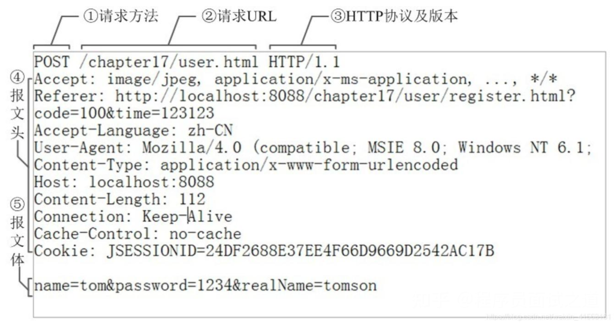
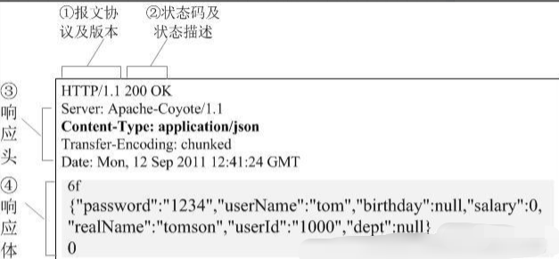
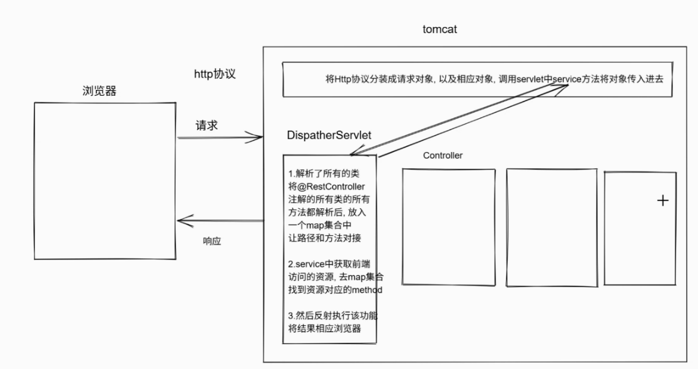

# 04 测试用例_注解_SpringMVC

## spring处理冲突的bean的解决方案

如何让这个类变成应用接口类

<callout emoji="🎉">
IOC/DI如何处理容器中冲突的bean
</callout>

### 第一种 @Autowired + @Qualifier

可以结合@Qualifier解决，可以指定名字注入

<callout emoji="🎼">
例如：@Qualifier("bean"的名字)
</callout>

示例代码：

```Java
package com.itcast.controller;
import com.itcast.service.TestService;
import org.springframework.beans.factory.annotation.Autowired;
import org.springframework.beans.factory.annotation.Qualifier;
import org.springframework.stereotype.Controller;
@Controller
public class TestController {
    /**
     * @Autowired：
     *   1. 默认按照“类型”进行注入
     *   2. 当容器中有多个相同类型的 Bean 时会产生冲突
     *
     * @Qualifier：
     *   1. 用来指定要注入的 Bean 的名字
     *   2. 解决同类型 Bean 冲突问题
     */
    @Autowired
    @Qualifier("testServiceImpl") // 指定注入名为 testServiceImpl 的 Bean
    private TestService testService;
    public void run() {
        testService.test();
    }
}

```

<callout emoji="🐵">
`@Autowired` 负责找类型，`@Qualifier` 负责精确指定 Bean 名
</callout>

### 第二种 按名称注入

可以采用@Resource解决，可以通过name属性指定名字注入

<callout emoji="🎁">
例如：@Resource(name = "bean的名字")
</callout>

示例代码：

```Java
package com.itcast.controller;
import com.itcast.service.TestService;
import jakarta.annotation.Resource;
import org.springframework.stereotype.Controller;
@Controller
public class TestController {
    /**
     * @Resource：
     *   1. JDK 提供的注解
     *   2. 默认按照 name 属性进行注入
     *   3. 不需要再配合 @Autowired 使用
     *
     * name 的值 = Bean 的名字
     */
    @Resource(name = "testServiceImpl1")
    private TestService testService;

    public void run() {
        testService.test();
    }
}

```

<callout emoji="🎉">
`@Resource`：我指定名字，你就给我这个 Bean
</callout>

### 第三种 指定默认 Bean

<callout emoji="✏️">
可以采用@Primary解决，通过@Primary指定默认的bean,提高优先级
</callout>

示例代码：

修改其中一个实现类:

```Java
package com.itcast.service.impl;

import com.itcast.service.TestService;
import org.springframework.context.annotation.Primary;
import org.springframework.stereotype.Service;

/**
 * @Primary：
 *   1. 标记当前 Bean 为“首选 Bean”
 *   2. 当容器中存在多个同类型 Bean 时
 *      优先注入该 Bean
 */
@Primary
@Service("testServiceImpl")
public class TestServiceImpl implements TestService {
    @Override
    public void test() {
        System.out.println("TestServiceImpl 执行了...");
    }
}

```

Controller 中直接按类型注入

```Java
package com.itcast.controller;
import com.itcast.service.TestService;
import org.springframework.beans.factory.annotation.Autowired;
import org.springframework.stereotype.Controller;

@Controller
public class TestController {
    /**
     * 由于容器中有 @Primary 标注的 Bean
     * 所以即使有多个 TestService 类型
     * Spring 也会自动注入 @Primary 的那个
     */
    @Autowired
    private TestService testService;
    public void run() {
        testService.test();
    }
}
```

<callout emoji="🥛">
`@Primary` 是“默认选择”
如果同时使用 `@Qualifier`，**以 @Qualifier 为准**
</callout>

## 测试

原始测试代码的方式的弊端：

<callout emoji="🎉">
(1) 不能批量测试多个功能  
(2) 不能将多个测试结果分离  
(3) 一个测试失败可能影响其他功能的测试
</callout>

### 测试方法

#### 黑盒测试（该岗位基本已经淘汰）：

<callout emoji="🎼">
只要给数据, 拿结果, 观察结果是否和预想一样即可, 不需要写任何代码!!!
只关心代码的输入和输出，不关心内部实现。
</callout>

#### 灰盒测试:

<callout emoji="🎼">
能够写部分代码, 压力测试循环测试..., 多个值测试....
介于黑盒和白盒之间的测试方法
</callout>

#### 白盒测试（目前主流岗位的测试方法）:

<callout emoji="🌟">
自己能够写测试用例, 测试代码
白盒相较于黑盒，白盒侧重于关注代码内部的逻辑结构与实现。
</callout>


### 定义测试用例

#### 测试类名的规则

```Java
1.定义一个测试用例，这个测试用例的类名建议叫做被测试的类+Test
2.
```

#### 测试方法的规则

定义测试方法，来测试每一个功能，这个测试方法想要独立运行那么可以和测试框架交互，标注一下`@Test`

<callout emoji="🌟">
（1）方法名建议叫做test+要测试的功能  
（2）方法不能有返回值  
（3）方法不能有参数
</callout>

### 测试框架

常用的注解：

```Java
@Test（重点）：标注方法是一个测试方法，可以"独立运行"
@BeforeEach：在每一个测试方法之前执行
@AfterEach：在每一个测试方法之后执行
@BeforeALl：在所有测试方法之前执行，只执行一次，必须是静态方法
@AfterALL：在所有测试方法之后执行，只执行一次，必须是静态方法
```

### 参数化测试（重点）

```Java
必须采用@ParameterizedTest，这个和@Test是冲突的
而且必须声明参数，参数可以接受单个元素
必须采用@VaLueSource对参数赋值
```

<callout emoji="🍞">
注意：测试主要测试代码是否能够顺利执行，是否有异常！！！，如果你想要测试的结果和你预期对比，不一致影响测试结果的话必须学会断言
Assertions工具类专用断言结果和预期结果是否一致用的
</callout>

示例代码：

```Java
package cn.itcast;
import org.junit.jupiter.api.*;
import org.junit.jupiter.params.ParameterizedTest;
import org.junit.jupiter.params.provider.ValueSource;

/**
 * MathUtilsTest
 *
 * 单元测试类说明：
 * 1. 测试类命名规范：被测试类名 + Test
 * 2. 专门用于测试 MathUtils 中的各个方法
 * 3. 使用的是 JUnit 5（Jupiter）
 */
public class MathUtilsTest {
    /**
     * 在所有测试方法执行之前执行
     * 只执行一次
     * ⚠ 必须是 static 方法
     */
    @BeforeAll
    public static void beforeAll() {
        System.out.println("每日大赛！！！终极测试");
    }
    /**
     * 在每一个测试方法执行之前执行
     * 常用于：初始化资源、打印日志
     */
    @BeforeEach
    public void beforeEach() {
        System.out.println("A公司终极测试");
    }
    /**
     * 测试加法功能
     * 普通测试方法：
     *  - 使用 @Test 标注
     *  - 方法名建议：test + 功能名
     *  - 方法不能有返回值
     *  - 方法不能有参数
     */
    @Test
    public void testGetSum() {
        MathUtils mathUtils = new MathUtils();
        int sum = mathUtils.getSum(1, 2);
        // 断言：预期结果是 3
        Assertions.assertEquals(3, sum);
    }
    /**
     * 参数化测试：测试多组数据
     *  - 使用 @ParameterizedTest
     *  - 不能和 @Test 同时使用
     *  - 测试方法必须有参数
     *  - 使用 @ValueSource 提供测试数据
     */
    @ParameterizedTest
    @ValueSource(ints = {1, 2, 3, 4, 5})
    public void testGetSumParameter(int id) {
        MathUtils mathUtils = new MathUtils();
        // 分别测试：1 + id 和 id + 1
        System.out.println("1 + " + id + " = " + mathUtils.getSum(1, id));
        System.out.println(id + " + 1 = " + mathUtils.getSum(id, 1));
    }
    /**
     * 测试减法功能
     */
    @Test
    public void testGetSubtract() {
        MathUtils mathUtils = new MathUtils();
        int result = mathUtils.getSubtract(10, 3);
        Assertions.assertEquals(7, result);
    }
    /**
     * 参数化测试：测试乘法功能
     */
    @ParameterizedTest
    @ValueSource(ints = {1, 2, 3, 4})
    public void testGetMultiply(int num) {
        MathUtils mathUtils = new MathUtils();
        int result = mathUtils.getMultiply(num, 2);
        Assertions.assertEquals(num * 2, result);
    }
    /**
     * 测试除法功能
     */
    @Test
    public void testGetDivide() {
        MathUtils mathUtils = new MathUtils();
        int result = mathUtils.getDivide(10, 2);

        Assertions.assertEquals(5, result);
    }
    /**
     * 异常测试（重点）
     * 测试除数为 0 时是否抛出 ArithmeticException
     */
    @Test
    public void testGetDivideException() {
        MathUtils mathUtils = new MathUtils();

        Assertions.assertThrows(ArithmeticException.class, () -> {
            mathUtils.getDivide(10, 0);
        });
    }
    /**
     * 在每一个测试方法执行之后执行
     * 常用于：资源释放、收尾工作
     */
    @AfterEach
    public void afterEach() {
        System.out.println("A公司终极测试完成");
    }
    /**
     * 在所有测试方法执行之后执行
     * 只执行一次
     * ⚠ 必须是 static 方法
     */
    @AfterAll
    public static void afterAll() {
        System.out.println("终极测试完成");
    }
}
/*
===================== 单元测试总结说明 =====================

1. 测试类命名规范
   - 被测试类名 + Test
   - 示例：MathUtils -> MathUtilsTest

2. 测试方法规范
   - 使用 @Test 标注
   - 方法名建议：test + 功能名
   - 方法不能有返回值
   - 普通 @Test 方法不能有参数

3. JUnit 5 常用注解（重点）
   @Test            : 标注测试方法
   @BeforeEach      : 每个测试方法之前执行
   @AfterEach       : 每个测试方法之后执行
   @BeforeAll       : 所有测试方法之前执行（只一次，static）
   @AfterAll        : 所有测试方法之后执行（只一次，static）

4. 参数化测试（重点）
   - 使用 @ParameterizedTest
   - 不能和 @Test 同时使用
   - 测试方法必须有参数
   - 使用 @ValueSource 提供参数

5. 断言（Assertions）
   - 用于对比“预期结果”和“实际结果”
   - 断言失败，测试失败
   - 常用方法：
        assertEquals
        assertThrows
        assertNotNull

6. 单元测试的核心目的
   - 验证代码是否能正常执行
   - 是否抛出异常
   - 结果是否符合预期

===========================================================
*/

```

## *注解*

<callout emoji="🥛">
*概念:JDK5出现的新特性,简化程序和(程序之间之间)(和框架)交互技术*
*本质:原来注解本质上是一个臭接口,基于jdk1.5接口的升级*
</callout>

### *框架职责*

 *(1)定义注解*

```Java
 public@interface注解名{
    常量
    抽象方法
}
public interface Anno extends java.lang.annotation.Annotation{
}
```

*注意事项:*

*抽象方法-->*

*(1)抽象方法不能有参数*  
*(2)抽象方法的返回值值类型只能是如下类型*

<callout emoji="🎁">
*(1)基本数据类型*  
*(2)String类型*  
*(3)字节码类型*  
*(4)注解类型*  
*(5)枚举类型*
*或者以上类型的一维数组！！！！*
</callout>

#### 定义注解

示例代码：

```Java
package demo.anno;

import java.lang.annotation.*;

/**
 * 演示：元注解 + 注解抽象方法的返回值类型限制
 */
@Documented
@Inherited
@Retention(RetentionPolicy.RUNTIME)              // 运行时可用（反射能取到）
@Target({ElementType.TYPE, ElementType.METHOD})  // 只能修饰类/接口/注解/枚举 以及 方法
public @interface MyAnno {

    // 1) 基本数据类型
    int id() default 1;
    // 2) String 类型
    String name() default "defaultName";
    // 3) 字节码类型
    Class<?> clazz() default Object.class;
    // 4) 枚举类型
    Level level() default Level.MEDIUM;
    // 5) 注解类型
    Meta meta() default @Meta(desc = "meta-default");
    // 6) 以上类型的一维数组
    String[] tags() default {"tagA", "tagB"};
    /**
     * 特殊：当抽象方法名叫 value
     * 使用注解时：@MyAnno("xxx") 可以省略 value=
     */
    String value() default "";
}

```

```Java
package demo.anno;

public enum Level {
    LOW, MEDIUM, HIGH
}
```

```Java
package demo.anno;

import java.lang.annotation.Retention;
import java.lang.annotation.RetentionPolicy;

@Retention(RetentionPolicy.RUNTIME)
public @interface Meta {
    String desc();
}

```

*(3)我们定义的注解如果没有被”元注解修饰,那么只存在源码阶段,翻译成.class文件就注解不存在*

*什么是元注解？*

<callout emoji="🎨">
*元注解:jdk定义出来专门用于修饰注解的注解叫做元注解*
</callout>

```Java
@Retention:设置注解存在阶段,默认值是存在只存在源码阶段
    RetentionPoLicy.SOURCE:只存在源码阶段(默认值)
    RetentionPoLicy.CLASS:存在源码和字节码文件中
    RetentionPoLicy.RUNTIME:存在源码,字节码文件中,运行时阶段都有效
@Target:设置注解可以修饰的内容,如果不设置,注解可以修饰他能修饰的所有
    ELementType.TYPE:修饰类,接口,枚举,注解
    ELementType.FIELD:修饰属性
    ELementType.METHOD:修饰方法
@Documented:抽取文档的时候需要不要显示该注解的信息
@Inherited:标注注解是否可以被继承
```

#### 解析注解

```Java
package demo.parse;
import demo.anno.MyAnno;
import demo.use.ChildService;
import demo.use.UserService;
import java.lang.reflect.Method;
public class AnnoParser {
    public static void main(String[] args) throws Exception {
        // ========== 1) 解析“类上的注解” ==========
        System.out.println("---- 解析 UserService 类注解 ----");
        parseClassAnno(UserService.class);
        // ========== 2) 解析“方法上的注解” ==========
        System.out.println("\n---- 解析 UserService 方法注解 ----");
        parseMethodAnno(UserService.class, "sum");
        parseMethodAnno(UserService.class, "hello");
        // ========== 3) 演示 @Inherited（子类拿父类类注解） ==========
        System.out.println("\n---- 演示 @Inherited：解析 ChildService 类注解 ----");
        parseClassAnno(ChildService.class);
    }
    private static void parseClassAnno(Class<?> clazz) {
        // 反射对象拿注解：clazz.getAnnotation(注解类型)
        MyAnno anno = clazz.getAnnotation(MyAnno.class);
        if (anno == null) {
            System.out.println(clazz.getSimpleName() + " 没有 MyAnno 注解");
            return;
        }
        // 注解对象就是“注解接口的实现类对象”，可以直接调用抽象方法取值
        System.out.println("类名: " + clazz.getSimpleName());
        System.out.println("value: " + anno.value());
        System.out.println("id: " + anno.id());
        System.out.println("name: " + anno.name());
        System.out.println("clazz: " + anno.clazz().getName());
        System.out.println("level: " + anno.level());
        System.out.println("meta.desc: " + anno.meta().desc());
        System.out.print("tags: ");
        for (String tag : anno.tags()) {
            System.out.print(tag + " ");
        }
        System.out.println();
    }
    private static void parseMethodAnno(Class<?> clazz, String methodName) throws Exception {
        // 获取反射 Method 对象
        Method method;
        // 这里为了简单：用无参方法/或参数固定的 sum(int,int)
        if ("sum".equals(methodName)) {
            method = clazz.getDeclaredMethod(methodName, int.class, int.class);
        } else {
            method = clazz.getDeclaredMethod(methodName);
        }
        MyAnno anno = method.getAnnotation(MyAnno.class);
        System.out.println("方法名: " + method.getName());
        if (anno == null) {
            System.out.println("  没有 MyAnno 注解");
            return;
        }
        System.out.println("  value: " + anno.value());
        System.out.print("  tags: ");
        for (String tag : anno.tags()) {
            System.out.print(tag + " ");
        }
        System.out.println();
    }
}
```


#### 继承演示

> 注意：`@Inherited` **只对“类上的注解”有效**，方法/字段上的注解不会被继承。

```Java
package demo.use;

public class ChildService extends UserService {
    // 不写任何注解
    // 但如果 MyAnno 标了 @Inherited，则 ChildService.class 也能拿到父类的类注解
}

```

### *用户职责*

*(3)使用注解和框架交互数据即可*

<callout emoji="🥇">
*特殊使用格式,可以通过"@注解名"创建注解实现类对象,需要对注解中的所有的抽象方法进行重写*  
*但是注解重写抽象方法比较特殊,只需要设置抽象方法的返回值即可,格式为:*
</callout>

```Java
@注解名(抽象方法名1=返回值1,抽象方法名2=返回值2...)
```

#### 使用注解

用注解与框架交互，示例代码：

```TypeScript
package demo.use;

import demo.anno.*;

/**
 * 演示：
 * 1) @MyAnno 的 value 省略写法：@MyAnno("xxx")
 * 2) 数组单个值可以省略 {}：tags="singleTag"
 */
@MyAnno(
        value = "class-anno",
        id = 100,
        name = "UserService",
        clazz = String.class,
        level = Level.HIGH,
        meta = @Meta(desc = "class-meta"),
        tags = {"service", "user"} // 多个值：必须写 {}
)
public class UserService {

    @MyAnno("method-anno") // value= 省略
    public int sum(int a, int b) {
        return a + b;
    }

    @MyAnno(tags = "singleTag") // 一维数组赋单个值：可以省略 {}
    public void hello() {
        System.out.println("hello");
    }
}

```

*注意事项:*

<callout emoji="🎁">
*当抽象方法的方法名为value的时候,而且只是对该抽象方法设置返回值的话,value可以省略*  
*当返回值类型是一个一维数组,我们只赋值单个值的时候,可以省略*
</callout>

### IOC&DI

扫描了你所有的类，只要类有@RestController注解的类都会被ioc并放入ioc容器  
解析这些类中所有的功能，这些功能中的短路径!！将其放入到map集合让和路径和功能绑定在一起

```Java
(1)tomcat解析HTTP的请求，并调用DishpatherServlet的service方法
(2)service方法中，得到请求的uri路径，拿到请求的资源的"小路径"
```

## servlet的来源

Servlet 的出现是为了解决 **Java 程序如何处理 HTTP 请求的问题**。

<callout emoji="🎁">
HTTP 是客户端（浏览器）与服务器之间通信的协议
Java 本身不能直接处理 HTTP
Servlet 是 **Java 处理 HTTP 请求的标准接口规范**
</callout>

👉 **Servlet = Java Web 程序与 HTTP 协议之间的桥梁**

### http协议

### HTTP 协议（Servlet 前提）

#### HTTP 是什么

<callout emoji="👍">
HTTP 是 **客户端（浏览器）和服务器之间通信的协议**
是超文本传输协议, 基于TCP/IP协议的通信协议
基于请求和响应模型
本质是：**请求 + 响应**
无状态协议：每次请求都是独立的，不会携带上一次的内容
http协议默认端口是-->80:
Https: -->443
Https相教于http多了加密传输协议 
例：

https://www.baidu.com
</callout>


#### HTTP 请求

<callout emoji="🎹">
请求行：`GET /test HTTP/1.1`（请求）
请求头
请求体（POST 才有）
</callout>

```Java
请求：---> 规定客户端向服务器发送数据的格式
    请求行
        请求方式 请求uri资源路径 协议的版本
    请求头 ---> 客户端告诉服务器自身的一些信息
        键: 值
    请求空行 ---> 就是隔开请求头和请求体空行
    请求体 ---> 携带post或者put等请求参数部分
```



<callout emoji="🏝️">
①是请求方法，GET和POST是最常见的HTTP方法，除此以外还包括`DELETE、HEAD、OPTIONS`、`PUT`、TRACE。不过，当前的大多数浏览器只支持`GET`和`POST`，Spring 3.0提供了一个`HiddenHttpMethodFilter`，允许你通过“\_method”的表单参数指定这些特殊的HTTP方法（实际上还是通过`POST`提交表单）。服务端配置了`HiddenHttpMethodFilter`后，Spring会根据_method参数指定的值模拟出相应的HTTP方法，这样，就可以使用这些HTTP方法对处理方法进行映射了。
请求方法详解一篇让你彻底搞定HTTP方法与状态码
②为请求对应的URL地址，它和报文头的Host属性组成完整的请求URL，
③是协议名称及版本号。
④是HTTP的报文头 ，报文头包含若干个属性，格式为“属性名:属性值”，服务端据此获取客户端的信息。
</callout>

以下是关键的请求头字段分类说明：

| **分类** | **关键字段** | **说明与示例** |
|-|-|-|
| **基础信息** | `Host` | 请求资源所在的主机名和端口号，HTTP/1.1规范中必须包含。示例：`Host: www.example.com:8080` |
|  | `User-Agent` | 描述发起请求的客户端（如浏览器、应用程序）的信息。示例：`User-Agent: Mozilla/5.0 (Windows NT 10.0; Win64; x64) AppleWebKit/537.36` |
| **内容协商** | `Accept` | 告知服务器客户端能够处理的响应内容类型（MIME类型）及优先级。示例：`Accept: text/html, application/json;q=0.9` |
|  | `Accept-Language` | 客户端偏好的自然语言。示例：`Accept-Language: zh-CN, en;q=0.8` |
|  | `Accept-Encoding` | 客户端支持的响应内容压缩编码方式。示例：`Accept-Encoding: gzip, deflate` |
| **条件请求** | `If-Modified-Since` | 如果请求的资源在指定时间后未被修改，则返回304状态码，表示可使用缓存。示例：`If-Modified-Since: Tue, 15 Aug 2023 10:30:00 GMT` |
|  | `If-None-Match` | 如果提供的ETag与服务器当前资源的ETag不匹配，才返回完整资源。通常与响应头`ETag`配合使用。 |
| **认证与状态** | `Authorization` | 包含访问受保护资源的凭证。示例：`Authorization: Bearer <token>` |
|  | `Cookie` | 将之前由服务器通过`Set-Cookie`发送的Cookie回传给服务器。 |
| **请求体相关** | `Content-Type` | 指定请求消息主体的媒体类型（MIME类型），适用于POST、PUT等方法。示例：`Content-Type: application/json` |
|  | `Content-Length` | 指明请求消息主体的长度（字节数）。 |

常见的 HTTP 请求方法列表：

| 方法 | 描述 |
|-|-|
| GET | 从服务器获取资源。用于请求数据而不对数据进行更改。例如，从服务器获取网页、图片等。 |
| POST | 向服务器发送数据以创建新资源。常用于提交表单数据或上传文件。发送的数据包含在请求体中。 |
| PUT | 向服务器发送数据以更新现有资源。如果资源不存在，则创建新的资源。与 POST 不同，PUT 通常是幂等的，即多次执行相同的 PUT 请求不会产生不同的结果。 |

#### HTTP 响应

<callout emoji="🥇">
状态行：`HTTP/1.1 200 OK`（响应状态）
响应头
响应体（数据）
</callout>

```Java
响应: ---> 规服务器向客户端发送数据的格式
        响应行
            协议的版本 状态码 状态码的描述
        响应头 ---> 服务器告诉客户端自身一些信息
            键: 值
        响应空行 ---> 就是隔开响应头和响应体空行
        响应体  ---> 响应的主体内容
```



<callout emoji="🚅"><p>①报文协议及版本；<br/>②状态码及状态描述；<br/>状态码详解<cite doc-id="Eh9OwCm5ZiqLyjkvR7lc6VCUn7e" file-type="wiki" title="day03 SpringBoot基础开发_三层架构_反射分层解耦" type="doc"></cite><br/>③响应报文头，也是由多个属性组成；</p></callout>

<callout emoji="👍">
HTTP响应也由三个部分组成：状态行、响应头和响应体。
</callout>

HTTP请求和响应都是由起始行、头字段和消息体组成的。在网络中，它们以纯文本的方式传输。  
示例HTTP报文如下所示：

```Java
//状态行包含了HTTP协议的版本、状态码和状态描述。常见的状态码有200表示成功，404表示页面不存在，500表示服务器内部错误等。
GET /index.html HTTP/1.1
Host: www.example.com
User-Agent: Mozilla/5.0 (Windows NT 10.0; Win64; x64) AppleWebKit/537.36 (KHTML, like Gecko) Chrome/89.0.4389.82 Safari/537.36

//响应头包含了响应的一些元数据信息，例如Content-Type、Content-Length、Set-Cookie等。
HTTP/1.1 200 OK
Content-Type: text/html; charset=utf-8
Content-Length: 1024

//响应体包含了服务器返回的实际数据，例如网页的HTML内容、图片、JSON数据等。
<!DOCTYPE html>
<html>
<head>
    <title>Welcome to My Website</title>
</head>
<body>
    <h1>Hello, World!</h1>
</body>
</html>
```

在上述示例中，请求和响应报文之间使用空行分隔，以表示报文的结束。

📌 **Servlet 的职责**

> 接收 HTTP 请求 → 解析 → 调用 Java 代码 → 返回 HTTP 响应

### servlet的编写流程

#### Servlet 本质

<callout emoji="🌟">
Servlet 是一个 **Java 接口**
由 **Tomcat** 调用
</callout>

```TypeScript
public class TestServlet extends HttpServlet {
    @Override
    protected void doGet(HttpServletRequest req, HttpServletResponse resp) {
        // 处理 GET 请求
    }
    @Override
    protected void doPost(HttpServletRequest req, HttpServletResponse resp) {
        // 处理 POST 请求
    }
}
```

### Servlet 执行流程



<callout emoji="💡">
1. 浏览器发送请求
2. Tomcat 接收请求
3. Tomcat 根据 URL 找到 Servlet
4. 调用 `doGet / doPost`
5. 返回响应
</callout>

### 一个请求一个 Servlet

最原始的 Servlet 开发阶段（没有 Controller）

```Java
public class AddUserServlet extends HttpServlet {
    protected void doGet(HttpServletRequest req, HttpServletResponse resp) {
        // 添加用户
    }
}
```

优点：

<callout emoji="🎉">
提高了HttpServlet访问范围
@WebServlet("/users/\*")
</callout>

存在的问题

<callout emoji="🌟">
Servlet 数量爆炸（Add / Delete / Update / Find）
请求控制、业务处理、响应逻辑混在一起
可维护性极差
</callout>

**👉** 此时还没有 Controller 的概念

### 单个 Servlet 如何处理多个请求

#### 通过参数区分功能

Controller 雏形

示例代码：

```Java
public class UserServlet extends HttpServlet {

    protected void doGet(HttpServletRequest req, HttpServletResponse resp) {
        String method = req.getParameter("method");

        if ("add".equals(method)) {
            add(req, resp);
        } else if ("delete".equals(method)) {
            delete(req, resp);
        }
    }
}

```

**本质变化：**

<callout emoji="🏆">
Servlet 开始“控制请求走向”
Controller 的雏形出现
</callout>

#### 问题

如果一个 Servlet 只写一个功能：

```Java
UserAddServlet
UserDeleteServlet
UserUpdateServlet
```

👉 **Servlet 数量爆炸**

---

#### 一个 Servlet + 多个功能

解决方案，示例代码：

```Java
public class UserServlet extends HttpServlet {
protected void doGet(HttpServletRequest req, HttpServletResponse resp) {String method = req.getParameter("method");
if ("add".equals(method)) {
            add(req, resp);
        } else if ("delete".equals(method)) {
            delete(req, resp);
        }
    }
private void add(...) {}private void delete(...) {}
}
```

📌 **问题**

<callout emoji="🎹">
if-else 极多
可维护性差
违反开闭原则
</callout>

### 通过反射简化分发方法

#### 核心思想

> **请求参数 = 方法名 → 通过反射调用方法**

#### BaseServlet

示例代码：

```Java
public class BaseServlet extends HttpServlet {

    protected void service(HttpServletRequest req, HttpServletResponse resp) {
        String methodName = req.getParameter("method");

        try {
            // 通过反射找到方法
            Method method = this.getClass()
                    .getDeclaredMethod(methodName,
                            HttpServletRequest.class,
                            HttpServletResponse.class);

            // 执行方法
            method.invoke(this, req, resp);

        } catch (Exception e) {
            e.printStackTrace();
        }
    }
}

```

📌 **优点**

<callout emoji="🏖️">
消除了 if-else
新增功能只需新增方法

定义baseservet让分发的动作放入这里，其他servlet继承baseServlet分发代码只需要写一遍即可
</callout>

👉 **Servlet 正式转型为 Controller（控制器）**

### 多个servlet如何抽取共性内容

#### 问题

<callout emoji="🏖️">
每个 Servlet 都需要反射分发逻辑
重复代码严重
</callout>

#### 解决方案：抽取父类

示例代码：

```TypeScript
public class UserServlet extends BaseServlet {

    public void add(...) {}
    public void delete(...) {}
}
```

📌 **此时的设计思想**

<callout emoji="🎁">
父类负责控制
子类负责业务
</callout>

### 前端控制器模式

#### 问题升级 Controller 的质变

<callout emoji="🍞">
Servlet 仍然很多
URL 与 Servlet 强绑定
</callout>

#### 前端控制器思想

```Java
   浏览器
     ↓
唯一 Servlet
     ↓
分发到不同处理逻辑
```

👉 将**所有请求统一入口**

### SpringMVC在这个基础上如何整合

SpringMVC = **Servlet + 反射 + 注解 + IOC**

#### 定义DispatherServlet

##### 为什么要定义 DispatcherServlet

在前面的阶段中（BaseServlet + 反射）已经存在几个明显问题：

<callout emoji="💡">
1. 每个模块都要写一个 BaseServlet
2. 每个 BaseServlet 都要手动写反射分发逻辑
3. Tomcat 与 Servlet 仍然存在较强耦合
4. 无法统一管理所有请求映射关系
</callout>

为了解决这些问题，引入 **DispatcherServlet（前端控制器）**：

> **把“请求接收 + 分发 + 调用”的控制逻辑，统一交给一个 Servlet 处理**

这就是 SpringMVC 的核心思想来源。

springMVC定义DispatherServlet，这个前端控制器

<callout emoji="🦄">
1. 扫描了所有的类，将抗有@RestController注解的类都创建对象
2. 并且解析了这些类中的功能，将功能中ur路径取出来和类上的路径整合
3. 将路径--->（方法，对象，路径）以键值对的方法存储到map集合中
4. 在service方法中，获取前端请求的路径
5. 根据路径从map集合中取出（方法，对象，路径）
6. 利用反射技术将方法调用起来！！
</callout>


#### DispatcherServlet 在整体架构中的位置

> **所有请求都先到 DispatcherServlet**
> 
> DispatcherServlet 是一个 Servlet  
>  也是 **SpringMVC 的前端控制器**

```Java
       浏览器
         ↓
       Tomcat
         ↓
  DispatcherServlet （唯一入口）
         ↓
    Controller （普通 Java 类）
         ↓
      返回结果
```

#### springMVC定义DispatherServlet

这个前端控制器

<callout emoji="✏️">
1.扫描了所有的类，将抗有`@RestController`注解的类都创建对象
2.并且解析了这些类中的功能，将功能中url路径取出来和类上的路径整合
3.将路径--->（方法，对象，路径）以键值对的方法存储到map集合中
4.在service方法中，获取前端请求的路径
5.根据路径从map集合中取出（方法，对象，路径）
6.利用反射技术将方法调用起来！！！！！
</callout>

**关键变化点：**

<callout emoji="🍰">
Tomcat 不再关心“请求映射到哪个方法”
Tomcat 只负责把请求交给 DispatcherServlet
DispatcherServlet 负责真正的请求分发
</callout>

#### 手搓 SpringMVC 原理

目录结构：

```Java
src
 └── main
     ├── java
     │   └── cn
     │       └── itcast
     │           ├── web
     │           │   └── DispatcherServlet.java
     │           │
     │           ├── annotation
     │           │   ├── RestController.java
     │           │   └── RequestMapping.java
     │           │
     │           ├── mapper
     │           │   └── ControllerMapper.java
     │           │
     │           ├── controller
     │           │   ├── UserController.java
     │           │   └── TestController.java
     │           │
     │           └── service
     │               └── UserService.java
     │
     └── webapp
         └── WEB-INF
             └── web.xml   （如果不用 @WebServlet）

```

DispatcherServlet（前端控制器，核心）：

```Java
package cn.itcast.web;

import cn.itcast.annotation.RequestMapping;
import cn.itcast.annotation.RestController;
import cn.itcast.mapper.ControllerMapper;

import javax.servlet.ServletException;
import javax.servlet.annotation.WebServlet;
import javax.servlet.http.HttpServlet;
import javax.servlet.http.HttpServletRequest;
import javax.servlet.http.HttpServletResponse;
import java.io.File;
import java.io.IOException;
import java.lang.reflect.Method;
import java.util.HashMap;
import java.util.Map;

/**
 * DispatcherServlet
 *
 * 前端控制器：
 * 1. 拦截所有请求
 * 2. 启动时扫描 Controller
 * 3. 建立 URL -> Controller 方法 的映射关系
 * 4. 运行时完成请求分发
 */
@WebServlet("/*") // 拦截所有请求
public class DispatcherServlet extends HttpServlet {

    /**
     * 保存 URL 与 Controller 方法的映射关系
     * key   : 请求路径（如 /user/findAll）
     * value : ControllerMapper（封装 controller 对象 + method）
     */
    private static Map<String, ControllerMapper> controllerMappers = new HashMap<>();

    /**
     * static 代码块：
     * 类加载时执行，相当于“框架启动初始化”
     */
    static {
        try {
            loadController();
            System.out.println("Controller 映射表：" + controllerMappers);
        } catch (Exception e) {
            e.printStackTrace();
        }
    }

    /**
     * 扫描 Controller，解析 @RequestMapping，建立映射关系
     */
    private static void loadController() throws Exception {

        // 1. 获取 classes 根路径（target/classes）
        String path = DispatcherServlet.class
                .getClassLoader()
                .getResource("")
                .getPath();

        // 2. controller 包所在目录
        File file = new File(path + "cn/itcast/controller");

        // 3. 遍历该目录下所有 class 文件
        File[] files = file.listFiles();
        for (File f : files) {

            // 4. 把磁盘路径转换成类的全限定名
            String absolutePath = f.getAbsolutePath();
            String className = absolutePath
                    .replace(path, "")
                    .substring(1, absolutePath.length() - 6)
                    .replace("\\", ".");

            // 5. 加载 Class 对象
            Class<?> clazz = Class.forName(className);

            // 6. 判断是否是 Controller
            RestController restController = clazz.getAnnotation(RestController.class);
            if (restController == null) {
                continue;
            }

            // 7. 创建 Controller 对象（模拟 IOC）
            Object controller = clazz.getConstructor().newInstance();

            // 8. 解析类上的 @RequestMapping
            RequestMapping classMapping = clazz.getAnnotation(RequestMapping.class);
            String firstPath = classMapping == null ? "" : classMapping.value();

            // 9. 遍历方法，解析方法上的 @RequestMapping
            Method[] methods = clazz.getDeclaredMethods();
            for (Method method : methods) {

                RequestMapping methodMapping = method.getAnnotation(RequestMapping.class);
                if (methodMapping == null) {
                    continue;
                }

                // 10. 拼接完整请求路径
                String url = firstPath + methodMapping.value();

                // 11. 保存映射关系
                controllerMappers.put(
                        url,
                        new ControllerMapper(controller, method, url)
                );
            }
        }
    }

    /**
     * 处理所有请求（运行阶段）
     */
    @Override
    protected void service(HttpServletRequest req, HttpServletResponse resp)
            throws ServletException, IOException {

        // 1. 获取请求路径
        String requestURI = req.getRequestURI();

        // 2. 根据路径查找映射
        ControllerMapper controllerMapper = controllerMappers.get(requestURI);

        if (controllerMapper == null) {
            resp.getWriter().write("404 NOT FOUND");
            return;
        }

        try {
            // 3. 反射调用目标方法
            Object result = controllerMapper
                    .getMethod()
                    .invoke(controllerMapper.getController());

            // 4. 响应结果
            resp.setContentType("text/html;charset=utf-8");
            resp.getWriter().write(result.toString());

        } catch (Exception e) {
            e.printStackTrace();
        }
    }
}

```

ControllerMapper（映射关系封装类）：

```TypeScript
package cn.itcast.mapper;

import java.lang.reflect.Method;

/**
 * ControllerMapper
 *
 * 封装：
 * 1. controller 对象
 * 2. method 方法
 * 3. url 请求路径
 */
public class ControllerMapper {

    private Object controller;
    private Method method;
    private String url;

    public ControllerMapper(Object controller, Method method, String url) {
        this.controller = controller;
        this.method = method;
        this.url = url;
    }

    public Object getController() {
        return controller;
    }

    public Method getMethod() {
        return method;
    }

    public String getUrl() {
        return url;
    }
}

```

@RestController 注解（标记 Controller）：

```Java
package cn.itcast.annotation;

import java.lang.annotation.Retention;
import java.lang.annotation.RetentionPolicy;

/**
 * 标记控制层组件
 */
@Retention(RetentionPolicy.RUNTIME) // 运行时可反射
public @interface RestController {
}

```

@RequestMapping 注解（请求映射）：

```Java
package cn.itcast.annotation;

import java.lang.annotation.Retention;
import java.lang.annotation.RetentionPolicy;

/**
 * 请求映射注解
 * value 用于指定请求路径
 */
@Retention(RetentionPolicy.RUNTIME)
public @interface RequestMapping {
    String value();
}

```

示例 Controller：

```TypeScript
package cn.itcast.controller;

import cn.itcast.annotation.RequestMapping;
import cn.itcast.annotation.RestController;

/**
 * 用户 Controller
 */
@RestController
@RequestMapping("/user")
public class UserController {

    @RequestMapping("/findAll")
    public String findAll() {
        return "find all users";
    }

    @RequestMapping("/add")
    public String add() {
        return "add user success";
    }
}

```

<callout emoji="✏️">
DispatcherServlet 是前端控制器，本质是 HttpServlet。
Tomcat 只负责把请求交给 DispatcherServlet，
DispatcherServlet 在启动时扫描 @RestController，
解析 @RequestMapping 建立 URL 到方法的映射关系，
请求到达后通过反射调用对应方法并返回结果。
</callout>

**DispatcherServlet 职责**

<callout emoji="🎨">
接收所有请求
分发请求
调用 Controller 方法
</callout>

#### SpringMVC让使用者如何使用功能

###### 框架内部做了什么

<callout emoji="📍">
扫描 Controller
解析注解
建立 URL → 方法映射
反射调用方法
</callout>

使用者直接定义Controller就可以使用SpringMVC

###### 注解驱动 Controller

<callout emoji="📍">
Controller 的底层演进是 Servlet 逐步解耦的过程。
SpringMVC 通过 DispatcherServlet 接管请求分发，

使 Tomcat 只负责请求转发，

Controller 只负责业务处理，
从而实现高内聚、低耦合的 Web 架构。
经过迭代 最后得到 Controller的最终形态
</callout>

**彻底脱离 Servlet API**

Controller 是 **普通 Java 类（POJO）**

<callout emoji="🎉">
不需要继承 `HttpServlet`
不需要依赖 `HttpServletRequest / Response`
</callout>

**注解驱动映射**

<callout emoji="🌟">
使用 `@Controller / @RestController`
使用 `@RequestMapping` 声明请求路径
URL → 方法映射由 SpringMVC 完成
</callout>

**框架接管以往繁杂的工作**

<callout emoji="⛱️">
请求参数自动绑定
返回值自动封装为响应
异常统一处理
编码、格式统一管理
</callout>

**@RestController**

示例代码：

```Java
@RestController
public class UserController {
}
```

作用：

<callout emoji="🍞">
标识当前类是 Controller
返回值直接写回响应体
</callout>

**@RequestMapping**

示例代码：

```TypeScript
@RequestMapping("/user/add")
public String add() {
    return "success";
}
```

作用：

<callout emoji="🎉">
建立请求路径与方法的映射关系
</callout>

## controller底层

### 发展历程

1. **阶段一原始Servlet接口实现（功能单一，冗余度高）**

```HTML
1. 直接实现Servlet接口，每个功能对应一个servlet类，需要手动实现 init /servlet/destroy等所有方法。
2. 问题：一个功能一个Servlet，类爆炸
```

1. **阶段二适配器模式优化（继承HttpServlet，减少冗余）**

```HTML
1. 继承HttpServlet（适配器类），仅需重写service方法，无需实现所有方法。
2. 问题：仍需为每个功能创建独立Servlet类。
```

1. **阶段三 单一Servlet(BaseServlet)+Tomcat(方法分发，减少类数量)**

```HTML
1. 封装BaseServlet（继承HttpServlet），通过反射解析URL中的方法名（比如：/user/add）。
    一个Servlet处理一个模块的所有功能。
2. Tomcat的核心衔接作用：
    1. 映射简化：Tomcat仅需解析web.xml中1哥Servlet的映射（如/user/*），所有该模块的请求都转发到这个
        Servlet。
    2. 声明周期管理：Tomcat仅初始化1个Servlet实例，而非多个，降低资源消耗
    3. 请求转发：Tomcat将所有/user/*请求转发到UserServlet的service()方法，后续的方法分发
      （调用add/delete）由BaseServlet的反射逻辑完成（Tomcat不感知内部方法
3. 直接催生springMVC:开发者仍需手动写反射逻辑，手动处理参数解析/相应封装；Tomcat与Servlet的耦合仍
    较深，且无法跨模块统一管理请求
```

1. **阶段四Tomcat+SpringMVC DispatcherServlet(框架接管，Controller诞生)**

```HTML
1. 核心变革：SpringMVC引入DispatcherServlet（前端控制器，本质仍是HttpServlet）代替自定义
    BaseServlet,彻底解耦Tomcat与业务逻辑。
2. Tom不再处理任何业务映射，仅仅做2件事：
    1. 启动时初始化DispatcherServlet,并加载Spring容器。
    2. 接受所有HTTP请求,直接转发给DispatcherServlet
3. Controller的核心特点：
       1. 普通Java类（无需继承HttpServlet/Servlet）通过@Controller/@RequestMapping声明映射，
           脱离Servlet API耦合
       2. DispatcherServlet替代Tomcat完成请求分发（匹配@RequestMapping到具体方法）
       3. Spring框架自动处理参数绑定，响应封装，异常处理，开发者仅关注业务逻辑。
```

| 维度 | 第三步 | SpringMVC Controller+Tomcat |
|-|-|-|
| 配置依赖 | 需要在web.xml配置模块级Servlet映射（如/user/\*） | 仅需配置DispatcherServlet的/\*映射，业务映射由注解完成。 |
| 请求分发 | 开发者手动写反射逻辑分发到方法 | DispatcherServlet自动分发（框架内置） |
| Tomcat职责 | 解析模块映射，转发请求到指定Servlet | 仅转发所有请求到DispatcherServlet，无业务感知 |
| 代码耦合 | 依赖Servelt API(HttpServletRequest/ServletResponse) | Controller可脱离Servlet API(框架自动封装) |

<callout emoji="❤️">
### 核心脉络总结
1. **Tomcat 的角色演进**：从 “管理所有 Servlet 实例、解析所有业务映射”→“仅管理一个 DispatcherServlet、仅做基础请求转发”，逐步从 “业务参与方” 降级为 “底层基础设施”；
2. **Controller 的核心变化**：从 “必须实现 Servlet 接口 / 继承 HttpServlet 的耦合类”→“无耦合的普通 Java 类”，从 “开发者手动处理所有请求细节”→“框架接管通用逻辑，仅聚焦业务”；
3. **整体目标**：始终围绕 “减少冗余代码、降低类数量、解耦底层容器与业务逻辑”，最终实现 Spring MVC Controller“轻量化、注解化、框架化” 的设计形态，成为 Java Web 开发的标准模式
</callout>


### 踩坑：MyBatis 注解与方法名冲突

### 注解与方法重复 冲突

xml和注解不能重复使用,否则mybatis将不知道使用哪个

若是有两个相同名字的方法 即使不调用也会报错 ,一样会干扰mybatis

```Java
@Insert("insert into user values(null,#{name},#{password},#{age},#{nickname})")
List<User> addUser(User user);

@Insert("insert into user values(null,#{name},#{password},#{age},#{nickname})")
int addUser(Map<String,Object> map);
```

控制台报错:

```SQL

============================
CONDITIONS EVALUATION REPORT
============================

Positive matches:
-----------------

    None

Negative matches:
-----------------

    None

Exclusions:
-----------

    None

Unconditional classes:
----------------------

    None

```

### 缺少注解

接口文档中要求需要用到返回值类型为JSON类型 要在参数列表加入 @RequestBody注解来声明

代码示例:

```TypeScript
//5. 修改部门
@PutMapping
public Result updateDept(@RequestBody Dept dept){
    boolean result = deptService.updateDept(dept);
    return result ? Result.ok("修改成功") : Result.error("修改失败");
}
```

```TypeScript
//3. 添加角色
@PostMapping
public Result addRole(@RequestBody Role role){
    boolean result = roleService.addRole(role);
    return result ? Result.ok("添加角色成功"):Result.error("添加角色失败");
}
```

错误类型:

> 控制台会提示MySQL错误 查询不到 或者缺少 实体类中的值

```Bash
org.springframework.dao.DataIntegrityViolationException: 
### Error updating database.  Cause: java.sql.SQLException: Field 'name' doesn't have a default value
### The error may exist in cn/itcast/mapper/RoleMapper.java (best guess)
### The error may involve cn.itcast.mapper.RoleMapper.insert-Inline
### The error occurred while setting parameters
### SQL: INSERT INTO role  ( create_time, update_time )  VALUES  ( ?, ? )
### Cause: java.sql.SQLException: Field 'name' doesn't have a default value
; Field 'name' doesn't have a default value
        略..
Caused by: java.sql.SQLException: Field 'name' doesn't have a default value
        at com.mysql.cj.jdbc.exceptions.SQLError.createSQLException(SQLError.java:129)
        at com.mysql.cj.jdbc.exceptions.SQLExceptionsMapping.translateException(SQLExceptionsMapping.java:122)
        at com.mysql.cj.jdbc.ClientPreparedStatement.executeInternal(ClientPreparedStatement.java:916)
        at com.mysql.cj.jdbc.ClientPreparedStatement.execute(ClientPreparedStatement.java:354)
        略..
        ... 67 more
```

---
> 来源：飞书技术知识库（脱敏版） · 03 Web 开发与框架 / Spring 与 SpringBoot / 04 测试用例_注解_SpringMVC · [原文](https://ccn8v2zngwsm.feishu.cn/wiki/SAAWwzNZHiv0DjkDWCsc3MzcnSd)
