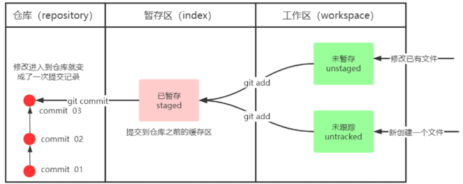
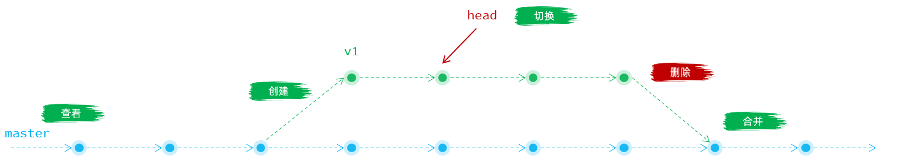

<title>07 qk项目知识点学习</title>

# 常见的sql 小函数

```SQL
    ifnull（列名，默认值）当某列中的值为的时候采用默认值替换
    concat（字符串1，字符串2....）将多个字符串拼接成null一个字符串
    if（条件，值1，值2）类似我们的三元运算符，只适合情况有两种的时候
适合多条件的时候
    case
    when 条件 1 then 结果
    when 条件 2 then 结果
    when 条件 3 then 结果
    ...
    else 首尾结果
    end
    
    year(时间列)取出时间的年
    date(时间列)取出时间的日
    
    substr(字符串列，开始的索引，取得个数)索引从1开始
    datediff(大日期1，小日期2)
```

示例代码:

```SQL
-- ==============================
-- 常见 SQL 函数示例汇总（带注释）
-- 适用数据库：MySQL（大部分函数通用）
-- ==============================


-- 1️⃣ IFNULL(列名, 默认值)
-- 当列中的值为 NULL 时，用默认值替换
SELECT
    IFNULL(phone, '未填写') AS phone_info
FROM users;


-- 2️⃣ CONCAT(字符串1, 字符串2, ...)
-- 将多个字符串拼接成一个字符串
-- ⚠️ 注意：只要有一个参数为 NULL，结果就是 NULL
SELECT
    CONCAT(first_name, ' ', last_name) AS full_name
FROM users;


-- 3️⃣ IF(条件, 值1, 值2)
-- 类似三元运算符，只适合「两种情况」
SELECT
    IF(age >= 18, '成年人', '未成年人') AS age_type
FROM users;


-- 4️⃣ CASE WHEN（多条件判断）
-- 适合多种情况的条件判断
SELECT
    CASE
        WHEN age < 18 THEN '未成年人'
        WHEN age BETWEEN 18 AND 65 THEN '在职年龄'
        WHEN age > 65 THEN '退休年龄'
        ELSE '未知'
    END AS age_stage
FROM users;


-- 5️⃣ YEAR(时间列)
-- 取出时间中的「年份」
SELECT
    YEAR(created_at) AS create_year
FROM users;


-- 6️⃣ DATE(时间列)
-- 取出时间中的「日期部分」（去掉时分秒）
SELECT
    DATE(created_at) AS create_date
FROM users;


-- 7️⃣ SUBSTR(字符串列, 开始索引, 取得个数)
-- 索引从 1 开始（不是 0）
SELECT
    SUBSTR(username, 1, 3) AS short_name
FROM users;

-- 8️⃣ DATEDIFF(日期1(大的), 日期2(小的))
-- 计算两个日期之间相差的「天数」
-- 结果 = 日期1 - 日期2
SELECT
    DATEDIFF(CURDATE(), created_at) AS days_since_create
FROM users;

-- ==============================
-- 总结：
-- IFNULL   → 处理 NULL 值
-- CONCAT   → 字符串拼接
-- IF       → 两种情况判断
-- CASE     → 多条件判断
-- YEAR     → 取年份
-- DATE     → 取日期
-- SUBSTR   → 字符串截取
-- DATEDIFF → 日期差
-- ==============================

```

# git

## 基本配置

1. 打开Git Bash
2. 设置用户信息

```SQL
git config --global user.name “itcast”
git config --global user.email “hello@itcast.cn”
```

邮箱可以是假邮箱

查看配置信息

```SQL
git config --global user.name
git config --global user.email
```

## 获取本地仓库

要使用Git对我们的代码进行版本控制，首先需要获得本地仓库

<callout emoji="🦄">
1）在电脑的任意位置创建一个空目录（例如test）作为我们的本地Git仓库
2）进入这个目录中，点击右键打开Git bash窗口
3）执行命令`git init`
4）如果创建成功后可在文件夹下看到隐藏的.git目录。
</callout>

本地仓库操作的命令，主要涉及到以下几个：

| **命令** | **描述** | **具体语法** |
|-|-|-|
| git init | 初始化一个本地仓库 | git init |
| git status | 查看文件状态 | git status |
| git add | 将文件的修改加入暂存区 | git add <file/dir> |
| git reset | 将暂存区的文件取消暂存或者切换到指定版本 | git reset <file>git reset --hard <commit> |
| git commit | 将暂存区的文件修改提交到版本库 | git commit –m <message>git commit [file1][file2] –m <message> |
| git log | 查看操作日志 | git log |

## 基础操作指令

Git工作目录下对于文件的修改(增加、删除、更新)会存在几个状态



```XML
工作区：我们电脑本机写代码的目录
暂存区：我们可以将修改的文件或者代码提交到本地仓库----->命令 git add *
本地仓库：可以将暂存区的文件或者代码提交到本地仓库----->命令 git commit -m "备注信息"
远程仓库：可以将本地仓库中的内容和远程仓库交互-------->命令 git push 远程仓库地址/简单名字 远程仓库分支
```

<callout emoji="🏝️">
1. git add (工作区 --> 暂存区)          git add .添加所有文件、文件夹和子文件夹，包括.gitignore和以点开头的任何其他内容；
2. git commit (暂存区 --> 本地仓库)
</callout>

### 查看修改的状态（status）

- 作用：查看的修改的状态（暂存区、工作区）
- 命令形式：git status

工作目录中的文件状态为 `Untracked`，表示文件未跟踪，未被纳入版本控制。文件的状态会随着我们执行Git的命令发生变化，Git工作区中的文件存在如下两类状态：

- Untracked 未跟踪（未被纳入版本控制）
- Tracked 已跟踪（被纳入版本控制）

  - Unmodified 未修改状态
  - Modified 已修改状态
  - Staged 已暂存状态

### 添加工作区到暂存区(add)

- 作用：添加工作区一个或多个文件的修改到暂存区
- 命令形式：git add 单个文件名|通配符

  - 将所有修改加入暂存区：git add .

### 提交暂存区到本地仓库(commit)

- 作用：提交暂存区汇总所有内容到本地仓库的当前分支
- 命令形式：git commit -m '注释内容'

<callout emoji="🍰">
提交时候添加的备注会被放到日志中
提交完后显示缓冲区没有东西可以提交了
</callout>

### 查看提交日志(log)

- 作用:查看提交记录
- 命令形式：git log [option]

  - options
  
    - all 显示所有分支
    - pretty=oneline 将提交信息显示为一行
    - abbrev-commit 使得输出的commitId更简短
    - graph 以图的形式显示

<callout emoji="🏆">
查看log一般都是会加上上面全部的参数的，可以给这个指令设置了别名  
使用git -log命令 ，简单命令为git log 
提交时候添加的备注会被放到日志中
</callout>

### 版本回退(reset)

撤回到之前的某个操作，会去删除 撤回到位置之后的版本

- 作用：版本切换 或者是 **取消暂存** 
- 命令形式：版本回退:  `git reset --hard commitID`取消暂存：`git reset <file>`commitID 可以使用 git-log 或 git log 指令查看
- 如何查看已经删除的记录？

  - git reflog
  - 这个指令可以看到已经删除的提交记录

可以在reflog里面知道删除文件的id，可以直接使用命令git reset --hard commitID 还原

所以

<callout emoji="⚽">
git reset --hard commitID既可以做版本回退，也可以做版本还原 还可以做取消暂存
</callout>

## Git远程仓库操作

常见命令如下：

| **命令** | **描述** | **示例** |
|-|-|-|
| git remote [-v] | 查看本地仓库 | git remote -v |
| git remote add <short-name> <url> | 添加远程仓库 | git remote add origin [https://gitee.com](https://gitee.com)... |
| git clone <url> | 从远程仓库克隆 | git clone [https://gitee.com](https://gitee.com)... |
| git push <shortname> [branchname] | 推送到远程仓库 | git push origin master |
| git pull <shortname> [branchname] | 从远程仓库拉取 | git pull origin master |

### 查看远程仓库 (git remote)

如果要查看已经配置的远程仓库服务器，可以执行 git remote 命令，它会列出每一个远程服务器的简称。

目前，我们的这个本地仓库并未配置任何的远程仓库，所以没有任何信息输出。

要将本地仓库和远程仓库连接起来，一般一个本地仓库对应一个远程仓库原则，远程仓库默认名为origin

- 命令： git remote add <远端名称> <仓库路径SSH>      

  - 远端名称，默认是origin，取决于远端服务器设置
  - 仓库路径，从远端服务器获取此SSH，

### 添加远程仓库 (git remote add)

- 作用：配置、添加远程仓库
- 语法：`git remote add 简称 远程仓库地址`
- 样例：`git remote add origin ``https://gitee.com/dawn_code/my-repo1.git`

<callout emoji="🎈">
注意：一个本地仓库可以关联多个远程仓库，多个远程仓库的地址的简称不能重复。（一般只会关联一个）
</callout>

### 推送到远程仓库(git push)

- 作用：将本地仓库的文件推送到远程仓库中。
- 语法：`git push [-f] [--set-upstream] [远端名称 本地分支名 ]`
- 样例：`git push origin master`

<callout emoji="🌅">
如果远程分支名和本地分支名称相同，则可以只写本地分支
      本来是：git push origin master ：master 表示将本地仓库的master分支提交到远程仓库的master分支

git push origin master      这里表示将本地仓库当前master分支的内容推到远程仓库上面去
-f 表示强制覆盖
--set-upstream 推送到远端的同时并且建立起和远端分支的关联关系。

git push --set-upstream origin master
如果当前分支已经和远端分支关联，则可以省略分支名和远端名。
</callout>

要访问远程仓库了，而访问远程仓库是需要输入账号、密码的，所以需要在弹窗中输出用户名、密码。（仅仅在第一次访问gitee时需要输入，后续就不用了，因为windows系统会自动记录账号密码）

### 从远程仓库克隆 (git clone)

- 作用：Git 克隆的是该 Git 仓库服务器上的几乎所有数据（包括日志信息、历史记录等）下载到本地，获得一份Git 远程仓库的拷贝。
- 语法：`git clone 远程仓库地址`
- 样例：`git clone ``https://gitee.com/dawn_code/my-repo1.git`

克隆之后，可以看到有一个目录 my-repo1，这个就是我们克隆的仓库对应的目录。进入 my-repo1 这个目录，就可以看到里面的文件。

<callout emoji="🍏">
**提示：**由于这个本地仓库是从远程仓库克隆下来的，所以这个本地仓库已经自动关联的这个远程仓库。
</callout>

### 从远程仓库中抓取和拉取 (git pull)

- 作用：从远程仓库获取最新版本并合并到本地仓库
- 语法：`git pull 远程仓库简称 分支名称`
- 样例：`git pull origin master`
- 抓取 命令：git fetch [remote name] [branch name]

  <callout emoji="🎹">
  抓取指令就是将仓库里的更新都抓取到本地，不会进行合并，不合并本地仓库就是没有更新，此时还没有拿到远程仓库的内容，合并后才会拿到更新的内容
  如果不指定远端名称和分支名，则抓取所有分支。
  </callout>
- 拉取 命令：git pull [remote name] [branch name]

  <callout emoji="🚅">
  拉取指令就是将远端仓库的修改拉到本地并自动进行合并，等同于fetch+merge
  如果不指定远端名称和分支名，则抓取所有并更新当前分支。
  </callout>

<callout emoji="🎈">
**注意：**如果当前本地仓库不是从远程仓库克隆，而是本地创建的仓库，并且仓库中存在文件，此时再从远程仓库拉取文件的时候会报错（fatal: refusing to merge unrelated histories ）
解决此问题可以在git pull命令后加入参数--allow-unrelated-histories
</callout>

## 分支操作

- 分支是Git 使用过程中非常重要的概念。使用分支意味着你可以把你的工作从开发主线上分离开来，以免影响开发主线。
- 本地仓库和远程仓库中都有分支，同一个仓库可以有多个分支，各个分支相互独立，互不干扰。
- 通过 `git init` 命令创建本地仓库时默认会创建一个`master`分支。



分支的操作指令包括:

| **命令** | **描述** | **示例** |
|-|-|-|
| git branch | 查看分支 | git branch -v |
| git branch <branch-name> | 创建分支 | git branch v1 |
| git checkout <branch-name> | 切换分支 | git checkout v1 |
| git push <short-name> <branch-name> | 推送至远程仓库分支 | git push origin v1 |
| git merge <branch-name> | 合并指定分支到当前分支 | git merge v1 |
| git branch –d <branch-name> | 删除分支 | git branch –d v1 |

### 查看分支

- 查看分支命令：`git branch`

  - `git branch`               列出所有本地分支
  - `git branch -r`         列出所有远程分支
  - `git branch -a`         列出所有本地分支和远程分支

### 创建分支

- 格式：`git branch 分支名称`
- 样例：`git branch v1`

<callout emoji="🌟">
创建的新分支会建立在当前分支的版本之上，所以新建的分支会有当前分支的内容
</callout>

### 切换分支

一个仓库中可以有多个分支，切换分支命令格式：`git checkout 分支名称`，例如：`git checkout b1`

<callout emoji="🎨">
可以直接切换到一个不存在的分支（创建并切换）
命令：git checkout -b 分支名
</callout>

<callout emoji="🍏">
**提示：**在命令行的后面会显示出当前所在分支，如上图所示 (b1)。
</callout>

### 推送分支至远程

- 推送至远程仓库分支命令格式：`git push 远程仓库简称 分支命令`
- 样例：`git push origin b1`

推送完成后可以查看远程仓库

### 合并分支

- 合并分支就是将两个分支的文件进行合并处理，命令格式：`git merge 分支`，表示将指定分支代码合并到当前分支
- 样例：`git merge b1` (注意: 操作之前，需要切换到master分支； 表示将b1分支的代码，合并到master分支)

<callout emoji="🏝️">
注意：分支上的内容必须先提交,才能切换分支
一个分支上的提交可以合并到另一个分支
- 命令：git merge 分支名称
- 在每个人都开发完后就将所有的代码汇总到一起，此时就要执行分支的合并操作
master是我们的主线，一般将分支合并到主线上面去
步骤：切换到master分支，然后执行合并命令，执行完后，分支上的资源、文件就会被合并到主线上面去
</callout>

### 删除分支

如果指定的分支，不需要了，可以直接将分支删除掉。

- 命令：`git branch -d 分支名`
- 样例：`git branch -d b1`

<callout emoji="✍️">
注意:
不能删除当前分支，只能删除其他分支
- git branch -d b1 删除分支时，需要做各种检查
- git branch -D b1 不做任何检查，强制删除
小d删除了就使用D，一般使用d就够了
我们去删除没有合并的分支的时候就会出现删除不了的情况，此时就可以使用D
</callout>

### 分支冲突

当合并分支后，两个或者多个分支对同一个文件的同一个地方进行修改的时候（不是同一个地方是不会出现冲突的 ），此时git就不知道要取哪个分支修改的值，是取a分支修改的值，还是取b分支修改的值呢，此时就产生了冲突

<callout emoji="🥛">
必须先拉取pull后解决冲突后才能再次push例如
第一步: A同事push自己的分支到远程的master分支
第二步: B同事push自己的分支到远程master分支
这时候如果A和B之间如果提交的内容有冲突的话, 这边就push失败, 必须先pull拉取代码解决冲突后再push
第三步: 这时候需要拉取远程master分支的代码和本地仓库的代码合并
第四步: 解决冲突,冲突的代码会包围在<<<<<< HEAD  >>>>>>版本号之内, 需要手动解决
第五步: 解决完后, 需要先add, 在commit, 然后在push才行!
注意：在上班时候大早上先去拉取代码再开发
</callout>

---
> 来源：飞书技术知识库（脱敏版） · 03 Web 开发与框架 / 项目实战：qk 全栈项目 / 07 qk项目知识点学习 · [原文](https://ccn8v2zngwsm.feishu.cn/wiki/IVf6wp9eciEbc2knVjMcDqBtnOd)
