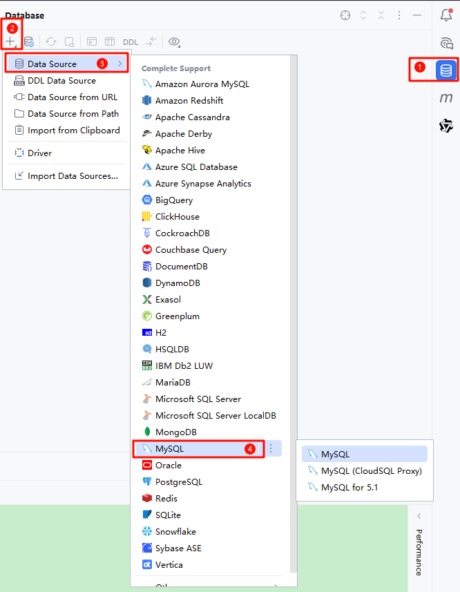
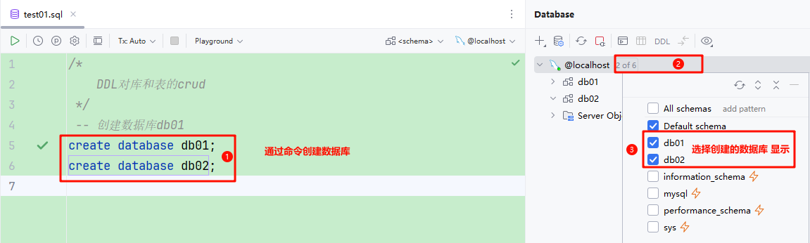

<title>04 数据库连接 sql语句</title>


# idea连接数据库

打开ide在右侧找到下图中的MySQL图标 依次点击操作



登录并连接数据库


创建数据库文件 并设置默认数据库方言


创建数据库 并显示



# Mysql_DDL语句

## 操作库的crud

```SQL
-- 创建一个库 名字itheima142001
create database itheima142001;
-- 创建库 如果不存在则创建 itheima142002
create database if not exists itheima142002;
-- 修改库的编码为utf8
alter database itheima142001 character set utf8;
-- 删除库
drop database itheima142001;
-- 查看所有库
show databases;
-- 切换库
use itheima142002;
-- 查看当前库的创建语句
show create database itheima142002;
```

## 操作表的crud

1. **Java与sql数据类型比对**

<table><colgroup><col/><col/><col/></colgroup><thead><tr><th>Java</th><th colspan="2">sql</th></tr></thead><tbody><tr><td>int</td><td>int</td><td></td></tr><tr><td>short</td><td>smallint</td><td></td></tr><tr><td>byte</td><td>tinyint</td><td></td></tr><tr><td>long</td><td>bigint</td><td></td></tr><tr><td>float</td><td>float</td><td></td></tr><tr><td>double</td><td>double</td><td></td></tr><tr><td>LocalDate</td><td>date</td><td></td></tr><tr><td>LocalTime</td><td>time</td><td></td></tr><tr><td>LocalDateTime</td><td>datetime</td><td></td></tr><tr><td>String</td><td>varchar(变长)</td><td>char（定长）</td></tr><tr><td>BigDecimal</td><td>DECIMAL(M,D)</td><td></td></tr></tbody></table>

```SQL
-- 创建表
create table user(
    id int,
    name varchar(20),
    age int,
    gender char(1)
);
```

---
> 来源：飞书技术知识库（脱敏版） · 02 数据库与持久层 / MySQL 基础与 SQL / 04 数据库连接 sql语句 · [原文](https://ccn8v2zngwsm.feishu.cn/wiki/UIFBw9lcmiXpWuk1L8yc9pBwnWg)
