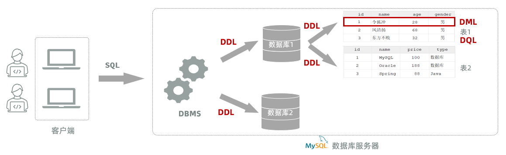
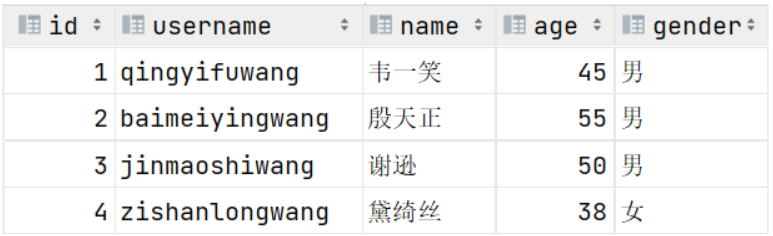
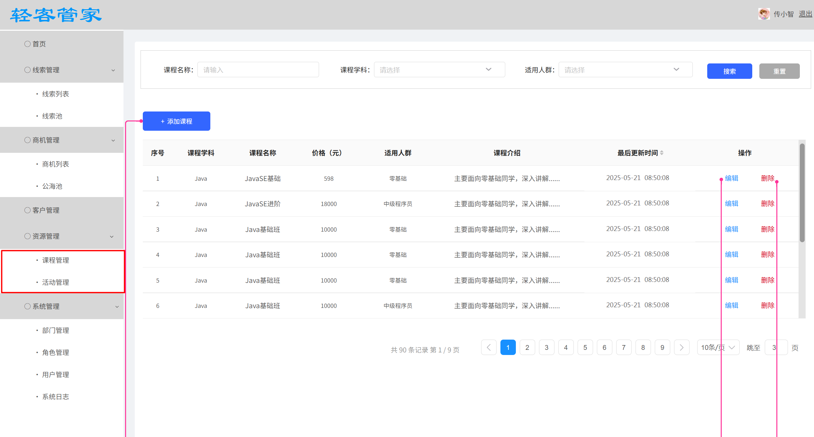

# 05 Mysql_jdbc

## SQL

### SQL语句

SQL：结构化查询语言。一门操作关系型数据库的编程语言，定义操作所有关系型数据库的统一标准。SQL语句根据其功能被分为四大类：DDL、DML、DQL、DCL 。

| **分类** | **全称** | **说明** |
|-|-|-|
| DDL | Data Definition Language | 数据定义语言，用来定义数据库对象(数据库，表，字段) |
| DML | Data Manipulation Language | 数据操作语言，用来对数据库表中的数据进行增删改 |
| DQL | Data Query Language | 数据查询语言，用来查询数据库中表的记录 |
| DCL | Data Control Language | 数据控制语言，用来创建数据库用户、控制数据库的访问权限 |


> 图注：这张图直观呈现了MySQL数据库相关的架构逻辑，客户端发送SQL语句至DBMS，DBMS通过DDL（数据定义语言）分别操作数据库1和数据库2，数据库1的表1中红框标注了包含今独孤、28岁、男性的记录，其对应关系明确了SQL语句分类（DDL、DML、DQL）的实际应用，是对SQL分类及数据库操作的可视化说明，和前文文档中SQL分类的内容相呼应，清晰展示了不同SQL分类在MySQL数据库服务器中的操作应用场景。

### DDL语句

#### 数据库操作

我们在进行数据库设计，需要使用到刚才所介绍SQL分类中的DDL语句。

DDL英文全称是Data Definition Language(数据定义语言)，用来定义数据库对象(数据库、表)。

DDL中数据库的常见操作：查询、创建、使用、删除。

##### 查询数据库

- 查询所有数据库

```SQL
show databases;
```

- 查询当前数据库

```SQL
select database();
```

<callout emoji="✅">
我们要操作某一个数据库，必须要切换到对应的数据库中。 
通过指令：select  database() ，就可以查询到当前所处的数据库 
</callout>

##### 创建数据库

- 语法：

```SQL
create database [ if not exists ] 数据库名  [default charset utf8mb4];
```

创建数据库时，可以不指定字符集。 因为在MySQL8版本之后，默认的字符集就是 utf8mb4。

- 创建一个itcast数据库。

```SQL
create database itcast;
```

<callout emoji="🦄">
注意：在同一个数据库服务器中，不能创建两个名称相同的数据库，否则将会报错。
</callout>

可以使用`if not exists`来避免这个问题

```SQL
-- 数据库不存在,则创建该数据库；如果存在则不创建
create database if not exists itcast; 
```

##### 使用数据库

- 语法：

```SQL
use 数据库名 ;
```

操作某一个数据库下的表时，需要通过该指令，切换到对应的数据库下，否则不能操作。

- 案例：切换到db142002数据库

```SQL
use db142002;
```

##### 删除数据库

- 语法:

```SQL
drop database [ if exists ] 数据库名 ;
```

- 如果删除一个不存在的数据库，将会报错。
- 可以加上参数 if exists ，如果数据库存在，再执行删除，否则不执行删除。
- 案例：删除db142003数据库

```SQL
drop database if exists db142003; -- db142003数据库存在时删除
```

<callout emoji="✅">
**说明：上述语法中的database，也可以替换成 schema**
- 如：create schema db01;
- 如：show schemas;
</callout>

代码示例：

```SQL
 -- 创建数据库db142001
 create database db142001;
 create database db142002;
 -- 创建数据库db142003，不存在再创建
 create database if not exists db142003;
 -- 删除数据库db142003
 drop database db142003;
 -- 删除数据库db142003，如果存在再删除
 drop database if exists db142003;
 -- 修改数据库 db142002的编码为utf8
 alter database db142002 character set utf8;
 -- 修改数据库 db142002的编码为gbk
 alter database db142002 character set gbk;
 -- 查看库的列表
 show databases;
-- 查看库的当时的创建语句
 show create database db142002;
-- 切换数据库(重要)
 use db142002;
```

#### 表操作

学习完了DDL语句当中关于数据库的操作之后，接下来继续学习DDL语句当中关于表结构的操作。

关于表结构的操作也是包含四个部分：创建表、查询表、修改表、删除表。

##### 创建

- 语法：

  ```SQL
  create table  表名(
          字段1  字段1类型 [约束]  [comment  字段1注释 ],
          字段2  字段2类型 [约束]  [comment  字段2注释 ],
          ......
          字段n  字段n类型 [约束]  [comment  字段n注释 ] 
  ) [ comment  表注释 ] ;
  ```

  - 注意： [ ] 中的内容为可选参数； 最后一个字段后面没有逗号
- 案例：创建tb_user表代码示例：

  - 建表语句：

  ```SQL
  create table tb_user (
      id int comment 'ID,唯一标识',  
      username varchar(20) comment '用户名',
      name varchar(10) comment '姓名',
      age int comment '年龄',
      gender char(1) comment '性别'
  ) comment '用户表';
  ```

  ```SQL
  -- 创建表
  create table student(
     id int,
     name varchar(20),
     sex char(1),
     age int,
     birthday date,
     entry_date datetime,
     is_married boolean
  );
  -- 创建表，如果存在则不创建
  create table if not exists student1(
     id int,
     name varchar(20),
     sex char(1),
     age int,
     birthday date,
     entry_date datetime,
     is_married boolean
  );
  ```

id字段是一行数据的唯一标识，不能有重复值。但是现在数据表中有两个相同的id值，这是为什么呢？

<callout emoji="⛱️">
在创建表结构的时候， id这个字段我们只加了一个备注信息说明它是一个唯一标识，但是在数据库层面呢，并没有去限制字段存储的数据。所以id这个字段没有起到唯一标识的作用。
</callout>

<callout emoji="📌">
想要限制字段所存储的数据，就需要用到数据库中的约束。
</callout>

##### 约束

- 概念：所谓约束就是作用在表中字段上的规则，用于限制存储在表中的数据。
- 作用：就是来保证数据库当中数据的正确性、有效性和完整性。（后面的学习会验证这些）
- 在MySQL数据库当中，提供了以下5种约束：

| **约束** | **描述** | **关键字** |
|-|-|-|
| 非空约束 | 限制该列 字段值不能为null | not null |
| 唯一约束 | 保证字段的所有数据都是唯一、不重复的，唯一对null无效 | unique |
| 主键约束 | *非空且唯一，一个表只有一个主键，主键可以由单列组成，或者多列都行* | primary key |
| 默认约束 | 插入数据*、*保存数据时，如果未指定该字段值，则采用默认值 | default |
| 外键约束 | 让两张表的数据建立连接，保证数据的一致性和完整性 | foreign key |

*主键约束托管机制：*

<callout emoji="🎨">
*（1）如果是数字列，我们可以采用mysql的默认托管机制，自增，不好用，教学期间简化主键管理*  
*auto_increment*  
*（2）随机的不重复的字符串！！！*
</callout>

<callout emoji="📌">
注意：约束是作用于表中字段上的，可以在创建表/修改表的时候添加约束。
</callout>

- 案例：创建tb_user表，对应的结构如下：


> 图注：这张图片展示了tb_user表的表结构及其中的4条数据记录，表头包含id、username、name、age、gender五个字段。其中id字段是数据的唯一标识，对应行号1至4；username字段取值分别为qingyifuwang、baimeiyingwang等，均为唯一的非空值；name字段的取值为韦一笑、殷天正等，不包含空值；gender字段的默认值为男，仅最后一条数据的gender取值为女，符合表结构中对该字段的约束设置。

在上述的表结构中:

- id 是一行数据的 **唯一标识**
- username 用户名字段是**非空**且**唯一**的
- name 姓名字段是**不允许存储空值**的
- gender 性别字段是有**默认值**，默认为男

建表语句：

```SQL
create table tb_user (
    id int primary key comment 'ID,唯一标识', 
    username varchar(20) not null unique comment '用户名',
    name varchar(10) not null comment '姓名',
    age int comment '年龄',
    gender char(1) default '男' comment '性别'
) comment '用户表';
```

数据表创建完成，接下来测试一下表中字段上的约束是否生效


问题：id字段下存储的值，如果由我们自己来维护会比较麻烦(必须保证值的唯一性)。MySQL数据库为了解决这个问题，提供了一个关键字：auto_increment（自动增长）

<callout emoji="📌">
**主键自增：auto_increment**
- 每次插入新的行记录时，数据库自动生成id字段(主键)下的值
- 具有auto_increment的数据列是一个正数序列开始增长(从1开始自增)
</callout>

示例代码：

```SQL
 -- 创建完整格式表 
create table student(
    id int primary key auto_increment,
    name varchar(20) not null ,
    sex char(1) not null,
    phone varchar(11) unique,
    nationlity varchar(20) default 'China'
);
```

##### 数据类型

在上面建表语句中，在指定字段的数据类型时，用到了int 、varchar、char，那么在MySQL中除了以上的数据类型，还有哪些常见的数据类型呢？ 接下来,我们就来详细介绍一下MySQL的数据类型。

MySQL中的数据类型有很多，主要分为三类：数值类型、字符串类型、日期时间类型。

**1). 数值类型**

| **类型** | **大小** | **有符号(SIGNED)范围** | **无符号(UNSIGNED)范围** | **描述** |
|-|-|-|-|-|
| tinyint | 1byte | (-128，127) | (0，255) | 小整数值 |
| smallint | 2bytes | (-32768，32767) | (0，65535) | 大整数值 |
| mediumint | 3bytes | (-8388608，8388607) | (0，16777215) | 大整数值 |
| int/integer | 4bytes | (-2147483648，2147483647) | (0，4294967295) | 大整数值 |
| bigint | 8bytes | (-2^63，2^63-1) | (0，2^64-1) | 极大整数值 |
| float | 4bytes | (-3.402823466 E+38，3.402823466351 E+38) | 0 和 (1.175494351 E-38，3.402823466 E+38) | 单精度浮点数值 |
| double | 8bytes | (-1.7976931348623157 E+308，1.7976931348623157 E+308) | 0 和 (2.2250738585072014 E-308，1.7976931348623157 E+308) | 双精度浮点数值 |
| decimal |  | 依赖于M(精度)和D(标度)的值 | 依赖于M(精度)和D(标度)的值 | 小数值(精确定点数) |

- 示例:

```SQL
-- 年龄字段 ---不会出现负数, 而且人的年龄不会太大
   age tinyint unsigned

-- 分数 ---总分100分, 最多出现一位小数
   score double(4,1)
```


**2). 字符串类型**

<sheet sheet-id="mzpea9" token="CcqMsyHybhs80PtULrZcj8UunhG"></sheet>

char 与 varchar 都可以描述字符串，char是定长字符串，指定长度多长，就占用多少个字符，和字段值的长度无关 。而varchar是变长字符串，指定的长度为最大占用长度 。相对来说，char的性能会更高些。

```SQL
示例： 
    用户名 username ---长度不定, 最长不会超过50
    username varchar(50)
    
    手机号 phone ---固定长度为11
    phone char(11)
```


**3). 日期时间类型**

<sheet sheet-id="ZpGxrd" token="CcqMsyHybhs80PtULrZcj8UunhG"></sheet>

```SQL
示例: 
    生日字段  birthday ---生日只需要年月日  
    birthday date
    
    创建时间 createtime --- 需要精确到时分秒
    createtime  datetime
```

##### 设计表案例

- 需求：根据资料中提供的页面原型，和页面开发规则说明，设计表结构。
- 具体的页面原型和页面开发规则说明，截图如下：

在设计数据库表的时候，一定要参考页面原型、需求文档，从实际项目的需求出发去设计，而在设计表的时候，不仅要考虑核心的业务字段，还得添加额外的辅助字段，比如：主键id，创建时间 create_time , 修改时间 update_time 。

表结构如下图所示：


> 图注：图片展示的是轻客管家系统中课程管理页面。左侧为功能导航栏，其中“课程管理”下有“课程列表”“课程添加”“课程修改”“课程删除”“课程详情”“课程管理”“活动管理”等选项，其中“课程管理”和“活动管理”被红色框线突出显示。右侧是课程列表区域，显示了序号、课程学科、课程名称、价格、适用人群、课程介绍、最后更新时间等信息，每条记录右侧有“编辑”和“删除”操作按钮。

示例代码：

```JavaScript
use dbhomework142006;
-- 课程表
create table course(
    id int unique primary key auto_increment comment '主键id',
    subject tinyint unsigned not null comment '课程学科 1.Java 2.Python 3.C++',
    curriculum tinyint unsigned not null comment '课程内容 1.JavaSE基础 2.JavaSE进阶 3.Java基础班',
    price int unsigned not null comment '价格',
    target_users tinyint unsigned comment '适用人群 1.零基础 2.中级程序员',
    introduce varchar(50) comment '课程介绍',
    create_time date comment '创建时间',
    update_time datetime comment '更新时间'
);
-- 活动表
create table event(
    id int unique primary key auto_increment comment '主键id',
    name varchar(10) not null comment '活动名称',
    source tinyint unsigned not null comment '渠道来源 1.推广介绍 2.线上活动',
    detail tinyint unsigned not null comment '活动明细 1.课程折扣/9.9折 2.课程折扣/8.8折 3.课程代金券/100元 4.课程代金券/500元',
    start_time date comment '开始时间',
    over_time datetime comment '结束时间'
);
```

<callout emoji="⛳">
在管理类的系统中，我们在设计表结构的时候，通常会在表中添加两个辅助字段：
- create_time : 记录数据插入的时间，在插入数据的时候，将该时间设置为当前系统时间，以后不再更新；
- update_time : 记录更新时间，在插入数据的时候，将该时间设置为当前系统时间，以后每一次更新该数据，都需要置为当前系统时间。
</callout>

##### 表操作-其他操作

上面讲解了表结构的创建、数据类型、设计表的流程，接下来，再来讲解表结构的查询、修改、删除操作 。 

- 查询数据库表的具体的语法：

```SQL
-- 查询当前数据库的所有表
show tables;
-- 查看指定的表结构
desc 表名 ;   -- 可以查看指定表的字段、字段的类型、是否可以为NULL、是否存在默认值等信息
-- 查询指定表的建表语句
show create table 表名 ;
```

- 修改数据库表结构的具体语法：

添加字段

```SQL
-- 添加字段
alter table 表名 add  字段名  类型(长度)  [comment 注释]  [约束];

-- 比如：  为employee表添加字段, 字段信息: phone varchar(11), 备注 手机号
alter table employee add phone varchar(11) comment '手机号';
```

修改字段

```SQL
-- 修改字段类型
alter table 表名 modify  字段名  新数据类型(长度);

-- 比如： 为employee表修改字段, 将 phone 字段修改为 phone char(11) 类型, 备注 手机号
alter table employee modify phone char(11) comment '手机号';
```

```SQL
-- 修改字段名，字段类型
alter table 表名 change  旧字段名  新字段名  类型(长度)  [comment 注释]  [约束];

-- 比如： 为employee表修改字段, 将 phone 字段名修改为 mobile, 类型 char(11), 备注 手机号
alter table employee change phone mobile char(11) comment '手机号';
```

删除字段

```SQL
-- 删除字段
alter table 表名 drop 字段名;

-- 比如： 删除employee表中的 mobile字段
alter table employee drop mobile;
```

修改表名

```SQL
-- 修改表名
rename table 表名 to  新表名;

-- 比如: 将employee表名改为 emp
rename table employee to emp;
```

删除表结构

```SQL
-- 删除表
drop  table [ if exists ]  表名;

-- 比如：如果employee 表存在，则删除employee 表
drop table if exists employee ;  -- 在删除表时，表中的全部数据也会被删除。
```

```SQL
-- 插入数据
insert into student(id, name, sex, phone, nationlity) values
  (1,'张三','男',15800966110,'China'),
  (2,'王二','男',null,'China'),
  (3,'王三','女',null,'China'),
  (4,'王四','男',15500966000,'China');
-- 插入数据
insert into student(id, name, sex, phone) values
  (5,'王五','女',154894616),
  (6,'王六','男',null);
-- 插入数据 (错误示范)
insert into student(id, name, sex, phone) values
  (7,'王七','女',15500966000),
  (8,'王八','男',null);
-- 插入数据 (错误示范)
insert into student(id, name, sex, phone) values
  (8,'王九',null,null),
  (10,null,'男',null);
```

<callout emoji="📌">
**关于表结构的查看、修改、删除操作，工作中一般都是直接基于图形化界面操作。** 
</callout>

### DML语句

DML英文全称是Data Manipulation Language(数据操作语言)，用来对数据库中表的数据记录进行增、删、改操作。

<callout emoji="🌰">
添加数据（INSERT）
修改数据（UPDATE）
删除数据（DELETE） 
</callout>

#### 增加(insert)

##### **语法**

- 向指定字段添加数据

```SQL
insert into 表名 (字段名1, 字段名2) values (值1, 值2);
```

- 全部字段添加数据

```SQL
insert into 表名 values (值1, 值2, ...);
```

- 批量添加数据（指定字段）

```SQL
insert into 表名 (字段名1, 字段名2) values (值1, 值2), (值1, 值2);
```

- 批量添加数据（全部字段）

```SQL
insert into 表名 values (值1, 值2, ...), (值1, 值2, ...);
```

注意：

<callout emoji="🌰">
    (1)列名和列值需要一一对应  
    (2)一旦插入语句执行就会添加一行数据,那些没有赋值的列,会使用默认值  
    (3)如果我们是对所有列都赋值,可以简化,不推荐使用  
        insert into 表名 values (列值列表);
</callout>

##### 案例演示

- 案例1：*为 employee 表的 name, gender, job, salary字段插入值*

```SQL
-- 1. 为 emp 表的 name, gender, job, salary字段插入值
insert into employee(name, gender, job, salary) values('张三', 1, 1, 5000);
```

- 案例2：*为 employee 表的 所有字段插入值*

```SQL
-- 2. 为 emp 表的 所有字段插入值
insert into employee(id, name, image, gender, job, salary, entry_date, create_time, update_time) VALUES (null, '李四', '1.png', 1, 1, 5000, '2023-01-01', now(), now());
insert into employee values (null, '花千骨', '2.png', 1, 1, 5800, '2025-01-01', now(), now());
```

<callout emoji="🍏">
**说明**: now() 是mysql数据库中的函数, 使用来获取当前系统时间的 
</callout>

- 案例3：*批量为 student 表的 id, name, sex, age, birth, entry_date, score字段插入数据*

```SQL
-- 插入多条数据
insert into student1(id, name, sex, age, birth, entry_date, score)values
      (2,'王二','男',20,'2000-02-28','2021-01-01',88),
      (3,'王三','女',18,'1999-03-28','2020-01-01',78),
      (4,'王四','男',19,'1998-04-28','2021-01-01',68),
      (5,'王五','女',20,'1997-05-28','2020-01-01',58),
      (6,'王六','男',18,'1996-06-28','2021-01-01',48);
```

<callout emoji="📌">
**insert操作的注意事项：**
1. 插入数据时，指定的字段顺序需要与值的顺序是一一对应的。
2. 字符串和日期型数据应该包含在引号中。
3. 插入的数据大小，应该在字段的规定范围内。
</callout>

#### 修改(update)

###### 语法

```SQL
update 表名 set 字段名1 = 值1 , 字段名2 = 值2 , .... [where 条件] ;
```

###### 案例演示

- 案例1：*将 employee 表的ID为1的员工 姓名更新为 '张三丰', 性别更新为男;*

```SQL
update employee set name = '张三丰', gender = 1, update_time=now() where id = 1;
```

- 案例2：*将 emp 表的所有员工的入职日期更新为 '2010-01-01'*

```SQL
update employee set entry_date='2010-01-01', update_time=now();
```

<callout emoji="📌">
**注意事项:**
1. 修改语句的条件可以有，也可以没有，如果没有条件，则会修改整张表的所有数据。
2. 在修改数据时，一般需要同时修改公共字段update_time，将其修改为当前操作时间。
</callout>

#### 删除(delete)

##### 语法

```SQL
delete from 表名  [where  条件] ;
```

##### 案例演示

- 案例1：删除emp表中id为1的员工

```SQL
delete from employee where id = 1;
```

- 案例2：删除employee表中所有员工

```SQL
delete from employee ;
```

```SQL
-- 删除所有数据
TRUNCATE TABLE student1;
TRUNCATE TABLE student;
```

```SQL
-- 删除表
drop table student1;
drop table student;
```

<callout emoji="📌">
**注意事项:**
- DELETE 语句的条件可以有，也可以没有，如果没有条件，则会删除整张表的所有数据。
- DELETE 语句不能删除某一个字段的值(可以使用UPDATE，将该字段值置为NULL即可)。
- 当进行删除全部数据操作时，会提示询问是否确认删除所有数据，直接点击Execute即可。 
</callout>

### DQL语句

#### 介绍

DQL英文全称是Data Query Language(数据查询语言)，用来查询数据库表中的记录。

查询关键字：**SELECT**

查询操作是所有SQL语句当中最为常见，也是最为重要的操作。在一个正常的业务系统中，查询操作的使用频次是要远高于增删改操作的。当我们打开某个网站或APP所看到的展示信息，都是通过从数据库中查询得到的，而在这个查询过程中，还会涉及到条件、排序、分页等操作。

##### 语法完整格式

DQL查询语句，语法结构如下：

```SQL
select 列名列表
from 表名列表
where 分组前条件列表
group by 分组字段
having 分组后条件列表
order by 排序字段1排序方式1,排序字段2,排序方式2...
limit 开始索引,每页个数
```

将上面的完整语法拆分为以下几个部分学习：

- 基本查询（不带任何条件）
- 条件查询（where）
- 分组查询（group by）
- 排序查询（order by）
- 分页查询（limit）

准备一些测试数据用于查询操作：

```JavaScript
-- 员工表
create table `employee` (
  `id` int unsigned primary key auto_increment comment '主键',
  `name` varchar(10) not null comment '姓名',
  `image` varchar(255) comment '头像',
  `gender` tinyint unsigned not null comment '性别, 1:男, 2:女',
  `job` tinyint unsigned comment '职位, 1:班主任, 2:讲师, 3:学工主管, 4:教研主管, 5:咨询师',
  `salary` int unsigned not null comment '薪资',
  `entry_date` date comment '入职日期',
  `create_time` datetime comment '创建时间',
  `update_time` datetime comment '更新时间'
)  comment '员工信息表';

INSERT INTO `employee` (`id`, `name`, `image`, `gender`, `job`, `salary`, `entry_date`, `create_time`, `update_time`) VALUES
       (1,'夫子','https://web-framework.oss-cn-hangzhou.aliyuncs.com/2023/1.jpg',1,4,30000,'2005-08-19','2025-04-16 16:30:39','2025-04-16 16:30:39'),
       (2,'颜瑟','https://web-framework.oss-cn-hangzhou.aliyuncs.com/2023/1.jpg',1,3,18000,'2010-03-22','2025-04-16 16:30:39','2025-04-16 16:30:39'),
       (3,'君陌','https://web-framework.oss-cn-hangzhou.aliyuncs.com/2023/1.jpg',1,2,22000,'2015-09-01','2025-04-16 16:30:39','2025-04-16 16:30:39'),
       (4,'李慢慢','https://web-framework.oss-cn-hangzhou.aliyuncs.com/2023/1.jpg',1,2,17000,'2018-12-25','2025-04-16 16:30:39','2025-04-16 16:30:39'),
       (5,'叶红鱼','https://web-framework.oss-cn-hangzhou.aliyuncs.com/2023/1.jpg',2,2,21000,'2013-07-14','2025-04-16 16:30:39','2025-04-16 16:30:39'),
       (6,'柳白','https://web-framework.oss-cn-hangzhou.aliyuncs.com/2023/1.jpg',1,2,13000,'2021-04-17','2025-04-16 16:30:39','2025-04-16 16:30:39'),
       (7,'余帘','https://web-framework.oss-cn-hangzhou.aliyuncs.com/2023/1.jpg',2,2,14500,'2020-10-31','2025-04-16 16:30:39','2025-04-16 16:30:39'),
       (8,'宁缺','https://web-framework.oss-cn-hangzhou.aliyuncs.com/2023/1.jpg',1,1,6800,'2022-06-11','2025-04-16 16:30:39','2025-04-16 16:30:39'),
       (9,'李渔','https://web-framework.oss-cn-hangzhou.aliyuncs.com/2023/1.jpg',2,1,4500,'2024-02-28','2025-04-16 16:30:39','2025-04-16 16:30:39'),
       (10,'唐小棠','https://web-framework.oss-cn-hangzhou.aliyuncs.com/2023/1.jpg',2,1,6000,'2017-05-09','2025-04-16 16:30:39','2025-04-16 16:30:39'),
       (11,'陈皮皮','https://web-framework.oss-cn-hangzhou.aliyuncs.com/2023/1.jpg',1,1,4700,'2025-01-15','2025-04-16 16:30:39','2025-04-16 16:30:39'),
       (12,'桑桑','https://web-framework.oss-cn-hangzhou.aliyuncs.com/2023/1.jpg',2,5,8000,'2023-08-08','2025-04-16 16:30:39','2025-04-16 16:30:39'),
       (13,'莫山山','https://web-framework.oss-cn-hangzhou.aliyuncs.com/2023/1.jpg',2,5,6500,'2020-10-31','2025-04-16 16:30:39','2025-04-16 16:30:39'),
       (14,'隆庆','https://web-framework.oss-cn-hangzhou.aliyuncs.com/2023/1.jpg',1,5,5500,'2016-09-22','2025-04-16 16:30:39','2025-04-16 16:30:39'),
       (15,'夏侯','https://web-framework.oss-cn-hangzhou.aliyuncs.com/2023/1.jpg',1,5,7500,'2011-12-12','2025-04-16 16:30:39','2025-04-16 16:30:39'),
       (16,'曲妮','https://web-framework.oss-cn-hangzhou.aliyuncs.com/2023/1.jpg',2,5,6800,'2024-06-01','2025-04-16 16:30:39','2025-04-16 16:30:39'),
       (17,'何明池','https://web-framework.oss-cn-hangzhou.aliyuncs.com/2023/1.jpg',1,5,6200,'2019-03-19','2025-04-16 16:30:39','2025-04-16 16:30:39'),
       (18,'陆晨迦','https://web-framework.oss-cn-hangzhou.aliyuncs.com/2023/1.jpg',2,5,5800,'2015-09-01','2025-04-16 16:30:39','2025-04-16 16:30:39'),
       (19,'唐王','https://web-framework.oss-cn-hangzhou.aliyuncs.com/2023/1.jpg',1,5,6800,'2022-07-07','2025-04-16 16:30:39','2025-04-16 16:30:39'),
       (20,'卫光明','https://web-framework.oss-cn-hangzhou.aliyuncs.com/2023/1.jpg',1,2,19000,'2009-11-11','2025-04-16 16:30:39','2025-04-16 16:30:39'),
       (21,'朝小树','https://web-framework.oss-cn-hangzhou.aliyuncs.com/2023/1.jpg',1,2,18500,'2020-05-05','2025-04-16 16:30:39','2025-04-16 16:30:39'),
       (22,'夏天','https://web-framework.oss-cn-hangzhou.aliyuncs.com/2023/1.jpg',2,1,5500,'2014-08-16','2025-04-16 16:30:39','2025-04-16 16:30:39'),
       (23,'钟大俊','https://web-framework.oss-cn-hangzhou.aliyuncs.com/2023/1.jpg',1,1,5500,'2015-09-01','2025-04-16 16:30:39','2025-04-16 16:30:39'),
       (24,'柯浩然','https://web-framework.oss-cn-hangzhou.aliyuncs.com/2023/1.jpg',2,2,21000,'2023-01-01','2025-04-16 16:30:39','2025-04-16 16:30:39'),
       (25,'齐四','https://web-framework.oss-cn-hangzhou.aliyuncs.com/2023/1.jpg',1,1,6500,'2018-10-10','2025-04-16 16:30:39','2025-04-16 16:30:39'),
       (26,'叶苏','https://web-framework.oss-cn-hangzhou.aliyuncs.com/2023/1.jpg',1,5,5200,'2025-03-03','2025-04-16 16:30:39','2025-04-16 16:30:39'),
       (27,'七念','https://web-framework.oss-cn-hangzhou.aliyuncs.com/2023/1.jpg',2,5,5500,'2015-06-18','2025-04-16 16:30:39','2025-04-16 16:30:39'),
       (28,'程立雪','https://web-framework.oss-cn-hangzhou.aliyuncs.com/2023/1.jpg',2,5,6000,'2012-09-09','2025-04-16 16:30:39','2025-04-16 16:30:39'),
       (29,'观主','https://web-framework.oss-cn-hangzhou.aliyuncs.com/2023/1.jpg',1,2,21000,'2007-07-07','2025-04-16 16:30:39','2025-04-16 16:30:39'),
       (30,'熊初墨','https://web-framework.oss-cn-hangzhou.aliyuncs.com/2023/1.jpg',1,5,7000,'2024-04-04','2025-04-16 16:30:39','2025-04-16 16:30:39'),
       (31,'水珠儿',NULL,2,1,5000,'2019-09-23','2025-04-16 16:30:39','2025-04-16 16:30:39'),
       (32,'徐崇山','https://web-framework.oss-cn-hangzhou.aliyuncs.com/2023/1.jpg',1,NULL,13000,'2021-12-25','2025-04-16 16:30:39','2025-04-16 16:30:39'),
       (33,'司徒依兰','https://web-framework.oss-cn-hangzhou.aliyuncs.com/2023/1.jpg',2,NULL,22500,'2013-03-21','2025-04-16 16:30:39','2025-04-16 16:30:39');
```

##### 基本查询

在基本查询的DQL语句中，不带任何的查询条件。

**语法如下：**

- 查询多个字段

```SQL
select 字段1, 字段2, 字段3 from  表名;
```

- 查询所有字段（通配符）

```SQL
select *  from  表名;
```

- 设置别名

```SQL
select 字段1 [ as 别名1 ] , 字段2 [ as 别名2 ]  from  表名;

```

- 去除重复记录

```SQL
select distinct 字段列表 from  表名;
```

**案例演示:**

- 案例1：查询指定字段 name，entry_date并返回 查询返回所有字段

```SQL
-- 查询student表 指定列和查询所有列
select id,name,phone from student;
select * from student;
```

- 案例2：*去重查询 employee job列*

```SQL
-- 去重查询 employee job列
-- select distinct列 from 表 ; 如果查询多列的话,多个列都需要一致才算重复
select distinct job from employee;
select distinct job,gender from employee;
```

<callout emoji="📌">
\* 号代表查询所有字段，在实际开发中尽量少用（不直观、影响效率）
</callout>

- 案例3：查询所有员工的 name, entry_date，并起别名(name的别名为姓名、entry_date的别名为入职日期)

```SQL
-- 方式1：
select name AS 姓名, entry_date AS 入职日期 from employee;

-- 方式2： 别名中有特殊字符时，使用''或""包含
select name AS '姓 名', entry_date AS '入职日期' from employee;

-- 方式3：
select name AS "姓名", entry_date AS "入职日期" from employee;
```

<callout emoji="🐵">
*as 别名即可*  
*as 可以省略*
</callout>

- 案例4：查询已有的员工关联了哪几种职位(不要重复)

```SQL
select distinct job from employee;
```

##### 条件查询

**语法：**

```SQL
select  字段列表  from   表名   where   条件列表 ; -- 条件列表：意味着可以有多个条件
```

学习条件查询就是学习条件的构建方式，而在SQL语句当中构造条件的运算符分为两类：

- 比较运算符
- 逻辑运算符

常用的比较运算符如下: 

| **比较运算符** | **功能** |
|-|-|
| > | 大于 |
| >= | 大于等于 |
| < | 小于 |
| <= | 小于等于 |
| = | 等于 |
| <> 或 != | 不等于 |
| between  ... and ... | 在某个范围之内(含最小、最大值) |
| in(...) | 在in之后的列表中的值，多选一 |
| like 占位符 | 模糊匹配(\_匹配单个字符, %匹配0个或者多个字符)  |
| is null | 是null |

<callout emoji="🏆">
注意:

Like必须结合通配符一起使用,否则和=号效果一致

所有的时间,其实底层都是采用时间毫秒值运算,都可以直接比较
</callout>

常用的逻辑运算符如下:

| **逻辑运算符** | **功能** |
|-|-|
| and 或 && | 并且 (多个条件同时成立) |
| or 或 \|\| | 或者 (多个条件任意一个成立) |
| not 或 ! | 非 , 不是 |

- 案例1：查询 姓名 为 '莫山山' 的员工

```SQL
SELECT * FROM employee WHERE name = '莫山山';
```

- 案例2：*查询工资在13000和20000之间的* 的员工信息

```SQL
-- 查询工资在13000和20000之间的
select * from employee where salary >= 13000 and salary <=20000;
select * from employee where salary between 13000 and 20000;
```

- 案例3：查询 没有分配职位 的员工信息

```SQL
SELECT * FROM employee WHERE job IS NULL;
```

<callout emoji="📌">
注意：查询为NULL的数据时，不能使用 `= null` 或 `！=null` 。得使用 `is null` 或 `is not null`。
</callout>

- 案例4：查询 有职位 的员工信息

```SQL
SELECT * FROM employee WHERE job IS NOT NULL;
```

- 案例5：*查询 职位不是讲师 的员工信息*

```SQL
SELECT * FROM employee WHERE job != 2;
```

- 案例6：*查询 入职日期 在 '2020-01-01' (包含) 到 '2025-01-01'(包含) 之间的员工信息*

```SQL
-- 方式1：
SELECT * FROM employee 
where entry_date >= '2020-01-01' and entry_date <= '2025-01-01';

-- 方式2： between...and
SELECT * FROM employee 
WHERE entry_date BETWEEN '2020-01-01' AND '2025-01-01';
```

- 案例7：*查询 入职时间 在 '2020-01-01' (包含) 到 '2025-01-01'(包含) 之间 且 性别为女 的员工信息*

```SQL
SELECT * FROM employee 
WHERE entry_date BETWEEN '2020-01-01' AND '2025-01-01' AND gender = 2;
```

- 案例8：查询 职位是 2 (讲师), 3 (学工主管), 4 (教研主管) 的员工信息

```SQL
-- 方式1：使用or连接多个条件
SELECT * FROM employee 
where job=2 or job=3 or job=4;

-- 方式2：in关键字
SELECT * FROM employee 
where job in (2,3,4);
```

- 案例9：查询 姓名 为两个字的员工信息

```SQL
SELECT * FROM employee WHERE name LIKE '__';
```

- 案例10：*查询 姓 '李' 的员工信息*

```SQL
SELECT * FROM employee WHERE name LIKE '李%';
```

- 案例11：*查询 姓名中包含 '小' 的员工信息*

```SQL
SELECT * FROM employee WHERE name LIKE '%小%';
```

##### 聚合函数

之前我们做的查询都是横向查询，就是根据条件一行一行的进行判断，而使用聚合函数查询就是纵向查询，它是对一列的值进行计算，然后返回一个结果值。（将一列数据作为一个整体，进行纵向计算）

常用聚合函数：

| **函数** | **功能** |
|-|-|
| count(列) | 统计求出该列的个数 |
| max(列) | 求出该列的最大值 |
| min(列) | 求出该列的最小值 |
| avg(列) | 求出该列的平均值 |
| sum(列) | 求出该的列总和 |

<callout emoji="📌">
注意 : 聚合函数会忽略空值，对NULL值不作为统计。
</callout>

- count ：按照列去统计有多少行数据。

  - 在根据指定的列统计的时候，如果这一列中有null的行，该行不会被统计在其中。
- sum ：计算指定列的数值和，如果不是数值类型，那么计算结果为0
- max ：计算指定列的最大值
- min ：计算指定列的最小值
- avg ：计算指定列的平均值

**案例演示:**

- 案例1：统计该企业员工数量

```SQL
-- count(字段)
select count(id) from employee ;-- 结果：30
select count(job) from employee ;-- 结果：29 （聚合函数对NULL值不做计算）

-- count(常量)
select count(0) from employee ;
select count('A') from employee ;

-- count(*)  推荐此写法（MySQL底层进行了优化）
select count(*) from employee ;
```

- 案例2：统计该企业员工的平均薪资

```SQL
select avg(salary) from  employee ;
```

- 案例3：统计该企业员工的最低薪资

```SQL
select min(salary) from employee ;
```

- 案例4：统计该企业员工的最高薪资

```SQL
select max(salary) from employee ;
```

- 案例5：统计该企业每月要给员工发放的薪资总额(薪资之和)

```SQL
select sum(salary) from employee ;
```

##### 分组查询

- 分组： 按照某一列或者某几列，把相同的数据进行合并输出。

  - 分组其实就是按列进行分类(指定列下相同的数据归为一类)，然后可以对分类完的数据进行合并计算。
  - 分组查询通常会使用聚合函数进行计算。

**语法：**

```SQL
select  字段列表  from  表名  [where 条件]  group by 分组字段名  [having 分组后过滤条件];
```

**案例演示：**

- 案例1：根据性别分组 , 统计男性和女性员工的数量

```SQL
select gender, count(*)
from employee 
group by gender; -- 按照gender字段进行分组（gender字段下相同的数据归为一组）
```

- 案例2：查询入职时间在 '2015-01-01' (包含) 以前的员工 , 并对结果根据职位分组 , 获取员工数量大于等于2的职位

```SQL
select job, count(*)
from employee 
where entry_date <= '2015-01-01'   -- 分组前条件
group by job                      -- 按照job字段分组
having count(*) >= 2;             -- 分组后条件
```

<callout emoji="📌">
**注意事项:**
- 分组之后，查询的字段一般为聚合函数和分组字段，查询其他字段无任何意义
- 执行顺序：where > 聚合函数 > having 
</callout>

<callout emoji="📌">
**where与having区别（面试题）**
- 执行时机不同：where是分组之前进行过滤，不满足where条件，不参与分组；而having是分组之后对结果进行过滤。
- 判断条件不同：where不能对聚合函数进行判断，而having可以。
</callout>

##### 排查查询

排序在日常开发中是非常常见的一个操作，有升序排序，也有降序排序。

**语法：**

```SQL
select  字段列表  
from   表名   
[where  条件列表] 
[group by  分组字段 ] 
order  by  字段1  排序方式1 , 字段2  排序方式2 … ;
```

- 排序方式：

  - ASC ：升序（默认值）
  - DESC：降序

**案例演示：**

- 案例1：根据入职时间, 对员工进行升序排序

```SQL
select id, name, image, gender, job, salary, entry_date, create_time, update_time
from employee 
order by entry_date ASC; -- 按照entrydate字段下的数据进行升序排序

select id, name, image, gender, job, salary, entry_date, create_time, update_time
from employee 
order by  entry_date; -- 默认就是ASC（升序）
```

<callout emoji="📌">
注意事项：如果是升序, 可以不指定排序方式ASC 
</callout>


- 案例2：根据入职时间，对员工进行降序排序

```SQL
select id, name, image, gender, job, salary, entry_date, create_time, update_time
from employee 
order by entry_date DESC; -- 按照entrydate字段下的数据进行降序排序
```

- 案例3：*根据 入职时间 对公司的员工进行 升序排序 ， 入职时间相同 , 再按照 薪资 进行降序排序*

```SQL
SELECT id, name, image, gender, job, salary, entry_date, create_time, update_time FROM employee 
ORDER BY entry_date ASC, salary DESC;
```

<callout emoji="📌">
注意事项：如果是多字段排序，当第一个字段值相同时，才会根据第二个字段进行排序 
</callout>

##### 分页查询

分页操作在业务系统开发时，也是非常常见的一个功能，日常在网站中看到的各种各样的分页条，后台也都需要借助于数据库的分页操作。

分页查询语法：

```SQL
select  字段列表  from  表名  limit  起始索引, 查询记录数 ;
```

- 案例1：从起始索引0开始查询员工数据, 每页展示5条记录

```SQL
select id, name, image, gender, job, salary, entry_date, create_time, update_time 
from employee 
limit 0 , 5; -- 从索引0开始，向后取5条记录
```

- 案例2：查询 第1页 员工数据, 每页展示5条记录

```SQL
select id, name, image, gender, job, salary, entry_date, create_time, update_time 
from employee 
limit 5; -- 如果查询的是第1页数据，起始索引可以省略，直接简写为：limit 条数
```

- 案例3：查询 第2页 员工数据, 每页展示5条记录

```SQL
select id, name, image, gender, job, salary, entry_date, create_time, update_time 
from employee 
limit 5 , 5; -- 从索引5开始，向后取5条记录
```

- 案例4：查询 第3页 员工数据, 每页展示5条记录

```SQL
select id, name, image, gender, job, salary, entry_date, create_time, update_time 
from employee 
limit 10 , 5; -- 从索引10开始，向后取5条记录
```

<callout emoji="📌">
**注意事项:**
1. 起始索引从0开始。计算公式 ：起始索引 = （查询页码 - 1）\* 每页显示记录数
2. 分页查询是数据库的方言，不同的数据库有不同的实现，MySQL中是LIMIT
3. 如果查询的是第一页数据，起始索引可以省略，直接简写为 limit  条数
</callout>

## JDBC

### 概念

JDBC（Java Database Connectivity，Java 数据库连接）是**Java 语言访问关系型数据库的标准 API**，由 Sun 公司（现 Oracle）定义，本质是一套用于规范 Java 程序与数据库交互的**接口集合**，而非具体实现。

<callout emoji="📌">
sun公司给的一套接口，让数据库厂商按照这套写实现类而写出来实现类叫做驱动jar包，屏蔽链接各种关系型数据库的差异，降低学习成本
</callout>

简单来说：JDBC 为 Java 程序员提供了统一的 “数据库访问接口”，无论底层是 MySQL、Oracle、SQL Server 还是 PostgreSQL，程序员只需编写一套基于 JDBC 接口的代码，通过切换数据库驱动即可适配不同数据库，实现 “一次编码，多库兼容”

### 基本使用步骤

```SQL
//1. 获取驱动
Class.forName("com.mysql.cj.jdbc.Driver");
//获取连接
Connection connection = DriverManager.getConnection("jdbc:mysql://localhost:3306/itheima142002", "root", "123456");
//3.执行者对象
Statement statement = connection.createStatement();
//4.让执行者执行sql语句
ResultSet rs = statement.executeQuery("sql语句"); //如果查询的话就是executeQuery，如果是executeUpdate.
//5.处理结果
//6.关闭资源
```

### sql注入的问题

#### 概念

<callout emoji="🌰">
应用程序若未对用户输入做严格校验，直接将输入拼接到 SQL 语句中执行，
即：
我们自己拼接sql中的参数的时候，识别参数中的关键字以及语法，导致sql语义发生变化的一种现象，叫做sq注入
</callout>

#### 如何避免

```SQL
采用预编译执行者对象，让他来对？号占位的参数赋值，会转义里面的语法部分
必须使用 PreparedStatement（预编译语句），而非 Statement（静态语句），通过 ? 占位符传递参数，底层会自动转义特殊字符
        MyBatis：使用 #{} 占位符（参数化），而非 ${}（直接拼接）
```

### 抽取工具简化jdbc

```SQL
代码复用：避免在多个地方重复编写获取连接、关闭资源等相同代码，减少冗余，提高开发效率。
便于维护：当数据库连接信息（如 URL、用户名、密码）或连接方式需要修改时，只需在工具类中一处修改，
        无需逐个修改所有使用 JDBC 的地方。
统一管理资源：能规范地处理数据库连接、Statement、ResultSet 等资源的关闭操作，避免资源泄露
          （比如忘记关闭连接导致连接池耗尽）。
简化开发：开发者无需关注连接的创建和关闭等底层细节，只需专注于 SQL 语句的编写和业务逻辑处理。
提高安全性：可以在工具类中集中处理数据库连接的安全相关配置（如加密连接信息），降低安全风险。
```

#### 抽取过程

**原生jdbc步骤**

```Java
public void findAll() throws SQLException, ClassNotFoundException {
    //1. 获取驱动
    Class.forName("com.mysql.cj.jdbc.Driver");
    //获取连接
    Connection connection = DriverManager.getConnection("jdbc:mysql://localhost:3306/itheima142002", "root", "123456");
    //3.执行者对象
    Statement statement = connection.createStatement();
    //4.让执行者执行sql语句
    ResultSet rs = statement.executeQuery("select * from employee");
    //5.解析结果集
    while(rs.next()){
        int id = rs.getInt("id");
        String name = rs.getString("name");
        System.out.println(id+name);
    }
    //6.关闭资源
    rs.close();
    statement.close();
    connection.close();
}
```

**抽取方法创建工具类**

```Java
public class JDBCUtils {
    static {
        try {
            Class.forName("com.mysql.cj.jdbc.Driver");
        } catch (ClassNotFoundException e) {
            throw new RuntimeException(e);
        }

    }

    //抽取获取链接
    public static Connection getConnection() throws Exception {
        return DriverManager.getConnection("jdbc:mysql://localhost:3306/db142001", "root", "1234");
    }

    //关闭资源
    public static void close(Connection conn, Statement state, ResultSet rs){

        try {
            if(rs!=null)  rs.close();
        } catch (SQLException e) {
            throw new RuntimeException(e);
        }
        try {
            if(state!=null)  state.close();
        } catch (SQLException e) {
            throw new RuntimeException(e);
        }
        try {
           if(conn!=null)  conn.close();
        } catch (SQLException e) {
            throw new RuntimeException(e);
        }

    }

    public static void close(Connection conn, Statement state){


       close(conn,state,null);

    }
}
```

<callout emoji="🌰">
**从原生jdbc到jdbcUtils的过程做了这些事：**
识别出重复度最高的操作：获取连接和关闭资源。
- 将数据库连接参数（url、user、password）抽取为常量，避免硬编码。
- 将 “获取连接” 的逻辑封装成独立方法（如getConnection()）。
- 将 “关闭资源” 的逻辑（关闭ResultSet、Statement、Connection）封装成独立方法（如close(...)），处理空指针和异常。
</callout>

**`JDBCUtils` 仅解决了连接获取和资源关闭的重复问题，但仍需手动编写 SQL、处理 ，代码繁琐且易出错**

```Java
public class SqlSession {

    public static int executeUpdate(String sql, Object...params) throws Exception {
        Connection conn = JDBCUtils.getConnection();
        //3.得到预编译的执行者对象
        PreparedStatement pstmt = conn.prepareStatement(sql);
        for (int i = 0; i < params.length; i++) {
            pstmt.setObject(i+1, params[i] );
        }
        //4.执行sql语句
        int row = pstmt.executeUpdate();
        System.out.println(row > 0 ? "成功" : "失败");
        JDBCUtils.close(conn,pstmt);
        return row;
    }

    public static <T> List<T> executeQuery(String sql,Class<T> clazz ,Object...params) throws Exception {
        Connection conn = JDBCUtils.getConnection();
        //3.得到预编译的执行者对象
        PreparedStatement pstmt = conn.prepareStatement(sql);
        for (int i = 0; i < params.length; i++) {
            pstmt.setObject(i+1, params[i]);
        }
        //4.执行sql语句
        ResultSet rs = pstmt.executeQuery();
        //创建集合, 将一行行的数据封装成对象, 然后存入集合
        List<T> list = new ArrayList<>();
        //获取该类的所有的成员变量
        Field[] fields = clazz.getDeclaredFields();
        //5.解析结果
        while (rs.next()){
            //创建一个该类的对象
            T t = clazz.getDeclaredConstructor().newInstance();
            //封住数据到对象上, 采用反射来封装
            for (Field field : fields) {
                field.setAccessible(true);
                String name = field.getName();
                Class<?> c = field.getType();
                //取出名字对应的列值
                Object value = rs.getObject(name);
                if(c == Integer.class){
                    //将value封装到t中
                    field.set(t,Integer.parseInt(value.toString()));
                }else{
                    //将value封装到t中
                    field.set(t,value);
                }


            }
            //走到t已经封装好数据了,将t放入到集合中
            list.add(t);
        }
        JDBCUtils.close(conn,pstmt,rs);

        return list;
    }

}
```

<callout emoji="✏️">
从jdbcUtils到sqlsession的过程做了这些事：
1. 实现 SQL 与代码分离
- JDBCUtils 模式下，SQL 语句通常硬编码在 Java 代码中，修改 SQL 需重新编译代码，维护成本高
1. 自动化参数绑定与结果映射
- JDBCUtils 中，需手动通过 setXxx() 方法为 PreparedStatement 绑定参数（如 ps.setString(1, "name")），并手动从 ResultSet 中提取字段映射到 Java 对象（如 user.setName(rs.getString("name"))），步骤冗余且易因字段名写错导致错误。
总结
从 JDBCUtils 到 SqlSession，本质是将数据库操作从 **“碎片化工具调用”升级为“集中式会话管理”**，核心作用是：通过统一的会话入口简化数据访问流程、强化事务和资源管控、分离 SQL 与业务逻辑，最终提升代码的可维护性、可靠性和开发效率。
</callout>

---
> 来源：飞书技术知识库（脱敏版） · 02 数据库与持久层 / MySQL 与 JDBC / 05 Mysql_jdbc · [原文](https://ccn8v2zngwsm.feishu.cn/wiki/GApkwEuhpiStV0kc9sgcq6MYnfd)
