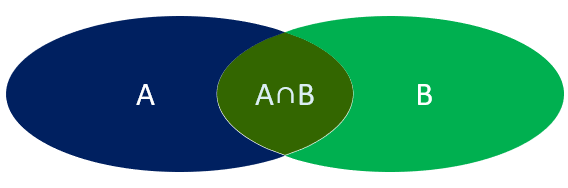

<title>09 数据库进阶</title>

# 多表查询

## 建表原则

在进行多表查询前，首先要根据业务关系设计表结构。

| 关系类型 | 实现方式 |
|-|-|
| 一对多 | 在 **“多”的一方** 的表中创建一个**外键列**，这个外键指向 **“一”的一方** 的主键。 (例如：部门表-员工表) |
| 多对多 | 需要创建一张 **中间表**。中间表至少包含**两个字段**，分别作为外键关联两张主表的主键。 (例如：学生表-课程表) |
| 一对一 | 在**任意一方**的表中创建一个**唯一的外键列**，关联另一张表的主键。 |

## 多表查询

多表查询主要分为两大类：**连接查询** 和 **子查询**。

多表查询：查询时从多张表中获取所需数据

> 单表查询的SQL语句：select  字段列表  from  表名;
> 
> 那么要执行多表查询，只需要使用逗号分隔多张表即可，如： select   字段列表  from  表1, 表2;

多表查询可以分为：



1. 连接查询

   - 内连接：相当于查询A、B交集部分数据
   - 外连接
   
     - 左外连接：查询左表所有数据(包括两张表交集部分数据)
     - 右外连接：查询右表所有数据(包括两张表交集部分数据)
2. 子查询

### 连接查询

连接查询是通过连接多个表，根据表之间的关联关系来检索数据。

#### 内连接

内连接查询：查询两表或多表中交集部分数据。

内连接从语法上可以分为：

- 隐式内连接
- 显式内连接

**隐式内连接语法：**

```SQL
SELECT 列名列表
FROM 表名列表
WHERE 连接条件 [AND 其他条件];
```

**显式内连接语法：**

```SQL
SELECT 列名列表
FROM 表1 
[INNER] JOIN 表2 ON 连接条件
[INNER] JOIN 表3 ON 连接条件
...
WHERE 其他条件;
```

<callout emoji="🌅">
查表和表之间的交集
</callout>

<callout emoji="✅">
在多表联查时，我们指定字段时，需要在字段名前面加上表名，来指定具体是哪一张的字段。 如：tb_emp.dept_id
</callout>

**给表起别名简化书写：**

```SQL
select  字段列表 from 表1 as 别名1 , 表2 as  别名2  where  条件 ... ;

select  字段列表 from 表1 别名1 , 表2  别名2  where  条件 ... ;  -- as 可以省略
```

使用了别名的多表查询：

```SQL
select e.id, e.name, d.name from tb_emp as e , tb_dept as d where e.dept_id = d.id and e.gender = 1 and e.salary > 8000;
```

<callout emoji="📌">
**注意事项:** 一旦为表起了别名，就不能再使用表名来指定对应的字段了，此时只能够使用别名来指定字段。
</callout>

#### 外连接

外连接分为两种：左外连接 和 右外连接。

**左外连接语法：**

```SQL
SELECT 列名列表
FROM 表1 
LEFT [OUTER] JOIN 表2 ON 连接条件
WHERE 其他条件;
```

返回 **左表（表1）** 的所有记录，即使右表（表2）中没有匹配的记录。

左外连接相当于查询表1(左表)的所有数据，当然也包含表1和表2交集部分的数据。

**右外连接语法：**

```SQL
SELECT 列名列表
FROM 表1 
RIGHT [OUTER] JOIN 表2 ON 连接条件
WHERE 其他条件;
```

返回 **右表（表2）** 的所有记录，即使左表（表1）中没有匹配的记录。

右外连接相当于查询表2(右表)的所有数据，当然也包含表1和表2交集部分的数据。

```Java
查某张的所有以及交集部分
```

<callout emoji="📌">
**注意事项：**
左外连接和右外连接是可以相互替换的，只需要调整连接查询时SQL语句中表的先后顺序就可以了。而我们在日常开发使用时，更偏向于左外连接。
</callout>


### 子查询（嵌套查询）

SQL语句中嵌套select语句，称为嵌套查询，又称子查询。

```SQL
SELECT  *  FROM   t1   WHERE  column1 =  ( SELECT  column1  FROM  t2 ... );
```

子查询外部的语句可以是insert / update / delete / select 的任何一个，最常见的是 select。

根据子查询结果的不同分为：

1. 标量子查询（子查询结果为单个值 [一行一列]）
2. 列子查询（子查询结果为一列，但可以是多行）
3. 行子查询（子查询结果为一行，但可以是多列）
4. 表子查询（子查询结果为多行多列[相当于子查询结果是一张表]）

子查询是指在一个 SQL 查询语句中 **嵌套** 另一个查询语句。根据子查询结果的不同，可以分为以下几类：

| 子查询类型 | 结果特点 | 使用场景与操作符 | 备注 |
|-|-|-|-|
| 标量子查询 | 单行单列 | 常用于条件判断，与 `>`, `>=`, `<`, `<=`, `=`, `!=`等运算符结合使用。 | 子查询的结果必须是一个值。 |
| 列子查询 | 单列多行 | 常用于 `IN`、`NOT IN`运算符后面，表示在某个集合内或不在一。 | 大部分情况可以用连接查询替代，连接查询效率更高。 |
| 行子查询 | 单行多列 | 常用于与一行多列的数据进行比较，使用 `= (值1, 值2, ...)`。 | 相对不常用。 |
| 表子查询 | 多行多列 | 将子查询的结果当作一张 **虚拟表**，然后与其他表进行联查。此时必须为虚拟表起一个别名。 | 非常灵活，常用于复杂的查询场景。 |

子查询可以书写的位置：

1. where之后
2. from之后
3. select之后

<callout emoji="📌">
子查询的要点是，先对需求做拆分，明确具体的步骤，然后再逐条编写SQL语句。 最终将多条SQL语句合并为一条。
</callout>

#### 标量子查询

子查询返回的结果是单个值(数字、字符串、日期等)，最简单的形式，这种子查询称为**标量子查询**。

常用的操作符： =   <>   >    >=    <   <=   

#### 列子查询

子查询返回的结果是一列(可以是多行)，这种子查询称为列子查询。

常用的操作符：

| **操作符** | **描述** |
|-|-|
| in | 在指定的集合范围之内，多选一 |
| not in | 不在指定的集合范围之内 |

#### 行子查询

子查询返回的结果是一行(可以是多列)，这种子查询称为行子查询。

常用的操作符：`= 、<> 、IN 、NOT IN`

#### 表子查询

子查询返回的结果是多行多列，常作为临时表，这种子查询称为**表子查询**。

---
> 来源：飞书技术知识库（脱敏版） · 02 数据库与持久层 / 数据库进阶 / 09 数据库进阶 · [原文](https://ccn8v2zngwsm.feishu.cn/wiki/PBApwaj9SiI7s3kwyLwcVGjNnYN)
