# 开发环境

工欲善其事必先利其器。

1. 个人电脑内存至少16G以上（为了更好的学习最好升级到32G）不符合条件的同学趁休息日升级电脑。
2. 有条件的购买便携显示器进行分屏开发，开发效率杠杠滴，这是专业程序员的标配。

<callout emoji="⚽">
**先下载资料！！！先下载资料！！！先下载资料！！！**
链接: https://pan.baidu.com/s/14hBDPAoYFDFZ5qXoSHesHA 提取码: 8tgq 
--来自百度网盘超级会员v5的分享
</callout>

## 1 导入虚拟机

黑马商成项目中用到的一些服务端软件如：Nacos配置中心、Redis、RabbitMQ消息队列等通常会安装在企业局域网的服务器中，开发人员去远程连接它们。在教学中我们在自己的电脑上安装虚拟机，虚拟机代表了企业局域网中的服务器。

服务器操作系统使用Centos7，导入下发的镜像文件。

### 1.1 **导入虚拟机**

首先安装VMware-workstation 16.x 或 VMware-workstation 17.x 虚拟机软件（**已安装vmware软件的同学不需要重新安装**），可从课程资料获取安装程序（VMwareworkstation16.rar）。

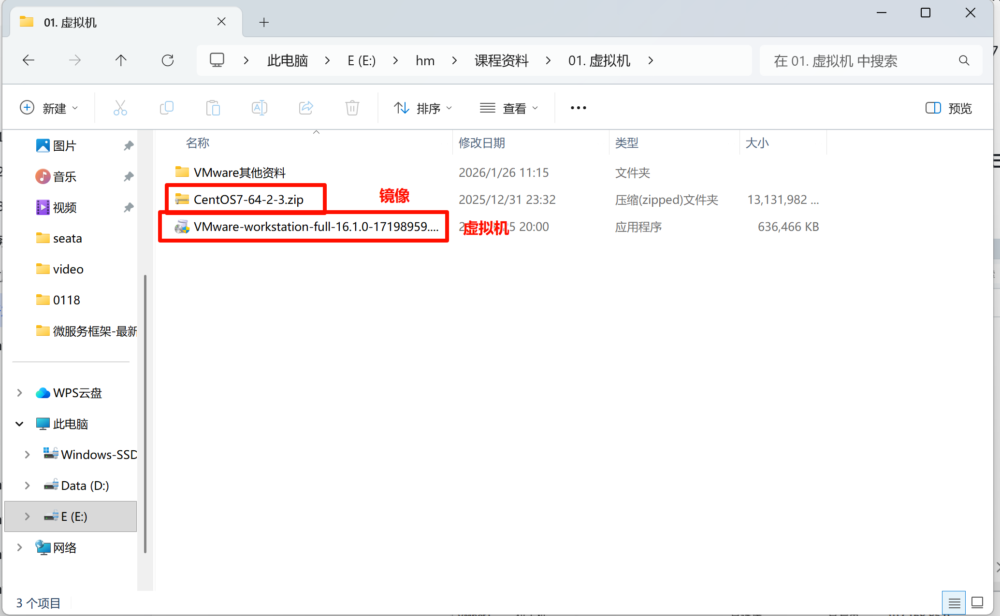
> 图注：图片展示的是E盘“01. 虚拟机”文件夹下的内容。其中，“CentOS7-64-2-3.zip”文件被红色框突出显示，其类型为“镜像”，大小为13.131.982 KB，修改日期为2025/12/31 23:32；“VMware-workstation-full-16.1.0-17198959...”文件被蓝色框突出显示，类型为“虚拟机”，大小为636.466 KB，修改日期为2020/06/26 11:15。该图片与文档中导入虚拟机步骤相关，用于说明导入的虚拟机文件位置。


**1）设置网络**

点击 “编辑--》虚拟网络编辑器”配置网络地址，地址须与下图一致。

设置子网IP：192.168.101.0，子网掩码：255.255.255.0。

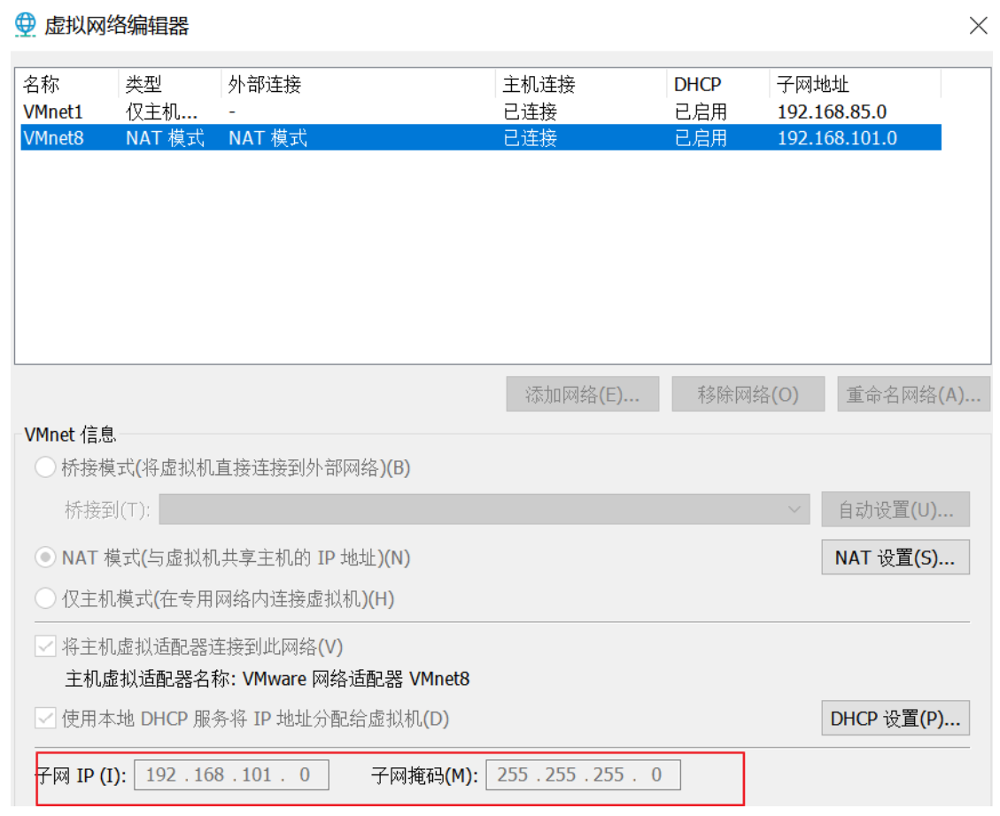
> 图注：图片展示的是虚拟网络编辑器界面，重点突出VMnet8的网络设置。界面中显示VMnet8为NAT模式，已连接，子网IP为192.168.101.0，子网掩码为255.255.255.0。该图片与文档中“导入虚拟机”步骤相关，用于指导用户在VMware workstation中配置网络，确保地址与文档要求一致，是设置网络时确认虚拟网卡IP地址和网关的参考依据。

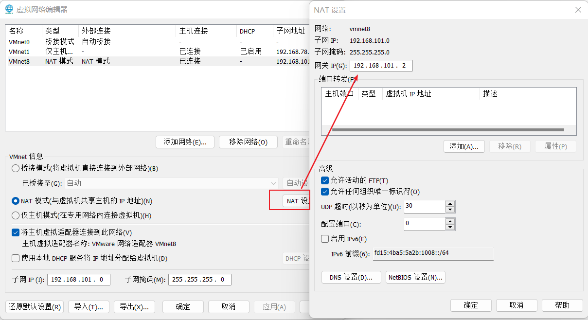
> 图注：图片展示的是VMware虚拟网络编辑器中NAT设置界面。界面中“桥接模式”“NAT模式”“仅主机模式”等选项被红色框线突出显示。NAT设置部分，地址、子网、子网掩码、网关等信息被红色箭头指向。右下角“添加”“移除”“属性”等操作按钮也被红色框线标出。该图片与文档中“导入虚拟机”步骤相关，用于指导用户在VMware中配置虚拟网络，确保网络地址与文档要求一致。

确认自己的虚拟网卡VMnet8的IP地址和网关如下图所示

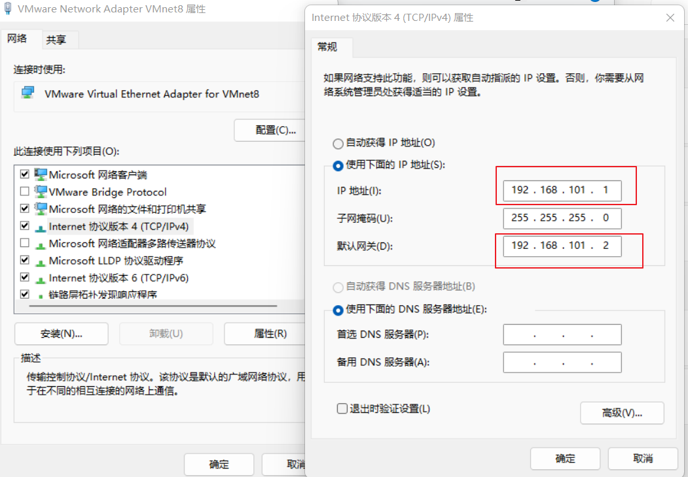
> 图注：图片展示了VMware Network Adapter VMnet8的属性设置界面及Internet协议版本4（TCP/IPv4）属性窗口。在属性设置界面中，选中“VMware Virtual Ethernet Adapter for VMnet8”后，点击“配置”按钮，弹出的属性窗口中，IP地址为192.168.101.1，子网掩码为255.255.255.0，默认网关为192.168.101.2。该图片与文档中设置虚拟机网络地址的内容相关，用于指导用户配置虚拟网卡IP地址和网关。

> **自己电脑的防火墙必须处于如下关闭状态！！！**
> 
> **自己电脑的防火墙必须处于如下关闭状态！！！**
> 
> **自己电脑的防火墙必须处于如下关闭状态！！！**

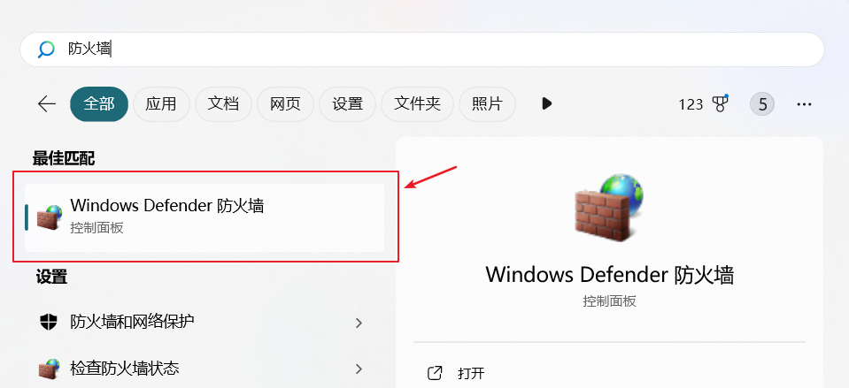
> 图注：这是Windows系统的查找界面，搜索关键词为“防火墙”，左侧“最佳匹配”区域用红色方框框选了“Windows Defender 防火墙 控制面板”选项，同时有红色箭头指向该选项，用于提示该操作项；界面右侧对应展示了“Windows Defender 防火墙 控制面板”的对应图标，下方设有“打开”按钮，界面左侧的“设置”区域还列出了防火墙相关的设置功能选项，该界面用于指导用户快速定位并打开Windows的防火墙控制面板。

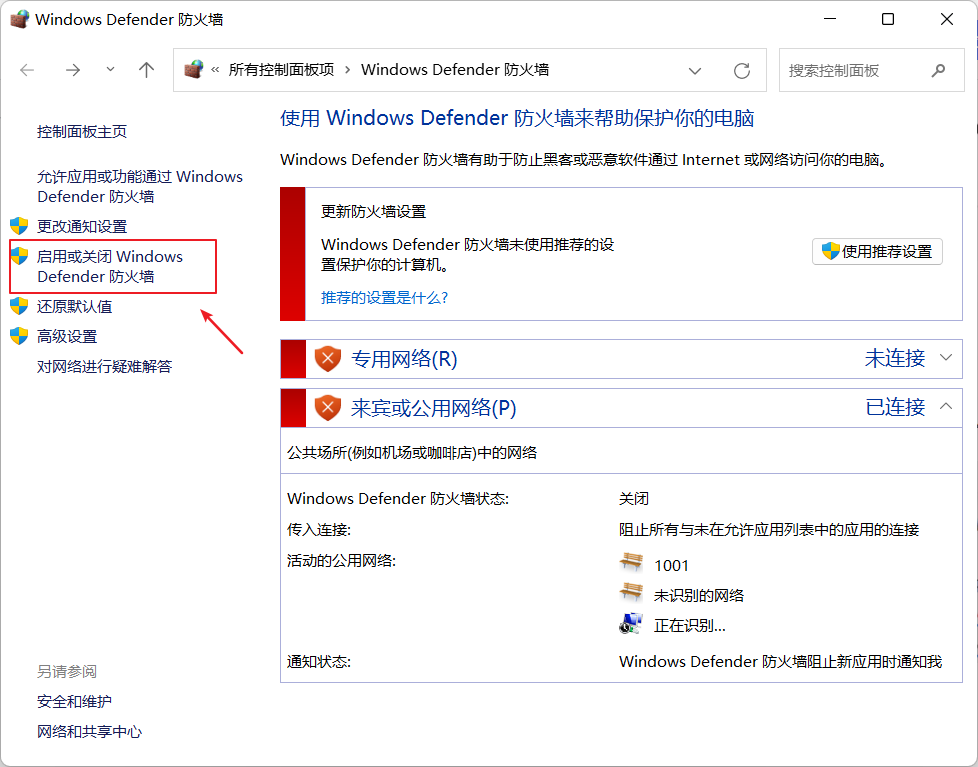
> 图注：这张图片展示的是Windows Defender防火墙的控制面板界面，界面左侧有红色箭头指向“启用或关闭Windows Defender防火墙”选项。界面主体部分介绍了Windows Defender防火墙的作用，更新防火墙设置相关内容，还显示了专用网络未连接、来宾或公用网络已连接的状态，以及防火墙状态、传入连接、活动的公用网络等相关信息，该界面用于对Windows Defender防火墙进行相关设置操作。

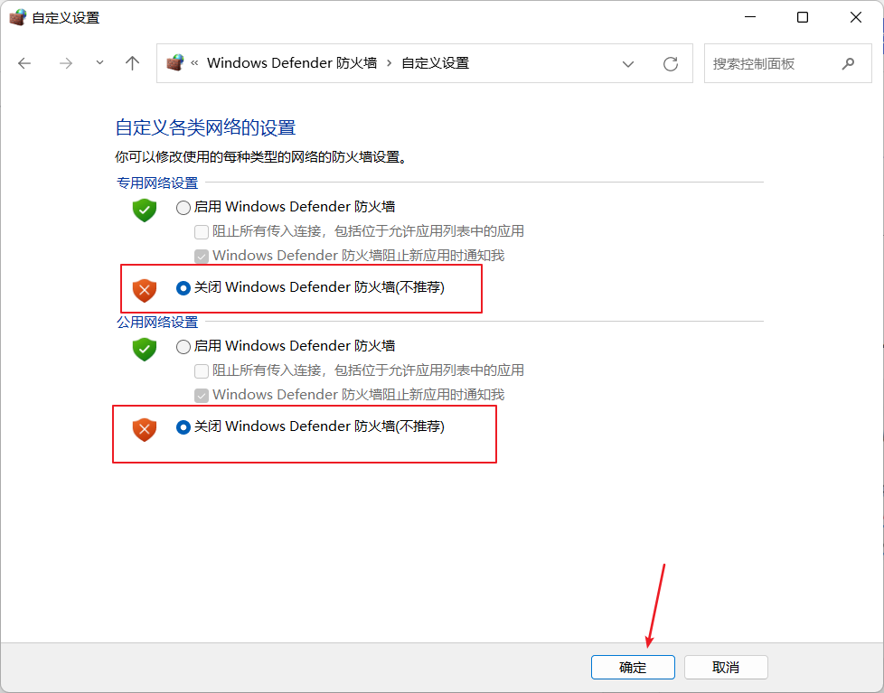
> 图注：图片展示的是Windows Defender防火墙的自定义设置界面。界面上方显示“自定义各类网络的设置”，并有“专用网络设置”和“公用网络设置”选项。专用网络设置中，“启用Windows Defender防火墙”选项被勾选，下方有“阻止所有传入连接，包括位于允许应用列表中的应用”和“Windows Defender防火墙阻止新应用时通知我”选项；公用网络设置中，“启用Windows Defender防火墙”选项也被勾选，下方同样有上述两个选项。界面底部有“确定”和“取消”按钮，其中“确定”按钮被红色箭头指向。

**2）导入虚拟机**

解压老师提供的虚拟机文件，进入解压后的文件架，**双击**"CentOS 7 64 位.vmx" 文件，选择复制虚拟机。

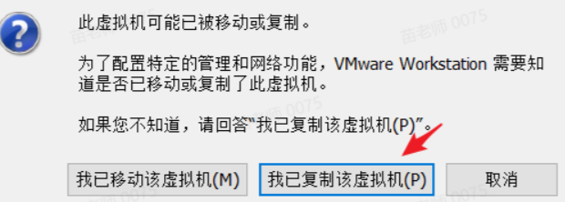
> 图注：这张图片显示的是VMware Workstation的提示弹窗，内容为：提示该虚拟机可能已被移动或复制，因需配置特定管理和网络功能，软件询问是否已移动或复制此虚拟机，弹窗提供三个选项，分别是“我已移动该虚拟机(M)”、“我已复制该虚拟机(P)”和“取消”，其中“我已复制该虚拟机(P)”选项被蓝色高亮选中，且有红色箭头指向该选项，该内容对应文档中导入虚拟机步骤里双击虚拟机文件后，选择复制虚拟机的相关操作环节，用于指导用户确认虚拟机的操作状态以完成导入设置。

对此虚拟机的设置建议至少8G内存、8核CPU，硬盘存储至少40G。

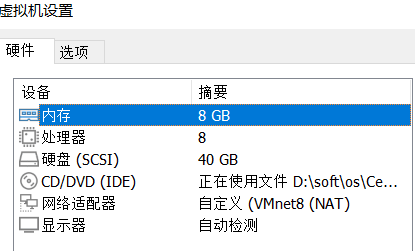
> 图注：这张图片是虚拟机设置界面，具体展示了硬件配置相关内容。界面包含硬件与选项两个标签页，当前处于硬件标签页，设备列表里的内存配置被蓝色高亮，为8GB，处理器设置为8核，硬盘存储设置为40GB，CD/DVD（IDE）正在使用指定路径的文件，网络适配器采用自定义的VMnet8（NAT）模式，显示器设置为自动检测。这一内容对应文档中导入虚拟机后设置硬件参数的步骤，为后续启动虚拟机提供了具体的配置参考。

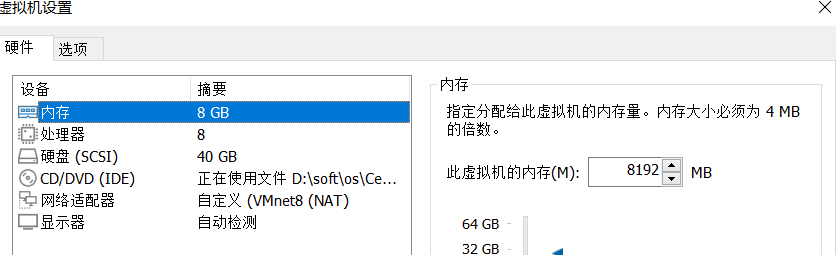
> 图注：这是虚拟机设置界面的硬件选项卡截图，界面左侧的设备列表中，“内存”选项处于选中状态，对应的摘要信息显示该虚拟机内存为8GB。界面右侧的内存设置区域显示，此虚拟机的内存设置为8192MB，同时提示内存大小必须为4MB的倍数，该设置对应文档中提及的虚拟机内存至少8G的配置建议，符合开发环境搭建时的虚拟机设置要求。

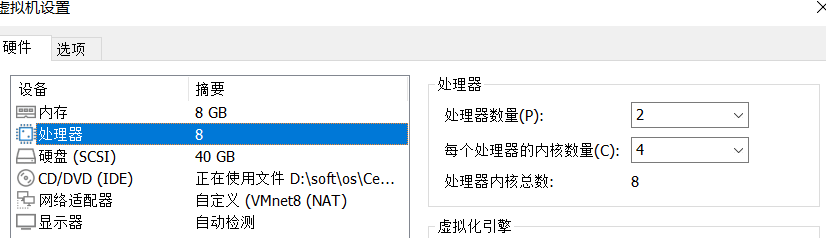
> 图注：图片展示的是虚拟机设置界面中硬件设置部分。内存设置为8GB，处理器设置为8，处理器数量为2，每个处理器的内核数量为4，处理器内核总数为8。该图片与文档中导入虚拟机步骤相关，是对对此虚拟机设置建议至少8G内存、8核CPU的直观呈现，帮助用户了解设置情况。

设置完成，启动虚拟机。

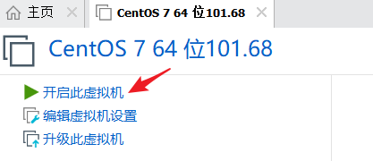
> 图注：图片展示了在虚拟机界面中对“CentOS 7 64 位101.68”虚拟机的操作选项。其中，“开启此虚拟机”选项被红色箭头突出指向，表明这是当前可执行的操作。该图片与文档中“导入虚拟机”部分内容相关，用于说明在虚拟机启动成功后，若遇到“未能启动虚拟机”报错，可尝试通过修改配置文件后，点击此选项来开启虚拟机，以解决报错问题。

注意：虚拟机的IP地址为192.168.101.68，不用修改IP地址。

虚拟机启动成功如下界面：

账号：root

密码: centos

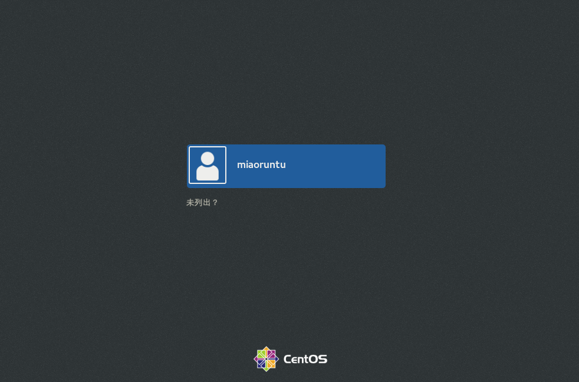
> 图注：图片展示的是虚拟机启动成功后的界面。画面中央有一个蓝色长方形框，内有白色人形图标，框内文字为“miaoruntu”，下方有“未列出？”字样。画面左下角有Windows和CentOS的标志。该图片与文档中“虚拟机启动成功”内容相关，直观呈现了虚拟机启动后的登录界面，帮助用户确认虚拟机是否成功启动。


#### 1.1.1 **可能遇到的问题**

win11打开.vmx文件报错：“未能启动虚拟机”

尝试解决方法：

1. 打开虚拟机的存放路径
2. 找到.vmx的配置文件
3. 修改 virtualHW.version改为virtualHW.version = "18"


### 1.2 苹果电脑用户（windows电脑同学无需操作）

使用苹果电脑的学生需要自行安装docker并安装MySQL8，已安装MySQL8的不必重新安装。

#### 1.2.1 安装MySQL

拉取镜像：

docker pull mysql:8.0.26

 创建以下目录：

sudo mkdir -p /usr/mysql/conf /usr/mysql/data /var/log/mysql

sudo chmod -R 777 /usr/mysql/ /var/log/mysql

 

创建配置文件

vim /usr/mysql/conf/my.cnf

添加以下内容到上述创建的配置文件中

```Java
 
[client]
#socket = /usr/mysql/mysqld.sock
default-character-set = utf8mb4
 
[mysqld]
#pid-file        = /var/run/mysqld/mysqld.pid
#socket          = /var/run/mysqld/mysqld.sock
#datadir         = /var/lib/mysql
#socket = /usr/mysql/mysqld.sock
#pid-file = /usr/mysql/mysqld.pid
 
datadir  = /usr/mysql/data
 
general_log = 1
general_log_file = /var/log/mysql/access.log
log-error = /var/log/mysql/error.log
 
character_set_server = utf8mb4
collation_server = utf8mb4_bin
secure-file-priv= NULL

Disabling symbolic-links is recommended to prevent assorted security risks
symbolic-links=0

Custom config should go here
!includedir /etc/mysql/conf.d/
```

  

创建启动容器

```Java
docker run -itd --name=mysql -v /usr/mysql/conf/my.cnf:/etc/mysql/my.cnf -v /usr/mysql/data:/usr/mysql/data -v /var/log/mysql:/var/log/mysql -p 3306:3306 -e MYSQL_ROOT_PASSWORD=mysql mysql:8.0.26
```

说明： -v : 挂载宿主机目录和 docker容器中的目录，前面是宿主机目录，后面是容器内部目录 -d : 后台运行容器 -p 映射容器端口号和宿主机端口号 -e 环境参数，MYSQL_ROOT_PASSWORD设置root用户的密码

 

下边修改mysql的访问权限为所有客户端可以访问：

进入容器内部

sudo docker exec -it mysql /bin/bash

连接mysql

mysql -uroot -pmysql

使用mysql库

use mysql;

修改访问主机以及密码等，设置为所有主机可访问

```Java
ALTER USER 'root'@'%' IDENTIFIED WITH mysql_native_password BY 'mysql';
flush privileges;
```

```Plain Text
docker ps 

```

windows下mysql是否启动

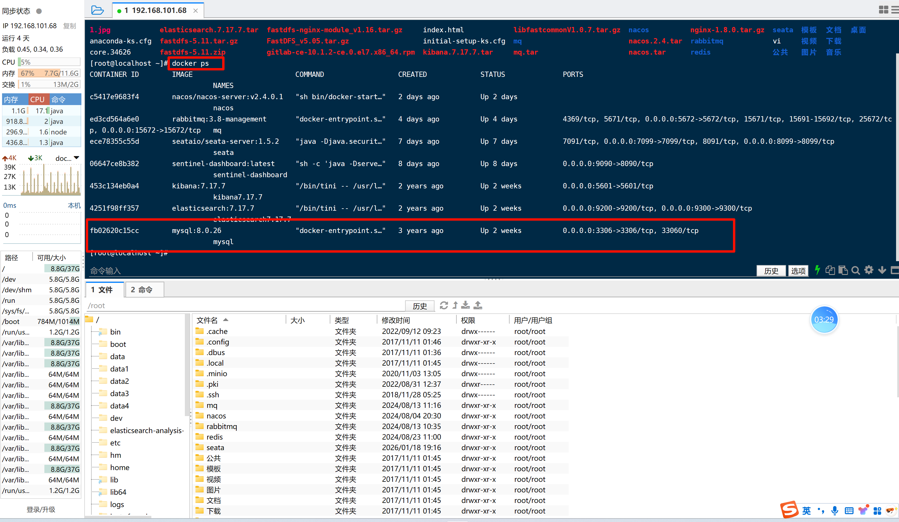
> 图注：这张图片展示了苹果电脑的Docker工具界面，结合上下文可知其为用于验证MySQL容器运行状态的操作界面。界面中“docker ps”命令的执行结果被红色框标注，其中包含名为“mysql”的容器信息，该容器基于“docker-entrypoint”镜像，运行时间为2周，端口映射为0.0.0.0的13066与13060端口，状态为运行中。这一结果对应文档中“创建启动容器”的操作，用于确认MySQL服务已成功后台启动并完成端口映射的配置。

### 1.3 **远程连接虚拟机**

虚拟机启动成功，下边使用ssh客户端工具（FinalShell）远程 连接 虚拟机。

打开FinalShell软件，没有安装的可以从课程资料“软件工具”目录获取安装程序（finalshell_install.exe）。

通过下图所示建立新连接：

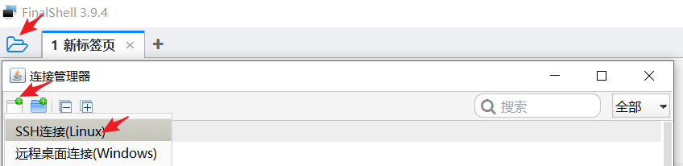
> 图注：图片展示了FinalShell 3.9.4软件界面，用于远程连接虚拟机。界面上方有“1新标签页”和“+”按钮，左侧有“连接管理器”选项，下方有“SSH连接(Linux)”和“远程桌面连接(Windows)”选项。该图片对应文档中“远程连接虚拟机”步骤，是通过下图所示建立新连接的操作指引，直观呈现了连接管理器中SSH连接选项，辅助用户进行远程连接操作。

填写连接信息：

IP地址：192.168.101.68

账号与密码为：root/centos

如下图：

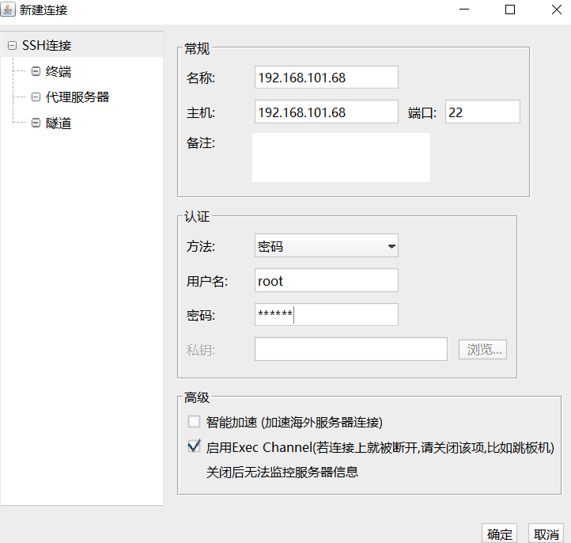
> 图注：图片展示的是通过Putty软件建立新连接的界面。左侧为连接类型选择栏，选中“终端”。右侧常规部分显示IP地址为192.168.101.68，端口为22，认证方法为密码，用户名为root，密码部分以星号显示。高级部分有“启用Exec Channel”选项被勾选。该图片与文档中“远程连接虚拟机”部分内容相关，用于指导用户在填写连接信息时的具体操作界面展示。

点击“确定”，创建连接成功，如下图：


> 图注：这张图片展示的是开发环境远程连接虚拟机操作里的连接管理器界面，界面内存在IP地址分别为192.168.101.68的连接条目，该条目对应的端口为22、账号为root。界面中用红色箭头指向该连接的IP地址区域，且标注了“双击”字样，该操作对应文档中双击连接信息即可完成虚拟机连接的步骤，填写的连接信息（IP地址192.168.101.68、账号root）与文档内容完全对应，是远程连接虚拟机操作的关键操作提示界面。

双击连接信息，连接成功如下图：


执行 **systemctl start docker 启动docker。**


> 图注：该图片展示了Linux远程连接虚拟机后的命令行操作界面，提示符显示当前为root用户，主机名为localhost，处于~目录下。界面中已执行“systemctl start docker”命令，命令下方的输入提示符处于可输入状态，这是在完成远程连接虚拟机后，启动Docker服务的操作步骤相关内容，对应开发环境搭建流程中启动Docker的操作环节。

~~启动mysql：docker start mysql~~

以上软件如果已经启动不用重复启动**。**

查询docker容器：docker ps

如下图：

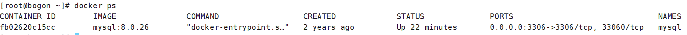
> 图注：这张图片是执行`docker ps`命令后的输出结果，当前处于root用户下的操作界面。结果展示了运行中的Docker容器信息：包含CONTAINER ID、IMAGE、COMMAND、CREATED、STATUS、PORTS、NAMES等列，其中名为mysql的容器，对应的镜像版本是8.0.26，该容器已运行22分钟，端口映射为0.0.0.0:3306->3306/tcp和33060/tcp，由此可验证mysql容器处于正常启动状态，这对应文档中远程连接虚拟机章节里“启动mysql”后的容器查询操作。


### 1.4 修改IP

```Plain Text
ip addr | grep 192.168.101
```

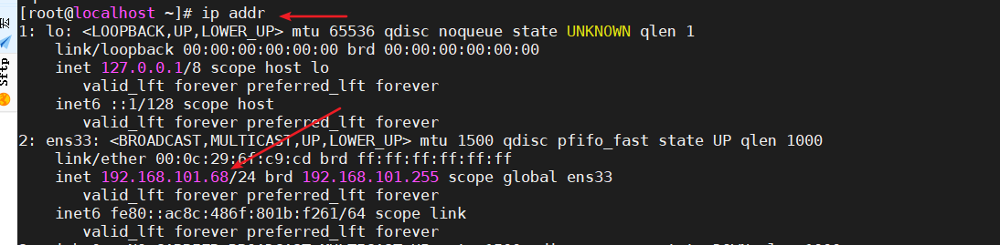
> 图注：图片展示的是在Linux系统中使用`ip addr`命令查询网络接口信息的结果。命令执行后，显示了两个网络接口信息。其中，`lo`接口为环回接口，IP地址为127.0.0.1；`ens33`接口为以太网接口，IP地址为192.168.101.68/24，广播地址为192.168.101.255。该图片与文档中“修改IP”部分相关，用于说明在root用户下进入网络配置文件目录后，使用`ip addr`命令查询网络接口信息，以确定需修改的IP地址。

如果虚拟机IP不是192.168.101.68需要修改虚拟机IP地址为192.168.101.68（已经是这个IP的无需操作）。

修改方法如下：

确保在root用户下进行操作，进入网络配置文件network-scripts目录下,找到我们需要修改的配置文件:

```Java
cd /etc/sysconfig/network-scripts/
vi ifcfg-ens33
```

使用ls命令，列出该目录下的文件。其中“ifcfg-ens33”的文件，为我们需要修改的网络配置文件。

 修改配置文件

 使用vim命令（vi命令也可以）,对文件进行配置：

1.  我们需要修改BOOTPROTO="static"也就是将dhcp改为static
2. 修改ONBOOT=“yes” 意思是将网卡设置 为开机启用.
3. 修改IPADDR=192.168.101.68
4. 修改GATEWAY=192.168.101.2

ifcfg-ens33文件内容如下：

```Java
[root@localhost network-scripts]# cat ifcfg-ens33
TYPE=Ethernet
PROXY_METHOD=none
BROWSER_ONLY=no
BOOTPROTO=static
DEFROUTE=yes
IPV4_FAILURE_FATAL=no
IPV6INIT=yes
IPV6_AUTOCONF=yes
IPV6_DEFROUTE=yes
IPV6_FAILURE_FATAL=no
IPV6_ADDR_GEN_MODE=stable-privacy
NAME=ens33
UUID=28711c7c-1216-454e-a454-b7c9a08e71e6
DEVICE=ens33
ONBOOT=yes
IPV6_PRIVACY=no
IPADDR=192.168.101.68
PREFIX=24
GATEWAY=192.168.101.2
DNS1=8.8.8.8
```


还需要修改vmware的网络配置

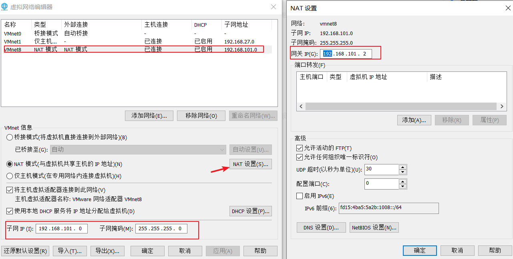
> 图注：这张图是 VMware 的虚拟网络编辑器和 NAT 设置界面，对应文档中修改 VM 网络配置的步骤。左侧虚拟网络编辑器中，选中了子网为192.168.101.0、子网掩码为255.255.255.0的NAT模式网络，还标注了“NAT设置”按钮；右侧NAT设置窗口里，网关被明确设为192.168.101.2，这些参数和文档中修改虚拟机网卡配置文件时设定的IPADDR、GATEWAY相匹配，是完成远程连接虚拟机前网络配置的关键操作界面。

修改完毕，重启虚拟机即可。


### 1.5 特别注意

使用虚拟机要特别小心，如果没有正常点击虚拟机关闭或者挂起虚拟机，可能会导致网卡文件损坏，因此要每次关闭电脑前，要确保虚拟机正常关闭后，再对电脑关机。咱们每次结束前就尽量选择挂起客户机就行，如下图：

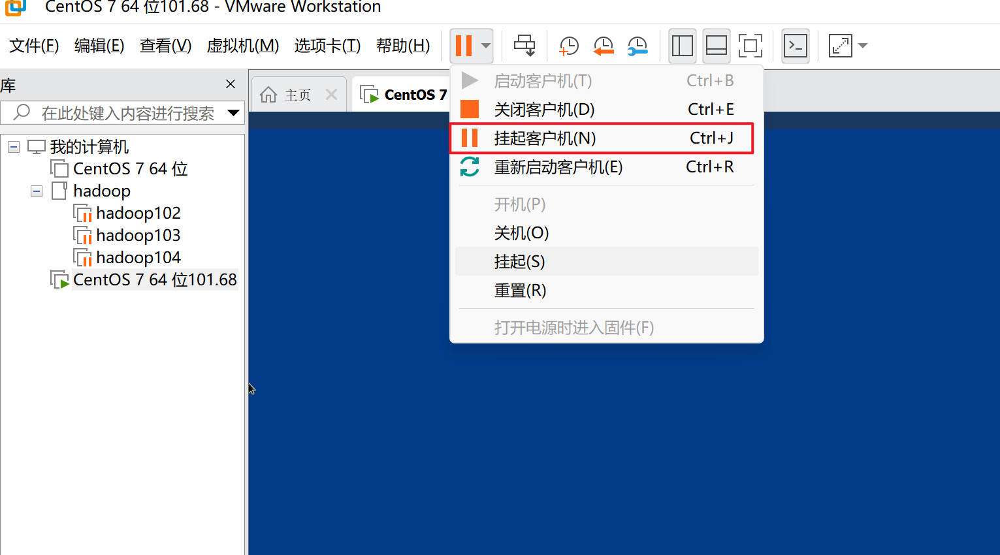
> 图注：图片展示了在VMware Workstation中挂起客户机的操作界面。画面中，虚拟机“CentOS 7 64位101.68”处于运行状态，其右侧的“选项卡”菜单被展开，其中“挂起客户机”选项以红色框突出显示，对应快捷键为Ctrl+J。该图片与文档中“特别注意”部分内容相关，用于说明在使用虚拟机时，如果没有正常点击虚拟机关闭或挂起虚拟机，可能会导致网卡文件损坏，因此每次结束前应尽量选择挂起客户机，下次运行时再点击继续运行此虚拟机。

下次运行时再点击继续运行此虚拟机即可

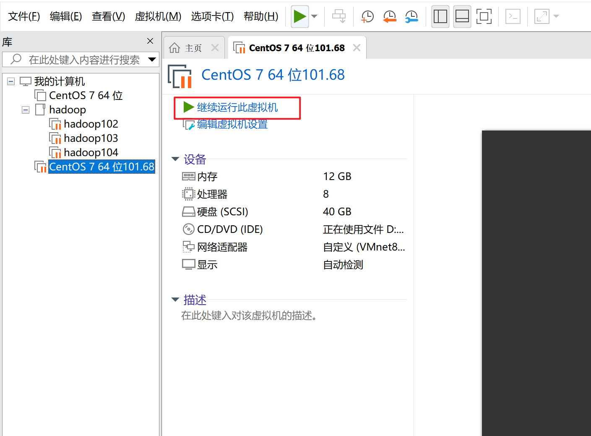
> 图注：图片展示了VMware Workstation Pro软件界面，左侧为文件夹结构，右侧是虚拟机设置窗口。窗口中“CentOS 7 64位101.68”被选中，其右侧有“继续运行此虚拟机”按钮被红色框突出显示。该图片与文档中“特别注意”部分内容相关，用于说明在使用虚拟机时，如果没有正常点击虚拟机关闭或挂起，可能会导致网卡文件损坏，因此每次结束前要确保虚拟机正常关闭后关机，下次运行时再点击此按钮继续运行虚拟机。


万一出现网卡损坏，连不上虚拟机，那么可以通过之前拍的快照进行恢复；但是如果忘记拍快照，那么就没拍照可恢复就只能重新解压一份虚拟机镜像文件再打开进行拍照了。


拍摄快照和恢复快照方式-确保虚拟机文件正常可用的情况下，找到拍摄入口

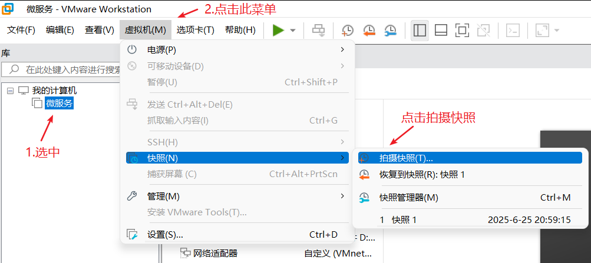
> 图注：图片展示了在VMware Workstation中拍摄快照的操作步骤。首先，选中左侧“我的计算机”下的“微服务”；接着点击上方菜单栏中的“虚拟机”选项卡；最后在下拉菜单中点击“拍摄快照”即可。该图片与文档中“拍摄快照和恢复快照方式”部分内容对应，直观呈现了拍摄快照的操作流程，帮助用户在确保虚拟机文件正常可用的情况下，找到并使用拍摄快照的入口。

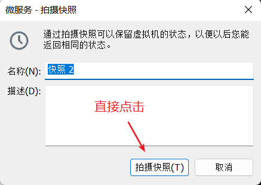
> 图注：图片展示了微服务 - 拍摄快照窗口，用于保留虚拟机状态。窗口中有“名称”和“描述”输入框，名称处显示“快照2”，下方有“拍摄快照”和“取消”按钮。图片中红色箭头指向“拍摄快照”按钮，并标注“直接点击”，与上下文提到的“拍摄快照和恢复快照方式 - 确保虚拟机文件正常可用的情况下，找到拍摄入口”相呼应，直观呈现了拍摄快照的操作入口位置。

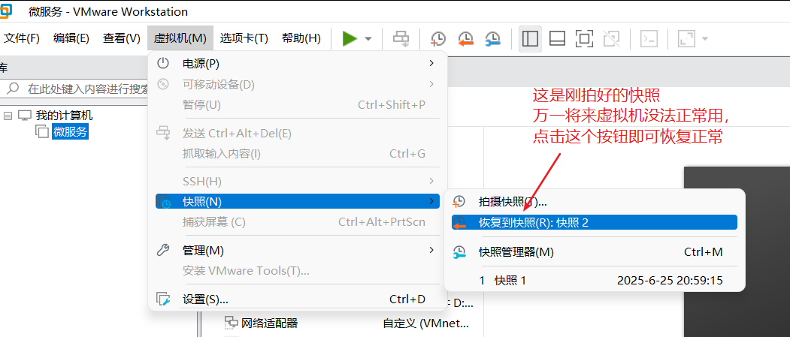
> 图注：这是VMware Workstation的操作界面截图，显示“虚拟机”菜单展开后，已选中“快照”选项，快照的下拉菜单中高亮标注了“恢复到快照(R):快照2”选项，右侧配有红色文字说明：“这是刚拍好的快照，万一将来虚拟机没法正常用，点击这个按钮即可恢复正常”，该图用于辅助说明文档中虚拟机快照的恢复操作步骤。

## 2 **IDEA环境配置**

安装IDEA，根据下边的步骤进行配置。如果已经配置过则忽略。

### **2.1 编码配置**

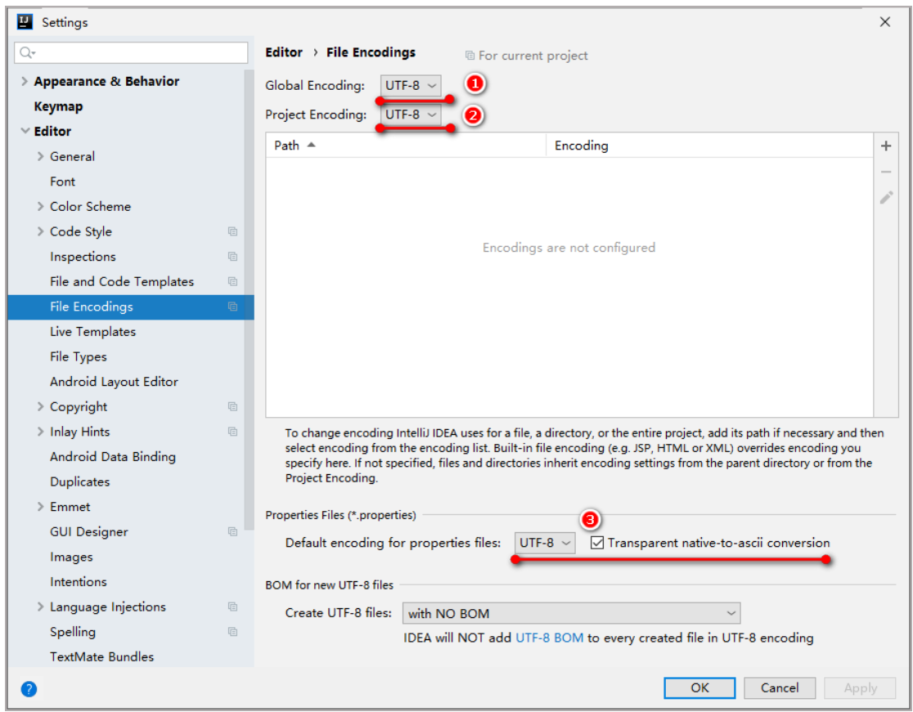
> 图注：图片展示了IntelliJ IDEA中“File Encodings”设置界面。左侧导航栏选中“File Encodings”。界面中“Global Encoding”和“Project Encoding”均设置为“UTF-8”（①②处红色框标注）。下方“Properties Files (*.properties)”部分，“Default encoding for properties files”也设置为“UTF-8”（③处红色框标注），并勾选了“Transparent native-to-ascii conversion”。该图片与文档中“IDEA环境配置”下的“2.1编码配置”内容相关，用于指导用户进行编码配置设置。

### 2.2 **自动导包设置**

IDEA可以自动优化导入包，**但是有多个同名的类调用不同的包，必须自己手动Alt+Enter设置**，  
下面可以通过设置来进行导包优化。

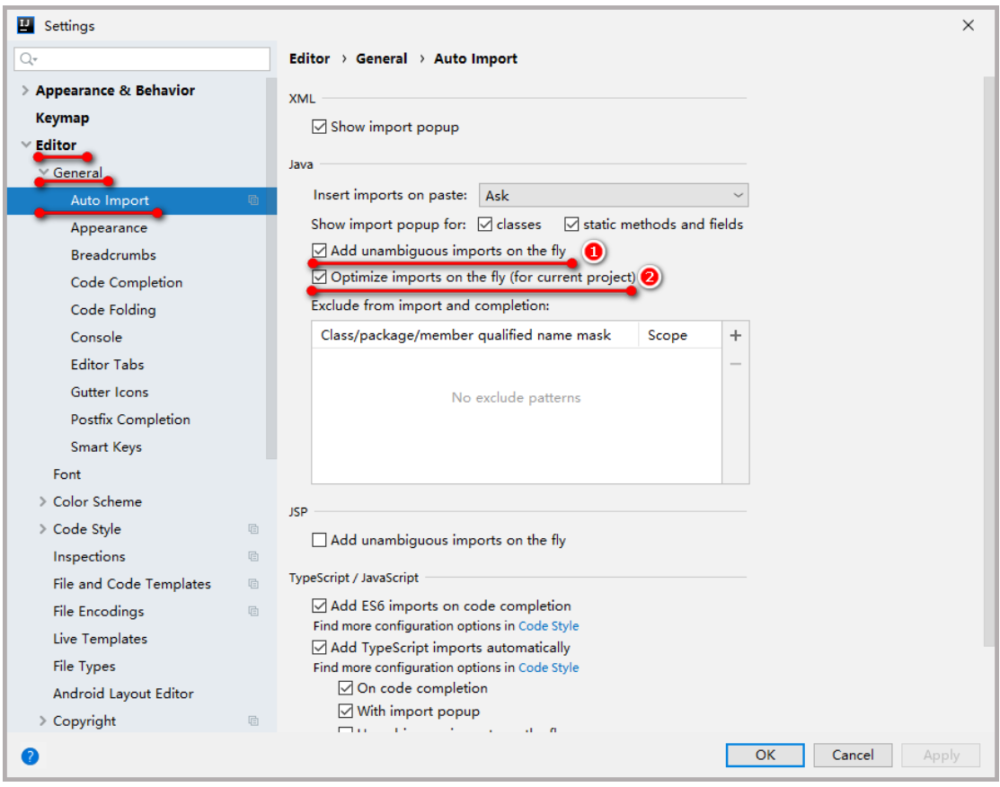
> 图注：图片展示的是IntelliJ IDEA中“Settings”下的“Editor”>“General”>“Auto Import”设置界面。关键内容有：在“Java”选项下，选中“Add unambiguous imports on the fly”（①）和“Optimize imports on the fly (for current project)”（②）两项。该图片与文档中“IDEA环境配置”部分相关，用于指导开发者配置IDEA环境，确保代码提示和导入优化等功能正常工作。

### 2.3 **提示忽略大小写**

IDEA代码提示默认是区分大小写的，设置为提示忽略大小写，编译我们后期的开发

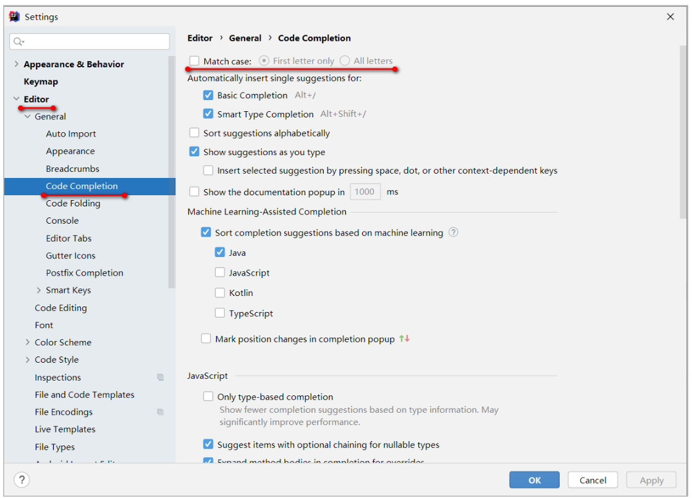
> 图注：这张图片是IDEA的设置界面，左侧菜单栏的Editor分类下选中了Code Completion选项，对应开发环境配置里“提示忽略大小写”的内容。界面里“Match case”选项当前选中的是“All letters”，这一设置用于实现代码提示忽略大小写，让代码提示更贴合开发需求，是IDEA环境配置中调整代码提示规则的关键操作设置项。

### 2.4 **设置 Java 编译级别**

工程创建成功，点击Project Structure:

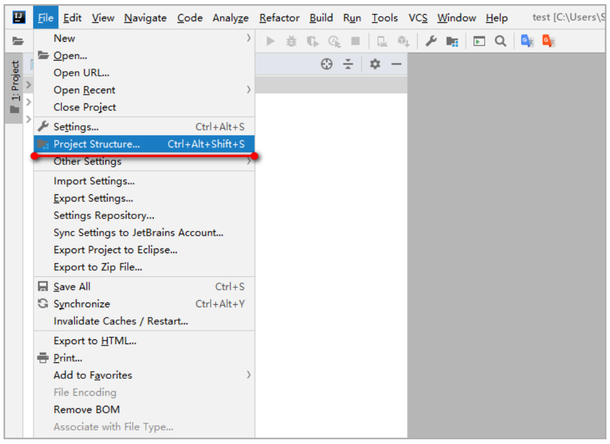
> 图注：图片展示了IDEA软件的File菜单界面。在File菜单下，用红色框和箭头突出显示了“Project Structure...”选项，其快捷键为Ctrl+Alt+Shift+S。该图片与文档中“设置Java编译级别”部分内容相关，用于指导用户在IDEA中点击Project Structure...以设置SDK为11及Project language level，是后续操作的指引图示。

点击Project，设置SDK为11及Project language level，如下图：

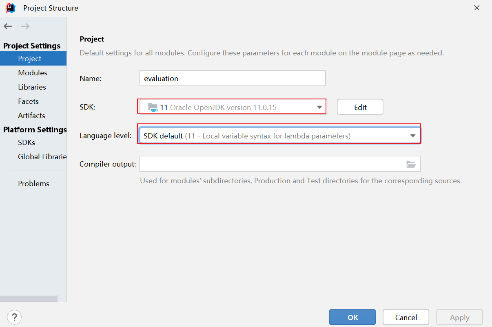
> 图注：这张图片是IntelliJ IDEA的Project Structure设置窗口，对应工程创建后配置Java编译级别的操作界面。窗口的Project设置页中，Name参数为“evaluation”；需重点设置的SDK选项已选中为“11 Oracle OpenJDK version 11.0.15”；Language level下拉菜单已展开，当前选中的项为“SDK default (11 - Local variable syntax for lambda parameters)”，该界面用于完成文档中要求的SDK及Project language level的配置。

## 3 Maven环境

### 3.1 安装Maven

下载maven3.8.6版本，下载链接如下：

https://dlcdn.apache.org/maven/maven-3/3.8.6/binaries/apache-maven-3.8.6-bin.zip

解压apache-maven-3.8.6-bin.zip到没有中文的目录下。

**已安装maven的不用重复安装。**

### 3.2 **配置仓库**

配置中央仓库位置：

在setting.xml文件中配置阿里云中央仓库地址。

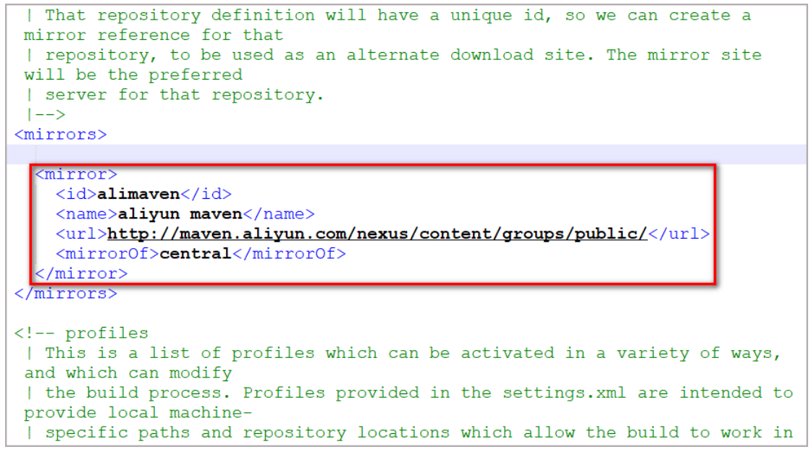
> 图注：这张图片展示的是Maven配置文件（settings.xml）中的镜像配置代码片段，核心内容被红色框标注出来，是一个名为aliyun maven的镜像配置。该镜像的唯一标识id为alimaven，对应的仓库地址为http://maven.aliyun.com/nexus/content/groups/public/，其镜像指向的是中央仓库（central）。这段配置的作用是将Maven的默认仓库替换为阿里云镜像，可加快依赖包的下载速度，这与前文文档中提及的配置Maven的内容相关，是Maven配置过程中关键的镜像配置部分。

### **3.3 IDEA中配置maven**

在IDEA中配置maven：进入 File --> Settings --> Build --> Build Tools --> Maven

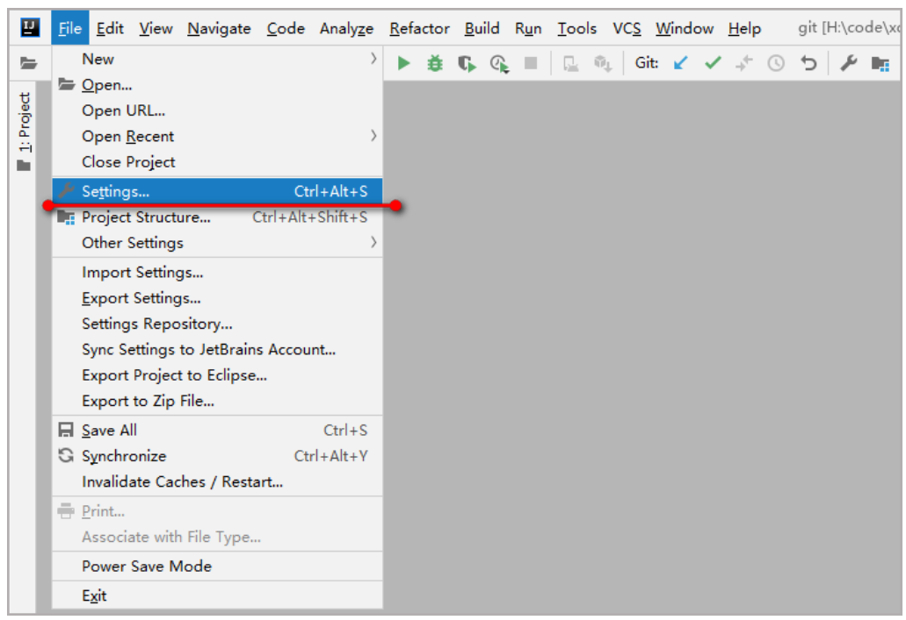
> 图注：这张图片展示了IDEA开发工具的菜单栏界面，明确标注了进入IDEA配置页面的操作路径，即点击顶部菜单栏的“File”选项后，在弹出的下拉菜单中，“Settings...”选项被红色箭头标注突出显示，该选项的快捷键为“Ctrl+Alt+S”。这张图对应文档中配置Maven的操作步骤，是指引用户进入IDEA设置界面以完成Maven配置的操作参考图，直观呈现了在IDEA中进入设置模块的具体操作位置。

配置maven安装目录、setting.xml及本地仓库的位置。

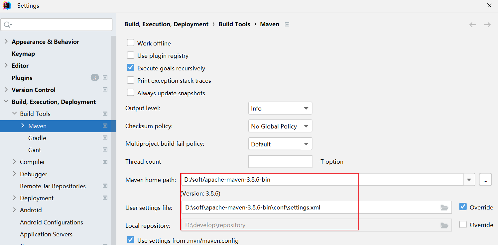
> 图注：图片展示了IDEA中配置Maven的设置界面。左侧为设置菜单，选中“Build Tools”下的“Maven”。右侧是Maven相关设置，包括是否离线工作、是否使用插件仓库等选项，以及Maven home path、User settings file和Local repository的路径设置，其中Maven home path为D:\\soft\\apache-maven-3.8.6-bin，User settings file为D:\\soft\\apache-maven-3.8.6-bin\\conf\\settings.xml，Local repository为D:\\develop\\repository。该图片与文档中“在IDEA中配置maven”内容对应，直观呈现了配置步骤中设置界面的样式和关键路径信息。

## 4 配置Git环境


在个人电脑安装Git，使用常用软件工具目录中的Git-2.37.3-64-bit.exe。

也可以自行下载，地址：https://git-scm.com/  （windows版本：https://git-scm.com/download/win）

安装成功，在右键菜单出现Git菜单，如下图

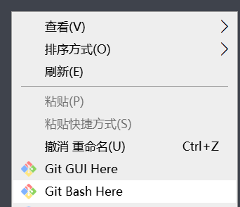
> 图注：图片展示了Windows系统右键菜单中与Git相关的选项。菜单中“Git GUI Here”和“Git Bash Here”两项被红色框线突出显示，前者用于启动Git GUI，后者用于启动Git Bash终端。该图片与文档中“配置Git环境”部分相关，用于说明安装Git成功后，在右键菜单中会出现Git相关选项，方便用户进行Git操作。

配置git邮箱：

```Java
git config --global user.name "你的名字"
git config --global user.email "你的邮箱"
```


安装成功在IDEA中配置git的安装目录

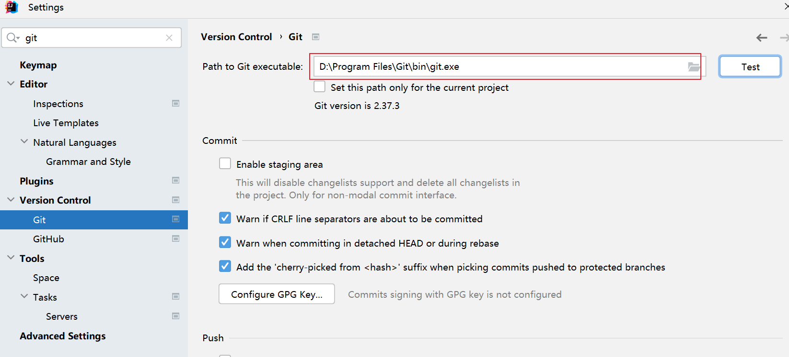
> 图注：这张图片展示的是IDEA软件的Settings设置界面中，配置Git安装目录的页面。界面左侧选中了“Version Control”分类下的“Git”选项，右侧核心区域的“Path to Git executable”输入框内，已填写Git可执行文件的路径为D:\\Program Files\\Git\\bin\\git.exe，该路径被红色框线标注突出显示，输入框右侧配有“Test”按钮。下方还显示了Git版本信息，以及关于CRLF换行符、提交分支的相关设置选项，该页面对应文档中安装Git后在IDEA中配置Git安装目录的步骤内容。


## 5 导入商城项目

### 5.1 拉取项目

首先，我们需要熟悉黑马商城项目的基本结构：

本课程提供的git地址为：git clone https://gitee.com/fjlcyl/hm-service.git

大家需要登录自己gitee账号，**Fork该仓库到自己的空间**，Fork是将其它仓库的内容复制到自己仓库。

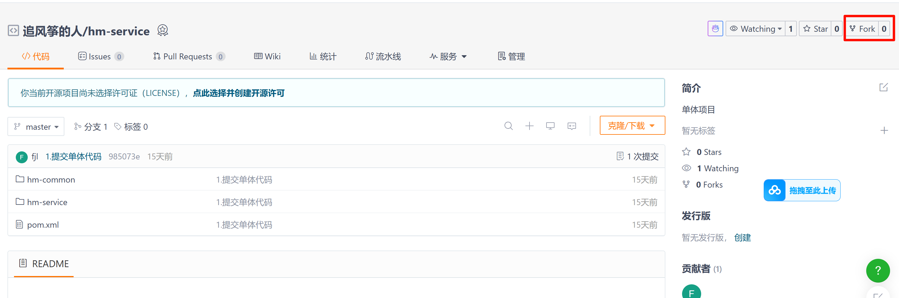
> 图注：这张图片展示的是开发者仓库中名为“追风筝的人/hm-service”的单体项目页面，页面顶部可见“代码”“Issues”“Pull Requests”等功能选项，项目当前分支为master，包含hm-common、hm-service、pom.xml等文件，且显示未选择开源项目许可证的提示。页面右上角的“Fork”按钮被红色方框重点标注，其当前状态显示为0，对应文档中克隆项目前需复制仓库地址的步骤，用于引导开发者操作项目仓库以完成后续项目拉取流程。

查看已复制到自己的仓库中的项目，点击“克隆/下载”，复制仓库地址

然后从此Git仓库克隆hmall到代码目录。

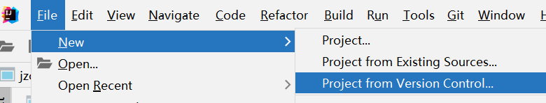
> 图注：这张图片展示的是开发工具的界面，当前处于“File”菜单的下拉选项界面，其中“New”选项被选中并展开了子菜单，“Project from Version Control...”选项以蓝色高亮显示，该界面对应导入商城项目流程中拉取项目的操作环节，是用户选择从远程版本控制系统克隆项目的操作入口界面。

输入远程仓库地址，并选择本地代码目录：

在弹出窗口选择信任该项目，接下来打开克隆成功的工程如下图：

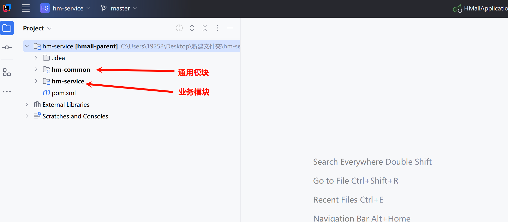
> 图注：该图片展示了开发工具的项目工程界面，为拉取并克隆成功后的hmall-parent项目工程界面。界面左侧的项目目录下，标注有“通用模块”的hm-common文件夹，以及“业务模块”的hm-service文件夹，两个模块均通过红色箭头及对应文字标注进行突出说明。该内容对应文档中5.1拉取项目的后续步骤，即成功克隆工程后的项目结构展示。


### 5.2 连接数据库

首先创建数据库连接

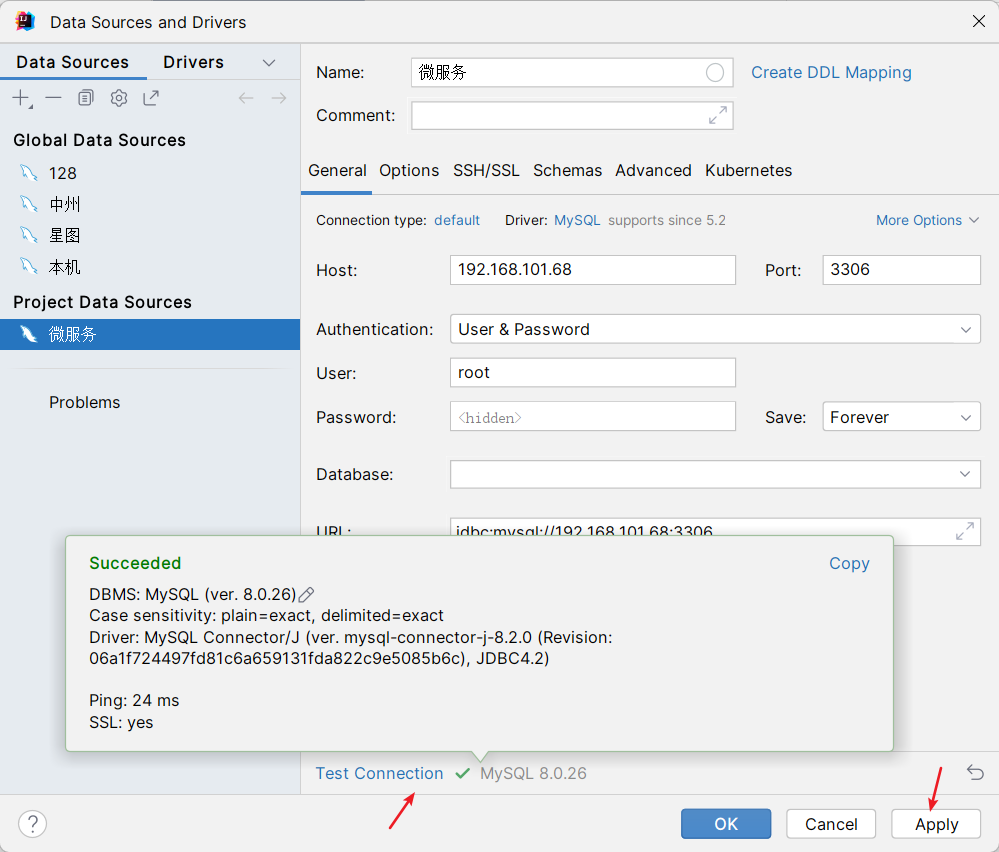
> 图注：图片展示的是Data Sources and Drivers界面，用于创建数据库连接。界面中“Name”处输入“我服务”，“Host”为192.168.101.68，“Port”为3306，“Authentication”选择“User & Password”，“User”为root，“Password”为mysql，“Database”未选择。下方显示数据库连接测试成功，Ping时间为24ms，SSL为yes。界面底部有“Test Connection”按钮，箭头指向该按钮，还有“OK”“Cancel”“Apply”等操作按钮。该图与上下文“首先创建数据库连接”相关，展示了创建数据库连接的操作界面及成功测试结果。

虚拟机中的MySQL数据库账号为root，密码为：mysql

连接成功数据库和对应表如下：

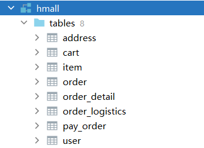
> 图注：图片图片展示了hmall数据库中tables文件夹下的表结构。其中包含address、cart、item、order、order_detail、order_logistics、pay_order、user等表。该图片与文档中“5.2连接数据库”部分内容相关，用于说明在连接成功数据库和对应表后，可查看到的表结构情况，辅助理解数据库中各表的分布情况。


接下来修改数据库连接参数，数据库的ip地址和数据库密码：在application-dev.yaml中：

```YAML
hm:
  db:
    host: 192.168.101.68 # 修改为你自己的虚拟机IP地址
    pw: mysql # 修改为docker中的MySQL密码
```

### 5.3 启动项目

启动项目：

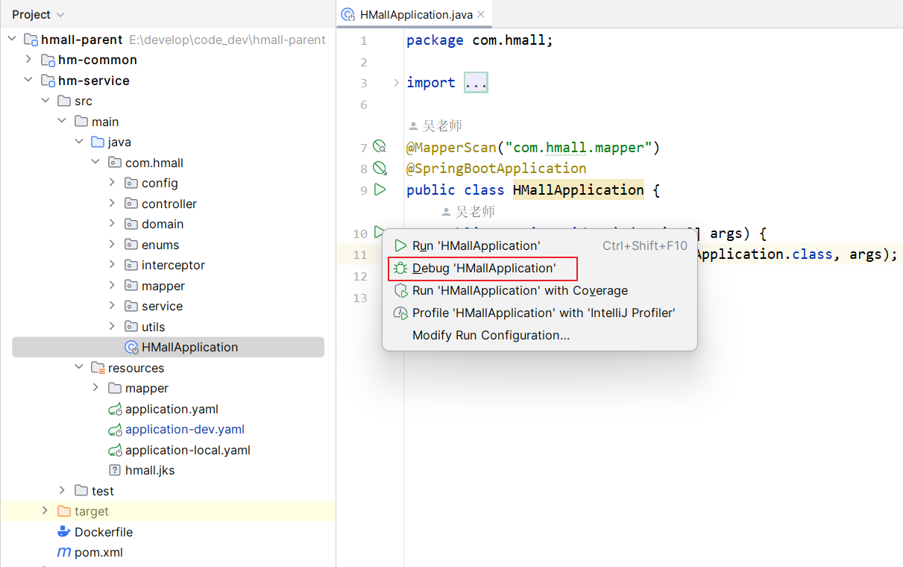
> 图注：图片展示了IntelliJ IDEA中hmall-parent项目的代码界面。左侧是项目结构，显示了hmall-common和hm-service等模块。右侧是H MallApplication.java代码，其中@MapperScan和@SpringBootApplication注解被高亮显示。右下角弹出的快捷菜单中，“Debug 'H MallApplication'”选项被红色框突出显示。该图片与文档中“5.3启动项目”部分对应，用于说明在IntelliJ IDEA中启动hmall项目时，选择“Debug 'H MallApplication'”这一操作步骤。

启动项目成功：

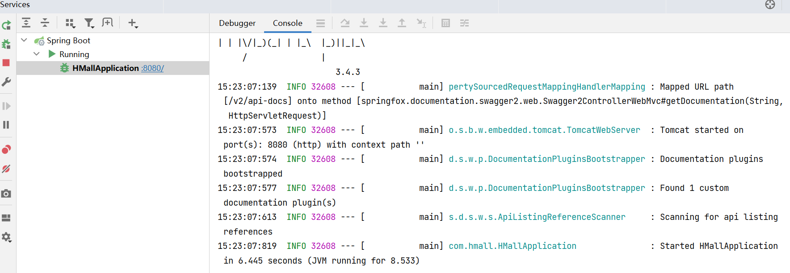
> 图注：图片展示的是HmallApplication启动成功后的控制台日志信息。日志显示了系统时间、应用程序版本、接口映射、Tomcat启动、文档插件初始化、自定义文档插件发现、API列表扫描等信息，最后以“Started HmallApplication in 6.445 seconds (JVM running for 8.533)”结束。该图片与文档中“5.3启动项目”部分对应，直观呈现了项目启动成功后的运行状态，帮助开发者确认项目运行情况。

### 5.4 运行前端

接下来运行前端，前端工程通过nginx运行，找到课程资料下“hmall-nginx”目录将其拷贝到代码目录下（将其复制到一个非中文、不包含特殊字符的目录下）：

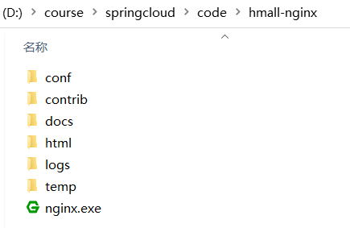
> 图注：这张图片展示的是本地文件路径为D盘course文件夹下springcloud文件夹内code文件夹中的hmall-nginx目录内容，该目录下包含conf、contrib、docs、html、logs、temp共6个文件夹，以及nginx.exe可执行文件。这一目录对应上下文里提到的“hmall-nginx”，是运行前端时需从课程资料拷贝到代码目录的内容，后续需在此目录的cmd窗口中通过命令行启动nginx。

进入hmall-nginx目录后，利用cmd启动，运行start nginx.exe启动nginx：

```PowerShell
# 启动nginx
start nginx.exe
# 停止
nginx.exe -s stop
# 重新加载配置
nginx.exe -s reload
# 重启
nginx.exe -s restart
```


<callout emoji="❗">
特别注意：
nginx.exe 不要双击启动，而是打开cmd窗口，通过命令行启动。停止的时候也一样要是用命令停止。如果启动失败不要重复启动，而是查看logs目录中的error.log日志，查看是否是端口冲突。如果是端口冲突则自行修改端口解决。
</callout>


通过任务管理器可以查看到nginx进程说明nginx启动成功

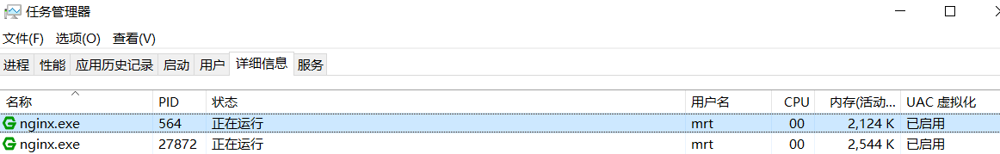
> 图注：图片展示的是Windows任务管理器界面，显示了nginx进程的相关信息。其中，nginx.exe进程的PID为564和27872，状态均为“正在运行”，用户名为mrt，CPU使用率为00，内存（活动...）分别为2,124K和2,544K，UAC虚拟化已启用。该图片与文档中“通过任务管理器可以查看到nginx进程说明nginx启动成功”内容对应，直观呈现了nginx进程状态，辅助说明nginx启动成功。

接下来可以访问门户：http://localhost:18080/


> 图注：图片展示了黑马商城首页界面。左上角有黑马商城标志及“黑马欢迎您！请登录 免费注册”提示。中间有搜索框及搜索按钮。下方有多个分类导航栏，如服装城、美妆馆等。中间大图宣传“大牌PK”，有飞利浦、松下等品牌。右侧有黑马快报、机票、电影票、游戏等板块。图片与上文介绍访问门户后进入的登录页面相呼应，展示了登录成功后的商城首页情况。

点击“登录”进入登录页面


> 图注：图片展示的是黑马商城的登录页面。左侧背景为紫色，有“聚手机节”“聚惠PHONE趴”8月08日8亿优惠券大放送，百台手机等你赢”的宣传语及手机图案。右侧是登录区域，有“扫描登录”“账户登录”选项，账户登录处显示用户名“Jack”，密码输入框被遮挡，有“记住我”勾选框，下方有“登录”按钮，其右侧有红色箭头指向。该图片与文档中“点击‘登录’进入登录页面”内容对应，展示了登录页面的界面情况。

输入密码：123

点击“登录”按钮，登录成功


> 图注：这张图片是黑马商城的首页界面，顶部左上角是平台标识“黑马商城HMALL.COM”，设有搜索框，右侧有购物车、用户相关入口及各类功能导航栏，如“会员”“企业采购”等。左侧为分类导航栏，涵盖图书、家用电器、服饰等商品分类，中间核心区域是“大牌PK！大牌爆款赤裸价对拼”的促销宣传位，搭配PHILIPS、Panasonic等品牌元素，右侧则是“黑马快报”及各类服务、商品相关快捷入口。该图片对应文档中访问黑马商城门户后的页面展示，用于直观呈现项目登录后可进入的商城首页内容。

如果登录出现异常信息（mybatis的报错），说明IDEA环境配置中2.4步没设置JDK版本为11，务必按要求做


## 6.问题汇总

<callout emoji="🏆">
如果问题不在下面，那就从头、一步一步的再搭建下环境！！！
如果问题不在下面，那就从头、一步一步的再搭建下环境！！！
如果问题不在下面，那就从头、一步一步的再搭建下环境！！！
</callout>

### 1.docker启动失败

重新解压下镜像文件

### 2.数据库连接失败

mysql是否正常启动

### 3.FinalShell等连接虚拟机失败

检查下网络配置

---
> 来源：飞书技术知识库（脱敏版） · 05 工程化与部署 / 开发环境与虚拟化 / 开发环境 · [原文](https://ccn8v2zngwsm.feishu.cn/wiki/LvZNwcFB0iBwUBkTkehcp2Knnwh)
