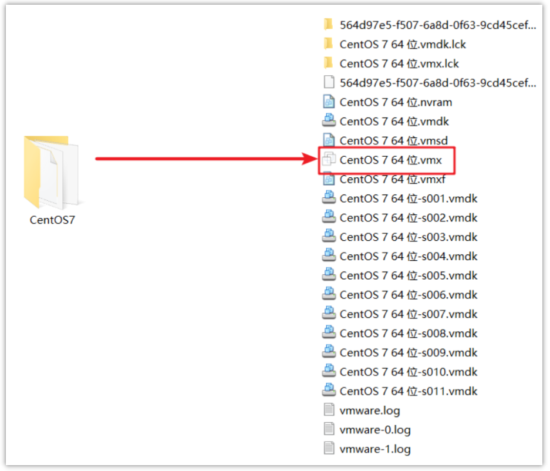
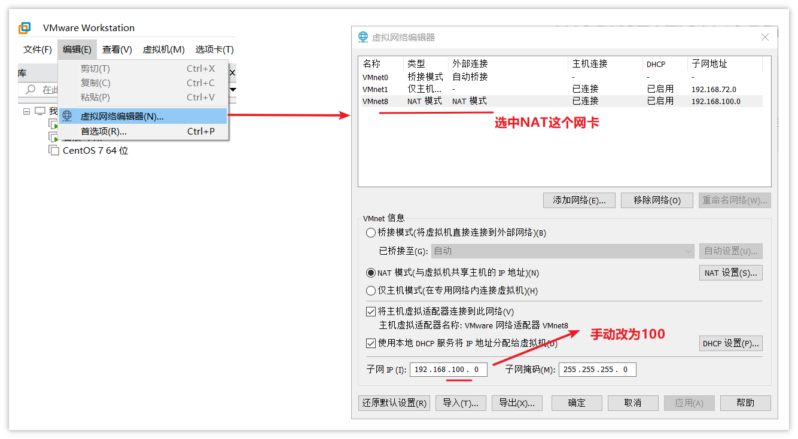
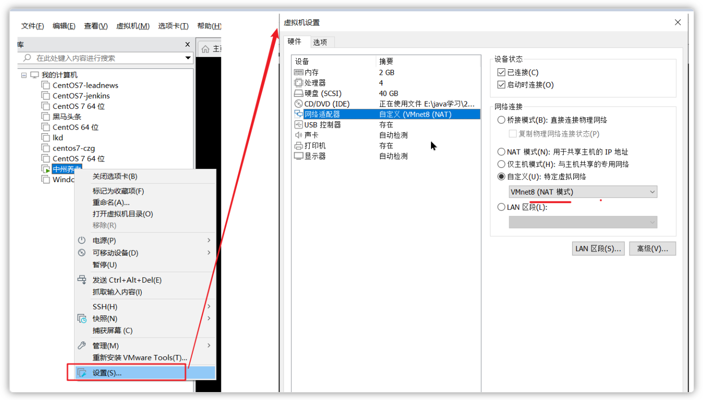
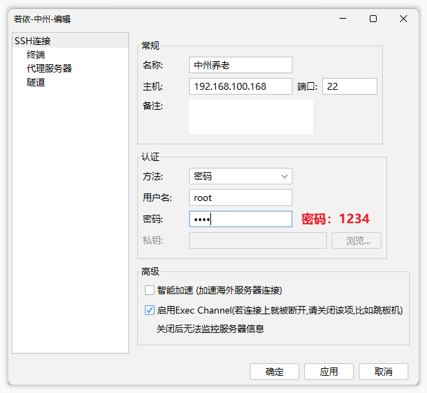

# 虚拟机环境说明（项目前置）

#### 挂载虚拟机

***注意：解压到一个空文件夹中***

找到资料中的虚拟机镜像文件夹，**双击**`CentOS 7 64位.vmx`即可挂载到虚拟机中（需提前安装虚拟机）

> 图注：该图片对应文档里虚拟机挂载的操作步骤，呈现的是CentOS7文件夹内的文件列表，其中包含多个CentOS7相关的虚拟机文件，被红色箭头标注突出的是“CentOS 7 64位.vmx”文件。结合上下文可知，此标注是为了明确操作中需要双击的目标文件，该文件是挂载虚拟机的关键入口，此图清晰展示了资料中虚拟机镜像文件夹里的文件构成，直观突出了完成虚拟机挂载需点击的核心文件，配合文档指引辅助完成虚拟机挂载的前置操作。

双击后，在弹出的对话框中选择：我已移动此虚拟机

#### 设置虚拟网络

**因为此虚拟机已设置静态的ip地址，项目一采用的网段是192.168.100.0**，所以为了减少环境网络的配置，可以手动设置虚拟机中NAT网卡的网段

设置步骤：

①：找到虚拟机的编辑按钮，打开`虚拟网络编辑器`

②：选中NAT模式的网卡，在下面的子网IP的输入框中**手动**设置为：`192.168.100.0`,确定保存即可

> 图注：图片展示了在VMware Workstation中设置虚拟网络的界面。左侧为VMware Workstation的菜单栏，右侧是虚拟网络编辑器窗口。在“虚拟网络编辑器”窗口中，选中了NAT模式的网卡，其子网IP地址为192.168.100.0。画面中用红色箭头和文字标注了“选中NAT这个网卡”及“手动改为100”，提示用户手动将子网IP地址改为100。该图片与上下文紧密相关，直观呈现了设置虚拟网络中手动修改NAT网卡子网IP的操作步骤。

③：右键虚拟机-->设置-->网络适配器-->自定义：选择**NAT网卡**连接模式

> 图注：图片展示了VMware虚拟机设置界面。左侧为虚拟机列表，选中“CentOS7 64位”。右侧是虚拟机设置窗口，选中“网络连接”选项卡。关键信息是“NAT网卡”设置，其连接模式为“Virtio (NAT)”，下方有“LAN IP地址”输入框，当前显示“192.168.100.168”。该图片与文档中设置虚拟网络步骤③相关，用于说明右键虚拟机设置网络适配器时，选择NAT网卡连接模式的操作。

④：启动服务器（网络设置完成后再启动服务器）

#### FinalShell客户端链接

**此虚拟机的静态ip为：192.168.100.168**，防火墙已关闭，可以直接使用客户端链接

以FinalSehll工具为例：

> 图注：这张图片是FinalShell客户端的SSH连接配置界面，用于连接目标虚拟机。界面左侧为SSH连接的相关功能选项，右侧常规设置区域里，主机地址为192.168.100.168，端口为22，与文档中说明的虚拟机静态IP地址一致。认证方法选择的是密码验证方式，用户名设为文档提及的root，密码旁以醒目的红色标注“1234”。下方高级设置中勾选了“启用Exec Channel”选项，该选项说明为若连接断开需关闭此设置，关闭后无法监控服务器信息，界面底部还有确定、应用、取消的操作按钮。

> 注意：此虚拟机的用户名：root，密码：1234

---
> 来源：飞书技术知识库（脱敏版） · 05 工程化与部署 / 开发环境与虚拟化 / 虚拟机环境说明（项目前置） · [原文](https://ccn8v2zngwsm.feishu.cn/wiki/Mcu0wXt1uiD1xCk2TuwcncNMnb0)
