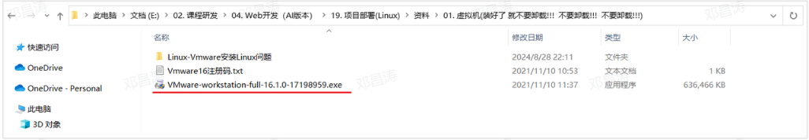
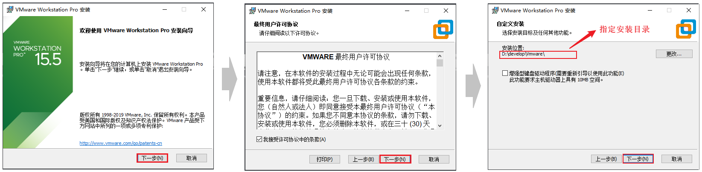
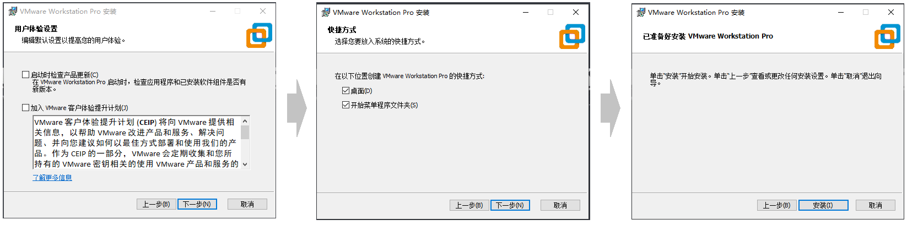
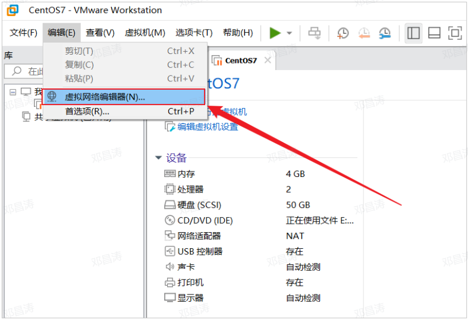
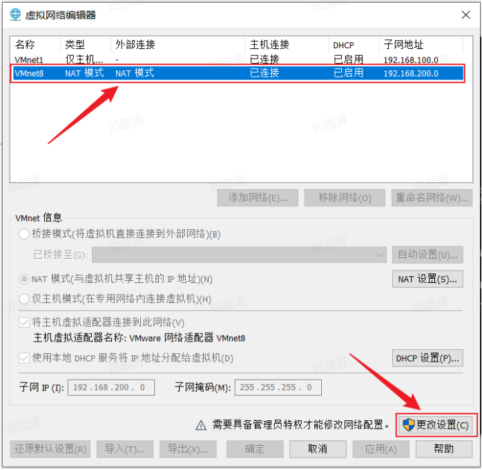
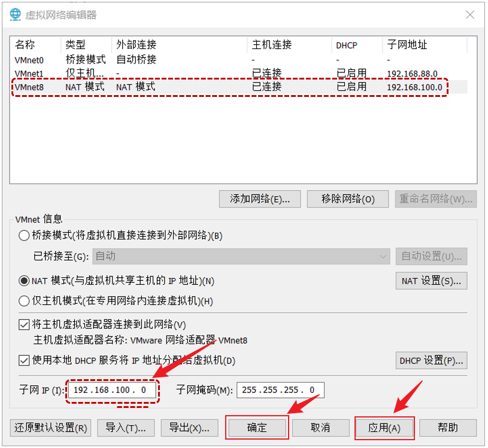
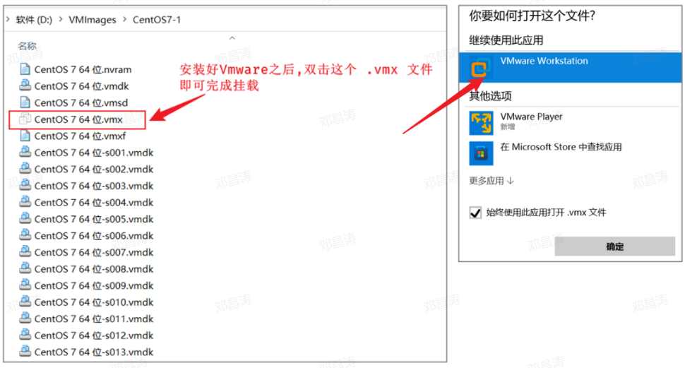
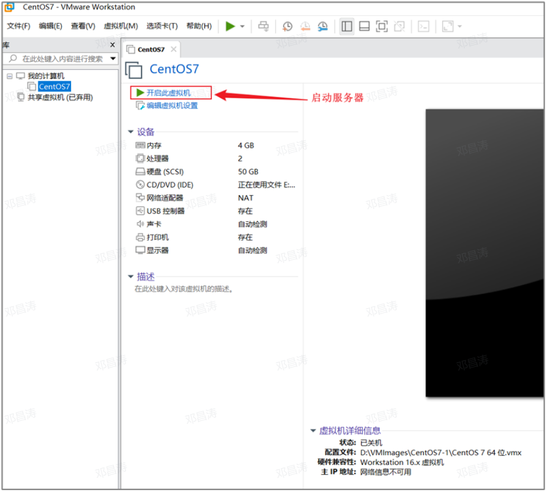
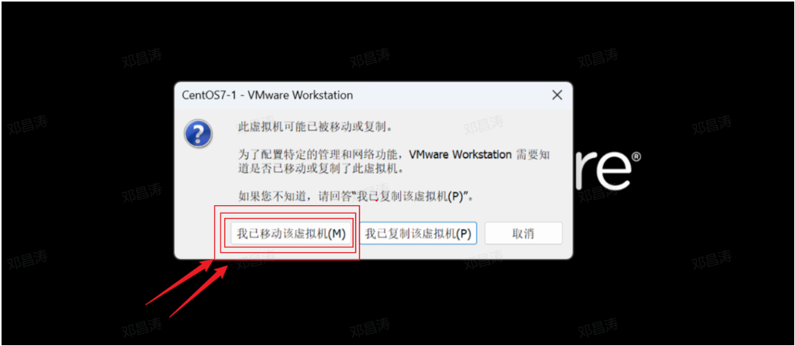

# VMware安装和虚拟机挂载

#### 安装VMware

在我们的课程资料中提供了VMware的安装程序。找到课程资料中的 Vmware的安装包（exe文件），然后双击下一步下一步的安装即可。

**备注：如果之前安装过，就不用安装了。不要卸载！！！！ 不要卸载！！！！  不要卸载！！！！**

**安装步骤:**

以上就是VMware在安装时的每一步操作，基本上就是点击 "下一步" 一直进行安装。

#### 挂载Linux系统

**1). 打开Vmware虚拟机，打开 `编辑` -> `虚拟网络编辑器(N)...`**

选择 `NAT模式`，然后选择右下角的 `更改设置`。

设置子网IP为 **`192.168.100.0`**，然后选择 `应用` -> `确定`。

**2). 解压 `资料/Linux镜像/CentOS7-1.zip` 到一个比较大的磁盘中 (没有中文的目录)。**

**3). 打开解压目录，双击 `.vmx` 文件，选择以 `Vmware Workstation` 打开这个文件。**

**4). 挂载完毕之后，启动Linux服务器。**

启动过程中，如果出现如下界面，选择 **`我已移动该虚拟机`**。

---
> 来源：飞书技术知识库（脱敏版） · 05 工程化与部署 / 开发环境与虚拟化 / VMware安装和虚拟机挂载 · [原文](https://ccn8v2zngwsm.feishu.cn/wiki/XXggwsPDSi69KWkenycc6mGjn2c)
