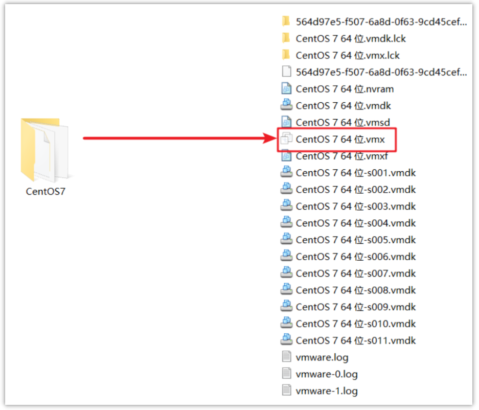
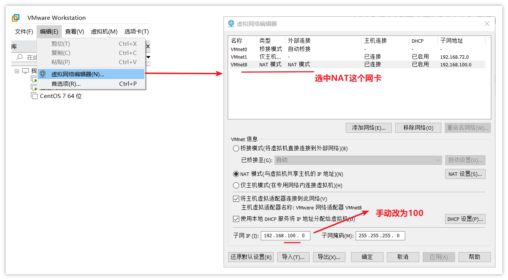
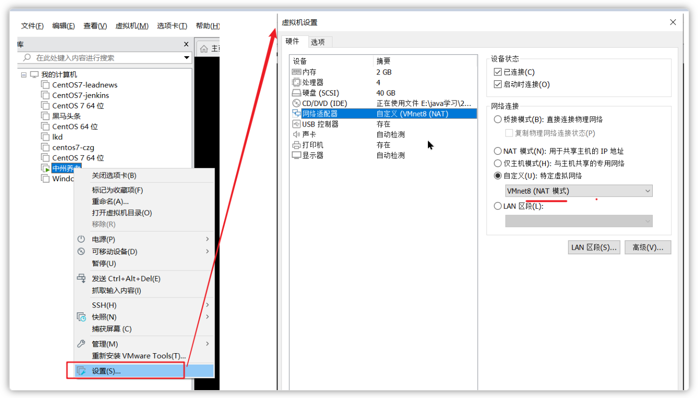
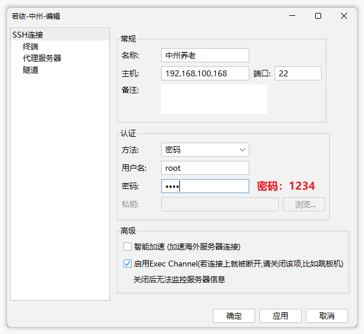

# 虚拟机环境说明（项目前置）

#### 挂载虚拟机

***注意：解压到一个空文件夹中***

找到资料中的虚拟机镜像文件夹，**双击**`CentOS 7 64位.vmx`即可挂载到虚拟机中（需提前安装虚拟机）

双击后，在弹出的对话框中选择：我已移动此虚拟机

#### 设置虚拟网络

**因为此虚拟机已设置静态的ip地址，项目一采用的网段是192.168.100.0**，所以为了减少环境网络的配置，可以手动设置虚拟机中NAT网卡的网段

设置步骤：

①：找到虚拟机的编辑按钮，打开`虚拟网络编辑器`

②：选中NAT模式的网卡，在下面的子网IP的输入框中**手动**设置为：`192.168.100.0`,确定保存即可

③：右键虚拟机-->设置-->网络适配器-->自定义：选择**NAT网卡**连接模式

④：启动服务器（网络设置完成后再启动服务器）

#### FinalShell客户端链接

**此虚拟机的静态ip为：192.168.100.168**，防火墙已关闭，可以直接使用客户端链接

以FinalSehll工具为例：

> 注意：此虚拟机的用户名：root，密码：1234

---
> 来源：飞书技术知识库（脱敏版） · 05 工程化与部署 / 开发环境与虚拟化 / 虚拟机环境说明（项目前置） · [原文](https://ccn8v2zngwsm.feishu.cn/wiki/Mcu0wXt1uiD1xCk2TuwcncNMnb0)
