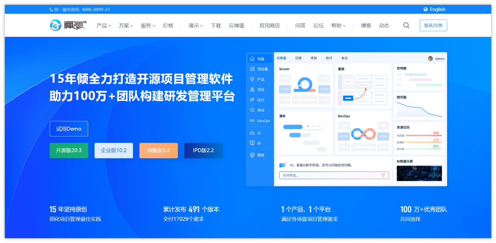
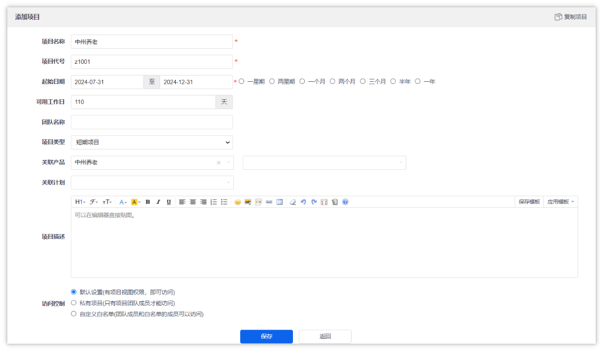

# 禅道项目管理

你们项目管理用的什么工具？

你们项目中的bug是如何管理的？怎么追踪的？


## 什么是项目管理

项目管理是一个复杂而细致的过程，它涉及对软件项目进行全面规划、执行、监控和控制，以确保项目能够按照预定的时间、成本和质量标准顺利完成。这个过程涵盖了多个关键方面：

1. 项目规划：

   - 确定项目的目标、范围、时间和预算。
   - 制定详细的项目计划，包括工作分解结构（WBS）、资源分配、里程碑和关键路径。
   - 识别潜在的风险，并制定相应的风险应对策略。
2. 团队组建与管理：

   - 组建一个跨职能的团队，包括开发人员、测试人员、设计师等。
   - 明确每个团队成员的角色和责任。
   - 促进团队沟通，确保信息在团队内部流通无阻。
3. 需求管理：

   - 与客户或利益相关者合作，明确并记录软件需求。
   - 对需求进行优先级排序，并制定需求变更管理流程。
4. 进度与质量管理：

   - 使用敏捷开发方法（如Scrum）或传统项目管理方法（如瀑布模型）来管理项目进度。
   - 实施质量控制措施，如代码审查、单元测试和集成测试。
5. 风险与变更管理：

   - 定期评估项目风险，并更新风险应对策略。
   - 管理项目变更，确保变更得到妥善处理并记录。
6. 沟通与报告：

   - 定期向项目团队、客户和其他利益相关者报告项目进展。
   - 确保所有相关方都了解项目的当前状态、已完成的工作以及接下来的计划。
7. 项目收尾：

   - 完成所有剩余工作，确保软件满足所有要求。
   - 进行项目回顾，总结经验教训，以便在未来的项目中加以改进。
   - 将项目成果交付给客户，并确保他们满意。

**项目管理常见的工具**

- 禅道：一款功能全面、易于上手的国产项目管理软件，特别适合中小团队进行敏捷开发和项目管理。
- PingCode：研发全生命周期覆盖的项目管理系统，功能丰富，适用于各种规模的研发团队。
- Worktile：市场占有率高的项目管理工具，自定义能力强，满足多种项目管理需求。
- Redmine：开源的项目管理软件，集成缺陷跟踪，支持多项目和子项目管理。
- Jira：全球知名的IT项目管理软件，广泛应用于缺陷跟踪、任务跟踪和敏捷管理。


## 禅道

### 概述

禅道是一款国产的开源**项目管理软件**，它专注于研发项目管理，内置了多种核心功能，旨在帮助项目团队成员高效地进行项目规划、任务追踪、质量管理、文档管理等。



官网地址：

<bookmark name="禅道项目管理软件  -  开源、免费的项目研发测试管理工具" href="https://www.zentao.net/"></bookmark>

使用说明文档：

<bookmark name="关于禅道项目管理软件 - 禅道使用手册 - 禅道项目管理软件" href="https://www.zentao.net/book/zentaopms/38.html"></bookmark>

**核心功能：**

- 产品管理：包括需求、计划、发布、路线图等功能，帮助产品经理整理和管理产品需求，制定产品规划。
- 项目管理：提供任务分配、团队协作、进度跟踪（如燃尽图）、项目里程碑设置等功能，确保项目按计划推进。
- 质量管理：集成缺陷管理、测试用例管理和测试任务管理，支持测试人员记录和跟踪问题，确保产品质量。
- 文档管理：方便地跟踪产品和项目过程中产生的文档，支持文档库的建设和共享。
- 事务管理：包括个人事务管理功能，如TODO列表、**我的任务**、**我的Bug**等，帮助团队成员管理个人工作。
- 组织管理：支持部门、用户、分组、权限等管理，确保项目团队的组织架构清晰，权限分配合理。
- 统计与搜索：提供丰富的统计报表和强大的搜索功能，帮助项目团队快速获取项目信息，进行数据分析。
- 扩展与集成：禅道支持灵活的扩展机制，用户可以根据需求进行二次开发。同时，禅道还提供了API机制，方便与其他系统集成。

**项目团队成员如何使用禅道**

1. 产品经理：

   - 在禅道中创建和管理产品需求，制定产品规划，将需求转化为具体的计划或迭代任务。
   - 使用禅道进行需求评审、优先级排序，并与项目经理和开发团队紧密协作，确保需求得到准确理解和实现。
2. 项目经理：

   - 在禅道中创建项目，关联产品需求，制定项目计划和里程碑。
   - 分配任务给开发团队，跟踪项目进度，确保项目按计划推进。
   - 组织项目会议，如每日站立会议、迭代回顾会议等，与团队成员保持紧密沟通。
3. 开发人员：

   - 在禅道中领取任务，记录任务执行状态，管理指向自己的缺陷（Bug）状态。
   - 与测试团队紧密协作，及时修复缺陷，确保软件质量。
4. 测试人员：

   - 在禅道中创建测试用例，执行测试任务，记录和跟踪缺陷。
   - 编写测试报告，为项目质量提供数据支持。
   - 与开发团队紧密协作，确保缺陷得到及时修复和验证。
5. 文档管理员：

   - 在禅道中管理项目文档库，整理和共享项目过程中产生的各类文档。
   - 确保团队成员能够方便地获取所需文档，支持项目工作的顺利进行。

### 安装及部署（目前虚拟机中已提供）

#### 安装

可以使用docker来安装部署禅道

1. 拉取镜像

```Bash
docker pull easysoft/zentao:12.3.3 
```

1. 创建容器

```Bash
docker run --privileged -it -d --name zentao -p 8001:80  -v /www/zentaopms:/www/zentaopms -v /www/mysqldata:/var/lib/mysql -e MYSQL_ROOT_PASSWORD=heima123 -d easysoft/zentao:12.3.3
```

- 访问的端口号为8001
- 该容器中内置了mysql数据库，需要单独设置一个密码

1. 启动容器成功后，可以在页面中直接访问禅道，访问地址：http://ip:8001即可

其中的关键项配置：


- 管理员账号为：itcast
- 管理员密码：HEIMA123itcast

> 可以使用管理员来创建组织，比如部门、用户等相关信息

启动成功后的效果：


#### 用户数据准备

在目前的账号中，已经创建了对应的研发团队的账号，大家可以使用，也可以使用itcast管理员自行创建

```Bash
产品经理账号：
    用户名：pm_zhangweiyi
    密码：PmWeiyi123
    角色：产品经理
项目经理账号：
    用户名：pm_lisheng
    密码：PmSheng123
    角色：项目经理
开发人员账号1：
    用户名：dev_wangxin
    密码：DevXin123
    角色：开发人员
开发人员账号2：
    用户名：dev_zhaoyang
    密码：DevYang123
    角色：开发人员
测试人员账号：
    用户名：test_qianjun
    密码：TestJun123
    角色：测试人员
```


### 按照角色的使用方式

#### 管理员

我们可以使用itcast（管理员）账号进行登录，可以维护组织相关的内容，包含了5个：

- 用户：该公司下的用户维护（增删改查），需要指定哪个部门
- 部门：该公司的部门名称（一般开发部使用，部门可能跟公司不同）
- 权限：当前禅道系统的菜单权限
- 动态：操作日志相关的信息
- 公司：可以修改或维护公司的信息


#### 产品经理

##### 产品概览


- 在产品面板中，可以看到目前的产品总览和需求的统计

##### 创建产品

在产品总览中有一个**添加产品**按钮，添加信息内容如下：


可以在新创建的产品中维护产品拥有的模块名称


创建好的模块如下


创建需求，可以选中模块，然后可以创建对应模块的需求，如下：


新增的需求列表如下：


也可以把需求指定给对应的**开发人员**负责


#### 项目经理

**需求面板**

在这里可以看到所有项目的情况，以及选中项目的总览


项目经理可以管理该项目团队的成员，如下图


添加项目，其中可以关联已有产品的项目，可以把所有的需求同步到新创建的项目中



也可以单独关联需求，只要关联的产品那边的模块或需求


可以创建任务，给团队成员分配任务，主要是时间成本


可以查看项目的进度看板


项目的燃尽图：


> 燃尽图（Burn Down Chart）是一种在项目完成之前，对需要完成的工作任务进行可视化表示的工作图表。它由横轴（X）和纵轴（Y）组成，横轴通常表示时间（如工作日或迭代周期），纵轴表示剩余工作量（如剩余工时或任务完成率）。理想情况下，燃尽图呈现为一个向下的曲线，随着项目任务的逐渐完成，“燃尽”至零，从而直观地预测何时工作将全部完成。

#### 测试人员（重点）

使用钱军(测试人员)的账号登录，在首页可以看到自己的任务概览


测试可以在系统中创建测试用例及提bug，下图是提bug的流程


详细描述bug的信息，如下：

- 属于哪个模块
- 指派给哪位开发人员解决
- 严重程度和优先级
- bug类型、测试的操作系统和浏览器
- 可以把复现的步骤详细描述，有错误信息可以贴图展示


创建好的bug如下所示，下图还未解决的状态，目前指派给了开发去解决


**验证测试**

当开发人员已经修复了bug后，可以查看这个bug的状态，为已解决，如下图


作为测试人员，需要重复bug复现的操作步骤，如果问题已修复，则可以关闭这个bug，如果没有则需要重新激活


#### 研发人员（重点）

使用王鑫（开发人员）的账号进行登录，他的看板是这样的，对自己任务的一个总览


查看自己的开发任务，一般是项目经理分配


查看自己的bug列表，由测试人员分配


详细查看bug信息，在本地最好复现一下，然后去解决


解决了bug之后，需要填写已解决，然后把bug重新指派给测试人员


---
> 来源：飞书技术知识库（脱敏版） · 05 工程化与部署 / 项目管理：禅道 / 禅道项目管理 · [原文](https://ccn8v2zngwsm.feishu.cn/wiki/UqMlwptGviWew2kbD30cPVVJnRe)
