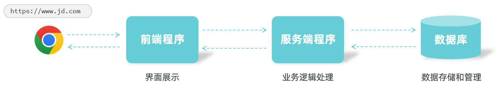
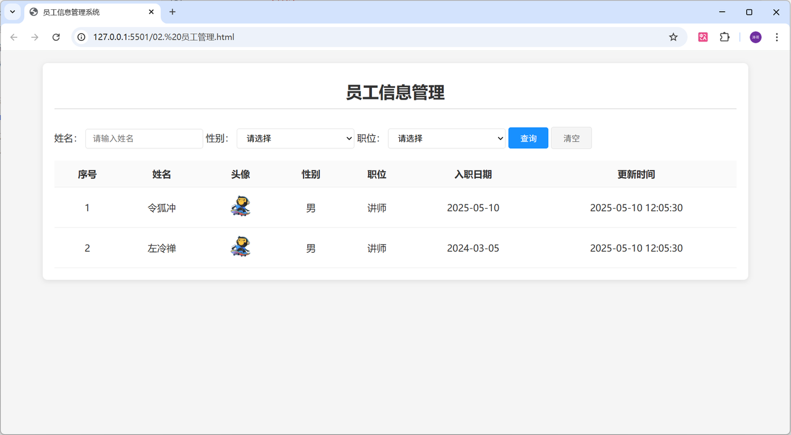
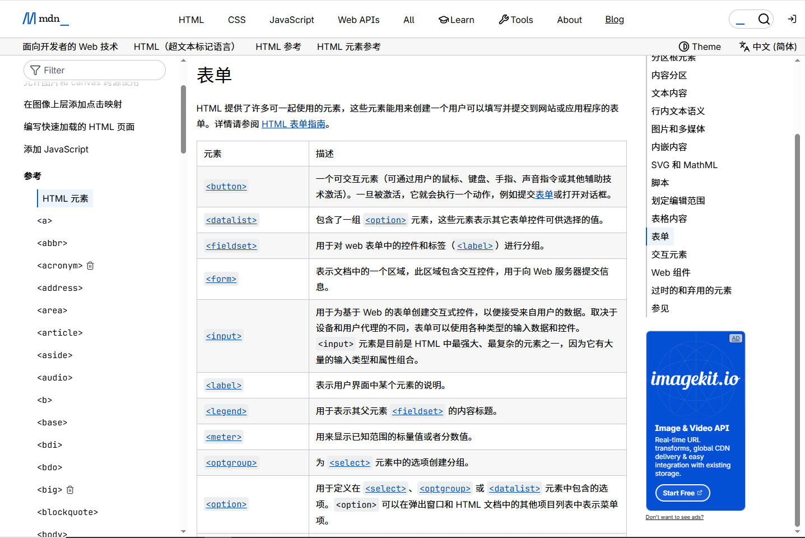
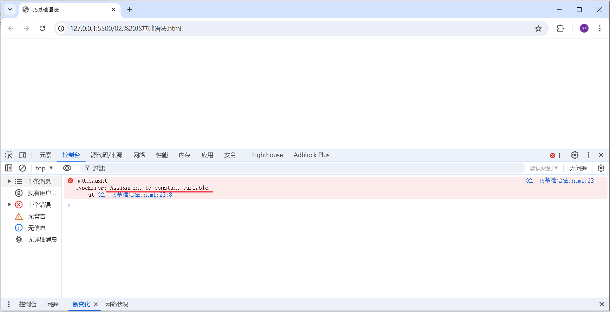
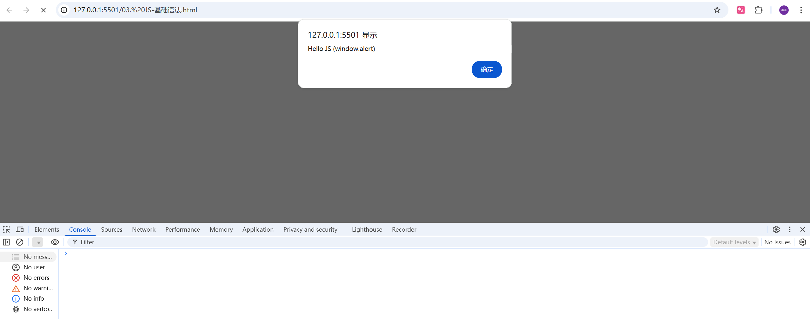
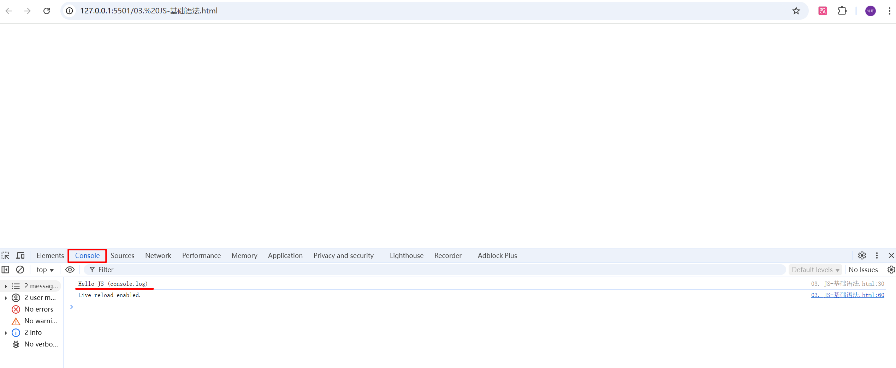
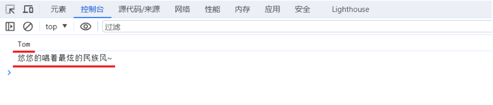
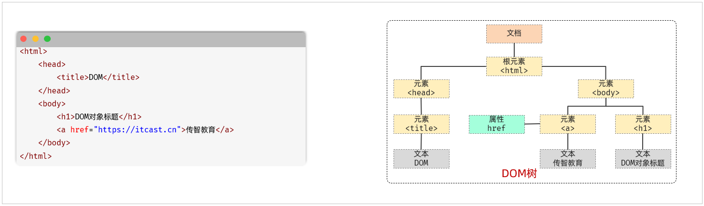
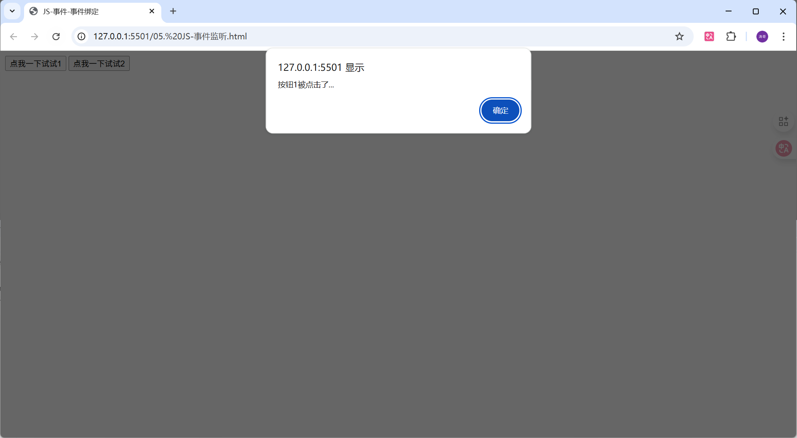

<title>01 html_CSS_动态加载数据_DOM操作</title>

# 前端入门

## Web网站结构

 一个web网站，核心呢，是由三个部分组成的，分别是：前端程序、后端程序、数据库。 具体的职责为：

- 前端程序：负责将数据以好看的样式呈现出来。
- 后端程序：负责具体的业务逻辑的处理。
- 数据库：负责数据的存储和管理。

具体的请求访问流程为：


> 图注：这张图展示了Web网站的请求访问流程，依次涉及前端程序、服务端程序、数据库三个核心环节，各环节配有对应的功能说明。Chrome浏览器代表用户端，它会向前端程序发起请求；前端程序负责界面展示，处理后再将请求传递给服务端程序，服务端程序承担业务逻辑处理工作，之后会向数据库发起数据请求；数据库负责数据的存储和管理，最终数据会沿反向路径返回至前端，供用户在浏览器中获取。

## HTML快速入门

制作一个HTML页面的步骤

1). 在电脑 上创建一个文件夹，命令为`HTML`

2). 在vscode中，新建一个文件，命名为`网页.html` (注意：后缀名为`.html`) 。

3). 通过快捷方式（输入 `！`），生成HTML的基础代码结构 。

<callout emoji="🍊">
HTML的结构标签: 

- `<html></html>` : 最外层的标签，用来定义整个HTML页面 ；
- `<head></head>` : 网页的头部，用来存放给浏览器看的信息，如 CSS样式 ;

  - `<title> </title>` : 定义整个网页的标题 ;
- `<body></body>` : 网页的主体，用来存放给用户看的信息，如 文字、图片、视频等 ；
</callout>

4). 编写网页的主体部分

<callout emoji="🍞">
标题标签，使用 `<h1></h1>` ;
图标标签，使用 ``
</callout>

5). 访问HTML页面。（通过浏览器打开）

<callout emoji="⚽">
在html页面文件中，右键然后选择VS Code插件中的 `Open with Live Server` ，通过浏览器打开页面
</callout>

##  HTML页面的基于语法

<callout emoji="🏖️">
HTML标签不区分大小写，建议小写
HTML标签的属性值使用单引号/双引号都可以
HTML语法结构松散，但是建议规范书写
HTML语法中注释的写法：<!– 注释的内容 -->
</callout>


## 前端案例

由于hmtl是固定标签语言，样式实现方法比较固定，所以针对固定样式可以通过提示词让AI快速生成，以提高效率

```XML
<!DOCTYPE html>
<html lang="zh-CN">
<head>
    <meta charset="UTF-8">
    <meta name="viewport" content="width=device-width, initial-scale=1.0">
    <title>员工信息管理系统</title>
    <style>
        * {
            margin: 0;
            padding: 0;
            box-sizing: border-box;
        }

        body {
            font-family: "Microsoft YaHei", sans-serif;
            background-color: #f5f5f5;
            color: #333;
            padding: 20px;
        }

        .container {
            max-width: 1200px;
            margin: 0 auto;
            background-color: #fff;
            border-radius: 8px;
            box-shadow: 0 2px 10px rgba(0, 0, 0, 0.1);
            padding: 20px;
        }

        h1 {
            text-align: center;
            font-size: 28px;
            margin-bottom: 30px;
            color: #333;
            padding: 10px 0;
            border-bottom: 2px solid #e8e8e8;
        }

        .search-area {
            display: flex;
            gap: 20px;
            margin-bottom: 30px;
            flex-wrap: wrap;
            align-items: center;
        }

        .search-item {
            display: flex;
            align-items: center;
            gap: 10px;
        }

        .search-item label {
            font-size: 14px;
            color: #666;
            min-width: 50px;
        }

        input[type="text"], select {
            padding: 8px 12px;
            border: 1px solid #ddd;
            border-radius: 4px;
            font-size: 14px;
            width: 200px;
            outline: none;
        }

        select {
            background-color: #fff;
        }

        .btn {
            padding: 8px 20px;
            border: none;
            border-radius: 4px;
            cursor: pointer;
            font-size: 14px;
            transition: all 0.3s ease;
        }

        .btn-primary {
            background-color: #1890ff;
            color: white;
        }

        .btn-default {
            background-color: #f5f5f5;
            color: #666;
            border: 1px solid #ddd;
        }

        .btn:hover {
            opacity: 0.8;
        }

        table {
            width: 100%;
            border-collapse: collapse;
            margin-top: 20px;
        }

        th, td {
            padding: 12px 15px;
            text-align: center;
            border-bottom: 1px solid #e8e8e8;
        }

        th {
            background-color: #fafafa;
            font-weight: bold;
            color: #333;
        }

        tr:hover {
            background-color: #f5f5f5;
        }

        .avatar {
            width: 40px;
            height: 40px;
            border-radius: 50%;
        }
    </style>
</head>
<body>
    <div class="container">
        <h1>员工信息管理</h1>
        
        <!-- 搜索区域 -->
        <form action="#">
          <label for="name">姓名：</label>
          <input type="text" id="name" name="name" placeholder="请输入姓名">
          
          <label for="gender">性别：</label>
          <select id="gender" name="gender">
              <option value="">请选择</option>
              <option value="1">男</option>
              <option value="2">女</option>
          </select>
  
          <label for="job">职位：</label>
          <select id="job" name="job">
              <option value="">请选择</option>
              <option value="1">班主任</option>
              <option value="2">讲师</option>
              <option value="3">学工主管</option>
              <option value="4">教研主管</option>
              <option value="5">咨询师</option>
          </select>
  
          <button type="submit" class="btn btn-primary">查询</button>
          <button type="reset" class="btn btn-default">清空</button>
        </form>
        
        <!-- 表格区域 -->
        <table>
            <thead>
                <tr>
                    <th>序号</th>
                    <th>姓名</th>
                    <th>头像</th>
                    <th>性别</th>
                    <th>职位</th>
                    <th>入职日期</th>
                    <th>更新时间</th>
                </tr>
            </thead>
            <tbody>
                <tr>
                    <td>1</td>
                    <td>令狐冲</td>
                    <td></td>
                    <td>男</td>
                    <td>讲师</td>
                    <td>2025-05-10</td>
                    <td>2025-05-10 12:05:30</td>
                </tr>
                <tr>
                    <td>2</td>
                    <td>左冷禅</td>
                    <td></td>
                    <td>男</td>
                    <td>讲师</td>
                    <td>2024-03-05</td>
                    <td>2025-05-10 12:05:30</td>
                </tr>
                <!-- 更多数据行... -->
            </tbody>
        </table>
    </div>
</body>
</html>
```

效果如下：


> 图注：这张图片展示的是名为“员工信息管理”的网页界面，属于员工信息系统页面。界面上方设有姓名输入框、性别下拉选择框、职位下拉选择框，还有蓝色的“查询”按钮和“清空”按钮，用于筛选员工信息。下方是员工信息表格，表格包含序号、姓名、头像、性别、职位、入职日期、更新时间这些列，当前表格内显示了两条员工数据，分别为序号1的令狐冲和序号2的左冷禅，两人的职位均为讲师，各自对应着不同的入职与更新时间，页面地址栏显示该页面是本地运行的员工管理页面。

上述案例的整个窗口是一个表单，而表单是一项一项的，这个我们称为表单项 或 表单元素。

- 表单场景: 表单就是在网页中负责数据采集功能的，如：注册、登录的表单。 
- 表单标签: `<form>`
- 表单属性:

  - `action`: 规定表单提交时，向何处发送表单数据，表单提交的URL。
  - `method`: 规定用于发送表单数据的方式，常见为： GET、POST。
  
    - `GET`：表单数据是拼接在url后面的， 如： xxxxxxxxxxx?username=Tom&age=12，url中能携带的表单数据大小是有限制的。
    - `POST`： 表单数据是在请求体（消息体）中携带的，大小没有限制。
- 表单项标签: 不同类型的input元素、下拉列表、文本域等。

  - `<input>`: 定义表单项，通过type属性（text、password、radio、checkbox等）控制输入形式
  - `<select>`: 定义下拉列表
  - `<textarea>`: 定义文本域

<callout emoji="✨">
**注意：**
表单中的所有表单项，要想能够正常的采集数据，在提交的时候能提交到服务端，表单项必须指定name属性。 否则，无法提交该表单项 。
</callout>

### 表格标签

| 标签 | 描述 |
|-|-|
| <table> | 定义表格整体 |
| <thead> | 用于定义表格头部(可选) |
| <tbody> | 定义表格中的主体部分(可选) |
| <tr> | 表格的行，可以包裹多个 <td> |
| <td> | 表格单元格(普通)，可以包裹内容；如果是表头单元格，可以替换为 <th> |

### 其他标签

那在AI生成的代码中，我们经常会见到一个标签，叫 `<div>`，那这个`<div>`是一个没有语义的标签，也就是说，`<div>` 本身是没有任何含义的，通常在前端页面开发中，我们使用 `<div>` 主要是用来配置CSS做页面布局的。

其他的标签，如果大家想进一步了解其作用，有两种方式： 

- 询问AI，AI会给出每一个标签详细的说明；
- 查阅官方文档，官方文档地址： [https://developer.mozilla.org/zh-CN/docs/Web/HTML](https://developer.mozilla.org/zh-CN/docs/Web/HTML)


> 图注：这张图片呈现的是MDN（Mdn）网站的HTML参考页面，具体内容围绕HTML表单相关知识展开。页面左侧是HTML元素导航栏，列出了多个HTML元素标签，如abbr、acronym等。页面右侧的表单说明区域，详细介绍了HTML表单提供了许多可一起使用的元素，允许用户输入信息并提交到网站或应用程序，还列举了多个表单相关元素的英文名称及对应功能描述，部分元素为表单交互和数据提交等提供支持。页面右上角是网站通用的导航栏，包含HTML、CSS、JavaScript等分类选项。

## CSS

### 什么是CSS样式

<callout emoji="✏️">
**CSS:** Cascading Style Sheet，层叠样式表，用于控制页面的样式（表现）。
</callout>

### CSS引入方式

CSS的3种引入方式，语法如下表格所示：

| 名称 | 语法描述 | 示例 |
|-|-|-|
| 行内样式 | 在标签内使用style属性，属性值是css属性键值对。 | <h1 style="xxx:xxx;">中国新闻网</h1> |
| 内部样式 | 定义<style>标签，在标签内部定义css样式。 | <style> h1 {...} </style> |
| 外部样式 | 定义<link>标签，通过href属性引入外部css文件 | <link rel="stylesheet" href="css/news.css"> |

对于上述3种引入方式，企业开发的使用情况如下：

<callout emoji="📚">
**行内样式：**会出现大量的代码冗余，不方便后期的维护，所以不常用（常配合JS使用）。
**内部样式：**通过定义css选择器，让样式作用于当前页面的指定的标签上。（可以写在页面任何位置，但通常约定写在head标签中）
**外部样式：**html和css实现了完全的分离，企业开发常用方式。
</callout>

### CSS选择器

<callout emoji="❤️">
选择器是选取需设置样式的元素（标签）
</callout>

**选择器通用语法如下**：

```HTML
选择器名   {
    css样式名：css样式值;
    css样式名：css样式值;
}
```

常见的css选择器：

<table><colgroup><col/><col/><col/><col/></colgroup><thead><tr><th>选择器</th><th>写法</th><th>示例</th><th>示例说明</th></tr></thead><tbody><tr><td vertical-align="middle"><b>元素选择器</b></td><td>元素名称 {...}</td><td>h1 {...}</td><td>选择页面上所有的&lt;h1&gt;标签</td></tr><tr><td vertical-align="middle"><b>类选择器</b></td><td>.class属性值 {...}</td><td>.cls {...}</td><td>选择页面上所有class属性为cls的标签</td></tr><tr><td vertical-align="middle"><b>id选择器</b></td><td>#id属性值 {...}</td><td>#hid {...}</td><td>选择页面上id属性为hid的标签</td></tr><tr><td vertical-align="middle">分组选择器</td><td>选择器1,选择器2{...}</td><td>h1,h2 {...}</td><td>选择页面上所有的&lt;h1&gt;和&lt;h2&gt;标签</td></tr><tr><td rowspan="2" vertical-align="middle">属性选择器</td><td>元素名称[属性] {...}</td><td>input[type] {...}</td><td>选择页面上有type属性的&lt;input&gt;标签</td></tr><tr><td>元素名称[属性名="值"] {...}</td><td>input[type="text"] {...}</td><td>选择页面上type属性为text的&lt;input&gt;标签</td></tr><tr><td vertical-align="middle">后代选择器</td><td>元素1元素2{...}</td><td>form input {...}</td><td>选择&lt;form&gt;标签内的所有&lt;input&gt;标签</td></tr></tbody></table>

两种方式：

<callout emoji="🎹">
现在开发中不需要特别记忆这些内容，可以通过询问AI提示，或者通过AI为我们的代码加上注释，来生成我们想要的样式。
查阅官方文档，官方文档地址： https://developer.mozilla.org/zh-CN/docs/Web/CSS
</callout>

## 动态加载数据

<callout emoji="🎨">
要想完成动态加载数据，并渲染展示在页面表格中，这种页面交互效果的实现，就需要通过JavaScript程序来搞定了。通过先编写提示词，基于AI来帮我们实现这个功能，然后再来逐步剖析其中涉及到的代码细，进行调整。
</callout>

#### 基本实现

#### JS基础语法

##### **JS引入方式**

JS代码也是书写在html中的，那么html中如何引入js代码呢？主要通过下面的2种引入方式：

- 第一种方式：内部脚本，将JS代码定义在HTML页面中

  - JavaScript代码必须位于<script></script>标签之间
  - 在HTML文档中，可以在任意地方，放置任意数量的<script></script>
  - 一般会把脚本置于<body>元素的底部，可改善显示速度
  - 例子：

  ```HTML
  <!DOCTYPE html>
  <html lang="en">
  <head>
    <meta charset="UTF-8">
    <meta name="viewport" content="width=device-width, initial-scale=1.0">
    <title>JS 引入方式</title>
  </head>
  <body>
    
    <script>
      alert('Hello JS')
    </script>
  </body>
  </html>
  ```


- 第二种方式：外部脚本， 将JS代码定义在外部 JS文件中，然后引入到 HTML页面中

  - 外部JS文件中，只包含JS代码，不包含<script>标签
  - 引入外部js的<script>标签，必须是双标签
  - 例子：
  
    - 在js目录下，定义一个js文件`demo.js`，在文件中编写js代码，如下：
  
    ```JavaScript
    alert('Hello JS')
    ```
  
    - 在html文件中，通过<script></script>引入js文件`demo.js`，如下：
  
    ```HTML
    <script src="js/demo.js"></script>
    ```
  - 注意1：demo.js中只有js代码，没有<script>标签
  - 注意2：通过<script></script>标签引入外部JS文件时，标签不能自闭合，如：<script src="js/demo.js" />
- JS书写规范：

  - 结束符：每行js代码，结尾以分号结尾，而结尾的分号可有可无。（建议在一个项目中保持一致，要么全部都加，要么全部都不加）
  - 注释：单行注释，多行注解的写法， 与java中一致。

##### **变量与常量**

**1). 变量**

接下来，我们再来讲解JS中的变量。在js中，变量的声明和java中还是不同的。

- JS中主要通过 `let` 关键字来声明变量的。
- JS是一门弱类型语言，变量是可以存放不同类型的值的。
- 变量名需要遵循如下规则：

  - 组成字符可以是任何字母、数字、下划线（\_）或美元符号（\$），且数字不能开头
  - 变量名严格区分大小写，如：name和Name是不同的变量
  - 不能使用关键字作为变量名，如：let、if、for等

变量的声明示例如下所示：

```HTML
<script>
    //变量
    let a = 20;
    a = "Hello";
    alert(a);
</script>
```

上述的示例中，大家会看到变量a既可以存数字，又可以存字符串。 因为JS是弱类型语言。

<callout emoji="🍊">
> PS. 在早期的JS中，声明变量还可以使用 `var` 关键字来声明。例如:
> 
> <body>  
>   
>     <script>  
>         //var声明变量  
>         var name = "A";  
>         name = "B";  
>         alert(name);  
>           
>         var name = "C"  
>         alert(name);  
>     </script>  
> </body>
> 
> 打开浏览器运行之后，大家会发现，可以正常执行，第一次弹出 B，第二次弹出 C 。我们看到 name变量重复声明了，但是呢，如果使用var关键字，是没有问题的，可以重复声明。
> 
> `var`声明的变量呢，还有一些其他不严谨的地方，这里就不再一一列举了，所以这个声明变量的关键字，并不严谨 【不推荐】。
</callout>

**2). 常量**

在JS中，如果声明一个场景，需要使用`const`关键字。一旦声明，常量的值就不能改变 （不可以重新赋值）。

如下所示：

```HTML
<body>
    <script>
        //常量
        const PI = 3.14;
        PI = 3.15;
        alert(PI);
    </script>
</body>
```

浏览器打开之后，会报如下错误：


> 图注：图片展示的是浏览器开发者工具界面，地址栏显示为“127.0.0.1:5500/02%20JS基础语法.html”。界面中“问题”标签下，问题列表显示“1 个错误”，错误内容为“TypeError: Assignment to constant variable.”，并有红色背景突出显示。该图片与上文提到的在JS中使用`const`关键字声明常量，一旦声明常量值不能改变，浏览器打开后会报此错误的内容相关，直观呈现了错误提示情况。

该错误就表示，常量不可以被重新分配值。

#### 数据类型

虽然JS是弱数据类型的语言，但是JS中也存在数据类型，JS中的数据类型分为 ：原始数据类型 和 引用数据类型。那这部分，我们先来学习原始数据类型，主要包含以下几种类型：

| **数据类型** | **描述** |
|-|-|
| number | 数字（整数、小数） |
| string | 字符串，单双引('...')、双引号("...")、反引号(\`...\`)皆可，正常使用推荐单引号 |
| boolean | 布尔。true，false |
| null | 对象为空。 JavaScript 是大小写敏感的，因此 null、Null、NULL是完全不同的 |
| undefined | 当声明的变量未初始化时，该变量的默认值是 undefined |

##### 输出语句

在JS中，常见的输出方式有两种，分别是：

| api | 描述 |
|-|-|
| window.alert(...) | 警告框 |
| console.log(...) | 写入浏览器控制台 |

定义JS，示例测试：

```HTML
<!DOCTYPE html>
<html lang="en">
<head>
    <meta charset="UTF-8">
    <meta http-equiv="X-UA-Compatible" content="IE=edge">
    <meta name="viewport" content="width=device-width, initial-scale=1.0">
    <title>JS基础语法</title>
</head>
<body>
        
    <script>
        //方式1: 弹出框
        window.alert("Hello JS (window.alert)");

        //方式2: 控制台
        console.log("Hello JS (console.log)")
    </script>
</body>
</html>
```

测试结果：


> 图注：图片展示了在浏览器中执行JavaScript代码后的效果。上方弹出一个警告框，显示“127.0.0.1:5501 显示 Hello JS (window.alert)” 。下方是浏览器开发者工具界面，左侧控制台区域显示“Hello JS” 。该图片与文档中介绍JavaScript输出语句的内容相关，直观呈现了使用`window.alert(...)`输出语句时在浏览器中弹出警告框的场景。


> 图注：图片展示了浏览器开发者工具中Console标签页的界面。左侧有Elements、Console、Sources等标签，当前选中Console。右侧显示了控制台信息，有“Hello console test”等提示，下方还有“2 user messages”“No errors”“No warnings”“2 info”“No verbose”等状态标识。该图片与文档中介绍JavaScript输出语句时的内容相关，直观呈现了在浏览器控制台中输出信息的效果。

##### 函数

**函数（function）**是被设计用来执行特定任务的代码块，方便程序的封装复用。 那我们学习函数，主要就是学习JS中函数的定义及调用的语法。


**1). 方式一**

格式如下：

```JavaScript
function 函数名(参数1,参数2..){
    要执行的代码
}
```

因为JavaScript是弱数据类型的语言，所以有如下几点需要注意：

- 形参不需要声明类型，并且JS中不管什么类型都是let去声明，加上也没有意义。
- 返回值也不需要声明类型，直接return即可


**示例：**

```JavaScript
function add(a, b){
    return a + b;
}
```

如果要调用上述的函数add，可以使用：函数名称(实际参数列表)

```JavaScript
let result = add(10,20);
alert(result);
```

我们在调用add函数时，再添加2个参数，修改代码如下：

```JavaScript
var result = add(10,20,30,40);
alert(result);
```

浏览器打开，发现没有错误，并且依然弹出30，这是为什么呢？

因为在JavaScript中，函数的调用只需要名称正确即可，参数列表不管的。如上述案例，10传递给了变量a，20传递给了变量b，而30和40没有变量接受，但是不影响函数的正常调用。


**2). 方式二**

定义函数是为函数指定了一个名字。 也可以不为函数指定名字，那这一类的函数，称之为**匿名函数**。那接下来，方式二，就来介绍一下匿名函数的定义和调用。

<callout emoji="📍">
**匿名函数：**是指一种没有名称的函数，由于它们没有名称，因此无法直接通过函数名来调用，而是通过变量或表达式来调用。
</callout>

匿名函数定义可以通过两种方式：函数表达式 和 箭头函数。

- 示例一（函数表达式）：

```JavaScript
var add = function (a,b){
    return a + b;
}
```

- 示例二（**箭头函数**）：

```JavaScript
var add = (a,b) => {
    return a + b;
}
```

上述匿名函数声明好了之后，是将这个函数赋值给了add变量。 可以直接通过add函数直接调用，调用代码如下：

```JavaScript
let result = add(10,20);
alert(result);
```

而箭头函数这种形式，在现在的前端开发中用的会更多一些。

<callout emoji="🍊">
**注意: 由于JS是弱类型语言，形参、返回值都不需要指定类型。在调用函数时，实参个数与形参个数可以不一致，但是建议一致。** 
</callout>

##### 自定义对象

在 JavaScript 中自定义对象特别简单，其语法格式如下：

```JavaScript
let 对象名 = {
    属性名1: 属性值1,
    属性名2: 属性值2,
    属性名3: 属性值3,
    方法名称: function(形参列表){}
};
```

可以通过如下语法调用属性：

```JavaScript
对象名.属性名
```

通过如下语法调用函数：

```JavaScript
对象名.方法名()
```

代码演示：

```JavaScript
<script>
    //自定义对象
    let user = {
        name: "Tom",
        age: 10,
        gender: "男",
        sing: function(){
             console.log("悠悠的唱着最炫的民族风~");
         }
    }

    console.log(user.name);
    user.eat();
<script>
```

浏览器控制台结果如下：


> 图注：这是前端学习相关的浏览器控制台截图，对应文档中自定义对象代码演示后的结果展示。该截图显示浏览器开发者工具已切换至“控制台”标签页，控制台内分别输出了自定义对象关联的姓名“Tom”，以及该对象调用方法后返回的内容“悠悠的唱着最炫的民族风~”，这一结果是自定义对象属性调用与方法调用的代码运行输出，印证了文档中自定义对象相关代码的执行效果。

其中，上述函数定义的语法可以简化成如下格式：

```JavaScript
<script>
    //自定义对象
    let user = {
        name: "Tom",
        age: 10,
        gender: "男",
        sing(){
             console.log("悠悠的唱着最炫的民族风~");
         }
    }
    console.log(user.name);
    user.eat();
<script>
```

#### DOM操作

##### DOM介绍

DOM：Document Object Model 文档对象模型。也就是 JavaScript 将 HTML 文档的各个组成部分封装为对象。

XML 文档中的标签需要写代码解析，而 HTML 文档是浏览器解析。封装的对象分为

<callout emoji="❤️">
Document：整个文档对象
Element：元素对象
Attribute：属性对象
Text：文本对象
Comment：注释对象
</callout>

如下图，左边是 HTML 文档内容，右边是 DOM 树


> 图注：图片展示了HTML文档内容及对应的DOM树结构。左侧HTML代码包含`<html>`、`<head>`、`<title>`、`<body>`等标签，以及`<h1>`、`<a>`标签和文本内容。右侧是DOM树，以“文档”为根节点，下有“根元素`<html>`”等分支，各节点对应HTML代码中的标签，如`<head>`、`<title>`、`<body>`等，还展示了属性如`<a>`标签的`href`属性。此图直观呈现了HTML与DOM树的关系，辅助理解DOM操作。

DOM主要作用如下：

<callout emoji="🏝️">
改变 HTML 元素的内容
改变 HTML 元素的样式（CSS）
对 HTML DOM 事件作出反应
添加和删除 HTML 元素
</callout>

##### DOM操作

- DOM的核心思想：将网页的内容当做对象来处理，标签的所有属性在该对象上都可以找到，并且修改这个对象的属性，就会自动映射到标签身上。
- document对象

  - 网页中所有内容都封装在document对象中
  - 它提供的属性和方法都是用来访问和操作网页内容的，如：document.write(…)
- DOM操作步骤:

  - 获取DOM元素对象
  - 操作DOM对象的属性或方法 (查阅文档或AI)
- 可以通过如下两种方式来获取DOM元素。

  1. 根据CSS选择器来获取DOM元素，获取到匹配到的第一个元素：`document.querySelector('CSS选择器');`
  2. 根据CSS选择器来获取DOM元素，获取匹配到的所有元素：`document.querySelectorAll('CSS选择器');`

**代码演示:**

```HTML
<!DOCTYPE html>
<html lang="en">
<head>
  <meta charset="UTF-8">
  <meta name="viewport" content="width=device-width, initial-scale=1.0">
  <title>JS-DOM</title>
</head>
<body>

  <h1 id="title1">11111</h1>
  <h1>22222</h1>
  <h1>33333</h1>

  <script>
    //1. 修改第一个h1标签中的文本内容
    //1.1 获取DOM对象
    // let h1 = document.querySelector('#title1');
    //let h1 = document.querySelector('h1'); // 获取第一个h1标签

    let hs = document.querySelectorAll('h1');

    //1.2 调用DOM对象中属性或方法
    hs[0].innerHTML = '修改后的文本内容';
  </script>
</body>
</html>
```

<callout emoji="🍊">
PS：在早期的JS中，也可以通过如下方法获取DOM元素（了解）。
- document.getElementById(...)：根据id属性值获取，返回单个Element对象。
- document.getElementsByTagName(...)：根据标签名称获取，返回Element对象数组。
- document.getElementsByName()：根据name属性值获取，返回Element对象数组。
- document.getElementsByClassName()：根据class属性值获取，返回Element对象数组。
</callout>

#### 事件监听

- 事件：就是所发生的事情。
- HTML事件：HTML事件指的就是发生在HTML元素上的 “事情”，例如：按钮被点击、鼠标移动到元素上、按下键盘按键等。
- 事件监听：JavaScript可以在事件触发时，就立即调用一个函数做出响应，也称为事件绑定 或 注册事件。
- 语法：`事件源``.addEventListener(``'事件类型'`` , ``事件触发执行的函数``)`

  - 事件源：哪个DOM元素触发了事件，要获取到对应的DOM元素
  - 事件类型：用什么方式触发，比如：鼠标单击 click
  - 事件触发执行的函数：要做什么事

代码演示：

```XML
<!DOCTYPE html>
<html lang="en">
<head>
    <meta charset="UTF-8">
    <meta http-equiv="X-UA-Compatible" content="IE=edge">
    <meta name="viewport" content="width=device-width, initial-scale=1.0">
    <title>JS-事件-事件绑定</title>
</head>

<body>
    <input type="button" id="btn1" value="点我一下试试1">
    <input type="button" id="btn2" value="点我一下试试2">
        
    <script>
        document.querySelector("#btn1").addEventListener('click', ()=>{
            alert("按钮1被点击了...");
        })
    </script>
</body>
</html>
```


> 图注：这张图片是前端事件监听的代码演示运行效果，显示了本地地址127.0.0.1下的网页运行场景，页面弹出提示框，内容为“127.0.0.1:5501 显示 按钮1被点击了...”，提示框右下角配有蓝色的“确定”按钮，页面左上角还有“点我一下试试1”“点我一下试试2”的按钮，呈现了addEventListener绑定的点击事件触发后的反馈结果，直观展示了事件触发时的响应效果。

---
> 来源：飞书技术知识库（脱敏版） · 03 Web 开发与框架 / 前端基础与 Vue / 01 html_CSS_动态加载数据_DOM操作 · [原文](https://ccn8v2zngwsm.feishu.cn/wiki/HLe7wffnRiD2w4kUFkwccD7Jnfg)
