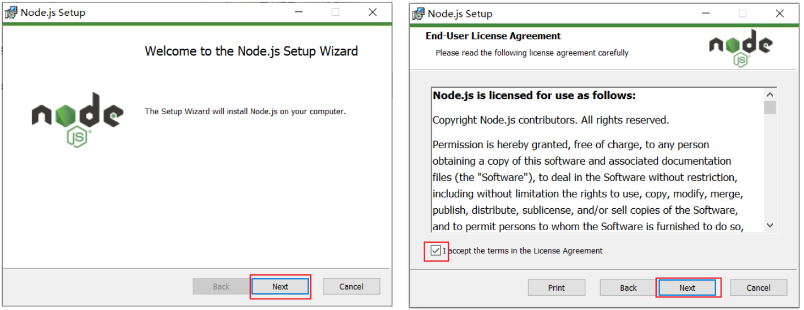
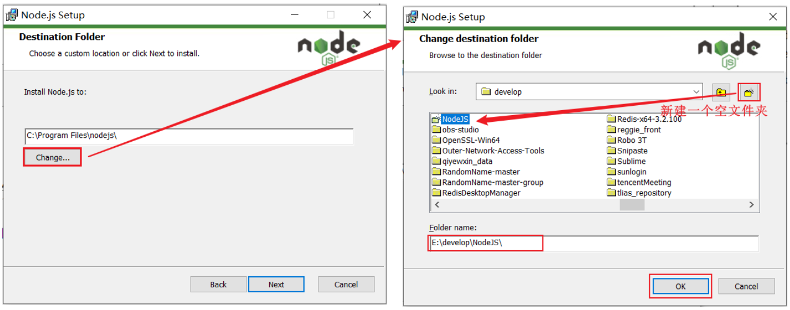
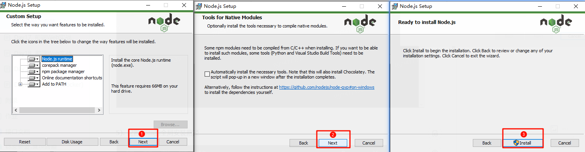
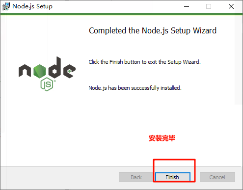
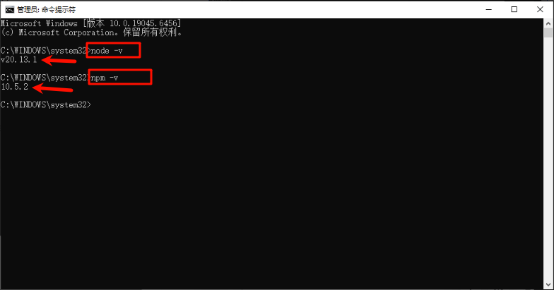
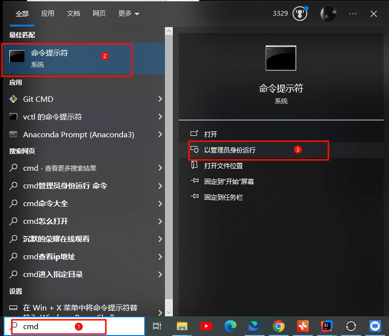
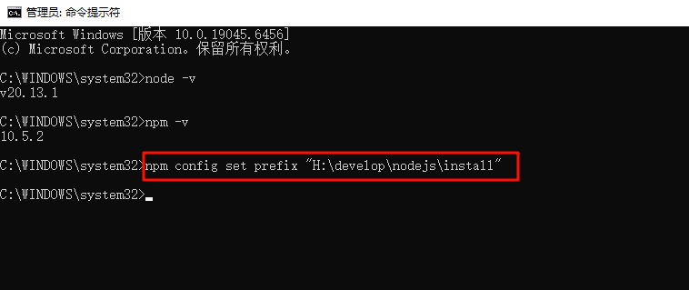
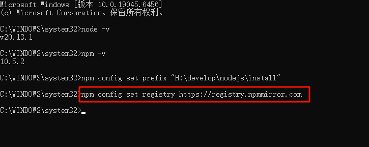

# 16 NodeJS安装

**1). 双击msi文件，勾选我接受**


> 图注：这两张图是Node.js安装程序的初始界面，属于Node.js安装流程的起始步骤内容。左侧是Node.js安装向导的欢迎界面，底部有Back、Next、Cancel三个操作按钮，其中Next按钮被红色框标注，对应安装步骤中“双击msi文件后勾选我接受”后的下一步操作要求。右侧是安装许可协议界面，明确显示许可协议内容，左下角有“Accept the terms in the License Agreement”的勾选框，该勾选框被红色框标注，Next按钮同样被红色框标注，对应安装流程中需要勾选协议后点击Next的操作。这两张图直观呈现了Node.js安装初始阶段的关键操作界面，是安装流程中引导用户确认协议并进入下一步的核心环节。


**2). 选择安装到一个，没有中文，没有空格 的目录下（新建一个文件夹NodeJS）**


> 图注：这张NodeJS安装的配置界面图包含两个窗口，左侧是初始的安装目的地选择窗口，显示默认安装路径为C:\\Program Files\\nodejs，有红框标注的“Change...”按钮，还有红色箭头指向右侧窗口；右侧是修改后的路径选择窗口，显示“Look in”路径为develop目录，红框标注了新建的NodeJS文件夹，“Folder name”输入框内容为E:\\develop\\nodeJS，右下角红框标注“OK”按钮，还有红色箭头指向右上角新建文件夹的图标，直观展示了文档中要求选择无中文无空格安装目录的操作过程。


**3). 点击 Next，下一步下一步的安装即可。**


> 图注：这张图片包含三张依次展示的Node.js安装界面。第一张是Custom Setup界面，可选择安装的功能组件，底部Next按钮被红色箭头标注；第二张是Tools for Native Modules界面，提示安装必要的原生模块工具，底部Next按钮同样有红色箭头标注；第三张是Ready to Install Node.js界面，用于启动安装，底部Install按钮带有红色箭头标注。该图对应Node.js安装流程，直观呈现了安装过程中各步骤的关键操作入口，辅助说明安装的操作步骤。

4).安装完毕


> 图注：图片展示的是Node.js安装向导完成界面。界面上方显示“Node.js Setup”标题，中间有Node.js图标及“Completed the Node.js Setup Wizard”等文字，下方提示点击“Finish”按钮退出安装向导，还说明Node.js已成功安装。界面底部有“Back”“Finish”“Cancel”三个按钮，其中“Finish”按钮被红色框突出显示。该图片对应文档中Node.js安装步骤的“安装完毕”部分，表明安装流程已完成。


**5). 验证NodeJS的环境变量**

NodeJS 安装完毕后，会自动配置好环境变量，我们验证一下是否安装成功，通过： `node -v`


> 图注：图片展示了在管理员身份运行的命令行中执行的指令及返回结果。上方指令“node -v”显示Node.js版本为20.13.1，下方指令“npm -v”显示npm版本为10.5.2。该图片与文档中“验证NodeJS的环境变量”部分对应，通过执行“node -v”和“npm -v”指令，可验证NodeJS是否安装成功及npm版本，与上文提到的通过`node -v`指令验证NodeJS环境变量相呼应。


**5). 配置npm的全局安装路径**


> 图注：图片展示了在Windows系统中打开命令提示符并以管理员身份运行的步骤。画面中，搜索栏输入“cmd”后，命令提示符选项被选中（1），点击后弹出菜单，其中“以管理员身份运行”选项被红框突出显示（2），点击该选项后，命令提示符将以管理员身份运行（3）。此图与文档中“配置npm的全局安装路径”步骤相关，用于说明在管理员身份下运行命令提示符的操作。


使用 **管理员身份** 运行命令行，在命令行中，执行如下指令：


> 图注：图片展示了在管理员身份运行的命令行中配置npm全局安装路径的操作。在命令行输入`npm config set prefix "H:\\develop\\nodejs\\install"`后，执行成功，该路径为NodeJS的安装目录。此操作与文档中“配置npm的全局安装路径”步骤对应，用于在Windows系统下设置npm的全局安装目录，确保后续安装的npm包能正确存放在指定位置。

```XML
npm config set prefix "H:\develop\nodejs\install"
```

**注意：D:\develop\NodeJS  这个目录是NodeJS的安装目录 !!!!!**


**6). 切换为淘宝镜像，加速下载：**


> 图注：图片展示了在Windows命令行中配置npm全局安装路径及切换淘宝镜像加速下载的指令操作。首先执行`npm config set prefix "H:\\develop\\nodejs\\install"`，设置全局安装路径；接着执行`npm config set registry https://registry.npmmirror.com`，切换为淘宝镜像。图片与文档中“配置npm的全局安装路径”及“切换为淘宝镜像，加速下载”内容对应，直观呈现了操作步骤。

```Java
npm config set registry https://registry.npmmirror.com
```

---
> 来源：飞书技术知识库（脱敏版） · 03 Web 开发与框架 / 前端工程化（Vue3 + ElementPlus） / 16 前端Web实战(Vue工程化+ElementPlus) / 16 NodeJS安装 · [原文](https://ccn8v2zngwsm.feishu.cn/wiki/Ut2DwRbX1iKgY1kqbdOcMpffnbb)
