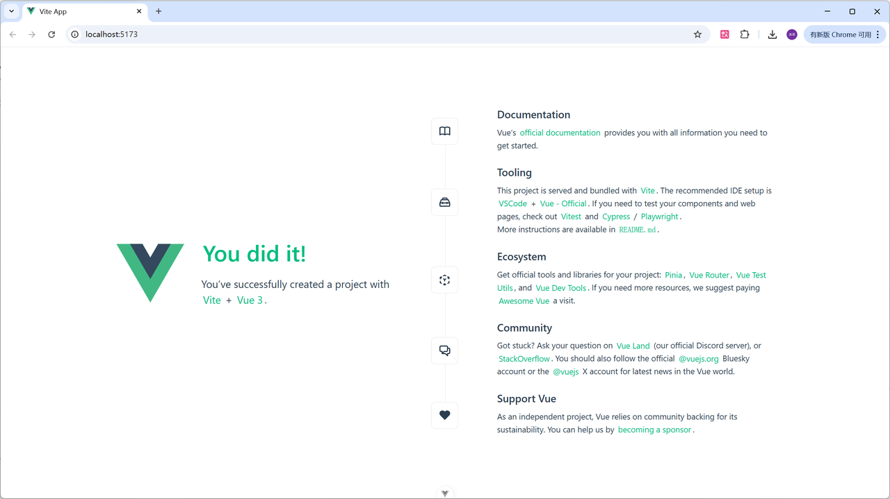

<title>16 前端Web实战(Vue工程化+ElementPlus)</title>


# 创建vue项目

创建一个工程化的Vue项目，执行命令：`npm create vue@3.16.4`


<callout emoji="✅">
**提示：**执行上述指令，将会安装并执行 create-vue，它是 Vue 官方的项目脚手架工具
</callout>

项目创建完成以后，进入`cd vue-test` 项目目录，执行命令安装当前项目的依赖：`npm install`


创建项目以及安装依赖的过程，都是需要联网的。【如果网络不太好，可能会造成依赖下载不完整报错，继续再次执行 命令安装。】 


**在浏览器输入http://localhost:5173验证看看能不能进入到项目默认主页**



# 项目开发流程

```Java
项目中的package.json文件就类似于我们在Java开发中的pom.xml文件是管理整个项目的架构的
项目中文件的调用顺序：main.js-->App.vue-->Main.vue(这个也是我们自己定义的是用来显示程序主页的信息的)-->.....
```

# 使用elementplus

```Java
在使用elementplus时我们需要找到自己想要的组件，然后把template中的代码拷贝下来到项目中
再观察这个组件中<script>中的代码和使用组件需要引入的东西，import ....
如果想成功使用一个组件的效果以上的这些代码必须要复制到项目中，缺一不可
```

---
> 来源：飞书技术知识库（脱敏版） · 03 Web 开发与框架 / 前端工程化（Vue3 + ElementPlus） / 16 前端Web实战(Vue工程化+ElementPlus) · [原文](https://ccn8v2zngwsm.feishu.cn/wiki/CoKCwYR46iSDPRkww9ncvtvpn1c)
