# 02 Vue_Axios异步请求_Maven环境配置

## Vue

### 集成vue环境

在Vue官网的快速学习中有多种官方定义好的构建方法，通过这些构建方法可以实现我们对HTML的渲染

> Vue快速上手开发文档：https://cn.vuejs.org/guide/quick-start

```HTML
<--准备元素（div），交给Vue控制 -->
<div id="app">{{ message }}</div>

<--模块化，需要设置 type="module" -->
<script type="module">
  import { createApp, ref } from 'https://unpkg.com/vue@3/dist/vue.esm-browser.js'

  createApp({
    setup() {
      const message = ref('Hello Vue!')
      return {
        message
      }
    }
  }).mount('#app')
</script>
```

### Vue方法

Vue的模块中对方法的使用

```XML
<script type="module">
    import { createApp} from 'https://unpkg.com/vue@3/dist/vue.esm-browser.js'

    createApp({
        data() {
            return {
                   属性名：属性值,
                   ...
                }
            }
        },
        methods: {
            方法名(){
            },
            方法名(){
            },
            ...
        },
        mounted() {
            入口函数，这里一般vue创建完成时的回到，页面初始请求都应该在这里发送
        }
    }).mount('#app')
</script>
```


### Vue常用指令

Vue指令展示data()中数据绑定methods()方法，入口函数中发送页面的第一次请求

<callout emoji="⛱️">
v-text="键",通过插值表达式渲染页面。 插值表达式的写法：{{键}}
v-bind:属性名="键”：
属性名="键”渲染标签的属性的值
src="url"
v-model="键"
双向绑定，动态搜集表单项数据
v-if="条件"  v-else-if="条件"  v-else
根据条件是否显示或者隐藏内容
v-for="(元素，索引）in 容器" 
v-for="变量 in 数字”
从1开始到数字结束，包含数字本身
v-on:事件名="vue中methods中函数名"。
@事件名="vue中methods的函数名"
</callout>

注意：

<callout emoji="🍰">
Vue中定义数据，必须通过data方法来定义，data方法返回值是一个对象，在这个对象中定义数据。
插值表达式中编写的变量，一定是Vue中定义的数据，如果插值表达式中编写了一个变量，但是在Vue中未定义，将会报错 。
Vue应用实例接管的区域是 '#app'，超出这个范围，就不受Vue控制了，所以vue的插值表达式，一定写在 `<div id="app">...</div>` 的里面 。
</callout>

##### v-for

**作用：**列表渲染，遍历容器的元素或者对象的属性

**语法：**`<tr v-for="(item,index) in items" :key="item.id">{{item}}</tr>`

**参数：**

- items 为遍历的数组
- item 为遍历出来的元素
- index 为索引/下标，从0开始 ；可以省略，省略index语法： `v-for = "item in items"`

**key：**

- 作用：给元素添加的唯一标识，便于vue进行列表项的正确排序复用，提升渲染性能
- 推荐使用id作为key（唯一），不推荐使用index作为key（会变化，不对应）

<callout emoji="💥">
注意：遍历的数组，必须在data中定义； 要想让哪个标签循环展示多次，就在哪个标签上使用 v-for 指令。
</callout>

##### v-bind

作用：动态为HTML标签绑定属性值，如设置href，src，style样式等。

语法：`v-bind:属性名="属性值"` ``

简化：`:属性名="属性值"` ``

<callout emoji="💥">
注意：v-bind 所绑定的数据，必须在data中定义/或基于data中定义的数据而来。
</callout>

##### v-if

**作用：**这两类指令，都是用来控制元素的显示与隐藏的

**v-if：**

- 语法：v-if="表达式"，表达式值为 true，显示；false，隐藏
- 原理：基于条件判断，来控制创建或移除元素节点（条件渲染）
- 场景：要么显示，要么不显示，不频繁切换的场景
- 其它：可以配合 v-else-if / v-else 进行链式调用条件判断

**示例：**

```HTML
   <!-- 基于v-if/v-else-if/v-else指令来展示职位这一列 -->
  <td>
    <span v-if="emp.job == '1'">班主任</span>
    <span v-else-if="emp.job == '2'">讲师</span>
    <span v-else-if="emp.job == '3'">学工主管</span>
    <span v-else-if="emp.job == '4'">教研主管</span>
    <span v-else-if="emp.job == '5'">咨询师</span>
    <span v-else>其他</span>
  </td>
```

<callout emoji="💥">
注意：v-else-if必须出现在v-if之后，可以出现多个； v-else 必须出现在v-if/v-else-if之后 。 
</callout>

##### v-model

- 作用：在表单元素上使用，**双向数据绑定**。可以方便的 **获取** 或 **设置** 表单项数据 
- 语法：`v-model="变量名"`
- 这里的双向数据绑定，是指 Vue中的数据变化，会影响视图中的数据展示 。 视图中的输入的数据变化，也会影响Vue的数据模型 。

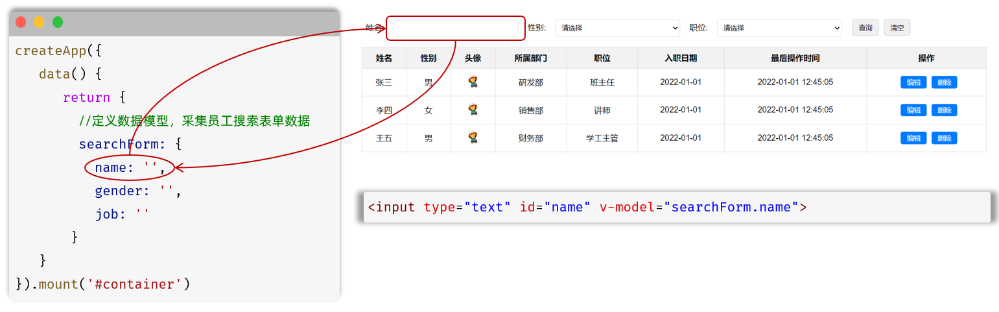
> 图注：图片展示了Vue中v-model双向数据绑定的示例。左侧代码中，data方法定义了searchForm对象，包含name、gender、job三个属性，初始值均为空字符串。右侧是员工信息表格，上方有姓名、性别等输入框，输入框的id与代码中v-model绑定的变量名对应。该图片直观呈现了v-model双向数据绑定的原理，即视图中的输入数据变化会影响Vue的数据模型，反之亦然。

<callout emoji="💥">
注意：v-model 中绑定的变量，必须在data中定义。
</callout>

##### v-on

作用：为html标签绑定事件（添加时间监听）

语法：

- `v-on:事件名="方法名"` 
- 简写为 `@事件名="vue中的函数"` 
- `<input type="button" value="点我一下试试" v-on:click="handle">`
- `<input type="button" value="点我一下试试" @click="handle">`

 

这里的handle函数，就需要在Vue应用实例创建的时候创建出来，在methods定义。

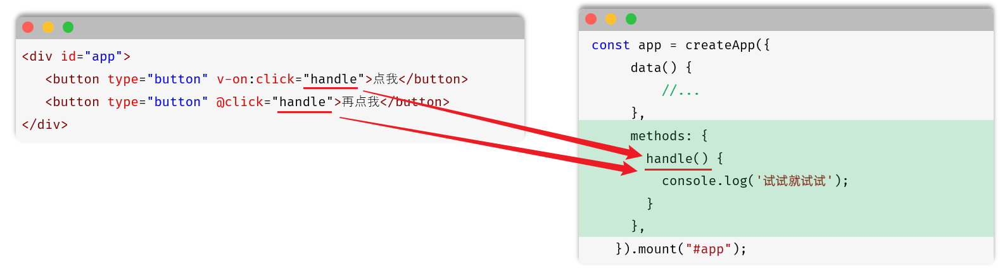
> 图注：这张图片展示了Vue框架中v-on指令的相关用法，左侧是Vue模板代码，呈现了两种绑定点击事件的写法，分别是完整语法`v-on:click="handle"`和简写语法`@click="handle"`，均用于为按钮元素绑定点击事件。右侧是Vue应用实例的配置代码，箭头指向代码里的methods选项，其中定义了与事件绑定对应的handle函数，函数内通过console.log实现打印提示内容的功能，该图直观对应了文档中v-on指令绑定事件的用法说明，帮助理解指令语法与对应函数的关联。

<callout emoji="💥">
注意： methods函数中的this指向Vue实例，可以通过this获取到data中定义的数据。
</callout>

以上都是Vue中常用的一些指令，而如果想了解Vue中全部的指令，可以参照官方文档：`https://cn.vuejs.org/api/built-in-directives.html#v-text`

### 基于Vue渲染页面

```HTML
<!DOCTYPE html>
<html lang="en">

<head>
    <meta charset="UTF-8">
    <meta name="viewport" content="width=device-width, initial-scale=1.0">
    <title>员工信息管理</title>
    <style>
        * {
            margin: 0;
            padding: 0;
            box-sizing: border-box;
        }

        body {
            font-family: "Microsoft YaHei", sans-serif;
            background-color: #f5f5f5;
            color: #333;
            padding: 20px;
        }

        .container {
            max-width: 1200px;
            margin: 0 auto;
            background-color: #fff;
            border-radius: 8px;
            /*   圆角    */
            box-shadow: 0 2px 10px rgba(0, 0, 0, 0.2);
            /*  阴影   */
            padding: 20px;
        }

        h1 {
            text-align: center;
            font-size: 28px;
            margin-bottom: 30px;
            color: #333;
            padding: 10px 0;
            border-bottom: 2px solid #e8e8e8;
        }

        .search-area {
            display: flex;
            gap: 20px;
            margin-bottom: 30px;
            flex-wrap: wrap;
            align-items: center;
        }

        .search-item {
            display: flex;
            align-items: center;
            gap: 10px;
        }

        .search-item label {
            font-size: 14px;
            color: #666;
            min-width: 50px;
        }

        input[type="text"],
        select {
            padding: 8px 12px;
            border: 1px solid #ddd;
            border-radius: 4px;
            font-size: 14px;
            width: 200px;
            outline: none;
        }

        select {
            background-color: #fff;
        }

        .btn {
            padding: 8px 20px;
            border: none;
            border-radius: 4px;
            cursor: pointer;
            font-size: 14px;
            transition: all 0.3s ease;
        }

        .btn-primary {
            background-color: #1890ff;
            color: white;
        }

        .btn-default {
            background-color: #f5f5f5;
            color: #666;
            border: 1px solid #ddd;
        }

        .btn:hover {
            opacity: 0.8;
        }

        table {
            width: 100%;
            border-collapse: collapse;
            margin-top: 20px;
        }

        th,
        td {
            padding: 12px 15px;
            text-align: center;
            border-bottom: 1px solid #e8e8e8;
        }

        th {
            background-color: #fafafa;
            font-weight: bold;
            color: #333;
        }

        tr:hover {
            background-color: #f5f5f5;
        }

        .avatar {
            width: 40px;
            height: 40px;
            border-radius: 50%;
        }
    </style>
</head>

<body>
    <div id="app">
        <h1>员工信息管理</h1>

        <!-- 搜索区域 -->
        <form action="#">
            <label for="name">姓名：</label>
            <input type="text" id="name" name="name" placeholder="请输入姓名" v-model="emp.name">

            <label for="gender">性别：</label>
            <select id="gender" name="gender" v-model="emp.gender">
                <option value="">请选择</option>
                <option value="1">男</option>
                <option value="2">女</option>
            </select>

            <label for="job">职位：</label>
            <select id="job" name="job" v-model="emp.job">
                <option value="">请选择</option>
                <option value="1">班主任</option>
                <option value="2">讲师</option>
                <option value="3">学工主管</option>
                <option value="4">教研主管</option>
                <option value="5">咨询师</option>
            </select>

        </form>
        <button type="submit" class="btn btn-primary" @click="findByCondition">查询</button>
        <button type="reset" class="btn btn-default">清空</button>

        <!-- 表格区域 -->
        <table>
            <thead>
                <tr>
                    <th>序号</th>
                    <th>姓名</th>
                    <th>头像</th>
                    <th>性别</th>
                    <th>职位</th>
                    <th>入职日期</th>
                    <th>更新时间</th>
                </tr>
            </thead>
            <tbody>
                <!-- 遍历数据 -->
                <tr v-for="(emp, index) in emps">
                    <td>{{index + 1}}</td>
                    <td>{{emp.name}}</td>
                    <td></td>
                    <td>{{emp.gender == 1 ? "男":"女"}}</td>
                    <td v-if="emp.job == 1">班主任</td>
                    <td v-else-if="emp.job == 2">讲师</td>
                    <td v-else-if="emp.job == 3">咨询师</td>
                    <td v-else-if="emp.job == 4">教研主管</td>
                    <td v-else-if="emp.job == 5">学工主管</td>
                    <td v-else>其他</td>
                    <td>{{emp.entrydate}}</td>
                    <td>{{emp.updatetime}}</td>
                </tr>
                <!-- 更多数据行... -->
            </tbody>
        </table>
    </div>
    <script src="https://unpkg.com/axios/dist/axios.min.js"></script>
    <script type="module">
        import { createApp} from 'https://unpkg.com/vue@3/dist/vue.esm-browser.js'

        createApp({
            data() {
                return {
                    emps: [],
                    emp: {
                        name: "",
                        gender: "",
                        job: ""
                    }

                }
            },
            methods: {
                findByCondition() {
                    console.log(this.emp);
                    this.find();

                },
                find() {
                    axios.get(`https://web-server.itheima.net/emps/list?name=${this.emp.name}&gender=${this.emp.gender}&job=${this.emp.job}`).then(res => {
                        this.emps = res.data.data;
                    });
                },
                reset() {
                    this.emp = { name: "", gender: "", job: "" };
                    this.find();
                }

            },
            mounted() {
                console.log("页面加载完毕,可以开始请求数据了");
                this.find();
                //   axors.get(`https://web-server.itheima.net/emps/list?name=${{emp.name}}&gender=${{emp.gender}}&job=${{emp.job}}`)
            }
        }).mount('#app')
    </script>

</body>
</html>
```

代码生成完成之后，可以使用浏览器将其打开了，来看一下页面的效果展示。

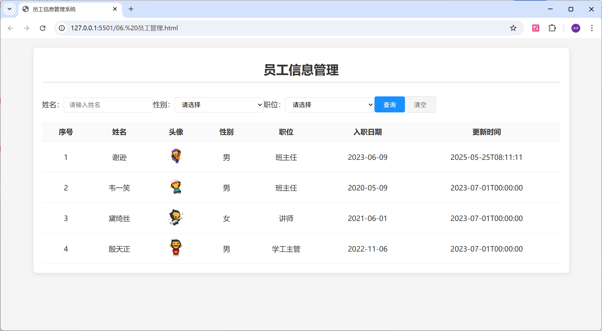
> 图注：这张图片展示的是一个名为“员工信息管理”的网页界面，该页面位于员工信息管理系统的127.0.0.1:5500路径下的员工管理html页面。页面设有姓名、性别、职位的筛选输入框与选择下拉框，还有“查询”“清空”按钮；下方的员工信息列表包含序号、姓名、头像、性别、职位、入职日期、更新时间等内容，已显示4位员工的信息，分别为姓名谢逊（班主任）、韦一笑（班主任）、黛绮丝（讲师）、殷天正（学工主管），对应的头像为卡通形象，各员工还标注了对应的入职与更新时间，这是基于Vue渲染后在浏览器中呈现的页面效果。

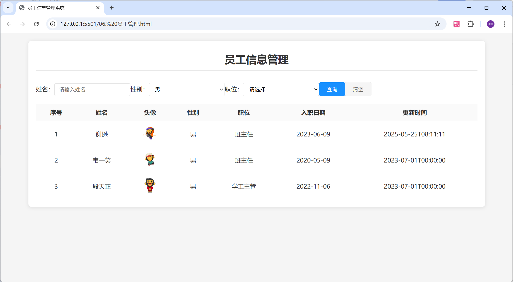
> 图注：这张图片展示的是“员工信息管理”页面，页面上方设有姓名、性别、职位的信息筛选栏，性别栏默认选中“男”，职位栏为待选择状态，右侧配有“查询”和“清空”按钮。页面下方以表格形式展示了3条员工信息，每条信息包含序号、姓名、头像、性别、职位、入职日期与更新时间，员工均为男性，职位有班主任和学工主管，其中第一条和第二条员工的入职日期分别为2023-06-09、2020-05-09，第三条员工入职日期为2022-11-06，该页面属于Vue项目中基于Vue渲染的员工管理界面。

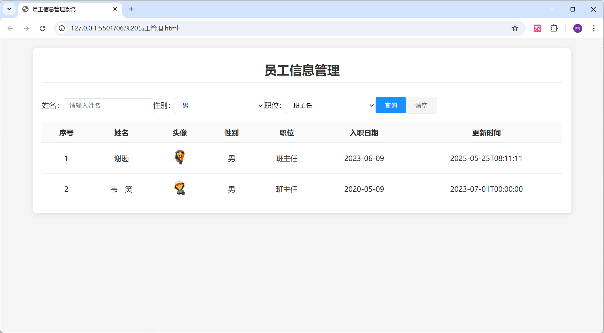
> 图注：这张图片展示了浏览器中打开的“员工信息管理”页面，该页面是Vue渲染完成后的效果。页面顶部设有姓名输入框、预设为“男”的性别选择框、预设为“班主任”的职位选择框，搭配“查询”“清空”两个操作按钮；下方以表格形式呈现员工信息，表格包含序号、姓名、头像、性别、职位、入职日期、更新时间字段，其中显示了两条员工数据，第一条员工姓名为谢逊，入职日期为2023-06-09，第二条为韦一笑，入职日期为2020-05-09，两条数据的职位均为班主任。

## 发送异步请求

使用原生的Ajax请求的代码编写起来还是比较繁琐的，所以接下来学习一门更加简单的发送Ajax请求的技术Axios 。Axios是对原生的AJAX进行封装，简化书写。Axios官网是：`https://www.axios-http.cn`

### Axios入门程序

Axios的使用比较简单，主要分为2步：

1). 引入Axios文件（官网中的快速入门中直接复制）

集成axios的环境

> Axios快速入门文档：https://www.axios-http.cn/docs/intro

```HTML
<script src="https://unpkg.com/axios/dist/axios.min.js"></script>
```

2). 点击按钮时，使用Axios发送请求

```HTML
axios.get(请求路径?参数).then(结果=>{
    对结果的处理即可
})
```

```HTML
axios.post(请求路径,参数).then(结果=>{
    对结果的处理即可
})
```

<callout emoji="✅">
注意：在使用axios时，在axios之后，输入 thenc 会自动生成成功及失败回调函数结构 。
</callout>

### 请求方式别名

Axios还针对不同的请求，提供了别名方式的api，具体格式如下：

axios.请求方式(url [, data [, config]])

具体如下：

| **方法** | **描述** |
|-|-|
| axios.get(url [, config]) | 发送get请求 |
| axios.delete(url [, config]) | 发送delete请求 |
| axios.post(url [, data[, config]]) | 发送post请求 |
| axios.put(url [, data[, config]]) | 发送put请求 |

我们目前只关注get和post请求，所以在上述的入门案例中，我们可以将get请求代码改写成如下：

```JavaScript
axios.get("https://mock.apifox.cn/m1/3083103-0-default/emps/list").then(result => {
    console.log(result.data);
})
```

post请求改写成如下：

```JavaScript
axios.post("https://mock.apifox.cn/m1/3083103-0-default/emps/update","id=1").then(result => {
    console.log(result.data);
})
```


如果使用axios中提供的.then(function(){....}).catch(function(){....})，这种回调函数的写法，会使得代码的可读性和维护性变差。 而为了解决这个问题，我们可以使用两个关键字，分别是：**async、await**。 

可以通过async、await可以让异步变为同步操作。async就是来声明一个异步方法，await是用来等待异步任务执行。

### vue+axios使用案例

```Java
<!DOCTYPE html>
<html lang="en">
<head>
  <meta charset="UTF-8">
  <meta name="viewport" content="width=device-width, initial-scale=1.0">
  <title>Vue-快速入门</title>
</head>
<body>
  <div id="app">
    <!-- 前端代码，必须写在APP的div双标签内部，否则vue无法接管 -->

  </div>

  <!-- 第一步导入vue和axios工程 -->
  <script src="https://unpkg.com/axios/dist/axios.min.js"></script>
  <script type="module">
    import { createApp } from 'https://unpkg.com/vue@3/dist/vue.esm-browser.js'
    createApp({
      data(){
        return{
            //数据列表，对象，变量
        }
      },

      methods: {
        // 绑定事件
      },
      mounted() {
        //动态获取数据，异步交互
        axios.get("路径").then((result) => {
            
        })
      },
      
    }).mount('#app')
  </script>
</body>
</html>
```

**案例：**

```HTML
<!DOCTYPE html>
<html lang="zh-CN">

<head>
    <meta charset="UTF-8">
    <meta name="viewport" content="width=device-width, initial-scale=1.0">
    <title>员工信息管理系统</title>
    <style>
        * {
            margin: 0;
            padding: 0;
            box-sizing: border-box;
        }

        body {
            font-family: "Microsoft YaHei", sans-serif;
            background-color: #f5f5f5;
            color: #333;
            padding: 20px;
        }

        .container {
            max-width: 1200px;
            margin: 0 auto;
            background-color: #fff;
            border-radius: 8px;
            /*   圆角    */
            box-shadow: 0 2px 10px rgba(0, 0, 0, 0.2);
            /*  阴影   */
            padding: 20px;
        }

        h1 {
            text-align: center;
            font-size: 28px;
            margin-bottom: 30px;
            color: #333;
            padding: 10px 0;
            border-bottom: 2px solid #e8e8e8;
        }

        .search-area {
            display: flex;
            gap: 20px;
            margin-bottom: 30px;
            flex-wrap: wrap;
            align-items: center;
        }

        .search-item {
            display: flex;
            align-items: center;
            gap: 10px;
        }

        .search-item label {
            font-size: 14px;
            color: #666;
            min-width: 50px;
        }

        input[type="text"],
        select {
            padding: 8px 12px;
            border: 1px solid #ddd;
            border-radius: 4px;
            font-size: 14px;
            width: 200px;
            outline: none;
        }

        select {
            background-color: #fff;
        }

        .btn {
            padding: 8px 20px;
            border: none;
            border-radius: 4px;
            cursor: pointer;
            font-size: 14px;
            transition: all 0.3s ease;
        }

        .btn-primary {
            background-color: #1890ff;
            color: white;
        }

        .btn-default {
            background-color: #f5f5f5;
            color: #666;
            border: 1px solid #ddd;
        }

        .btn:hover {
            opacity: 0.8;
        }

        table {
            width: 100%;
            border-collapse: collapse;
            margin-top: 20px;
        }

        th,
        td {
            padding: 12px 15px;
            text-align: center;
            border-bottom: 1px solid #e8e8e8;
        }

        th {
            background-color: #fafafa;
            font-weight: bold;
            color: #333;
        }

        tr:hover {
            background-color: #f5f5f5;
        }

        .avatar {
            width: 40px;
            height: 40px;
            border-radius: 50%;
        }
    </style>
</head>

<body>
    <div id="container">
        <h1>员工信息管理</h1>

        <!-- 搜索区域 -->
        <form action="#">
            <label for="name">姓名：</label>
            <input type="text" id="name" name="name" placeholder="请输入姓名" v-model="emp.name">

            <label for="gender">性别：</label>
            <select id="gender" name="gender" v-model="emp.gender">
                <option value="">请选择</option>
                <option value="1">男</option>
                <option value="2">女</option>
            </select>

            <label for="job">职位：</label>
            <select id="job" name="job" v-model="emp.job">
                <option value="">请选择</option>
                <option value="1">班主任</option>
                <option value="2">讲师</option>
                <option value="3">学工主管</option>
                <option value="4">教研主管</option>
                <option value="5">咨询师</option>
            </select>

            <button type="button" class="btn btn-primary" @click="findByCondition">查询</button>
            <button type="reset" class="btn btn-default">清空</button>
        </form>

        <!-- 表格区域 -->
        <table>
            <thead>
                <tr>
                    <th>序号</th>
                    <th>姓名</th>
                    <th>头像</th>
                    <th>性别</th>
                    <th>职位</th>
                    <th>入职日期</th>
                    <th>更新时间</th>
                </tr>
            </thead>
            <tbody>
                <tr v-for="(emp,i) in emps">
                    <td>{{i+1}}</td>
                    <td>{{emp.name}}</td>
                    <td></td>
                    <td>{{emp.gender ==1?`男`:`女`}}</td>
                    <td v-if="emp.job == 1">班主任</td>
                    <td v-else-if="emp.job == 2">讲师</td>
                    <td v-else-if="emp.job == 3">学工主管</td>
                    <td v-else-if="emp.job == 4">教研主管</td>
                    <td v-else-if="emp.job == 5">咨询师</td>
                    <td>{{emp.entrydate}}</td>
                    <td>{{emp.updatetime}}</td>
                </tr>
            </tbody>
        </table>
    </div>

    <script src="https://unpkg.com/axios/dist/axios.min.js"></script>

    <script type="module">
        import { createApp, ref } from 'https://unpkg.com/vue@3/dist/vue.esm-browser.js'

        createApp({
            data() {
                return {
                    emps: [],
                    emp: {
                        name: ``,
                        gender: ``,
                        job: ``
                    }

                }

            },
            methods: {
                findByCondition() {
                    this.find()
                },

                async find() {
                    const resp = await axios.get(`https://web-server.itheima.net/emps/list?name=${this.emp.name}&gender=${this.emp.gender}&job=${this.emp.job}`);

                    this.emps = resp.data.data
                },

            },
            mounted() {
                this.find();
            },

        }).mount('#container')  </script>
    <script>

    </script>
</body>

</html>
```

## maven环境配置

### maven配置步骤

<whiteboard token="YU9Twzfq2h7sJ9bYVstcGb0Zn0e"></whiteboard>


### maven中的标签的含义

<callout emoji="✍️">
- `<project>`` `：pom文件的根标签，表示当前maven项目
- `<modelVersion>`：声明项目描述遵循哪一个POM模型版本

  - 虽然模型本身的版本很少改变，但它仍然是必不可少的。目前POM模型版本是4.0.0
- 坐标 ：

  - `<groupId>` `<artifactId>` `<version>`
  - 定位项目在本地仓库中的位置，由以上三个标签组成一个坐标
  - groupId：定义当前Maven项目隶属组织名称（通常是域名反写，例如：com.itheima）
  - artifactId：定义当前Maven项目名称（通常是模块名称，例如 order-service、goods-service）
  - version：定义当前项目版本号
  
    - SNAPSHOT: 功能不稳定、尚处于开发中的版本，即快照版本
    - RELEASE: 功能趋于稳定、当前更新停止，可以用于发行的版本
- `<maven.compiler.source>` ：编译JDK的版本
- `<maven.compiler.target>` ：运行JDK的版本
- `<project.build.sourceEncoding>` : 设置项目的字符集
</callout>

### 创建maven项目

先退出所有项目，在如下设置中依次选中

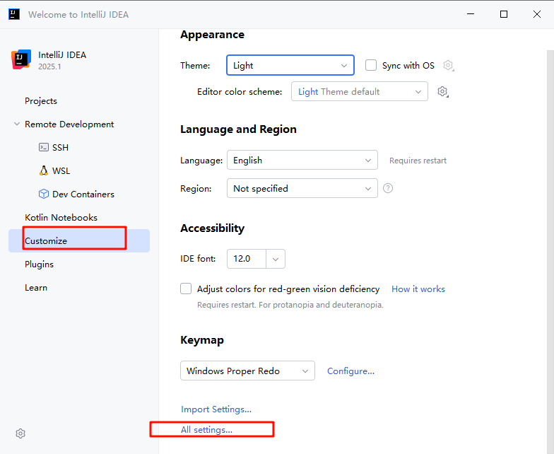
> 图注：图片展示了IntelliJ IDEA 2025.1的欢迎界面。左侧导航栏中，“Customize”选项被红色框突出显示。右侧“Appearance”设置区域中，“All settings...”选项也被红色框标出。该图片与文档中“创建maven项目”步骤相关，用于指导用户在IntelliJ IDEA中进行相关设置，即先退出所有项目，依次选中“Customize”和“All settings...”选项，以设置默认JDK版本等，且注意不要勾选Use settings from.mvn/maven.config。

注意： 不要勾选Use settings from .mvn/maven.config

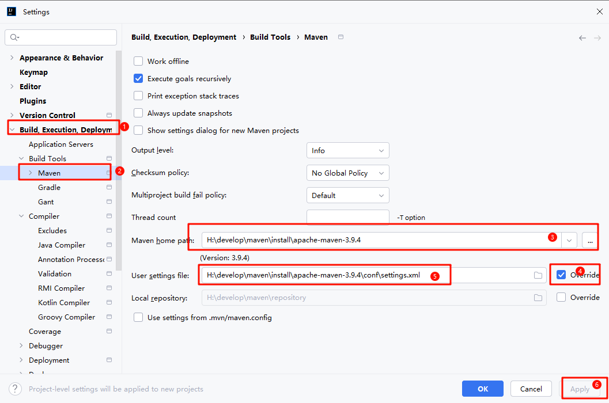
> 图注：图片展示了IntelliJ IDEA中Maven配置界面。左侧导航栏选中“Build, Execution, Deployment”下的“Build Tools”和“Maven”。右侧Maven配置区域中，Maven home path设置为H:/develop/maven/install/apache-maven-3.9.4，User settings file设置为H:/develop/maven/install/apache-maven-3.9.4/conf/settings.xml，且有“Override”选项被勾选。该图片与文档中创建Maven项目时设置默认JDK版本的上下文相关，直观呈现了Maven配置的具体操作界面及关键设置项。

设置默认JDK版本，按照图中顺序依次选中

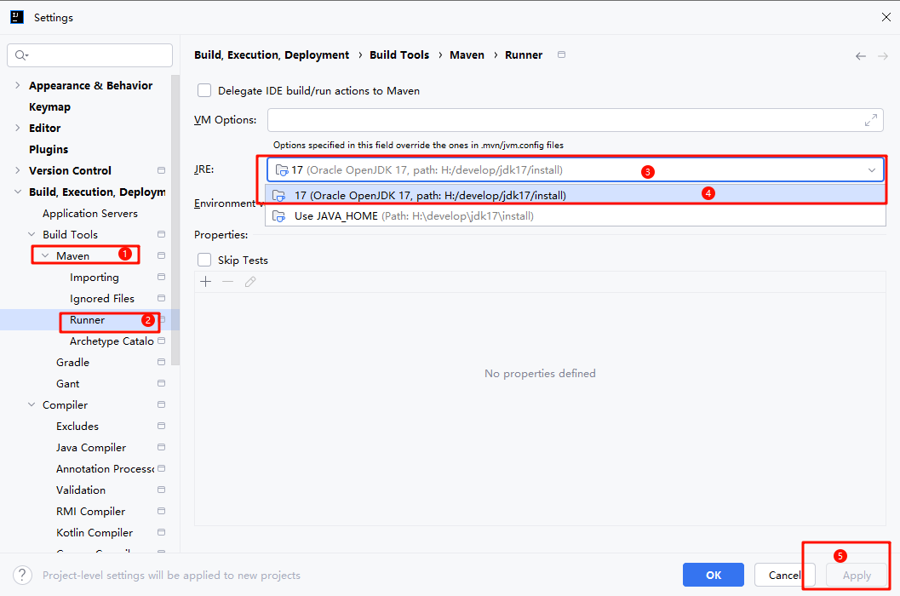
> 图注：图片展示了IntelliJ IDEA中Maven设置界面。左侧导航栏选中“Build Tools”下的“Maven”，右侧“Runner”选项被红框突出显示。在JRE设置区域，有两个JRE选项，分别是“17 (Oracle OpenJDK 17, path: H:/develop/jdk17/install)”和“17 (Oracle OpenJDK 17, path: H:/develop/jdk17/install)”，也被红框标注。右下角有“Apply”和“Cancel”按钮。该图片与文档中创建Maven项目时设置默认JDK版本的操作步骤相关，用于指导用户在IntelliJ IDEA中选择JDK版本。


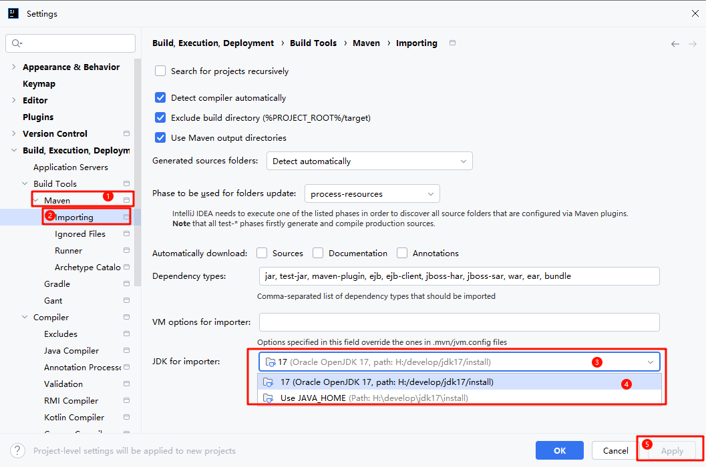
> 图注：图片展示了IntelliJ IDEA中Maven设置界面。左侧导航栏选中“Build Tools”下的“Maven”选项。右侧“Importing”标签页中，有“Detect compiler automatically”等勾选项，以及“JDK for importer”下拉框，显示了两个Oracle JDK 17选项，路径分别为“C:/Users/itcast/jdk17/install”和“C:/Users/itcast/jdk17/install”，下方还有“Use JAVA_HOME”选项。该图片与文档中创建Maven项目时设置默认JDK版本的内容相关，用于说明设置JDK版本的操作步骤。

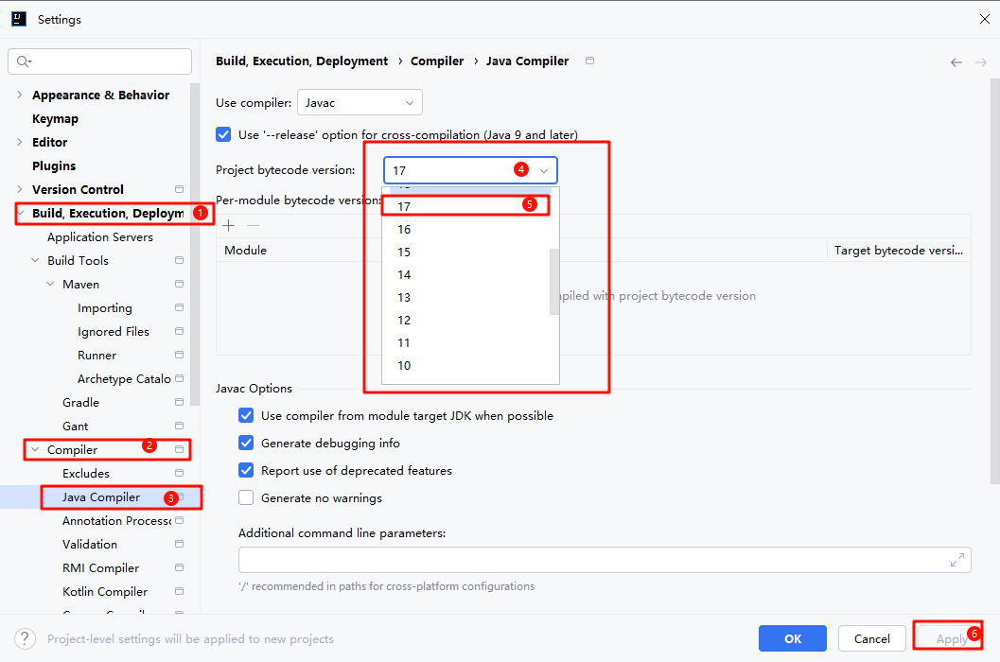
> 图注：图片展示了IntelliJ IDEA中设置Maven项目相关配置的界面。左侧导航栏中，以红色框突出显示了“Build, Execution, Deployment”“Compiler”“Java Compiler”等选项。右侧“Compiler”选项卡下，有“Use compiler:”下拉框，选中“Javac”，“Project bytecode version”和“Per-module bytecode version”均设置为17，下方还有“Java Options”相关设置。该图片与文档中创建Maven项目时设置默认JDK版本的上下文相关，直观呈现了设置步骤中涉及的界面及关键配置项。

### 生命周期

Maven的生命周期就是为了对所有的构建过程进行抽象和统一。 描述了一次项目构建，经历哪些阶段。

在Maven出现之前，项目构建的生命周期就已经存在，软件开发人员每天都在对项目进行清理，编译，测试及部署。虽然大家都在不停地做构建工作，但公司和公司间、项目和项目间，往往使用不同的方式做类似的工作。

Maven从大量项目和构建工具中学习和反思，然后总结了一套高度完美的，易扩展的项目构建生命周期。这个生命周期包含了项目的清理，初始化，编译，测试，打包，集成测试，验证，部署和站点生成等几乎所有构建步骤。

Maven对项目构建的生命周期划分为3套（相互独立）：

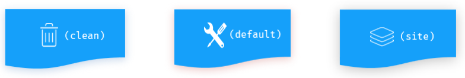
> 图注：这张图片展示了Maven构建生命周期中相互独立的3套生命周期，每套都用带图标的蓝色卡片呈现。从左到右，第一个卡片图标是垃圾桶，对应clean生命周期，用于项目的清理工作；中间的卡片图标是交叉的扳手和螺丝刀，对应default生命周期，是日常项目构建的核心生命周期；最右侧的卡片图标是堆叠的文件，对应site生命周期，用于生成项目站点。这和上文提到的“Maven对项目构建的生命周期划分为3套（相互独立）”的内容对应，清晰呈现了三套生命周期的标识。

- clean：清理工作。
- default：核心工作。如：编译、测试、打包、安装、部署等。
- site：生成报告、发布站点等。

三套生命周期又包含哪些具体的阶段呢, 我们来看下面这幅图:

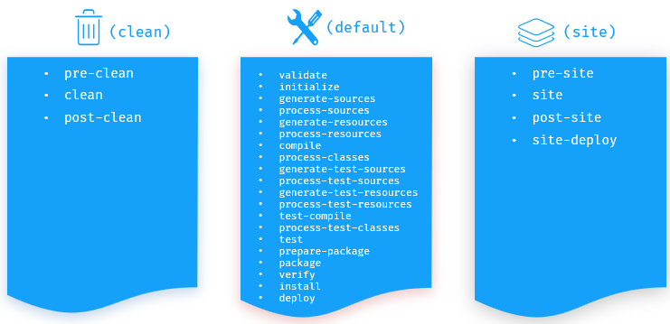
> 图注：这张图展示了Maven的三套核心生命周期，分别为clean、default和site生命周期，每套生命周期下都包含对应阶段。其中clean生命周期仅有pre-clean、clean、post-clean三个阶段；default生命周期包含validate、initialize、generate-sources等多个阶段，还涵盖了compile、test、package、install等被提及的常用阶段；site生命周期则包含pre-site、site、post-site、site-deploy四个阶段。该图直观呈现了Maven三套生命周期及其所包含的阶段，用于辅助理解文档中关于Maven生命周期的相关说明。

每套生命周期包含一些阶段（phase），阶段是有顺序的，后面的阶段依赖于前面的阶段。

我们看到这三套生命周期，里面有很多很多的阶段，这么多生命周期阶段，其实我们常用的并不多，主要关注以下几个：

- clean：移除上一次构建生成的文件
- compile：编译项目源代码
- test：使用合适的单元测试框架运行测试(junit)
- package：将编译后的文件打包，如：jar、war等
- install：安装项目到本地仓库

```HTML
常用的声明周期：
clean：移除上一次构建生成的文件
compile：编译项目源代码
test：使用合适的单元测试框架运行测试(junit)
package：将编译后的文件打包，如：jar、war等
install：安装项目到本地仓库
deploy:发布项目
```

Maven的生命周期是抽象的，这意味着生命周期本身不做任何实际工作。**在Maven的设计中，实际任务（如源代码编译）都交由插件来完成。**

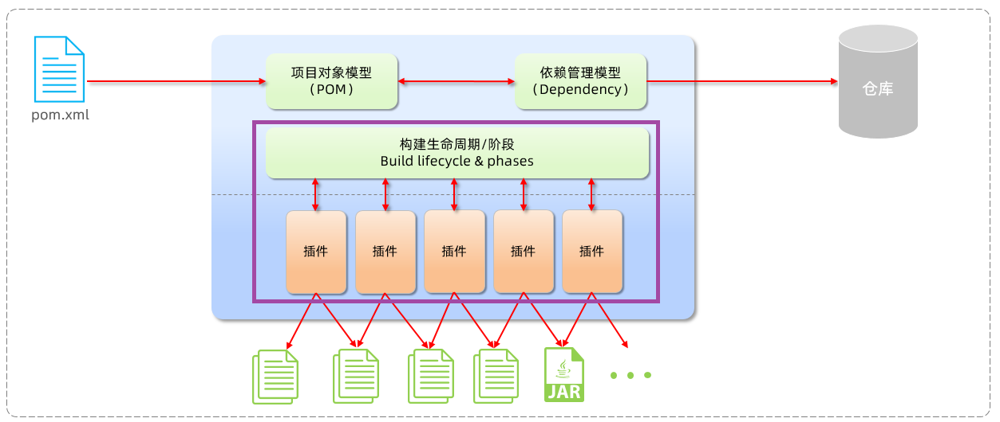
> 图注：这张图展示了Maven构建的核心流程：以pom.xml文件为源头，依次关联项目对象模型（POM）与依赖管理模型（Dependency），依托构建生命周期/阶段，再调动插件完成对应任务，最终生成编译后的文件（如JAR包），产出物会被提交至仓库。这与文档中介绍的Maven核心内容相呼应，清晰呈现出Maven通过插件实现生命周期具体任务的核心设计。

IDEA工具为了方便程序员使用maven生命周期，在右侧的maven工具栏中，已给出快速访问通道。

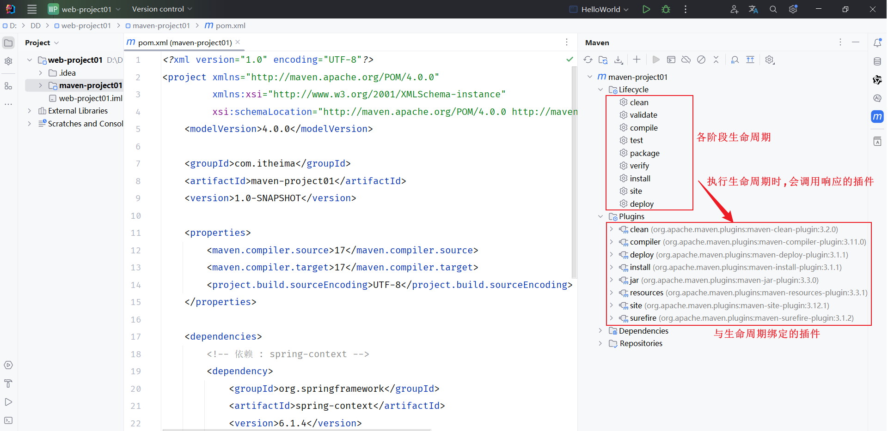
> 图注：图片展示了IDEA工具中maven项目pom.xml文件的生命周期相关内容。左侧为项目结构，右侧是maven工具栏。工具栏中以红色框标注了各阶段生命周期，如clean、validate等。箭头指向“执行生命周期时，会调用响应的插件”处，下方以红色框突出显示了与生命周期绑定的插件，如maven-clean-plugin、maven-compiler-plugin等。该图片与上下文介绍的maven生命周期相关，直观呈现了生命周期各阶段及对应插件。

- 生命周期的顺序是：`clean` --> `validate` --> `compile` --> `test` --> `package` --> `verify` --> `install` --> `site` --> `deploy`
- 我们需要关注的就是：`clean` -->  `compile` --> `test` --> `package`  --> `install`

<callout emoji="📌">
**说明：**在同一套生命周期中，我们在执行后面的生命周期时，前面的生命周期都会执行。
</callout>

<callout emoji="📌">
**思考：**当运行package生命周期时，clean、compile生命周期会不会运行？
    clean不会运行，compile会运行。  因为compile与package属于同一套生命周期，而clean与package不属于同一套生命周期。
</callout>

### Java项目文件夹层级分类


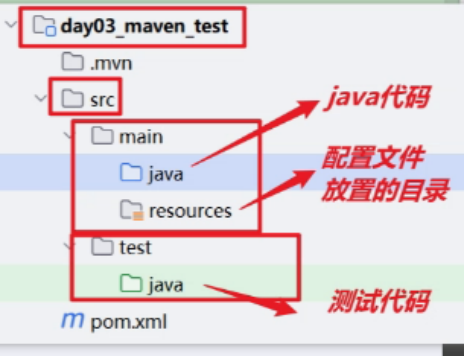
> 图注：这张图片展示了Maven项目的文件夹层级结构，所属项目名称为day03_maven_test，顶层目录包含.mvn、src、test文件夹与pom.xml文件。其中src是核心目录，其下分为main和test两个子目录：main目录内的java文件夹用于放置java代码，resources文件夹是配置文件放置的目录；test目录内的java文件夹则用于放置测试代码。该图片用于直观说明文档中Maven环境配置相关的Java项目文件夹层级分类内容，清晰标注了各目录的用途。

---
> 来源：飞书技术知识库（脱敏版） · 03 Web 开发与框架 / 前端基础与 Vue / 02 Vue_Axios异步请求_Maven环境配置 · [原文](https://ccn8v2zngwsm.feishu.cn/wiki/EUxRwSVugiR5dmkVQ9Wchy56nyb)
