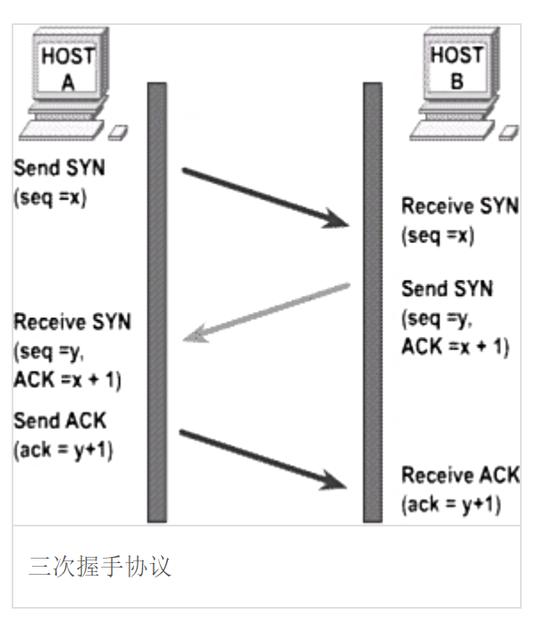
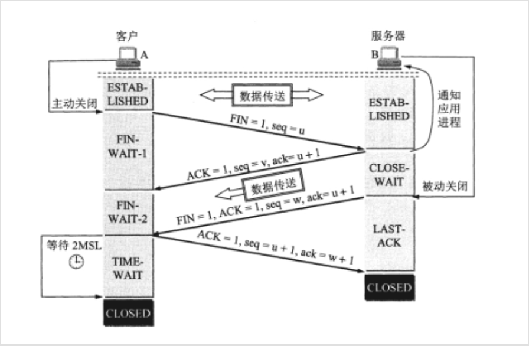
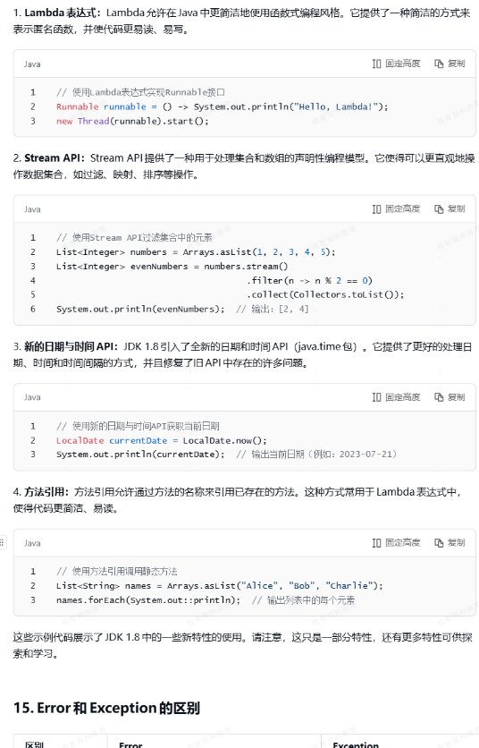
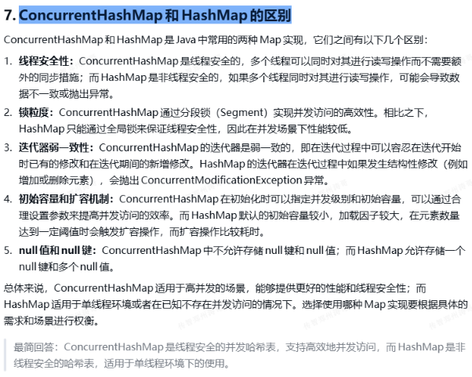
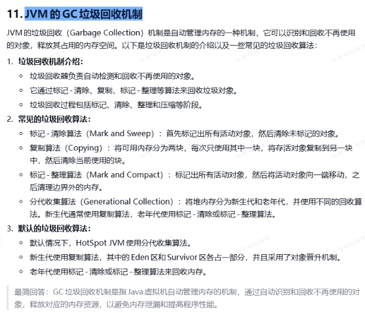
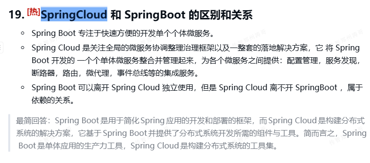

# 八股文面试题

## 接口和抽象类的区别

<synced_reference src-block-id="MNEOdOR3psQiu2bTYdpcGXXdn45" src-token="K0jpdlOsgozvvcxQVm3cZFv2nle"></synced_reference>

## lambda和匿名内部类的区别

<synced_reference src-block-id="VHscdg9dhsVyuEbnWRBcDAyinIe" src-token="K0jpdlOsgozvvcxQVm3cZFv2nle"></synced_reference>

12.2面试题

JVM内存结构

String类的常用方法

数组 (Array) 和列表 (ArrayList) 区别

## JVM内存结构

```Java
最简回答：Java的内存结构主要包括方法区、堆、虚拟机栈、本地方法栈和程序计数器。方法区用于存储类信息，堆用于存储对象实例，虚拟机栈用于存储方法调用和局部变量，本地方法栈用于存储非Java方法信息，程序计数器用于记录当前线程执行的指令地址。
```

## String类的常用方法

```Java
length(); 返回字符串长度。
getBytes(); 返回字符串byte类型数组
indexof(); 返回指定字符的索引。
split(); 字符串分割，返回分割后的字符串数组
replace(); 字符串替换。
substring(); 字符串截取。
trim(); 取出字符串两端空格
toLowerCase(); 将字符串站换成小写字母
toUpperCase();将字符串转换成大写字母。
```

## Array与ArrayList的区别

```Java
Array可以存储基本数据类型和引用数据类型，ArrayList只可以存储引用数据类型
Array是长度固定的，ArrayList是长度可变的。
ArrayList在处理固定大小的基本数据类型的时候，速度相对较慢
```

12.4面试题

面向对象的三大特征

接口为啥不能有构造函数?

lambda和匿名内部类的区别?

单列集合的分类

## 面向对象的三大特征

```Java
封装：
    定义：将数据和操作绑定在一起，形成一个独立的单元；
    作用：隐藏内部实现细节，对外暴露访问的接口
    实现方式：通过修饰符，控制成员的可见性。
继承：
    定义：允许一个类继承另一个类的属性和方法。
    作用：实现代码的复用，建立类之间的层次关系
    实现方式：通过extends关键字来继承
多态：
    定义：同一个接口可以有多种不同的实现方式
    作用：提高代码的灵活性和可扩展性
    实现方式：方法重写，方法重载，接口实现。
```

## 接口为啥不能有构造函数?

```Java
因为接口的成员变量都默认被public abstact final修饰成为了常量放在了常量池中，只会随着接口的加载而加载一次，所以不再需要构造函数对其初始化。
```

## lambda和匿名内部类的区别

```Java
匿名内部类是会在磁盘中生成.class字节码文件的，而lambda是直接在内存操作中的不会生成字节码文件。
匿名内部类是对已知的接口和类进行子类的创建，而lambda是对函数式接口进行子类的创建。
```

## 单列集合的分类

```Java
Collection:(接口)
List:（接口）
    ArrayList（实现类）
    LinkedList（实现类）
Set:（接口）
    HashSet（实现类）
    LinkedHashSet（实现类）
    TreeSet（实现类）

List:
    特点：有序，有索引，可重复
Set：
    hashSet: 特点：无序，无索引，不可重复
    LinkedHashSet:特点：有序，无索引，不可重复
    TreeSet:特点：排序，无索引，不可重复
```

12.5面试题

数组和链表结构的特点

hash表存储数据原理

并发修改异常产生的原因

## 数组和链表结构的特点

```Java
数组: 基于数组, 数组是长度固定, 在内存中开辟的是连续的空间, 我们数组名其实记录是这个连续空间的首地址, 0索引下面一定是1索引, 是连续的!!!, 查询快, 但是增删慢
链表结构:链表结构: 在内存中是散列空间, 不是连续的, 是通过对象记录对象方式来实现的
单链表:
    对头的操作特别快, 其他都慢
双链表
    对首尾操作巨快, 越靠中间越慢, 因为必须先查到元素才能操作元素
```

## hash表存储数的原理

```Python
首先根据键算出元素的hash值
然后和底层的hash表长度求"位&"运算,  得到一个索引
判断该索引处是否有节点
没有:  将元素封装成节点然后放入到该位置
有:  将该位置的节点以及该位置节点下面链表中的所有的元素取出来和要存储的键进行比较hash值以及equals方法对比, 但凡有一个完全相同,则判定为重复元素, 则将旧值替换,如果比较完毕后没有发现完全一样的, 则jdk7以及之前采用头插法将新元素放到索引位置处,将原来的头节点挂在新节点的下面
如果元素个数 / hash表长度 大于 负载因子, 则会触发扩容,扩容是二倍扩容, 扩容后, 所有元素会重新计算hash, 重新计算索引存放
```

## 并发修改异常的原因

```Java
我们使用迭代器遍历集合的时候, 如果采用集合删除或者添加, 会导致索引迁移, 此时没有人调整迭代器内部的cursor, 导致漏掉的情况!!!
```

12.7

继承的好处

多态的使用场景

继承的注意事项

HashMap存储数据的过程

## 继承的好处

```Java
继承能让子类直接父类已定义的属性和方法，提高代码复用性，大幅减少代码冗余，提高代码层次性，提高开发效率。
```

## 多态的使用场景

```Java
多态经常用于在定义方法的时候，让父类类型作为参数可以行为多态，从而接收所有父类类型对应的子类对象提高
方法的扩展性，通用性    
```

## 继承的注意事项

```Java
(1) 不能重写父类的私有方法和静态方法
(2) @Override注解可以帮助我们检测是否正确重写
(3) 我们可以通过右键 generate快速重写 , alt +insert
(4) 子类的权限修饰符要求大于等于父类权限修饰符
(5) 子类重写的方法,返回值类型必须小于等于父类的返回值类型
```

## HashMap存储数据的过程

```Python
1. 首先根据键算出元素的hash值
2. 然后和底层的hash表长度求"位&"运算,  得到一个索引
3. 判断该索引处是否有节点
1. 没有:  将元素封装成节点然后放入到该位置
2. 有:  将该位置的节点以及该位置节点下面链表中的所有的元素取出来和要存储的键进行比较
    hash值以及equals方法对比, 但凡有一个完全相同,则判定为重复元素, 则将旧值替换,
    如果比较完毕后没有发现完全一样的, 则jdk7以及之前采用头插法将新元素放到索引位置处,
    将原来的头节点挂在新节点的下面..jdk8以及之后采用尾插法将新元素放到节点的最下面如
    果链表的长度 >=8 , 底层hash表长度>= 64 会将链表转成红黑树结构
4. 如果元素个数 / hash表长度 大于 负载因子, 则会触发扩容,扩容是二倍扩容, 扩容后, 所有元素会重新计算hash, 重新计算索引存放
5. 当Hash表删除元素的时候, 红黑树节点个数 <=6 的时候会将其转成链表
```

12.8面试题

HashMap存储数据的过程

线程池的七大参数

拒绝策略原因以及有哪几种

Stream使用的注意事项

## HashMap存储数据的过程

```Java
1. 首先根据元素计算出一个Hash值
2. 拿着这个Hash值跟底层的hash表的hash值做位于运算得到一个索引值，然后拿着这个索引值去hash表里面进行匹配
3. 如果这个索引处没有元素存在那么就将这个元素封装成一个节点放到这个索引的位置
4. 如果有元素的话那么就拿着这个元素的键和这个索引处以及它下面的链表中的元素的键逐个进行
    hash值的比较和equals的比较，但凡有一个一样的那就把这个旧的元素的值换成这个新的元素的值
    如果没有一个一样的那就把这个元素（jdk1.7按照头插法放到这个索引处链表的头部，将原来的
    链表挂载到这个新的头部的下边，jdk1.8之后采用的是尾插法，直接将这个元素放到这个链表的
    最后）其中jdk1.8新增加了红黑树的算法，就是当这个链表的长度大于等于8，整个hash表的长度
    大于等于64那么就会转换成红黑树。
5. hash表的扩容规则：如果hash表的元素的个数比超过了负载因子那么就会触发hash表的二倍扩容机制，扩容之后会重新计算hash值和索引值存放元素。
6. 如果链表的节点的长度小于等于6的话那么红黑树又会转化成普通链表。
```

## 并发修改异常产生的原因

```Shell
我们使用迭代器遍历集合的时候, 如果采用集合删除或者添加, 会导致索引迁移, 此时没有人调整迭代器内部的cursor, 导致漏掉的情况!
```

## 线程池的七大参数

```Java
1. 核心线程的数量
2. 线程池中最大线程数
3. 临时线程的存活时间
4. 临时线程存活时间的单位
5. 允许的队列任务长度
6. 创建线程工厂
7. 拒绝策略
```

## 拒绝策略的原因，以及几种拒绝策略

```Java
原因：当核心线程数和临时线程数都处于工作状态以及队列任务满了的情况下，那么就会触发拒绝策略。
拒绝策略的四种情况：
      1. 直接拒绝，并会报出异常
      2. 直接拒绝，不会爆出异常
      3. 拒绝等待最久的任务，并添加最新的任务，不抛出异常
      4. 自己解决不了，交给主线程解决
```

## Stream的使用注意事项

```Java
stream不会影响原来的数组或者集合
stream流对象只能使用一次，但凡操作了就不能再使用了，stream主打的就是链式编程
一行代码解决问题，所以不希望你分成两步，所以禁止对流进行二次操作。
```

12.10面试题

三次握手四次挥手

线程的状态

HashMap存储数据原理

## 三次握手四次挥手

```Java
第一次：客户端发送syn包，询问服务器，并且自己处于syn_send状态。
第二次：服务器收到syn包，并且发送ack包，并且需要发送syn询问，自己处于syn_receive状态
第三次：客户端收到服务器的syn+ack包，发送ack确认收到进行连接
```

```Java
1. 客户端发送fin给服务器，自己处于fin_wait1状态。
2. 服务器发送ack确认，将客户端的fin_wait1的状态转为fin_wait2状态
3. 服务器发送fin给客户端，自己处于LAST_ACK状态。
4. 客户端收到fin,发送ack确定断开。
```

## 线程的状态

```Java
总共六种状态：
    1. NEW 新建：当线程被创建出来，但是未调用start状态。
    2. RUNNABLE 可运行：调用start方法，具备被cpu执行的状态。
    3. BLOCKED 阻塞状态：cpu正在执行当前线程，但是遇到锁对象进不去执行不了的状态！！！
    4. WAITING(无限等待)：无限等待，线程遇到锁对象的wait方法，线程处于无限等待，必须通过锁的notify()或者notifyAll()唤醒才行，唤醒后线程处于RUNNABLE状态。
    5. TIMED_WAITING 计时等待：计时等待，线程遇到sleep到时间后线程会自动转成RUNNABLE状态
    6. TERMINATED:线程终结状态，终止状态。
```

## HashMap存储数据的原理

```Python
1. 首先根据元素计算出一个Hash值
2. 拿着这个Hash值跟底层的hash表的hash值做位于运算得到一个索引值，然后拿着这个索引值去hash表里面进行匹配
3. 如果这个索引处没有元素存在那么就将这个元素封装成一个节点放到这个索引的位置
4. 如果有元素的话那么就拿着这个元素的键和这个索引处以及它下面的链表中的元素的键逐个进行
    hash值的比较和equals的比较，但凡有一个一样的那就把这个旧的元素的值换成这个新的元素的值
    如果没有一个一样的那就把这个元素（jdk1.7按照头插法放到这个索引处链表的头部，将原来的
    链表挂载到这个新的头部的下边，jdk1.8之后采用的是尾插法，直接将这个元素放到这个链表的
    最后）其中jdk1.8新增加了红黑树的算法，就是当这个链表的长度大于等于8，整个hash表的长度
    大于等于64那么就会转换成红黑树。
5. hash表的扩容规则：如果hash表的元素的个数比超过了负载因子那么就会触发hash表的二倍扩容机制，扩容之后
    重新计算hash值和索引值存放元素。
6. 如果链表的节点的长度小于等于6的话那么红黑树又会转化成普通链表。
```

12.14面试题

vue的常见的指令有哪些, 作用是啥?

反射的概念,以及使用前提

获取字节码的方式有几种, 分别是什么

## vue的常见的指令有哪些，作用是啥

```HTML
v-text/{{}}：数据单向绑定
v-for：遍历容器的元素或者对象的属性
v-if：判断语句,用来控制元素的显示与隐藏
v-bind：动态为HTML数据绑定属性值，比如设置href，src，style样式等
v-model：数据的双向绑定
v-on：为html绑定事件（添加事件监听）
```

## 反射的概念，以及使用前提

```HTML
反射机制 是 Java 提供的一种功能，它让我们可以在程序运行时动态获取类的信息，并且操作类的对象。
简单来说，通过反射，我们可以在不知道类的具体信息时，还是能够动态创建对象、访问属性、调用方法等。
反射的核心是 Java 提供的 java.lang.reflect 包。
使用前提是首先要获得类的字节码对象
```

## 获取字节码的方式有哪几种

```Java
//第一种：通过 类名.Class
Class<Student> stuClass1 = Student.class;
//第二种方法 1.创建对象 2.通过对象名.getClass()；
Student student = new Student();
Class<? extends Student> stuClass2 = student.getClass();
//第三种方法 Class.forName(全限定类名)
Class<?> stuClass3 = Class.forName("com.example.reflect.Student");
```

12.16面试题

SpringMVC的原理?

元注解有哪些?

http协议的组成部分?

## SpringMVC原理

```XML
1. SpringMVC 是一个基于 Java 的实现了 MVC模式的请求驱动类型的轻量级 Web 框架，通过把 Model、View、
    Controller 分离，将 web 层进行职责解耦，把复杂的 web 应用分成清晰的几部分，简化开发，减少出错，
    方便组内开发人员之间的配合。
2. 在我看来，SpringMVC 就是将我们原来开发在 servlet 中的代码拆分了一部分由 SpringMVC 完成，
    一部分由我们自己完成。
```

## 元注解有哪些

```HTML
 3. 我们定义的注解如果没有被"元注解修饰",那么只存在源码阶段，翻译成.class文件就注解不存在了。
     什么是元注解？？
         元注解：JDK定义出来专门用于修饰注解的注解叫做元注解
      @Retention：设置注解存在阶段，默认值是只存在源码阶段。
                  RetentionPolicy.SOURCE：只存在源码阶段
                  RetentionPolicy.CLASS：存在源码和字节码文件中
                  RetentionPolicy.RUNTIME：存在源码字节码文件中，运行时阶段都有效
      @Target：设置注解可以修饰的内容，如果不设置，注解可以修饰他能修饰的所有
                  ElementType.TYPE：修饰类，接口，枚举，注解
                  ElementType.FIELD：修饰属性
                  ElementType.METHOD：修饰方法
      @Documented：抽取文档的时候不用显示该注解的信息
      @Inherited：标注注解是否可以被继承
              如果父类的注解类是被这个注解标注了的话，那么在子类继承父类的时候会自动继承父类标注的注解
                  
```

## Http协议的组成部分

```HTML
1. HTTP 请求报文
    请求行、请求头、空行、请求体（GET 请求无请求体）
2. HTTP 响应报文
    状态行、响应头、空行、响应体  
```

12.17面试题

请介绍一下jdbc是什么 以及使用步骤?

请说出mysql分组的注意事项?

请说出mysql分页的语法?

请描述什么是sql注入,以及如何避免?

## 介绍jdbc是什么 以及使用步骤

```SQL
JDBC 为 Java 程序员提供了统一的 “数据库访问接口”，无论底层是 MySQL、Oracle、SQL Server 还是
PostgreSQL，程序员只需编写一套基于 JDBC 接口的代码，通过切换数据库驱动即可适配不同数据库，实现
“一次编码，多库兼容”
1. 获取驱动
2. 获取连接
3. 请出执行者
4. 让执行者执行sql
5. 处理结果集
6. 关闭资源
```

## 说出mysql分组的注意事项

```XML
1. SELECT 字段限制：分组（GROUP BY）后，SELECT 仅能包含分组字段、聚合函数
2. WHERE 与 HAVING 区分：WHERE 过滤分组前的原始数据（不能用聚合函数），
                        HAVING 过滤分组后的结果（可使用聚合函数）。
3. NULL 值处理：NULL 值会被归为同一分组，需注意业务场景中是否需单独处理。
4. 性能优化：分组字段建议建索引，避免大表全表扫描；减少不必要的分组层级
```

## 说出mysql的分页语法

```SQL
select 字段名 from 表明 条件查询 limit 起始索引（页数-1）* 每页显示的数据数，每页显示的数据条数
```

## 说出什么是 sql注入，以及如何避免

```SQL
概念：应用程序若未对用户输入做严格校验，直接将输入拼接到 SQL 语句中执行，
攻击者就能利用这一漏洞 “欺骗” 数据库执行恶意指令。

如何避免：必须使用 PreparedStatement（预编译语句），而非 Statement（静态语句），
        通过 ? 占位符传递参数，底层会自动转义特殊字符
        MyBatis：使用 #{} 占位符（参数化），而非 ${}（直接拼接）
```

12.18面试题

mybatis的参数处理情况有几种？

boot配置文件的优先级？

mybatis的xml文件配置的规则有哪些

## mybatis的参数处理情况有几种？

```SQL
1. 单个简单参数：直接使用 #{任意值}
        @Delete("delete from students where id = #{id}")
        int removeStudentById(Integer id);
2. 单个自定义对象类型的参数：在values中使用#{成员变量名1}，#{成员变量名2}中间使用","分隔
        @Insert("insert into students values(null,#{name}, #{age},#{sex}, #{power})")
        int AddStudent(Student student);
3. 单个map集合的参数：这个方法需要在使用时定义一个HashMap() 用键对给每个成员变量赋值 #{键}
        @Insert("insert into students values(null,#{name}, #{age},#{sex}, #{power})")
        int AddStudent(Map<Student,Object> map);
4. 单个list集合或者数组的参数：需要使用xml配置文件进行sql语句的编写 并使用foreach标签
    arry                @Param取别名
    collection list     @Param取别名
        public int removeStudentbyIds(int[] ids);
        <delete id="removeStudentbyIds">
            delete from students where 
            <foreach collection="array" open="id in (" close=")" item="id" separator=",">
                #{id}
            </foreach>
        </delete>
5. 多个参数：需要使用@Param注解给每个参数取别名，要不然会自动识别为（arg0,arg1……）
        @Select("select * from students where name = #{name} and power = #{power}")
        Student findByNameAndPower(@Param("name") String name, @Param("power") Integer power);
```

## boot配置文件的优先级

```XML
properties > yml > yaml
```

## mybatis的xml文件配置的规则有哪些

```XML
1. namespace:必须是Mapper接口的全限定类名
2. 每个sql语句的标签中的id必须是该方法名
3. 如果非要不把xml文件放在规范的位置的情况下需要在yml文件中配置 
    mapper-locations: classpath:mapper/*.xml
```

12.22面试题

## 处理请求参数的情况(三种)

老师总结的

```Java
1.k-v键值对
    1.一个原则：只要是把参数名和前端传入的Key的名字保持一致就可已自动帮助我们填入
    2.注意事项：
        1. 如果有必填的参数需要使用@Param进行标注
        2. 如果有不和前端key的名字一样的参数需要使用@Param(name=("前端key的名字")进行取别名)
        3. 如果需要有默认值的话@Param(defaultValue = "默认值")；
        4. 如果有时间参数的话需要@DateTimeFormat(pattern=""时间格式)
2.json格式
    1.只要我们在参数前边加上@RequestBody即可标注为这个参数mybatis会帮我们转化为json字符串
    2.如果有时间参数的话需要@DateTimeFormat(pattern=""时间格式)
3. 路径参数
    1. 在参数前加上@PathVariable，需要路径的某一段是赋值给参数的值
    2. 如果有时间参数的话需要@DateTimeFormat(pattern=""时间格式)
```

12.23面试题

1. mybatis的动态标签有哪些? 分别作用是什么?
2. 全局异常处理的定义步骤?
3. springMVC常用的注解有哪些? 分别作用是什么?

## mybatis的动态标签有哪些? 分别作用是什么?

```Java
1.<if>:单条件判断，满足则拼接sql片段
2.<where>: 自动包裹条件片段，智能处理and/or前缀
3.<set>:用于update语句，自动处理逗号，避免set字段=值，末尾都有逗号
4.<foreach>:循环遍历集合/数组，拼接批量sql，比如in,批量插入，批量更新
5.<choose>/<when>/<otherwise>:多条件分支判断，仅仅匹配第一个满足的条件
6.<trim>:自定义修建sql片段
7.<bind>：自定义变量，避免数据库方言差异导致的字符串拼接问题，如模糊查询
```

## 全局异常处理的定义步骤

```Java
1. 定义异常：
    1.定义一个GlobalExceptionHandler类
    2.在类上边添加@RestControllerAdivise注解：标注他是一个全局异常处理类
    3.在里边编写方法，方法中编写处理异常的逻辑，但是需要通过@ExceptionHandler配置处理异常的类型
2. 处理异常
    1.客户端异常：CustomException类，可以正常显示给客户端看的
    2.系统异常：SystemException/ServiceException类：一般是service层出现的异常，不需要将其真实结果
      告知用户，可以提示一句“服务器正忙”
    3.未知异常：Exception：一般用于抓取controller层的异常以免有漏网之鱼
```

## SpringMVC常用的注解有哪些，分别有什么作用

```SQL
1. @RestController：标注这个类是一个应用接口类
2. @RequestMapping：用于处理请求url映射的注解，可用于类或方法上，用于类上，
                    则表示类中的所有相应请求的方法都是以该地址作为父路径。
3. @RequestBody：注解实现接收http请求的json数据，将json转换为java对象。
4. @ResponseBody：注解实现将conreoller方法返回的对象转化为json对象相应给客户。
5. @PathVariable：用户从url路径上获取指定参数，标注在参数前@PathVariablel("要获取的参数名").
6. @RequestParam：标注在方法参数之前，用于对传入的参数做一些限制，支持三个属性：
                  value：默认属性，用于指定前端传入的参数名称
                  required：用于指定此参数是否必传
                  defaultValue：当参数非必传参数且前端没有传入参数时，指定一个默认值。
7. @RestControllerAdvice标注在一个类上，表示该类是一个全局异常处理的类。
8. @ExceptionHandler(Exception.class）标注在异常处理类中的方法上，表示该方法可以处理的异常类型。
```

12.27面试题

1.事务的四大特性

2.mybatis的一对多的注意事项

## 事务的四大特性

```Java
ACID
A：原子性：
        事务所有操作都是一个整体不能分割要么同时成功，要么同时失败
C：一致性：
        事务前后操作的事务的逻辑总量不变
I：隔离性：
        事务和事务之间"讲道理"相互隔离不会相互影响
        READ_UNCOMMITED：读未提交，引发：脏读，不可重复读，幻读
        READ_COMMITED：读已提交，引发：不可重复读，幻读
        REPEATABLE READ：可重复读，引发：幻读
        SERIALIZABLE：串行化：没有问题，效率极低
        常见的问题：
        脏读：一个事务收到了另外一个事务的影响，读到其他事务未提交的数据，这种现象叫做脏读
        不可重复读：oracle数据库采用这个级别
            一个事务受到了另外一个事务的影响，读到别人已提交（insert/delete语句的影响)的数据，
            造成多次查询结果不一致
D：持久性：
        事务一旦提交后，就会持久化更新磁盘中的数据
        事物的传播行为：propagation
        遇到嵌套事务的时候，子事务对待父事务的态度叫做事务的传播行为
        默认值：REQUIRED加入父事务，跟父事务组成一个事物的传播行为
        REQUIRED_NEW：新事物，自己独立一个事务
```

## mybatis的一对多的注意事项

```Java
一对多：
    1. <ResultMap id ="需要和sql的resulmap的属性的值保持一致" type = "设置封装的实体类的全类名"
         autoMapping = "true">
    2. 必须封装主键列：<id property = "类中主键的属性" column = "表中的主键列名">
    3. 封装普通类：<result property = "普通的属性" column = "普通列名"> 如果列名和属性一样，
        可以开启自动映射
    4. 遇到集合属性：<collection ofType = "集合泛型类型" autoMapping = "true">
    5. 由于是多表查询很多列的列名是冲突的，如果我们不处理，会默认封装靠前的这个列，需要独立起别名处理才行
一对一：遇到对象属性，<association type= "集合泛型类型" autoMapping = "true">
```

12.29面试题

1.redis的数据类型有多少种, 分别是什么?

2.请列出springMVC的主要解决那些问题?

3.请列出spring框架解决那些问题?

4.请列出mybatis的动态标签以及作用

## redis的数据类型有多少种, 分别是什么?

```Java
1. String：存储单个值，适用于缓存和键值存储，常用命令：SET用于设置值，GET用于获取值。
2. List：有序、可重复的字符串集合，适用于消息队列和发布/订阅系统，常用命令：LPUSH用于从列表左侧添加元素，LRANGE用于获取指定范围的元素。
3. Set：无序、不可重复的字符串集合，适用于标签系统和好友关系等，常用命令：SADD用于向集合添加成员，SMEMBERS用于获取集合所有成员。
4. Hash：字段-值对的无序散列，适用于存储对象、缓存和计数器，常用命令：HSET用于设置字段值，HGETALL用于获取散列的所有字段和值。
5. Sorted Set：有序的字符串集合，每个成员关联一个分数，适用于排行榜和按分数范围获取成员，常用命令：ZADD用于添加成员及其分数，ZRANGE用于获取指定范围的成员。
```

## 请列出springMVC主要解决哪些问题?

```Java
1. 统一管理前端请求：
    替代传统 Servlet 分散的请求映射，通过 @RequestMapping 等注解，集中、灵活地绑定 URL
    与处理方法，避免手动配置 Servlet、映射路径的繁琐。
2. 自动化处理请求参数：
    自动完成前端请求参数（URL 参数、表单、JSON 等）与后端方法参数的类型转换、数据绑定（
    如 @RequestParam @RequestBody），无需手动解析 HttpServletRequest。
3. 统一处理全局异常：
    通过 @ControllerAdvice + @ExceptionHandler 实现全局异常捕获与统一响应，替代传统的 
    try-catch 分散处理，保证响应格式一致。
4. 简化视图与数据的渲染：
    通过 ModelAndView、@ResponseBody 等方式，快速完成数据到视图（JSP/HTML）的渲染，或直接返回 
    JSON 等数据格式，适配前后端分离 / 传统开发场景。
5. 实现 MVC 分层解耦：
    明确区分 Controller（请求处理）、Service（业务逻辑）、DAO（数据访问）的职责，降低各层代码的耦合
    度，提升项目的可维护性。
6. 支持拦截器实现统一功能：
    通过拦截器（Interceptor）实现登录校验、权限控制、日志记录等通用功能的统一拦截，避免在每个接口重复
    编写相同逻辑
7. 整合其他框架 / 技术：
    无缝对接 Spring 容器，可快速整合 MyBatis、Redis 等技术，同时支持文件上传、国际化等 Web 开发常
    用功能，减少技术整合的复杂度。

```

## 请列出spring框架解决那些问题?

```Java
1. IOC：控制反转，将对象的创建交给框架管理，spring发现你的类上有ioc注解，就会帮我们反射创建对象将其
   维护到ioc容器中，我们可以结合ioc容器中获取对象即可
2. DI：自动注入，根据类型注入
       解决bean冲突问题：
       1. 第一种：@Qualifiler(bean的名字)
       2. 第二种：@Resouce(name=bean的名字)
       3. 第三种：@Primary提高优先级
3. 声明式事务管理：@Transational
       1. rollbackFor = 异常类型
       2. propagation = 事务的传播行为
           1. requires:加入父事务
           2. requires:独立事务
4. AOP：在不修改源码的情况下，增强功能
```

## 请列出mybatis的动态标签以及作用

```XML
1.<if>:单条件判断，满足则拼接sql片段
2.<where>: 自动包裹条件片段，智能处理and/or前缀
3.<set>:用于update语句，自动处理逗号，避免set字段=值，末尾都有逗号
4.<foreach>:循环遍历集合/数组，拼接批量sql，比如in,批量插入，批量更新
5.<choose>/<when>/<otherwise>:多条件分支判断，仅仅匹配第一个满足的条件
6.<trim>:自定义修建sql片段
7.<bind>：自定义变量，避免数据库方言差异导致的字符串拼接问题，如模糊查询
```

1.2面试题

1.介绍一下aop

2.springboot自动配置的原理

3.第三方bean管理的相关注解有哪

## 介绍一下aop

```Java
作用：在不改变源码的情况下对IOC容器中的功能进行增强
组成部分：通知：增强逻辑
        切入点：那些需要被增强的功能
        织入类型：
            增强的方式：@Before,@After，@AfterReturning,@AfterThrowing,@Around(最常用)
        切面：切入点+通知+织入
        连接点：指的是所有方法
在 Spring AOP 中，默认使用两种代理方式来增强对象的功能：
JDK 动态代理：这种方式适用于目标类实现了 接口 的情况。代理对象是通过接口来创建的，代理的工作是基于
            接口的。
CGLIB 动态代理：在 Spring Boot 2.x 版本中，默认使用这种方式。它是通过 继承 目标类来创建一个子类
              进行代理，适合那些 没有接口 的类。
简单来说，JDK 动态代理 依赖接口，而 CGLIB 动态代理 则通过类的继承来创建代理。
```

## springboot自动配置的原理

```Java
当我们启动程序的时候, 启动类上有一个@SpringBootApplication这个注解, 内部包含了两个核心的注解
@ComponentScan注解, 扫描当前项目中的所有的bean,启动类所在包以及下面的类, 
@EnableAutoConfiguration注解, 这个注解有一个@Import(AutoConfigurationImportSelector注解),
 这个类里面有一个selectImports方法, 中会加载第三方配置目录中META-INF/spring/xxx.imports下面的配
 置, 并且解析配置中@Bean以及@ConditionalXxx的注解
```

## 第三方bean管理的相关注解有哪些

```SQL
核心：@Configuration + @Bean（手动注入）；
批量注入：@Import；
条件注入：@ConditionalOnClass/@ConditionalOnMissingBean；
配置绑定（读取配置文件中的内容）：@ConfigurationProperties；
兼容 XML：@ImportResource。
```


1.5面试题

1.请介绍一下拦截器和过滤器的区别

2.请介绍一下springMVC执行的原理

3.请介绍一下ioc和di是什么

4.请介绍mybatis-plus的原理

## 请介绍一下拦截器和过滤器的区别

```Java
归属与依赖：
过滤器filter属于Servlet规范，依赖Servlet容器，需要实现Filter接口
拦截器Interceptor属于SpringMVC框架，依赖Spring容器，需要实现HandlerInterceptor接口
执行顺序：
  客户端请求->filter->servlet->interceptor->controller
  controller->interceptor->servlet->filter->响应给客户端
作用域：
过滤器作用于所有请求；拦截器仅作用于控制器的请求
主要作用：
过滤器对请求或响应作通用预处理，拦截器对controller层进行业务增强
```

## 请介绍一下springMVC执行的原理

```Java
springmvc工作原理是基于servlet容器的前端控制器模式，首先dispatcheservlet接收并分发请求，
然后通过handlermapping找到对应的controller进行业务处理，最后通过viewResolver渲染视图，并返回
给客户端
```

## 请介绍一下ioc和di是什么

```Java
IOC和DI都是spring框架的技术
1. IOC：控制反转，将对象的创建权交给spring框架，简化开发，降低耦合。
2. DI：是IOC的具体手段，通过@Autowired等注解将IOC容器中的类直接拿来开箱即用
```

```Shell
ioc控制反转核心理念是将对象的创建、管理、依赖关系从开发者处转移到容器控制，从而对象不再依赖具体实现而依赖容器，减少冗余代码，降低耦合性。

di是依赖注入，是ioc理念的具体手段，spring容器在创建对象时自动将该对象依赖的其他对象注入到当前对象中。（spring依赖注入有三种核心方式：构造器注入，setter注入和@autowired字段注入）
```

## mp的原理

```Java
1. 开发者调用方法
2. mp动态代理拦截方法，并调用sql生成器给你解析实体，获取具体信息
3. 拼接生成sql语句，并交给mybatis原生执行器处理
4. mybatis执行sql，返回结果并映射为对应的实体类型的对象
5. mp将结果返回给开发者
```


1.12面试题

数组 (Array) 和列表 (ArrayList) 区别

线程的状态

线程池的拒绝策略有哪些

## 数组（Array）和列表（ArrayList）区别

```Java
Array可以存储基本数据类型和引用数据类型，ArrayList只可以存储引用数据类型
Array是长度固定的，ArrayList是长度可变的。
ArrayList在处理固定大小的基本数据类型的时候，速度相对较慢
```

## 线程的状态

```Java
总共六种状态：
    1. NEW 新建：当线程被创建出来，但是未调用start状态。
    2. RUNNABLE 可运行：调用start方法，具备被cpu执行的状态。
    3. BLOCKED 阻塞状态：cpu正在执行当前线程，但是遇到锁对象进不去执行不了的状态！！！
    4. WAITING(无限等待)：无限等待，线程遇到锁对象的wait方法，线程处于无限等待，必须通过锁的notify()或者
        notifyAll()唤醒才行，唤醒后线程处于RUNNABLE状态。
    5. TIMED_WAITING 计时等待：计时等待，线程遇到sleep到时间后线程会自动转成RUNNABLE状态
    6. TERMINATED:线程终结状态，终止状态。
```

## 线程池的拒绝策略是什么

```Java
原因：当核心线程数和临时线程数都处于工作状态以及队列任务满了的情况下，那么就会触发拒绝策略。
拒绝策略的四种情况：
      1. 直接拒绝，并会报出异常
      2. 直接拒绝，不会爆出异常
      3. 拒绝等待最久的任务，并添加最新的任务，不抛出异常
      4. 自己解决不了，交给主线程解决
```

1.14面试题

线程池核心参数

重写和重载的区别

遍历LIST有哪些方式

## 线程池的核心参数

```Markdown
1. 核心线程的数量
2. 线程池中最大线程数
3. 临时线程的存活时间
4. 临时线程存活时间的单位
5. 允许的队列任务长度
6. 创建线程工厂
7. 拒绝策略
```

## 重写和重载的区别

```Java
重载：发生在同一个类中，方法名相同参数列表不同（参数类型不同、个数不同、顺序不同），与 方法返回值和访问
修饰符无关，**即重载的方法不能根据返回类型进行区分。
重写：发生在父子类中，方法名、参数列表必须相同，返回值小于等于父类，抛出的异常小于等于 父类，访问修饰符
大于等于父类（里氏代换原则）；如果父类方法访问修饰符为private则子类中就不能重写
```

## 遍历LIST有哪些方式

```Java
普通遍历：for(int i=0; i< arrays.size(); i++)
增强for遍历：for(String str : arrays)
foreach遍历：list.forEach((str) -> xxxxx)
使用Iterator迭代器遍历
stream流遍历
```


1.15面试题

过滤器和拦截器的区别

SpringMVC执行流程

ArrayList与LinkedList区别


## 过滤器和拦截器的区别

```Java
归属与依赖：
过滤器filter属于Servlet规范，依赖Servlet容器，需要实现Filter接口
拦截器Interceptor属于SpringMVC框架，依赖Spring容器，需要实现HandlerInterceptor接口
执行顺序：
  客户端请求->filter->servlet->interceptor->controller
  controller->interceptor->servlet->filter->响应给客户端
作用域：
过滤器作用于所有请求；拦截器仅作用于控制器的请求
主要作用：
过滤器对请求或响应作通用预处理，拦截器对controller层进行业务增强
```

## springmvc的执行流程

```Java
springmvc是基于servlet容器的前端控制器模式，首先dispatcheservlet接收前端请求并分发，通过handlerMapping
找到对应的controller执行功能，最后通过viewResolver渲染视图和数据并返回数据给前端
```

## ArrayList和LinkedList的区别

```Java
简化回答：ArrayList基于数组实现，适合随机访问但插入/删除效率低；LinkedList基于链表实现，适合频繁的
        插入/删除操作但访问元素效率较低。
 
1. 数据结构实现：ArrayList 是动态数组的数据结构实现，而 LinkedList 是双向链表的数据结构实现。 

2. 随机访问效率：ArrayList 比 LinkedList 在随机访问的时候效率要高，因为 LinkedList 是线性的数 
   据存储方式，所以需要移动指针从前往后依次查找。 

3. 增加和删除效率：在非首尾的增加和删除操作，LinkedList 要比 ArrayList 效率要高，因为 ArrayList
   增删操作要影响数组内的其他数据的下标。 

4. 内存空间占用：LinkedList 比 ArrayList 更占内存，因为 LinkedList 的节点除了存储数据，还存储 
   了两个引用，一个指向前一个元素，一个指向后一个元素。 

5. 线程安全：ArrayList 和 LinkedList 都是不同步的，也就是不保证线程安全；
```


面试题

Redis常见的数据类型

TCP三次握手和四次挥手

TCP和UDP的区别

## Redis常见的数据类型

| **数据类型** | **介绍** | **描述** |
|-|-|-|
| string | 字符串 | 普通字符串，redis中最简单的数据类型 |
| hash | 哈希 | 也叫散列，类似于java中的HashMap结构 |
| list | 列表 | 按照插入顺序排列，可以有重复元素，类似于java中的LinkedList |
| set | 集合 | 无序集合，没有重复元素，类似于java中的HashSet |
| zset / sorted-set | 有序集合 | 集合中每个元素关联一个分数（score），根据分数排序，没有重复元素 |

Redis支持五种主要的数据类型，每种类型都有其特点和适用场景：

1. **String（字符串）**

   - 存储单个值
   - 适用于缓存、计数器、键值存储
   - 常见命令：SET key value、GET key
2. **List（列表）**

   - 有序、可重复的字符串集合
   - 适用于消息队列、发布/订阅系统
   - 常见命令：LPUSH key value、LRANGE key start stop
3. **Set（集合）**

   - 无序、不可重复的字符串集合
   - 适用于标签系统、好友关系等
   - 常见命令：SADD key member、SMEMBERS key
4. **Hash（哈希）**

   - 字段-值对的无序散列
   - 适用于存储对象、缓存、计数器
   - 常见命令：HSET key field value、HGETALL key
5. **Sorted Set（有序集合）**

   - 有序的字符串集合，每个成员关联一个分数
   - 适用于排行榜、按照分数范围获取成员
   - 常见命令：ZADD key score member、ZRANGE key start stop、ZREVRANGE key start stop

## TCP三次握手和四次挥手

TCP协议是面向连接、可靠通信的协议，通过三次握手建立连接，四次挥手断开连接。

**三次握手（建立连接）**

三次握手的主要目的是确保通信双方收发消息都是没问题的（全双工）：

1. **第一次握手** ：客户端发送SYN包，询问服务器，客户端处于SYN_SEND状态
2. **第二次握手** ：服务器收到SYN包，发送ACK包并发送SYN询问，服务器处于SYN_RECEIVE状态
3. **第三次握手** ：客户端收到服务器的SYN+ACK包，发送ACK确认收到进行连接

（图 1）



**四次挥手（断开连接）**

四次挥手确保通信双方收发消息都已经完成，处理完毕再断开：

1. **第一次挥手** ：客户端发送FIN给服务器，客户端处于FIN_WAIT1状态
2. **第二次挥手** ：服务器发送ACK确认，客户端转为FIN_WAIT2状态
3. **第三次挥手** ：服务器发送FIN给客户端，服务器处于LAST_ACK状态
4. **第四次挥手** ：客户端收到FIN，发送ACK确定断开

（图 2）



## TCP和UDP的区别

TCP和UDP是传输层的两种主要协议，它们在连接方式、可靠性和应用场景上有明显区别：

1. **连接方式** ：

   - TCP：面向连接的协议，需要先建立连接再传输数据
   - UDP：面向无连接的协议，不事先建立连接
2. **可靠性** ：

   - TCP：可靠通信，通过三次握手建立连接，传输数据进行确认，四次挥手断开连接
   - UDP：不可靠通信，发送方不管对方是否在线，数据在中间丢失也不管，接收方收到数据也不返回确认
3. **数据传输方式** ：

   - TCP：字节流传输，保证数据顺序到达
   - UDP：数据报传输，一包数据包含：自己的IP、端口、目的地IP、端口和数据（限制在64KB内）
4. **适用场景** ：

   - TCP：适用于对数据可靠性要求高的场景，如HTTP、FTP、SMTP等
   - UDP：适用于对实时性要求高但可接受少量数据丢失的场景，如视频流、音频流等
5. **拥塞控制** ：

   - TCP：有拥塞控制机制，会根据网络状况调整发送速率
   - UDP：没有拥塞控制，不会根据网络状况调整发送速率


面试题

双亲委派机制

Error和Exception的区别

ThreadLocal是一个什么样的技术

## 双亲委派机制

```Java
双亲委派模型是Java中用来加载类的一种机制，简单来说，当类加载器需要加载一个类时，他不会直接自己去加载，
而是先把这个请求交给给他的父加载器。如果父加载器不能加载该类，当前的加载器才会尝试加载。
这种方式的好处是：系统类（X像JDK)的核心类库会优先被加载，避免了不同的类加载器加载同一个类而导致冲突，从而增强了系统的安全性和稳定性。

```

## ERROR和Exception的区别

```Java
在Java中，Exception就是通过代码处理提前预设的问题，通常是因为程序逻辑错误或者外部环境出了问题。它分为两种：Checked Exception(检查型异常)和Unchecked Exception（运行时异常）。
而Error则是系统层面的问题，比如内存溢出或者栈溢出这种系统级的错误，这些问题无法通过代码去捕获和解决，通常靠优化系统或环境来解决
```

## ThreadLocal是一个什么样的技术

```Java
ThreadLocal让每个线程都有自己独立的变量副本，这样一个线程中的数据不会和其他线程的数据混淆或互相影响
简单来说：每个线程都拥有自己的私有空间，他不会和其他线程去争抢数据，这样就避免了数据冲突。
为什么这样做很重要呢？因为在传统的多线程编程中，多个线程可能会同时修改同一份数据，这样就容易出错，而
ThreadLocal通过给每个线程分配一份独立的副本，确保了每个线程只修改自己的数据，这样就能保证线程安全，避免了不必要的麻烦。
```

```Java
ThreadLocal为每个线程提供一份独立的变量副本，让多线程并发访问时，线程之间的数据完全隔离、互不干扰，避免了多线程环境下的多个线程可能会同时修改同一份数据的问题, 从而解决了线程安全问题 
```

面试题

什么是反向代理以及工作流程

Nginx的负载均衡

MyBatis结果集映射

## 什么是反向代理一级工作流程

```Java
反向代理是指以代理服务器来接受internet上的连接请求，然后将请求发给内部网络上的服务器，并将从服务器上
得到的结果返回给internet上请求连接的客户端，此时代理服务器对外表现为一个反向代理服务器。
反向代理总结就是一句话，代理端代理的是服务器。
```

```Java
反向代理 是一种网络架构模式，客户端向反向代理服务器发送请求，反向代理服务器再将请求转发给内部网络中的应用服务器，并将处理结果返回给客户端。反向代理对客户端是透明的，客户端不知道请求实际由哪台应用服务器处理。
```

## Nginx的负载均衡

```Java
负载均衡就是代理服务器将接收到的请求均衡分发到各个服务器中，负载均衡主要解决网络拥塞问题，提高服务器响应
速度服务就近提供，达到更好的访问质量，减少后台服务器并发压力。
```

## mybatis结果集映射

```Java
1. 这种对应关系是通过resultMap或<result>标签来实现的。也就是说，Mybatis会根据这些规则，把从数据库查询出来的每一列数据自动放到Java对象的相应位置，不需要手动去设置每个字段。

1. <resultMap id = "需要和sql的resultmap的属性的值保持一致" type= "设置封装的实体类的全类名" 
    autoMpping = "true">
2. 必须封装主键列：<id property = "类中主键的属性" column = "表中的主键列名">
3. 封装普通类：<result property = "普通属性" column = "普通列名"> 如果列名和属性一样，可以开启自动映射
4. 遇到集合属性：<collection ofType = "集合泛型类型" autoMapping = "true" >
5. 由于是多表查询很多列的类名是冲突的，如果不处理，会默认封装靠前的这个列，需要独立起别名处理才行
一对一：遇到对象属性，<association type = "集合泛型类型" autoMapping = "true">

```

```Java
1. 这种对应关系是通过resultMap或<result>标签来实现的。也就是说，Mybatis结果集映射是将数据库查询结果转换为 Java 对象的过程。当查询结果与 Java 对象结构不完全匹配时，需要显式配置结果映射。
如果在多表查询中有很多列的类名是冲突的,不处理，会默认封装靠前的这个列，需要独立起别名处理才行

1. <resultMap id = "需要和sql的resultmap的属性的值保持一致" type= "设置封装的实体类的全类名" 
    autoMpping = "true">
2. 必须封装主键列：<id property = "类中主键的属性" column = "表中的主键列名">
3. 封装普通类：<result property = "普通属性" column = "普通列名"> 如果列名和属性一样，可以开启自动映射
4. 遇到集合属性：<collection ofType = "集合泛型类型" autoMapping = "true" >
5. 由于是多表查询很多列的类名是冲突的，如果我们不处理，会默认封装靠前的这个列，需要独立起别名处理才行
一对一：遇到对象属性，<association type = "集合泛型类型" autoMapping = "true">

```

<cite doc-id="Va4Wd2OPeo58cxxORBfcslbXnIb" file-type="docx" title="MyBatis结果集映射标签使用方法" type="doc"></cite>


面试题：

1、反射机制及主要用到的方法

2、Spring中Bean有几种注入方式

3、悲观锁和乐观锁的区别

## **反射机制及主要用到的方法**

反射机制是Java中一种强大的特性，它允许程序在运行期间动态获取方法区的字节码对象，并且解剖字节码每一部分并进行操作。简单来说，反射是操作类的另外一种方式，与普通方式直接创建对象、访问属性和方法不同。

**反射的主要作用**

- 在运行期间动态获取字节码对象
- 解剖字节码每一部分并进行操作
- 实现动态编程和框架开发

**反射的主要方法**

**获取字节码对象的三种方式** ：

1. Class.forName("类的全限定名")
2. 类名.class
3. 对象.getClass()

**使用反射创建对象** ：

1. 获取字节码对象
2. 获取无参/有参构造

   - 字节码对象.getConstructor()
3. 暴力反射

   - 有参/无参构造对象.setAccessible(true)
4. 使用newInstance创建对象

   - 有参/无参构造对象.newInstance(参数列表)

**使用反射操作成员变量** ：

1. 获取字节码对象
2. 获取成员变量对象

   - 字节码对象.getDeclareField("成员变量名")
3. 创建实例对象

   - 字节码.newInstance()
4. 设置变量值/获取变量值

   - 成员变量对象.set/get

**使用反射操作成员方法** ：

1. 获取字节码对象
2. 拿到成员方法对象

   - 字节码对象.getDeclaredMethod("方法名", 方法的参数列表的数据类型对象……)
3. 通过成员方法对象调用成员方法

   - 成员方法对象.invoke("实体类对象名", 对方法的参数列表赋值)

## **Spring中Bean有几种注入方式**

Spring依赖注入(DI)是IOC理念的具体手段，Spring容器在创建对象时自动将该对象依赖的其他对象注入到当前对象中。Spring依赖注入有三种核心方式：构造器注入，setter注入和@autowired字段注入。

**1. 构造器注入**  
通过构造函数注入依赖的对象，当对象创建时自动注入所需依赖。

**2. Setter注入**  
通过setter方法注入依赖的对象，Spring在对象创建后调用对应的setter方法注入依赖。

**3. @Autowired字段注入**  
直接在字段上使用@Autowired注解进行注入，不需要构造器或setter方法。

**解决Bean冲突的方法**  
当存在多个相同类型的Bean时，可以使用以下方法解决冲突：

1. **@Autowired + @Qualifier**

   - 可以结合@Qualifier解决，可以指定名字注入
   - 例如：@Qualifier("bean的名字")
   - @Autowired负责找类型，@Qualifier负责精确指定Bean名
2. **按名称注入**

   - 可以采用@Resource解决，可以通过name属性指定名字注入
   - 例如：@Resource(name = "bean的名字")
   - @Resource：我指定名字，你就给我这个Bean
3. **指定默认Bean**

   - 可以采用@Primary解决，通过@Primary指定默认的bean，提高优先级
   - @Primary是"默认选择"
   - 如果同时使用@Qualifier，以@Qualifier为准

## **悲观锁和乐观锁的区别**

**两种锁的基本区别：**

1. **实现方式不同** ：

   - 悲观锁：通常是数据库层的实现，如SELECT ... FOR UPDATE语句
   - 乐观锁：通常是应用层的实现，如使用版本号或时间戳
2. **性能表现不同** ：

   - 悲观锁：在高并发下可能导致性能下降，因为会阻塞其他线程
   - 乐观锁：在高并发下性能更好，因为不会阻塞其他线程
3. **适用场景不同** ：

   - 悲观锁：适合写操作频繁、冲突率高的场景
   - 乐观锁：适合读操作频繁、冲突率低的场景
4. **冲突处理方式不同** ：

   - 悲观锁：在操作前加锁，防止其他线程操作，直接避免冲突
   - 乐观锁：先假设没有冲突，操作时检查是否发生冲突，如发现冲突则重试或放弃
5. **实现复杂度不同** ：

   - 悲观锁：实现相对简单，但需要处理死锁问题
   - 乐观锁：实现相对复杂，需要处理重试逻辑

乐观锁通常使用版本号机制实现：在表中增加一个version字段，更新时检查版本号是否一致，一致则更新并增加版本号，否则重试。


面试题

1.sleep和wait的区别

2.类加载器加载过程

3.HashMap为什么用红黑树不用B树

## sleep和wait的区别

```Java
sleep和wait是Java中两种线程进入等待状态的方法,他主要有一下主要区别:
    状态不同:
        sleep(long time) 会使线程进入 TIME_WAITING(计时等待)状态,到时间后线程会自动转成RUNNABLE状态
        wait()会使线程进入WAITING(无限等待)状态,必须通过锁的notify()或者notifyAll()唤醒才行
    锁的持有情况不同:
        sleep方法不会释放对象锁
        wait方法会释放对象锁
    调用位置不同:
        sleep可以在任何地方调用
        wait只能在同步块或同步方法中调用
    唤醒方式不同
        sleep是自动唤醒
        wait需要其他线程调用notify或notifyAll()来唤醒
```

```Java
sleep 是线程类(Thread)的方法,导致此线程暂停执行指定时间,给执行机会给其他线程,但是监控状态依然保持,倒时后会自动恢复 . 调用sleep不会释放对象锁
wait 是Object类的方法,对此对象调用wait方法导致本线程放弃对象锁,进入等待此对象的等待锁定池,只有针对此对象发出notify方法(或notifyAll)后本线程锁定池准备获得对象锁进入运行状态
```

```Java
sleep是线程休眠一段时间后继续执行,期间保持对象锁不释放;
wait是线程等待并释放对象锁,直到其他线程通知后才继续执行
```

## **类加载器加载过程**

Java类加载器采用 **双亲委派模型** ，这是JVM类加载的核心机制。其工作原理如下：

1. **发起加载请求** ：开发者写的代码和第三方依赖类，默认先交给 **系统类加载器(应用类加载器)** 处理
2. **向上委托加载** ：

   - 系统类加载器不直接加载，先委托给其父加载器—— **平台类加载器**
   - 平台类加载器也不直接加载，继续委托给其父加载器—— **启动类加载器**
3. **顶层加载器尝试加载** ：

   - 启动类加载器检查要加载的类是否属于JVM核心类库（如rt.jar）
   - 能加载→直接返回类对象，流程结束
   - 加载不了→向下回传加载请求
4. **平台类加载器尝试加载** ：

   - 检查要加载的类是否属JDK扩展/平台类库
   - 能加载→返回类对象，流程结束
   - 加载不了→继续向下回传
5. **系统类加载器最终加载** ：

   - 检查要加载的类是否在项目classpath下
   - 能加载→返回类对象
   - 加载不了→抛出ClassNotFoundException(类找不到异常)

双亲委派模型的目的是：

- 保证类的唯一性：比如java.lang.String只会被启动类加载器加载，避免自定义类冒充核心类
- 保证安全：防止恶意代码替换JVM核心类，避免安全风险

```Java
Java类加载器的加载过程可以分为一下几个步骤:
    加载: 通过类的全限定类名获取字节码文件,并将其转换为方法区内的运行时数据结构
    验证: 对字节码进行校验,确保符合Java虚拟机规范
    准备: 为类的静态变量分配内存,并设置默认初始值
    解析: 将符号引用转换为直接引用,即将类、方法、字段等解析为具体的内存地址
    初始化:执行类的初始化代码,包括静态变量赋值和静态代码块的执行
    使用: 类初始化完成后,可创建实例对象,调用方法等,进入实际使用阶段
    卸载: 当类不再被引用,且加载该类的类加载器也被回收时,JVM会将类的Class对象从方法区卸载,释放内存
```

## **HashMap为什么用红黑树不用B树**

HashMap在JDK8中引入了红黑树，当链表长度大于等于8且底层hash表长度大于等于64时，会将链表转为红黑树结构。而不是使用B树，主要原因如下：

1. **红黑树是自平衡的二叉搜索树** ，具有以下特性：

   - 根节点是黑色
   - 叶子节点是黑色的
   - 两个红色不能相连
   - 所有节点到其所有叶子节点的简单路径上所有的黑色节点数量保持一致
2. **红黑树与B树的区别** ：

   - 红黑树是二叉树，而B树是多路查找树
   - 红黑树的平衡条件更简单，实现起来更高效
   - 红黑树在插入、删除等操作上的时间复杂度是O(log n)，与B树相同，但实现更简单
3. **HashMap使用红黑树的优势** ：

   - 当链表长度超过阈值时，红黑树可以提供更快的查找速度
   - 红黑树的自平衡特性确保了最坏情况下的查找性能
   - 实现相对简单，适合作为HashMap的底层数据结构

当Hash表删除元素时，如果红黑树节点个数小于等于6，会将其转回链表结构，这是为了在数据量较小时保持更好的性能。

```Java
HashMap使用红黑树(Red-Black Tree) 而不是B树的主要原因是效率和复杂度
    效率: 红黑树相对于B树,在插入、删除和查找操作上具有更好的平均性能.红黑树的平衡性质可以保证树的高度相对较小,从而减少搜索的路径长度,提高了操作的效率
    复杂度: B树是一种多路搜索树,节点可以包含多个关键字和指针,适合用于磁盘存储等场景,可以优化磁盘IO操作.然而,在内存中的数据结构中,红黑树的实现更为简单,代码的复杂度较低.同时,红黑树的性能在典型HashMap 使用场景中通常表现出良好的性能.
另外,HashMap 维护了一个哈希表和一个链表或红黑树的混合机构(JDK8 之后),当发生哈希冲突时,会使用链表或红黑树来处理冲突.链表适合处理冲突较少的情况,而红黑树则适合处理冲突较多的情况.红黑树相对于链表具有更高的查找效率,因此在冲突较多的情况下能够提供更好的性能.
总之,HashMap 使用红黑树而不是B树主要是出于对效率和复杂度的考虑.红黑树在内存中的实现更简单,对于典型的HashMap 使用场景能够提供良好的性能,且适合处理较多冲突的情况.
```

```Java
HashMap使用红黑树而不是B树，是因为红黑树相对于B树在插入、删除和查找等操作上的平衡性能更好，且红黑树的节点比B树的节点更小，占用的内存更少，适合存储在内存中的数据结构。
```

面试题

什么是AOP

索引创建原则有哪些

索引会失效的情况有哪些


## **什么是AOP**

```Java
Aop: 全称Aspet Oriented Programming,即: 面相切面编程
Aop:(Aspect-Oriented Programming,面向切面编程) 能够将那些与业务无关,却为业务 模块所共同体调用的逻辑或责任(例如事务处理、日志管理、权限控制等)封装起来,便于减少 系统的重复代码,降低模块间的耦合度,并有利于未来的可扩展性和可维护性
Spring Aop 是基于动态代理的,如果要代理的对象实现了某个接口,那么Spring Aop 就会使用JDK动态代理区创建代理对象;而对于有没实现接口的对象,就无法使用JDK动态代理,转而使用CGLib动态代理生成一个被代理对象的子类作为代理. 当然也可以使用AspectJ,Spring Aop中已经集成了AspectJ,AspectJ 应该算得上是Java生态系统中最完整的AOP框架了,使用AOP之后我们可以把一些通用功能抽取出来,在需要用到的地方直接使用即可,这样可以大大简化代码量,我们需要增加新功能也更方便,提高了系统的扩展性. 日志功能、事务管理规和权限管理等场景都用到了AOP
```

```Java
在Spring中,AOP(Aspect-Oriented Programming，面向切面编程)是一种编程范式,通过在不修改原有代码的情况想,将横切关注点(如事务管理,日志记录等)从核心业务逻辑中解耦出来,并在需要的地方进行统一的切面逻辑处理.
```

```Java
作用：在不改变源码的情况下对IOC容器中的功能进行增强
组成部分：通知：增强逻辑
        切入点：哪些需要被增强的功能
        织入类型：增强的方式：@Before,@After,@AfterReturning,@AfterThroeing,@Around
        切面：切入点+通知+织入
        连接点：值得是所有方法
在Spring AOP中，默认使用两种代理方式增强对象的功能：
JDK动态代理：这种方式适用于目标类实现了接口的情况。代理对象是通过接口来创建的，代理的工作是基于接口的
CGLIB动态代理：在SpringBoot2.x版本中，默认使用的这种方式。它是通过继承目标类来创建一个子类，进行    代理，适合那些没有接口的类。
简单来说，JDK动态代理以来接口，而CGLIB动态代理，则通过类的继承来创建代理。
```

AOP (Aspect-Oriented Programming，面向切面编程) 是一种编程思想，允许在不改变原有代码的情况下对IOC容器中的功能进行增强。在Spring框架中，对这种思想进行了实现。

AOP的优势主要体现在以下四个方面：

1. **减少重复代码** ：不需要在业务方法中定义大量的重复性代码，只需要将重复性代码抽取到AOP程序中即可。
2. **代码无侵入** ：在基于AOP实现这些业务功能时，对原有的业务代码是没有任何侵入的，不需要修改任何的业务代码。
3. **提高开发效率** ：减少了重复代码的编写，加快了开发速度。
4. **维护方便** ：统一管理横切关注点，使代码更易于维护。

AOP的核心概念包括：

1. **连接点** ：所有可能被增强的方法，例如程序中的所有方法。
2. **切入点** ：那些需要被增强的方法，例如UserService中的所有方法。
3. **通知** ：增强的逻辑，例如日志记录等。
4. **切面** ：切入点+通知+织入，例如LoggingAspect类。
5. **目标对象** ：需要被增强的对象，例如UserServiceImol实例。

AOP的通知类型有五种：

1. **@Around** ：环绕通知，此注解标注的通知方法在目标方法前、后都被执行（最常用）。
2. **@Before** ：前置通知，此注解标注的通知方法在目标方法前被执行。
3. **@After** ：后置通知，此注解标注的通知方法在目标方法后被执行，无论是否有异常都会执行。
4. **@AfterReturning** ：返回后通知，此注解标注的通知方法在目标方法后被执行，有异常不会执行。
5. **@AfterThrowing** ：异常后通知，此注解标注的通知方法发生异常后执行。

常见的应用场景包括：

1. 记录系统的操作日志
2. 权限控制
3. 事务管理：Spring事务管理底层通过AOP实现，添加@Transactional注解后，AOP程序会在原始方法运行前开启事务，运行完毕后提交或回滚事务。

## **索引创建原则有哪些**

索引创建原则主要包括：

1. **选择合适的字段** ：选择经常用于查询条件、连接条件的字段创建索引。
2. **最左前缀原则** ：复合索引中，查询条件必须包含最左边的字段才能使用索引。
3. **选择区分度高的字段** ：字段的区分度越高，索引的效率越好。
4. **控制索引数量** ：索引过多会影响写入性能，增加存储空间。
5. **主键自动创建索引** ：主键会自动创建唯一索引。
6. **选择合适的索引类型** ：根据查询场景选择B+树、哈希、全文等不同类型的索引。
7. **避免在低选择性字段上创建索引** ：如性别、状态等低选择性字段不适合创建索引。
8. **考虑索引的使用频率** ：为经常使用的查询创建索引。
9. **注意联合索引的顺序** ：高频字段放在前面，低选择性字段放在后面。
10. **避免过度索引** ：只为必要的查询创建索引。

```Java
1. 一般会选择数据量大的表进行创建索引，比如数据量超过10万条的时候
2. 创建索引时不要选择那些没有进行非空约束的字段，而且最好对那些查询比较频繁的字段进行索引创建
3. 创建索引时建议联合索引不要单列索引，而且创建的索引字段并不是越多越好
4. 如果没有创建索引的话就会默认使用主键索引，如果连主键都没有指定的话mysql会为我们默认指定一个rowid作为索引
```

## **索引会失效的情况有哪些**

索引会失效的情况主要包括：

1. **使用函数或表达式** ：对索引字段使用函数或表达式会导致索引失效。
2. **隐式类型转换** ：字段类型与查询条件类型不匹配导致隐式转换，索引失效。
3. **like以%开头** ：使用like '%关键词'时，即最左侧使用通配符,索引会失效。
4. **联合索引不遵循最左前缀原则** ：查询条件不包含最左边的字段。
5. **使用not in、<>、!=** ：这些操作符可能导致索引失效。
6. **使用or连接包含非索引字段** ：如果or连接的字段中有一个没有索引，整个查询可能不会使用索引。
7. **is null或is not null** ：某些情况下可能导致索引失效。
8. **使用select** \* ：可能导致优化器选择全表扫描。
9. **范围条件最右侧(后)的字段不会使用索引** ：联合索引中，范围条件后的字段不会使用索引。
10. **索引字段被修改** ：如果查询条件中包含被修改的索引字段，索引可能失效。
11. **使用distinct** ：某些情况下可能导致索引失效。
12. **使用in子查询** ：可能导致索引失效。

```Java
1. 使用索引时要遵循最左原则，就是不要跳过第一个索引字段，这样会失效，但是可以顺序调整，就是先写后面的字段再写第一个字段也是可以生效的
2. 使用索引时如果使用了范围查询比如 > < 这样的符号，那么在符号后边的索引字段就会失效
3. 使用索引时不要使用运算
4. 使用索引时如果使用了模糊查询那么当 % 在左边的时候也会造成索引失效
```


面试题

Mysql优化方案

事务失效的场景有哪些

MybatisPlus的特性


## 事务失效的场景

```Java
非public方法上加了事务注解
非事务方法调用了事务方法
异常被catch掉,没有外抛
类上未被加@Service 注解,spring不会管理此组件
方法上未加@Transaction注解
@Transaction 注解失效
```

## Mysql优化方案

```Java
服务器优化 (增加CPU、内存、网络、更换更高性能磁盘)
表设计优化(字段长度控制、添加必要的索引)
SQL优化(避免SQL命中不到索引的情况)
架构部署优化(一主多从集群部署)
分库分表(垂直分库、水平分库)
编码优化实现读写分离
```

## 为什么要用MybatisPlus /MybatisPlus的特性

```Java
无侵入:只做增强不做改变,引入它不会对现有工程产生影响,如丝般顺滑
损耗小:启动自动注入基本的CRUD
强大的CRUD操作:内置Mapper Service 仅仅通过对Mapper和Service进行简单配置就能实现对单表的CRUD操作\
支持Lambda调用:通过Lambda表达式 ,编写各种查询 无需考虑字段错误
支持主键自动生成: 可以配置4种主键生成方式 
内置代码生成器
内置分页插件
```


面试题

JDK1.8的新特性

JVM的GC垃圾回收机制

ConcurrentHashMap和HashMap的区别


## JDK1.8的新特性


```Java
以下是除去 CompletableFuture、重复注解和接口默认方法之外的JDK 1.8 的新特性，并附上一些参考代码案例
1.Lambda 表达式: Lambda允许在Java中更简洁地使用函数式编程风格,它提供了一种简洁的方式来表示匿名函数,并使代码更易读、易写
2. Stream API : Steam API 提供了一种用于处理集合和数组的声明性编程模型,它使得可以更直观地操作数据集合,如过滤、映射、排序等操作.
3. 新的日期与时间API: JDK1.8引入了全新的日期和时间API(java.time包). 它提供了更好的处理日期、时间和时间间隔的方式,并且修复了旧API中存在的许多问题
4. 方法引用: 方法引用允许通过方法的名称来引用已存在的方法.这种方式常用于Lambda表达式中,使得代码更简洁、易读.
 

```








面试题

Mysql索引底层原理

redis和mysql如何保持数据一致性

nginx的作用


## Mysql索引底层原理

```Java
MySQL的索引底层结构是B+树

```

```Java
MySQL索引底层原理使用了B+树结构,它是一种平衡树,能快速定位和检索数据;
B+树的叶子节点存储实际数据,中间节点存储索引,通过减少磁盘IO来提高查询效率;
索引按照值的大小进行顺序排列,使得范围查询效率更高
```

## Redis(或ElasticSearch)和MySQL如何保持数据一致性

```Java
Redis(或ElasticSearch)和MySQL如何保持数据一致性,以及他们的具体实现和优缺点如下:
```

```Java
ElasticSearch和MySQL的数据一致性可以通过以下三种方案实现:
1. 双写: 每次写入操作同时将数据写入ElasticSearch和MySQL,确保数据一致性,但可能增加写延迟和复杂性
2. 异步队列: 将写入操作请求放入队列中, 后台任务异步地将数据写入ElasticSearch和MySQL,提高写入性能,但可能导致一定的数据不一致性
3. Canal方案: 使用Canal工具订阅MySQL的binlog日志,实时将数据同步到ElasticSearch, 实现数据的实时增量同步,但需要额外的工具和配置
```

## Nginx的作用

```Java
反向代理: 将多台服务器代理成一台服务器
负载均衡: 将多个请求均匀的分配到多台服务器上,减轻每台服务器的压力,提高服务的吞吐量,降低并发压力
动静分离: nginx 可以用作静态文件的缓存服务器,提高访问速度
```

面试题

什么是正向代理

什么是反向代理

SpringCloud和SpringBoot的区别和关系


## 什么是正向代理

正向代理是一种网络代理服务器的运作模式，它充当客户端与外部服务器之间的中间人，代理客户端发起的请求，并将这些请求转发给外部服务器。在正向代理的架构中，客户端无法直接访问目标服务器，而是通过正向代理服务器来代为发起连接。以下是正向代理的基本工作原理：

1. **客户端发送请求**：客户端向正向代理服务器发起请求，请求中包含了要访问的目标服务器的信息。
2. **代理服务器转发请求**：正向代理服务器接收到客户端的请求后，会代表客户端向目标服务器发起实际的连接请求。
3. **目标服务器响应**：目标服务器接收到代理服务器发起的连接请求后，会向代理服务器返回响应数据。
4. **代理服务器响应客户端**：代理服务器再将目标服务器的响应数据返回给客户端，客户端则认为这些数据是直接从代理服务器获取的。

常见使用场景：访问受限资源、保护客户端隐私、访问跨境内容

总的来说，**正向代理充当客户端的代理**，代替客户端发起连接和获取数据，为客户端提供了更多的灵活性和隐私保护。

## 什么是反向代理

反向代理（Reverse Proxy）是一种代理服务器的部署方式，它代表服务器接收客户端的请求，并将这些请求转发给内部的服务器。与正向代理不同，反向代理是对外隐藏了真实的服务器，并充当了客户端与内部服务器之间的中间人。客户端认为它们直接与反向代理通信，而不知道实际处理请求的是内部的服务器。

反向代理的工作流程如下：

1. **客户端发送请求**：客户端向反向代理服务器发送请求，通常是访问某个网站或服务。
2. **反向代理处理请求**：反向代理服务器接收到客户端的请求后，根据配置的规则和负载均衡策略，将请求转发给内部的一个或多个服务器。
3. **内部服务器响应**：内部服务器接收到来自反向代理的请求后，处理请求并生成响应数据。
4. **反向代理返回响应**：反向代理服务器将内部服务器的响应数据返回给客户端，客户端认为这些数据是直接从反向代理获取的。

反向代理的主要作用包括负载均衡、安全防护、缓存加速等。通过反向代理，可以提高服务器的性能、可靠性和安全性，同时隐藏了内部服务器的实际地址，增强了系统的安全性。

总的来说，**反向代理充当服务器的代理**，代替服务器处理客户端的请求和响应，为服务器提供了更好的性能和安全保护。

## SpringCloud和SpringBoot的区别和关系



```Java
Spring Boot

```


面试题

- SpringCloud五大组件
- 分布式事务
- JWT组成结构、加密算法


## Spring Cloud五大组件

```Java
Spring Cloud 是一个用于构建分布式系统的开发工具包,它提供了一系列的组件来简化分布式系统的开发和管理.
以下是Spring Cloud 中的五个核心组件:
1. 服务注册与发现(Eureka): Eyreka 是一个用于实现服务注册与发现的组件,提供了服务注册中心来管理服务实例的注册和发现, 使得服务之间可以方便地进行通信和调用
2. 客户端负载均衡(Ribbon) : Ribbon搜索一个用于在客户端实现负载均衡的组件, 它可以根据一定的策略选择合适的服务实例进行负载均衡, 提高系统的可用性和性能.
3. 服务调用(Fegin): Fegin是一个声明式的服务调用组件,它基于注解和动态代理,它可以让开发者使用简单的接口定义服务调用,而无需关心底层的具体实现.
4. 熔断器(Hystrix): Hystrisx 是一个用于实现服务容错和熔断的组件,它可以保护系统免受服务故障的影响, 通过实现服务降级、熔断和隔离等机制,提高系统的稳定性和可靠性.
5. 网关(Geteway) : Zuul或Gateway是用于构建统一的API网关的组件, 它可以实现请求的路由、过滤和转发等功能, 提供了对外的统一的接入点, 并可以对请求安全验证、限流和监控等

这个五个组件是Spring Cloud 中常用核心组件, 它们提供了一系列功能来简化分布式系统的工作, 实现了服务注册与发现、负载均衡、服务调用、熔断和容错、网关等关键功能,极大地提高了分布式系统的可靠性和可用性
```

## 分布式事务

```Java
1.CAP定理
    分布式系统有三个指标：
        Consistency（一致性）
        Availability（可用性）
        Partition tolerance （分区容错性）
    它们的第一个字母分别是 C、A、P。Eric Brewer认为任何分布式系统架构方案都不可能同时满足这3个目标，这个结论就叫做 CAP 定理。
```

```Java
分布式事务的定义：分布式事务知道的是在分布式系统中，多个独立的服务或数据库操作需被当作一个整体来执行，必须同时成功或者同时失败，以此来保证数据的一致性。
Seata分布式事务框架的使用步骤为：引入依赖，配置事务切面你和数据源代理，添加@GlobalTransactional注解。
AT模式：效率较高，回滚机制通过发送回滚请求和Undo Log实现，经过两阶段提交协议实现最终一致性，一阶段提交请求、阶段收集执行结构和UndoLog,二阶段提交确认/回滚阶段执行最终操作。
```

## JWT组成结构、加密算法

```Java
1. JWT组成结构：
   JWT由三部分组成，分别是头部（Header），载荷（PayLoad）,签名（Sinature）,三部分之间用英文句号点.分隔
2. JWT加密原理：
    头部（Header)：通常两部分组成，token的类型（即JWT）和所使用签名算法，例如HMAC SHA256或RSA。这部分会被Base64Url编码，构成JWT的第一部分。
    载荷（Payload）：包含声明，声明是关于用户和其他数据的语句，分为三种类型，已注册的声明，公共的声明和私有的声明，这部分也会被Base64Url编码，构成JWT的第二部分
    签名（Signature）：需要使用编码后的头部，编码后的载荷，一个密钥，按照头部中指定的签名算法进行签名。签名的作用是保证JWT没有被篡改过。

加密算法
一般分类如下
    对称加密
    非对称加密
    哈希摘要
    电子签名
    密码存储
其中
    对称加密常见的有：DES、AES 等，国家标准有 SM4
    非对称加密常见的有：RSA，ECDSA 等，国家标准有 SM2
    哈希摘要有：MD5、SHA-2、SHA-3 等，国家标准有 SM3
    电子签名有：通常会结合 RSA、ECDSA 和哈希摘要完成签名，或者是 HMAC
    密码存储：直接使用哈希摘要作为密码存储、加盐存储、BCrypt
```


面试题

1.Nacos作为注册中心的工作原理

2.Gateway网关的特性

3.Feign工作原理

## Nacos作为注册中心的工作原理


```JSON
Nacos注册中心是一个服务注册与发现的工具, 它提供了服务提供者 将服务注册到注册中心, 并让服务消费者从注册中心获取服务实例的能力. 
注册中心通过两种类型的实例进行管理, 包括临时实例和非临时实例. 临时实例会定期发送心跳信号以保持连接, 而非临时实例则长时间提供服务. 
注册中心通过定期的心跳检查来检测实例的可用性, 并在长时间没有心跳信号将失效实例剔除.
```

## Gateway网关的特性

```JSON
Gateway网关是一种API网关, 具有路由、负载均衡、安全认证、限流熔断等特性, 用于统一管理和分发请求, 提高系统的可用性、安全性和可扩展性. 
网关可以根据请求的路由规则将请求转发到不同的服务实例, 并提供过滤器机制来实现请求的加解密、鉴权、限流等功能.
通过Gateway 的配置,可以有效管理和保护微服务架构中的各个服务.
```

## Feign工作原理

```JSON
Feign是一个声明式的Web服务客户端, 通过定义Java接口来描述服务间的通信协议, 包括URL、请求方法、请求参数等.
在应用启动时, Feign会根据方法的注解和参数生成HTTP请求,并发送给目标服务. 
目标服务处理完请求后, 将响应返回给Feign客户端, Feign会将响应解析为Java对象并返回给调用者
```


面试题:

nacos如何实现热更新

说一下你项目配置文件的加载顺序？

网关鉴权怎么实现的？


## nacos如何实现热更新

```Java
nacos实现服务配置的热更新主要依赖于其客户端与服务器之间的持仓轮询机制和时间监听机制。下面是nacos服务配置热更新的具体实现方式：
1. 客户端订阅配置：
    初始化：首先，应用程序通过nacos客户端连接到nacos服务器，并订阅特定的数据ID和组
    获取初始配置：客户端首次连接时会从nacos服务器拉去最新的配置信息，并将其缓存到本地
2. 长轮询
    保持连接：在获取到初始配置后，客户端不会立即关闭与nacos服务器的连接，而是维持一个长轮询连接
    监听变化：如果在此期间配置没有发生变化，nacos服务器将保持连接打开，直到有配置更新或超时
    推送更新：一旦nacos服务器检测到配置发生变更，它会立即响应客户端，并将最新的配置数据推送给客户端
3. 客户端处理更新：
    更新本地缓存：客户端接收到新的配置数据后，会更新本地缓存中的配置信息。
    触发回调：nacos客户端提供了一个监听器机制，并允许开发者注册Listener对象。当配置发生变化时，nacos会调用这些监听器，从而触发响应的业务逻辑。
4. Spring Cloud集成：
    @RefreshScope注解：在SpringCloud应用中，可以使用@RefreshScope注解来标记需要热更新的Bean或Controller。这样当配置发生变化时，Spring Cloud会自动刷新这些Bean的实例。
    @ConfigurationProperties注解：对于使用@ConfigurationProperties注解加载的配置类，同样可以通过@RefreshScope来实现配置的热更新。
    环境变量与系统属性：Spring Cloud还支持通过环境变量或系统属性来动态修改配置，并且这些更改也会被nacos捕获并应用。
    以此来实现热更新
```

## 项目配置文件的加载顺序

```JSON
配置文件加载顺序
我们引入nacos之后微服务的配置文件可以在nacos上统一管理，并且也引入了bootstrap.yml文件，此时不同的配置文件它们的优先级不同，配置文件的优先级如下:
Bootstrap 配置：(本地配置)
    bootstrap.yaml
    bootstrap-{profile}.yaml(如果有)
Application 配置 ：(本地配置)
    application.yaml
    application-{profile}.yaml(如果有)
nacos配置:
    扩展配置文件(如果有)
    共享配置文件(如果有)
    {spring.application.name}.yaml 
    {spring.application.name}-{profile}.yaml (如果有)
```

## 网关鉴权怎么实现

```JSON
网关认证是指在网关对请求进行身份验证的过程。这个过程确保只有经过授权的用户或设备才能访问特定的服务或资源。
流程如下：
    用户登录成功生成token并存储在前端
    前端携带token访问网关
    网关解析token中的用户信息，网关将请求转发到微服务，转发时携带用户信息
    微服务从http头信息获取用户信息
    微服务之间远程调用使用内部接口（即无状态接口）
网关鉴权除了验证token的合法性还有一层含义是校验用户的权限，通常校验用户的权限不放在网关而是放在微服务去实现，因为具体的接口在微服务,在token中包括了用户的权限字符串，微服务接收到权限字符串通过spring security框架进行拦截实现，具体的方案就是在controller接口上通过下边的注解实现
```

面试题

1.讲一下redis的持久化机制

2.你的项目是怎么保证缓存一致性的？

3.分布式锁与syncronized锁的区别

## 讲一下redis的持久化机制

```Java
Redis使用两种主要的持久化机制来保证数据的安全性：RDB（Redis Database Backup）和AOF（Append Only File）
1. RDB全称Redis Database Backup file（Redis数据备份文件），也被叫做Redis数据快照。简单来说就是把内存中的所有数据都记录到磁盘中。当Redis实例故障重启后，从磁盘读取快照文件，恢复数据。快照文件称为RDB文件。如果对性能要求较高并且可以接受少量的数据丢失，那么RDB是更好的选择。
2. AOF全称为Append Only File（追加文件）是Redis提供的另一种持久化机制，与RDB相比，AOF持久化通过记录每次写操作的命令到一个单独的日志文件中，使得即使Redis服务重启，也可以通过重放这些命令来恢复数据。而在大多数情况下，结合使用RDB和AOF能够提供最佳的数据保护和性能表现。

```

```Shell
RDB是Redis的快照持久化方式，通过周期性的快照将数据保存到硬盘，占用更少的磁盘空间和CPU资源，适用于数据备份和恢复，但可能存在数据丢失的风险。AOF是追加日志持久化方式，将每个写操作以追加的方式记录到日志文件中，确保了更高的数据完整性和持久性，但相对于RDB消耗更多的磁盘空间和写入性能，适用于数据持久化和灾难恢复，且可以通过配置实现不同的同步频率。
```

## 你的项目是怎么保证缓存一致性的

```Java
1. 保证强一致性
使用分布式锁对缓存的读和写加锁控制，这样可以保证强一致性，但是这样影响了使用缓存的性能，可以设想当前如果线程01正在修改缓存，此时线程02去读缓存就需要等线程01修改完成释放锁后才能读到最新数据，这肯定会影响读数据的性能。
2. 保证最终一致性
允许缓存和数据库的数据存在一段时间不一致，但最终数据会一致。
可以使用延迟双删、定时任务异步同步的方式。
延迟双删给了我们启发，那就是：要想保证缓存最终于数据库一致就是key必须加过期时间，即使一旦发生缓存不一致，当缓存过期后会重新加载，数据最终还是能保证一致。
```

```Shell
在项目中，我们采用了多种策略来保证缓存一致性，主要包括：
使用分布式锁 ：通过Redis实现分布式锁，确保在高并发场景下，只有一个线程能够同时对缓存和数据库进行操作，避免并发导致的数据不一致。
延迟双删 ：先删除缓存，再写入主数据库，延迟一定时间后再次删除缓存。这种方法能有效解决主从复制延迟导致的缓存不一致问题。
异步同步 ：
    MQ异步同步 ：利用Canal监听数据库binlog日志，通过消息队列将数据变更同步到缓存。
    定时任务同步 ：对实时性要求不高的数据，通过定时任务方式同步数据到缓存。
缓存过期策略 ：为缓存设置合理的过期时间，确保即使出现短暂不一致，最终也能通过缓存过期机制实现数据一致。
```

## 分布式锁与syncronized锁的区别

```Java
1. Synchronized锁：
Synchronized 是 Java 语言内置的关键字，提供了一种简单的方式来实现线程之间的互斥。它可以在方法或代码块级别上使用，保证了在同一时刻只有一个线程可以执行被 synchronized 修饰的方法或代码块。
作用范围：synchronized 只能在单个 JVM 中起作用，适用于多线程环境中的同步问题。
实现方式：通过 JVM 实现，利用了底层的操作系统互斥锁（mutex）。
使用简便：直接在代码层面使用，不需要额外的配置或依赖。
应用场景：synchronized 主要用于解决同一 JVM 内多线程间的同步问题。
2. 分布式锁：
分布式锁是一种在分布式系统中实现同步的机制。当应用程序分布在不同的机器上时，需要一种协调机制来确保多个节点之间的一致性。分布式锁已不属于某个虚拟机，而是分布式部署，由多个虚拟机所共享。
用范围：分布式锁跨越多个 JVM 或者多个服务实例，适用于分布式系统中的同步问题。
实现方式：通常依赖于外部的服务或中间件，如 Redis、Zookeeper、Etcd 等，通过一定的协议（如两阶段锁、心跳检测）来实现。
复杂性：实现相对复杂，需要考虑网络延迟、故障恢复等问题
应用场景：分布式锁则用于解决跨多个 JVM 或者跨多个服务实例的同步问题
```

```Shell
作用范围
    synchronized锁 ：只能在单个JVM中起作用，适用于多线程环境中的同步问题。
    分布式锁 ：跨越多个JVM或多个服务实例，适用于分布式系统中的同步问题。
实现方式
    synchronized锁 ：通过JVM实现，利用了底层的操作系统互斥锁（mutex）。
    分布式锁 ：通常依赖于外部的服务或中间件，如Redis、Zookeeper、Etcd等，通过一定的协议（如两阶段锁、心跳检测）来实现。
使用简便性
    synchronized锁 ：直接在代码层面使用，不需要额外的配置或依赖。
    分布式锁 ：实现相对复杂，需要考虑网络延迟、故障恢复等问题。
应用场景
    synchronized锁 ：主要用于解决同一JVM内多线程间的同步问题。
    分布式锁 ：用于解决跨多个JVM或跨多个服务实例的同步问题。
锁机制对比
    synchronized锁 ：JVM内存锁，执行同步代码块需要先获取锁，获取锁的线程执行完成并释放锁后其它线程才可以获取锁，同步代码块的代码是串行执行。
    分布式锁 ：独立于JVM进程部署的分布式锁服务，应用程序通过网络接口请求分布式锁服务获取锁释放锁。
```


面试题

1.什么是缓存穿透？如何解决缓存穿透？

2.什么是缓存击穿？如何解决缓存击穿？

3.什么是缓存雪崩？如何解决缓存雪崩？


## 什么是缓存穿透？如何解决缓存穿透？

```Shell
缓存穿透:
    缓存和数据库中都没有要查询的数据,从而直接访问数据库,导致大量请求全表扫描,使数据库崩掉
解决方案:
    将数据库不存在的数据也放入缓存中 这样即使使用数据库不存在的数据,也能通过缓存拦截,还可以使用布隆过滤器来进行解决.
    
最简回答:
    缓存穿透可以通过使用布隆过滤器来快速判断请求的Key是否合法,避免数据库查询不存在的数据
```

## 什么是缓存击穿？如何解决缓存击穿？

```Shell
缓存击穿:
    缓存中没有但数据库中有,如果同一时间访问量过大会使数据崩掉
解决方案:
    加分布式锁,只允许一条数据访问数据库;将数据储存到缓存中,其他线程的数据从缓存中拿
    
    可以通过使用互斥锁来保护数据库查询,确保只有一个线程能够查询数据库并写入缓存,避免多个并发请求同时访问数据库
```

## 什么是缓存雪崩？如何解决缓存雪崩？

```Shell
缓存雪崩:
    缓存中的数据正好在一个时间删除,当请求来时穿过缓存访问数据库,从而引发的数据库崩溃.
解决方案:
    设置合理的缓存失效时间:针对不同业务需求,设置不同的缓存失效时间,避免缓存同时失效,引发雪崩效应
    设置缓存锁:在缓存失效时,设置一个短暂的锁时间,只允许一个请求查询数据库并刷新缓存,其他请求等待锁释放后再读取缓存
    
```


面试题

1.什么是布隆过滤器？如何使用布隆过滤器？

2.分布式锁可以用什么实现？

3.项目中如何进行索引同步的？


## 什么是布隆过滤器？如何使用布隆过滤器？

```Shell
布隆过滤器(Bloom Filter) 是一种数据结构, 用于快速判断一个元素是否属于一个集合中. 它是基于哈希函数实现的,可以高效地判断一个元素是否在集合中,但不能精确地确定一个元素在集合中的位置.
布隆过滤器是适合处理大规模数据集,比如:海量数据去重、垃圾邮件过滤、避免缓存穿透等.
使用布隆过滤器需要提前将数据通过多个hash函数映射布隆过滤器中,从布隆过滤器查询的方法也是通过多个hash函数进行映射找到具体位置,如果找到一个位置的值为0则说明数据一定不存在,如果找到位置的值都是1则说明可能存在.
我知道的在rdit中提供bitmap位图结构可以实现布隆过滤器,使用Redisson也可以实现,使用Google的Guava库也可以实现.
```

## 分布式锁可以用什么实现？

```Shell
实现分布式锁的技术方案有很多: 数据库、通过Redis的SETNX、Redisson、zookeeper等
我们的项目用的Redisson实现
使用Redisson实现分布式锁的流程是:
1. 首先创建Redisson客户端
2. 调用getLock方法获取分布式锁对象
3. 通过分布式锁对象获取锁,调用tryLock方法获取,这是一个非阻塞方法
4. 获取锁后执行业务逻辑代码,要使用Try/finally将代码包裹,在finally中去释放锁
5. Redisson 还提供了一个看门狗机制, 可以对锁进行自动续期, 避免锁到期被其他线程强占的问题
```

## 项目中如何进行索引同步的？

```Shell
项目使用了Canal+MQ的方式进行索引同步.
Canal会定时读取数据库的binlog日志, 解析出增加、修改及删除的数据内容并将其写入MQ.
同步程序监听MQ, 收到消息后根据消息内容请求ES同步索引数据.
这里最关键的问题是MQ的消息可靠性, 我们是这样保证MQ的消息可靠性的

```


面试题

1.如何保证消息的可靠性？可以百分百保证MQ的消息可靠性吗？

2.你们是怎么做微服务保护的？

3.Canal是怎么伪装成 MySQL slave？


## 如何保证消息的可靠性？可以百分百保证MQ的消息可靠性吗？

```Java
保证MQ消息的可靠性可从几个方面去处理。
1. 保证生产消息的可靠性
    首先在发送消息时可以开启重试机制，避免因为短暂的网络问题导致发送消息失败。
    RabbitMQ还提供生产者确认机制保证发送消息到MQ的可靠性。
    消息投递成功返回ack，投递失败返回nack。
    消息投递成功但路由失败会返回异常信息。
    我们在发送消息时给每个消息指定一个唯一ID，设置回调方法，如果Publisher Return失败或Publisher Confirm返回nack，我们在回调方法中解析失败消息，并记录到失败表由定时任务去异步重新发送。
2. 设置消息持久化
    设置交换机持久化：将交换机的定义信息(元数据)持久化到RabbitMQ的数据库中
    队列持久化：将队列的定义信息(元数据)持久化到RabbitMQ的数据库中
    消息持久化：发送消息设置delivery_mode=2，消息进行持久化。
3. 保证消费消息的可靠性
    RabbitMQ是通过消费者回执来确认消费者是否成功处理消息的：消费者获取消息后，应该向RabbitMQ发送ACK回执，表明自己已经处理完成消息，RabbitMQ收到ACK后删除消息，在处理失败后向MQ发送NACK那么消息会重新投递到消费者。
    RabbitMQ提供三个确认模式：手动ack，自动ack、关闭ack
    本项目使用自动ack模式，当消费消息失败会重试，重试3次如果还失败会将消息投递到固定的交换机，通过交换机将消息转发到失败消息队列，程序监听失败消息队列，接收到失败消息，将失败消息存入失败消息表，通过定时任务进行处理。
4. 消息队列无法百分百保证可靠性
    消息队列无法百分百保证可靠性，一定要提供补偿机制，比如：支付通知消息发送失败，我们可以在业务层提供支付结果查询接口，由消息消费方调用接口去查询支付结果。
```

**可以百分百保证MQ的消息可靠性吗？**

```Shell
无法保证百分百消息可靠，所以使用MQ是针对那些对数据一致性要不是很高的场景。
当消息出现丢失允许暂时数据不一致最后通过补偿措施保证数据最终一致性即可。
```

## 你们是怎么做微服务保护的？

```Java
为了避免微服务雪崩问题我们项目引入Sentinel实现微服务保护。
具体我们使用Sentinel实现熔断降级，对高并发接口进行限流、线程隔离等。
每个远程调用接口我们会编写对应的降级方法，当接口异常或发生熔断会直接走降级逻辑，迅速响应给用户，避免长期等待造成系统阻塞。
```

## Canal是怎么伪装成 MySQL slave？

```Java
1、Canal模拟 MySQL 从库的交互协议，伪装自己为 MySQL slave ，向 MySQL master 发送dump 协议
2、MySQL master 收到 dump 请求，开始推送 binary log 给 slave (即 canal )。一旦连接建立成功，Canal会一直等待并监听来自MySQL主服务器的binlog事件流，当有新的数据库变更发生时MySQL master主服务器发送binlog事件流给Canal。
3、Canal会及时接收并解析这些变更事件并解析 binary log 
```

面试题

1.如何利用Sentinel配置限流

2.Gateway网关作用

3.es索引文档过程


## 如何利用Sentinel配置限流

```Java
启动Sentinel控制台;
项目中引入Sentinel依赖;
先访问要限流的资源;
访问Sentinel控制台, 设置按照qps或者线程数等限流规则
```

## Gateway网关作用

```Java
Gateway网关是一种Api网关,具体路由、负载均衡、安全认证、限流熔断等特性, 用于统一管理和分发请求, 提高系统的可用性、安全性和可扩展性. 
网关可以根据请求的路由规则将请求转发到不同的服务实例,并提供过滤器机制来实现请求的加解密、鉴权、限流等功能. 
通过Gateway的配置,可以有效管理和保护微服务框架中的各个服务.
```

## es索引文档过程

```Java
Elasticsearch 中索引文档的一般过程:
    1. 创建索引(Index): 在Elasticsearch中, 首先需要为文档指定一个索引,索引是文档的逻辑容器,类似于关系型数据库中的数据库. 可以通过REST API 或者编程客户端创建索引.
    2. 定义映射(Mapping): 在创建索引时, 可以定义文档的映射, 即每个字段的数据类型和属性. 映射定义了文档的结构, 包括字段名、数据类型、分词器等信息.
    3. 索引文档(Indexing): 一旦索引和映射准备就绪,就可以开始索引文档了. 文档是Elasticsearch储存、索引和搜索的基本单位, 通常以JSON格式表示. 将文档发送到Elasticsearch的特定索引中,Elasticsearch将文档解析、索引并存储.
    4. 文档存储: Elasticsearch将文档存储在倒排索引中,以便快速地进行全文搜索. 同时文档被分割成多个字段,并根据字段类型进行索引化处理. 如果是要索引且需要分词的, 则先利用分词器进行分词,过滤,然后再形成倒排索引.
```


面试题

1.redis主从集群与分片集群的区别

2.Redis过期删除策略？

3.Redis淘汰策略有哪几种？


## redis主从集群与分片集群的区别

```Bash
主从集群:
    主从集群是通过主节点(Master)和若干个从节点(Slave) 组成的集群. 主节点负责处理写操作和广播读操作给所有从节点,从节点负责处理并复制主节点数据.
    主从集群的优点是简单易用, 从节点可以提高读取性能和数据冗余,同时也能在主节点故障时提供故障转移. 提高redis的可用性
分片集群:
    分片集群将数据分片存储在多个节点上,每个节点负责存储部分数据. 客户端根据一定的规则将数据请求路由到相应的节点上
    分片集群的优点是能够横向扩展,提高了整体的读写性能和储存容量;同时也能提高系统的可用性和容错能力

总的来说, 主从集群适合简单场景下的读写分离和故障恢复,而分片集群适合需要大规模扩展和高性能的场景
```

## Redis过期删除策略？

```Bash
Redis的过期KEY删除策略有两种:
    惰性删除
    周期删除
惰性删除,顾名思义就是过期后不会立即删除. Redis会在每次访问KEY的时候判断当前KEY有没有设置过期时间,如果有,过期时间是否已经到期
周期删除:顾名思义是通过一个定时任务,周期性的抽样部分过期的key,然后执行删除
```

## Redis淘汰策略有哪几种？

```Bash
Redis 支持8种不同的内存淘汰策略:
    noeviction:不淘汰任何key,但是内存写满时不允许写入新数据,默认就是这种策略
    volatile-ttl:对设置TTL的key,比较key的剩余TTL值,TTL越小越优先被淘汰
    allkeys-random:对全体key,随机进行淘汰.也就是直接从db->dict中随机挑选
    volatile-random：对设置了TTL的key ，随机进行淘汰。也就是从db->expires中随机挑选。
    volatile-lru:对设置TTL的key,基于LRU算法进行淘汰
    allkeys-lru:对全体key,基于LRU算法进行淘汰
    allkeys-lfu:对全体key,基于LFU算法进行淘汰
    volatile-lfu:对设置TTL的key,基于LFU算法进行淘汰
比较容易混淆的两个算法:
    LRU,最近最久未使用. 用当前时间减去最后一次访问时间,这个值越大则淘汰优先级越高
    LFU,最少频率使用. 会统计每个key的访问频率,值越小淘汰优先级越高
```


面试题

1.Nacos作为注册中心的工作原理

2.事务失效的场景有哪些？

3.RabbitMQ死信队列


## Nacos作为注册中心的工作原理

```Bash
Nacos注册中心是一个服务注册与发现的工具,它提供了服务提供者将服务注册到注册中心,并让服务消费者从注册中心获取服务实例的能力.
注册中心通过两种类型的实例进行管理, 包括临时实例和非临时实例.
临时实例会定期发送心跳信号保持连接,而非临时实例则长时间提供服务.
注册中心通过定期的心跳检查来监测实例的可用性,并在长时间没有心跳信号时将失效实例剔除.
```

## 事务失效的场景有哪些？

```Bash
非public方法加上了 事务注解
非事务方法调用了事务方法
异常被catch掉了,没有外抛
类上未加@Service注解,spring不会管理此组件
方法上未加@Transaction注解
```

## RabbitMQ死信队列

```Bash
RabbitMQ死信队列用于处理未能被消费者处理的消息,主要发生在消息被拒绝、消息过期和队列到达最大长度时.
```


面试题

1.OpenFeign的工作原理？

2.Redis挂了数据如何处理

3.MySQL索引底层的实现原理是什么？

## OpenFeign的工作原理？

```Java
OpenFeign是一个微服务之间调用的http客户端,它集成了负载均衡组件自动将请求转发到不同的服务实例,它是一个http通信模版,底层使用的第三方框架OKHttp发送http请求并获取响应结果,整个请求的过程实现了RPC远程方法调用,将请求和响应自动封装为Java对象.
使用流程:
    定义接口: 开发者通过定义Java接口来描述服务间的通信协议,包括URL、请求方法、请求参数等.
    代理生成: 在应用启动时,Feign接口会生成代理对象
    请求发送: 调用代理对象的方法时,Feign会根据方法的注解和参数生成HTTP请求,并发送给目标服务. Feign的底层使用的是第三方的OKHttp框架发起的http请求.
    负载均衡: OpenFeign集成了负载均衡组件(如Ribbon或Spring Cloud Loadbalancer), 可以自动将请求发到不同的服务实例.
    响应处理: 目标服务处理完成请求后,将响应返回给Feign客户端
    结果解析: OpenFeign会根据接口定义和注解,将HTTP响应 解析为Java对象,并返回给调用者.
```

## Redis挂了数据如何处理

```Java
1. Redis有集群,不会轻易不可用;若某个主节点挂了则通过Sentinel哨兵自动用从节点替换为主节点;
2. 若Redis真不可使用; 可以支持查询数据库,业务还是一样可以执行; 然后再修复redis
3. 如果要完整的思考在redis挂掉的情况下,微服务需要高效稳定运行, 那么可以在每台微服务中都设置本地缓存(HashMap、memcache、caffeineCache都可以)
```

## MySQL索引底层的实现原理是什么？

```Java
Mysql的默认的储存引擎是InnoDB采用的B+树的数据结构来存储索引, 选择B+树的主要原因是:
    第一 阶数多,路径更短
    第二 个磁盘读写代价B+树更低, 非叶子节点只能存储指针, 叶子阶段存储数据
    第三 是B+树便于扫库和区间查询,叶子节点是一个双向链表.
```


面试题：

1.Xxl-Job在项目中的使用步骤

2.为什么使用Xxl-Job而不是SpringTask

3.Redisson是什么，怎么用

## Xxl-Job在项目中的使用步骤

将xxl-job 集成到 Spring Boot 工程中，一般需要以下步骤:

1. **添加依赖**： 在 Maven 配置文件中添加 xxl-job 的依赖，用于引入 xxl-job 的核心功能和相关组件。
2. **配置xxl-job 的参数**: 在 Spring Boot 的配置文件 (如 application.properties 或 application.yml)中，配置xxl-job 的相关参数，包括调度中心地址、执行器名称、日志路径等。
3. **创建执行器类**：在Spring Boot 工程中，创建一个实现了 XxlJobExecutor类的执行器类，并将该类注册为 Spring 的 Bean。
4. **编写任务类**：根据具体的业务需求，编写定时执行的任务类，可以使用@XxlJob注解标记任务方法。
5. **启动任务调度**：在项目启动时，通过编写一个启动类或在执行器类中初始化任务调度器，启动xxl-job的任务调度功能。
6. **配置任务调度**：通过xxl-job 的管理界面，配置定时任务的执行计划、路由策略等参数，可以通过调度中心进行任务的触发和管理。

```Java
xxl-job集成到 Spring Boot 工程中的使用步骤包括: 
添加xxl-job的依赖到建构文件中、配置xxl-job的参数,如调度中心地址和执行器名称,创建执行器类并注册为Spring的Bean,编写定时任务类并在项目启动时初始化任务调度器.
```

## 为什么使用Xxl-Job而不是SpringTask

xxl-job 是一个分布式任务调度框架，主要用于解决大规模分布式系统中的定时调度和任务管理问题。它提供了可视化的任务管理界面和强大的调度功能，可以方便地实现定时任务的配置、监控和执行。

为什么要使用 xxl-job，而不是用 springTask 呢？ 这主要取决于具体的需求和场景。 下面是一些使用 xxl-job的主要优势：

1. 分布式支持：xxl-job 是为分布式系统设计的，可以很好地支持分布式环境下的任务调度和管理。它提供了任务分片、任务路由等功能，使得任务可以在不同的节点上并行执行，提高了系统的吞吐量和可扩展性。
2. 可视化管理：xxl-job提供了一个简洁易用的任务管理界面，可以方便地配置和监控任务。管理员可以通过界面进行任务的添加、修改、删除和触发，同时还能实时查看任务的执行情况和日志，方便故障排查和性能优化。
3. 异常处理和报警：xxl-job对任务执行过程中的异常进行了细致处理和监控，可以及时捕获任务的异常情况，并通过邮件、短信等方式进行报警通知。这些功能有助于提高系统的稳定性和可靠性。

相比之下，springTask是 Spring 框架提供的一个任务调度模块，它也可以用于实现定时任务的调度和管理。但是，相对于 xxl-job，springTask 的功能和扩展性相对较弱。它主要适用于单机和简单的任务调度场景，对于分布式系统和大规模任务管理来说，xxl-job 更具优势。

```Java
xxl-job是一个分布式任务调度框架,用于解决大规模分布式系统中的定时调度和任务管理问题. 使用xxl-job可以实现任务的分片、路由和可视化管理,同时提供异常处理和报警功能.相比于SpringTask.xxl-job具有更强的分布式支持和扩展性,适用于复杂的分布式系统和大规模任务管理场景,而SpringTask更适用于简单的任务调度和单机环境.
```

## Redisson是什么，怎么用

Redisson是一个用于Java 的简单易用的Redis客户端，它封装了常见的分布式操作和并发控制的功能，提供了丰富的API和功能，使得开发人员可以轻松地与Redis进行交互。

在 Spring Boot中使用 Redisson，需要进行以下步骤：

1. 添加 Redisson 的依赖：在项目的构建文件（如 pom.xml） 中添加 Redisson 的依赖。 可以通过Maven 引I入相应的依赖。
2. 配置 Redisson 连接信息： 在 Spring Boot 的配置文件(如 application.properties 或application.yml）中配置 Redisson 的连接信息，包括 Redis 的主机地址、端口号、密码等。
3. 创建 RedissonClient对象：可以通过自动注入或手动创建RedissonClient 对象。如果使用自动注入，可以在配置类中添加@ Bean 注解将 RedissonClient注入为 Spring 的 Bean； 如果手动创建，可以在需要的地方创建 RedissonClient对象。
4. 使用 Redisson 功能：通过 RedissonClient对象，可以使用 Redisson 提供的各种功能，如分布式锁、分布式集合、分布式队列等。根据具体需求，调用相应的方法来操作Redis。

例如，使用 Redisson 的分布式锁，可以注入 RedissonClient对象后调用 getLock方法来获取锁对象，然 后使用lock方法加锁，并在需要时执行相应的操作，最后使用unlock方法释放锁。

```Java
Redisson是一个Java的Redis客户端,提供丰富的API功能,用于封装分布式操作和并发控制. 在Spring Boot中使用Redisson,首先添加Redisson的依赖,然后在配置文件中配置Redisson连接信息,接着通过@Autowired注解或手动创建RedissonClient对象. 最后利用RedissonClient对象可以使用各种功能,如分布式锁、分布式集合等,与Redis进行交互.
```


## ==与equals区别

- **区别1. == 是一个运算符，equals 是 Object 类的方法**
- **区别2. 比较时的区别**

  - 用于基本类型的变量比较时：== 用于比较值是否相等；equals 不能直接用于基本数据类型的比较，需要转换为其对应的包装类型。
  - 用于引用类型的比较时：== 和 equals 都是比较栈内存中的地址是否相等，相等为 true，否则为 false；但通常会重写 equals 方法来实现对象内容的比较。

**最简回答**："=="用于比较对象的引用或基本类型的值是否相等，而 equals 方法用于比较对象的内容是否相等。换句话说，"=="比较的是身份，equals 比较的是内容。

---
> 来源：飞书技术知识库（脱敏版） · 08 面试知识库 / 八股文面试题 · [原文](https://ccn8v2zngwsm.feishu.cn/wiki/Lp8FwmSs2iDtgPkW7WxchIBInVd)
