# 每日背诵

## 一、基础

### Day 01

### String/StringBuffer/StringBuilder区别

```Java
String是不可变字符串,每次修改都会创建新的对象,适用于不经常修改的字符串操作;
StringBuffer是可变字符串,线程安全, 适用于多线程环境;
StringBuilder也是可变字符串,但不是线程安全的,适用于单线程频繁修改字符串的场景
```

### 反射机制及主要用到的方法

```Java
Java反射机制是指在运行时动态地获取类的信息并操作类或对象的能力. 
通过反射, 我们可以在编译时无法确定的情况下,通过类名获取类的实例、获取类的字段、方法、构造函数等信息,并且可以在运行时调用这些方法或访问这些字段
```

### JVM内存结构

```Java
Java的内存结构主要包括方法区、堆、虚拟机栈、本地方法栈和程序计数器。
方法区用于存储类信息，堆用于存储对象实例，虚拟机栈用于存储方法调用和局部变量，本地方法栈用于存储非Java方法信息，程序计数器用于记录当前线程执行的指令地址。
```

### `==`与equals区别

```Java
"==" 用于比较对象的引用或基本类型的值是否相等,而equals方法用于比较对象的内容是否相等.
换句话说,"=="比较的是身份,equals比较的是内容.
```

### 接口和抽象类的区别

```Java
接口是一种规范,它定义了一组方法的签名,而不包含具体实现. 
一个类可以实现多个接口.
抽象类是一种可以包含具体方法和抽象方法的类, 它可以被继承,但不能被实例化.
一个类继承一个抽象类.
简而言之,接口关注的是行为的规范,而抽象类关注的是共享的功能
```

### Day 02

### 重写和重载的区别

```Java
重写(override) 指的是子类重写父类中已有的方法, 子类的方法具有相同的名称、参数列表和返回类型兼容.
重载(overload)指的是在同一个类中定义多个方法, 它们具有相同的名称但参数列表不同.
重写主要涉及继承和多态, 而重载则是在同一个类中的方法之间进行区分.
简而言之, 重写是对已有方法的重新实现,而重载是创建具有相同名称但不同参数列表的多个方法.
```

### sleep和wait的区别

```Java
sleep是线程类(Thread) 的方法, 导致此线程暂停执行指定时间,给执行机会给其他线程,但是监控状态依然保持,到时后会自动恢复. 调用sleep不会释放对象锁.
wait搜索Object类的方法,对此对象调用wait方法导致本线程放弃对象锁,进入等待此对象的等待锁定池,只有针对此对象发出notify方法(或notifyAll)后本线程才进入对象锁定池准备获得对象锁进入运行状态.
```

### String类的常用方法

```Java
length(): 返回字符串长度
getBytes():返回字符串byte类型数组
indexof(): 返回指定字符的索引
split(): 字符串切割,返回分割后的字符串数组
replace(): 字符串替换
sbuString(): 字符串截取
trim(): 去除字符串两端空格
toLowerCase(): 将字符串转换为小写
toUpperCase(): 将字符串转换为大写
```

### 类加载器加载过程

```Java
Java类加载器的加载过程可以分为以下几个步骤:
1. 加载: 通过类的全限定类名获取字节码文件,将其转换为方法区内的运行时数据结构.
2. 验证: 对字节码进行校验,确保符合Java虚拟机规范
3. 准备: 为类的静态变量分配内存,并设置默认初始值.
4. 解析: 将符号引用转换为直接引用,即将类、方法、字段等解析为具体的内存地址
5. 初始化: 执行类的初始化代码,包括静态变量赋值和静态代码块的执行
```

### Day03

### 双亲委派机制

```Java
双亲委派机制是指类加载器在加载类时, 首先将加载请求委托给父类加载器,只有当父类加载器无法加载时,才自己尝试加载.从而确保类的加载安全和防止类的重复加载.
```

Day03

### JVM的GC垃圾回收机制

```Java
GC垃圾回收机制是指Java虚拟机自动管理内存的机制, 通过自动识别和回收不再使用的对象,释放对应的内存资源,以避免内存泄露和提高程序性能
```

### JVM调优参数

```Java
一般调优, 通常优先对堆内存空间进行调整, -Xms表示初始堆内存大小(默认为物理内存的1/64),-Xmx表示最大分配对内存大小(默认为物理内存的1/4)
```

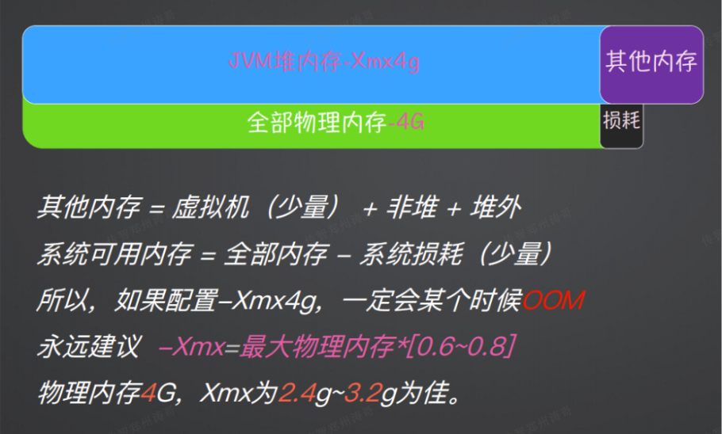
> 图注：这张图片是JVM内存配置相关的说明内容，核心围绕JVM堆内存的配置建议展开。图片上方直观呈现JVM堆内存（设置为-Xmx4g）、全部物理内存（4G），同时标注内存包含其他内存、存在损耗的组成关系。下方的文字明确给出内存相关的计算公式，同时强调配置-Xmx4g时一定会出现OOM的情况，重点提出永远建议-Xmx的取值为最大物理内存的0.6~0.8倍，当物理内存为4G时，-Xmx设为2.4g到3.2g为佳，用于指导JVM堆内存的合理配置，避免OOM问题的发生。

```Java
举例,物理内存4G, 运行JAR包时可指定堆内存参数
```

```Bash
java -Xmx3.2g -Xms1g -jar xxx.jar
```

### OOM问题排查

```Java
如何排查OOM问题
    检查OOM日志文件:查看错误日志或异常信息, 定位到具体的异常堆栈信息.
    使用内存分析工具:如Java的jmap、jstack、VisualVM等工具,分析内存快照以定位内存泄漏.
    进行代码审查:检查可能引起的内存泄漏的代码,如长时间持有对象、未关闭资源等
    增加日志和监控:使用合适的日志和监控工具,记录系统的内存使用情况及峰值

可能原因:
    对象过多:创建了大量对象并占用了大量内存
    内存泄漏:某些对象被错误地保持引用,使得无法被垃圾回收器回收
    不合理的内存设置:如分配给应用程序的内存不足导致OOM
    
如何复现一个内存溢出场景?复现内存溢出的场景可以通过以下方法:
    增加测试数据量: 模拟大量数据的输入,使得应用程序需要占用更多的内存.
    重复执行某些操作: 如循环读取文件或者对象进行不断修改等
    设置小的堆大小: 通过设置较小的堆大小,可以更容易触发OOM异常

内存溢出和内存泄漏的区别
    内存溢出:指应用程序在申请内存时,无法获得足够的内存空间,造成异常终止.常见的原因是使用了过多的对象并且没有妥善释放. 
    内存泄漏: 指应用程序中存在无用的对象占用内存,并且这些对象无法被垃圾回收器回收. 随着时间的推移,内存资源逐渐耗尽,最终导致内存溢出.
```

### JDK1.8的新特性

```Java
Lambda表达式:
    Lambda允许在Java中更简洁地使用函数式编程风格. 它提供了一种简洁的方式来表示匿名函数, 并使代码更易读、易写.
Stream API:
    Stream API 提供了一种用于处理集合和数组的声明式编程模型. 它使得可以更直观地操作数据集合, 如过滤、映射、排序等操作
新的日期与时间API:
     JDK1.8 引入了全新的日期和时间API(java.time包). 它提供了更好的日期、时间和时间间隔的方式. 并且修复了旧API中存在的许多问题
方法引用:
    方法引用允许通过方法的名称来引用已存在的方法. 这种方式常用于Lambda表达式,使代码更简洁、易读.
```

### Error和Exception的区别

```Java
Error 是由系统和JVM引起的严重问题,通常无法通过代码处理,程序应该终止.
Exception是由程序执行过程中的异常情况引起, 可以通过代码捕获并处理,有可能继续执行.
Error继承自java.lang.Error类,而Exception继承自java.lang.Exception类
```


## 二、集合

### Day04

### Java常用的集合

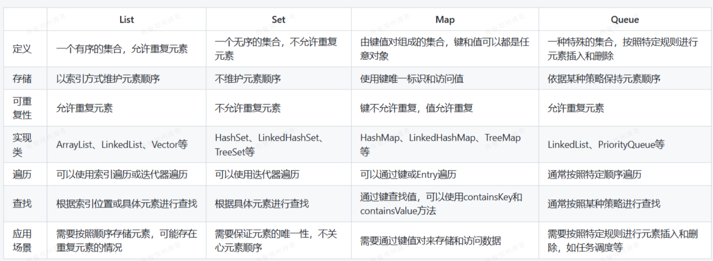
> 图注：这张图片是一张对比表格，展示了Java常用集合框架中List、Set、Map、Queue这四大集合的核心特性。表格从定义、存储、可重复性、实现类、遍历、查找、应用场景七个维度展开对比：List是允许重复元素的有序集合，典型实现类为ArrayList、LinkedList等，可按索引操作；Set不允许重复元素且为无序集合，代表实现有HashSet等；Map是由键值对组成的集合，键不允许重复，实现类包含HashMap、TreeMap等；Queue则是一种按特定规则进行元素插入和删除的特殊集合，如LinkedList、PriorityQueue。

```Bash
Collection 接口: Collection是集合List、Set、Queue的最基本接口
    List(列表): 按照元素插入的顺序保存元素,允许重复元素. 常见的有ArrayList、LinkedList等
    Set(集合): 不允许出现重复元素的无序集合. 常见的有HashSet、TreeSet等
    Queue(队列): 按照先进先出的(FIFO)的原则进行元素操作的集合.常见的有ArrayDeque、PriorityQueue等.
Map接口: 是映射表的基础接口
    Map(映射): 存储键值对(key-value) 的集合,根据唯一的键来查找和访问值. 常见的有HashMap、TreeMap等.
    
Iterator接口:迭代器,可以通过迭代器遍历集合中的数据
    Collection接口的实现类(如ArrayList、HashSet、LinkedList、PriorityQueue等) 都可以通过调用iterator()方法来获取一个迭代器.
    Map接口的实现类(如 HashMap、TreeMap等),它们并不直接实现Collection接口,而是提供了entrySet()和KeySet()等方法来返回一个可以迭代的集合.这些方法返回的集合对象实现了Collection接口,因此可以通过这些集合对象来获取迭代器
    Iterator接口是Java集合框架提供的一种用于遍历集合元素的通用方式. 它定义了一系列用于访问集合元素的方法,包括判断是否有下一个元素、获取下一个元素、删除当前元素等操作.
```

### HashMap底层原理

```Bash
JDK1.8及以后底层结构为:数组 + 链表 + 红黑树
HashMap是Java集合框架中一种基于哈希表实现的Map接口,它存储键值对,键是唯一的,而值可以重复. 它的底层结构是一个数组结构,在实际情况中,这个数组被分为多个"桶(bucket)",而每个桶内存储的是链表或红黑树(JDK1.8引入),具体使用哪种取决于链表的长度和当前Map的大小.
    默认参数:
        默认负载因子(load factor): 0.75. 负载因子是衡量HashMap满的程度的一个标注. 当HashMap中的元素达到容量与负载因子的乘积时,就会进行扩容.
        默认容量(capacity): 16, 必须是2的幂
    扩容机制:
        当HashMap中的元素数量达到treshold时, 即当前容量乘以负载因子,HashMap会进行扩容操作
        扩容操作会创建一个新的数组,其大小为原始数组大小的两倍,并重新计算每个键的哈希值和在新数组中的位置.
        这个过程涉及到重新计算每个键的哈希值,并将所有的键值对重新插入到新的数组中,因此扩容是一个比较耗费性能的操作
    数组:
        作用: 数组是HashMap存储元素的主要结构,每个数组元素是一个桶(bucket),可以存储一个或多个键值对(Entry).
        默认大小:默认初始容量为16(必须是2的幂).
        扩容机制:当HashMap中的元素数量到达容量与负载因子的乘积时,即size >= threshold (threshold = capacity * load factor), 数组会进行扩容操作,扩容为原来的两倍大小.
        
    对于默认的容量和负载因子，［threshold 的默认值是:
        threshold = 16 * 0.75 = 12
        这意味着当HashMap 中的元素数量达到 12 时，HashMap会进行扩容操作。扩容后的新容量是原容量的两倍为 36，同时 threshold 也会相应地更新为新的容量乘以负载因子。
        
    链表:
        作用: 当数组的同一个桶位置(即索引相同)发生哈希碰撞时,多个键值对会以链表的形式储存.JDK1.8之前,HashMap就是使用链表处理冲突;JDK1.8之后,当链表长度大于一定阈值时,链表会转换为红黑树.
        默认阈值: 链表转红黑树的阈值为8(当链表长度大于8时,会转换为红黑树)
        
    红黑树:
        作用: 为了提高HashMap的性能,当链表长度过长时,链表会被转换为红黑树.这样可以减少搜索时间,从O(n)降低到O(log n).
        默认阈值: 链表转回链表的阈值为6(当红黑树的节点数量小于6时,会转换回链表)
        
```

### HashMap为什么用红黑树


```Java
HashMap使用红黑树而不是用B树,是因为红黑树相对于B树在插入、删除和查找等操作上的平衡性更好,且红黑树的节点比B树的节点更小,占用的内存更少,适合存储在内存中的数据结构.
```

### HashMap什么时候扩容

- 在JDK1.7中,当HashMap中元素数量操作当前容量与负载因子(默认0.75)的乘积时,会触发扩容操作,扩容后的容量为当前容量的二倍.例如,初始容量为16,当元素数量达到12时会触发扩容,扩容后的容量为32
- 在JDK1.8中,HashMap的扩容和红黑树的转化是两个独立的操作,且顺序是先扩容,然后再进行红黑树的转换.当HashMap中的元素数量超过负载因子(默认0.75)与数组容量的乘积时,会触发扩容操作.扩容会重新计算调整数组的大小,并将原来数组中的元素重新分配到新的数组位置上. 扩容操作会导致原本哈希冲突较多的链表长度变长,因此当链表长度超过阈值(默认为8) 时,会将链表转化为红黑树. 综上所述,在JDK1.8中,HashMap的操作顺序是先扩容,然后再进行红黑树的转换. 扩容是为了减少哈希冲突,提高HashMap的性能和效率,而链表转红黑树的操作则是为了在特定情况下提供更好的查找、插入和删除元素的性能.

### HashMap的长度为什么是2的 N 次方

```Java
HashMap的长度选择为2 的N次方是为了 提高散列算法的效率和分布均匀性,通过使用2的幂次方作为长度,可以确保哈希码的高位和低位可以均匀参与到散列算法中,减少哈希冲突的发生,并提高散列算法的效率和性能.
```

### Day05

### HashMap和Hash Table区别

```Java
线程安全:
    HashMap: 非线程安全.
    HashTable: 线程安全,所有公共方法都是同步的.
Null值的处理:
    HashMap: 允许使用一个null键和多个null值
    HashTable: 不允许使用null或null值
性能:
    HashMap: 通常提供比HashTable更好的性能,因为它非同步
    HashTable: 由于同步,性能通常低于HashMap
```

### ConcurrentHashMap和HashMap的区别

ConcurrentHashMap 和 HashMap 是Java 中常用的两种 Map 实现，它们之间有以下几个区别:

1. 线程安全性：ConcurrentHashMap是线程安全的，多个线程可以同时对其进行读写操作而不需要额外的同步措施；而HashMap是非线程安全的，如果多个线程同时对其进行读写操作，可能会导致数据不一致或抛出异常。
2. 锁粒度：ConcurrentHashMap 通过分段锁（Segment） 实现并发访问的高效性。相比之下,HashMap 只能通过全局锁来保证线程安全性，因此在并发场景下性能较低。
3. 选代器弱一致性：ConcurrentHashMap的迭代器是弱一致的，即在迭代过程中可以容忍在迭代开始时已有的修改和在迭代期间的新增修改。HashMap的迭代器在迭代过程中如果发生结构性修改（例如增加或删除元素），会抛出 ConcurrentModificationException 异常。
4. 初始容量和扩容机制：ConcurrentHashMap在初始化时可以指定并发级别和初始容量，可以通过合理设置参数来提高并发访问的效率。而HashMap 默认的初始容量较小，加载因子较大，在元素数量达到一定阀值时会触发扩容操作，而扩容操作比较耗时。
5. null值和 null键： ConcurrentHashMap 中不允许存储 null 键和 null 值; 而 HashMap 允许存储一个null键和多个 null 值。

总体来说，ConcurrentHashMap 适用于高并发的场景，能够提供更好的性能和线程安全性；而HashMap 适用于单线程环境或者在已知不存在并发访问的情况下。选择使用哪种 Map 实现要根据具体的需求和场景进行权衡.

```Java
ConcurrcentHashMap是线程安全的并发哈希表, 支持高效地并发访问,而HashMap是非线程安全的哈希表,适用于单线程环境下的使用.
```

### ConcurrentHashMap和HashTable区别

```Java
ConcurrentHashMap和HashTable的区别在于并发性和线程安全性,
ConcurrentHashMap利用分段锁(Segment)实现高效的并发访问和更新,而HashTable使用全局锁(synchronized)来保证线程安全.
```

### ArrayList与LinkedList区别

```Java
数据结构:
    ArrayList: 基于动态数组实现.
    LinkedList: 基于双向链表实现.
性能:
    ArrayList: 随机访问速度快,时间复杂度为O(1);插入和删除操作较慢,时间复杂度为O(n).
    LinkedList: 插入和删除操作快,时间复杂度为O(1);随机访问慢,时间复杂度为O(n).
内存占用:
    ArrayList: 每个元素除了储存数据外,还需要额外储存索引位置信息.
    LinkedList: 每个元素除了存储数据外,还需要额外存储两个指针(指向前一个和后一个元素的引用).
```

### 遍历LIST有哪些方式

```Java
普通遍历: for(int = 0;i < arrays.size(); i++)
增强for遍历: for(String str : arrays)
forEach遍历: list.forEach((Str) -> xxxx)
使用Iterator迭代器遍历
java 8 的 Stream遍历
```

### Day06

### 数组 (Array) 和列表 (ArrayList) 区别

```Java
Array可以包含基本类型和对象类型,ArrayList只能包含对象类型.
Array大小是固定的,ArrayList的大小是动态变化的.
ArrayList处理固定大小的基本数据类型的时候,这种方式相对比较慢.
```

### 线程安全和有序的集合类

有序的集合类名包括:

TreeMap 基于红黑树实现的有序Map

LinkedHashMap 基于哈希表和双向链表实现的有序Map

TreeSet 基于红黑树实现的有序Set

LinkedHashSet 基于哈希表和双向链表 实现的有序Set

示例;

有序Map: TreeMap

有序List: LinkedList

有序Set: LinkedHashSet

ArrayList虽然是一个有序集合,但是它是按添加顺序进行排序而不是根据元素的值进行排序. 如果需要根据元素的值进行排序,应该使用TreeSet 或 TreeMap


线程安全的集合类有以下几种:

HashTable 所有public方法都加上了syschronized关键字,以确保线程安全.

ConcurrenttHashMap 线程安全的哈希表实现的Map

CopyOnWriteArrayList 线程安全的数组实现的List

ConcurrentSkipListSet 线程安全的跳表实现的有序Set

示例:

Map的例子: ConcurrentHashMap

List的例子: CopyOnWriteArrayList

Set的例子: ConcurrentSkipListSet

## 三、线程和锁

### 线程的状态

```Java
线程的状态包括: 新建(new)、就绪(Runnable)、运行(Running)、阻塞(Blocked) 、等待(Waiting)、超时等待(Timed Waiting)、终止(Terminated)
```

### 创建线程的方式

```Java
在Java中,创建线程有以下几种方式:
    集成Thread类
    实现Runnable接口
    使用匿名内部类
    使用Lambda表达式
这些都是Java中创建线程的常见方式,你可以根据具体需求选择适合的方式来创建线程.
```

### 线程池核心参数

```Java
corePoolSize => 线程池核心线程数量
maximumPoolSize => 线程池最大数量(包含核心线程数量)
keepAliveTime => 当前线程池数量超过corePoolSize时,多余的空闲线程的存活时间,即多次时间内会被销毁.
unit => keepAliveTime 的单位
workQueue => 线程池所使用的缓冲队列,被提交但尚未被执行的任务
threadFactory => 线程工厂, 用于创建线程,一般用默认的即可
handler => 拒绝策略,当任务太多来不及处理,如何拒绝任务
```

### Day07

### 如何创建线程池

在企业中: 不要使用Executors直接创建线程池,会容易出现OOM问题,要使用ThreadPoolExcutor构造方法创建,引用自《阿里巴巴开发手册》

<callout emoji="🎉">
[强制] 线程池不允许使用Executors 去创建,而是通过ThreadPoolExecutor的方法,这样处理方式让写的同学更加明确线程池的运行规则,规避资源耗尽的风险. 说明:
Executors返回的线程池对象的弊端如下:
1) FixedThreadPool 和SingleThreadPool:
允许的请求队列长度为Integer.MAX_VALUE , 可能会堆积大量的请求, 从而导致OOM.
2) CachedThreadPool: 
允许的创建线程数量为Integer.MAX_VALUE, 可能会创建大量的线程,从而导致OOM.
</callout>

创建线程池的方式一 : new ThreadPoolExecutor 方式

创建线程池的方式二 : spring 的 ThreadPoolTaskExecutor 方式

创建线程池的注意事项:

1. **线程池的大小**: 线程池的大小应根据任务的类型和系统资源进行合理的配置。如果线程池的大小过小，可能会导致任务排队等待执行，影响系统的响应性能；如果线程池的大小过大，可能会占用过多的系统资源，导致系统负载过重。可以通过监控和调整线程池的大小来优化性能。
2. **任务队列的选择**: 线程池通过会使用一个任务队列来保存待执行的任务, 任务队列的选择应根据任务的特性进行合理的选择. 如果任务较多且时间较短,可以选择无界队列(如 LinkedBlockingQueue); 如果任务较少且执行时间较长,可以选择有界队列(如ArrayBlockingQueue) 或者优先级队列(如PriorityBlockingQueue).
3. **线程池的拒绝策略:** 当任务无法被线程池接收执行时,需要定义适当的拒绝策略. 常见的拒绝策略有: 抛出异常(AbortPolicy)、丢弃任务(DiscardPolicy)、丢弃最早的任务(DiscardOrdersPolicy) 和调用者运行任务(CallerRunsPolicy).根据业务需求选择合适的拒绝策略.
4. **线程池的生命周期管理**: 线程池的生命周期包括初始化、执行任务和关闭. 在初始化时,需要设置线程池的参数; 在执行任务时,需要提交任务到线程池;在关闭时,需要调用线程池的shutdown()或shutdownNow()方法来关闭线程池, 并等待所有任务完成. 正确地管理线程池的生命周期可以避免资源泄漏和线程阻塞的问题.
5. **线程安全性**: 在自定义线程池时,需要考虑线程安全性. 多个任务并发执行时, 可能会涉及到共享资源的访问, 需要使用合适的同步机制来保证线程安全.

总之, 自定义线程池需要合理配置线程池的大小、选择适当的任务队列和拒绝策略, 正确管理线程池的生命周期, 并考虑线程安全性. 这些注意事项可以帮助我们设计高效、可靠的线程池.

### 线程池工作原理

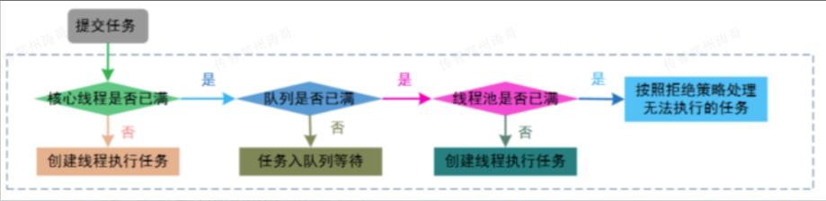
> 图注：图片展示了线程池执行任务的流程。当提交任务时，先判断核心线程是否已满，若未满则创建线程执行任务；若已满则判断队列是否已满，若未满则任务入队列等待；若队列已满且线程池未满，则创建线程执行任务；若队列和线程池均已满，则按照拒绝策略处理无法执行的任务。

线程池刚创建时, 里面没有一个线程. 任务队列是作为参数传进来的. 不过,就算队列里有任务,线程池也不会马上执行它们.

- 当调用Execute() 方法添加任务时, 线程池会做如下判断:
- 如果正在运行的线程数量小于corePoolSize, 那么马上创建线程运行这个任务;
- 如果正在运行的线程数量大于或等于 corePoolSize, 那么将这个任务放入队列;
- 如果这时候队列满了,而且正在运行的线程数量小于 maximumPoolSize,那么还是要创建非核心线程立刻运行这个任务;
- 如果队列满了, 而且正在运行的线程数量大于或等于maximumPoolSize,那么线程池会抛出异常RejectExecutionException.

当一个线程完成任务时, 它会从队列中取下一个任务来执行.

当一个线程无事可做,超过一定的时间(keepAliveTime)时,线程池会判断,如果当前运行的线程数大于 corePoolSize,那么这个线程就被停掉. 所以线程池的所有任务完成后,它最终会收缩到corePoolSize的大小.

### 线程池大小如何设定

```Java
生产环境中,Java线程池大小的设定与硬件资源和并发请求需求密切相关.通常可以考虑CPU核心数、内存容量、网络带宽等硬件资源, 并结合预估的并发请求量来确定线程池大小,可以充分利用资源并保持合理的并发处理能力. 较多的硬件资源和高并发通常需要更大的线程池来提高并发处理效率.
```

### 线程池的拒绝策略有哪些

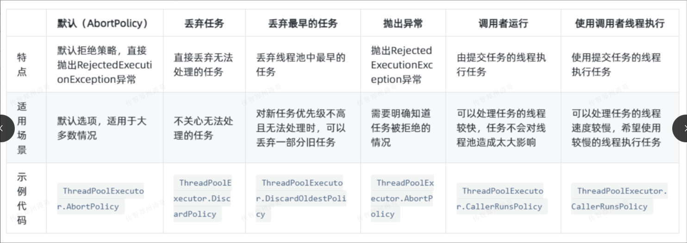
> 图注：图片是一张表格，对比了线程池的5种拒绝策略。从左至右依次为默认（AbortPolicy）、丢弃任务、丢弃最早的任务、抛出异常、调用者运行。每种策略对应特点、适用场景、示例代码等内容。如默认策略适用于大多数情况，示例代码为ThreadPoolExecutor.AbortPolicy；丢弃任务适用于不关心无法处理任务的情况，示例代码为ThreadPoolExecutor.DiscardPolicy等。该表与文档中介绍线程池拒绝策略的内容相关，直观呈现了各策略特点及适用场景。

```Java
线程池的拒绝策略有四种：
AbortPolicy(默认方式，中止并抛出RejectedExecutionException 异常）、CallerRunsPolicy(使用调用线程来执行被拒绝的任务）、DiscardPolicy(默默地丢弃被拒绝的任务）以及 DiscardOldestPolicy（丢弃最早被添加到队列的任务，然后尝试重新提交新任务）。
如果希望快速失败并将异常传递给调用者，则选择AbortPolicy。如果希望尽可能保证任务的执行而不堆积在队列中，则选择 CallerRunsPolicy。如果对任务的丢失情况不敏感，则选择 DiscardPolicy。而如果希望尽可能保留最新的任务而不是旧的任务，则选择DiscardOldestPolicy.
```

### 是否所有微服务都使用同一个线程池

```Java
每个微服务用一个线程池,避免不通过业务模块的线程池彼此间的相互影响. 不至于出现某个服务的线程池出现的问题导致其他服务的线程池不可用.
```

### Day08

### synchronized 和 lock 的区别？

```Java
synchronized 和Lock的区别是: synchronized是Java关键字,是内置的同步机制,能修饰方法或代码块,锁的获取是隐式的,底层实现原理是基于JVM内置监视器锁; 而Lock是一个接口,提供更灵活的同步机制,可以手动控制锁的获取和释放,底层实现可以是ReentrantLock等,性能在高竞争环境下通常较好.
```

### synchronized的锁种类

```Java
synchronized的锁种类,主要分类锁和对象锁,具体是那种锁,分为以下这些情况:
    类锁- 当synchronized用在这些地方时: 静态方法、静态代码块、类的变量
    对象锁- 当synchronized用在这些地方时: 非静态方法、非静态代码块、this
```

### 什么情况下会产生死锁，如何解决

```Java
产生死锁的情况是在多线程程序中, 每个线程都持有一些资源,并且等待其他线程释放它所需的资源. 解决死锁可以采用以下方法: 
避免死锁的发生,通过破坏死锁产生的四个必要条件之一来预防; 
检测死锁,使用算法检测出是否出现死锁,并采取相应的措施解除死锁; 
恢复死锁,即进行资源的强制抢占或进行回滚操作,将进程回退到安全状态以解除死锁.
```

### ThreadLocal是一个什么样的技术

```Java
ThreadLocal是一种Java技术，它允许在多线程环境中维护线程私有的变量副本。底层实现会使用一个类似于 Map的结构来存储每个线程的变量副本。ThreadLocal并不是强引I用或弱引I用，它使用弱引1用作为键来维护各个线程的变量副本，但变量本身由线程强引l用。在使用ThreadLocal时，可能会出现内存泄漏的问题。如果线程结束了，但ThreadLocal中的变量没有被手动清理，那么该变量会一直存在于ThreadLocal 的 Map 中，导致内存泄漏。解决这个问题的常见方式是在使用完ThreadLocal后调用removeO方法将变量从ThreadLocal中移除，或者使用Java 8中的ThreadLocal的InitiaIValue方法来提供默认值。另外，也可以使用ThreadLocal的弱引I用方式来解决内存泄漏问题，例如使用InheritableThreadLocal.
```

### 悲观锁和乐观锁的区别

悲观锁：认为自己在使用数据的时候一定有别的线程来修改数据，在获取数据的时候会先加锁，确保数据不会被别的线程修改。

锁实现：关键字 synchronized、接口 Lock 的实现类

适用场景：写操作较多，先加锁可以保证写操作时数据正确

乐观锁：认为自己使用数据时不会有别的线程修改数据，所以不会添加锁，只是在更新数据的时候去判断之前有没有别的线程更新了这个数据

锁实现1：CAS 算法， CAS 即 Compare And Swap，是一种更新的原子操作，比较当前值跟传入值是否一样，一样则更新，否则返回 false，不进行任何操作；例如 Actomiclnteger类的原子自增是通过 CAS自选实现。

锁实现 2：版本号控制：数据表中加上版本号字段version，表示数据被修改的次数。当数据被修改时，这个字段值会加1，提交必须满足＂提交版本必须大于记录当前版本才能执行更新＂的乐观锁策略适用场景：读操作较多，不加锁的特点能够使其读操作的性能大幅提升

## 四、Web

### Day09

### TCP和UDP的区别

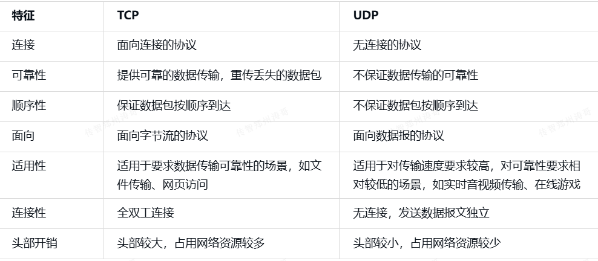
> 图注：这张图片展示了TCP与UDP协议的对比表格，以“特征”为表头分为左右两栏，分别对应TCP和UDP的各项参数。表格涵盖连接、可靠性、顺序性等共8项关键特征：TCP为面向连接的协议，提供可靠数据传输，而UDP是无连接协议，不保证传输可靠性；在适用性方面，TCP适用于对可靠性要求高的文件传输、网页访问场景，UDP则多用于对传输速度要求高、可靠性要求低的实时音视频传输、在线游戏场景；此外两者在连接性、头部开销等细节上也有明显差异，清晰呈现了两种传输协议的核心区别。

```Java
TCP是一种面向连接的、可靠的协议,它保证数据的顺序和完整性,适用于要求数据传输可靠性的场景.UDP是一种无法连接的、不可靠的协议,传输速度快,适用于对传输速度要求较高,对可靠性要求较低的场景.
```

### 常见的HTP响应状态码

| 状态码 | 类别 | 描述 |
|-|-|-|
| 1xx | 信息状态码 | 服务器收到请求,需要请求者继续执行操作 |
| 2xx | 成功状态码 | 请求被成功接收、理解和接受,比如:200-请求成功,201-已创建 |
| 3xx | 重定向状态码 | 需要进一步的操作以完成请求,比如:301-永久重定向,302-临时重定向 |
| 4xx | 客户端错误状态码 | 服务器无法处理请求,客户端出现错误,比如:401-请求需要认证,403-请求的对应资源禁止被访问,404-服务器无法找到对应资源 |
| 5xx | 服务器错误状态码 | 服务器处理请求时发生错误,比如:500-服务器内部错误,502-错误的网关,503-服务不可用 |

### GET和POST的区别

| 特征 | GET | POST |
|-|-|-|
| 参数 | 通过URL传递参数 | 通过请求体传递参数 |
| 安全性 | 不安全,因为参数可见URL | 相对安全,参数不可见于URL |
| 缓存 | 可以被缓存 | 不能被缓存 |
| 数据长度限制 | 有限制,因为URL长度有限 | 无限制 |
| 安全性 | 适合用于无副作用的请求,如搜索 | 适合用于有副作用的请求,如表单提交 |
| 可见性 | 参数可见于URL | 参数不可见于URL |
| 用途 | 适合用于获取数据 | 适合用于提交数据 |

```Java
GET用于从服务器获取数据,将数据附加在URL上发送,对数据长度有限制;
POST用于服务器提交数据,将数据放在请求体中发送,数据长度没有限制.
```

### Cookie和Session的区别

| 特征 | Cookie | Session |
|-|-|-|
| 储存位置 | 储存在客户端 | 储存在服务器 |
| 安全性 | 相对较低 | 相对较高 |
| 大小限制 | 有大小限制 | 一般无限制 |
| 过期时间 | 可以设置过期时间 | 会话结束或超时后过期 |
| 数据存储 | 存储在客户端,可以被篡改 | 储存在服务器端,相对安全 |
| 传输方式 | 储存在请求头中,随请求发送到服务器 | 储存在服务器端,通过会话ID进行传输 |

```Java
Cookie是储存在客户端的数据,可以被客户端修改,有大小限制,且可以设置过期时间. Session是储存在服务器端的数据,通过会话id进行传输,更安全,且通常没有大小限制,过期时间由服务器控制.
```

### 过滤器和拦截器的区别

| 区别 | 过滤器 | 拦截器 |
|-|-|-|
| 原理 | 基于回调实现 | 基于动态代理实现 |
| 触发时机 | 在请求到达目标资源之前触发,过滤器在Servlet前后执行 | 在请求到达目标资源之后触发,拦截器在handler前后执行 |
| 使用范围 | 通常用于过滤请求和响应,过滤器主要用于过滤请求中无效参数,安全校验 | 可以用于检查权限、日志记录、异常处理等 |
| 实现方式 | 通常基于Servlet规范实现 | 可以基于AOP、动态代理等方式实现 |
| 应用场景 | 能够对请求进行预处理和后处理 | 可以进行更灵活的业务逻辑处理 |
| 灵活性 | 相对较低,只能对请求和响应进行处理 | 相对要求较高,可以对请求、响应、异常等进行处理 |
| 执行顺序 | 可以有多个过滤器,按照配置顺序执行 | 一般只有一个拦截器,按照配置顺序执行 |

```Java
过滤器是在请求到达目标资源之前进行预处理和后处理,通常用于过滤请求和响应,适合对请求和响应进行统一处理的场景,比如过滤请求中无效参数,安全校验;拦截器是在请求到达目标资源之后进行处理,可以用于权限检查、日志记录、异常处理等,适合需要更灵活的业务逻辑处理的场景
```

## 五、设计模式

### Day10

### 单例模式的几种写法

```Java
单例模式的核心定义
保证一个类仅有一个实例，并提供一个该实例的全局访问点。核心是：
    私有构造方法 + 静态实例 + 静态获取方法。
```

懒加载 -懒汉模式

```Java
public class Singleton {
    private volatile static Singletoninstance;
    private Singleton(){    
    }
    
    public static Singleton getInstance(){
        if(instance ==null){//第一次检查
            synchronized(instance == null){
                if(instance == null){ // 第二次检查
                    instance = new Singleton();
                }
            }
        }
        return instance;
    }
}
```

```Java
使用双重检查实现了线程安全的单例模式.getInstance()方法首先检查instance是否为null,如果为null,则进入同步块.在同步块内部,再次检查instance 是否为null,这是为了防止多个线程同时通过第一次检查,然后一个线程创建了实例,而另一个线程又创建了一个实例的情况发生.
使用双重检查锁可以保证线程安全的前提下,减少锁的竞争,提高性能.但需要注意的是,使用双重检查锁需要将instance声明为volatile类型,以确保多线程环境下的可见性
```

预加载-饿汉模式

```Java
public class Singleton {
    private static final singleton instance = new Singleton();
    private singleton({
    }
    public static singleton getInstance(){
        return instance;
    }
}
```

静态内部类模式

```Java
public class Singleton{
    private static final Singleton instance = new Singleton();
    private Singleton(){
    }
    
    public static Singleton getInstance(){
        return Instance;
    }
}
```

枚举模式

```Java
public enum Singleton{
    /**
    * 单例示例
    */
    public void doSomeThing(){
        System.out.println("done")
    }
}
```

> 单元素的枚举类型是实现Singleton 的最佳方法


### Spring中的设计模式有哪些

```Java
工厂模式: Spring 使用工厂模式通过BeanFactory和ApplicationContext创建bean对象.
单例模式: Spring 中的bean默认都是单例的
代理模式: Spring 的AOP功能用到了 JDK的动态代理和CGLIB字节码生成技术
```

### MyBatis中有哪些设计模式

```Java
工厂模式: 例如SqlSessionFactory、ObjectFactory、MapperProxyFactory;
单例模式: 例如ErrorContext和LogFactory;
代理模式: Mybatis实现的核心,比如MapperProxy、ConnectionLogger,用的jdk的动态代理; 还有executor.loader包使用了cglib或者javassist达到延迟加载的效果;
```

## 六、Mysql

### 数据库的ACID特性

```Java
原子性(Atomicity): 事务中的操作要么全部成功,要么全部失败.事务是一个不可分割的单元,要么全部执行,要么全部回滚.如果事务中的任何操作失败,所有的操作都会被回滚到事务开始之前的状态,可以保证数据的一致性.
一致性(Consistrncy): 事务的执行应使数据库从一个一致性转移到另一个一致性的状态.在事务开始和结束时,数据库的完整性约束应得到满足,确保数据的正确性和一致性.
隔离性(Isslation): 每个事务在执行过程中都应该与其他事务隔离.并发事务的执行应当互不干扰,每个事务应该感知不到其他事务的存在或并发执行.隔离级别定义了不同事务之前的可见性和互相影响的程度.
持久性(Durability): 一旦事务提交成功,其对数据库的修改应该永久保存,即使系统发生故障或重启,也应该能够保持数据的持久性.
```

> 最简回答: ACID特性是指原子性(Atomicity)、一致性(Consistrncy)、隔离性(Isolation)和持久性(Durability), 用于保证数据库事务的可靠性和一致性

### MySQL存储引擎


> 图注：图片是一张关于MySQL存储引擎InnoDB和MyISAM特性的对比表格。表格分为事务、并发、外键、备份、崩溃恢复、其他六个类别。InnoDB在事务上为事务型，支持行级锁和外键，有在线热备，崩溃恢复概率低，其他有聚簇索引、MVCC特性；MyISAM为非事务型，支持表级锁，不支持外键和备份，崩溃恢复慢且易丢失，其他有压缩表、空间数据索引。此图与文档中介绍MySQL存储引擎的内容相关，直观呈现了两者特性差异。

```Java
Mysql默认是Innodb存储引擎,适合比较庞大的应用场景
    InnoDB: Mysql5.6版本默认的存储引擎.InnoDB是一个事务安全的存储引擎,它具备提交、回滚以及崩溃恢复的功能以保护用户数据.InnoDB的行级别锁定以及Oracle风格的一致性无锁读提升了它的多用户并发数以及性能. InnoDB 将用户数据存储在聚集索引中以减少基于主键的普通查询所带来的I/O开销.为保证数据完整性,InnoDB还支持外键约束
    MyISAM: MyISAM即不支持事务、也不支持外键、其优势是访问速度快,但是表级别的锁定限制了它在读写负载方面的性能,因此它经常应用于只读或者以读为主的数据场景.
```

> 最简回答: InnoDB是Mysql的默认存储引擎,支持事务处理、行级锁和外键; 而MyISAM不支持事务、只有表级锁,并且不支持外键.


## Day11

### 数据库的事务隔离级别

**SQL标准定义了四个隔离级别:**

**READ-UNCOMMITTED(读取未提交):** 最低的隔离级别,允许读取尚未提交的数据变更,肯能引发脏读、幻读或不可重复读.

**READ-COMMITTED(读取已提交):** 允许读取并发事务已经提交的数据,可以阻止脏读,但是幻读或不可重复读仍有可能发生

**REPEATABLE-READ(可重复读):** 对同一字段的多次读取结果都是一致性的,除非数据是被本身事务自己所修改,可以阻止脏读和不可重复的,但幻读仍有可能发生.

**SERIAALIZABLE(可串行化):** 最高的隔离级别,完全服从ACID的隔离级别.所有的事务依次逐个执行,这样事务之间就完全不可能产生干扰,也就是说,该级别可以防止脏读、不可重复读以及幻读.

| 隔离级别 | 脏读 | 不可重复读 | 幻读 |
|-|-|-|-|
| READ-UNCOMMITTED | ✅️ | ✅️ | ✅️ |
| READ-COMMITTED | ❌️ | ✅️ | ✅️ |
| REPEATABLE-READ | ❌️ | ❌️ | ✅️ |
| SERIALIZABLE | ❌️ | ❌️ | ❌️ |

事务隔离级别越严格,数据库效率越低.Mysql默认的事务隔离级别是: REPEATABLE-READ可重复读级别,简称RR级别,但是会出现幻读问题.

> 最简回答: 数据库事务隔离级别是指多个并发事务同时执行时,各个事务之间的隔离程序,常见的隔离级别有读未提交(Read Uncommitted)、读以提交(Read Committed)、可重复读(Repeatable Read)和串行化(Serializable).

### 索引的种类

```Java
从数据结构角度
    树索引(O(log(n)))
    Hash 索引
从物理存储角度
    聚集索引(clustered index)
    非聚集索引(non-clusterd index)
从逻辑角度
    普通索引
    唯一索引
    主键索引
    联合索引
```

### 索引会失效的情况有哪些

```Java
索引参数表达式计算
函数运算
%词语% 模糊查询
字符串与数字不走索引
查询条件中有or ,即使其中有条件带索引也不会使用. 换而言之,就是要求使用的所有字段,都必须建立索引
正则表达式不使用索引
    以 ^ 开头的前缀匹配，能利用 B + 树的有序性，从根节点定位前缀范围,反之任意在其他位置破坏了索引 “有序性” 正则会失效
```

### MySQL索引底层原理

MySQL的索引底层结构是B+树.


B+ 树是一种平衡多路搜索树,具有以下特点:

1. 所有关键字保存在叶子节点,并且叶子节点之间通过链表连接,形成一个有序的叶子节点序列
2. 非叶子节点只存储索引字段的值和子节点的指针,不保存实际的数据.这样可以使得一个节点可以存储更多的关键字,减少了树的高度,加快搜索速度.
3. 叶子节点包含所有索引字段的值和互相对应数据的指针


在B+树索引中,每个节点的大小是固定的,与磁盘页的大小相当. 节点的大小通常的是数据库的大小,例如16KB或32KB.每个节点可以存储多个关键字和指针.叶子节点的关键字是有序的,且通过链表链接在一起.


索引查询快的原因有以下几点:

1. 路径长度短: B+ 树具有平衡性,所以叶子节点的深度相同,因此在查询过程中只需沿着树的高度进行几次磁盘I/O操作,所以查询速度较快.
2. 顺序访问优势: B+树的叶子节点之间使用链表连接,并且叶子节点的关键字是有序的,因此对于范围查询操作,可以通过顺序扫描叶子节点来获取有序的数据结果,提高查询速度
3. 最小化磁盘I/O操作: B+树具有较高的填充因子,每个磁盘页上存储的关键字数量较多,能够减少磁盘I/O操作的次数,提高查询效率.


综上所述,B+树的平衡性、有序的叶子节点、顺序访问以及最小化的磁盘I/O操作是使得索引查询快速的关键因素.通过B+树的数据结构和索引的建立,可以大幅度减少磁盘访问次数,提高数据库查询的效率.

>  最简回答: MySQL索引底层原理使用了B+树数据结构,它是一种平衡树,能够快速定位和检索数据;B+树的叶子节点储存实际数据,中间节点储存索引,通过减少磁盘I/O来提高查询效率;索引按照值的大小顺序排列,使得范围查询效率更高.

### 聚集索引与非聚集索引

InnoDB聚集索引的叶子节点存储行记录,因此,InnoDB必须要有,且只有一个聚集索引:

1. 如果表定义了PK,则PK就是聚集索引;
2. 如果表没有定义PK,则第一个not NULL unique列是聚集索引;
3. 否则,InnoDB会创建一个隐藏的row-id作为聚集索引;

> 所以PK查询非常快,直接定位行记录.


聚集索引

聚集索引,又叫聚簇索引,所有的数据都存在聚集索引上,叶子节点直接对应数据,从中间级的索引页的索引行直接对应数据页.

InnoDB储存引擎中的主键默认就会创建一个聚集索引,每张表只能创建一个聚集索引.记录的索引顺序与物理顺序相同,更适合between and 和 order by 操作


非聚集索引

非聚集索引,又叫非聚簇索引、辅助索引,所有的数据和索引的目录都是分开存的,叶子节点不存放具体的整行数据(叶子节点不直接指向数据页),而是存储的这一行的主键的值.

记录的索引顺序与物理顺序无关.每张表可以有多个非聚集索引,需要更多磁盘和内存,多个索引会影响insert 和update的速度.


举例：

表中有四条记录：

1, shenjian, m, A:

3, zhangsan, m, A

5, lisi, m, A

9, wangwu, f B

<grid>
<column width-ratio="0.468303">
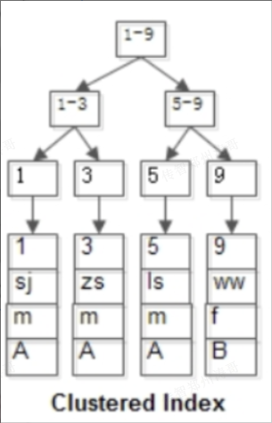
> 图注：图片展示了InnoDB聚集索引的B+树结构示例。图中以1 - 9为根节点，分为1 - 3和5 - 9两个子节点，再分别对应1、3、5、9等具体记录。每个记录包含id、name、sex、grade等字段信息。该图与上下文紧密相关，直观呈现了聚集索引中数据存储与索引结构的关系，帮助理解聚集索引将所有数据存储在索引上，叶子节点直接对应数据，从中间级索引页的索引行直接对应数据页的特点。

</column>
<column width-ratio="0.531697">
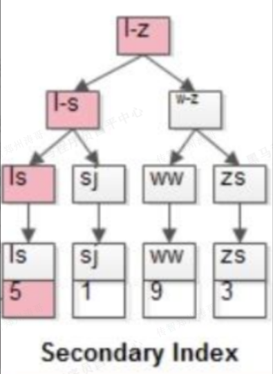
> 图注：图片展示了非聚集索引的B+树结构。图中“l-z”为根节点，下分“l-s”和“w-z”两个子节点，再分别有“l”“s”“w”“z”等子节点，最底层为“5”“1”“9”“3”等叶子节点。该图与上下文介绍的非聚集索引内容相关，说明非聚集索引的叶子节点不存放具体的整行数据，而是存储这一行的主键值，如图中叶子节点存储的id值。

</column>
</grid>


两个B+树索引分别如上1图和2图:

1. id为pk,聚集索引,叶子节点存储行记录
2. Name 为KEY,非聚集索引,叶子节点存储PK值,即id;


## Day12

### MySQL回表查询

既然从普通索引无法直接定位行记录,那么普通索引的查询过程是怎么样呢?

通常情况下,需要扫描两遍索引树.

例如

```SQL
select * from t where name = 'list';
```

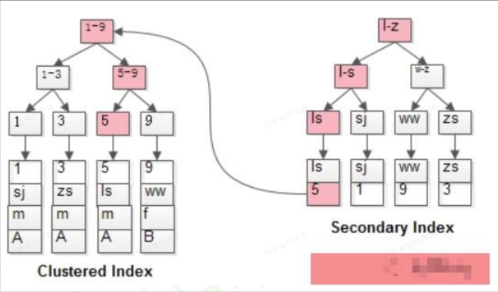
> 图注：图片展示了MySQL中主键索引（Clustered Index）和非主键索引（Secondary Index）的结构。左侧是主键索引，以数字1 - 9为索引，每个数字对应一行记录，记录包含字母和数字。右侧是非主键索引，以字母I - Z为索引，每个字母对应一行记录，记录包含数字。图片中粉红色部分突出显示了主键值id=5对应的行记录，直观呈现了回表查询中先定位主键值再定位行记录的过程，与上下文对回表查询的解释相呼应。

如粉红色路径,需要扫描两遍索引树:

1. 先通过普通索引树定位到主键值id=5;
2. 再通过聚集索引定位到行记录;

这就是所谓的回表查询,先定位主键值,再定位行记录,它的性能较扫一遍索引树更低


注意,什么是索引覆盖?只需要在一棵索引树上就能获取SQL所需的所有列数据,无需回表,速度更快.

不如:

```SQL
select id,name from user where name = 'shenjian';
```

### MySQL最左匹配原则

MySQL联合索引遵循最左前缀匹配原则,即最左优先,查询的时候会优先匹配最左边的索引.

例如当我们在(a,b,c)三个字段上创建联合索引时,实际上是创建了三个索引,分别是(a)、(a,b)、(a,b,c).

查询条件中包含这些索引的时候,查询就会用到索引.例如下面的查询条件,就可以用到索引:

```SQL
select * from table_name where a = ?;
select * from table_name where a = ? and b = ?;
select * from table_name where a=? and b = ? and  c = ?;
```

其他查询条件不包含这些索引的语句,就不会用到索引,例如:

```SQL
select * from table_name where b = ?;
select * from table_name where c = ?;
select * from table_name where b = ? and c = ?;
```

> 如果查询的条件包含(a,c),也会用到索引,相当于用到了(a)索引.

### count(\*)、count(1)和count(列)

```SQL
count(*)是直接统计所有记录的行数,无需对任何列进行计算,因此最快.
count(1)比count(列名)快的原因是,1是一个常量,不需要计算,而coun(列名)需要对指定列进行计算,增加了额外的计算开销
count(字段)在实际情况中却经常比count(*)和count(1)慢,因为还需要对指定列进行计算,并且如果指定列含有NULL值,就会被忽略掉,影响了统计的准确性

结论,效率由高到低排序;
    a.count(*)最快
    b.count(1)快
    c.count(字段)慢
```

###  MySQL优化方案

```SQL
服务器优化(增加 CPU、内存、网络、更换高性能磁盘)。
表设计优化 (字段长度控制、添加必要的索引)。 
SQL 优化 (避免 SQL 命中不到索引I的情况)
架构部署优化 (一主多从集群部署)
分库分表 (垂直分库、水平分表)。
编码优化实现读写分离
```

### SQL优化方案

1. 优化查询条件

使用索引:确保所有涉及到的列都有适当的索引

```SQL
select * from table where column = 'value';
create index idx_column on table(column);
```

避免模糊查询: %开头的通配符会使索引失效,尽量避免在查询条件中使用%开头的like语句

```SQL
select * from table where column like 'value%'
```

1. 使用合适的数据类型

使用最小可能的数据类型:选择最合适的数据类型,不要使用比实际需要更大的数据类型.

```SQL
create table example(column int,column2 varchar(50));
```

避免使用储存过大的数据类型:避免使用TEXT、BLOB等存储过大的数据类型,因为他们会占用更多的储存空间和I/O操作.

1. 减少查询次数

使用JOIN查询:通过优化JOIN语句,避免使用多个单表查询

```SQL
select * from table1 inner join table2 on table.id = table2.id;
```

使用批量操作:合并多个相似的操作作为一个更大的操作,减少多次查询和事务提交.

```SQL
insert into table (column1,column2) values (value1,value2),(value3,value4),...;
```

1. 优化索引

检查索引使用情况:通过explain或其他性能分析工具,检查查询是否使用了适当的索引.

```SQL
explain select * from table where column = 'value';
```

-删除不必要的索引: 移除未使用或被其他索引覆盖的冗余索引,减少索引维护的开销.

1. 避免使用select \*

明确列出所需的列:只选择需要的列,避免不必要的数据传输和处理

```SQL
select column1,column2 from table;
```

## Day13

### 如何设计数据库表

```SQL
数据库设计规范
    根据业务模块拆分数据库(业务模块垂直分库)
    同一业务模块的表在一个数据库里
表设计规范
    表名、字段名全部小写英文带下划线
    字段类型长度根据实际需求选择
    设计基础字段(主键ID、时间、逻辑删除、版本)
    添加必要冗余字段
    添加必要索引(常用于查询的单字段或组合索引),单表索引建议控制在5个以内
    规划分表(单表超500万行或容量超2G才分表)
```

### MySQL常用函数

```SQL
数字函数
    聚合函数: avg、sun、count、min、max
    绝对值: ABS(x)
    取余: MOD(x,y)
日期函数
    系统当前时间: NOW()
    日期转换字符串: DATE_FORMAT(date,format)
    字符串转日期: STR_TO_DATE(str,format)
    日期间隔天数: DATEDIFF(date1,date2)
字符串函数:
    拼接字符串: CONCAT(s1,s2...sn)
    截取字符串: SUBSTR(s,start,length)
    替换字符串: REPLACE(s,s1,s2)
```

### MySQL三大日志文件

```SQL
Redo log(重做日志) 用于保证事务的持久性,它在事务提交前将数据写入磁盘,以防止数据丢失
Undo log(回滚日志) 用于事务的回滚操作,它记录了事务对数据的修改,以便在事务回滚时进行数据恢复
Binlog(二进制日志) 记录了数据库的所有修改操作,包括对数据的增删改操作,用于数据恢复、复制和灾难恢复.
Redo log和Undo log是InnoDB存储引擎特有的日志,而Binlog是MySQL服务器层的日志
```

## 七、Redis

### Redis为什么快

```SQL
Redis 之所以快是因为它采用了内存存储和非阻塞的I/O模型,避免了磁盘IO的延迟;同时,Redis使用了IO多路复用技术,通过一个线程同时处理多个客户端请求,减少了线程切换的开销,提高了并发处理能力
```

### Redis可以用来做什么

```SQL
缓存
排行榜
分布式计数器
分布式锁
消息队列
分布式Token
限流
```

## Day14

### Redis的持久化机制

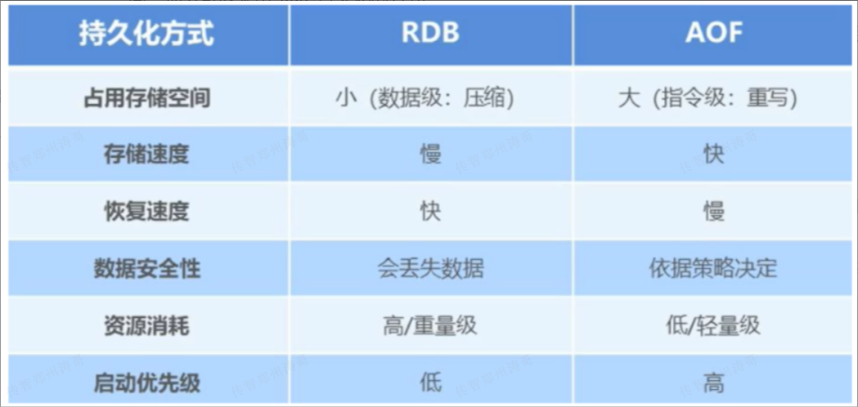
> 图注：这张图是Redis持久化方式对比表，展示了RDB与AOF两种持久化方式在多个维度的差异。具体来看，在占用存储空间上，RDB小（为数据级压缩），AOF大（为指令级重写）；存储速度方面，RDB慢，AOF快；恢复速度上，RDB快，AOF慢；数据安全性上，RDB会丢失数据，AOF则依据策略决定；资源消耗方面，RDB为高/重量级，AOF为低/轻量级；启动优先级上，RDB低，AOF高，这份对比表能帮助用户结合业务需求选择适合的持久化方式，和文档中介绍的选择RDB或AOF的内容相呼应。

在`Redis`4.0 之后提供了混合持久化的方式，顾名思义就是把 `RDB `持久化和 `AOF`持久化结合起来的一种方式。混合持久化就是快照以一定的频率执行，而在两次快照之间，使用`AOF`日志记录这期间的所有命令操作。

**选择RDB还是AOF？**

- 如果你的业务场景需要很高的性能，或者宕机之后能够尽快的恢复，而对数据完整性的要求不是那么高，那么可以采用 `RDB `持久化的方式。
- 如果你的业务场景对数据完整性的要求很高，那么可以采用`AOF`的持久化方式，而至于采用那种回写策略，则取决于你对数据完整性的要求程度。
- 如果你的业务场景既要兼顾性能，又注重数据完整性，那么可以采用混合持久化的方式。·如果你对数据丢失无所谓，追求性能最大化的情况下，甚至可以禁用持久化。

```SQL
RDB是Redis的快照持久化方式，通过周期性的快照将数据保存到硬盘，占用更少的磁盘空间和CPU资源，适用于数据备份和恢复，但可能存在数据丢失的风险。AOF是追加日志持久化方式，将每个写操作以追加的方式记录到日志文件中，确保了更高的数据完整性和持久性，但相对于RDB消耗更多的磁盘空间和写入性能，适用于数据持久化和灾难恢复，且可以通过配置实现不同的同步频率。
```

### Redis常用的数据类型

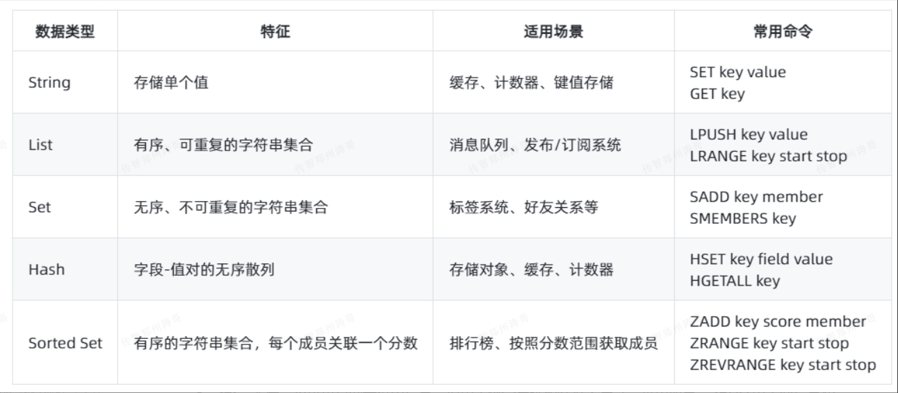
> 图注：这张图片是一张表格，对应“Redis常用的数据类型”相关内容，清晰呈现了Redis常见的五种数据类型信息，每一行对应一种数据类型。表格的列包含数据类型、特征、适用场景、常用命令四项，其中数据类型包括String、List、Set、Hash、Sorted Set，每类数据都标注了明确的特性，如String用于存储单个值、Sorted Set是关联分数的有序集合，也明确了各自适用的场景及对应常用命令，和文档中介绍String、List、Set类型的上下文内容相呼应，补充了另外两种Redis常用数据类型的相关信息。

- **String**：存储单个值，适用于缓存和键值存储，常用命令：SET用于设置值，GET用于获取值。
- **List**：有序、可重复的字符串集合，适用于消息队列和发布/订阅系统，常用命令：LPUSH用于从列表左侧添加元素，LRANGE用于获取指定范围的元素。
- **Set**：无序、不可重复的字符串集合，适用于标签系统和好友关系等，常用命令：SADD 用于向集合添加成员，SMEMBERS用于获取集合所有成员。
- **Hash**：字段-值对的无序散列，适用于存储对象、缓存和计数器，常用命令：HSET用于设置字段值， HGETALL 用于获取散列的所有字段和值。
- **Sorted Set**：有序的字符串集合，每个成员关联一个分数，适用于排行榜和按分数范围获取成员，常用命令：ZADD用于添加成员及其分数，ZRANGE用于获取指定范围的成员。

### Redis的缓存雪崩、缓存穿透、缓存击穿

**缓存穿透**

缓存穿透：缓存中和数据库中都没有所查询的东西，从而使数据库崩掉。

解决方案：将一条数据库不存在的数据也放入缓存中这样即使数据库不存在但缓存中有，还可以使用布隆过滤器。

**缓存击穿**

缓存击穿：缓存中没有但数据库中有，如果同一时间访问量过大会使数据崩掉。

解决方案：加分布式锁，一条数据访问数据库；将数据存储到缓存中，其他线程从缓存中拿。

**缓存雪崩**

缓存雪崩：缓存中的数据正好在一个时间删除，当请求来时穿过缓存访问数据库。

解决方案:

设置合理的缓存失效时间：针对不同的业务需求，设置不同的缓存失效时间，避免缓存同时失效，引发雪崩效应。

设置缓存锁：在缓存失效时，设置一个短暂的锁定时间，只允许一个请求查询数据库并刷新缓存，其他请求等待锁释放后再读取缓存。

```SQL
缓存穿透可以通过使用布隆过滤器来快速判断请求的Key是否合法，避免查询不存在的数据。
缓存击穿可以通过使用互斥锁来保护数据库查询，确保只有一个线程能够查询数据库并写入缓存，避免多个并发请求同时访问数据库。
缓存雪崩可以通过合理设置缓存的失效时间，使用热点数据预热来减少对缓存的依赖，从而避免整个缓存层的崩溃。
```

### Redis的哨兵集群

Redis 的哨兵（Sentinel） 机制是一种用于监控和管理 Redis 实例的高可用性解决方案。它由一组独立运行的Redis哨兵节点组成，用于监控主节点和从节点的状态，并在主节点故障或其他变化时进行自动切换和故障恢复。

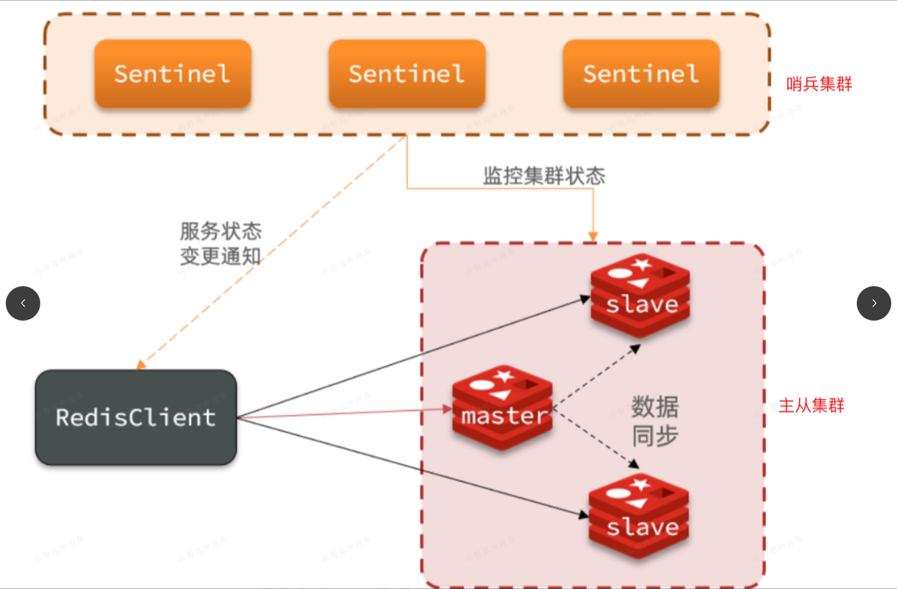
> 图注：这张图展示了Redis哨兵集群与主从集群的工作架构，其中哨兵集群由三个标注为“Sentinel”的节点组成，负责监控下方主从集群的状态，还会向RedisClient发送服务状态变更通知。主从集群包含1个master主节点和2个slave从节点，主节点与从节点间存在“数据同步”的关系，客户端RedisClient可与主、从节点建立连接。该图对应文档中关于Redis哨兵集群的内容，直观呈现了哨兵集群监控主从集群、保障服务高可用的逻辑，呼应了哨兵机制的监控、故障检测功能。

**哨兵机制的主要功能和意义如下：**

1. **监控**：哨兵会定期检查Redis 实例的状态，包括主节点和从节点的可用性。
2. **自动故障检测和转移**：当主节点失效或不可用时，哨兵可以自动检测到故障，并根据预先配置的策略进行主节点切换，将一个可用的从节点提升为新的主节点。
3. **高可用性**：哨兵可以确保在主节点故障的情况下，系统仍能继续提供服务，通过将从节点升级为主节点，保持系统的可用性。
4. **配置提供**：哨兵还可以提供配置信息，使客户端能够动态获取Redis 节点的最新状态，以实现自动的节点发现和故障转移过程。

**哨兵的工作机制如下：**

1. 哨兵节点发现彼此，互相通信。
2. 检测主节点是否可用，如果不可用，则标记为下线。
3. 哨兵节点相互投票，选举一个新的主节点候选人。
4. 当大多数哨兵节点投票给同一个候选人时，选举成功，该候选人成为新的主节点。5．通知其他从节点重新连接到新的主节点。

使用哨兵机制可以提高Redis的高可用性和可靠性，确保 Redis 集群在节点故障或其他变化时能够自动进行故障转移和恢复。客户端可以通过连接到哨兵节点，获取正确的Redis 节点信息，并保持与Redis 集群的稳定连接。

需要注意的是，哨兵机制并不是分布式存储方案，它只实现了高可用性和故障转移，不提供数据分片的功能。如果需要实现数据分片和水平扩展，可以使用 Redis 集群（Redis Cluster）来实现。

```SQL
Redis 的哨兵集群主要用于实现高可用性，监控Redis 主、从节点的状态变化，并在主节点失效时自动将从节点升级为主节点。哨兵集群由多个哨兵节点组成，工作原理是哨兵节点通过相互通信，监测主节点的健康状态，当主节点失效时，选举新的主节点，并通知其他从节点进行切换，确保系统的可用性。
```

### Redis的分片集群

Redis分片集群是一种将数据分布到多个节点的解决方案，用于实现数据的水平扩展和提高系统的吞吐量。

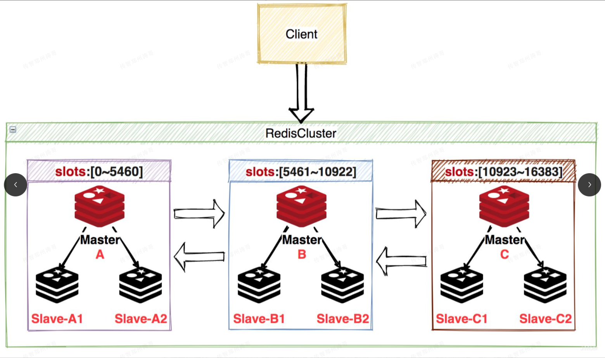
> 图注：这张图展示了Redis分片集群的结构，顶部的Client将请求指向RedisCluster集群，集群内包含3个主节点，分别标注为A、B、C，每个主节点对应不同的哈希槽范围，节点A负责的插槽为0~5460，节点B为5461~10922，节点C为10923~16383。每个主节点下方还配备了对应的从节点，节点A的从节点为Slave-A1、Slave-A2，节点B的为Slave-B1、Slave-B2，节点C的为Slave-C1、Slave-C2，主从节点之间通过双向箭头连通，直观呈现了Redis分片集群的数据分片和主从备份的架构设计，和文档中提及的Redis分片集群由多个节点组成、可实现故障恢复的内容相呼应。

1. **节点数量**：Redis分片集群通常由多个节点组成，每个节点负责存储部分数据。节点数量可以根据需求进行配置，常见的节点数量为3主3从，或3主6从或更多。
2. **故障恢复**：当一个节点出现故障或下线时，集群会进行自动的故障恢复。其他节点会接管故障节点上的数据，保证数据的可用性。
3. **哈希槽原理**：Redis分片集群使用哈希槽来分配和管理数据。哈希槽是一个固定数量的槽，总共槽位数量16384个，每个数据被映射到其中一个槽上。每个节点负责管理一部分槽和相应的数据。
4. **弹性伸缩**：Redis分片集群支持弹性伸缩，可以根据需要增加或减少节点的数量。当节点数量增加时，集群会自动重新计算和迁移哈希槽，确保数据均匀分布在新的节点上。当节点数量减少时，集群会迁移数据，让剩余节点负责故障节点的数据。

通过以上机制，Redis分片集群实现了数据的分布式存储和高可用性。它可以根据实际需求进行节点数量的调整，具备故障恢复能力，并通过哈希槽实现数据的均匀分布，同时支持弹性伸缩以适应业务需求的变化。

**读写数据时是如何定位哈希槽？**

在 Redis 分片集群中，确切的说法是使用 CRC16 算法计算Key 的哈希值，而不是定位哈希槽。


CRC16算法（循环冗余校验算法）是一种广泛应用于网络通信和数据校验领域的哈希算法，用于计算Key 的哈希值。

**举例说明：**

假设有一个包含三个节点的Redis分片集群，节点A、节点B和节点C。每个节点负责存储哈希槽的范围如下:

- 节点A:0-5499
- 节点B:5500-10999
- 节点C:11000-16383

现在有一个Key为"example_key"需要进行操作。

1. 使用 CRC16 算法计算"example_key"的哈希值，例如为 12345。
2. 将哈希值对 16384 （2^14) 求余， 得到计算结果为 12345 % 16384 = 12345。
3. 根据计算结果12345，确定该数据应该存储在节点C的哈希槽11000-16383范围内。
4. 客户端将数据写入节点C，或者从节点C读取相关数据。

通过CRC16算法计算Key的哈希值，可以得到一个范围在0到16383的整数值，然后根据这个哈希值确定数据所对应的哈希槽范围，进而确定数据的存储位置。

```SQL
Redis的分片集群主要用于实现数据的横向扩展，将数据分散存储在多个节点上，提高系统的并发能力和存储能力。分片集群由多个节点组成，根据Key经过哈希算法映射到不同的节点上，每个节点负责存储和处理一部分数据，工作原理是通过一致性哈希算法将数据按照一定规则分配到不同的节点上，实现数据的均衡存储和查询。
```

## Day15

### Redis分布式锁命令使用

用过，使用的是Redis分布式锁。可以使用分布式锁来实现多个客户端之间的协调和同步，以避免并发操作引起的数据冲突。下面是使用Redis 实现分布式锁的一般步骤：

1. **获取锁：**

   - 使用`SET` 命令尝试在指定的键上设置一个唯一的值作为锁。
   - 设置键的超时时间，以防止获取锁后出现异常导致锁一直被占用（避免死锁）。

`SET` 命令常用的选项是：

- `NX`：仅在键不存在时设置键的值，用于确保只有一个客户端能够成功设置锁。
- `EX`：设置键的过期时间，用于防止锁被长时间占用。单位秒。
- `PX`：设置键的过期时间，用于防止锁被长时间占用。单位毫秒。

注意：SETNX命令也可以获取锁，但还得执行其他命令设置过期时间，不如SET一条命令搞定：

或者，SET lock_key value NX EX 10 会将名为lock_key的锁设置为在 10秒后过期。

例如， SET lock_key value NX PX 10000 会将名为 lock_key的锁设置为在 10秒后过期。

1. **释放锁：**

- 使用`DEL` 命令删除键来释放锁。
- 确保只有锁的持有者能够释放锁，可通过比较锁的值来进行验证。

当然Redis 分布式锁还存在锁重入、主从一致、锁误删问题，可通过 Redisson 锁解决

### Redis（或ElasticSearch）和MySQL如何保持数据一致性

Redis（或 ElasticSearch）和 MySQL如何保持数据一致性，以及它们的具体实现和优缺点如下:

1. **同步双写方案：**

- 实现方式：在应用程序中，将数据同时写入Redis（或ElasticSearch）和MySQL，确保两个写操作要么同时成功，要么同时失败。
- 优点：简单直接，实时性较高，不依赖额外组件。
- 缺点：增加了系统复杂性，需要处理并发写冲突，可能导致写入延迟增加。

1. **异步队列方案：**

- 实现方式：将数据更新操作以消息的方式发送到消息队列中，并在消费者程序中分别更新Redis（或ElasticSearch) 和 MySQL。
- 优点：实现了数据解耦和异步处理，提高了系统的可伸缩性和稳定性。
- 缺点：增加了系统复杂性，引入了消息队列系统，可能会有一定的延迟，需要确保消息消费的可靠性。

1. **Canal方案：**

- 实现方式：使用 Canal工具监听 MySQL 的 binlog，将数据变更事件发送到 Redis (或ElasticSearch） 来更新数据。
- 优点：实时性较高，不需要修改应用程序代码，可以实现MySQL的逻辑解耦和数据的多重同步。·缺点：增加了系统复杂性，需要额外的Canal工具和客户端程序来处理数据同步，可能额外占用资源。

双写模式简单直接，适用于数据实时性要求较高的场景。异步队列适用于要求解耦和异步处理的场景，但可能增加了系统复杂性和引入延迟。Canal方案适用于希望实现 MySQL 的逻辑解耦和多重数据同步的场景，但需要额外维护Canal工具和客户端程序。

```SQL
Elasticsearch和MySQL的数据一致性可以通过以下三种方案实现
1.双写：每次写入操作同时将数据写入 Elasticsearch 和 MysQL，确保数据一致性，但可能增加写延迟和复杂性。
2.异步队列：将写入操作请求放入队列中，后台任务异步地将数据写入Elasticsearch和 MySQL，提高写入性能，但可能导致一定的数据不一致性。
3. Canal方案：使用 Canal 工具订阅 MySQL 的 binlog 日志，实时将数据同步到 Elasticsearch，实现数据的实时增量同步，但需要额外的工具和配置
```

### Redisson是什么，怎么用

Redisson是一个用于Java 的简单易用的Redis客户端，它封装了常见的分布式操作和并发控制的功能，提供了丰富的API和功能，使得开发人员可以轻松地与Redis进行交互。

在 Spring Boot中使用 Redisson，需要进行以下步骤:

1. **添加 Redisson 的依赖**：在项目的构建文件(如 pom.xml） 中添加 Redisson 的依赖。 可以通过Maven引入相应的依赖。
2. **配置 Redisson 连接信息**：在 Spring Boot 的配置文件(如 application.properties 或application.yml）中配置 Redisson 的连接信息，包括 Redis 的主机地址、端口号、密码等。
3. **创建 RedissonClient对象**：可以通过自动注入或手动创建 RedissonClient 对象。如果使用自动注入，可以在配置类中添加@Bean 注解将 RedissonClient注入为 Spring 的 Bean；如果手动创建，可以在需要的地方创建 RedissonClient对象。
4. **使用 Redisson 功能**：通过 RedissonClient对象，可以使用 Redisson提供的各种功能，如分布式锁分布式集合、分布式队列等。根据具体需求，调用相应的方法来操作Redis。

例如，使用 Redisson 的分布式锁，可以注入RedissonClient对象后调用 getLock方法来获取锁对象，然后使用lock方法加锁，并在需要时执行相应的操作，最后使用unlock方法释放锁。

```SQL
Redisson是一个Java的Redis客户端，提供丰富的APl和功能，用于封装分布式操作和并发控制。在 Spring Boot 中使用 Redisson，
首先添加 Redisson 的依赖，然后在配置文件中配置Redisson 连接信息，接着通过@Autowired 注解或手动创建RedissonClient 对象。
最后，利用RedissonClient对象可以使用各种功能，如分布式锁、分布式集合等，与Redis 进行交互。
```

### Redisson看门狗机制的原理

Redisson 的看门狗机制是为了解决分布式环境下使用分布式锁时的问题。它通过周期性地对锁进行心跳续期，保证在业务执行期间锁不会被自动释放，防止因执行时间过长或节点宕机而导致锁提前释放的情况发生。

实现原理是在获取锁时，Redisson 会使用一个独立的线程启动一个定时任务，定时更新锁的过期时间。同时，每个 Redisson 实例都会在 Redis 中生成一个唯一ID作为锁的标识，以避免其他实例错误地释放锁。

看门狗机制的目的是防止锁过期时间超时，而业务执行仍在进行中的情况发生。通过定时地续期锁的过期时间，确保锁在业务执行期间一直有效。这样可以避免获得锁的实例因为处理时间过长而导致锁过期被其他实例获取，保证分布式环境下的锁的可靠性。

续期与看门狗机制相关，通过定时续期，锁的过期时间会在业务执行期间不断更新，从而避免锁过期。一旦锁的续期失败，即续期任务运行失败或锁的标识不匹配，Redisson会立即释放该锁，以避免业务不再持有锁而导致的问题。

总结来说，Redisson的看门狗机制通过定时续期锁的过期时间，保证在业务执行期间锁不会被自动释放，解决了在分布式环境下使用分布式锁时锁过期的问题，提高了锁的可靠性和使用效果。

```SQL
Redisson 的看门狗机制通过定时续期锁的过期时间，保证在业务执行期间锁不会被自动释放。它解决了分布式环境下锁过期导致的资源竞争问题，确保业务能够完成。续期是看门狗机制的核心，它通过定时更新锁的过期时间来实现锁的持久性，以防止锁过期并被其他实例获得。
```

## 八、服务框架

### MyBatis里#和\$区别

在 MyBatis 中，`#`和`$`在SQL 语句中的使用具有以下区别:

1. 参数替换方式：

- `#`符号表示使用预编译语句，并将参数值进行占位符替换。
- `$`符号表示直接将参数值替换到SQL 语句中。

1. 预编译处理：

- `#`符号在替换时会自动进行预编译处理，可以防止SQL注入攻击，并确保查询参数的类型正确匹配。
- `$`符号在替换时不会进行预编译处理，替换后的参数直接拼接到SQL 语句中，潜在地存在SQL注入的风险。

1. 适用场景：

- `#`符号适用于参数值，如查询条件、更新数据等需要进行预处理操作的场景。
- `$`符号适用于非参数值，如表名、列名等不需要进行预处理操作的场景。

```SQL
在 MyBatis 中，# 用于参数的替换，并会进行预编译处理，以防止 SQL 注入；而 $ 则直接将参数值替换进SQL语句有SQL注入风险。
```

## Day16

### MyBatis动态SQL

```SQL
MyBatis动态SQL可以让我们在XML映射文件内，以标签的形式编写动态SQL，完成逻辑判断和动态拼接SQL的功能：
MyBatis提供了9种动态SQL标签：trim、where、set、foreach、choose、when、outherwise、bind；
执行原理：使用OGNL从SQL参数对象中计算表达式的值，根据表达式的值动态拼接SQL，以此来完成动态SQL的功能
```

### ResultType和 ResultMap的区别

```SQL
如果数据库结果集中1列名和要封装实体的属性名完全一致的话用resultType属性
如果数据库结果集中的列名和要封装的实体的属性名有不一致的情况用resultMap属性，通过resultMap手动创建对象映射，resultMap要配置一下表和类的一一对应关系，所以说就算你的字段名和你的实体类的属性名不一样也没关系，都会给你映射出来
```

### 为什么要用MyBatisPlus

MyBatis-Plus（简称MP）是一个Mybatis的增强工具，在Mybatis的基础上只做增强不做改变，为简化开发、提高效率

特性：

- 无侵入：只做增强不做改变，引入它不会对现有工程产生影响，如丝般顺滑
- 损耗小：启用即会自动注入基本的CRUD，性能基本无损耗，直接面向对象操作
- 强大的CRUD操作：内置通用Mapper、通用Service，仅仅通过少量配置即可实现单表大部分CRUD操作，更有强大的条件构造器，满足各类使用要求
- 支持Lambda形式调用：通过Lambda表达式，方便的编写各类查询条件，无需再担心字段错了
- 支持主键自动生成：支持多达4种主键策略（内含分布式唯一ID生成器-Sequence），可自由配置，完美解决主键问题
- 支持ActiveRecord模式：支持ActiveRecord形式调用，实体类只需继承Model类即可进行强大的CRUD操作
- 支持自定义全局通用操作：支持全局通用方法注入（Write once，use anywhere）
- 内置代码生成器：采用代码或者Mapper插件可快速生成Mapper、Model、Service、Controller层代码，支持模版引擎，更有超多自定义配置可使用
- 分页插件支持多种数据库：支持MySQL、MariaDB、Oracle、DB2、H2、HSQL、SQLite、Postgre、SQLServer等多种数据库
- 内置性能分析插件：可输出SQL语句以及其执行时间，建议开发测试时启用该功能，能快速揪出慢查询
- 内置全局拦截器：提供全表Delete、update操作智能分析阻断，也可自定义拦截规则，预防误操作

### MyBatisPlus的常用注解

```Java
@TableName：用于指定实体类对应的数据库表名。该注解可以在实体类上添加，表示该类映射到指定的数据库表。例如：@TableName（"user"）。
@TableField：用于指定实体类的字段对应的数据库表的字段名。该注解可以在实体类的字段上添加，表示该字段映射到指定的数据库表字段。例如：@TableName（“name”）。
@TableId：用于指定实体类的字段作为数据库表的主键。该注解可以在实体类的字段上添加，表示该字段作为数据库表的主键。例如：@TableId（value="Id"，type=IdType.AUTO）
@Version：用于指定实体类的字段作为乐观锁的版本字段。乐观锁是一种并发控制机制，通过版本号的变化来判断数据是否被秀才。该注解可以在实体类的字段上添加，表示该字段作为乐观锁的版本字段。例如：@Version
```

### Spring里IOC是什么

IOC （lnversion Of Controll， 控制反转） 是一种设计思想，就是将原本在程序中手动创建对 象的控制权，交由给 Spring 框架来管理。IOC 在其他语言中也有应用，并非Spring 特有。IOC 容器是Spring 用来实现IOC 的载体，IOC 容器实际上就是一个 Map(key, value)， Map 中存放 的是各种对象。

将对象之间的相互依赖关系交给IOC容器来管理，并由IOC容器完成对象的注入。这样可以很大程度上简化应用的开发，把应用从复杂的依赖关系中解放出来。IOC容器就像是一个工厂一样，当我们需要创建一个对象的时候，只需要配置好配置文件/注解即可，完全不用考虑对象是如何被创建出来的。在实际项目中一个 Service 类可能由几百甚至上千个类作为它的底层，假如我们需要实例化这个Service，可能要每次都搞清楚这个Service 所有底层类的构造函数，这可能会把人逼疯。如果利用IOC的话，你只需要配置好，然后在需要的地方引I用就行了，大大增加了项目的可维护性且降低了开发难度。

```Java
在Spring中，IOC（Inversion of Control，控制反转）是一种设计模式。通过它，对象的创建和依赖关系的管理被交由容器负责，从而实现对象之间的解耦和灵活性的提升。简单说，就是由容器来控制对象的生命周期和依赖关系
```

## Day17

### Spring中Bean的注入方式有几种

构造器依赖注入：构造器依赖注入通过容器触发一个类的构造器来实现的，该类有一系列参数，每个参数代表一个对其他类的依赖。

Setter方法注入：Setter方法注入是容器通过调用无参构造器或无参static工厂方法实例化bean之后，调用该bean的Setter方法，即实现了基于Setter的依赖注入

基于注解的注入：最好的解决方案是用构造器参数实现强制依赖，Setter方法实现可选依赖

```Java
在Spring中，Bean的注入方式有三种：构造器注入、Setter方法注入和注解注入
```

### Spring中Bean的作用域有几种

Spring框架支持以下五种bean的作用域：

- Singleton：唯一bean实例，Spring中的bean默认都是单例的。可以认为Spring中的Bean默认情况下是非线程安全的。
- prototype：每次请求都会创建一个新的bean实例
- request：每一次HTTP请求都会产生一个新的bean，该bean仅当前HTTP request内有效
- Session：每一次HTTP请求都会产生一个新的bean，该bean仅当前HTTP session内有效
- global-session：全局session作用域，仅仅在基于Portlet的Web应用中才会有意义，Spring5中已经没有了Portlet

### Spring里AOP是什么

AOP： 全称 Aspect Oriented Programming， 即： **面向切面编程**。

AOP（Aspect-Oriented Programming，面向切面编程）能够将那些与业务无关，却为业务 模块所共同调用的逻辑或责任（例如事务处理、日志管理、权限控制等）封装起来，便于减少系统的重复代码，降低模块间的耦合度，并有利于未来的可扩展性和可维护性。

Spring AOP 是基于动态代理的，如果要代理的对象实现了某个接口，那么 Spring AOP 就会使 用JDK动态代理去创建代理对象；而对于没有实现接口的对象，就无法使用JDK动态代理，转 而使用 CGlib 动态代理生成一个被代理对象的子类来作为代理。 当然也可以使用AspectJ，SpringAOP 中已经集成了 AspectJ，Aspect 应该算得上是Java 生 态系统中最完整的 AOP 框架了。使用AOP之后我们可以把一些通用功能抽象出来，在需要用到的地方直接使用即可，这样可以大大简化代码量。我们需要增加新功能也方便，提高了系统的扩展性。日志功能、事务管理和权限管理等场景都用到了 AOP。

```Java
在Sping中，AOP（Aspect-Oriented Programming，面向切面编程）是一种编程范式，通过在不修改原有代码的情况下，将横切关注点（如事务管理、日志记录等）从核心业务逻辑中解耦出来，并在需要的地方进行统一的切面逻辑处理。
```

### AOP主要用在哪些场景中

事务管理

日志

公共异常处理

自定义分布式锁组件

性能监视

安全检查

缓存

我们的项目中，事务管理、公共字段填充、全局异常处理都用到了

### Spring的常用注解

```Java
@Autowrid：用于有值设值方法、非设值方法、构造方法和变量
@Component：用于注册所有的bean
@Repository：用于注册dao层的bean
@Controller：用于注册控制层的bean
@Service：用于注册Service层的bean
@Component：用于实例化对象
@Value：简单属性的依赖注入
@ComponentScan：组件扫描
@Transactional：事务管理
```

## Day18

### @Resources和@Autowired的区别

```Java
都是用来自动装配的，都可以放在属性的字段上
@Autowired通过byType的方式实现，而且必须要求这个对象存在！
@Resource默认通过byName的方式实现，如果找不到名字，则通过byType实现！如果两个都找不到的情况下，就会报错！
```

### SpringMVC执行流程

MVC 是 Model 一View 一 Controler 的简称，它是一种架构模式，它分离了表现与交互。它被分为三个核心部件：模型、视图、控制器。

- Model（模型）：是程序的主体部分，主要包含业务数据和业务逻辑。在模型层，还会涉及到用户发布的服务，在服务中会根据不同的业务需求，更新业务模型中的数据。
- View（视图）：是程序呈现给用户的部分，是用户和程序交互的接口，用户会根据具体的业务需求，在View视图层输入自己特定的业务数据，并通过界面的事件交互，将对应的输入参数提交给后台控制器进行处理。
- oController （控制器）：Controller 是用来处理用户输入数据，以及更新业务模型的部分。控制器中接收了用户与界面交互时传递过来的数据，并根据数据业务逻辑来执行服务的调用和更新业务模型的数据和状态。

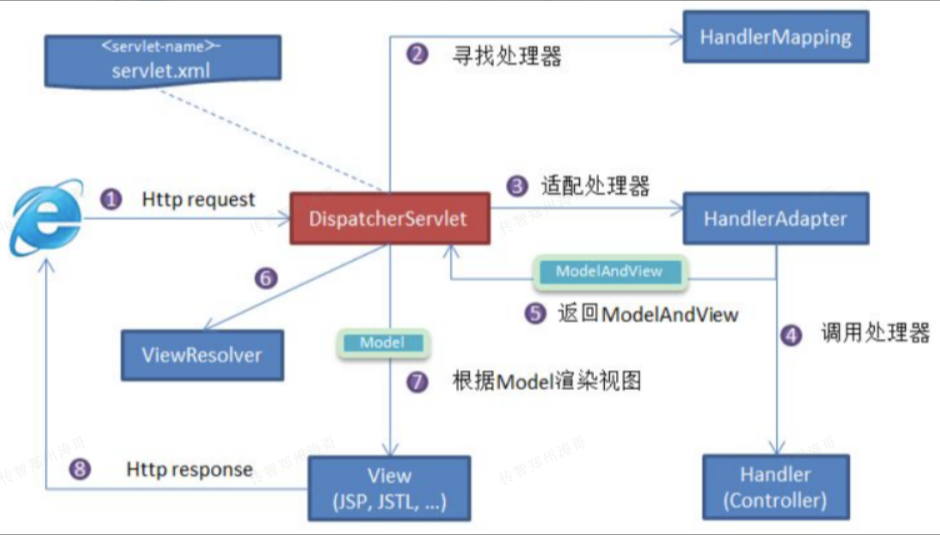
> 图注：图片展示了SpringMVC执行流程。客户端发送HTTP请求到DispatcherServlet，DispatcherServlet根据请求信息调用HandlerMapping解析请求对应的Handler，寻找处理器；适配处理器，调用处理器；返回ModelAndView；根据Model渲染视图，返回HTTP响应。图中还标注了ViewResolver、Model、View等组件，以及HandlerAdapter、Controller等关键环节，直观呈现了请求处理到响应返回的整个流程。

工作原理：

1. 客户端（浏览器）发送请求，直接请求到 DispatcherServlet。
2. DispatcherServlet根据请求信息调用 HandlerMapping，解析请求对应的 Handler。
3. 解析到对应的 Handler （也就是我们平常说的 Controller 控制器）。
4. HandlerAdapter 会根据 Handler 来调用真正的处理器来处理请求和执行相对应的业务逻 辑。
5. 处理器处理完业务后，会返回一个ModelAndView 对象，Model 是返回的数据对象，View 是逻辑上的View。
6. ViewResolver 会根据逻辑View 去查找实际的View。
7. DispatcherServlet把返回的 Model 传给View（视图渲染）。
8. 把View返回给请求者（浏览器）。

```Java
Spring MVC的工作原理是基于Servlet容器的前端控制器模式，首先DispatchServlet接收并分发请求，然后根据HandlerMapping找到对应的Controller进行业务处理，最后通过ViewResolver渲染视图并返回响应给客户端。
```

### SpringMVC的常用注解

类上的注解：

- Controller：用于标识一恶搞类为控制器
- RestController：用于标识一个类为控制器。响应数据为JSON格式
- RequestMapping：用于定义接口的基础路径

方法上的注解：

- Header：用于获取请求头中的参数
- RequestMapping：用于映射请求URL与处理方法，可以接收任何请求方式。
- GetMapping：用于映射GET请求的URL到处理方法
- PostMapping：用于映射POST请求的URL到处理方法。
- PutMapping：用于请求PUT请求到URL到处理方法。
- DeleteMapping：用于DELETE请求到URL到处理方法
- ResponseBody：用于直接返回数据给客户端。响应数据是JSON格式。

参数的注解：

- PathVariable：用于获取URL路径中的参数。
- RequestParam：用于获取请求参数
- ModelAttribute：用于获取请求参数
- RequestBody：用于获取请求JSON参数。

### 为什么用SpringBoot

- 独立运行 Spring Boot 而且内嵌了各种 servlet 容器，Tomcat、Jetty 等，现在不再需要打成war 包部署到容器中，Spring Boot 只要打成一个可执行的jar 包就能独立运行，所有的依赖包都在一个 jar 包内。
- 简化配置 spring-boot-starter-web 启动器自动依赖其他组件，减少了 maven 的配置。自动配置 Spring Boot 能根据当前类路径下的类、jar 包来自动配置 bean，如添加一个 spring-boot-starter-web 启动器就能拥有web的功能，无需其他配置。
- 无代码生成和XML配置Spring Boot 配置过程中无代码生成，也无需XML 配置文件就能完成所有配置工作，这一切都是借助于条件注解完成的，这也是Spring4.x的核心功能之一。
- 避免大量的Maven导入和各种版本冲突
- 应用监控SpringBoot 提供一系列端点可以监控服务及应用，做健康检测。

```Java
使用Spring Boot可以简化编码、减少配置、简化部署、简化监控、简化坐标依赖导入、简化整合其他技术，并提供强大的微服务支持，减少开发人员在搭建和配置项目上的工作量，使开发者能够更专注于业务逻辑的实现，快速构建可靠的、可扩展的应用程序。
```

### SpringBoot自动配置原理

SpringBoot的自动配置原理基于条件化配置和约定优于配置的机制。它通过扫描类路径下的依赖、配置文件和注解等信息，结合 Spring Boot提供的自动配置类和条件注解，根据条件判断自动配置哪些组件,然后将它们注入到Spring 容器中。这种方式使得开发者能够快速搭建应用程序，并根据自己的需求进行个性化的配置和扩展。

SpringBoot的自动配置原理主要分为以下几个步骤：

1. **扫描**：Spring Boot会扫描应用程序的类路径，查找特定的依赖、配置文件和注解等信息。
2. **条件判断**：根据条件注解，比如`@ConditionalOnClass`、`@ConditionalOnProperty`等，判断是否满足自动配置的条件。
3. **自动配置**：如果满足条件，Spring Boot会根据自动配置类（通常以`*-autoconfigure` 结尾）中的配置代码，自动创建和配置所需的组件。
4. **组件注册**：自动配置完成后，Spring Boot 会将这些组件注册到 Spring 容器中，使其可供应用程序使用。
5. **自定义配置**：开发者可以通过自定义配置文件或者注解，覆盖或修改自动配置的行为，实现个性化的配置和扩展。

通过这些步骤，SpringBoot实现了简化配置和快速开发的目标，提供了便捷的开发方式，同时保持了灵活性和可扩展性。

```Java
Spring Boot的自动配置原理是基于条件注解和配置文件的机制。它通过扫描classpath下的自动配置类，根据条件注解（如@ConditionalOnClass、@ConditionalOnProperty）判断是否满足配置条件，从而决定是否启用对应的自动配置类。配置文件中的属性值可以通过
@ConfigurationProperties注解与配置类进行绑定，实现属性的自动注入。最终，这些自动配置类会被注册到Spring容器中，完成自动配置的过程。
```

## Day19

### SpringBoot启动时都做了什么

Spring Boot 启动主要经历以下几个步骤：

1. 加载配置：Spring Boot启动时首先加载`META-INF/spring.factories`文件，这个文件制定了各个自动配置类的路径
2. 扫描自动配置类： 根据`spring.factories`中配置的自动配置类路径，Spring Boot会扫描这些自动配置类，并将它们实例化。
3. 条件判断：通过条件注解，如`@ConditionalOnClass`、`@ConditionalOnProperty`等，决定是否应该自动配置类
4. 自动配置：根据自动配置类的代码逻辑，自动配置相应的组件，例如数据库连接池、Web服务器、日志等
5. 注册组件：将自动配置的组件注册到Spring容器中，使其可以被应用程序使用
6. 启动应用：执行应用程序的启动逻辑，包括初始化、加载数据、启动定时任务等

通过使用`spring.factories`文件，Spring Boot实现了自动配置的功能，大大简化了应用程序的配置和开发过程。

```Java
Spring Boot启动时会加载配置文件（如application.properties）并扫描自动配置类（通过spring.factories），根据条件判断（如@ConditionalOnClass、@ConditionalOnProperty）自动配置各个组件，将它们注册到Spring容器中。最后，启动应用程序，处理请求，响应用户。简而言之，Spring Boot启动时负责配置加载、自动装配和应用程序的启动。
```

### SpringBoot的核心注解

```Java
SpringBootApplication，由3个注解组成：
    @SpringBootConfiguration：组合了@Configuration注解，实现配置文件的功能。
    @EnableAutoConfiguration：打开自动配置功能，也可以关闭某个自动配置的选项，如果关闭数据源自动配置功能
    @ComponentScan：Spring组件扫描
```

### SpringCloud和SpringBoot的区别

- Spring Boot专注于快速方便的开发单个个体微服务
- Spring Cloud是关注全局的微服务协调调整治理框架以及一整套的落地解决方案，它将Spring Boot开发的一个个单体微服务整合并管理起来，为各个微服务之间提供：配置管理，服务发现，断路器，路由，微代理，事件总线等的集成服务
- Spring Boot可以离开Spring Cloud独立使用，但是Spring Cloud离不开Spring Boot，属于依赖关系

```Java
Spring Boot是用于简化Spring应用的开发和部署的框架，而Spring Cloud是构建分布式系统的解决方案，它基于Spring Boot并提供了分布式系统开发所需的组件与工具。简而言之，Spring Boot是单体应用的生产力工具，Spring Cloud是构建分布式系统的工具集
```

### SpringCloud五大组件

Spring Cloud是一个用于构建分布式系统的开发工具包，它提供了一系列组件来简化分布式系统的开发和管理。以下是Spring Cloud中的五个核心组件：

1. 服务注册与发现（Eureka）：Eureka是一个用于实现服务注册与发现的组件，提供了服务注册中心来管理服务实例的注册与发现，使得服务之间可以方便地进行通信和调用。
2. 客户端负载均衡（Ribbon）：Ribbon是一个用于在客户端实现负载1均衡的组件，它可以根据一定的策略选择合适的服务实例进行负载均衡，提高系统的可用性和性能
3. 服务调用（Fegin）：Fegin是一个声明式的服务调用组件，它基于注解和动态代理，可以让开发者使用简单的接口定义服务调用，而无需关注底层的具体实现。
4. 熔断器（Hystris）Hystrix是一个用于实现服务容错和熔断的组件，它可以保护系统免受服务故障的影响，通过实现服务降级、熔断和隔离等机制，提高系统的稳定性和可靠性。
5. 网关（Gateway）：Zuul或Gateway是用于构建统一的API网关的组件，它可以实现请求的路由、过滤和转发等功能，提供了对外的统一的接入点，并可以对请求进行安全验证、限流和监控等

这五个组件是Spring Cloud中常用的核心组件，它们提供了一系列功能来简化构建分布式系统的工作，实现了服务注册与发现、负载均衡、服务调用、熔断和容错、网关等关键功能，极大提高了分布式系统的可靠性和可用性。

### SpringCloud组件分类

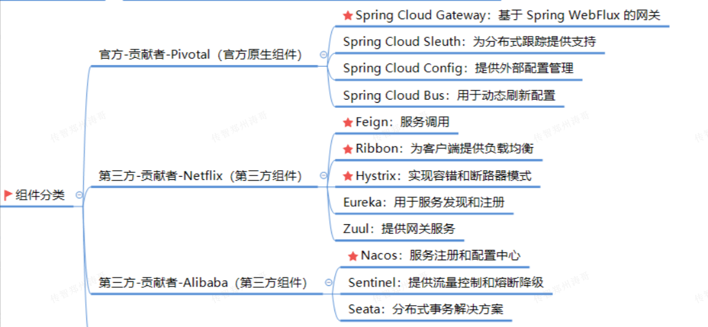
> 图注：图片展示了Spring Cloud组件分类，分为官方贡献者Pivotal（官方原生组件）和第三方贡献者（第三方组件）两类。官方贡献者有Spring Cloud Gateway、Spring Cloud Sleuth、Spring Cloud Config、Spring Cloud Bus等。第三方贡献者中，Netflix贡献了Feign、Ribbon、Hystrix、Eureka、Zuul等，Alibaba贡献了Nacos、Sentinel、Seata等。该图与上文介绍的Spring Cloud五大组件相关，直观呈现了各组件所属类别及具体名称。

### Eureka工作原理

Eureka 是 Spring Cloud 中的服务注册与发现组件，其工作原理可以简述为以下几个步骤:

1. 服务注册：服务提供者在启动时，将自己的服务实例信息（包括名称、IP地址、端口号等）注册到Eureka 注册中心。
2. 心跳检测与续约：注册后的服务实例会周期性地发送心跳给Eureka 服务器来表明自己仍然可用。默认情况下，心跳时间间隔为 30秒。
3. 服务发现：服务消费者从Eureka 注册中心获取注册的服务列表，并缓存在本地。它可以根据服务名称找到可用的服务实例。
4. 负载均衡：服务消费者使用负载均衡算法从本地的服务列表中选择一个服务实例进行调用。
5. 容错处理：Eureka客户端会维护服务实例的健康状态信息，并自动剔除故障节点，进行容错处理。

总结起来，Eureka 通过服务注册、心跳检测与续约、服务发现、负载均衡和容错处理等步骤来实现服务注册与发现的功能。心跳默认每30秒发送一次。

```Java
Eureka是Spring Cloud中的服务注册与发现组件。它通过服务注册，在启动时将服务实例信息注册到Eureka注册中心；通过心跳检测与续约，实现服务实例的健康状态监测；通过服务发现，让消费者能够从注册中心获取可用的服务列表；最后，通过负载均衡和容错处理，实现服务调用的负载均衡和容错能力
```

## Day20

### Gateway网关的特性

Gateway（网关）是一种在微服务架构中起到请求转发、路由和过滤的作用的组件。他作为系统的入口点，接收所有的客户端请求，并将他们转发到相应的服务上进行处理。以下是Gateway网关的作用和使用方式的说明：

作用：

1. 请求路由：Gateway可以根据请求的URL路径将请求动态路由到不同的服务实例上，实现动态路由的功能。
2. 负载均衡：Gateway可以根据负载均衡策略将请求分发到多个服务实例中，平衡负载，提高系统的可用性和性能。
3. 安全控制：Gateway可以集成认证和授权机制，对请求进行鉴权，保护系统的安全性。
4. 请求过滤：Gateway可以对请求进行过滤和校验，例如对请求进行验证、请求参数转换、请求日志记录等
5. 降级和熔断：Gateway可以对服务进行降级和熔断处理，当服务出现故障或超时时，返回预设的响应或转发到备用服务。
6. 监控和统计：Gateway可以对请求进行监控和统计，记录请求的响应时间、流量等指标，方便分析系统性能和问题排查

```Java
Gateway网关是一种API网关，具有路由、负载均衡、安全认证、限流熔断等特性，用于统一管理和分发请求，提高系统的可用性、安全性和扩展性。网关可以根据请求的路由规则将请求转发到不同的服务实例，并提供过滤机制来实现请求的加解密、鉴权、限流等功能。通过Gateway的配置，可以有效管理和保护微服务中的各个服务。
```

### Gateway的路由断言工厂

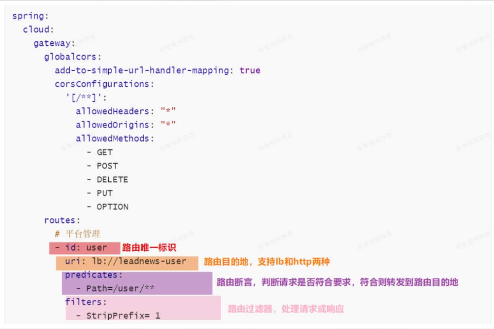
> 图注：这是一张展示Spring Cloud Gateway相关配置代码的图片，内容为网关的路由相关配置示例。图片中呈现的代码属于Gateway配置的routes部分，包含路由唯一标识为user、路由目的地为lb://eadnews-user的配置；predicates（路由断言）配置了Path=/user/**，用于判断请求是否符合以/user开头的规则，符合则转发到对应目的地；filters（路由过滤器）配置了StripPrefix=1，用于处理请求。此外，配置中还包含全局跨域（cors）相关设置，允许所有请求头、跨域源及GET、POST等常见请求方法，同时提及了add-to-simple-url-handler-mapping相关配置，该图对应文档中关于Gateway路由断言工厂的内容，直观展示了路由断言与过滤器的具体配置形式。

在网关的路由配置里只需在-Path中配置/user/\*\*，那么以user开头的请求就会被网关处理，这是如何实现的呢？

事实上，Gateway中有许多路由断言的工厂，当我们在配置文件中对断言进行配置后，这些配置就会被路由断言工厂进行解析并处理，而-Path配置就是由

org.springframework.cloud.gateway.handler.predicate.PathRoutePredicateFactory 来处理的。

SpringCloud Gateway中一共提供了11种基本的路由断言工厂，分别如下:


### 事务失效的场景有哪些

- 非public方法上加了事务注解
- 非事务方法调用了事务方法
- 异常被catch掉，没有外抛
- 类上未加上@Service注解，spring不会管理此组件
- 方法上未加@Transactional注解

### RabbitMQ工作模式

RabbitMQ是一个广泛使用的开源消息代理，它支持多种工作模式。以下是RabbitMQ的几种常见的工作模式以及它们的特点和应用场景：

1. 简单模式（Simple Mode）

- 特点：使用单个生产者将消息发送到单个消费者
- 应用场景：适用于简单的任务分发，消息的顺序不重要

1. 工作队列模式（Work Queue Mode）

- 特点：多个生产者将消息发送到一个或多个消费者
- 应用场景：适用于任务分发，提高系统的并发处理能力

1. 广播模式（Fanout Mode）

- 特点： 消息发送者将消息发布到交换机，多个消费者通过绑定到交换机的队列接收消息
- 应用场景： 适用于消息广播，例如日志记录、实时聊天、新闻发布等

1. 路由模式（Routing Mode）

- 特点：消息发送者通过制定不同的路由键将消息发送到交换机，交换机根据路由键将消息发送到对应队列
- 应用场景： 适用于消息有选择性的路由，例如根据消息内容进行过滤

1. 主题模式（Topic Mode）

- 特点：消息发送者通过指定主题（可以使用通配符）将消息发送到交换机，交换机根据主题将消息发送到对应的队列
- 应用场景：适用于消息的多样性路由，例如根据不同的主题进行过滤和选择

```Java
RabbitMQ工作模式包括简单模式、工作队列、广播模式、路由模式、主题模式和RPC模式，分别适用于不同的消息传递和处理需求。
```

### RabbitMQ消息可靠性保证

RabbitMQ 提供的消息可靠性保证措施措施可以从生产端、服务端和消费端的角度来说明：

生产端（Producer）的可靠性保证措施：

- 发布者确认（Publisher Confirms）：生产者可以通过启用发布者确认机制，在消息成功发送给RabbitMQ后接收确认回执，确保消息已被正确接收


服务端（Broker）的可靠性保证措施：

- 持久化（Durability）：队列和交换机可设置为持久化，使其在RabbitMQ重新启动后不会丢失。
- 持久化消息：被标记为持久化的消息，会写入磁盘，确保消息在服务器故障时不会丢失，
- 事务机制（Transactions）：可通过启用事务机制将一组操作包装在事务中，要么全部成功执行，要么全部回滚，保证消息的原子性和一致性处理，


消费端（Consumer）的可靠性保证措施：

- 手动消息确认（Manual Message Acknowledgement）：消费者在处理完消息后，发送确认回执给RabbitMQ，告知消息已被成功处理，RabbitMQ可以删除该消息。

通过组合使用以上的措施，可以实现全方位的消息可靠性保证，减少消息丢失和处理错误的风险，并确保消息系统的高可用性和稳定性。

```Java
RabbitMQ消息可靠性保证措施包括发布者确认、消费者确认、持久化队列和交换机、事务机制以及手动确认消息等
```

## Day21

### RabbitMQ死信队列

RabbitMQ的死信队列（Dead Letter Queue） 是用来处理无法被正常消费或处理的消息的特殊队列。产生死信队列的情况有以下几种：

1. 消息被拒绝（Rejected）：当消费者拒绝消费信息或者消息超过消费者的最大重试次数，消息会被发送到死信队列
2. 消息过期（Expired）：如果消息在一定时间内没有被消费者处理，即超过了消息的过期时间，该消息也会被发送到死信队列。
3. 队列达到最大长度（Queue Length Limit）：当队列达到了定义的最大长度限制，新的消息无法进入队列，会将旧的消息发送到死信队列

通过配置死信交换机（Dead Letter Exchange）和死信队列（Dead Letter Queue）的绑定关系，可以将满足上述条件的消息发送到指定1的死信队列中，以便进行后续的处理或分析。

```Java
RabbitMQ死信队列用于处理未能被消费者处理的消息，主要发生在消息被拒绝、消息过期和队列达到最大长度时。
```

### RabbitMQ消息重复消费问题

RabbitMQ 消息重复消费问题通常由以下原因导致的：

1. 生产者用于发送消息失败后的重试，导致又发送了一次重复的消息
2. 消费者应用程序在处理消息时发生了错误，导致消息确认（ACK）没有发给RabbitMQ，从而导致RabbitMQ将消费者重新分发给其他消费者进行消费。
3. 网络问题或消费者应用程序重启时，RabbitMQ无法收到消息确认，也会导致消息重新分发


为了解决消息重复消费的问题（保证消费幂等性），可以采取以下措施：

1. 生产端：生产消息时，为每个消息设置唯一的消息ID（可以使用雪花算法生成唯一ID）
2. 消费端：

- 加锁：消费者在处理消息前，使用Redis（更好的是使用Redisson框架，可以自动续期锁）的set命令添加nx选项设置分布式锁，key为消息id，值是任意值。如果设置分布式锁失败，则忽略重复消息，拒绝处理。如果设置分布式锁成功，则处理业务
- 消息确认：消费者应及时地发送消息确认（ACK）给RabbitMq，表示已经成功处理了消息。这样RabbitMq就不会将消息重新分发其他消费者

### 为什么使用Xxl-Job而不是SpringTask


```Java
xxl-job是一个分布式任务调度框架，用于解决大规模分布式系统中的定时调度和任务管理问题。使用xxl-job可以实现任务的分片、路由和可视化管理，同时提供处理异常和报警功能。相比于springTask，xxl-job具有更强的分布式支持和扩展性，适用于复杂的分布式系统和大规模任务管理场景，而springTask更适合于简单的任务调度和单机环境。
```

### Xxl-Job在项目中的使用步骤

```Java
xxl-job集成到Spring Boot工程中的使用步骤包括：添加xxl-job的依赖到构建文件中、配置xxl-job的参数，如调度中心地址和执行器名称，创建执行器类并注册为Spring的Bean，编写定时任务类并在项目启动时初始化任务调度器。
```

### ElasticSearch倒排索引


```Java
ElasticSearch的倒排索引是一种将词条和文档id之间的对应关系反转储存的结构，通过快速定位包含特定词条的文档来提高搜索效率。倒排索引的储存方式避免了全文扫描，通过将关键词与文档ID建立映射关系，使得搜索引擎能够快速检索出包含关键词的文档，从而提高了搜索效率。
```

## Day22

### Seata分布式事务框架

```Java
Seata分布式事务框架的使用步骤为：引入依赖、配置事务切面和数据源代理、添加@GlobalTransactional注解。AT模式：效率高、回滚机制通过发送回滚请求和Undo Log实现、通过两阶段提交协议实现最终一致性，一阶段提交请求 阶段收集执行结果和Undo Log，二阶段提交确认/回滚阶段执行最终操作。
```

### 为什么用MongoDB

```Java
MongoDB的使用能够带来非结构化数据存储、高扩展性和性能、灵活的开发过程、高可用性和容错性、强大的查询功能以及活跃的社区支持和生态系统，适用于许多大规模数据处理和非结构化数据存储的应用场景。
```

### 为什么MongoDB比MySQL快

```Java
MongoDB比MySQL快的原因在于它使用了内存映射的技术提高数据访问速度、支持多类型索引优化查询、具备分布式存储和查询能力，并且不需要复杂的关系模型，适用于大规模数据处理和非结构化数据存储场景。
```

### MongoDB和Redis的区别

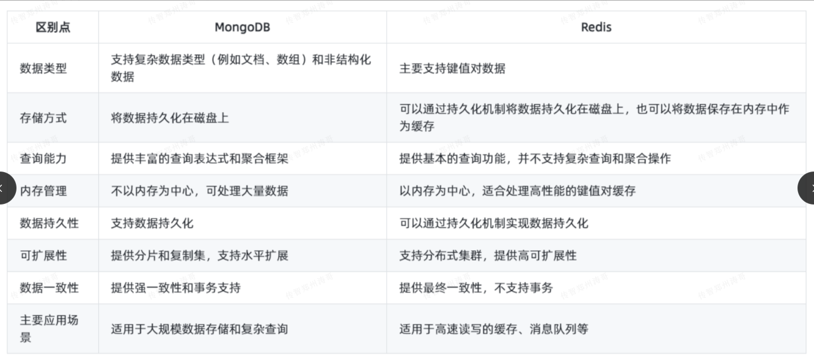
> 图注：图片是一张对比表，展示了MongoDB和Redis在数据类型、存储方式、查询能力、内存管理、数据持久性、可扩展性、数据一致性及主要应用场景等方面的区别。如MongoDB支持复杂数据类型和非结构化数据，而Redis主要支持键值对数据；MongoDB可通过持久化机制将数据持久化在磁盘上，Redis可将数据保存在内存中作为缓存；MongoDB提供丰富查询表达式和聚合框架，Redis仅提供基本查询功能；MongoDB不以内存为中心，Redis以内存为中心；MongoDB支持数据持久化，Redis可通过持久化机制实现；MongoDB支持分片和复制集，Redis支持分布式集群；MongoDB提供强一致性，Redis提供最终一致性；MongoDB适用于大规模数据存储和复杂查询，Redis适用于高速读写的缓存、消息队列等。

```Java
MongoDB和Redis在几个关键方面有明显区别。首先，数据模型不同，MongoDB支持复杂数据类型和非结构化数据，而Redis主要支持键值对。其次，存储方式不同，MongoDB将数据持久化在磁盘上，而Redis可以将数据保存在内存中作为缓存，最后，应用场景不同，MongoDB适用于大规模数据存储和复杂查询，而Redis适用于高性能的键值对缓存和消息队列等场景。根据具体需求，选择适合的数据库方案
```

### Nginx的作用

```Java
反向代理：将多台服务器代理成一台服务器
负载均衡：将多个请求均匀的分配到多台服务器上，减轻每台服务器的压力，提高服务的吞吐量。
动静分离：nginx可以用作静态文件的缓存服务器，提高访问速度。
```

## Day23

### Linux常用命令

系统类的：

- 查看ip：ifconfig
- 重启：reboot
- 查看内存：free
- 查看磁盘：df
- 查看CPU：top
- 查看端口对应的进程：lsof -i：端口号

进程类：

- ps：显示当前运行的进程

  - Ps -ef | grep java（查看所有正在运行的Java进程）
- kill：终止指定的进程

  - Kill -9 PID （终止具有指定PID的进程，PID是进程ID的占位符）
- java：运行java应用程序

  -  java -Xmx3.2g -Xms1g -jar myapp.jar （运行名为“myapp.jar”的Sring Boot JAR文件）
- nohup：后台执行命令，并忽略挂断信号

  - Nohup java -Xmx3.2g -Xms1g -jar myapp.jar & （在后台执行名为myapp.jar的Spring Boot JAR文件）
- 文件类

  - tail：动态实时查看日志文件的最后几行内容（问到就答这个）
  
    - Tail -10f order.log --表示输出名为“order.log”的文件的最后10行内容，并监控输出后续新增的日志内容
  - tail：非动态查看（静态查看）日志文件的最后几行内容
  
    - tail -n 10 order.log --表示输出名为“order.log”的文件的最后10行内容，不会监控输出后续的新增日志内容
- find：在指定目录下搜索文件或目录

  - find /path/to/directory -name "\*.txt" （在指定路径下查找所有扩展名为"\*.txt"的文件）
- cat：查看文件内容

  - cat file.txt（显示名为"file.txt"的文件的内容）

### Jenkins自动部署原理

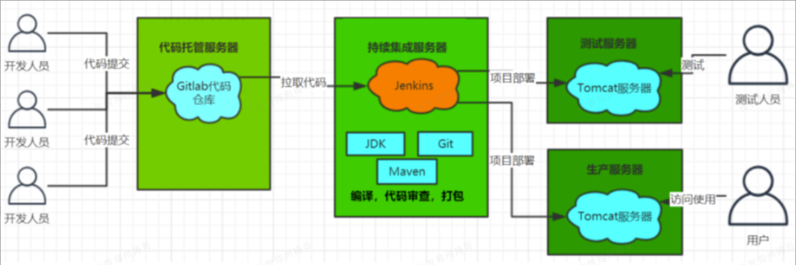
> 图注：图片展示了Jenkins自动部署的流程。开发人员提交代码至Gitlab代码仓库，Jenkins从仓库拉取代码，进行编译、代码审查、打包等操作，再将项目部署到测试服务器和生产服务器，由测试人员和用户进行测试和访问使用。图中还标注了JDK、Git、Maven等关键组件，以及Tomcat服务器等部署环境，直观呈现了Jenkins在项目构建、部署中的作用。

1. 配置Jenkins项目：在Jenkins上创建一个新项目，并设置相关参数，例如项目名称、源码管理方式、构建触发条件等
2. 源码拉取：当触发条件满足时，Jenkins会从Git仓库中获取最新的代码。
3. 构建过程：在构建过程中，Jenkins将执行一系列操作来构建Java项目，例如：

   - 设置构建环境：确定使用的Java开发工具、编译器版本等
   - 安装依赖：如果项目需要依赖其他库或框架，Jenkins会通过构建工具Maven下载和安装所需的依赖项。
   - 编译项目： 执行编译命令，将Java代码编译成可执行的字节码文件
   - 运行测试：执行单元测试、集成测试等，以确保代码质量和功能正确性
   - 代码打包：将编译后的代码打包成JAR文件，以备部署使用
4. 部署到服务器：完成构建后，Jenkins可以使用不同的方式将构建结果部署到服务器上，例如：

   - 远程拷贝：通过SSH或其他协议将构建生成的文件复制到目标服务服务器上。
   - 容器化部署：使用Docker或其他容器技术，在目标服务器上创建并运行包含应用程序的容器
5. 验证部署：Jenkins可以通过发送请求或执行自动化测试等方式验证部署的应用程序是否正常运行。


Jenkins通过提供一个可定制的、持续集成和交互的自动化流程，结合不同的插件和工具，实现了Java项目的自动化部署。它可以自动化执行构建、测试和部署等任务，减少人工操作，提高交付速度和质量。同时，Jenkins还支持日志记录、通知、报告生成等记录，方便开发团队进行监控和跟踪。

### 你公司的性质

```Java
我们是小型项目外包制公司，主要业务是接项目做，我们技术团队负责开发客户的项目并交付给客户使用。我们可以实现任何客户的需求（小程序、APP、官方网站、管理系统）
```

### 技术团队组成

```Java
公司总人差不多二三十人，技术团队（技术部）总共12人，1个技术经理、4个Java、其他各一个，包括产品经理、UI、前端、IOS、安卓、运维、测试。（注意小公司是没有架构师和项目经理）。我认为自己在团队中属于中等偏上水平，能独立按时保质的完成领导交代的任务。
```


## Day24

### 软件开发流程

```Java

```

### 项目开发为什么需要这么久

### 项目做了这么久怎么挣钱

### 为什么用微服务而不是单体项目

### 为什么你们用的是这个RabbitMQ而不是Kafka？


## Day25

### 软件开发流程

### 项目开发为什么需要这么久

### 项目做了这么久怎么挣钱

### 为什么用微服务而不是单体项目

### 为什么你们用的是这个RabbitMQ而不是Kafka？

### 第一个项目的甲方公司是哪家

### 技术选型由谁决定

## Day26

### 你的工作是谁安排的

### 写过技术文档吗

### 设计过接口文档吗

### 接口文档规范你知道吗

### 接口文档是由谁负责的，文档里有什么

### 在项目中设计过表吗，具体是哪些表？

## Day27

### 写过前端页面吗，前端水平如何

### 怎么判断代码写的好不好

### 接口健壮性如何保障

### 接口幂等性是啥

### API接口很慢如何解决

## Day28

---
> 来源：飞书技术知识库（脱敏版） · 08 面试知识库 / 八股文面试题 / 每日背诵 · [原文](https://ccn8v2zngwsm.feishu.cn/wiki/EVTQwyGJIiJ0Y2kKKlFccfbNngg)
