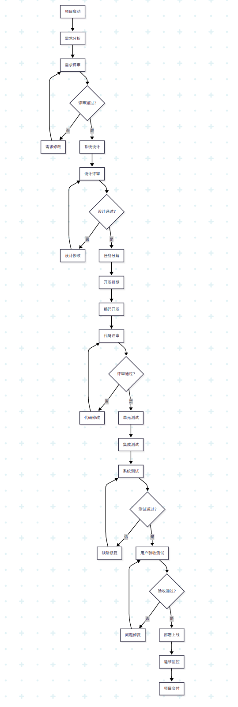
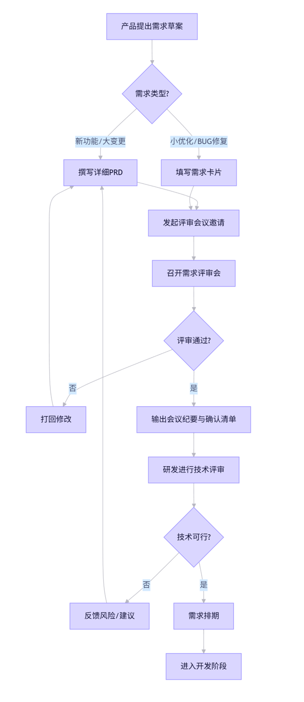
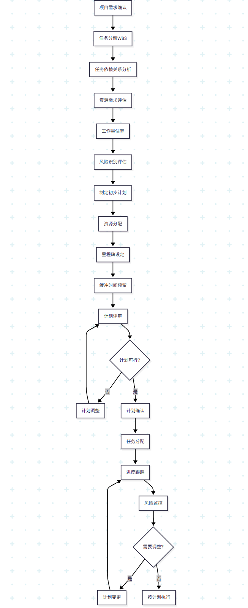
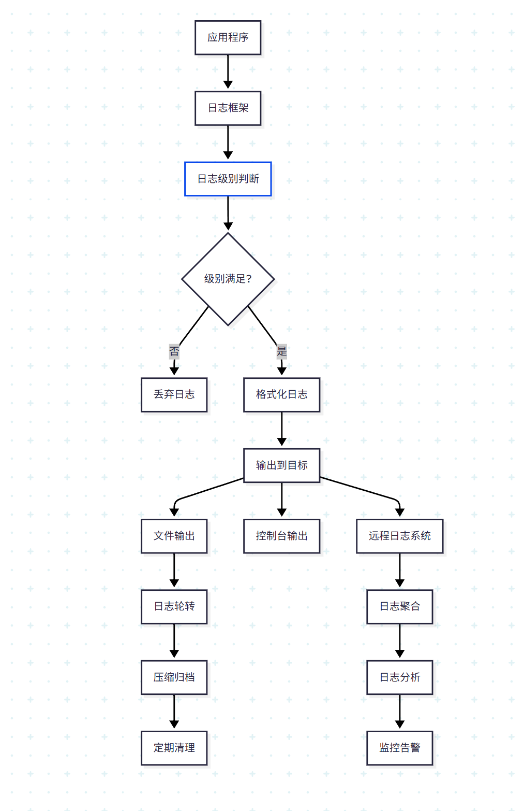
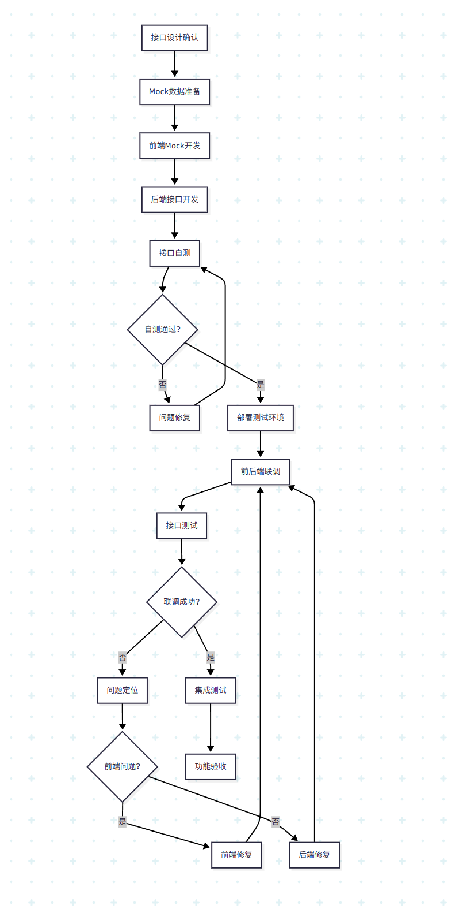
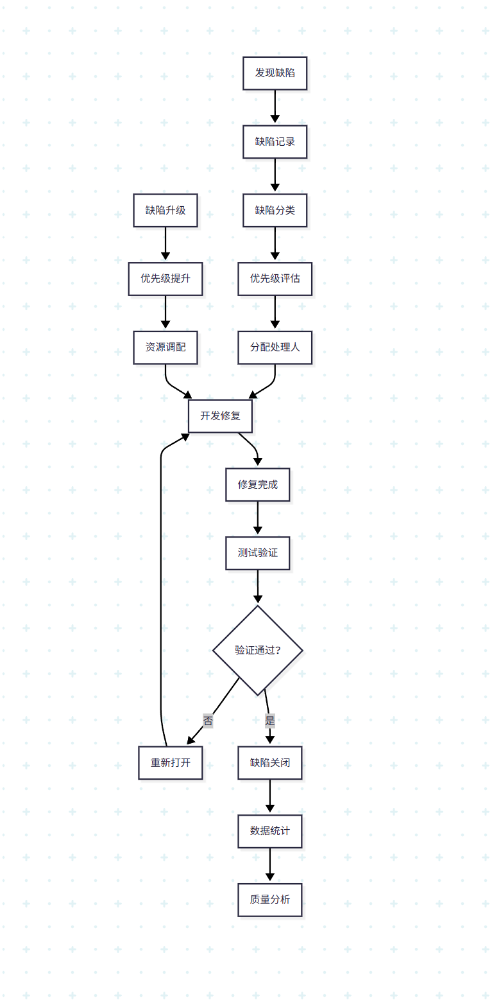
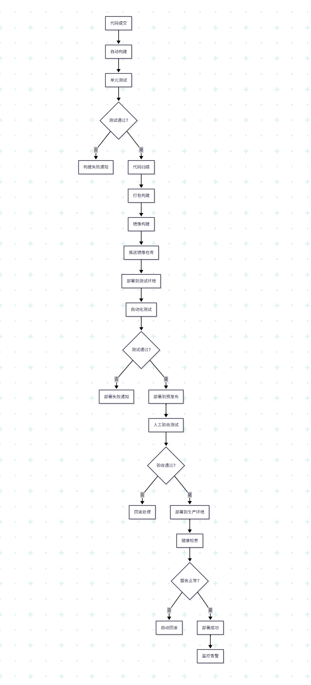
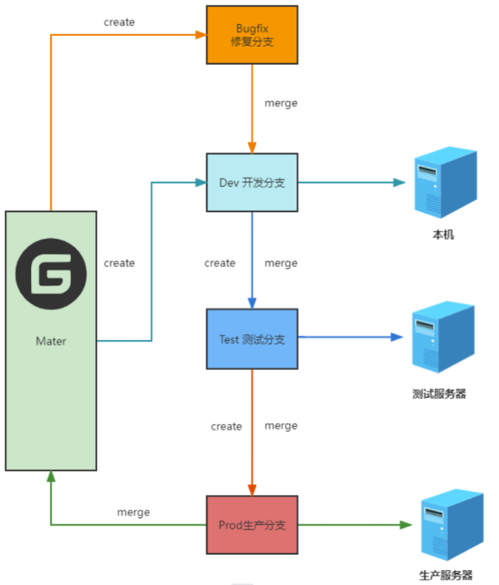
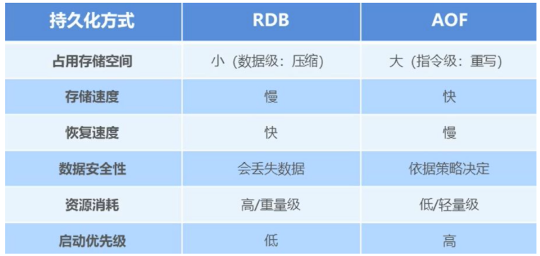

# 公共面试题

## 一. 团队规范

### 软件开发流程图

### 需求评审规范

#### 流程图

\>>>>流程图放这里<<<<

#### 说明

<callout emoji="🥛">
### **流**程起点：产品提出需求方案

- 产品经理或业务方提出新的产品需求
- 形成初步的需求方案和想法
### 需求类型判断

**流程中有一个关键的分支判断点，根据需求类型分为两条路径：**

**路径A：新功能/大变更**

- **撰写详细PRD**：产品需求文档（Product Requirements Document）
- 包含详细的功能描述、用户故事、业务逻辑等
- 适用于复杂功能或重大变更

**路径B：小优化/BUG修复**

- **填写需求卡片**：简化的需求描述
- 适用于小的功能优化、界面调整、缺陷修复等
- 流程相对简化，提高效率
### **评审会议**安排

- **发起评审会议邀请**：组织相关人员参与评审
- **召开需求评审会**：集中讨论需求的合理性和可行性
### **评审决策点**

**评审通过？** 这是流程中的核心决策点：

如果评审不通过（否）：

- **打回修改**：需求方案存在问题
- 返回到流程起点，重新完善需求方案
- 形成闭环，确保需求质量

**如果评审通过（是）：**

- 进入下一阶段的技术评审
### **技术可行性评审**

- **输出会议纪要并确认清单**：记录评审结果和待办事项
- **研发进行技术评审**：技术团队评估实现方案
### **技术评审决策**

**技术可行？ 第二个关键决策点：**

**如果技术不可行（否）：**

- **反馈风险/建议**：技术团队提出风险点和改进建议
- 可能需要调整需求方案或寻找替代方案

**如果技术可行（是）：**

- **需求排期**：将需求纳入开发计划
- **进入开发阶段**：正式启动开发工作
</callout>

### 任务排期规范

#### 流程图

\>>>>流程图放这里<<<<

#### 说明

<callout emoji="🥛">
### 任务分解原则：
- 按功能模块分解
- 单个任务工期不超过5个工作日
- 任务颗粒度适中，便于跟踪
- 明确任务输入输出和验收标准
### 工作量估算方法：
- 专家判断法：基于经验估算
- 类比估算法：参考历史项目
- 三点估算法：乐观、悲观、最可能时间
- 功能点估算法：基于功能复杂度
### 里程碑管理：
- 需求确认里程碑
- 设计完成里程碑
- 开发完成里程碑
- 测试完成里程碑
- 上线部署里程碑
### 风险管理：
- 技术风险：新技术学习成本
- 资源风险：人员变动、技能不匹配
- 进度风险：依赖延期、需求变更
- 质量风险：测试不充分、缺陷遗漏
</callout>

### Java开发规范

<callout emoji="🏆">
### 类命名：
- 使用大驼峰命名法（PascalCase）
- 类名应该是名词，如 `UserService`、`OrderController`
- 接口名以 `I` 开头或以 `able` 结尾，如 `IUserService`、`Serializable`
### 方法命名：
- 使用小驼峰命名法（camelCase）
- 方法名应该是动词，如 `getUserById()`、`calculateTotal()`
- 布尔类型方法以 `is`、`has`、`can` 开头
### 变量命名：
- 使用小驼峰命名法
- 常量使用全大写加下划线，如 `MAX_SIZE`、`DEFAULT_TIMEOUT`
- 包名全小写，如 `com.company.project.module`
</callout>

### 表设计规范

<callout emoji="🏖️">
## **命名规范：**

### **表命名**

- 使用小写字母和下划线
- 表名要有意义，体现业务含义
- 避免使用保留字和关键字

### **字段命名**

-  使用小写字母和下划线
-  主键统一命名为 \`id\`
-  外键命名为 \`关联表名_id\`，如 \`user_id\`
-  布尔字段以 \`is\_\` 开头，如 \`is_active\`
-  时间字段以 \`\_time\` 结尾，如 \`create_time\`
## 字段设计规范：

### **数据类型选择：**

-  整数类型：根据数值范围选择 TINYINT、SMALLINT、INT、BIGINT
-  字符串类型：定长用 CHAR，变长用 VARCHAR
-  间类型：使用 DATETIME 或 TIMESTAMP
-  金额类型：使用 DECIMAL，避免 FLOAT 和 DOUBLE

### **字段约束：**

-  主键字段：NOT NULL + AUTO_INCREMENT
-  必填字段：添加 NOT NULL 约束
-  唯一字段：添加 UNIQUE 约束
-  外键字段：添加外键约束和索引
-  默认值：为字段设置合理的默认值
## 索引设计规范

### 索引类型：

-  主键索引：每个表必须有主键
-  唯一索引：保证数据唯一性
-  普通索引：提高查询性能
-  复合索引：多字段组合查询

### 索引设计原则：

-  为经常查询的字段创建索引
-  为外键字段创建索引
-  避免在小表上创建过多索引
-  复合索引遵循最左前缀原则
-  定期分析和优化索引使用情况
## 表设计最佳实践
-  每个表必须有主键
-  每个表必须有 \`create_time\` 和 \`update_time\` 字段
-  使用逻辑删除，添加 \`is_deleted\` 字段
-  大字段单独建表，避免影响主表查询性能
-  合理使用分区表处理大数据量
</callout>

### 接口设计规范

<callout emoji="🎹">
**URL 设计**：
- 使用名词而非动词，如 `/users` 而非 `/getUsers`
- 使用复数形式，如 `/users`、`/orders`
- 层级关系用斜杠表示，如 `/users/{id}/orders`
- 使用小写字母和连字符，如 `/user-profiles`
**HTTP 方法**：
- GET：获取资源
- POST：创建资源
- PUT：更新整个资源
- PATCH：部分更新资源
- DELETE：删除资源
**状态码规范**：
- 200：请求成功
- 201：创建成功
- 400：请求参数错误
- 401：未授权
- 403：禁止访问
- 404：资源不存在
- 500：服务器内部错误
</callout>

### 分支管理规范

#### 流程图

\>>>>流程图放这里<<<<

#### 说明

<callout emoji="🥛">
**分支类型**：
- **master分支**：生产环境代码，只能通过合并更新
- **develop分支**：开发环境代码，集成所有功能
- **feature分支**：功能开发分支，从develop创建
- **release分支**：预发布分支，从develop创建
- **hotfix分支**：紧急修复分支，从master创建
**分支命名规范**：
- feature分支：`feature/功能名称`，如 `feature/user-login`
- release分支：`release/版本号`，如 `release/v1.2.0`
- hotfix分支：`hotfix/问题描述`，如 `hotfix/login-bug`
**合并规范**：
- 使用Pull Request进行代码合并
- 合并前必须进行代码评审
- 合并时使用 `--no-ff` 参数保留分支历史
- 删除已合并的feature分支
**版本管理**：
- 使用语义化版本号：主版本.次版本.修订版本
- 每次发布都要打标签
- 标签命名：`v1.2.0`、`v1.2.1`
</callout>

### 日志管理规范

#### 流程图

\>>>>流程图放这里<<<<

#### 说明

<callout emoji="🥛">
**日志级别：**
- **ERROR**：错误信息，系统异常
- **WARN**：警告信息，潜在问题
- **INFO**：一般信息，业务流程
- **DEBUG**：调试信息，详细执行过程
- **TRACE**：跟踪信息，最详细的执行信息
**日志格式**：
[时间] [级别] [线程] [类名] - 日志内容
**日志内容规范**：
- 关键业务操作必须记录日志
- 异常信息必须记录完整堆栈
- 敏感信息不能记录到日志中
- 日志内容要简洁明了，便于问题定位
**日志管理策略**：
- 按日期和大小进行日志轮转
- 压缩历史日志文件节省空间
- 定期清理过期日志文件
- 重要日志备份到远程存储
**性能考虑**：
- 生产环境关闭debug和TRACE级别
- 使用异步日志提高性能
- 避免在循环中打印大量日志
- 合理设置日志缓冲区大小
</callout>

### 前后端联调规范

#### 流程图

\>>>>流程图放这里<<<<

#### 说明

<callout emoji="🥛">
**联调准备**：
- 接口文档详细定义（URL、参数、响应格式）
- Mock数据准备，覆盖正常和异常场景
- 测试环境搭建和数据准备
- 联调计划制定，明确时间和责任人
**联调环境**：
- **开发环境**：开发人员自测使用
- **测试环境**：前后端联调使用
- **预发布环境**：最终验收使用
- 环境数据隔离，避免相互影响
**联调流程**：
1. 后端接口开发完成并自测通过
2. 部署到测试环境
3. 前端切换到真实接口
4. 执行联调测试用例
5. 问题记录和跟踪
6. 修复验证
7. 联调完成确认
**问题管理**：
- 使用统一的问题跟踪工具
- 问题分类：接口问题、数据问题、逻辑问题
- 问题优先级：P0紧急、P1重要、P2一般、P3优化
- 问题状态跟踪：新建、处理中、已修复、已验证、已关闭
**联调测试用例**：
- 正常流程测试
- 异常场景测试
- 边界值测试
- 并发测试
- 性能测试
</callout>

### 禅道缺陷管理规范

#### 流程图

\>>>>流程图放这里<<<<

#### 说明

<callout emoji="🥛">
**缺陷分类**：
- **功能缺陷**：功能不符合需求
- **界面缺陷**：UI显示问题
- **性能缺陷**：响应时间过长
- **兼容性缺陷**：浏览器或设备兼容问题
- **安全缺陷**：安全漏洞
**优先级定义**：
- **P0-紧急**：系统崩溃、核心功能不可用
- **P1-高**：主要功能异常，影响用户使用
- **P2-中**：次要功能问题，有替代方案
- **P3-低**：界面美化、体验优化
**缺陷状态**：
- **新建**：缺陷刚被发现和记录
- **确认**：缺陷被确认为有效缺陷
- **分配**：缺陷已分配给开发人员
- **修复**：开发人员已修复缺陷
- **测试**：缺陷修复后等待测试验证
- **关闭**：缺陷已修复并验证通过
- **拒绝**：缺陷被认为不是问题
**缺陷记录规范**：
- 缺陷标题简洁明了
- 详细描述重现步骤
- 附加截图或日志信息
- 标明测试环境和数据
- 记录预期结果和实际结果
**质量度量**：
- 缺陷发现率
- 缺陷修复率
- 缺陷重开率
- 缺陷修复周期
- 缺陷密度分析
</callout>

### 项目部署规范

#### 流程图

\>>>>流程图放这里<<<<

#### 说明

<callout emoji="🥛">
**环境管理**：
- **开发环境**：开发人员日常开发使用
- **测试环境**：功能测试和集成测试
- **预发布环境**：生产环境的完整复制
- **生产环境**：正式对外提供服务
**部署策略**：
- **蓝绿部署**：维护两套相同的生产环境
- **滚动部署**：逐步替换旧版本实例
- **金丝雀部署**：小流量验证新版本
- **A/B测试**：同时运行两个版本进行对比
**CI/CD流水线**：
- 代码提交触发自动构建
- 自动执行单元测试和代码扫描
- 构建Docker镜像并推送到仓库
- 自动部署到测试环境
- 执行自动化测试
- 人工确认后部署到生产环境
**回滚机制**：
- 保留最近3个版本的镜像
- 部署失败自动回滚到上一版本
- 提供手动回滚功能
- 回滚后进行健康检查
**监控告警**：
- 应用性能监控（APM）
- 基础设施监控
- 业务指标监控
- 异常告警和通知
- 日志聚合和分析
**安全规范**：
- 镜像安全扫描
- 敏感信息加密存储
- 网络访问控制
- 权限最小化原则
- 审计日志记录
</callout>

## 二. 公司个人情况

> **注意：这块每个人针对自己的情况进行修改答案**

### 公司在什么位置

<callout emoji="🎁">
广州市越秀区东华东路638号601房
16年成立
**地铁 1 号线 东山口站**
- 出口：**E/F 出口**
- 路线：出站沿东华东路向东直行，过署前路路口即到。
**地铁 6 号线 东湖站**
- 出口：**B2 出口**
公司位于东华东路东悦居大厦（638 号）内，临街写字楼，入口靠近 “东华东路 - 菜园东” 路口。
**东华市场社区 / 东山少爷公园**（约 200 米）
**越秀区图书馆（东山分馆）**（约 300 米）
**东川路商圈 / 东川新街市**（约 300 米）
</callout>

### 技术团队组成

<callout emoji="⚽">
公司总人数差不多二三十人，技术团队（技术部）总共12人，1个技术经理、4个Java、其他各1人，包括产品经理、UI、前端、IOS、安卓、运维、测试。（注意小公司内是没有架构师的和项目经理）。我认为自己在技术团队属于中等偏上水平，能独立按时保质的完成领导交代的任务。
</callout>

### 薪资与社保

> **如果你的原来工作经历公司是一线城市，那么月薪都不能低于15K，冲高薪的可写更高**

<callout emoji="🎹">
**广州 18K，每月发薪日：10号，建设银行**
**记住公式：**
- 基础工资占比70%
- 绩效工资占比30%
假设之前是18K，基础工资是12600，绩效工资是5400
是否涨薪过：涨薪过了，入职9K，中间涨了2次，离职是18K
**社保和五险一金情况**
- 面试城市和工作经历城市在同一个省份：我的公司不正规，五险一金没交
- 面试城市和工作经历城市不在同一个省份：我的公司只交了五险，没交公积金（社保基础为10K）
**五险一金查询**
- 社保缴纳比例查询网站：https://www.zhipin.com/wage/
- 薪资、缴纳基础、五险一金缴纳比例、每个月到手薪资大概多少

  - **同省：没有缴纳五险一金，不存在缴纳比例**
  
    - 每个月到手：16,710元（平均16.7K多）
  - **异省：只缴纳了五险，没有一金**
  
    - 社保缴纳基数：10000
    - 养老保险：8%
    - 医疗保险：2%
    - 失业保险：0.5
    - 生育保险：0
    - 工伤保险：0
    - 每个月到手：15,047元 （平均每月15K多）
</callout>

### 为什么离职

<callout emoji="🎉">
- 由于父母在这边做生意或由于女朋友是这边的，希望自己来这里发展。
女朋友毕业后在这边上班，希望自己来这里发展
我住哪：郑州市金水区丰产路街道经三路明鸿新城 （郑州）

上海市浦东新区潍坊新村街道（上海）
</callout>

### 高考分数？

<callout emoji="🌅">
498（一本线484） 本校专业分数线392
</callout>

### 学校在什么位置？

<callout emoji="✏️">
河南省郑州市新郑市双湖大道2号郑州经贸学院
南四环，双湖大道地铁站（二号线），河南工程学院附近
</callout>

### 大学专业所学的课程有哪些？

<callout emoji="🍞">
C++两学期，数字电子技术，计算机组成原理，计算机网络，
计算机导论，程序设计基础，大学英语，高数，JavaEE,软件工程，网络安全技术，操作系统，编译原理，数据库原理与应用
</callout>

## 三. 项目面试话术

> **注意：问题如果有跟自己项目相关的，答案必须结合着自己的项目进行修改**

这里有个非常重要的第一点就是：软件开发流程每个环节涉及到的主要问题，都要非常熟悉

### 该项目是单体架构还是微服务架构？为什么使用微服务架构？

<callout emoji="🎉">
因为技术经理决定了技术栈就是微服务SpringCloud的技术栈，所以就搭建了多个微服务的项目。我猜测他之所以选微服务技术框架，原因可能是他预估我们的项目将来会有很高的并发量，并且我们的业务也比较复杂，所以应该考虑根据业务模块拆分微服务，这样更加方便管理、维护和部署。
</callout>

### 项目中用到了哪些SpringCloud组件？

<callout emoji="✏️">
- Nacos注册中和配置中心
- SpringCloudLobalancer负载均衡
- Feign服务调用
- Gateway网关
- Sentinel流控组件
</callout>

### 该项目分为多少个端？具体都有哪些端？每个端的核心功能是什么？

<callout emoji="📍">
该项目分为**三个端：管理端、小程序端、APP端。** 
正式百居易 主项目表述
管理端：房源管理模块、日历价管理模块、库存管理模块、订单管理模块、入住管理模块、消息中心模块、自动化任务模块、财务报表模块、小程序配置模块等
小程序端：房源浏览模块、房间预订模块、日期选择模块、订单下单模块、支付模块、订单查询模块、订单状态查看模块、入住提醒模块等
APP端：订单处理模块、消息处理模块、任务处理模块、入住办理模块、运营操作模块等
</callout>

### 该项目的技术栈如何？该项目springboot和springcloud用的什么版本？mysql用的什么版本？

<callout emoji="👍">
● 整体架构：springcloud+springboot+MyBatis+MyBatis-plus+spring MVC
● 表现层：用户端：APP，管理端：VUE+ElementUI
● 服务层：springcloud，gateway ，feign，nacos，springboot，mybatisplus，aliyunOSS
● 数据层：mysql
● 中间件：redis，RabbitMQ，springtask，xxljob
● springboot的版本是2.7.2
● springcloud的版本是2021.0.3
● mysql的版本是8.0.23
</callout>

### 该项目有多少个微服务？每个微服务的核心功能是什么？ (单体项目不写) 

<callout emoji="🏕️">
api 微服务, 
该项目共有12个微服务。主要包括：权限团队微服务、房源微服务、渠道集成微服务、库存微服务、价格微服务、订单微服务、入住微服务、消息中心微服务、自动化微服务、任务微服务、财务报表微服务、小程序微服务。 
● 权限团队微服务（iam-team-service），核心功能：租户、用户、角色、权限、团队组织管理，登录认证与租户隔离
● 房源微服务（property-service），核心功能：房源、房型、房间、设施、规则等主数据维护
● 渠道集成微服务（channel-integration-service），核心功能：对接外部渠道，完成渠道授权、房态房价同步、订单同步与异常重试
● 库存微服务（inventory-service），核心功能：房态库存管理、库存占用与释放、防止超售
● 价格微服务（pricing-service），核心功能：日历价管理、费用项配置、微店专属价格设置
● 订单微服务（order-service），核心功能：订单创建、订单状态流转、改期取消换房、支付后订单推进
● 入住微服务（stay-service），核心功能：入住提醒、入住确认、在住管理、退房处理
● 消息中心微服务（messagehub-service），核心功能：多渠道消息聚合、统一会话管理、智能回复、消息发送
● 自动化微服务（automation-service），核心功能：自动化规则配置、规则触发、自动提醒、状态推进
● 任务微服务（task-service），核心功能：定时任务、补偿任务、失败重试、任务执行跟踪
● 财务报表微服务（finance-report-service），核心功能：账单明细归并、报表生成、报表查询、报表导出
● 小程序微服务（store-miniapp-service），核心功能：小程序房源查询、价格库存校验、下单支付对接、订单同步 
</callout>

### 该项目的开发周期和人员配备如何？你的水平如何？

<callout emoji="🌰">
- 总共计划6个月
- 参与人员7个人，3个Java 、2个移动端开发、1个运维、1个测试
- 我认为自己在技术团队属于中等偏上水平，能独立**按时保质**的完成领导交代的任务。
</callout>

### 功能模块的开发周期

<callout emoji="🦄">
- 这个项目开发多久？

  - 6个月 4个月开发 两个月维护
- 这个模块开发多久？

  - 复杂模块，两周左右
- 这个功能开发多久？

  - 复杂功能，一周左右
- 普通模块或功能

  - 两到三天
</callout>

### 该项目的开发流程是什么样的？你参与了哪些？

<callout emoji="✏️">
开发流程：需求分析、系统设计、接口设计、技术选型、代码开发、集成测试、部署上线、运维监控。我参与接口设计和代码开发。
</callout>

### 你在团队中的角色是什么样的

<callout emoji="🌰">
如果对方问你在项目中啥角色？项目是你一个人做的吗？
回答技巧：我在团队中属于后端Java开发，项目是我们团队开发完成的，我是其中一份子，负责了一部分功能的开发。
</callout>

### 该项目的数据库一共有多少张表？核心表和字段有哪些？ 

<callout emoji="🌅">
该项目数据库大约有**30+张表**，其中核心表有：
● **会话表（hostgpt_session）**，核心字段有（id 主键ID，tenant_id 租户ID，session_no 会话编号，guest_uid 用户标识，channel 渠道来源，session_status 会话状态）
● **消息表（hostgpt_message）**，核心字段有（id 主键ID，session_id 会话ID，role 角色，content 消息内容，answer_type 回复类型）
● **知识表（knowledge_chunk）**，核心字段有（id 主键ID，tenant_id 租户ID，title 标题，question 问题，answer 答案，version 版本号）
● **入住单表（stay_order）**，核心字段有（id 主键ID，tenant_id 租户ID，order_no 订单号，room_id 房间ID，check_in_date 入住日期，check_out_date 离店日期，stay_status 入住状态）
● **履约任务表（stay_task）**，核心字段有（id 主键ID，task_no 任务编号，order_no 订单号，task_type 任务类型，execute_status 执行状态）
● **房态库存表（room_inventory）**，核心字段有（id 主键ID，room_id 房间ID，biz_date 业务日期，sale_status 售卖状态，available_count 可售数量）
● **账单明细表（financial_bill_detail）**，核心字段有（id 主键ID，order_no 订单号，room_id 房间ID，channel 渠道，income_type 收支类型，amount 金额，biz_date 业务日期）
● **报表表（financial_statement）**，核心字段有（id 主键ID，room_id 房间ID，stat_date 统计日期，channel 渠道，revenue 收入，cost 成本，profit 利润）
● **导出任务表（financial_export_task）**，核心字段有（id 主键ID，export_no 导出编号，date_range 日期范围，file_url 文件地址，task_status 任务状态）
● **小程序订单表（mini_program_order）**，核心字段有（id 主键ID，order_no 订单号，applet_order_no 小程序订单号，user_openid 用户标识，order_amount 订单金额，order_status 订单状态）
● **订单明细表（mini_program_order_item）**，核心字段有（id 主键ID，order_no 订单号，room_id 房间ID，check_in_date 入住日期，check_out_date 离店日期，price_snapshot 价格快照）
● **支付流水表（payment_record）**，核心字段有（id 主键ID，order_no 订单号，transaction_id 支付流水号，pay_channel 支付渠道，pay_amount 支付金额，pay_status 支付状态）
● **支付配置表（payment_config）**，核心字段有（id 主键ID，app_id 应用ID，merchant_no 商户号，notify_url 回调地址，status 状态）
</callout>

### 如何设计数据库和表，项目中表的设计规范

<callout emoji="🥛">
- **数据库设计规范**

  - 根据业务模块拆分数据库（业务模块垂直分库）
  - 同一业务模块的表在一个数据库里
- **表设计规范**

  - 表名、字段名全部小写英文带下划线
  - 字段类型长度根据实际需求选择
  - 设计基础字段（主外键ID、时间、逻辑删除、版本）
  - 添加必要冗余字段
  - 添加必要索引（常用于查询的单字段或组合索引），单表索引建议控制在5个以内
  - 规划分表（单表超500万行或容量超2G才分表）
</callout>

### 该项目整体请求和响应格式是如何设计的？

<callout emoji="📌">
1. **前端页面：**查询操作是发送GET请求, 新增操作是发送POST请求,修改操作是发送PUT请求,删除操作是发送Delete请求
1. **后端传递数据：**DTO、VO、实体类：PO、query
**3.请求参数设计：**
1)修改和新增是json格式提交的数据
2)简单的查询和删除使用的是路径传参
3)分页查询比较特殊,项目中分页查询的请求参数设计的是 key=value 格式传递参数
4.响应结果设计：
 {"code": "","data": "","msg": "", ... ...}
- code表示请求处理的状态码。不同的状态分配不同的状态码，例如200表示成功，404表示资源未找到，500表示服务器内部错误。
- data表示响应的数据。它包含了请求处理后需要返回给用户端的具体数据，例如查询结果、资源对象等。  
- msg表示用于当前状态码的解释的文本描述。
</callout>

### 该项目是否上线以及能否访问？

<callout emoji="🥛">
- **我最近做的这个项目：**之前的版本已经上线过，下个版本预计下个月上线
- **之前的所有项目：**全部都上线过，至于他们现在是否还处于上线状态我就不太清楚，原因是最近这半年多领导没让我负责之前的项目了，我一直在忙最近这个项目
</callout>

### 生产有多少服务器？

<callout emoji="📚">
项目用到的服务器数量具体多少，我是一线开发人员不太清楚，是由技术经理和运维负责人来决定的；生产部署由运维人员负责。由于我们是容器化部署，我感觉服务器数量不会太多，几台高配的服务器应该就足够了。
</callout>

### 项目上线后有多少用户量？并发量有多大？

<callout emoji="💡">
- **最近这个项目：**用户量9W左右，日活2000左右，并发量（QPS/TPS）在200左右
- **之前的项目：**由于最近没负责之前的项目了，所以他们的线上数据我也不太清楚了
</callout>

### 生产环境哪些表的数据量最多？

<callout emoji="🎹">
任何项目中，数据量最大的表是操作日志表，记录了用户的所有操作日志信息
如果从业务角度看，**数据量相对较大的表**还有：  
 ● **订单表**：记录全渠道订单数据  
 ● **入住单表（stay_order）**：记录入住履约过程数据  
 ● **账单明细表（financial_bill_detail）**：记录最细粒度的财务明细数据  
 ● **支付流水表（payment_record）**：记录支付全过程数据
</callout>

### 你认为最有难度的项目是哪个？最有难度的功能呢？

<callout emoji="❤️">
我认为最有难度的项目是**百居易 PMS 民宿管理系统**，因为这个项目是一个**多租户 + 多渠道 + 高并发的业务系统**，涉及订单、库存、入住、财务等多个核心模块协同。
最有难度的功能是**入住管理与退房自动化模块**。
主要难点在于：
- **流程复杂**：从入住提醒到退房再到保洁派单，链路很长
- **一致性要求高**：需要同时更新入住单和房态库存
- **异步任务多**：容易出现重复执行问题
</callout>

### 你认为最有挑战的是哪个项目？

<callout emoji="🌅">
- **我认为最有难度的项目是百居易 PMS 民宿管理系统**
</callout>

### 你认为哪个功能最有难度？

<callout emoji="🥇">
我认为最有难度的功能是**入住管理与退房自动化模块**。
因为这个模块是订单完成后的核心履约链路，涉及**入住提醒、入住办理、在住管理、自动退房、保洁派单等多个流程节点**，整个流程比较长且复杂。
主要难点在于：
- **多服务协同**：需要同时操作订单、入住、库存等多个服务
- **数据一致性要求高**：例如退房时要同步更新入住单和房态库存
- **异步任务多**：像自动退房、提醒任务容易出现重复执行
针对这些问题，我主要通过：  
 👉 **分布式事务（Seata）+ Redis分布式锁 + 状态机幂等控制 + MQ重试机制**
来保证系统的**一致性和任务最终执行成功**。
</callout>

### 该项目有日志系统吗？如何实现记录日志的？

<callout emoji="📍">
项目中肯定会记录日志啊，将来生产出现问题要依靠日志排查的。
我们项目中的日志技术使用的SpringBoot内置的Logback技术。
一般项目中记录日志会现在类上添加@Sl4j注解，在需要记日志的地方，主要记录两种日志
- 一种是常规业务日志，使用log.info("[模块名]xxxxx:{}", 参数值)
- 一种是错误业务日志，使用log.error("[模块名]xxxxx:{}", 参数值)
</callout>

### 该项目整体异常处理是如何设计的？

<callout emoji="🌟">
1. 项目中会统一自定义一个异常类BaseException，它可以继承RuntimeException用来封装原始异常信息
2. 项目中会统一自定义一个处理异常的类，如ExceptionHandler。在该类中自定义一个方法handleException方法，用于捕获和处理项目中出现的所有异常
3. 项目中使用Spring的全局异常处理器，也就是RestControllerAdvice注解声明的一个处理器，来处理不同的异常，主要区分处理自定义异常和运行时异常...。
4. 自定义异常往往是业务异常，所以打印一下log即可。
5. 运行时异常大概率是代码bug，所以不仅要打log，还会记录到数据库或者发送短信消息给运维和开发。
</callout>

### ES数据量有多大啊，怎么这点数据还用ES呢？

<callout emoji="🎁">
- 目前系统刚上线没多久，我们的商品或文章或XX数据总共也就20万
- 至于为啥用ES，是因为ES支持各种复杂搜索，基于倒排索引机制，可以实现快速高效分词搜索！如果用mysql实现分词模糊查询效率是非常低的。并且项目设计初期已经预测到未来的数据量会非常大。
</callout>

### 该项目用MQ了吗？哪个模块用了？具体怎么用的？为什么要用MQ?

<callout emoji="🥛">
该项目中**消息模块、入住履约模块、财务报表模块、订单模块等都用到了MQ**。
针对不同业务会定义不同的MQ消息，比如**消息发送、入住提醒、自动退房、支付成功、账单生成等消息**。基本流程是：  
 首先由业务服务发送MQ消息，然后编写MQ监听器进行监听，消费者监听到消息后执行对应操作，比如发送通知、更新订单状态、生成账单等。
MQ在这个项目中的主要作用是：  
 一是**实现系统解耦**，各个模块之间不需要直接调用，通过MQ进行通信；  
 二是**应对高并发场景**，比如下单和支付时通过MQ削峰；  
 三是**支持失败重试和补偿机制**，保证任务最终执行成功。
</callout>

### 该项目用redis了吗？哪个模块用了？具体怎么用的？为什么要用redis?

<callout emoji="🌟">
该项目中**订单模块、库存模块、入住履约模块、消息模块、财务报表模块等都用到了Redis**。
具体的使用要根据不同的业务场景来实现，基本就是将热点数据先缓存到Redis中，在查询时优先从Redis读取，减少数据库访问；对于需要持久化的数据，再通过数据库进行存储或异步写入。
比如：  
 在**库存模块中**，使用Redisson分布式锁控制并发，防止超卖；  
 在**入住模块中**，缓存入住信息和状态数据，减少数据库查询；  
 在**消息模块中**，缓存会话上下文，提升消息处理效率；  
 在**报表模块中**，缓存报表结果，提升查询性能；  
 在**支付模块中**，通过Redis做幂等控制，防止重复处理。
Redis在项目中的主要作用是：  
 一是**做热点数据缓存和接口缓存**，提升查询速度，减轻数据库压力；  
 二是**存储业务数据**，比如会话数据、订单状态、报表结果等；  
 三是**实现分布式锁**，解决高并发场景下的资源竞争问题；  
 四是**实现幂等控制**，保证接口在重复请求情况下数据安全。
</callout>

### 你的APP有官网吗

<callout emoji="🎼">
有，应用市场也已经上架可搜到！
</callout>

### 你的APP能在应用市场搜到吗

<callout emoji="🍞">
第一个项目必须知道在哪个应用市场能搜到和最近一次的发布上线日期
面试现场，极有可能面试官当面下载你的项目对应的APP，然后打开APP问哪块怎么实现的。
说明我们需要提前下载好APP，使用体验过多次，是你写的功能你就按照简历写的内容扩展回答。不是你写的功能不要硬着头皮回答，应该说：这块是我同事负责的，不是我负责的，您可以问我负责的功能，我知无不言。
</callout>

### 说下开发遇到的困难，头疼棘手的问题，难忘的经历？

<callout emoji="🎉">
在项目中，我遇到过一个比较典型的**性能问题是在财务报表模块中报表生成效率低的问题**。
- **问题：** 原来报表是通过接口实时查询账单明细表（financial_bill_detail）并进行聚合计算的，由于数据量较大，在高峰期会出现**查询慢、接口响应时间长，甚至阻塞用户请求**的问题，用户体验比较差。
- **研究：** 针对这个问题，我研究了将**实时计算改为离线计算 + 缓存优化**的方案。  
 主要引入了**XXL-JOB 定时任务 + Redis缓存技术**，将报表计算从同步接口中拆出来，提前计算好结果。
- **应用：** 在项目中，我通过XXL-JOB定时任务每天定时从账单明细表中读取数据，按日期、房间、渠道进行聚合计算，并将结果写入报表表（financial_statement）。  
 同时，在查询接口中引入Redis缓存，优先读取缓存数据，未命中再查询数据库，并设置TTL控制缓存有效期。
- **效果：** 改造之后，报表查询接口由原来的**秒级甚至更长时间**优化到**毫秒级返回**，数据库压力明显降低，同时也避免了高并发下的性能瓶颈，整体系统稳定性和用户体验都有明显提升。
</callout>

### 项目里使用到的JavaStream常用的方法有哪些？

<callout emoji="✏️">
map filter distinct limit sorted count
</callout>

### AOP在项目中有具体的使用场景吗？

<callout emoji="✍️">
- 公共字段自动填充
- 分布式锁组件
- 事务管理
- 权限管理
- 全局异常统一处理
- SpringCache缓存处理
</callout>

### 服务熔断降级项目中用到过吗？

<callout emoji="📍">
我知道的方案有两种，SpringCloud的**Hystrix组件或Sentinel，我们项目中使用的是Sentinel**
</callout>

### 项目的分支情况如何？

<callout emoji="⚽">
我们的项目分支是多个的，不止一个，根据开发环境的不同，有不一样的分支
- 【master】主干永远是最新的代码，跟生产运行的代码保持一致，项目第一版一般只有master分支
- 【开发分支】每次开发新版功能时，都基于master创建新的分支：分支命名规则与业务功能有关，团队所有成员基于此分支开发
- 【测试分支】每次迭代开发完毕，完成自测和前后端联调后，基于开发分支创建测试分支
- 【测试分支】测试团队基于测试分支部署并进行测试，测试过程中有问题，继续修改开发分支，开发完毕再合并到测试分支
- 【生产分支】测试通过后基于测试分支新建生产分支(注意版本号，此分支代码方便回滚)， 基于生产分支进行部署，如果部署失败则回滚。如果部署成功，则将生产分支代码合并到master分支。
- 【修复分支】基于master新建bugfix分支，快速修复bug，无问题后合并到上次的测试分支，测试无问题后，合并到上次的生产分支并再次合并到master分支进行上线
</callout>

### 前端Vue基础

全栈工程师：前端Vue考察很多，至少保证Vue基础答上来

- Vue生命周期
- Vue常用指令v-on/v-bind/v-if/v-for/v-show
- Vue请求响应处理-Axios

## 四. 高频必会

**项目遇到的问题和解决方案，出现以下问题，都用我们学过的解决方案（从微服务阶段去找）**

### Redis问题

#### **1.1 Redis在项目中哪里使用了？**

**缓存高频访问数据，提升系统响应速度**

- **电商搜索模块**（搜了项目）：使用Redis缓存热门搜索结果和高频访问商品数据，减少Elasticsearch和数据库的查询压力，**使搜索响应时间平均缩短至150ms以内**，同时降低后端查询压力约40%。
- **健康数据看板**（番茄闪轻项目）：将用户周/月健康报告缓存至Redis，**数据加载速度提升70%**，从原1.2秒缩短至0.36秒，显著优化用户体验。

2. **分布式锁与并发控制**

- **促销活动**（9搜了项目）：利用Redis实现分布式锁，结合乐观锁机制解决优惠券超发超领问题，**确保促销活动期间优惠券领取成功率达98%**，保障高并发场景下的数据一致性。

3. **数据结构的灵活应用**

- **积分排名**（叮当早教项目）：基于Redis的**Zset结构实现用户总积分实时排名**，每月自动汇总前30名用户并授予勋章，支持积分兑换功能，同时将榜单数据持久化到数据库。
- **点赞功能**（叮当早教项目）：使用Redis的**Set结构存储用户点赞记录**，Zset存储点赞总数，结合定时任务将数据持久化到数据库，**点赞操作响应时间从300ms缩短至100ms以内**。

4. **异步通信与消息队列配合**

- **订单状态通知**（搜了、好房东租房项目）：通过Redis缓存订单状态变更消息，结合RabbitMQ实现异步通知（如发货提醒、预约成功通知），**确保通知及时率达99%以上**，同时降低系统耦合度。

5. **实时数据存储与在线状态管理**

- **实时沟通模块**（好房东租房项目）：利用Redis缓存用户在线状态和聊天会话数据，配合WebSocket实现租客与房东的实时消息推送，保障高并发场景下的通信稳定性。

6. **库存与限流场景**

- **食材库存预警**（番茄闪轻项目）：通过Redis实时监控库存阈值，当库存低于设定值时触发RabbitMQ预警消息，**因缺货导致的订单取消量减少75%**，提升订单完成率至96%。

通过上述场景的实践，我熟练掌握了Redis的缓存策略设计（如过期时间设置、缓存穿透/击穿防护）、分布式锁实现（Redisson框架应用）及高性能数据结构选型，能够结合业务需求灵活优化系统性能。

#### 1.2 Redis三兄弟问题

- **缓存穿透**

  - 缓存穿透：缓存中和数据库中都没有所查询的东西，从而使数据库崩掉。
  - 解决方案：将一条数据库不存在的数据也放入缓存中这样即使数据库不存在但缓存中有，还可

以使用布隆过滤器。

- **缓存击穿**

  - 缓存击穿：缓存中没有但数据库中有，如果同一时间访问量过大会使数据崩掉。
  - 解决方案：加分布式锁，一条数据访问数据库；将数据存储到缓存中，其他线程从缓存中拿。

- **缓存雪崩**

  - 缓存雪崩：缓存中的数据正好在一个时间删除，当请求来时穿过缓存访问数据库。
  - 解决方案：
  
    - 设置合理的缓存失效时间：针对不同的业务需求，设置不同的缓存失效时间，避免缓存同时失效，引发雪崩效应。
    - 设置缓存锁：在缓存失效时，设置一个短暂的锁定时间，只允许一个请求查询数据库并刷新缓存，其他请求等待锁释放后再读取缓存。

#### 1.3 Redis持久化问题

在`Redis` 4.0之后提供了混合持久化的方式，顾名思义就是把`RDB`持久化和`AOF`持久化结合起来的一种方式。混合持久化就是快照以一定的频率执行，而在两次快照之间，使用 `AOF` 日志记录这期间的所有命令操作。

**选择RDB还是AOF？**

- 如果你的业务场景需要很高的性能，或者宕机之后能够尽快的恢复，而对数据完整性的要求不是那么高，那么可以采用`RDB`持久化的方式。  
- 如果你的业务场景对数据完整性的要求很高，那么可以采用`AOF`的持久化方式，而至于采用那种回写策略，则取决于你对数据完整性的要求程度。    
- 如果你的业务场景既要兼顾性能，又注重数据完整性，那么可以采用混合持久化的方式。    
- 如果你对数据丢失无所谓，追求性能最大化的情况下，甚至可以禁用持久化。

> 最简回答：RDB是Redis的快照持久化方式，通过周期性的快照将数据保存到硬盘，占用更少的磁盘空间和CPU资源，适用于数据备份和恢复，但可能存在数据丢失的风险。AOF是追加日志持久化方式，将每个写操作以追加的方式记录到日志文件中，确保了更高的数据完整性和持久性，但相对于RDB消耗更多的磁盘空间和写入性能，适用于数据持久化和灾难恢复，且可以通过配置实现不同的同步频率。

#### 1.4 Redis集群问题

##### 哨兵集群

Redis的哨兵（Sentinel）机制是一种用于监控和管理Redis实例的高可用性解决方案。它由一组独立运行的Redis哨兵节点组成，用于监控主节点和从节点的状态，并在主节点故障或其他变化时进行自动切换和故障恢复。

**哨兵机制的主要功能和意义如下：**

1. **监控：**哨兵会定期检查Redis实例的状态，包括主节点和从节点的可用性。
2. **自动故障检测和转移：**当主节点失效或不可用时，哨兵可以自动检测到故障，并根据预先配置的策略进行主节点切换，将一个可用的从节点提升为新的主节点。
3. **高可用性：**哨兵可以确保在主节点故障的情况下，系统仍能继续提供服务，通过将从节点升级为主节点，保持系统的可用性。
4. **配置提供：**哨兵还可以提供配置信息，使客户端能够动态获取Redis节点的最新状态，以实现自动的节点发现和故障转移过程。

**哨兵的工作机制如下**

1. 哨兵节点发现彼此，互相通信。
2. 检测主节点是否可用，如果不可用，则标记为下线。
3. 哨兵节点相互投票，选举一个新的主节点候选人。
4. 当大多数哨兵节点投票给同一个候选人时，选举成功，该候选人成为新的主节点。
5. 通知其他从节点重新连接到新的主节点。

使用哨兵机制可以提高Redis的高可用性和可靠性，确保Redis集群在节点故障或其他变化时能够自动进行故障转移和恢复。客户端可以通过连接到哨兵节点，获取正确的Redis节点信息，并保持与Redis集群的稳定连接。

需要注意的是，哨兵机制并不是分布式存储方案，它只实现了高可用性和故障转移，不提供数据分片的功能。如果需要实现数据分片和水平扩展，可以使用Redis集群（Redis Cluster）来实现。

> 最简回答：  
> Redis的哨兵集群主要用于实现高可用性，监控Redis主、从节点的状态变化，并在主节点失效时自动将从节点升级为主节点。哨兵集群由多个哨兵节点组成，工作原理是哨兵节点通过相互通信，监测主节点的健康状态，当主节点失效时，选举新的主节点，并通知其他从节点进行切换，确保系统的可用性。

##### 分片集群

Redis分片集群是一种将数据分布到多个节点的解决方案，用于实现数据的水平扩展和提高系统的吞吐量。

1. **节点数量：**Redis分片集群通常由多个节点组成，每个节点负责存储部分数据。节点数量可以根据需求进行配置，常见的节点数量为3主3从，或3主6从或更多。

2. **故障恢复：**当一个节点出现故障或下线时，集群会进行自动的故障恢复。其他节点会接管故障节点上的数据，保证数据的可用性。

1. **哈希槽原理：**Redis分片集群使用哈希槽来分配和管理数据。哈希槽是一个固定数量的槽，总共槽位数量16384个，每个数据被映射到其中一个槽上。每个节点负责管理一部分槽和相应的数据。
2. **弹性伸缩：**Redis分片集群支持弹性伸缩，可以根据需要增加或减少节点的数量。当节点数量增加时，集群会自动重新计算和迁移哈希槽，确保数据均匀分布在新的节点上。当节点数量减少时，集群会迁移数据，让剩余节点负责故障节点的数据。

通过以上机制，Redis分片集群实现了数据的分布式存储和高可用性。它可以根据实际需求进行节点数量的调整，具备故障恢复能力，并通过哈希槽实现数据的均匀分布，同时支持弹性伸缩以适应业务需求的变化。

**读写数据时是如何定位哈希槽?**

在Redis分片集群中，确切的说法是使用CRC16算法计算Key的哈希值，而不是定位哈希槽。

CRC16算法（循环冗余校验算法）是一种广泛应用于网络通信和数据校验领域的哈希算法，用于计算Key的哈希值。

**举例说明：**

假设有一个包含三个节点的Redis分片集群，节点A、节点B和节点C。每个节点负责存储哈希槽的范围如下：

- 节点A：0-5499
- 节点B：5500-10999
- 节点C：11000-16383

现在有一个Key为"example_key"需要进行操作。

1. 使用CRC16算法计算"example_key"的哈希值，例如为12345。
2. 将哈希值对16384（2^14）求余，得到计算结果为12345 % 16384 = 12345。
3. 根据计算结果12345，确定该数据应该存储在节点C的哈希槽11000-16383范围内。
4. 客户端将数据写入节点C，或者从节点C读取相关数据。

通过CRC16算法计算Key的哈希值，可以得到一个范围在0到16383的整数值，然后根据这个哈希值确定数据所对应的哈希槽范围，进而确定数据的存储位置。

> 最简回答：  
> Redis的分片集群主要用于实现数据的横向扩展，将数据分散存储在多个节点上，提高系统的并发能力和存储能力。分片集群由多个节点组成，根据Key经过哈希算法映射到不同的节点上，每个节点负责存储和处理一部分数据，工作原理是通过一致性哈希算法将数据按照一定规则分配到不同的节点上，实现数据的均衡存储和查询。

#### 1.5 Redis与MySQL数据一致性问题

Redis（或ElasticSearch）和MySQL如何保持数据一致性，以及它们的具体实现和优缺点如下：

1. **同步双写方案：**

- 实现方式：在应用程序中，将数据同时写入Redis（或ElasticSearch）和MySQL，确保两个写操作要么同时成功，要么同时失败。
- 优点：简单直接，实时性较高，不依赖额外组件。
- 缺点：增加了系统复杂性，需要处理并发写冲突，可能导致写入延迟增加。

1. **异步队列方案：**

- 实现方式：将数据更新操作以消息的方式发送到消息队列中，并在消费者程序中分别更新Redis（或ElasticSearch）和MySQL。
- 优点：实现了数据解耦和异步处理，提高了系统的可伸缩性和稳定性。
- 缺点：增加了系统复杂性，引入了消息队列系统，可能会有一定的延迟，需要确保消息消费的可靠性。

1. **Canal方案：**

- 实现方式：使用Canal工具监听MySQL的binlog，将数据变更事件发送到Redis（或ElasticSearch）来更新数据。
- 优点：实时性较高，不需要修改应用程序代码，可以实现MySQL的逻辑解耦和数据的多重同步。
- 缺点：增加了系统复杂性，需要额外的Canal工具和客户端程序来处理数据同步，可能额外占用资源。

双写模式简单直接，适用于数据实时性要求较高的场景。异步队列适用于要求解耦和异步处理的场景，但可能增加了系统复杂性和引入延迟。Canal方案适用于希望实现MySQL的逻辑解耦和多重数据同步的场景，但需要额外维护Canal工具和客户端程序。

> 最简回答：  
> Redis（Elasticsearch）和MySQL的数据一致性可以通过以下三种方案实现：  
> 1. 双写：每次写入操作同时将数据写入Elasticsearch和MySQL，确保数据一致性，但可能增加写延迟和复杂性。  
> 2. 异步队列：将写入操作请求放入队列中，后台任务异步地将数据写入Elasticsearch和MySQL，提高写入性能，但可能导致一定的数据不一致性。  
> 3. Canal方案：使用Canal工具订阅MySQL的binlog日志，实时将数据同步到Elasticsearch，实现数据的实时增量同步，但需要额外的工具和配置。

### RabbitMQ问题

#### 2.1 RabbitMQ消息可靠性问题

RabbitMQ提供的消息可靠性保证措施可以从生产端、服务端和消费端的角度来说明：

**生产端（Producer）的可靠性保证措施：**

- 发布者确认（Publisher Confirms）：生产者可以通过启用发布者确认机制，在消息成功发送给RabbitMQ后接收确认回执，确保消息已被正确接收。

**服务端（Broker）的可靠性保证措施：**

- 持久化（Durability）：队列和交换机可设置为持久化，使其在RabbitMQ重新启动后不会丢失。
- 持久化消息：被标记为持久化的消息，会写入磁盘，确保消息在服务器故障时不会丢失。
- 事务机制（Transactions）：可通过启用事务机制将一组操作包装在事务中，要么全部成功执行，要么全部回滚，保证消息的原子性和一致性处理。

**消费端（Consumer）的可靠性保证措施：**

- 手动消息确认（Manual Message Acknowledgement）：消费者在处理完消息后，发送确认回执给RabbitMQ，告知消息已被成功处理，RabbitMQ可以删除该消息。

通过组合使用以上的措施，可以实现全方位的消息可靠性保证，减少消息丢失和处理错误的风险，并确保消息系统的高可用性和稳定性。

> 最简回答：RabbitMQ消息可靠性保证措施包括发布者确认、消费者确认、持久化队列和交换机、事务机制以及手动消息确认等。

#### 2.2 RabbitMQ重复消费问题（消费幂等性）

**RabbitMQ消息重复消费问题通常是由以下原因导致的：**

1.生产者用于发送消息失败后的重试，导致又发送了一次重复的消息 

2.消费者应用程序在处理消息时发生了错误，导致消息确认（ack）没有发送给RabbitMQ，从而导致RabbitMQ将消息重新分发给其他消费者进行消费。

1. 网络问题或消费者应用程序重启时，RabbitMQ无法收到消息确认，也会导致消息重新分发。

**为了解决消息重复消费问题（保证消费幂等性），可以采取以下措施：**

1. **生产端：**生产消息时，为每个消息设置唯一的消息ID （可以使用雪花算法生成唯一ID）。
2. **消费端：**

-  **加锁：**消费者在处理消息之前，使用redis（更好的是使用Redisson框架，可以自动锁续期）的set命令添加nx选项设置分布式锁，key为消息id，值是任意值。如果设置分布式锁失败，则忽略重复消息，拒绝处理。如果设置分布式锁成功，则处理业务。
- **消息确认：**消费者应及时地发送消息确认（ack）给RabbitMQ，表示已经成功处理了消息。这样RabbitMQ就不会将消息重新分发给其他消费者。

#### 2.3 RabbitMQ消息堆积问题

RabbitMQ 消息堆积是指消息生产速度超过消费速度，导致队列中消息大量积压的问题。

**核心原因**

1. 消费者不足或消费逻辑阻塞（如数据库慢查询）
2. 突发流量导致生产者过载
3. 队列配置不合理（如持久化导致 IO 瓶颈）

**快速解决**

1. 增加消费者实例或并行度
2. 优化消费逻辑（异步处理、批量消费）
3. 临时转移积压消息到新队列
4. 限流生产者（令牌桶算法）

**预防措施**

- 设置队列长度告警阈值
- 定期压测确定系统瓶颈
- 配置死信队列处理失败消息

#### 2.4 RabbitMQ延迟消息问题

**方案1.死信交换机+TTL**

生成死信的情况有以下几种：

1. **消息被拒绝（Rejected）：**当消费者拒绝消费消息或者消息超过消费者的最大重试次数时，消息会被发送到死信队列。
2. **消息过期（Expired）：**如果消息在一定时间内没有被消费者处理，即超过了消息的过期时间，该消息也会被发送到死信队列。
3. **队列达到最大长度（Queue Length Limit）**：当队列达到了定义的最大长度限制，新的消息无法进入队列，会将旧的消息发送到死信队列。

通过配置死信交换机（Dead Letter Exchange）和死信队列（Dead Letter Queue）的绑定关系，可以将满足上述条件的消息发送到指定的死信队列中，以便进行后续的处理或分析。

**方案2.延迟消息插件**

RabbitMQ社区提供了一个延迟消息插件来实现相同的效果。

此方案实现过程非常简单，安装延迟消息插件，发送消息时指定延迟时间，到达延迟时间消息被消费。

延迟消息插件内部会维护一个本地数据库表，同时使用Elang Timers功能实现计时。如果消息的延迟时间设置较长，可能会导致堆积的延迟消息非常多，会带来较大的CPU开销，同时延迟消息的时间会存在误差。

因此，**不建议设置延迟时间过长的延迟消息**。

#### 2.5 RabiitMQ消费顺序性问题

单一消费者模式:一个队列只绑定一个消费者，避免多消费者并行处理导致乱序。

消息分区:

- 生产者按业务标识（如订单ID）计算路由键（Routing Key），将同一组消息发送到固定队列。
- 每个队列绑定独立消费者，确保组内消息顺序消费。

单活消费者:队列设置参数 x-single-active-consumer=true，同一队列绑定多消费者时，仅首个活跃消费者接收消息；若其宕机，自动切换至下一个。

### ElasticSearch问题

#### 3.1 ElasticSearch与MySQL数据一致性问题

Redis（或ElasticSearch）和MySQL如何保持数据一致性，以及它们的具体实现和优缺点如下：

1. **同步双写方案：**

- 实现方式：在应用程序中，将数据同时写入Redis（或ElasticSearch）和MySQL，确保两个写操作要么同时成功，要么同时失败。
- 优点：简单直接，实时性较高，不依赖额外组件。
- 缺点：增加了系统复杂性，需要处理并发写冲突，可能导致写入延迟增加。

1. **异步队列方案：**

- 实现方式：将数据更新操作以消息的方式发送到消息队列中，并在消费者程序中分别更新Redis（或ElasticSearch）和MySQL。
- 优点：实现了数据解耦和异步处理，提高了系统的可伸缩性和稳定性。
- 缺点：增加了系统复杂性，引入了消息队列系统，可能会有一定的延迟，需要确保消息消费的可靠性。

1. **Canal方案：**

- 实现方式：使用Canal工具监听MySQL的binlog，将数据变更事件发送到Redis（或ElasticSearch）来更新数据。
- 优点：实时性较高，不需要修改应用程序代码，可以实现MySQL的逻辑解耦和数据的多重同步。
- 缺点：增加了系统复杂性，需要额外的Canal工具和客户端程序来处理数据同步，可能额外占用资源。

双写模式简单直接，适用于数据实时性要求较高的场景。异步队列适用于要求解耦和异步处理的场景，但可能增加了系统复杂性和引入延迟。Canal方案适用于希望实现MySQL的逻辑解耦和多重数据同步的场景，但需要额外维护Canal工具和客户端程序。

#### 3.2 ElasticSearch深度分页问题

elasticsearch的数据一般会采用分片存储，也就是把一个索引中的数据分成N份，存储到不同节点上。这种存储方式比较有利于数据扩展，但给分页带来了一些麻烦。

针对深度分页，elasticsearch提供了两种解决方案：

- search after：分页时需要排序，原理是从上一次的排序值开始，查询下一页数据。官方推荐使用的方式。
- scroll滚动查询：原理将排序后的文档id形成快照，保存下来，基于快照做分页。官方已经不推荐使用。

## 五. 公共面试问题

> **注意：问题如果有跟自己项目相关的，答案必须结合着自己的项目进行修改**

### 你未来的职业规划是什么样的？

<callout emoji="🎉">
- 回答方式一：技术方向：我比较喜欢走技术路线，未来我希望能凭借自己的技术实力走上更高的岗位，最终目的是希望能当上一名优秀的架构师，我在为此目标不断的努力 （建议回答这个）
- 回答方式二：管理方向：我期望走技术+管理的路线，这样能锻炼我的综合能力，过去我也有带领小团队的经验，感觉管理并不是很容易的事情，能极大的锻炼个人能力。最终目标是希望能成为一名优秀的技术总监，我在为此目标不断的努力
</callout>

### 你对加班的看法？能接受出差吗？

<callout emoji="🏕️">
特殊阶段公司为迭代冲刺有加班这个要求的话，我全力以赴；
如果没有加班需求的情况下我会尽力提高工作效率，减少平时不必要的加班; 
出差的话我完全没有问题，可以接受；
</callout>

### 技术团队组成，认为自己的技术在团队属于什么水平

<callout emoji="🎉">
公司总人数差不多二三十人，技术团队（技术部）总共12人，1个技术经理、4个Java 、其他各1人，包括产品经理、UI、前端、IOS、安卓、运维、测试。（注意小公司内是没有架构师的和项目经理）。我认为自己在技术团队属于中等偏上水平，能独立**按时保质**的完成领导交代的任务。
</callout>

### 团队里沟通最多的人是谁？

<callout emoji="📚">
跟团队的每个人沟通都挺多的，我们平时有问题有想法都会互相探讨、分享
</callout>

### 你为什么不是计算机专业却从事Java工作？

<callout emoji="🌟">
我大学选错了专业，大学期间我发现自己还是对计算机更感兴趣，所有就一直在网上找资料自学Java，所以毕业后就直接找了Java开发的工作。
</callout>

### 并发问题：高并发会带来什么问题及解决方案

<callout emoji="❤️">
**主要带来的问题：**
- 用户端：感受到系统响应变慢，表现为卡顿、阻塞、严重超时甚至不可用，用户体验极差
- 服务端：服务器资源消耗严重，磁盘/CPU/内存/网络资源开销达到警戒值或上限，服务器甚至宕机
**解决方案：**
- 静态资源优化

  - CSS/JS/图片等静态资源上传到云存储（阿里云OSS或者开源MinIO）服务
- 服务器优化

  - 增加服务器的CPU、内存、磁盘等配置
- 部署优化

  - Nginx配置负载均衡、限流
  - 微服务多节点部署
  - 基础服务MySQL、Redis等多节点部署
- 代码优化

  - 答题：延迟请求到达时间
  - 网关限流：限制单位时间内的请求数
  - Hystrix：熔断降级保证不会级联失败
  - MQ：削峰、异步、解耦
  - Redis：缓存加速查询
  - MySQL：分库分表、读写分离、添加索引
  - 合并写请求
</callout>

### 平时如何进行技术提升的？

<callout emoji="⚽">
我平时喜欢在B站研究要学的技术，也会看技术类的公众号，比如我最近刚在B站学习研究了《Langchain4j实战项目》这个课程并有一定的收获。
</callout>

### 你的团队有没有技术开发规范？

<callout emoji="🎁">
我们团队，没有现成的开发规范，但知道一些行业内开发规范的知识。
- 行业内比较流行的有《Java开发手册（嵩山版）》里面有设计数据库表和开发细节的规范
- 另外写完代码需要进行单元测试，需要Jacoco插件/阿里P3C插件进行单元测试覆盖率统计
</callout>

### 生产问题：生产环境（线上）出现了问题如何解决

<callout emoji="📌">
1. 登录生产环境服务器
2. 找到日志文件所在位置
3. 通过VIM或Grep命令筛选报错日志关键词
4. 找到报错日志附近的日志信息，定位到报错的代码行数
5. 基于master创建快速修复分支bugfix分支
6.  基于此分支修复bug，修复完自测
7. 自测通过交给测试团队复测
8. 测试团队测试通过，再合并到master分支
9. 基于master分支重新部署上线，再观察是否有问题
10. 将master修复bug的代码合并到当前正在开发的分支上
11. 如果问题不在代码上，而是数据库的问题，则应该对数据库进行相应的优化
**具体解决的问题：**
是一个ThreadLocal的问题，具体表现为在生产环境出现了大量的OOM异常。通过日志定位发现是由于使用ThreadLocal保存登录用户信息这里，用完没有及时清理，所以导致内存占用越来越多。最后添加了一段代码threadLocal.remove()及时清理就解决了这个问题。
</callout>

### 生产问题：如果服务器现在很慢你会如何排查？说下排查思路

<callout emoji="📍">
- 一种是服务器本身慢，那么排查服务器的各种指标是否正常。先排查服务器本省资源的消耗：内存、磁盘、CPU等

  - CPU（top命令和vmstat命令）：有问题就排查线程是否创建过多
  - 内存（free命令）：有问题就排查JVM是否调优
  - 磁盘（df命令）：有问题就排查是否输出日志过多，要定期淘汰历史日志
- 一种是请求响应慢，如果上述指标正常请求依然很慢，可以依次按照如下几条思路去分析

  - 排查MySQL的使用请情况：连接数、CPU负载等、慢SQL，就考虑优化SQL或加缓存
  - 分析是不是Feign同步调用阻塞导致，考虑添加MQ异步排队处理
  - 分析是不是调用第三方接口耗时导致，可以考虑引入线程异步处理
</callout>

###  你负责测试工作吗？还是测工程师负责

<callout emoji="💡">
我们都负责的。
我作为Java后端开发写完代码后主要负责编写JUnit单元测试来保证代码质量。
测试工程师主要负责项目项目进行功能测试和性能测试。
</callout>

### 你是如何进行接口测试和前后端联调的？

<callout emoji="⛱️">
我们根据定义接口文档，编写接口测试用例 , 在进行接口测试和前后端联调之前，需要搭建一个测试环境, 进行接口测试完成之后 , 当接口测试通过后，前后端开发人员可以开始进行联调。
</callout>

### 你会不会前端开发? 前端水平如何，项目中参与过前端开发吗？

<callout emoji="🐵">
回答技巧：会的，前端开发框架能熟练使用，能独立使用Vue开发项目页面
</callout>

### 你能独立进行项目部署吗

<callout emoji="🚅">
如果对方问你会项目部署吗，生产是你部署的吗？
回答技巧：项目部署过程我是很熟悉的，主要有两种部署方式，一种是传统手动部署，具体做法是使用maven的mvn package命令将项目打成jar包，传到服务器上并通过java -jar命令启动；另外一种方式是使用Jenkins进行自动化部署。只不过我们公司生产环境有专业的运维工程师来负责，所以他们部署的细节我就不太清楚了。
</callout>

### 你做过小程序开发吗

<callout emoji="❤️">
回答技巧：根据以下两种情况，根据你的项目，选择一种回答
-  这个项目的小程序真的能搜到-这么回答：
做过的，小程序的对接流程我是比较熟悉的，我最近负责的项目的小程序已经上线了
- 这个项目的小程序真的搜不到-这么回答：
做过的，小程序的对接流程我是比较熟悉的，我最近负责的项目的小程序在我离职前还未上线
</callout>

### 你对薪资的要求是什么？

<callout emoji="⚽">
1. 面试之前先上网了解一下该公司的情况，包括薪资待遇，做到知己知彼
2. 被问到薪资要求时，可以以退为进，反问对方：“只要觉得我合适，我愿意接受咱们公司的薪资标准，请问咱们公司的薪资标准如何？”如果对方说了公司的薪资标准，你也满意，正好一拍即合。如果对方不说公司的薪资标准，而是让你开价，你可以结合第1条了解到的情况报个价，然后观察对方反应，视情况明确说一下，如果觉得我合适，薪资可以再沟通。
</callout>

## 六. 避坑问题

每个人必须把正确答案找到并写

<callout emoji="🌟">
- 你用的JDK是哪个版本，是8吗？

  - 错误回答：不对，我们用的是1.8
  - 8和1.8是一个版本
- 你们公司的需求是谁出的？

  - 错误回答：项目经理吧，不对，好像是技术经理
  - 是产品经理
- 你们团队开发时，会有几种项目分支，还是就一个？

  - 错误回答：就一个，分支名就是我的姓名
【master】主干永远是最新的代码，跟生产运行的代码保持一致，项目第一版一般只有master分支
【开发分支】每次开发新版功能时，都基于master创建新的分支：分支命名规则与业务功能有关，团队所有成员基于此分支开发
【测试分支】每次迭代开发完毕，完成自测和前后端联调后，基于开发分支创建测试分支
【测试分支】测试团队基于测试分支部署并进行测试，测试过程中有问题，继续修改开发分支，开发完毕再合并到测试分支
【生产分支】测试通过后基于测试分支新建生产分支(注意版本号，此分支代码方便回滚)， 基于生产分支进行部署，如果部署失败则回滚。如果部署成功，则将生产分支代码合并到master分支。
【修复分支】基于master新建bugfix分支，快速修复bug，无问题后合并到上次的测试分支，测试无问题后，合并到上次的生产分支并再次合并到master分支进行上线
- 前面听你介绍时提到审核用了Redis+DFA（确定有穷自动机）进行提速，讲下Redis咋用的？

  - 错误回答：不好意思，这块不了解
  - 创建DFA结构的map集合以及工具类，将数据库中的敏感词数据读取出来通过工具类构建敏感词map并存入redis
- 你前面说过文章审核用到线程池技术？你能讲下多线程的知识点吗？

  - 错误回答：不好啥意思，我会线程池，不会多线程。
  - 七个核心参数，创建线程池的方式（不要使用Excotors），拒绝策略，多个微服务不共享线程池
- 看你项目都是Cloud的？你能讲下Cloud为什么用它吗？

  - 错误回答：不好意思啊，我不太了解SpringCloud
  - 因为技术经理决定了技术栈就是微服务SpringCloud的技术栈，所以就搭建了多个微服务的项目。我猜测他之所以选微服务技术框架，原因可能是他预估我们的项目将来会有很高的并发量，并且我们的业务也比较复杂，所以应该考虑根据业务模块拆分微服务，这样更加方便管理、维护和部署。
- 我看你技能里写的熟练使用MySQL和Redis，你们用的什么版本的啊？端口多少？

  - 错误回答：这个，我记不住了
  - mysql 8.0.34 3306
  - redis  6.2.4 6379
- 你们这么多SpringCloud项目，使用Boot版本和Cloud版本分别是什么？

  - 错误回答：不清楚了，没关注过
  - Spring Boot是用于简化Spring应用的开发和部署的框架，而Spring Cloud是构建分布式系统的解决方案，它基于Spring Boot并提供了分布式系统开发所需的组件与工具。简而言之，Spring Boot是单体应用的生产力工具，Spring Cloud是构建分布式系统的工具集。
- 我看你写的电商项目，从商品展示到购物车下单交易支付搜索都是你做的吗？

  - 错误回答：对啊，全都我一个人做的
- 你参与过并发编程相关的内容吗？

  - 错误回答：这个没有的
  - 分布式锁，线程池
- 之前公司加班多吗？

  - 错误回答：公司天天加班，老板就知道压榨我们
  - 加班是大势所趋，只要不过分我都能接受
- 你这简历写的内容是真的吗？怎么都不会呢？

  - 错误回答：额，编了一些内容进去
  - 都是真的，稍微美化一点
- 你是培训机构出来的吧？这回答的水平没法开发啊

  - 错误回答：不好意思啊，我的确是刚培训完的
  - 我擅长的是业务
- 技术面试官的提问-你还有什么想要问我的吗？

  - 错误回答：请问公司给交五险一金吗？
  - 咱们项目目前到哪个阶段了，技术栈都有哪些
</callout>

## 七. 版本端口

| **服务** | **端口** | **软件版本号** | **依赖版本号** |
|-|-|-|-|
| JDK |  | JDK8或11 |  |
| Idea |  | 2023.3.3 |  |
| Maven |  | 3.9.4 |  |
| MySQL | 3306 | 8.0.34 |  |
| Canal |  | 1.1.5 |  |
| Nginx | 默认80  https是443 | 1.22.0 |  |
| Redis | 6379 | 6.x                              |  |
| ElasticSearch | 9200 | 7.17.7 |  |
| Kibana | 5601 | 7.17.7 |  |
| MangoDB | 27017 | 4.0.5 |  |
| RabbitMQ | 5672/15672 | 3.8.19 |  |
| Seata | 8091 | 1.5.2 |  |
| Sentinel | 7090 | 1.8.6 |  |
| Xxl-Job | 9999 | 2.3.0 |  |
| MinIO | 9000 | 7.1.0 |  |
| oracle | 1521 |  |  |
| Tomcat | 8080 |  | 9.0.43 |
| SpringBoot | 8080 |  | 2.7.10 |
| SpringCloud |  |  | 2021.0.4 |
| SpringCloudAlibaba |  |  | 2021.0.1.0 |
| mybatis |  |  | 3.4.3 |
| mybatis-plus |  |  | 3.4.3 |
| Nacos | 8848 | 2.4 |  |
| OpenAI |  |  | 1.6.1 |
| SpringAI |  |  | 1.0 GA |
|  |  |  |  |

---
> 来源：飞书技术知识库（脱敏版） · 08 面试知识库 / 公共面试题 · [原文](https://ccn8v2zngwsm.feishu.cn/wiki/N4AJwNDhXisrOuk8s83cqsMVnpb)
