# 项目表述

> **提示：本文档仅限参考，主要参考别人的编写风格，任何人不得抄袭**

## 一、自我介绍

<callout emoji="✏️">
以下内容，是作为面试开场的回答内容。面试官面试的第一个问题普遍是请你做下自我介绍，那就按照下面这种格式介绍（仅限参考，不要抄）。  
内容要点：表述全面、逻辑感、连贯性、层次感、总分总
</callout>

---

面试官好，我叫ZS，今年25岁，来自陕西咸阳，有3年的Java后端开发经验，因为个人发展原因离职打算找一个更好的发展平台。

我对Spring、SpringMVC、SpringBoot、Mybatis以及MyBatisPlus等Java后端开发的主流框架都比较熟悉。然后对关系型数据库mysql以及基于内存的非关系型数据库redis比较了解，同时对搭建微服务框架的SpringCloud的各种组件都有涉猎，比如SpringCloud的常用组件服务注册中心nacos、客户端负载均衡、OpenFeign远程调用、用来保护微服务的熔断限流组件、GateWay网关以及消息中间件RabbitMQ等等均有所涉猎。

除此之外，我对AI大模型应用开发领域也有一定涉猎，对常见的大模型应用开发技术prompt、RAG、Function Calling以及模型微调都有一定了解。在将AI技术与业务场景融合领域有一些实践经验。

我之前做过电商、智慧出行、在线教育、养老等类型的项目，最近做过的项目是一款为自驾用户提供行程规划、景区推荐、AI 助手的一站式旅行平台，接下来我将详细介绍该项目。

## 二、项目介绍

<callout emoji="🎼">
项目介绍里一定要包括项目是什么样的项目，功能模块有哪些，用户能做什么
</callout>

---

最近参与这个项目叫自驾甄行，这是一款聚焦于自驾旅行场景的综合性服务平台，通过 “AI 驱动 + 数据支撑” 构建 “行程规划 - 景区探索 - 旅行服务” 的闭环生态，覆盖 C 端用户自驾需求与 B 端平台管理场景，核心目标是解决自驾用户 “规划难、选点乱、信息散” 的痛点，提升自驾旅行的便捷性与体验感。

- **用户端**

  - AI 旅行助手：输入起点、终点、旅行天数，自动生成每日行程（含景点、美食、小贴士）与行程地图；
  - 行程推荐：基于用户位置、偏好（如自然景观 / 人文古迹）推荐热门自驾攻略（行程天数、景点数量、路线规划）；
  - 景区列表查询：支持 “附近景区检索”（基于定位）与 “精准搜索”（按名称、类型、评分筛选），展示景区详情（开放时间、门票、景点介绍）；
  - 行程管理：收藏、编辑、分享生成的行程，查看历史行程记录；
- **管理端：**

  1. 内容管理：维护景区、美食、小贴士数据（新增 / 编辑 / 下架），审核用户上传的旅行攻略；
  2. AI 配置：管理 SpringAI 大模型参数、Prompt 模板、RAG 知识库（如景区开放状态、美食推荐规则）；
  3. 用户管理：查看用户画像、行程记录，处理用户反馈与投诉；
  4. 数据运营：统计核心指标（行程生成量、景区查询量、用户活跃度），生成运营报表；
  5. 系统设置：配置第三方接口（地图 API、门票预订 API）、缓存策略、权限管控。

## 三、项目业务架构

<callout emoji="⚽">
用户端和管理端这两个业务端分别对应的业务流程图的提供能帮助你梳理清楚项目的整体业务情况，既然熟悉业务细节也要知道全局业务情况。
注意：所有流程图，步骤控制在10步左右，否则不好记
</callout>

---

### 用户端业务流程

#### 1.1 业务流程图

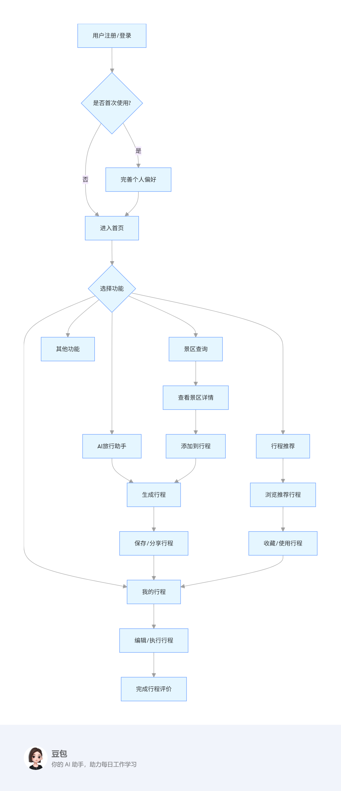

#### **1.2 业务流程图步骤说明**

<callout emoji="🍞">
用户端业务流程图步骤说明：有序罗列，步骤前带上编号，方便记忆
</callout>

1. 用户通过注册或登录进入系统
2. 首次使用的用户需要完善个人偏好设置，非首次使用用户直接进入首页
3. 首页提供多种功能入口，包括 AI 旅行助手、行程推荐、景区查询等
4. 用户可根据需求选择相应功能：

   - 使用 AI 旅行助手生成个性化行程
   - 浏览系统推荐的行程攻略
   - 查询景区信息并可将其添加到行程中
5. 用户可以保存、收藏或分享行程
6. 在 "我的行程" 中，用户可以编辑行程或按照行程进行旅行
7. 行程结束后，用户可以对行程进行评价

### 管理端业务流程

#### 2.1 业务流程图

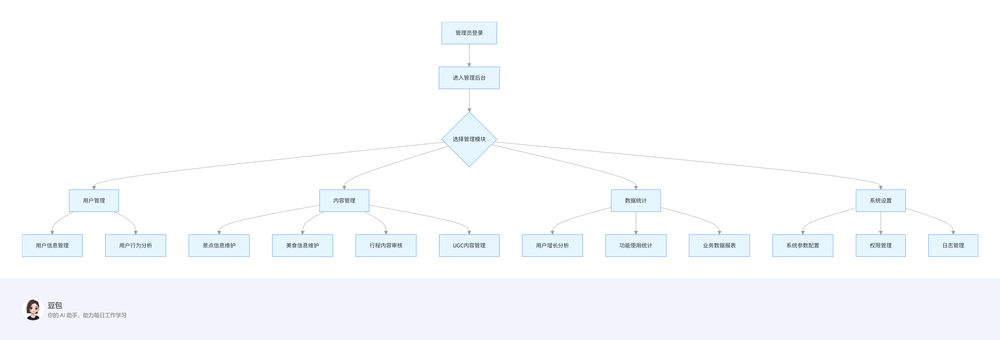

#### 2.2 业务流程图步骤说明

<callout emoji="❤️">
管理端业务流程步骤说明：有序罗列，步骤前带上编号，方便记忆
</callout>

1. 管理员通过账号密码登录管理后台
2. 管理后台提供多个管理模块入口
3. 管理员可根据工作需要选择相应模块：

   - 用户管理：管理用户信息，分析用户行为
   - 内容管理：维护景点、美食等基础数据，审核用户生成内容
   - 数据统计：查看用户增长、功能使用情况等数据报表
   - 系统设置：配置系统参数，管理用户权限，查看系统日志
4. 各模块下包含具体的管理功能，管理员可根据需求进行操作

## 四、项目技术架构

<callout emoji="📍">
这个模块主要罗列技术架构图和技术栈情况
</callout>

---

### 技术架构图

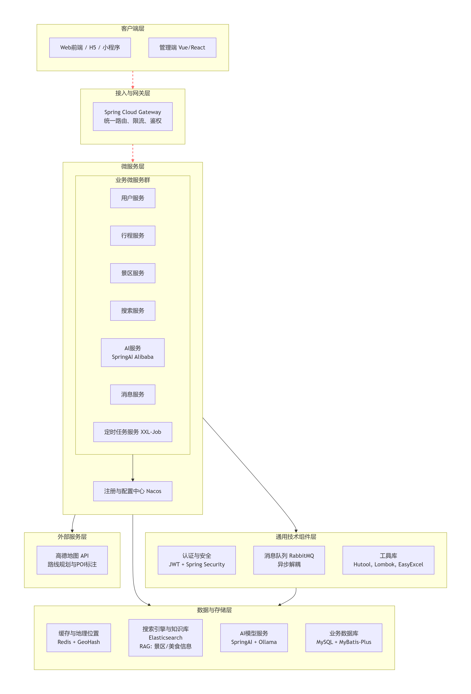

### 技术栈情况

这个项目主要用到的技术栈有：

#### 🖥️ 客户端层 (Client Layer)

技术栈: Vue/React + H5/小程序

- 用户端应用: 基于H5和小程序技术，为终端用户提供景区浏览、搜索、AI行程生成、行程管理等核心功能界面。
- 管理后台: 使用Vue或React构建的管理系统，供运营人员进行景区信息管理、用户管理、内容审核等操作。
- 核心职责: 用户交互界面渲染、数据展示、请求发起和结果呈现。

#### 🔌 接入与网关层 (Gateway Layer)

技术栈: Spring Cloud Gateway + JWT

- 统一API网关: 作为整个微服务体系的唯一入口，承担请求路由、负载均衡、跨域处理等职责。
- 安全认证: 集成JWT进行身份验证，拦截非法请求，保护后端服务。
- 流量治理: 实现限流、熔断、降级等 resilience 模式，保障系统高可用性。
- 核心职责: 请求转发、安全控制、流量管控。

#### ⚙️ 微服务层 (Microservices Layer)

技术栈: SpringBoot + SpringCloud Alibaba + Nacos

服务治理:

- Nacos: 提供服务注册与发现、动态配置管理、服务健康监测，是微服务架构的协调中心。

业务微服务群:

1. 用户服务: 负责用户注册、登录、身份认证、个人信息管理。
2. 行程服务: 处理用户行程的创建、编辑、删除、查询，管理行程数据生命周期。
3. 景区服务: 维护景区基础信息，包括详情、开放时间、门票价格等。
4. 搜索服务: 封装Elasticsearch检索能力，提供景区多条件搜索和RAG知识库查询。
5. AI服务: 通过SpringAI集成大模型，负责AI行程生成、内容推荐等智能功能。
6. 消息服务: 处理异步通知，如行程生成完成提醒、景区状态变更通知。
7. 定时任务服务: 基于XXL-Job实现分布式任务调度，处理数据统计、缓存更新等定时作业。

核心职责: 业务逻辑处理、服务间协作、领域功能实现。

#### 🛠️ 通用技术组件层 (Common Components Layer)

技术栈: JWT + Spring Security + RabbitMQ + Hutool + Lombok + EasyExcel

- 安全框架: JWT实现无状态分布式认证，Spring Security提供细粒度的基于角色的访问控制。
- 消息中间件: RabbitMQ实现服务间异步通信，解耦系统组件，提升响应速度。
- 开发工具集:

  - Lombok: 简化实体类开发，减少样板代码。
  - Hutool: 提供丰富的工具方法，处理日期、加密等通用操作。
  - EasyExcel: 实现数据的导入导出功能，尤其适用于管理后台的报表导出。
- 核心职责: 提供跨服务的通用技术能力，提升开发效率和系统稳定性。

#### 💾 数据与存储层 (Data & Storage Layer)

技术栈: MySQL + MyBatis-Plus + Redis + Elasticsearch + SpringAI + Ollama

- 关系型数据库: MySQL作为核心业务数据的持久化存储，存储用户、行程、景区等结构化数据。
- ORM框架: MyBatis-Plus简化数据库操作，提供高效的CRUD能力和查询封装。
- 缓存数据库: Redis用于缓存热点数据（如行程结果、景区列表），并通过GeoHash数据结构支持附近景区检索。
- 搜索引擎: Elasticsearch提供景区信息的全文检索和多条件组合查询，同时作为RAG的知识库存储。
- AI引擎: SpringAI提供标准化的大模型调用接口，Ollama负责本地大模型的部署和推理。
- 核心职责: 数据持久化、高速缓存、智能搜索、AI内容生成。

#### 🌐 外部服务层 (External Services Layer)

技术栈: 高德地图API

- 地理位置服务: 高德地图API提供用户定位、地理编码、路径规划、静态地图生成等LBS核心能力。
- 核心职责: 为行程路线规划、附近景区推荐、地理位置展示提供专业的外部服务支持。

### 微服务拆分

#### 1. 用户服务 (User Service)

- 职责：用户身份管理、个人资料、偏好设置
- 核心功能：

  - 用户注册、登录、JWT令牌管理
  - 个人信息维护、旅行偏好收集
  - 与Spring Security集成实现权限控制

#### 2.  行程服务 (Trip Service)

- 职责：用户行程的全生命周期管理
- 核心功能：

  - 行程的创建、编辑、删除、查询
  - AI行程的接收、存储和版本管理
  - 行程分享、收藏功能
  - 与Redis集成缓存高频访问的行程数据

#### 3. 景区服务 (Scenic Service)

- 职责：景区基础信息管理
- 核心功能：

  - 景区信息的CRUD操作
  - 景区开放状态管理
  - 门票价格、开放时间维护
  - 与高德地图API集成维护地理位置数据

#### 4. 搜索服务 (Search Service)

- 职责：提供全文检索和多条件搜索能力
- 核心功能：

  - 景区多条件组合搜索（位置、评分、类型等）
  - RAG知识库检索，为AI行程提供数据支撑
  - 搜索词建议、热门搜索统计
  - 基于Elasticsearch的复杂查询优化

#### 5. AI服务 (AI Service) - ⭐核心服务

- 职责：智能行程生成和旅行推荐
- 核心功能：

  - 接收生成请求（起点、终点、天数）
  - 协调RAG检索→大模型调用→地图集成的完整流程
  - Prompt工程：构建结构化提示词模板
  - 通过SpringAI调用Ollama大模型
  - 行程结果的结构化处理和返回

#### 6. 消息服务 (Message Service)

- 职责：异步通知和消息处理
- 核心功能：

  - 监听RabbitMQ消息队列
  - 处理行程生成完成的通知
  - 景区状态变更的实时提醒
  - 推送消息到用户端

#### 7. 定时任务服务 (Job Service)

- 职责：分布式任务调度
- 核心功能：

  - 基于XXL-Job的定时任务管理
  - 数据统计报表生成
  - 缓存数据定期更新
  - 系统监控和告警任务

### 用户端微服务调用关系图

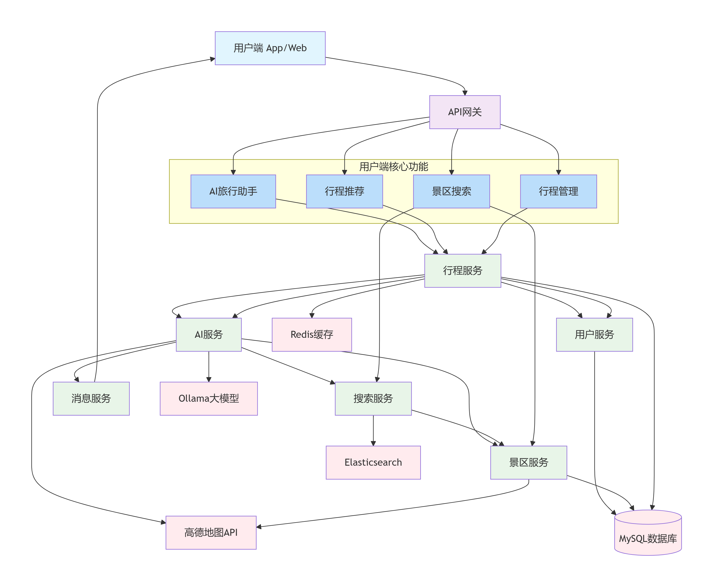

**用户端主要功能流程：**

1. AI旅行助手：用户输入 → 行程服务 → AI服务 → RAG检索 → 大模型生成 → 返回行程
2. 行程推荐：基于用户偏好 → 行程服务 → AI服务 → 个性化推荐
3. 景区搜索：搜索请求 → 搜索服务 → Elasticsearch → 景区服务 → 返回结果
4. 行程管理：CRUD操作 → 行程服务 → 用户服务(权限) → 数据持久化

### 管理微服务调用关系图

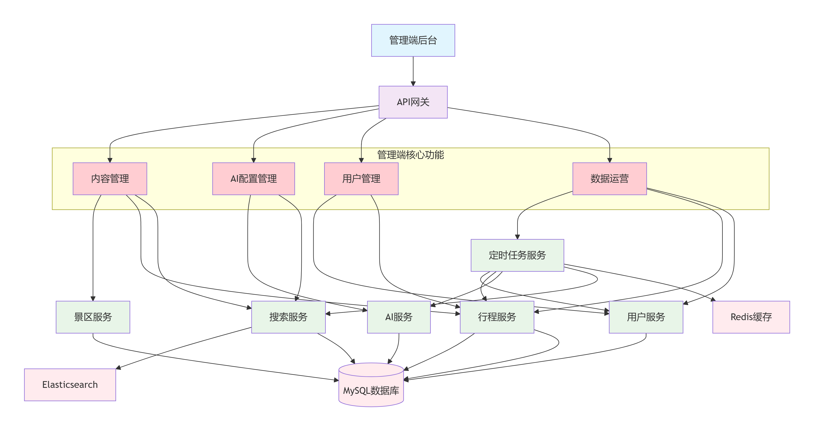

**管理端主要功能流程：**

1. 内容管理：景区/行程数据维护 → 景区服务/行程服务 → 数据库更新
2. AI配置：Prompt模板/RAG配置 → AI服务/搜索服务 → 参数持久化
3. 用户管理：用户数据查询 → 用户服务 → 关联行程数据
4. 数据运营：统计报表 → 定时任务服务 → 各业务服务数据聚合

### AI大模型使用

<callout emoji="🥖">
针对项目罗列AI功能用到的大模型有哪些，生成一个表格，表格包括如下内容：
大模型名称、模型类型（是否推推理模型）、应用到的功能，模型参数大小、是否ollama模型、是否云端大模型、是否用到rag知识库、是否用到ToolCalling、价格（怎么计费的）
</callout>

<sheet sheet-id="vUJbw8" token="QLhssHPI5hLxOBtNO2AcMUPinud"></sheet>

### 系统部署架构图

### 系统部署架构说明

#### 🌐 客户端层 (Client Layer)

- 用户终端: 浏览器、移动端APP、管理后台
- 部署方式: 静态资源托管在CDN，APP通过应用商店分发

#### 📡 CDN与域名解析层

- DNS解析: 智能DNS实现地域调度
- CDN加速: 全球边缘节点缓存静态资源
- 安全防护: WAF防护Web攻击，DDoS清洗

#### ⚖️ 负载均衡层

- 四层负载均衡: 基于IP+端口的TCP流量分发
- 七层负载均衡: HTTP/HTTPS协议解析，SSL证书卸载
- 健康检查: 主动探测后端服务健康状态

#### 🚪 应用网关层

- API Gateway: 3实例集群部署，实现零停机升级
- 动态路由: 基于Nacos的服务发现动态更新路由
- 限流熔断: 网关级流量控制和服务降级

#### 🏗️ 微服务应用层

- 容器化部署: 基于Kubernetes的Pod部署
- 资源配额: 按服务特性分配CPU/内存资源
- 弹性伸缩: HPA基于CPU/内存使用率自动扩缩容

#### 🎛️ 服务治理层

- Nacos集群: 3节点保障服务注册高可用
- 配置管理: 统一配置中心，支持灰度发布
- 服务网格: Istio实现细粒度流量管理

#### 🔄 消息与缓存层

- RabbitMQ集群: 3节点镜像队列，消息零丢失
- Redis集群: 6节点三主三从，自动故障转移
- 持久化策略: 消息和缓存数据的持久化保障

#### 💾 数据存储层

- MySQL集群: 一主两从，半同步复制
- 读写分离: 中间件实现自动读写分离
- 备份策略: 每日全量备份+每小时增量备份

#### 🤖 搜索与AI层

- Elasticsearch: 3节点集群，分片副本机制
- Ollama服务: GPU服务器部署，模型热加载
- 向量数据库: 专为RAG优化的向量检索

#### 🖥️ 基础设施层

- Kubernetes: 高可用集群，3Master+8Node
- 网络规划: VPC内网隔离，安全组策略
- 存储方案: 云盘+NAS满足不同存储需求

#### 📊 监控与运维层

- 全方位监控: 基础设施、应用、业务多层监控
- 日志收集: 集中式日志管理和分析
- 链路追踪: 分布式系统调用链追踪

#### 🔗 外部服务依赖

- 地图服务: 高德地图API HTTPS调用
- 对象存储: 图片、视频等大文件存储
- 第三方服务: 短信、邮件等通知服务

#### 关键部署指标

- 可用性: 99.95% SLA保障
- 扩展性: 水平扩展，支持千级Pod部署
- 性能: API响应时间<200ms，AI服务<2s
- 安全: 全链路HTTPS，网络隔离
- 成本: 按需分配资源，预留实例优化成本

这个纵向部署架构图详细展示了每个层次的组件部署方案，为实际的生产环境部署提供了清晰的技术指导。

## 六、具体的功能实现与解决方案

在这个项目中主要实现了这几个功能：AI 旅行助手、行程推荐查询等功能。接下来我就说一下这些功能的详细设计与实现。

<callout emoji="📌">
- 这个模块最重要，介绍你在这个项目中，负责了XXX、YYYY、ZZZ、DD这么几个模块的功能。
- 具体某几个功能是怎么实现的，挑几个来说
- **说明：要求写全部的功能模块，每个功能必须是有难度和亮点的功能，不能是单表CRUD功能**
- 开始介绍具体的功能，每个功能或功能模块，结构包括这几项

  - 业务介绍
  - 表设计
  - 接口设计
  - 技术实现
  - 为什么用这个技术
  - 存在什么问题
  - 如何解决
- 注意：所有流程图，步骤控制在10步左右，否则不好记
</callout>

---

### 功能1：AI 旅行助手

#### 业务介绍

##### 1.1 业务概述

AI 旅行助手是自驾甄行 APP 的核心功能之一，用户输入自驾起点、终点、旅行天数后，系统通过 SpringAI 调用大模型（结合 RAG 检索景区 / 美食知识库），生成结构化行程 —— 包含每日行程主题。（如 “Day1：北京→承德，避暑山庄深度游”）、当日推荐景点（含开放时间、游玩时长、门票价格）、当地美食（推荐理由、地址）、旅行小贴士（如 “景区停车场位置”“防晒建议”），并同步生成行程路线地图（标注每日行驶路线、景点位置）。

##### 1.2 业务流程图

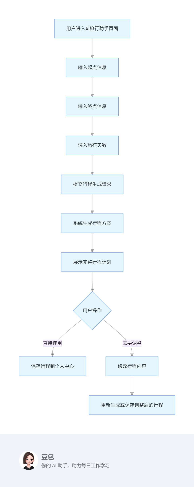

##### **1.3 业务流程图及说明**

1. 用户进入 AI 旅行助手功能页面
2. 用户依次输入行程的起点信息、终点信息和旅行天数
3. 用户提交行程生成请求
4. 系统处理请求并生成详细的行程方案
5. 系统展示完整的行程计划，包括每天的安排
6. 用户可以选择直接使用该行程，保存到个人中心
7. 用户也可以选择调整行程内容，修改后可重新生成或直接保存调整后的行程

#### 表设计

##### 2.1 表关系图

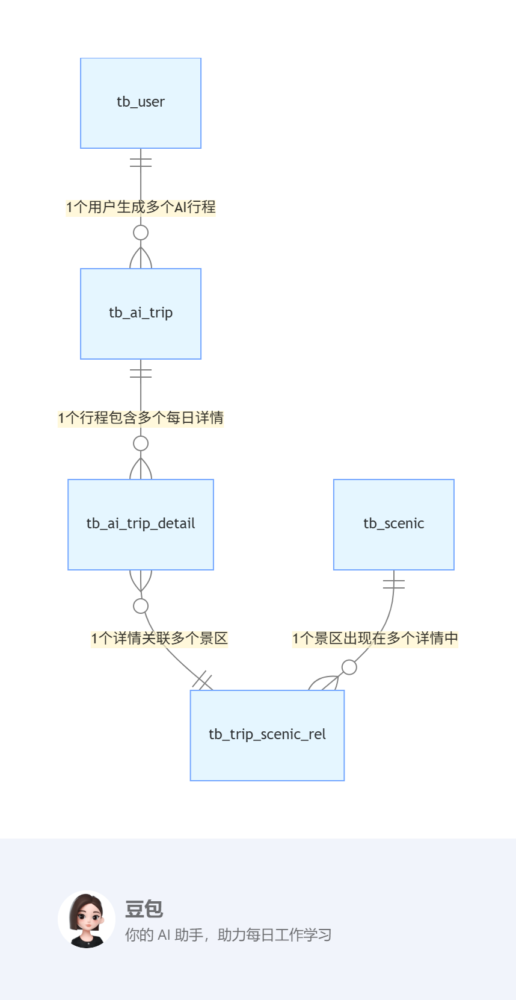

##### 2.2 表关系说明

AI 旅行助手核心表包括AI 行程主表（存储行程整体信息）、行程详情表（存储每日行程内容）、行程景点关联表（关联行程与景区），表间通过 “主键 - 外键” 关联，形成完整数据链路：

- 1 个用户（tb_user）可生成多个 AI 行程（tb_ai_trip）：一对多关系（通过`user_id`关联）；
- 1 个 AI 行程（tb_ai_trip）包含多个每日详情（tb_ai_trip_detail）：一对多关系（通过`trip_id`关联）；
- 1 个每日详情（tb_ai_trip_detail）关联多个景区（tb_scenic）：多对多关系（通过中间表 tb_trip_scenic_rel 关联）。

##### 2.3 表字段设计

AI 行程主表：**tb_ai_trip**

<sheet sheet-id="2qPN9W" token="QLhssHPI5hLxOBtNO2AcMUPinud"></sheet>

行程详情表：**tb_ai_trip_detail**

<sheet sheet-id="OE3sVe" token="QLhssHPI5hLxOBtNO2AcMUPinud"></sheet>

行程景点关联表：**tb_trip_scenic_rel**

<sheet sheet-id="eNs6Qb" token="QLhssHPI5hLxOBtNO2AcMUPinud"></sheet>

景区表：**tb_scenic**

<sheet sheet-id="xzHJcs" token="QLhssHPI5hLxOBtNO2AcMUPinud"></sheet>

#### 接口设计

<table><colgroup><col/><col/></colgroup><tbody><tr><td><b>接口名称</b></td><td>生成 AI 行程接口</td></tr><tr><td>请求地址</td><td>http://localhost:8080/api/v1/ai-trip/generate</td></tr><tr><td>请求方法</td><td>POST</td></tr><tr><td>请求参数</td><td>{   "userId": 10001,          // 用户ID（登录后从JWT解析，前端可选传）   "startPoint": "北京市朝阳区",  // 自驾起点（非空）   "endPoint": "承德市双桥区",    // 自驾终点（非空）   "tripDays": 3             // 旅行天数（1-15天，非空） }</td></tr><tr><td>响应数据格式</td><td><pre caption="&#xA;" lang="JSON" wrap="true"><code>{   "code": 200,   "message": "行程生成成功",   "data": {     "tripId": 20001,                     // 行程ID     "tripTitle": "北京市朝阳区→承德市双桥区3天自驾行程",  // 行程标题     "mapUrl": "https://amap.com/trip/20001",  // 行程地图URL     "isCollected": 0,                    // 是否收藏（0-否，1-是）     "tripDetailList": [                  // 每日行程列表       {         "detailId": 30001,         "dayNum": 1,         "dayTheme": "Day1：北京市朝阳区→承德市，避暑山庄深度游",         "foodName": "承德杏仁茶",         "foodAddress": "承德市双桥区南营子大街12号",         "tipsContent": "景区较大，建议租电子讲解器（20元/台）",         "scenicList": [                  // 当日景点列表           {             "scenicId": 40001,             "scenicName": "避暑山庄",             "playDuration": "3小时",             "openTime": "8:00-18:00",             "ticketPrice": 130.00           }         ]       }     ],     "createTime": "2024-05-20T14:30:00"  // 行程创建时间   } }</code></pre></td></tr></tbody></table>

<table><colgroup><col/><col/></colgroup><tbody><tr><td><b>接口名称</b></td><td>收藏 AI 行程接口</td></tr><tr><td>请求地址</td><td>http://localhost:8080/api/v1/ai-trip/collect</td></tr><tr><td>请求方法</td><td>PUT</td></tr><tr><td>请求参数</td><td>{   "userId": 10001,          // 用户ID（非空）   "tripId": 20001,          // AI行程ID（非空）   "isCollected": 1          // 是否收藏（1-收藏，0-取消收藏，非空） }</td></tr><tr><td>响应数据格式</td><td><pre caption="&#xA;" lang="JSON" wrap="true"><code>{   "code": 200,   "message": "收藏成功",   "data": {     "tripId": 20001,     "isCollected": 1,     "updateTime": "2024-05-20T16:20:00"  // 状态更新时间   } }</code></pre></td></tr></tbody></table>

#### 技术实现

##### 4.1 技术实现方案流程图

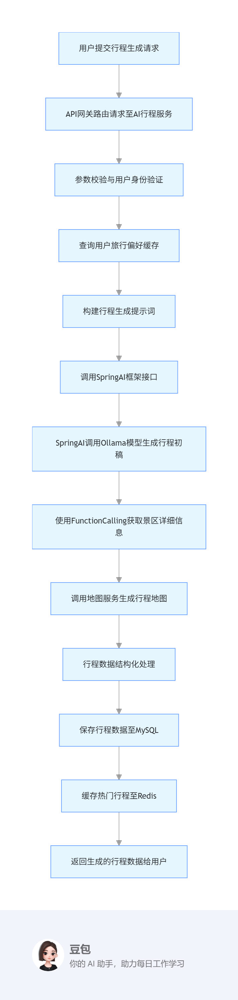

##### 4.2 流程图步骤说明

1. 用户在前端提交行程生成请求，包含起点、终点和天数等信息
2. API 网关接收请求并路由至 AI 行程服务
3. 服务进行参数校验和用户身份验证
4. 从 Redis 缓存中查询用户的旅行偏好设置
5. 根据用户输入和偏好构建行程生成的提示词，应用 Prompt 工程优化
6. 调用 SpringAI 框架的接口，将提示词传递给 AI 模型
7. SpringAI 调用 Ollama 本地大模型生成初步的行程方案
8. 使用 FunctionCalling 技术调用景区服务 API，获取详细的景区信息
9. 调用地图服务生成行程地图，并获取地图 URL
10. 将 AI 生成的非结构化数据转换为结构化格式，符合系统数据模型
11. 将完整的行程数据保存到 MySQL 数据库
12. 对于优质行程，缓存至 Redis 以提高后续访问速度
13. 将生成的行程数据返回给前端展示给用户

#### 为什么使用这个技术

1. SpringAI 框架

   - 优点 1：提供了统一的 AI 模型调用接口，简化了不同 AI 模型的集成过程
   - 优点 2：支持 Prompt 工程和 FunctionCalling，能够更精确地控制 AI 生成结果
2. Redis 缓存

   - 优点 1：显著提高相似行程请求的响应速度，减少系统处理时间
   - 优点 2：减轻数据库负担，提高系统整体吞吐量

#### 遇到的问题

大模型生成的行程与实际景区开放状态不一致，导致推荐无效（如景区临时闭园，但模型仍推荐）。

核心原因：RAG 知识库中的 “景区开放状态” 未实时更新，若景区临时闭园（如暴雨、维修），检索时仍按 “正常开放” 筛选，导致行程推荐失效。

#### 问题的解决方案

实现 “景区开放状态实时同步 + 缓存主动失效” 机制：

1. 数据源对接：对接第三方景区开放状态 API（如高德地图 “景区服务” API），通过 XXL-Job 定时任务（每 2 小时执行一次）更新 ElasticSearch 知识库中的 “开放状态” 字段；
2. 缓存主动失效：若某景区开放状态从 “1（正常）” 变为 “0（闭园）”，通过 RabbitMQ 发送 “缓存清理” 消息，AI 服务消费消息后，删除 Redis 中包含该景区的所有行程缓存（键匹配`ai:trip:*`）；
3. 行程重新生成：用户再次请求包含该景区的行程时，RAG 检索会过滤闭园景区，大模型生成新行程，确保推荐有效性。

### 功能2：行程推荐

#### 业务介绍

##### 1.1 业务概述

行程推荐功能针对尚未创建行程的用户，根据用户的地理位置、历史浏览记录、偏好设置等信息，智能推荐多种适合的自驾游攻略。每个推荐行程包含景点数量、行程天数、详细的每日时间安排、路线规划和游玩建议，并提供行程地图供用户直观了解行程路线，帮助用户快速找到感兴趣的旅行方案。

##### 1.2 业务流程图及说明

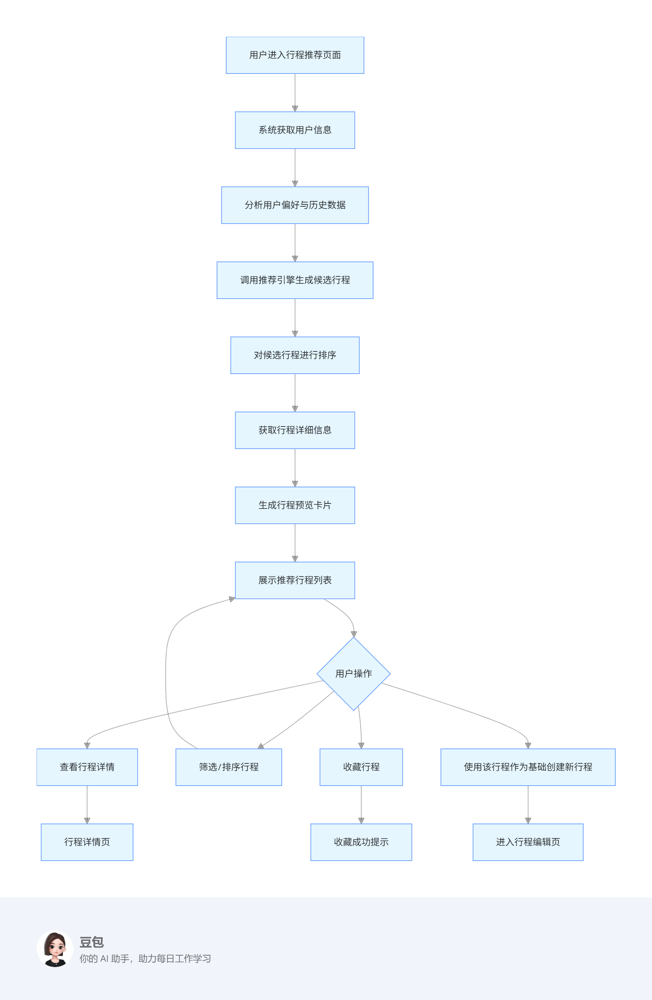

**流程图步骤说明：**

1. 用户进入行程推荐功能页面
2. 系统获取用户的基本信息、地理位置、偏好设置等
3. 分析用户的历史浏览记录、收藏内容、评分数据等，挖掘用户兴趣点
4. 调用推荐引擎，结合用户特征和热门行程数据，生成候选推荐行程
5. 根据相关性、热度、评分等因素对候选行程进行排序
6. 获取每个推荐行程的详细信息，包括景点、路线、美食等
7. 生成简洁明了的行程预览卡片，包含关键信息
8. 在前端展示推荐行程列表
9. 用户可进行多种操作：

   - 查看行程详情，了解完整信息
   - 根据天数、主题等条件筛选或排序行程
   - 将感兴趣的行程收藏
   - 以推荐行程为基础，创建自己的个性化行程

#### 表设计

##### 2.1 表关系图

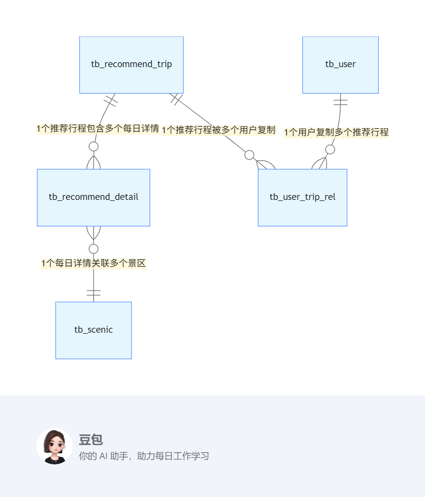

##### 2.2 表关系说明

行程推荐核心表包括推荐行程主表（存储推荐攻略整体信息）、推荐行程详情表（存储每日安排）、用户行程关联表（记录用户复制推荐行程的关系），表间关系如下：

- 1 个推荐行程（tb_recommend_trip）包含多个每日详情（tb_recommend_detail）：一对多关系（通过`trip_id`关联）；
- 1 个用户（tb_user）可复制多个推荐行程：多对多关系（通过中间表 tb_user_trip_rel 关联，记录复制时间）；
- 1 个推荐行程（tb_recommend_trip）可被多个用户复制：多对多关系（通过中间表 tb_user_trip_rel 关联）。

##### 2.3 表字段设计

推荐行程主表：**tb_recommend_trip**

<sheet sheet-id="90nN9A" token="QLhssHPI5hLxOBtNO2AcMUPinud"></sheet>

推荐行程详情表：**tb_recommend_detail**

<sheet sheet-id="57gcBh" token="QLhssHPI5hLxOBtNO2AcMUPinud"></sheet>

用户行程关联表：**tb_user_trip_rel**

<sheet sheet-id="hHH60i" token="QLhssHPI5hLxOBtNO2AcMUPinud"></sheet>

用户行程表：**tb_user_trip**

<sheet sheet-id="RWqBfH" token="QLhssHPI5hLxOBtNO2AcMUPinud"></sheet>

#### 接口设计

<table><colgroup><col/><col/></colgroup><tbody><tr><td><b>接口名称</b></td><td>获取行程推荐列表接口</td></tr><tr><td>请求地址</td><td>http://localhost:8080/api/v1/recommend-trip/list</td></tr><tr><td>请求方法</td><td>GET</td></tr><tr><td>请求参数</td><td>userId=10001&amp;tripDays=2&amp;trendTag=夏季避暑&amp;pageNum=1&amp;pageSize=10</td></tr><tr><td>响应数据格式</td><td><pre caption="&#xA;" lang="JSON" wrap="true"><code>{   "code": 200,   "message": "推荐列表查询成功",   "data": {     "total": 28,              // 符合条件的行程总数     "pageNum": 1,             // 当前页码     "pageSize": 10,           // 每页条数     "list": [       {         "recTripId": 50001,         "tripTitle": "张北草原2天自驾攻略",         "tripDays": 2,         "scenicCount": 5,         "trendTag": "夏季避暑,亲子游",         "score": 4.8,         "viewCount": 12580,         "mapUrl": "https://amap.com/recommend/50001",         "scenicPreview": ["张北草原", "草原天路", "野狐岭"]  // 景点预览       }     ]   } }</code></pre></td></tr></tbody></table>

<table><colgroup><col/><col/></colgroup><tbody><tr><td><b>接口名称</b></td><td>复制推荐行程接口</td></tr><tr><td>请求地址</td><td>http://localhost:8080/api/v1/recommend-trip/copy</td></tr><tr><td>请求方法</td><td>POST</td></tr><tr><td>请求参数</td><td>{   "userId": 10001,          // 用户ID（非空）   "recTripId": 50001        // 推荐行程ID（非空） }</td></tr><tr><td>响应数据格式</td><td><pre caption="&#xA;" lang="JSON" wrap="true"><code>{   "code": 200,   "message": "行程复制成功",   "data": {     "userTripId": 60001,     // 复制后生成的用户个人行程ID     "tripTitle": "张北草原2天自驾攻略",     "copyTime": "2024-05-20T15:45:00",     "tripDays": 2,     "scenicCount": 5   } }</code></pre></td></tr></tbody></table>

#### 技术实现

##### 4.1 技术实现方案流程图

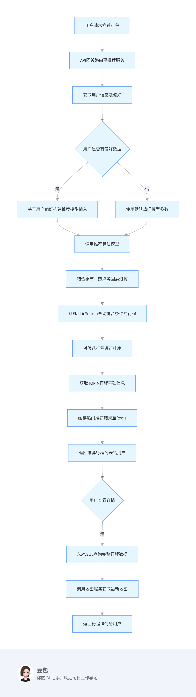

##### 4.2 流程图步骤说明

1. 用户在前端请求推荐行程列表，可附带筛选条件
2. API 网关将请求路由至推荐服务
3. 服务获取当前用户信息，并从 Redis 缓存中获取用户偏好数据
4. 根据用户是否有偏好数据，采取不同的推荐策略
5. 对于有偏好的用户，基于其偏好构建推荐模型输入参数
6. 对于无偏好的用户，使用默认的热门推荐模型参数
7. 调用推荐算法模型，生成初始推荐结果
8. 结合季节因素、当前热点等外部因素对初始结果进行过滤
9. 从 ElasticSearch 中查询符合过滤条件的行程数据
10. 对候选行程进行多维度排序（热度、评分、匹配度等）
11. 获取排名靠前的 N 个行程的基础信息
12. 将热门推荐结果缓存至 Redis，提高后续访问速度
13. 将推荐行程列表返回给前端展示给用户
14. 当用户查看某行程详情时，从 MySQL 查询该行程的完整数据
15. 调用地图服务获取最新的行程地图数据
16. 将完整的行程详情返回给用户

#### 为什么使用这个技术

1. 混合推荐算法

   - 优点 1：结合协同过滤和内容特征算法，兼顾用户兴趣和内容相关性
   - 优点 2：有效解决 "冷启动" 问题，新用户也能获得合适的推荐
2. ElasticSearch

   - 优点 1：支持复杂的多条件筛选和排序，提升推荐精准度
   - 优点 2：高效的全文检索能力，可快速匹配用户潜在兴趣点
3. Redis 缓存

   - 优点 1：缓存热门行程数据，提高推荐列表加载速度
   - 优点 2：实时更新行程的浏览、收藏等计数信息，保证数据时效性
4. 异步数据处理

   - 优点 1：用户行为数据异步处理，不影响主流程响应速度
   - 优点 2：可批量处理数据，提高系统整体性能

#### 遇到的问题

推荐行程列表查询响应慢问题：随着平台推荐行程数量增长（已达 500 + 条），用户筛选推荐行程时（如 “2 天 + 亲子游 + 评分≥4.5”），需关联查询多张表（包括行程主表、详情表、景区表，MySQL 多表关联查询耗时从初期的 100ms 增至 800ms+，超出用户可接受的 200ms 响应阈值，高峰期甚至出现查询超时，用户抱怨 “加载卡顿”。

#### 问题的解决方案

采用 “Redis 缓存预热 + MySQL 索引优化” 的技术方案，具体实现如下：

1. MySQL 索引优化（解决 “查得慢” 根本问题）：针对推荐行程筛选的核心 SQL（按 “天数 + 标签 + 评分” 筛选），添加 2 类索引（行程主表联合索引+行程-景区关联表索引）以减少多表关联查询的耗时量。
2. Redis 缓存预热（解决 “反复查” 性能问题）：针对用户高频筛选场景（如 “1 天行程”“2-3 天亲子游”“评分≥4.5”），提前缓存查询结果，避免重复访问数据库
3. 实时查询优先读缓存：在推荐行程查询接口中，先查 Redis 缓存，缓存命中直接返回，未命中再查数据库并更新缓存

### 等功能..

## 七、收尾 

<callout emoji="🏖️">
介绍完毕后，一定要有收尾，主要目的是暗示面试官我说完了您可以提问了
</callout>

我的个人情况大致介绍完毕了，谢谢。

---
> 来源：飞书技术知识库（脱敏版） · 08 面试知识库 / 求职方法论 / 项目表述 · [原文](https://ccn8v2zngwsm.feishu.cn/wiki/WE22wdgGwilE1RktLWFcFgcXnmd)
