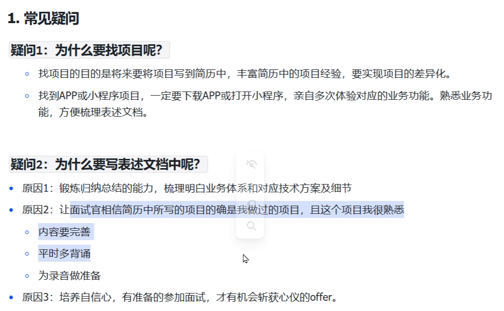
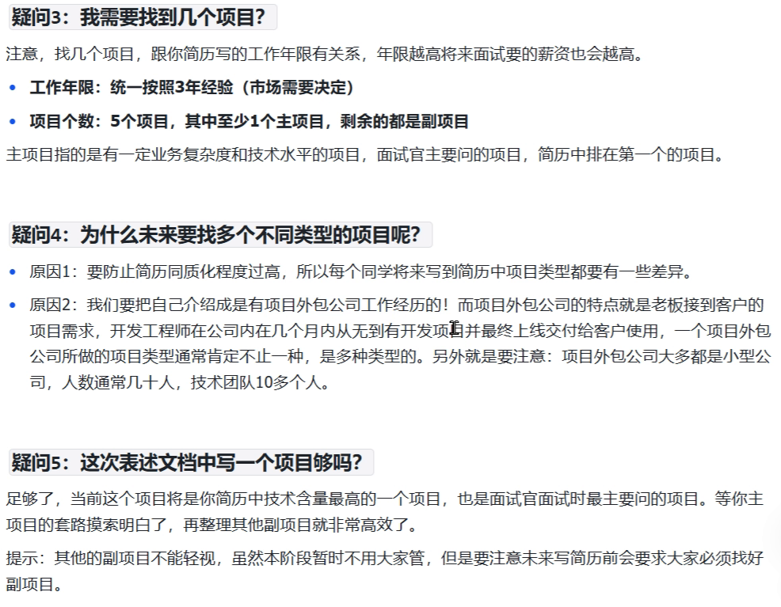

# 项目查找

### **分类目录**

1. **新闻资讯**

   - 宠物、留学、体育、二次元、鸟类、钓鱼等垂直领域资讯
2. **购物电商**

   - 生鲜、珠宝、批发、购物比价及其他垂直领域电商
3. **生活服务**

   - **租赁**：房屋、车辆等
   - **回收**：环保回收、二手买卖回收
   - **票务**
   - **家政到家**：上门维修、安装、保洁、保姆、洗衣等
4. **在线教育**

   - 升本、考公、考研、律师（资格考试）、兴趣教育、职业技能等
5. **医疗健康**

   - **医疗医药**：医院挂号、医疗体检、在线问诊、糖尿病管理、肾病管理、疾病早筛等
   - **健康养生**：健康档案、康复训练、养生健康、饮食营养、女性健康等
6. **运动健身**

   - 健身训练、运动减肥、减脂课程、健身社区等
7. **旅游出行**

   - 行程规划、出行导航、攻略社区等
8. **母婴亲子**

   - 孕期管理、儿童教育、亲子活动、育儿社区、母婴服务
9. **房产家居**

   - 民宿、长租、短租、房屋交易、家居服务等
10. **美食菜谱**

    - 菜谱教学、菜品视频、美食分享、饮食文化等
11. **美容美体**

    - 医美社区、美容社区、美妆、化妆等
12. **游戏周边**

    - 账号交易、代练、陪玩、租号等
13. **汽车服务**

    - 买车租车、用车养车、充电桩、摩托车、驾考、车友等
14. **创作设计**

    - 穿搭设计、建筑设计、房屋设计、音乐创作等

---
> 来源：飞书技术知识库（脱敏版） · 08 面试知识库 / 求职方法论 / 项目查找 · [原文](https://ccn8v2zngwsm.feishu.cn/wiki/XzFRwW6pvilTF6kVjiUcJ7IMnod)
