# 微服务面试篇（上）

## 学习目标

1. 能够说出ES索引同步的常用方案
2. 能够说出Canal+MQ数据同步的方案
3. 能够说出Canal是怎么伪装成 MySQL slave
4. 能够测试通过Canal+MQ数据同步流程
5. 能够说出商品查询缓存接口的执行流程
6. 能够说出如何保证缓存一致性
7. 能够说出分布式锁常用的方案
8. 能够说出使用Redisson实现分布式锁的流程
9. 能够说出缓存穿透、击穿、雪崩现象及解决方案


## 1 ES索引同步方案

### 1.1. 技术方案分析

#### 1.1.1 同步方式

管理员在商城的后台维护商品信息，数据存储在MySQL。

用户在商城搜索商品信息，从Elasticsearch搜索商品信息。

<whiteboard token="DDtUwJzAVhLdFmblI2TczK6YnVg"></whiteboard>

如果Elasticsearch的索引数据与MySQL的商品数据不一致会导致什么问题？

用户搜索到的商品信息并非商品最新的信息，比如：价格不同，搜索到的商品价格与实际价格不同，商品下架但是用户仍然可以搜索到商品信息，这些问题都会严重影响用户的体验。

我们需要一种方案，当管理员修改商品信息后及时的修改商品索引信息，使MySQL中的商品数据与ES中的商品数据保持一致。

常见的索引数据同步方案有两种：**同步方式和异步方式。**


首先说**同步方式**

在修改商品信息的方法中加入操作Elasticsearch索引的代码，即在原有业务方式的基础上添加索引同步的代码，CRUD操作MySQL的同时CRUD操作ES索引。

如下代码，是在添加商品信息的时候向ES索引添加文档。

```JavaScript
public void insert(Item item){
    //向Item表添加记录
    
    //向Item索引添加文档
}
```

此方式会在很多业务方法中加入操作ES索引的代码，增加代码的复杂度不方便维护，扩展性差。

其次，上边的代码存在分布式事务，操作Item表会访问数据库，向索引添加文档会访问ES，使用数据库本地事务是无法控制整个方法的一致性的，比如：向ES写成功了由于网络超时导致异常，最终写数据库操作回滚了而写ES操作没有回滚，数据库的数据和ES中的索引不一致。


#### 1.1.2 异步方式

异步方式是通过引入MQ实现，修改商品信息时向MQ发送修改的商品信息，然后监听MQ的程序请求ES向索引写入，流程如下：


<whiteboard token="H7xDwxX1OhTrbOb37lHcLECqnTf"></whiteboard>

此方案的好处：

1. 商品服务不用直接访问ES，通过MQ将商品服务和ES解耦合。

缺点：

1. 在商品的CRUD方法中仍然需要加入向MQ发送消息的代码，如下：

```JavaScript
public void insert(Item item){
    //向Item表添加记录
    
    //向MQ发送添加商品消息
}
```

此方案，不少公司都在使用，虽然增加系统复杂性和依赖MQ可靠性，但能做到及时更新数据


有没有一种方法不用对商品的CRUD方法进行侵入，商品的CRUD方法就是对商品的增删改查，不会存在向ES同步数据相关的代码。


此时我们要借助一个神器就是Canal **[kə'næl]**，先看下Canal在整个流程中的位置，如下图：

<whiteboard token="G0tJwbIjqhsjwObZxFAcVeRanFb"></whiteboard>

从图中可以看出，商品管理的CRUD方式仅仅包括对商品表的CRUD业务操作（下图红色框内部分），不再有操作MQ的相关逻辑。

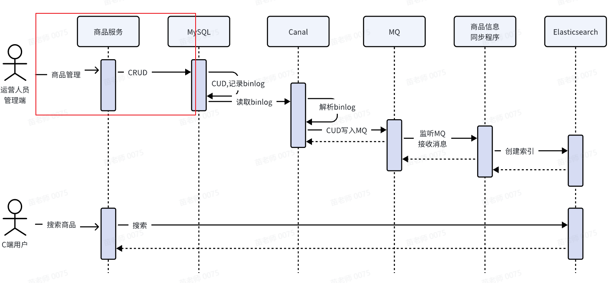

Canal是和MySQL存在联系，并且Canal负责和MQ交互，这种方案就是借助了Canal和MQ实现的。


此方案，是中大型公司的首选，更新非常及时


### 1.2 Canal+MQ数据同步

#### 1.2.1. MySQL主从复制

要理解Canal的工作原理需要首先要知道MySQL主从数据同步的原理。

首先我们要知道，平时我们在学习时只用MySQL单机即可，但是生产环境中MySQL部署为主从集群模式，MySQL主从集群由MySQL主服务器(master)和MySQL从服务器(slave)组成，主数据库提供写服务，从数据库提供读服务，主从之间进行数据复制保证数据同步，如下图：


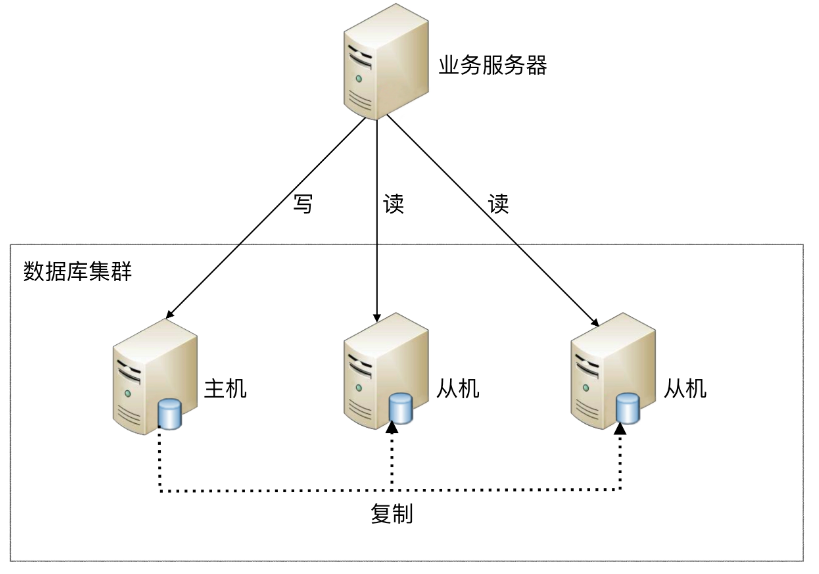

MySQL主从之间是如何同步的呢？

MySQL主从数据同步是一种数据库复制技术，进行写数据会先向主服务器写，写成功后通过binlog日志将数据同步到从数据库。

具体流程如下图：

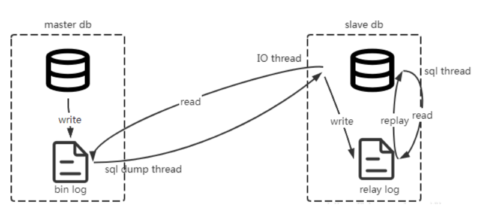

1、主服务器将所有写操作（INSERT、UPDATE、DELETE）以二进制日志（binlog）的形式记录下来。

2、从服务器连接到主服务器，发送dump 协议,请求获取主服务器上的binlog日志。

MySQL的`dump`协议是MySQL复制协议中的一部分。

3、MySQL master 收到 dump 请求，开始推送 binary log 给 slave

4、从服务器解析binlog日志，根据日志内容更新从服务器的数据库，完成从服务器的数据保持与主服务器同步。

##### 1.2.1.1 binlog

binlog日志是什么？

MySQL的binlog（二进制日志）是一种记录数据库服务器上所有修改数据的日志文件。它主要用于数据复制和数据恢复。binlog的主要作用是记录数据库的DDL（数据定义语言）操作和DML（数据操作语言）操作，以便在数据库发生故障时进行恢复。

binlog长什么样？

类似下边这样：

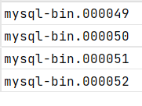

binlog的主要特点如下：

1. 事务级别的记录：

   - Binlog 以事务为单位记录数据更改，这意味着每个事务的开始和结束都会被记录下来。
   - 这种记录方式有助于保证数据的一致性和事务的完整性。
2. 支持多种格式：

   - STATEMENT：记录每条 SQL 语句，适用于大多数情况，但有些 SQL 语句的结果依赖于会话状态，可能导致复制问题。
   - ROW：记录每行数据的更改，精确度高，但会增加日志文件的大小。
   - MIXED：默认模式，结合了 STATEMENT 和 ROW 的优点，大部分情况下采用 STATEMENT 模式，但在 STATEMENT 模式可能引起问题时自动切换到 ROW 模式。
3. 非阻塞性：

   - Binlog 的写入操作是非阻塞的，即写入 Binlog 不会阻塞客户端的事务提交。
   - 这意味着应用程序可以在无需等待日志写入完成的情况下继续运行，提高了性能。
4. 数据恢复：

   - Binlog 可以用于数据恢复，允许恢复到特定的时间点或事务。
   - 这对于灾难恢复非常重要，可以减少数据丢失的风险。
5. 主从复制：

   - Binlog 是 MySQL 主从复制的基础。
   - 通过从主服务器读取并重放 Binlog，从服务器可以保持与主服务器相同的数据状态。


在 MySQL 中启用 Binlog 需要在配置文件 (`my.cnf` 或 `my.ini`) 中进行设置。

一些关键的配置选项包括：

- `server-id`：用于标识服务器的唯一 ID，这对于多服务器环境非常重要。
- `log_bin`：指定是否启用 Binlog 以及 Binlog 文件的保存位置。
- `binlog_format`：定义 Binlog 的格式，如 STATEMENT, ROW 或 MIXED。
- `expire_logs_days`：定义 Binlog 文件保留的时间，超过这个时间的文件会被自动删除。
- `max_binlog_size`：单个 Binlog 文件的最大大小，达到这个大小后会自动创建新的文件。

举例：

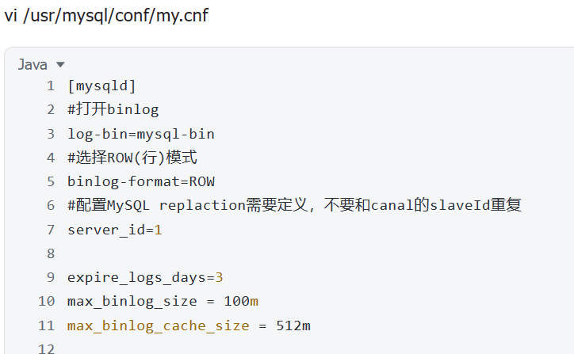

**注意事项：**

- Binlog 文件会占用磁盘空间，因此需要定期清理不再需要的旧文件。
- 使用 Binlog 进行数据恢复或复制时，要确保所有相关服务器的时间同步，否则可能会出现问题。


binlog常用命令：

查看是否开启binlog日志

`show variables like 'log_bin';`

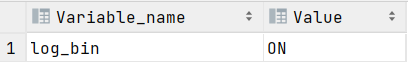

使用以下命令查看所有binlog日志列表：

`SHOW MASTER LOGS;`

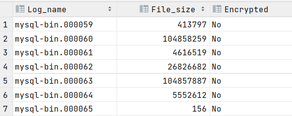

要查看MySQL服务器上的binlog状态，可以使用以下命令：

`SHOW MASTER STATUS;`

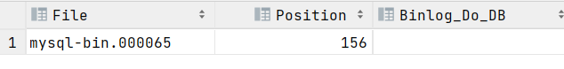

要查看所有的binlog文件列表，可以使用以下命令：

`SHOW BINARY LOGS;`

查看binlog日志保存路径

`SHOW VARIABLES LIKE 'datadir';`

刷新log日志，立刻产生一个新编号的binlog日志文件，跟重启一个效果，可以执行以下命令：

`FLUSH LOGS;`

清空所有binlog日志，可以执行以下命令：

`RESET MASTER;`


#### 1.2.2. Canal+MQ同步流程

Canal是什么呢？

**canal [kə'næl]**，译意为水道/管道/沟渠，主要用途是基于 MySQL 数据库增量日志解析，对数据进行同步，如下图：

Canal可与很多数据源进行对接，将数据由MySQL同步到ES、MQ、DB等各个数据源。

Canal的意思是水道/管道/沟渠，它相当于一个数据管道，通过解析MySQL的binlog日志完成数据同步工作。

官方文档：[https://github.com/alibaba/canal/wiki](https://github.com/alibaba/canal/wiki)

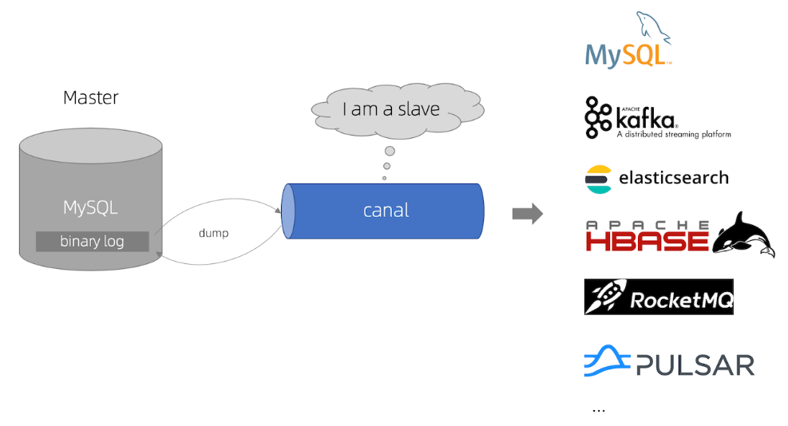

Canal数据同步的工作流程如下：

1、Canal模拟 MySQL slave 的交互协议，伪装自己为 MySQL slave ，向 MySQL master 发送dump 协议

MySQL的`dump`协议是MySQL复制协议中的一部分。

2、MySQL master 收到 dump 请求，开始推送 binary log 给 slave (即 canal )

。一旦连接建立成功（长连接），Canal会一直等待并监听来自MySQL主服务器的binlog事件流，当有新的数据库变更发生时MySQL master主服务器发送binlog事件流给Canal。

3、Canal会及时接收并解析这些变更事件并解析 binary log 


理解了Canal的工作原理下边再看数据同步流程：

<whiteboard token="INtHw0zthhgZ2UbW8f5cBWs2nse"></whiteboard>

1. 首先创建一张专门用于向ES同步商品信息的表item_sync，item_sync表的字段内容可能包含item表的字段，一定覆盖所有索引字段。

方法：复制item表到item_sync表。

这里为什么要单独创建一张同步表呢？

因为同步表的字段和索引是对应的，方便进行同步。

1. 商品服务在对商品进行CRUD时向Item表写数据并且向item_sync写入数据，并产生binlog。
2. Canal请求MySQL读取binlog，并解析出item_sync表的数据更新日志，并发送至MQ的数据同步队列。
3. 异步同步程序监听MQ的数据同步队列，收到消息后解析出item_sync表的更新日志。
4. 异步同步程序根据item_sync表的更新日志请求Elasticsearch添加、更新、删除索引文档。

最终实现了将MySQL中的Item表的数据同步至Elasticsearch


#### 1.2.3. 配置数据同步环境

本节实现将MySQL的变更数据通过Canal写入MQ。

根据Canal+MQ同步流程，进行如下配置：

1. 配置Mysql主从同步，开启MySQL主服务器的binlog
2. 安装Canal并配置，保证Canal连接MySQL主服务器成功
3. 安装RabbitMQ，并配置同步队列。
4. 在Canal中配置RabbitMQ的连接信息，保证Canal收到binlog消息写入MQ

对于异步程序监听MQ通过Java程序中实现。

以上四步配置详细参考“配置搜索及数据同步环境v1.0”。


#### 1.2.4. 同步程序

前边我们实现了Canal读取binlog日志并向MQ发送消息的整个流程，下边我们需要编写同步程序监听MQ，解析出更改的数据更新ES索引数据。

在search-service工程添加依赖：

```JavaScript
<properties>
    <canal.version>1.1.5</canal.version>
</properties>

<dependency>
    <groupId>com.alibaba.otter</groupId>
    <artifactId>canal.client</artifactId>
    <version>${canal.version}</version>
</dependency>
<dependency>
    <groupId>com.alibaba.otter</groupId>
    <artifactId>canal.protocol</artifactId>
    <version>${canal.version}</version>
</dependency>
```

从课程资料中拷贝"es/canal"目录到search-service工程的com.hmall.search包下。

阅读AbstractCanalRabbitMqMsgListener类下的parseMsg(Message message) 方法，理解同步程序的执行思路。

parseMsg(Message message) 方法实现了解析canal发送给mq的消息，并调用batchHandle或singleHandle处理数据，在这两个方法中会调用抽象方法void batchSave(List<T> data)和void batchDelete(List<Long> ids)去向数据库保存数据、删除数据。

```JavaScript
public void parseMsg(Message message) throws Exception {

    try {
        // 1.数据格式转换
        CanalMqInfo canalMqInfo = JSONUtil.toBean(new String(message.getBody()), CanalMqInfo.class);
        // 2.过滤数据，没有数据或者非插入、修改、删除的操作均不处理
        if (CollUtils.isEmpty(canalMqInfo.getData()) || !(OperateType.canHandle(canalMqInfo.getType()))) {
            return;
        }

        if (canalMqInfo.getData().size() > 1) {
            // 3.多条数据处理
            batchHandle(canalMqInfo);
        } else {
            // 4.单条数据处理
            singleHandle(canalMqInfo);
        }
    } catch (Exception e) {
        //出现错误延迟1秒重试
        Thread.sleep(1000);
        throw new RuntimeException(e);
    }
}
```


如果我们要实现商品信息同步就需要编写商品信息同步类，同步程序做两件事：

1. 同步类需要监听MQ，接收canal发送给mq的消息
2. 同步程序需要继承AbstractCanalRabbitMqMsgListener类，并重写void batchSave(List<T> data)和void batchDelete(List<Long> ids)这两个方法，这样就实现了将canal发送的商品信息保存或删除ES中对应的数据。

代码如下：

下边的代码能读懂会用即可。

```JavaScript
package com.hmall.search.canal.listeners;

import cn.hutool.core.bean.BeanUtil;
import co.elastic.clients.elasticsearch.ElasticsearchClient;
import co.elastic.clients.elasticsearch.core.BulkRequest;
import co.elastic.clients.elasticsearch.core.BulkResponse;
import co.elastic.clients.elasticsearch.core.DeleteByQueryResponse;
import co.elastic.clients.elasticsearch.core.bulk.BulkResponseItem;
import com.hmall.search.domain.po.ItemDoc;
import com.hmall.search.domain.po.ItemSync;
import org.springframework.amqp.core.ExchangeTypes;
import org.springframework.amqp.core.Message;
import org.springframework.amqp.rabbit.annotation.Exchange;
import org.springframework.amqp.rabbit.annotation.Queue;
import org.springframework.amqp.rabbit.annotation.QueueBinding;
import org.springframework.amqp.rabbit.annotation.RabbitListener;
import org.springframework.stereotype.Component;

import javax.annotation.Resource;
import java.io.IOException;
import java.util.ArrayList;
import java.util.List;
import java.util.stream.Collectors;

/**
 * @author Mr.M
 * @version 1.0
 * @description Canal+MQ商品信息同步程序
 * @date 2024/8/22 19:36
 */
@Component
public class ItemCanalDataSyncHandler extends AbstractCanalRabbitMqMsgListener<ItemSync> {

    @Resource
    private ElasticsearchClient esClient;

    @RabbitListener(bindings = @QueueBinding(
            value = @Queue(name = "canal-mq-hmall-item"),
            exchange = @Exchange(name = "exchange.canal-hmall", type = ExchangeTypes.TOPIC),
            key = "canal-mq-hmall-item"),
            concurrency = "1"
    )
    public void onMessage(Message message) throws Exception {
        parseMsg(message);
    }

    @Override
    public void batchSave(List<ItemSync> data) {

        BulkRequest.Builder br = new BulkRequest.Builder();

        for (ItemSync itemSync : data) {
            br.operations(op -> op
                    .index(idx -> idx
                            .index("items")
                            .id(itemSync.getId().toString())
                            .document(itemSync)
                    )
            );
        }

        BulkResponse result = null;
        try {
            result = esClient.bulk(br.build());
        } catch (IOException e) {
            throw new RuntimeException(e);
        }
        Boolean aBoolean = result.errors();
        if(aBoolean) {
            try {
                Thread.sleep(1000);
            } catch (InterruptedException e) {
                throw new RuntimeException(e);
            }
            throw new RuntimeException("同步失败");
        }

    }

    @Override
    public void batchDelete(List<Long> ids) {
        List<String> idList = ids.stream().map(id -> id.toString()).collect(Collectors.toList());
        DeleteByQueryResponse response = null;
        try {
            response = esClient.deleteByQuery(dq -> dq
                    .query(t -> t.ids(t1 -> t1.values(idList)))
                    .index("items"));
            boolean hasFailures = response.failures().size() > 0;
            if(hasFailures) {
                try {
                    Thread.sleep(1000);
                } catch (InterruptedException e) {
                    throw new RuntimeException(e);
                }
                throw new RuntimeException("同步失败");
            }
        } catch (IOException e) {
            throw new RuntimeException("同步失败");
        }


    }
}
```


接下来测试：

手动修改Item_sync表的数据，断点跟踪onMessage(Message message)方法，当插入、修改数据时执行踪onMessage(Message message)方法，当删除数据时执行batchDelete(List<Long> ids)。

手动对Item_sync表增、删、改，观察ES中item索引的数据是否正常增、删、改。


#### 1.2.5. 保证消息的顺序性

如何保证Canal+MQ同步消息的顺序性？

场景：

如下图：

首先明确Canal解析binlog日志信息按顺序发到MQ的队列中，现在是要保证消费端如何按顺序消费队列中的消息。

生产中同一个服务会启动多个jvm进程，每个进程作为同一个队列的消费者,如下图：

<whiteboard token="YFK0wr4rfhhD8RbnHZdcc9Pyn0N"></whiteboard>


现在对商品价格先修改为100再修改为200，在MQ中的有两个消息：

修改价格为100

修改价格为200

预期：最终将价格修改为200

此时两条消息会被分发给两个jvm进程，假设“修改价格为100”的消息发给jvm进程1，“修改价格为200”的消息发给jvm进程2，两个进程分别去消费，此时无法控制两个消息的先后顺序，可能导致价格最终并非修改为200。

解决方法：

多个jvm进程监听同一个队列保证只有一个消费者活跃，即只有一个消费者接收消息。

消费队列中的数据使用单线程。


如何保证只有一个消费者接收消息？

队列需要增加x-single-active-consumer参数，表示否启用单一活动消费者模式。

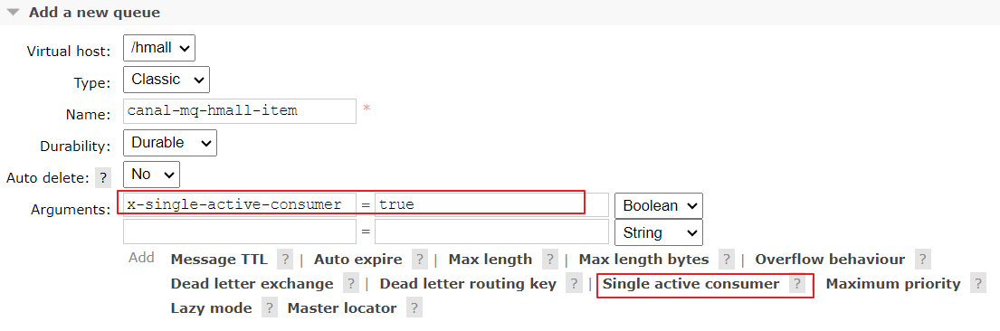

配置完成查保证队列上存在SAC标识，如下图：

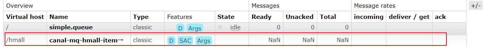

当有多个jvm进程都去监听该队列时，只有一个为活跃状态

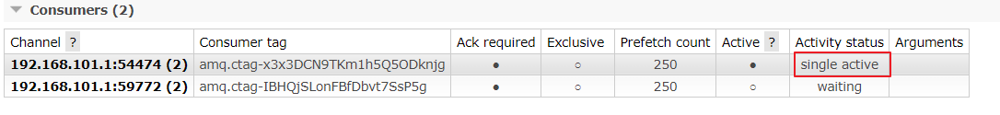

如果使用x-single-active-consumer参数需要修改为如下代码：

在Queue中添加：arguments={@Argument(name="x-single-active-consumer", value = "true", type = "java.lang.Boolean") }

如下所示：

```JSON
@RabbitListener(bindings = @QueueBinding(
        value = @Queue(name = "canal-mq-hmall-item",arguments={@Argument(name="x-single-active-consumer", value = "true", type = "java.lang.Boolean") }),
        exchange = @Exchange(name = "exchange.canal-hmall", type = ExchangeTypes.TOPIC),
        key = "canal-mq-hmall-item"),
        concurrency = "1"
)
public void onMessage(Message message) throws Exception {
    parseMsg(message);
}
```

concurrency=”1“表示 指定消费线程为1。

> 切记，单个实例中，消费同一个队列的消费者方法只能写一个，否则依然无法保证顺序

#### 1.2.6 面试题

Canal是怎么伪装成 MySQL slave？


Canal数据同步异常了怎么处理？


项目中如何进行索引同步的？


如何保证Canal+MQ同步消息的顺序性？


## 2 缓存常见问题

### 2.1 面试题

你的项目是怎么保证缓存一致性的？或  说一下双写不一致的解决方案。

考察项目中对缓存的应用，对缓存一致性方案的理解。


分布式锁你们用什么实现的？

考察对分布式锁的理解和应用。


说一下缓存穿透、缓存雪崩、缓存击穿？

考察高并发下对缓存的常见问题及解决方案的理解。


### 2.2. 缓存应用入门

#### 2.2.1 缓存概念

缓存（Cache）是一种用于提高数据访问速度的技术，它通过暂时存储频繁访问或计算成本较高的数据，使得后续的访问可以直接从缓存中获取数据，而不需要重新计算或从较慢的数据源（如数据库或磁盘）中读取数据。它可以显著提升应用程序的性能和响应速度。

缓存通常位于应用程序和底层数据存储之间，充当一个快速访问的中间层。

如下图所示：

我们的业务数据通常存储在数据库中，用户请求应用程序接口，应用程序查询数据库响应结果。

当访问量增大为了减轻对数据库的访问，提高响应速度，会在应用程序和数据库之间增加缓存层，用户请求应用程序接口，应用程序先查询缓存，如果查询到数据则直接响应用户，如果未在缓存命中则查询数据库并响应用户，并且将数据库查询到的数据存储到缓存中。

<whiteboard token="OO3IwXafghEGwDbTHgCcz2wUnrb"></whiteboard>

缓存可以存在于多个层次，从CPU缓存、内存缓存到分布式缓存系统。

上边我们用redis作为缓存层，redis可独立部署，这种称为**分布式缓存**。

我们也可以在应用程序内存中增加缓存结构，这种称为**内存缓存，**简单理解就是缓存存在于应用程序的内存中，如下图：在应用程序内存中创建一个HashMap对象，应用程序接口先从HashMap中查询数据，如果查询到则直接响应给用户，如果查询不到则查询数据库响应给用户并且从数据库查询到的数据存储到HashMap中。

<whiteboard token="XUfHwZ2LOhOJ7dbafu3c16C7nSf"></whiteboard>

关于内存缓存的例子还有很多，比如我们使用的MyBatis的一级缓存、二级缓存默认就是使用内存缓存实现。

**MyBatis的一级缓存**：

- 当同一个 SqlSession 中执行相同的 SQL 查询时，第一次执行查询的结果会被缓存起来，如果后续的查询条件相同，则直接从缓存中获取结果，而不再执行 SQL 语句。
- 一级缓存在 SqlSession 关闭或提交后就会被清空。
- 一级缓存就是SqlSession级别的缓存。

**MyBatis的二级缓存**：

- 二级缓存是在命名空间级别上的缓存，它作用于多个 SqlSession 之间。
- 与一级缓存相比，二级缓存可以跨越多个 SqlSession。
- 要启用二级缓存，需要在 Mapper 的 XML 文件的根节点 `<mapper>` 上添加 `cache` 元素，或者自定义一个实现 `Cache` 接口的类。

关于MyBatis一级缓存和二级缓存的内容请大家课下自行复习。

可搜索以下提示词，快速练手感受效果

- SpringBoot中MyBatisPlus二级缓存的快速使用
- SpringBoot中MyBatisPlus插件mybatis-plus-cache-redis的快速使用
- SpringBoot中MyBatisPlus插件mybatis-plus-cache-redis的高级配置使用


其他本地缓存技术：EhCache、Caffine

#### 2.2.2 缓存案例

##### 2.2.2.1 需求

下图是购物车的界面，购物车中的商品信息来源于商品服务，为了提高访问速度减少对数据库的访问，购物车请求商品服务查询商品信息，商品服务的商品查询接口正是使用缓存去实现。

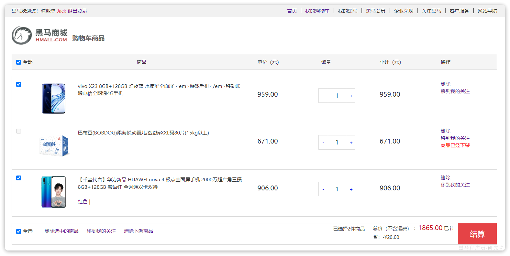

商品服务的商品信息查询接口使用缓存实现流程，如下图：

<whiteboard token="VbQXwBt2ZhTkGgbU5oMcPp9onve"></whiteboard>

##### 2.2.2.2 集成 redis

下边在商品服务中使用Redis在商品查询接口中使用缓存。

记得先启动redis服务: docker start redis

1. 首先在商品服务添加redis依赖

```JavaScript
<dependency>
    <groupId>org.springframework.boot</groupId>
    <artifactId>spring-boot-starter-data-redis</artifactId>
</dependency>
```

1. 配置RedisConfig.java

从课程资料的“redis”目录拷贝RedisConfig.java到商品服务的com.hmall.item.config包下。

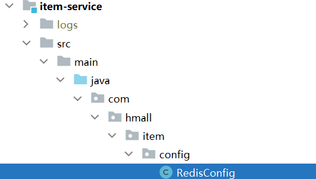

在RedisConfig.java中定义了RedisTemplate，使用RedisTemplate去操作Redis。


记住：

常用的有Jedis和Lettuce两个访问redis的客户端库，其中Lettuce的性能和并发性要好一些，Spring Boot 默认使用的是 Lettuce 作为 Redis 的客户端。

本项目集成了Spring data redis框架，在项目中可以通过RedisTemplate访问Redis，RedisTemplate提供了方便访问redis的模板方法。

RedisTemplate和Lettuce 是什么关系？

`RedisTemplate` 进行 Redis 操作时，实际上是通过 `Lettuce` 客户端与 Redis 服务器进行通信。


1. 配置redis地址

在application.yaml中配置

```JavaScript
spring:
  redis:
    host: 192.168.101.68
    port: 6379
    password: redis
```


##### 2.2.2.3 编写缓存方法

在IItemService.java类中增加缓存方法

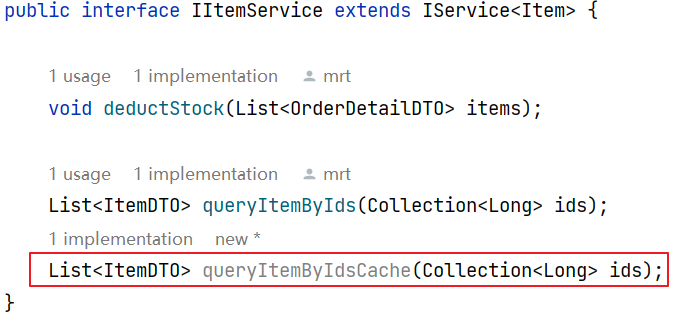

```JavaScript
@Override
public List<ItemDTO> queryItemByIdsCache(Collection<Long> ids) {
    //定义空列表
    List<ItemDTO> itemDTOList = new ArrayList<>();
    ids.stream().forEach(id->{
        //先查询缓存
        Item itemCache = (Item) redisTemplate.opsForValue().get("hmall:item:" + id);
        //如果缓存有则转为ItemDto
        if(Objects.nonNull(itemCache)){
            ItemDTO itemDTO = BeanUtils.copyBean(itemCache, ItemDTO.class);
            itemDTOList.add(itemDTO);
        }else{
            //查询数据库
            Item itemDB = getById(id);
            if(Objects.nonNull(itemDB)){
                //将数据库查询到的数据放入缓存
                redisTemplate.opsForValue().set("hmall:item:" + id,itemDB);
                //转为ItemDto
                ItemDTO itemDTO = BeanUtils.copyBean(itemDB, ItemDTO.class);
                itemDTOList.add(itemDTO);
            }
        }
    });
    return itemDTOList;
}
```


修改“根据id批量查询商品” 接口，调用queryItemByIdsCache 方法查询商品信息

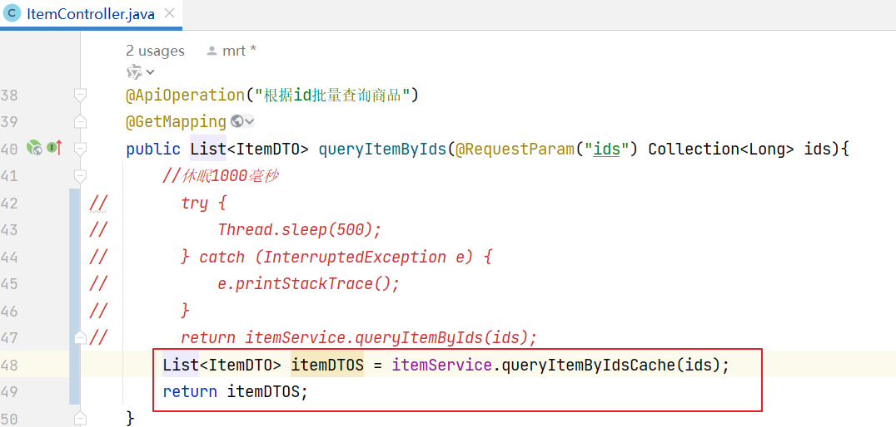


##### 2.2.2.4 测试

通过swagger文档进行测试，请求查询商品信息

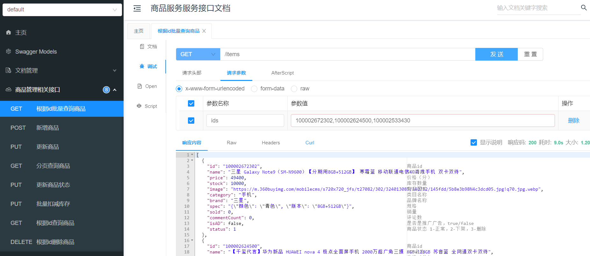

查询成功观察redis是否存储了商品信息

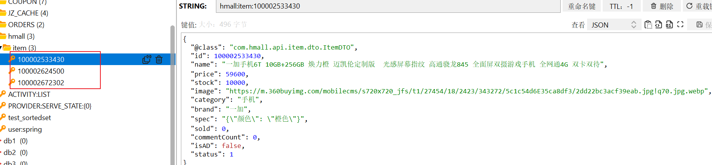


再次请求查询观察代码是否还查询数据库。


### 2.2 缓存一致性问题

#### 2.2.1 问题描述

缓存一致性是指缓存和数据库两者的数据保持一致。

如果管理员在后台修改了商品信息保存在数据库，用户在购物车从缓存查询商品信息，数据库和缓存两者的数据如果不能保持一致将影响用户的体验性，比如：商品调价，原价是90元，调为100元，如果用户在购物车仍然查询到调价前的价格等用户去支付时却是调价后的价格，这个体验是非常差的。

如下图：

<whiteboard token="IqKKwS1NVh1iHbbGr7Bc3Si6n3y"></whiteboard>

为什么会出现缓存不一致呢？

我们在修改商品信息时去修改缓存信息不就保持一致了吗，如下代码：

```JavaScript
public void updateItem(ItemDTO item){
  //修改数据库
  //更新缓存
}
```

这样的代码仍然会存在缓存不一致的问题。


下边我们分析造成缓存不一致的原因：

造成缓存不一致的原因可能是在写数据库和写缓存两步存在异常，也可能是并发所导致。

写数据库和写缓存导致不一致称为**双写不一致**，比如：先更新数据库成功了，更新缓存时失败了，最终导致不一致。

并发导致缓存不一致举例如下：

<whiteboard token="YIgywgtlbhHuQabCWDEcaTO0n9c"></whiteboard>

执行流程：

线程1先写入数据库X，当去写入缓存X时网络卡顿

线程2先写入数据库Y

线程2再写入缓存Y

线程1 写入缓存旧值X覆盖了新值Y


即使先写入缓存再写数据在并发环境也可能存在问题，如下图：

<whiteboard token="VhFiwNnf6hVvLabLhUQcogjenig"></whiteboard>

流程：

线程1先写入缓存X，当去写入数据库X时网络卡顿

线程2先写入缓存Y

线程2再写入数据库Y

线程1 写入数据库旧值X覆盖了新值Y


#### 2.2.2 解决方案

如何解决并发环境下双写不一致的问题？

出现并发环境下双写不一致的主要原因就是多线程并发导致，只要把并行操作改为串行操作即可解决。

##### 2.2.2.1 **使用分布式锁**

什么是分布式锁？

syncronized是jvm内存锁，要执行syncronized代码块需要先获取锁，获取锁的线程执行完成并释放锁后其它线程才可以获取锁，同步代码块的代码是串行执行。

```JavaScript
syncronized{
  //同步代码块
}
```

为什么会有分布式锁，为什么不使用syncronized内存锁？

如果是同一个进程内的线程去争抢资源可以用syncronized内存锁，因为都是同一个jvm中的线程去争抢同一个锁。

<whiteboard token="S469wAE81hWnPXb0rgLctl6fnRd"></whiteboard>

如果是多个进程的线程去争抢一个资源此时用syncronized是无法控制的，此时就需要用分布式锁，也就是独立于jvm进程部署一个分布式锁服务。

<whiteboard token="LhFswfEoPhyfxvbCc6gcQ3sVnKb"></whiteboard>

因为我们的微服务实例都会部署多个jvm进程，至少是两个进程去保证高可用，所以不同的进程去修改同一份数据就相当于去争抢同一个资源，此时就需要用分布式锁。


所以，分布式锁区别于内存锁，分布式锁就是由第三方软件单独提供获取锁释放锁的服务，独立部署，应用程序通过网络接口请求分布式锁服务获取锁释放锁，比如：Redis可以作为分布式锁服务，如下图：

<whiteboard token="FbkqwWlkDhCFmobhPOtchdZwnrT"></whiteboard>

上图中`SETNX` 是 Redis 中的一个命令，它的全称是 "SET if not exists"，即只有当键不存在时才设置键值对成功。

多线程执行SETNX命令，同时只会有一个线程执行SETNX成功，执行成功的线程表示获取锁成功。

如下图：

当mykey不存在时执行`SETNX mykey 1` 返回1表示执行成功，执行成功的线程表示获取锁成功。

获取锁的线程执行业务逻辑完成后删除mykey表示释放锁，删除mykey后其它线程再次执行SETNX才会成功。

测试：

开两个ssh窗口，并用redis-cli程序连接上redis

docker exec -it redis redis-cli

虚拟机中redis的密码为：redis，通过下边的命令进行认证：

auth redis

同时向两个窗口发送:setnx mykey 1命令

发现只有一个窗口执行成功，这说明只会有一个线程执行SETNX成功


下边我们理解使用分布式锁解决双写不一致的方案：

<whiteboard token="TequwEd8ShkLkIbLVwbcrop3nzf"></whiteboard>

流程：

线程1申请分布式锁，拿到锁。此时其它线程无法获取同一把锁。

线程1写数据库，写缓存，操作完成释放锁。

伪代码如下：

```JavaScript
public void updateItem(ItemDTO item){
  //获取分布式锁
  //修改数据库
  //更新缓存
  //释放锁
}
```

线程2申请分布锁成功，写数据库，写缓存。

对双写的操作每个线程顺序执行。

对操作异常问题仍需要解决：写数据库成功写缓存失败了，数据库需要回滚，此时就需要使用分布式事务组件。


##### 2.2.2.2 **延迟双删**

既然双写操作存在不一致，我们把写缓存改为删除缓存呢？

先写数据库再删除缓存，如果删除缓存失败了缓存也就不一致了，那我们改为：先删除缓存再写数据库，如下图：

<whiteboard token="CkkywRZAFhSwb0byG9rc5vuxnGf"></whiteboard>

执行流程：

线程1删除缓存

线程2读缓存发现没有数据此时查询数据库拿到旧数据写入缓存

线程1写入数据库

最终数据库和缓存数据不一致。


即使线程1删除缓存、写数据库操作后线程2再去查询缓存也可能存在问题，如下图：

<whiteboard token="Bt6Ew0NuSh0oI9bjcKpchJs2n2b"></whiteboard>

线程1向主数据库写，线程2向从数据库查询，流程如下：

线程1删除缓存

线程1向主数据库写，数据向从数据库同步

线程2查询缓存没有数据，查询从数据库，得到旧数据

线程2将旧数据写入缓存


解决上边的问题采用延迟双删：

线程1先删除缓存，再写入主数据库，延迟一定时间再删除缓存。

<whiteboard token="FkDAwDCDLhjbCMbyhX5ci5jOnqf"></whiteboard>

上图线程1的动作简化为下图：

<whiteboard token="CpBxwZ040hl2yZbO3szc2SgNnme"></whiteboard>

延迟多长时间呢？

延迟主数据向从数据库同步的时间间隔，如果延迟时间设置不合理也会导致数据不一致。


> 迟时间的核心目标是 确保 “读请求重建缓存” 的操作先于 “延迟删除缓存” 的操作完成


**延迟时间一般设置多久？**

- 对于主从复制集群，建议设置为 1s \~ 3s。


由于更新步骤里，没有加锁步骤，高并发情况下，操作redis次数减少，性能还不错，此方案较好，使用公司较多。

缺点：如果延迟时间设置过长，数据无法及时删掉导致数据没法及时更新一致（实效性会收到影响）


##### 2.2.2.3 **异步同步**

延迟双删的目的也是为了保证最终一致性，即允许缓存短暂不一致，最终保证一致性。

保证最终一致性的方案有很多，比如：通过MQ、定时任务都可以实现。

1. **对实时性要求较高可以采用MQ异步同步**：


<whiteboard token="Sjz9weSN1hPgPhbxHSncFAa6nZb"></whiteboard>

流程如下：

线程1写数据库

canal读取binlog日志，将数据变化日志写入mq

同步程序监听mq接收到数据变化的消息

同步程序解析消息内容写入redis，写入redis成功正常消费完成，消息从mq删除。

此方案较好，更新比较及时，使用公司非常多


1. **对实时性要求不高可以采用定时任务方式：**

专门启动一个数据同步任务定时读取数据同步到redis，此方式适用于对数据实时性要求不强更新不频繁的数据。

<whiteboard token="NPgQwj7gOh3IylbqeCXcCB7mnHe"></whiteboard>

线程1写入数据库（业务数据表，变化日志表）

同步程序读取数据库（变化日志表），根据变化日志内容写入redis，同步完成删除变化日志。


##### 2.2.2.4 总结

通过上边的解决方案分析可知：

保存双写一致性的方案包括两个方向：

1. **保证强一致性**

**使用分布式锁对缓存的读和写加锁控制**，这样可以保证强一致性，但是这样影响了使用缓存的性能，可以设想当前如果线程01正在修改缓存，此时线程02去读缓存就需要等线程01修改完成释放锁后才能读到最新数据，这肯定会影响读数据的性能。

伪代码如下：

```JavaScript
public void updateItem(ItemDTO item){
  //获取写锁 / 排它锁
  //修改数据库
  //更新缓存
  //释放锁
}


public ItemDTO getItemById(Long id){
  //获取读锁 / 共享锁
  //从缓存读取商品信息
  //释放锁
}
```


1. **保证最终一致性**

允许缓存和数据库的数据存在一段时间不一致，但最终数据会一致。

可以使用延迟双删、定时任务异步同步的方式。

延迟双删给了我们启发，那就是：**要想保证缓存最终于数据库一致就是key必须加过期时间**，即使一旦发生缓存不一致，当缓存过期后会重新加载，数据最终还是能保证一致。


下边尝试回答面试题：

你的项目是怎么保证缓存一致性的？或  说一下双写不一致的解决方案。


### 2.3 分布式锁入门

在缓存一致性方案中用到了分布式锁，这里对分布式锁进行介绍。

#### 2.3.1 面试题

面试题:分布式锁与syncronized锁的区别

1. **Synchronized锁**

`Synchronized` 是 Java 语言内置的关键字，提供了一种简单的方式来实现线程之间的互斥。它可以在方法或代码块级别上使用，保证了在同一时刻只有一个线程可以执行被 `synchronized` 修饰的方法或代码块。

- 作用范围：`synchronized` 只能在单个 JVM 中起作用，适用于多线程环境中的同步问题。
- 实现方式：通过 JVM 实现，利用了底层的操作系统互斥锁（mutex）。
- 使用简便：直接在代码层面使用，不需要额外的配置或依赖。
- 应用场景：`synchronized` 主要用于解决同一 JVM 内多线程间的同步问题。

1. **分布式锁**

分布式锁是一种在分布式系统中实现同步的机制。当应用程序分布在不同的机器上时，需要一种协调机制来确保多个节点之间的一致性。**分布式锁已不属于某个虚拟机，而是分布式部署，由多个虚拟机所共享。**

- 用范围：分布式锁跨越多个 JVM 或者多个服务实例，适用于分布式系统中的同步问题。
- 实现方式：通常依赖于外部的服务或中间件，如 Redis、Zookeeper、Etcd 等，通过一定的协议（如两阶段锁、心跳检测）来实现。
- 复杂性：实现相对复杂，需要考虑网络延迟、故障恢复等问题
- 应用场景：分布式锁则用于解决跨多个 JVM 或者跨多个服务实例的同步问题。


#### 2.3.2 技术方案

实现分布式锁的方案有很多，常用的如下：

1、基于数据库实现分布锁

利用数据库主键唯一性的特点，或利用数据库唯一索引、行级锁的特点，比如：多个线程同时向数据库插入主键相同的同一条记录，谁插入成功谁就获取锁，多个线程同时去更新相同的记录，谁更新成功谁就抢到锁。

2、基于redis实现锁

redis提供了分布式锁的实现方案，比如：SETNX、redisson等。

3、使用zookeeper实现

zookeeper是一个分布式协调服务，主要解决分布式程序之间的同步的问题。zookeeper的结构类似的文件目录，多线程向zookeeper创建一个子目录(节点)只会有一个创建成功，利用此特点可以实现分布式锁，谁创建该结点成功谁就获得锁。


#### 2.3.3 SETNX实现分布式锁

AI: 使用redisTemplate写一个例子用SETNX实现分布式锁


修改更新商品接口：

```JavaScript
@ApiOperation("更新商品")
@PutMapping
public void updateItem(@RequestBody ItemDTO item) {
    Long id = item.getId();
    //锁id
    String lockKey = "hmall:item:lock:"+item.getId();
    //通过SETNX获取锁
    if (!redisTemplate.opsForValue().setIfAbsent(lockKey, "lock", 20, TimeUnit.SECONDS)) {
        //获取锁失败
        throw new BizIllegalException("操作过于频繁，请稍后再试！");
    }
    try {
        // 不允许修改商品状态，所以强制设置为null，更新时，就会忽略该字段
        item.setStatus(null);
        // 更新
        itemService.updateById(BeanUtils.copyBean(item, Item.class));
        Item item1 = itemService.getBaseMapper().selectById(item.getId());
        item = BeanUtils.copyBean(item1, ItemDTO.class);
        //更新缓存
        redisTemplate.opsForValue().set("hmall:item:"+id,item,1, TimeUnit.HOURS);
    }catch (Exception e){
        e.printStackTrace();
    }finally {
        redisTemplate.delete(lockKey);
    }
}
```

测试：

同时开两个测试窗口，每个窗口的请求都会开一个新线程，开两个窗口来模拟两个线程请求接口。

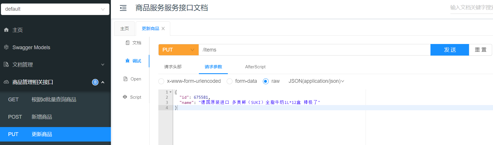

第一个窗口更新商品信息获取锁成功，更新商品信息未完成时锁未释放，另一个窗口无法获取锁导致更新失败。


使用SETNX实现分布式锁有以下问题：

1. 锁过期被强占

当线程01执行业务逻辑的时间过长，锁到达过期时间则自动释放锁，此时线程02将获取锁成功，仍然存在并发问题。

1. 锁被强删

当线程01执行业务逻辑的时间过长，锁到达过期时间则自动释放锁，此时线程02将获取锁成功，线程01执行完业务逻辑后删除了线程02的锁。

1. 获取锁失败没有重试机制

当线程获取锁失败没有重试机制导致程序直接失败，一些场景需要加入重试机制提高获取锁的成功率。

1. 缺少锁重入机制


**在生产中建议使用成熟的分布式锁库，如 Redisson，以确保锁的安全性和健壮性。**


#### 2.3.4 Redisson实现分布式锁

##### 2.3.4.1 基本使用

在SETNX实现分布式的缺陷都可以用Redisson去解决。

1. 锁过期被强占

看门狗机制解决

1. 锁被强删

在删除时会判断是否是当前线程的锁，如果是，才可以删除。利用lua脚本实现

1. 获取锁失败没有重试机制

设置等待时间，在等待时间内不停地重试获取锁

1. 缺少锁重入机制

利用redis的hash结构实现 key:锁的键，hashkey:线程id, value:重入次数


AI:写一个redisson实现分布式锁的例子


Redisson 是一个用于 Java 开发的 Redis 客户端和分布式锁框架，它不仅可以实现分布式锁，还可以实现分布式集合（如 List、Set、Map 等）和分布式对象（如 AtomicInteger、AtomicLong、CountDownLatch 等），简单理解就是将JVM中内存存储的List、Set、AtomicInteger这些对象使用Redis去存储和管理。

使用Redisson的基本用法如下：

```Java
// 创建Redisson客户端
RedissonClient redissonClient = Redisson.create();
// 获取名为myLock的分布式锁实例，通过此实例进行加锁、解锁
RLock lock = redissonClient.getLock("myLock");
 try {
    // 尝试获取锁，最多等待3秒，持锁时间为5秒
    boolean isLockAcquired = lock.tryLock(3, 5, TimeUnit.SECONDS);
     if (isLockAcquired ) {
        try {
            // 获取锁成功，执行业务逻辑
            Thread.sleep(5000);
        } finally {
            // 释放锁
            lock.unlock();
        }
    } else {
       // 获取锁失败，处理相应逻辑
    }
} catch (InterruptedException e) {
    // 处理中断异常
}

```

说明：

lock.tryLock方法是一种非阻塞获取锁的方式，没有获取锁可以直接返回，而lock.lock()是一种阻塞获取锁的方法，多个线程通过lock()方法获取锁，只有一个线程获取到锁，其它线程将阻塞等待。

通常lock.tryLock方法使用的更广泛。

1. **使用tryLock方法获取锁时传3个参数：**

- waitTime：尝试获取锁的最大等待时间，在这个时间范围内会不断地尝试获取锁，如果在 `waitTime` 时间内未能获取到锁，则返回 `false`。waitTime默认为-1，表示获取锁失败后立刻返回不重试。
- leaseTime：表示持锁的时间，即锁的自动释放时间。在获取锁成功后，锁会在 `leaseTime` 时间后自动释放。如果在持锁的时间内未手动释放锁，锁也会在 `leaseTime` 时间后自动释放。
- TimeUnit：表示时间单位，可以是秒、毫秒等。


Redisson 的设计哲学是：显式指定的 `leaseTime` 优先级高于看门狗默认值。  
当你传入 `leaseTime` 参数时，Redisson 认为你已经明确知道业务执行时间，因此不会触发自动续期，以避免意外延长锁的持有时间。


**看门狗机制的触发条件**

Redisson 的看门狗默认超时时间为 30 秒，仅在以下场景自动触发：

1. 使用无参 `lock()` 方法

```Java
RLock lock = redisson.getLock("myLock");
lock.lock(); // 看门狗自动生效，锁默认30秒，会自动续期
```

1. 仅指定等待时间

```Java
lock.tryLock(10, TimeUnit.SECONDS); // 等待10秒，锁默认30秒且自动续期
```

1. leaseTime指定为-1

```Java
lock.tryLock(long waitTime, -1,TimeUnit unit)
```


1. **tryLock方法返回值：**

true：获取到了锁

false：未获取到锁

1. **注意释放锁**

获取到锁后的代码放在try中，在finally 中释放锁。

下边用Redisson替换SETNX方式。

1. 首先在商品服务加入 Redisson依赖

```JavaScript
<dependency>
    <groupId>org.redisson</groupId>
    <artifactId>redisson</artifactId>
    <version>3.17.7</version>
</dependency>
```

1. 将资料目录“redis”下的RedissonConfiguration.java 拷贝到商品服务的com.hmall.item.config包下

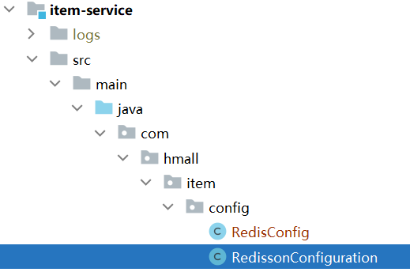


1. 编写service方法，使用Redisson替换SETNX

```JavaScript
@PutMapping
public void updateItem(@RequestBody ItemDTO item) {

    Long id = item.getId();
    //锁id
    String lockKey = "hmall:item:lock:"+item.getId();
    RLock lock = redissonClient.getLock(lockKey);
    try {
        //尝试获取锁
        boolean b = lock.tryLock(3,15,TimeUnit.SECONDS);
        if(!b){
            throw new BizIllegalException("操作过于频繁，请稍后再试！");
        }

        try {
            // 不允许修改商品状态，所以强制设置为null，更新时，就会忽略该字段
            item.setStatus(null);
            // 更新
            itemService.updateById(BeanUtils.copyBean(item, Item.class));
            Item item1 = itemService.getBaseMapper().selectById(item.getId());
            item = BeanUtils.copyBean(item1, ItemDTO.class);
            //更新缓存
            redisTemplate.opsForValue().set("hmall:item:"+id,item,1, TimeUnit.HOURS);
        }catch (Exception e){
            e.printStackTrace();
        }finally {
            //释放锁
            lock.unlock();
        }

    }catch (Exception e){
        e.printStackTrace();
    }

}
```


1. 测试

同SETNX测试过程。


##### 3.4.4.2 看门狗机制

再回顾下使用SETNX的前两个问题如下：

1. 锁过期被强占

当线程01执行业务逻辑的时间过长，锁到达过期时间则自动释放锁，此时线程02将获取锁成功，仍然存在并发问题。

1. 锁被强删

当线程01执行业务逻辑的时间过长，锁到达过期时间则自动释放锁，此时线程02将获取锁成功，线程01执行完业务逻辑后删除了线程02的锁。

1. 获取锁失败没有重试机制

当线程获取锁失败没有重试机制导致程序直接失败，一些场景需要加入重试机制提高获取锁的成功率。


通过Redisson的测试可知Redisson具有重试功能，解决SETNX的第三个问题。

导致前两个问题的主要原因是任务执行时间过长，超过了锁的有效期，锁失效后被其它线程抢占，有同学可能会说不要设置锁的过期时间，**如果不设置锁的过期时间当程序断电结束会导致死锁发生，所以锁一定要设置过期时间**。

但是设置锁的过期时间为多少合适呢？

设置多少都不合适，这个问题Redisson提供了锁自动续期的功能，默认锁的过期时间为30秒，当任务没有执行完成时每隔10秒自动续期一次，这个机制就是Redisson的看门狗机制。

"看门狗机制"（Watchdog）是**一种用于监测和维护锁的超时时间的机制**，**它可以确保在任务没有完成时对锁的过期时间进行自动续期**，以避免任务没有完成时锁自动释放的问题。开启看门狗后针对当前锁创建一个线程执行延迟任务，默认每隔10秒将锁的过期时间重新续期为30秒。当任务结束，程序执行unlock()方法释放锁时会结束看门狗线程。

**注意：任务结束一定要执行unlock()方法释放锁，否则看门狗线程一直进行续期，导致锁无法释放。**


下边**测试看门狗：**

调用下边的方法都可以开启看门狗：

```JSON
tryLock(long waitTime, -1,TimeUnit unit)
```

传入leaseTime参数为-1可以开启看门狗。


下边进行测试：

修改tryLock的方法，leaseTime参数传入-1，开启看门狗。

```JSON
boolean isLock = lock.tryLock(３, -1, TimeUnit.SECONDS);//开启看门狗
```

在代码中添加Thread.*sleep*(50000);休眠50秒。


重启商品服务，调用更新商品信息接口，获取锁成功，通过redis客户端观察分布式锁的自动续期功能

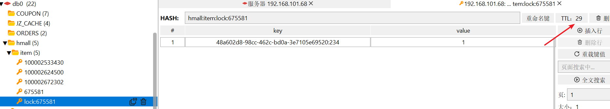

锁的过期时间到20秒时会自动续期到30秒。


#### 2.3.5 总结

分布式锁你们用什么实现的？


### 2.4 缓存穿透问题

#### 2.4.1 概念

在使用缓存时特别是在高并发场景下会遇到很多问题，常用的问题有缓存穿透、缓存击穿、缓存雪崩以及缓存一致性问题。下边介绍缓存穿透问题及解决方案。

什么是缓存穿透问题？

**缓存穿透是指请求一个不存在的数据，缓存层和数据库层都没有这个数据，这种请求会穿透缓存直接到数据库进行查询**。它通常发生在一些恶意用户可能故意发起不存在的请求，试图让系统陷入这种情况，以耗尽数据库连接资源或者造成性能问题。

<whiteboard token="SGVnwDZCZhbFusbhkIXcyVpHnab"></whiteboard>

查询一个缓存中不存在的数据将会执行方法查询数据库，数据库也不存在此数据，查询完数据库也没有缓存数据，缓存没有起到作用。

#### 2.4.2 解决方案

##### 2.4.2.1. 缓存空值或特殊值

如何解决缓存穿透?

**1、对请求增加校验机制**

比如：查询的Id是长整型并且是19位，如果发来的不是长整型或不符合位数则直接返回不再查询数据库。

**2、缓存空值或特殊值**

当查询数据库得到的数据不存在，此时我们仍然去缓存数据，缓存一个空值或一个特殊值的数据，避免每次都会查询数据库，避免缓存穿透。

流程如下：

<whiteboard token="ZE3sw2ZoLh0p0Ebdc9ZcEjVpnfg"></whiteboard>

修改原有商品查询方法，从数据库没有查询到数据时缓存一个空属性对象

```JavaScript
@Override
public List<ItemDTO> queryItemByIdsCache(Collection<Long> ids) {
    //定义空列表
    List<ItemDTO> itemDTOList = new ArrayList<>();
    ids.stream().forEach(id->{
        //先查询缓存
        ItemDTO itemCache = (ItemDTO) redisTemplate.opsForValue().get("hmall:item:" + id);
        //如果缓存有则转为ItemDto
        if(Objects.nonNull(itemCache)){
            ItemDTO itemDTO = BeanUtils.copyBean(itemCache, ItemDTO.class);
            itemDTOList.add(itemDTO);
        }else{
            //查询数据库
            Item itemDB = getById(id);
            if(Objects.nonNull(itemDB)){
                //将数据库查询到的数据放入缓存
                redisTemplate.opsForValue().set("hmall:item:" + id,itemDB);
                //转为ItemDto
                ItemDTO itemDTO = BeanUtils.copyBean(itemDB, ItemDTO.class);
                itemDTOList.add(itemDTO);
            }else{
                ItemDTO itemDTO = new ItemDTO();
                itemDTO.setName("商品已下架");
                //向缓存设置空值
                redisTemplate.opsForValue().set("hmall:item:" + id,itemDTO);
            }
        }
    });
    return itemDTOList;
}
```


##### 3.4.2.2. **使用布隆过滤器**

**什么是布隆过滤器？**

布隆过滤器（Bloom Filter）是一种数据结构，用于快速判断一个元素是否属于一个集合中。

它使用多个Hash函数将一个元素映射成一个位阵列（Bit array）中的一个点，将Bit array理解为一个二进制数组，数组元素是0或1。

当一个元素加入集合时，通过N个散列函数将这个元素映射到一个Bit array中的N个点，把它们设置为1。


**为什么会存在误判？**

主要原因是哈希冲突。布隆过滤器使用多个哈希函数将输入的元素映射到位数组中的多个位置，当多个不同的元素通过不同的哈希函数映射到相同的位数组位置时就发生了哈希冲突。

由于哈希函数的有限性，不同的元素可能会映射到相同的位置上，这种情况下即使元素不在布隆过滤器中可能产生误判，即布隆过滤器判断元素在集合中。

**如何降低误判率？**

增加Bit array空间，减少哈希冲突，优化散列函数，使用更多的散列函数。


**如何使用布隆过滤器？**

将要查询的元素通过N个散列函数提前全部映射到Bit array中，比如：查询商品信息，需要将全部商品的id提前映射到Bit array中，当去查询元素是否在数据库存在时从布隆过滤器查询即可，如果哈希函数返回0则表示肯定不存在。

<whiteboard token="QZ4nwmHEqh60H2bQoSYcOdXinKh"></whiteboard>


布隆过滤器的优点是：二进制数组占用空间少，插入和查询效率高效。

缺点是存在误判率，并且删除困难，因为同一个位置由于哈希冲突可能存在多个元素，删除某个元素可能删除了其它元素。

**布隆过滤器的应用场景？**

1、海量数据去重，比如URL去重，搜索引擎爬虫抓取网页，使用布隆过滤器可以快速判定一个URL是否已经被爬取过，避免重复爬取。

2、垃圾邮件过滤：使用布隆过滤器可以用于快速判断一个邮件地址是否是垃圾邮件发送者，对于海量的邮件地址，布隆过滤器可以提供高效的判定。

3、安全领域：在网络安全中，布隆过滤器可以用于检查一个输入值是否在黑名单中，用于快速拦截一些潜在的恶意请求。

4、避免缓存穿透：通过布隆过滤器判断是否不存在，如果不存在则直接返回。


**如何在代码中实现布隆过滤器？**

使用redit的bitmap位图结构实现。

使用redisson实现。

使用google的Guava库实现。

下边举例说明：

引入依赖

```Plain Text
<!-- https://mvnrepository.com/artifact/com.google.guava/guava -->
<dependency>
    <groupId>com.google.guava</groupId>
    <artifactId>guava</artifactId>
    <version>28.2-jre</version>
</dependency>
```

测试代码：

```Java

import com.google.common.hash.BloomFilter;
import com.google.common.hash.Funnels;

import java.nio.charset.Charset;

/**
 * @author Mr.M
 * @version 1.0
 * @description TODO
 * @date 2023/10/25 17:10
 */
public class BloomFilterExample {
    public static void main(String[] args) {
        // 创建一个布隆过滤器，预期元素数量为1000，误判率为0.01
        BloomFilter<String> bloomFilter = BloomFilter.create(Funnels.stringFunnel(Charset.defaultCharset()), 1000, 0.01);

        // 添加元素到布隆过滤器
        bloomFilter.put("example1");
        bloomFilter.put("example2");
        bloomFilter.put("example3");

        // 测试元素是否在布隆过滤器中
        System.out.println(bloomFilter.mightContain("example1")); // true
        System.out.println(bloomFilter.mightContain("example4")); // false
    }
}
```

在上述代码中，我们创建了一个预期包含1000个元素、误判率为0.01的布隆过滤器。然后，我们向布隆过滤器中添加了三个元素（"example1"、"example2" 和 "example3"），并测试了几个元素是否在布隆过滤器中。

请注意，误判率是你可以调整的一个参数。较低的误判率通常需要更多的空间和计算资源。


#### 2.4.3 小结

什么是缓存穿透？如何解决缓存穿透？


什么是布隆过滤器？如何使用布隆过滤器？


### 2.5 缓存击穿问题

目标：理解缓存击穿问题，掌握缓存击穿的解决方案。

#### 2.5.1 概念

缓存击穿发生在访问热点数据，大量请求访问同一个热点数据，当热点数据失效后同时去请求数据库，瞬间耗尽数据库资源，导致数据库无法使用。

比如某手机新品发布，当缓存失效时有大量并发到来导致同时去访问数据库。

#### 2.5.2 解决方案

如何解决缓存击穿？

**1、使用锁**

单体架构下（单进程内）可以使用同步锁控制查询数据库的代码，只允许有一个线程去查询数据库，查询得到数据库存入缓存。

```Java
synchronized(obj){
  //查询数据库
  //存入缓存
}
```

分布式架构下（多个进程之间）可以使用分布式锁进行控制。


**2、热点数据不过期**

可以由后台程序提前将热点数据加入缓存，缓存过期时间不过期，由后台程序做好缓存同步。

例如：当服务上架后将服务信息缓存到redis且永不过期，此时需要使用put注解。

**3、缓存预热**

分为提前预热、定时预热。

提前预热就是提前写入缓存。

定时预热是使用定时程序去更新缓存。


**4、热点数据查询降级处理**

对热点数据查询定义单独的接口，当缓存中不存在时走降级方法避免查询数据库。


#### 2.5.3 小结

什么是缓存击穿？如何解决缓存击穿？


### 2.6 缓存雪崩问题

目标：理解缓存雪崩问题，掌握缓存雪崩的解决方案。

#### 2.6.1 概念

缓存雪崩是缓存中大量key失效后当高并发到来时导致大量请求到数据库，瞬间耗尽数据库资源，导致数据库无法使用。

比如对某信息设置缓存过期时间为30分钟，在大量请求同时查询该类信息时，此时就会有大量的同类信息存在相同的过期时间，一旦失效将同时失效，造成雪崩问题。

#### 2.6.2 解决方案

如何解决缓存雪崩？

**1、使用锁进行控制**

思路同缓存击穿。

**2、对同一类型信息的key设置不同的过期时间**

通常对一类信息的key设置的过期时间是相同的，这里可以在原有固定时间的基础上加上一个随机时间使它们的过期时间都不相同。

**3、缓存定时预热**

不用等到请求到来再去查询数据库存入缓存，可以提前将数据存入缓存。使用缓存预热机制通常有专门的后台程序去将数据库的数据同步到缓存。

#### 2.6.3 小结

什么是缓存雪崩？如何解决缓存雪崩？


## 作业

### 1 使用分布式锁防止订单重复提交

#### 1.1 什么情况下会重复提交订单？

以下情况会导致重复提交相同的订单：

网络延迟或不稳定： 当用户点击提交按钮后，由于网络延迟或不稳定，前端可能在等待服务端响应时，用户误以为操作未成功，多次点击提交按钮。

重复点击按钮： 用户可能会因为页面加载缓慢或其他原因感到不耐烦，多次点击提交按钮，导致重复提交订单。

页面刷新后的再次提交： 用户在订单提交后，如果刷新页面，浏览器可能会重新发送上一次的表单提交请求，导致订单的重复提交。

#### 1.2 如何防止重复提交相同的订单？

防止重复提交相同的订单就是保证创建订单方法的幂等性。

通常需要在前端和后端共同去完成：

##### **前端防重复提交**

**禁用提交按钮：** 在用户点击提交按钮后，立即将按钮禁用，防止用户多次点击。

**显示加载中状态：** 提交按钮点击后，显示加载中状态，防止用户再次点击。


##### **后端防重复提交**

###### 利用Token机制

- 生成Token：用户每次进入下单页面，前端会向服务器请求一个唯一的Token。
- 验证Token：用户提交订单时，需要携带这个Token一起发送。服务器接收到订单请求后，验证Token的有效性和唯一性，一旦Token被使用过就失效。
- 存储Token：可以将Token存放在Redis等缓存数据库中，并设置一定的过期时间。

<whiteboard token="LXpywm4SMhrOBLbtlcUccWDmnlS"></whiteboard>

###### **使用分布式锁**

以用户id作为分布式锁锁定下单接口10秒，10秒内该用户不能再次下同一个服务的订单。


<whiteboard token="HAacwTfE1hx69vbR5VycEBsYnMg"></whiteboard>

---
> 来源：飞书技术知识库（脱敏版） · 08 面试知识库 / 微服务面试题 / 微服务面试篇（上） · [原文](https://ccn8v2zngwsm.feishu.cn/wiki/N07Kw7zi7it7Ujk6cVGc2zggnnb)
