# Redis集群搭建

## 1.Redis主从

单节点Redis的并发能力是有上限的，要进一步提高Redis的并发能力，这里讲一种方案就是搭建主从集群，实现读写分离。

### 1.1.主从集群结构

下图就是一个简单的Redis主从集群结构：

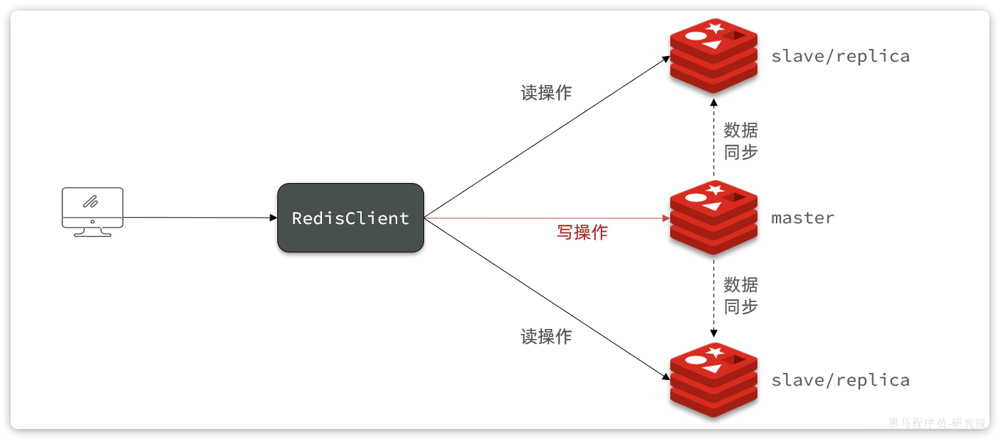

如图所示，集群中有一个master节点、两个slave节点（现在叫replica）。当我们通过Redis的Java客户端访问主从集群时，应该做好路由：

- 如果是写操作，应该访问master节点，master会自动将数据同步给两个slave节点
- 如果是读操作，建议访问各个slave节点，从而分担并发压力


### 1.2.搭建主从集群

我们会在同一个虚拟机中利用3个Docker容器来搭建主从集群，容器信息如下：

<table><colgroup><col/><col/><col/><col/></colgroup><thead><tr><th><h5><b>容器名</b></h5></th><th><h5><b>角色</b></h5></th><th><h5><b>IP</b></h5></th><th><h5><b>映射端口</b></h5></th></tr></thead><tbody><tr><td>r1</td><td>master</td><td>192.168.101.68</td><td>7001</td></tr><tr><td>r2</td><td>slave</td><td>192.168.101.68</td><td>7002</td></tr><tr><td>r3</td><td>slave</td><td>192.168.101.68</td><td>7003</td></tr></tbody></table>


#### 1.2.1.启动多个Redis实例

我们利用课前资料提供的docker-compose文件来构建主从集群：

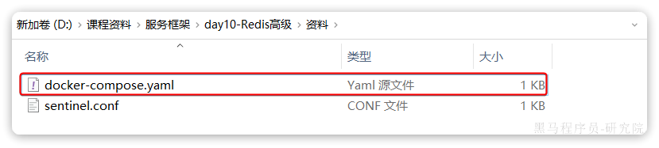

文件内容如下：

```YAML
version: "6.2.7"

services:
  r1:
    image: redis:6.2.7
    container_name: r1
    network_mode: "host"
    entrypoint: ["redis-server", "--port", "7001"]
  r2:
    image: redis:6.2.7
    container_name: r2
    network_mode: "host"
    entrypoint: ["redis-server", "--port", "7002"]
  r3:
    image: redis:6.2.7
    container_name: r3
    network_mode: "host"
    entrypoint: ["redis-server", "--port", "7003"]

```


将其上传至虚拟机的`/root/redis`目录下：

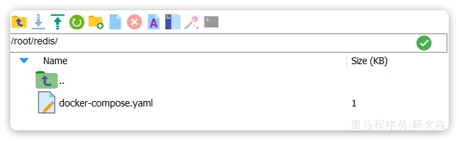

执行命令，运行集群：

```Bash
docker-compose up -d
```

结果：

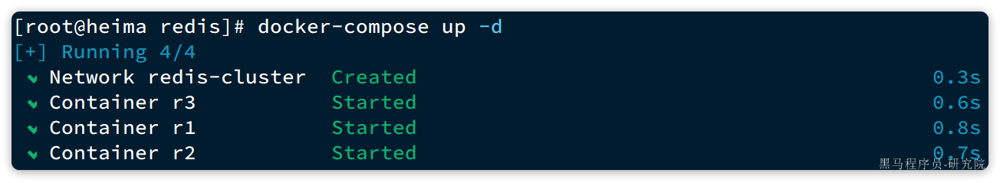


由于采用的是host模式，我们看不到端口映射。不过能直接在宿主机通过ps命令查看到Redis进程：

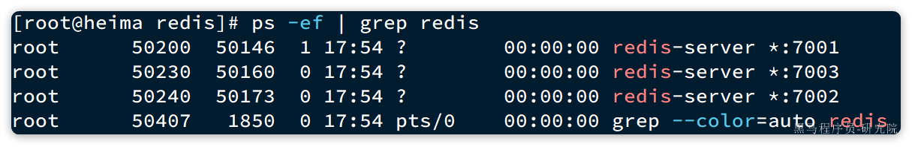


#### 1.2.2.建立集群

虽然我们启动了3个Redis实例，但是它们并没有形成主从关系。我们需要通过命令来配置主从关系：

```Bash
# Redis5.0以前
slaveof <masterip> <masterport>
# Redis5.0以后
replicaof <masterip> <masterport>
```


有临时和永久两种模式：

- 永久生效：在redis.conf文件中利用`slaveof`命令指定`master`节点
- 临时生效：直接利用redis-cli控制台输入`slaveof`命令，指定`master`节点


我们测试临时模式，首先连接`r2`，让其以`r1`为master

```Bash
# 连接r2
docker exec -it r2 redis-cli -p 7002
# 认r1主，也就是7001
slaveof 192.168.101.68 7001
```


然后连接`r3`，让其以`r1`为master

```Bash
# 连接r3
docker exec -it r3 redis-cli -p 7003
# 认r1主，也就是7001
slaveof 192.168.101.68 7001
```


然后连接`r1`，查看集群状态：

```Bash
# 连接r1
docker exec -it r1 redis-cli -p 7001
# 查看集群状态
info replication
```

结果如下：

```Bash
127.0.0.1:7001> info replication
# Replication
role:master
connected_slaves:2
slave0:ip=192.168.101.68,port=7002,state=online,offset=140,lag=1
slave1:ip=192.168.101.68,port=7003,state=online,offset=140,lag=1
master_failover_state:no-failover
master_replid:16d90568498908b322178ca12078114e6c518b86
master_replid2:0000000000000000000000000000000000000000
master_repl_offset:140
second_repl_offset:-1
repl_backlog_active:1
repl_backlog_size:1048576
repl_backlog_first_byte_offset:1
repl_backlog_histlen:140
```

可以看到，当前节点`r1:7001`的角色是`master`，有两个slave与其连接：

- `slave0`：`port`是`7002`，也就是`r2`节点
- `slave1`：`port`是`7003`，也就是`r3`节点


#### 1.2.3.测试

依次在`r1`、`r2`、`r3`节点上执行下面命令：

```Bash
set num 123

get num
```


你会发现，只有在`r1`这个节点上可以执行`set`命令（**写操作**）

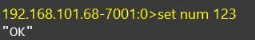

其它两个节点只能执行`get`命令（**读操作**）。也就是说读写操作已经分离了。

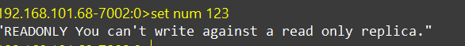


## 2.Redis哨兵

主从结构中master节点的作用非常重要，一旦故障就会导致集群不可用。那么有什么办法能保证主从集群的高可用性呢？


### 2.1.哨兵集群介绍

Redis提供了`哨兵`（`Sentinel`）机制来监控主从集群监控状态，确保集群的高可用性。

哨兵集群作用原理图：

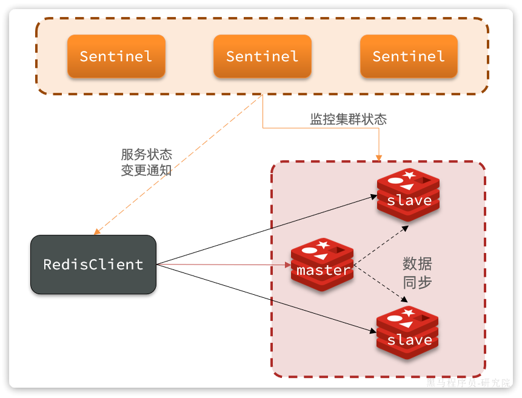

哨兵的作用如下：

- **状态监控**：`Sentinel` 会不断检查您的`master`和`slave`是否按预期工作
- **故障恢复（failover）**：如果`master`故障，`Sentinel`会将一个`slave`提升为`master`。当故障实例恢复后会成为`slave`
- **状态通知**：`Sentinel`充当`Redis`客户端的服务发现来源，当集群发生`failover`时，会将最新集群信息推送给`Redis`的客户端


### 2.2.搭建哨兵集群

首先，我们停掉之前的redis集群：

```Bash
# 老版本DockerCompose
docker-compose down

# 新版本Docker
docker compose down
```


然后，我们找到课前资料提供的sentinel.conf文件：

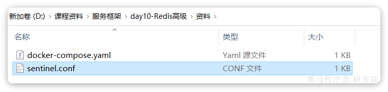


其内容如下：

```Bash
sentinel announce-ip "192.168.101.68"
sentinel monitor hmaster 192.168.101.68 7001 2
sentinel down-after-milliseconds hmaster 5000
sentinel failover-timeout hmaster 60000
```

说明：

- `sentinel announce-ip "192.168.101.68"`：声明当前sentinel的ip
- `sentinel monitor hmaster 192.168.101.68 7001 2`：指定集群的主节点信息 

  - `hmaster`：主节点名称，自定义，任意写
  - `192.168.101.68 7001`：主节点的ip和端口
  - `2`：认定`master`下线时的`quorum`值
- `sentinel down-after-milliseconds hmaster 5000`：声明master节点超时多久后被标记下线
- `sentinel failover-timeout hmaster 60000`：在第一次故障转移失败后多久再次重试


我们在虚拟机的`/root/redis`目录下新建3个文件夹：`s1`、`s2`、`s3`:

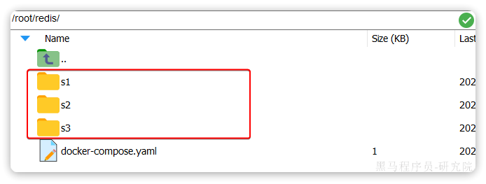

将课前资料提供的`sentinel.conf`文件分别拷贝一份到3个文件夹中。


接着修改`docker-compose.yaml`文件，内容如下：

```YAML
version: "6.2.7"

services:
  r1:
    image: redis:6.2.7
    container_name: r1
    network_mode: "host"
    entrypoint: ["redis-server", "--port", "7001"]
  r2:
    image: redis:6.2.7
    container_name: r2
    network_mode: "host"
    entrypoint: ["redis-server", "--port", "7002", "--slaveof", "192.168.101.68", "7001"]
  r3:
    image: redis:6.2.7
    container_name: r3
    network_mode: "host"
    entrypoint: ["redis-server", "--port", "7003", "--slaveof", "192.168.101.68", "7001"]
  s1:
    image: redis:6.2.7
    container_name: s1
    volumes:
      - /root/redis/s1:/etc/redis
    network_mode: "host"
    entrypoint: ["redis-sentinel", "/etc/redis/sentinel.conf", "--port", "27001"]
  s2:
    image: redis:6.2.7
    container_name: s2
    volumes:
      - /root/redis/s2:/etc/redis
    network_mode: "host"
    entrypoint: ["redis-sentinel", "/etc/redis/sentinel.conf", "--port", "27002"]
  s3:
    image: redis:6.2.7
    container_name: s3
    volumes:
      - /root/redis/s3:/etc/redis
    network_mode: "host"
    entrypoint: ["redis-sentinel", "/etc/redis/sentinel.conf", "--port", "27003"]
```


直接运行命令，启动集群：

```Shell
docker-compose up -d
```

运行结果：

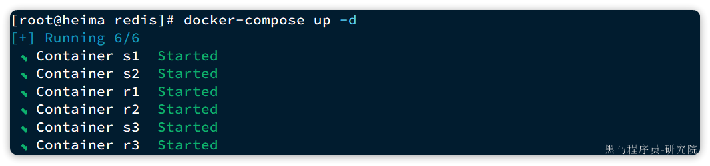

我们以s1节点为例，查看其运行日志：

```Bash
# Sentinel ID is 8e91bd24ea8e5eb2aee38f1cf796dcb26bb88acf
# +monitor master hmaster 192.168.101.68 7001 quorum 2
* +slave slave 192.168.101.68:7003 192.168.101.68 7003 @ hmaster 192.168.101.68 7001
* +sentinel sentinel 5bafeb97fc16a82b431c339f67b015a51dad5e4f 192.168.101.68 27002 @ hmaster 192.168.101.68 7001
* +sentinel sentinel 56546568a2f7977da36abd3d2d7324c6c3f06b8d 192.168.101.68 27003 @ hmaster 192.168.101.68 7001
* +slave slave 192.168.101.68:7002 192.168.101.68 7002 @ hmaster 192.168.101.68 7001
```

可以看到`sentinel`已经联系到了`7001`这个节点，并且与其它几个哨兵也建立了链接。哨兵信息如下：

- `27001`：`Sentinel ID`是`8e91bd24ea8e5eb2aee38f1cf796dcb26bb88acf`
- `27002`：`Sentinel ID`是`5bafeb97fc16a82b431c339f67b015a51dad5e4f`
- `27003`：`Sentinel ID`是`56546568a2f7977da36abd3d2d7324c6c3f06b8d`


### 2.3.演示failover

接下来，我们演示一下当主节点故障时，哨兵是如何完成集群故障恢复（failover）的。

停止r1

```Bash

docker stop r1
```

登录r2，查看集群状态：

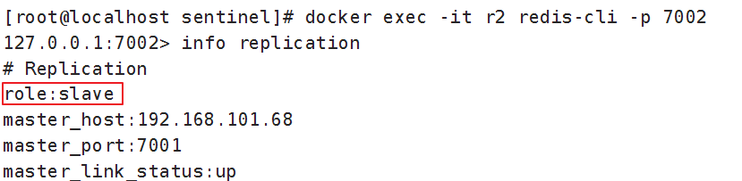


稍微等待一段时间后，会发现sentinel节点触发了`failover`：

继续查看集群状态发现主节点为r2

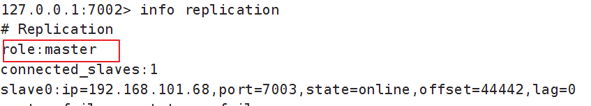

## 3.Redis分片集群

主从模式可以解决高可用、高并发读的问题。但依然有两个问题没有解决：

- 海量数据存储
- 高并发写


要解决这两个问题就需要用到分片集群了。分片的意思，就是把数据拆分存储到不同节点，这样整个集群的存储数据量就更大了。

Redis分片集群的结构如图：

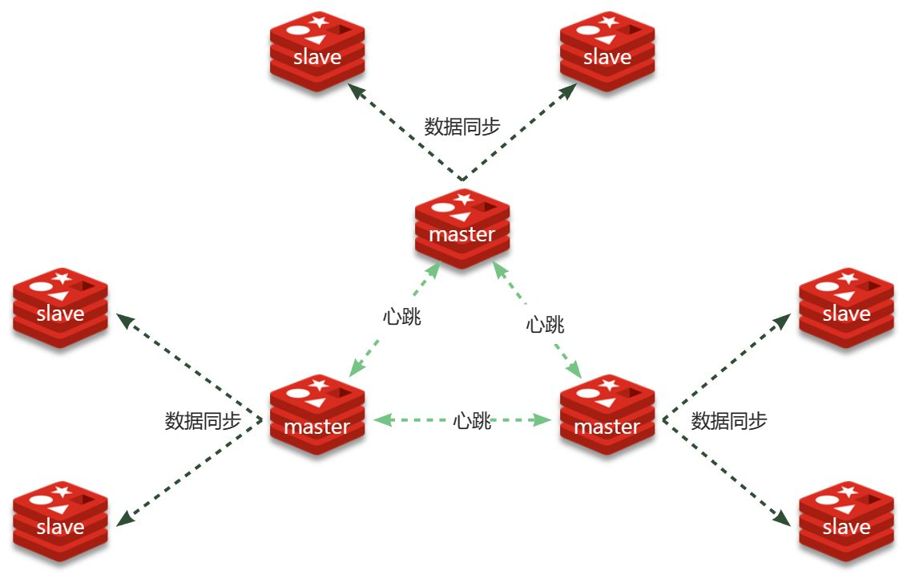

分片集群特征：

-  集群中有多个master，每个master保存不同分片数据 ，解决海量数据存储问题
-  每个master都可以有多个slave节点 ，确保高可用
-  master之间通过ping监测彼此健康状态 ，类似哨兵作用
-  客户端请求可以访问集群任意节点，最终都会被转发到数据所在节点 


### 3.1.搭建分片集群

Redis分片集群最少也需要3个master节点，由于我们的机器性能有限，我们只给每个master配置1个slave，形成最小的分片集群：

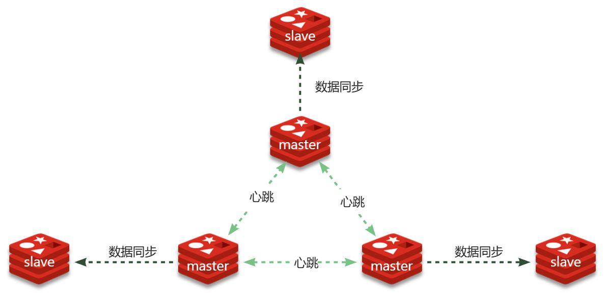


计划部署的节点信息如下：

<sheet sheet-id="q37cQG" token="AJkbs1A2zh1UkutBTkucdb9InKb"></sheet>


#### 3.1.1.集群配置

分片集群中的Redis节点必须开启集群模式，一般在配置文件中添加下面参数：

```Bash
port 7000
cluster-enabled yes
cluster-config-file nodes.conf
cluster-node-timeout 5000
appendonly yes
```

其中有3个我们没见过的参数：

- `cluster-enabled`：是否开启集群模式
- `cluster-config-file`：集群模式的配置文件名称，无需手动创建，由集群自动维护
- `cluster-node-timeout`：集群中节点之间心跳超时时间


一般搭建部署集群肯定是给每个节点都配置上述参数，不过考虑到我们计划用`docker-compose`部署，因此可以直接在启动命令中指定参数，偷个懒。


在虚拟机的`/root`目录下新建一个`redis-cluster`目录，然后在其中新建一个`docker-compose.yaml`文件，内容如下：

```YAML
version: "3.2"

services:
  r1:
    image: redis
    container_name: r1
    network_mode: "host"
    entrypoint: ["redis-server", "--port", "7001", "--cluster-enabled", "yes", "--cluster-config-file", "node.conf"]
  r2:
    image: redis
    container_name: r2
    network_mode: "host"
    entrypoint: ["redis-server", "--port", "7002", "--cluster-enabled", "yes", "--cluster-config-file", "node.conf"]
  r3:
    image: redis
    container_name: r3
    network_mode: "host"
    entrypoint: ["redis-server", "--port", "7003", "--cluster-enabled", "yes", "--cluster-config-file", "node.conf"]
  r4:
    image: redis
    container_name: r4
    network_mode: "host"
    entrypoint: ["redis-server", "--port", "7004", "--cluster-enabled", "yes", "--cluster-config-file", "node.conf"]
  r5:
    image: redis
    container_name: r5
    network_mode: "host"
    entrypoint: ["redis-server", "--port", "7005", "--cluster-enabled", "yes", "--cluster-config-file", "node.conf"]
  r6:
    image: redis
    container_name: r6
    network_mode: "host"
    entrypoint: ["redis-server", "--port", "7006", "--cluster-enabled", "yes", "--cluster-config-file", "node.conf"]
```


**注意**：使用Docker部署Redis集群，network模式必须采用host


#### 3.1.2.启动集群

进入`/root/redis-cluster`目录，使用命令启动redis：

```Bash
docker-compose up -d
```

启动成功，可以通过命令查看启动进程：

```Bash
ps -ef | grep redis
# 结果：
root       4822   4743  0 14:29 ?        00:00:02 redis-server *:7002 [cluster]
root       4827   4745  0 14:29 ?        00:00:01 redis-server *:7005 [cluster]
root       4897   4778  0 14:29 ?        00:00:01 redis-server *:7004 [cluster]
root       4903   4759  0 14:29 ?        00:00:01 redis-server *:7006 [cluster]
root       4905   4775  0 14:29 ?        00:00:02 redis-server *:7001 [cluster]
root       4912   4732  0 14:29 ?        00:00:01 redis-server *:7003 [cluster]
```

可以发现每个redis节点都以cluster模式运行。不过节点与节点之间并未建立连接。


接下来，我们使用命令创建集群：

```Bash
# 进入任意节点容器
docker exec -it r1 bash
# 然后，执行命令
redis-cli --cluster create --cluster-replicas 1 \
192.168.101.68:7001 192.168.101.68:7002 192.168.101.68:7003 \
192.168.101.68:7004 192.168.101.68:7005 192.168.101.68:7006
```

命令说明：

- `redis-cli --cluster`：代表集群操作命令
- `create`：代表是创建集群
- `--cluster-replicas 1` ：指定集群中每个`master`的副本个数为1

  - 此时`节点总数 ÷ (replicas + 1)` 得到的就是`master`的数量`n`。因此节点列表中的前`n`个节点就是`master`，其它节点都是`slave`节点，随机分配到不同`master`


输入命令后控制台会弹出下面的信息：

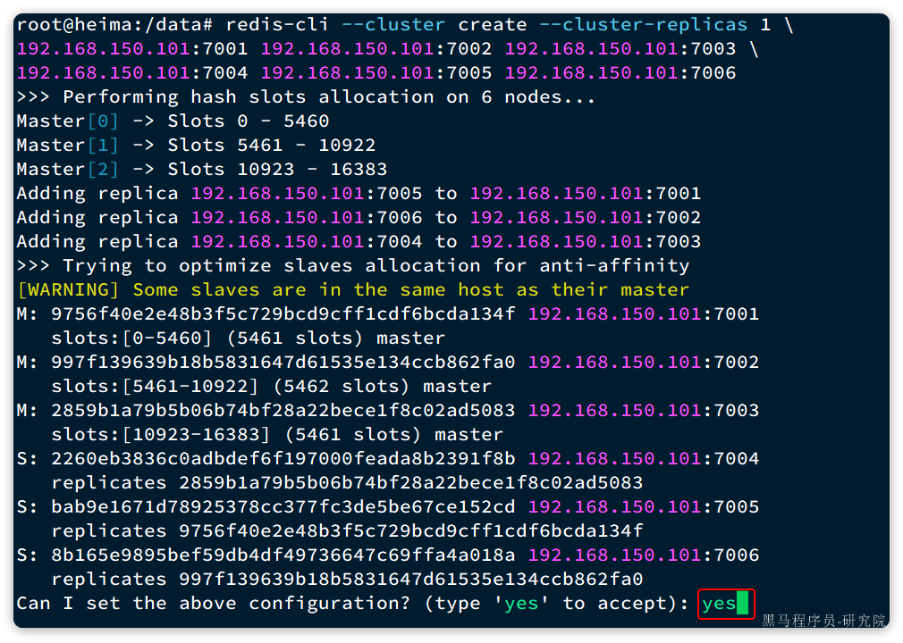

这里展示了集群中`master`与`slave`节点分配情况，并询问你是否同意。节点信息如下：

- `7001`是`master`，节点`id`后6位是`da134f`
- `7002`是`master`，节点`id`后6位是`862fa0`
- `7003`是`master`，节点`id`后6位是`ad5083`
- `7004`是`slave`，节点`id`后6位是`391f8b`，认`ad5083`（7003）为`master`
- `7005`是`slave`，节点`id`后6位是`e152cd`，认`da134f`（7001）为`master`
- `7006`是`slave`，节点`id`后6位是`4a018a`，认`862fa0`（7002）为`master`


输入`yes`然后回车。会发现集群开始创建，并输出下列信息：

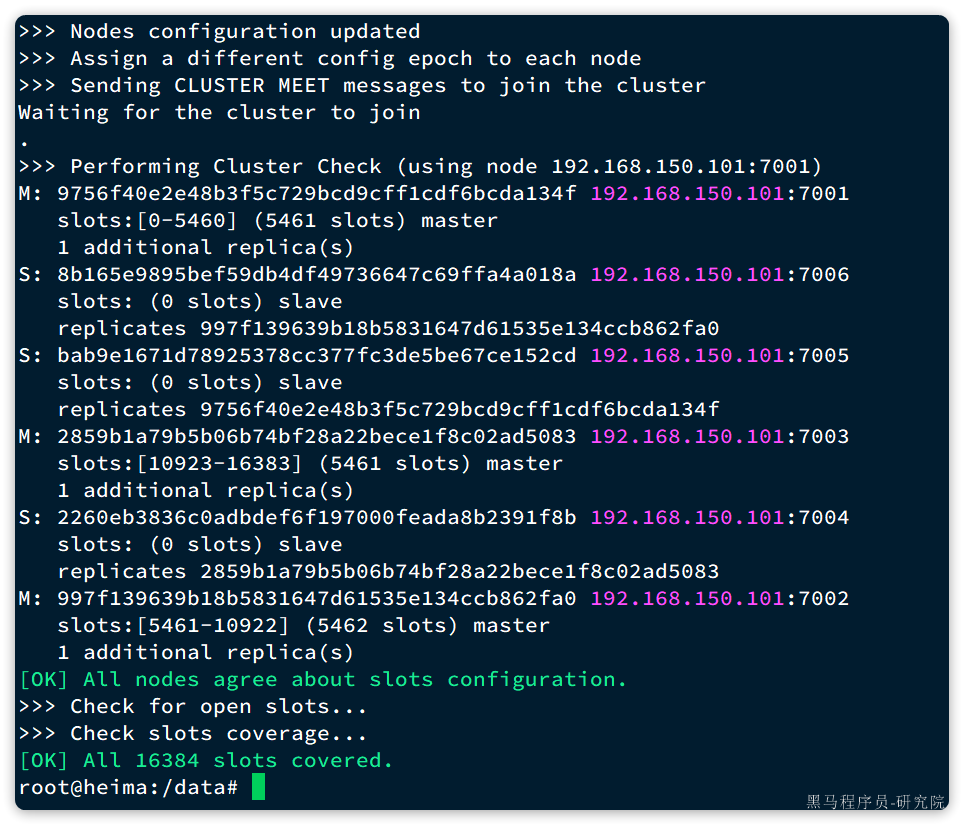


接着，我们可以通过命令查看集群状态：

```Bash
redis-cli -p 7001 cluster nodes
```

结果：

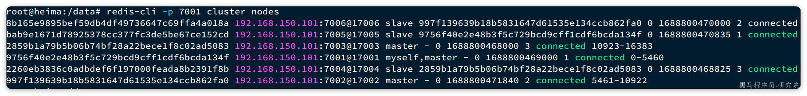

### 3.2.Java客户端连接分片集群

RedisTemplate底层同样基于lettuce实现了分片集群的支持，而使用的步骤与哨兵模式基本一致，参考`2.5节`：

1）引入redis的starter依赖

引入SpringDataRedis的依赖：

```XML
<dependency>
    <groupId>org.springframework.boot</groupId>
    <artifactId>spring-boot-starter-data-redis</artifactId>
</dependency>
```

2）配置分片集群地址

与传统单点模式不同，需要配置每个redis实例的地址，如下：

```YAML
spring:
  redis:
    cluster:
      nodes:
        - 192.168.101.68:7001
        - 192.168.101.68:7002
        - 192.168.101.68:7003
        - 192.168.101.68:8001
        - 192.168.101.68:8002
        - 192.168.101.68:8003
```

3）配置读写分离

还要配置读写分离，让java客户端将写请求发送到master节点，读请求发送到slave节点。定义一个bean即可：

```Java
@Bean
public LettuceClientConfigurationBuilderCustomizer clientConfigurationBuilderCustomizer(){
    return clientConfigurationBuilder -> clientConfigurationBuilder.readFrom(ReadFrom.REPLICA_PREFERRED);
}
```

这个bean中配置的就是读写策略，包括四种：

- `MASTER`：从主节点读取
- `MASTER_PREFERRED`：优先从`master`节点读取，`master`不可用才读取`slave`
- `REPLICA`：从`slave`节点读取
- `REPLICA_PREFERRED`：优先从`slave`节点读取，所有的`slave`都不可用才读取`master`

---
> 来源：飞书技术知识库（脱敏版） · 08 面试知识库 / 微服务面试题 / 微服务面试篇（下） / Redis集群搭建 · [原文](https://ccn8v2zngwsm.feishu.cn/wiki/MQT4wExxbimVQ1k90wOcYU5Gnke)
