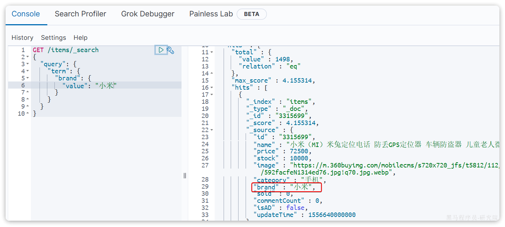
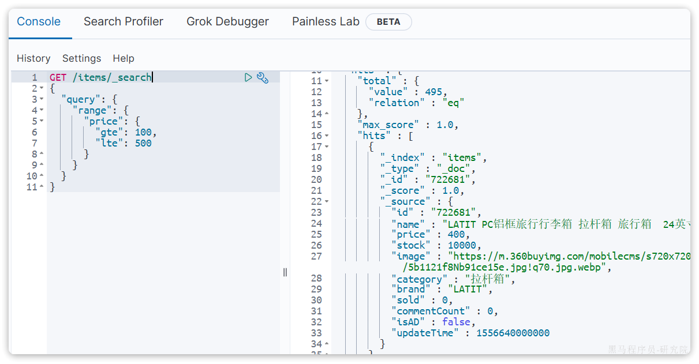
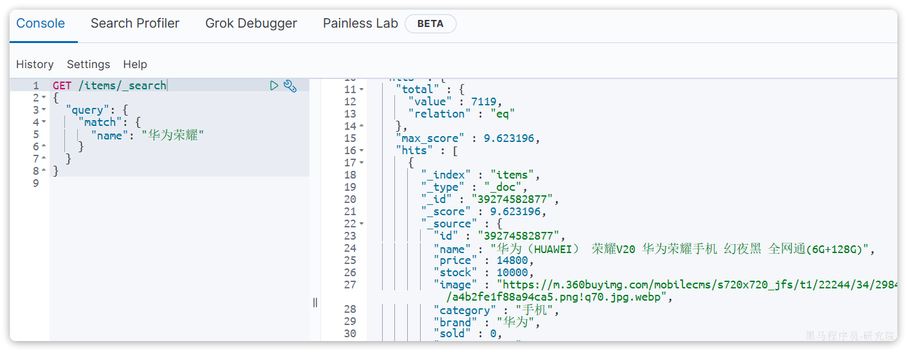
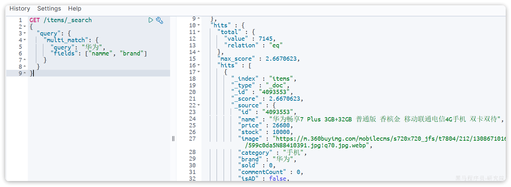
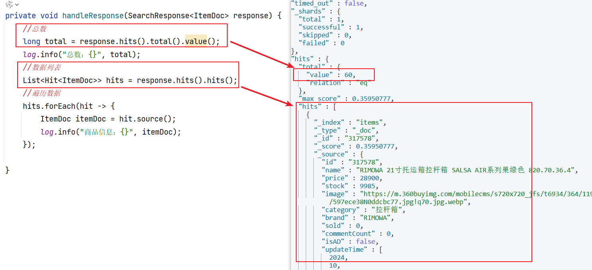
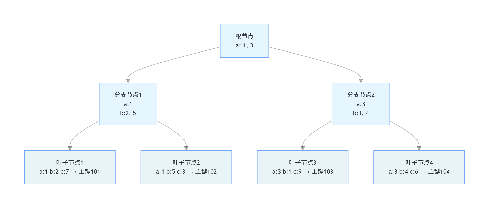
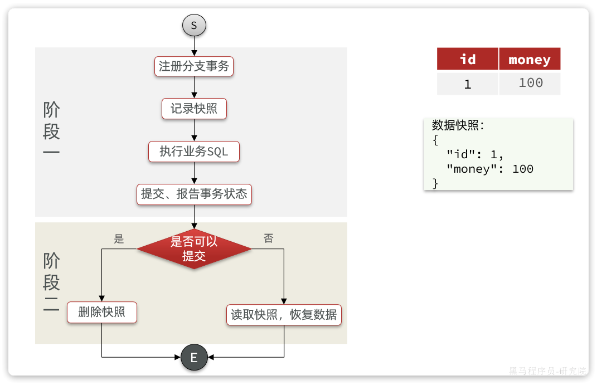
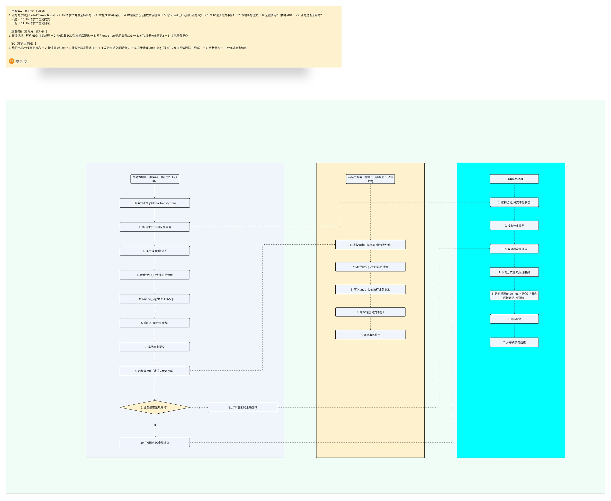
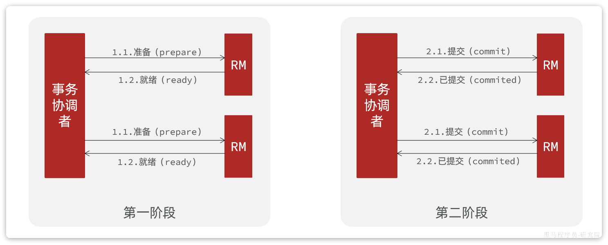
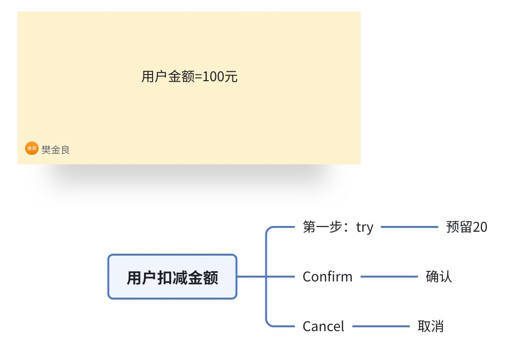

# 日常整理

## Spring 核心设计模式及使用场景

##### 单例模式（Singleton）

- **核心思想**：确保一个类只有一个实例，并提供全局访问点。
- **Spring 中的使用场景**：Spring 容器中的**默认 Bean 作用域（singleton）** 就是单例模式的典型应用。Spring 通过 `DefaultSingletonBeanRegistry` 类管理所有单例 Bean 的创建和缓存，保证每个 Bean 名称对应唯一的实例。
- **关键代码示例（核心逻辑）**：
- java
- 运行

```Java
// Spring 内部管理单例的核心逻辑简化版
public class DefaultSingletonBeanRegistry {
    // 缓存单例 Bean 的容器
    private final Map<String, Object> singletonObjects = new ConcurrentHashMap<>(256);

    // 获取单例 Bean，双重检查锁保证线程安全
    public Object getSingleton(String beanName, ObjectFactory<?> singletonFactory) {
        Assert.notNull(beanName, "Bean name must not be null");
        synchronized (this.singletonObjects) {
            Object singletonObject = this.singletonObjects.get(beanName);
            if (singletonObject == null) {
                // 创建 Bean 实例
                singletonObject = singletonFactory.getObject();
                // 放入缓存
                this.singletonObjects.put(beanName, singletonObject);
            }
            return singletonObject;
        }
    }
}
```

- **使用场景补充**：Spring 上下文（`ApplicationContext`）本身也是单例，IOC 容器启动后只会创建一个上下文实例。

##### 工厂模式（Factory）

Spring 中主要用到**简单工厂**和**工厂方法**，核心是 “解耦对象创建和使用”。

- **核心思想**：通过工厂类统一创建对象，而非直接 `new`，降低耦合。
- **Spring 中的使用场景**：

  - **BeanFactory（简单工厂）**：Spring 最核心的工厂接口，负责创建和管理 Bean 实例，`ApplicationContext` 是其高级实现。你通过 `getBean()` 获取 Bean 时，本质是调用工厂方法创建 / 获取对象。
  - **FactoryBean（工厂方法）**：自定义 Bean 工厂接口，用于创建复杂对象（如数据源、MyBatis 的 `SqlSessionFactory`）。比如 `MybatisSqlSessionFactoryBean` 就是通过 `FactoryBean` 封装 SqlSessionFactory 的创建逻辑。
- **代码示例（自定义 FactoryBean）**：
- java运行

```Java
// 自定义 FactoryBean 创建复杂对象
public class UserFactoryBean implements FactoryBean<User> {
    // 封装 User 对象的创建逻辑
    @Override
    public User getObject() throws Exception {
        User user = new User();
        user.setId(1L);
        user.setName("Spring");
        return user;
    }

    @Override
    public Class<?> getObjectType() {
        return User.class;
    }

    // 是否单例（默认 true）
    @Override
    public boolean isSingleton() {
        return true;
    }
}

// 配置类
@Configuration
public class AppConfig {
    @Bean
    public UserFactoryBean userFactoryBean() {
        return new UserFactoryBean();
    }
}

// 使用
public class Test {
    public static void main(String[] args) {
        ApplicationContext context = new AnnotationConfigApplicationContext(AppConfig.class);
        // 获取 FactoryBean 创建的 User 实例（自动调用 getObject()）
        User user = context.getBean(User.class);
        System.out.println(user.getName()); // 输出：Spring
    }
}
```

##### 代理模式（Proxy）

Spring 核心的 AOP 功能完全基于代理模式实现，分为**JDK 动态代理**（基于接口）和**CGLIB 动态代理**（基于子类）。

- **核心思想**：为目标对象创建代理对象，在不修改目标对象代码的前提下，增强其功能（如日志、事务、权限校验）。
- **Spring 中的使用场景**：

  - **AOP 切面**：比如 `@Transactional` 事务注解、`@Cacheable` 缓存注解、自定义 `@Aspect` 切面，都是通过代理为目标方法添加增强逻辑。
  - **声明式事务**：Spring 为加了 `@Transactional` 的 Bean 创建代理，在方法执行前开启事务，执行后提交 / 回滚事务。
- **核心逻辑示例**：
- java运行

```Java
// JDK 动态代理简化示例（Spring AOP 底层逻辑）
public class AopProxyExample {
    public static void main(String[] args) {
        // 目标对象
        UserService target = new UserServiceImpl();
        // 创建代理（Spring 中由 JdkDynamicAopProxy 实现）
        UserService proxy = (UserService) Proxy.newProxyInstance(
            target.getClass().getClassLoader(),
            target.getClass().getInterfaces(),
            (proxyObj, method, argsArr) -> {
                // 前置增强：比如开启事务
                System.out.println("方法执行前：开启事务");
                // 执行目标方法
                Object result = method.invoke(target, argsArr);
                // 后置增强：比如提交事务
                System.out.println("方法执行后：提交事务");
                return result;
            }
        );
        // 调用代理方法
        proxy.saveUser();
    }
}

interface UserService {
    void saveUser();
}

class UserServiceImpl implements UserService {
    @Override
    public void saveUser() {
        System.out.println("执行保存用户逻辑");
    }
}
```

##### 模板方法模式（Template Method）

- **核心思想**：定义一个算法的骨架，将可变的步骤延迟到子类实现，固定通用流程。
- **Spring 中的使用场景**：

  - **JdbcTemplate**：封装了 JDBC 的通用流程（加载驱动、创建连接、创建 Statement、释放资源），只需要子类 / 使用者实现 SQL 执行、结果集处理等可变步骤。
  - **RestTemplate**：封装了 HTTP 请求的通用流程（创建请求、发送请求、处理响应、关闭连接），使用者只需指定 URL、请求参数等。
- **代码示例（JdbcTemplate 简化逻辑）**：
- java运行

```Java
// 模板方法抽象类（Spring 中 JdbcTemplate 的核心逻辑）
public abstract class JdbcTemplate {
    // 固定算法骨架（模板方法）
    public <T> T query(String sql, RowMapper<T> rowMapper) {
        Connection conn = null;
        PreparedStatement ps = null;
        ResultSet rs = null;
        try {
            // 1. 通用步骤：获取连接（固定）
            conn = getConnection();
            // 2. 通用步骤：创建 PreparedStatement（固定）
            ps = conn.prepareStatement(sql);
            // 3. 通用步骤：执行 SQL（固定）
            rs = ps.executeQuery();
            // 4. 可变步骤：处理结果集（交给子类/使用者）
            return rowMapper.mapRow(rs, 0);
        } catch (Exception e) {
            // 通用步骤：异常处理（固定）
            handleException(e);
        } finally {
            // 通用步骤：释放资源（固定）
            close(conn, ps, rs);
        }
        return null;
    }

    // 通用方法：获取连接
    private Connection getConnection() { /* 实现 */ }
    // 通用方法：异常处理
    private void handleException(Exception e) { /* 实现 */ }
    // 通用方法：释放资源
    private void close(Connection conn, PreparedStatement ps, ResultSet rs) { /* 实现 */ }
}

// 使用者实现可变步骤
JdbcTemplate jdbcTemplate = new JdbcTemplate();
User user = jdbcTemplate.query("SELECT * FROM user WHERE id=1", (rs, rowNum) -> {
    User u = new User();
    u.setId(rs.getLong("id"));
    u.setName(rs.getString("name"));
    return u;
});
```

##### 观察者模式（Observer）

- **核心思想**：定义对象间的一对多依赖，当一个对象状态变化时，所有依赖它的对象都会收到通知并自动更新。
- **Spring 中的使用场景**：

  - **事件监听机制**：Spring 的 `ApplicationEvent` 和 `ApplicationListener` 是观察者模式的典型实现。比如：
  
    - `ContextRefreshedEvent`：容器刷新完成时触发，通知所有监听器；
    - `ContextClosedEvent`：容器关闭时触发；
    - 自定义事件：通过 `publishEvent()` 发布事件，`@EventListener` 监听事件。
- **代码示例（自定义事件）**：
- java运行

```Java
// 1. 定义自定义事件
public class UserCreatedEvent extends ApplicationEvent {
    private User user;
    public UserCreatedEvent(User user) {
        super(user);
        this.user = user;
    }
    public User getUser() { return user; }
}

// 2. 发布事件
@Service
public class UserService {
    @Autowired
    private ApplicationContext context;

    public void createUser(User user) {
        // 业务逻辑：创建用户
        System.out.println("创建用户：" + user.getName());
        // 发布事件
        context.publishEvent(new UserCreatedEvent(user));
    }
}

// 3. 监听事件
@Component
public class UserCreatedListener {
    @EventListener // 监听 UserCreatedEvent 事件
    public void handleUserCreatedEvent(UserCreatedEvent event) {
        User user = event.getUser();
        System.out.println("监听到用户创建事件：" + user.getName() + "，执行后续逻辑（如发送邮件）");
    }
}
```

##### 适配器模式（Adapter）

- **核心思想**：将一个类的接口转换成客户希望的另一个接口，使原本因接口不兼容而无法一起工作的类能协同工作。
- **Spring 中的使用场景**：

  - **HandlerAdapter（MVC 适配器）**：Spring MVC 中，不同的处理器（`Controller`、`HttpRequestHandler`、`Servlet`）有不同的执行方法，`HandlerAdapter` 适配这些处理器，统一通过 `handle()` 方法执行，让 DispatcherServlet 无需关心处理器的具体类型。
  - **AOP 中的 AdvisorAdapter**：适配不同类型的通知（Advice），统一处理前置、后置、环绕通知等。

##### 策略模式（Strategy）

- **核心思想**：定义一系列算法，将每个算法封装起来，使它们可互相替换，算法的变化独立于使用算法的客户。
- **Spring 中的使用场景**：

  - **Resource 加载策略**：Spring 的 `Resource` 接口封装了不同的资源类型（文件、类路径、URL、网络资源），`ResourceLoader` 根据不同的资源路径前缀（`classpath:`、`file:`、`http:`）选择不同的策略加载资源。
  - **事务管理策略**：`PlatformTransactionManager` 是核心接口，不同的实现（`DataSourceTransactionManager`、`JtaTransactionManager`、`HibernateTransactionManager`）对应不同的事务管理策略，可根据持久化技术切换。

#### 总结

1. **单例模式**：Spring 默认 Bean 作用域，通过 `DefaultSingletonBeanRegistry` 管理唯一实例；
2. **工厂模式**：`BeanFactory`/`FactoryBean` 封装 Bean 创建逻辑，解耦对象创建和使用；
3. **代理模式**：AOP 核心，实现事务、缓存等无侵入增强；
4. **模板方法**：`JdbcTemplate`/`RestTemplate` 封装通用流程，只暴露可变步骤；
5. **观察者模式**：`ApplicationEvent`/`ApplicationListener` 实现事件驱动；
6. **适配器模式**：`HandlerAdapter` 适配 MVC 不同处理器，统一执行逻辑；
7. **策略模式**：`ResourceLoader`/`PlatformTransactionManager` 支持算法 / 策略灵活切换。

这些模式是 Spring 框架 “高内聚、低耦合、可扩展” 的核心保障，理解它们能帮你更深入地掌握 Spring 的设计思想，也能在实际开发中借鉴这些模式解决问题。


## `@Resource` 和 `@Autowired`核心区别详解

 Spring 框架中 `@Resource` 和 `@Autowired` 这两个依赖注入注解的核心区别，是 Spring 开发中非常基础且高频的知识点。

##### 来源与归属

- **@Autowired**：是 **Spring 框架原生注解**（`org.springframework.beans.factory.annotation.Autowired`），属于 Spring 专属。
- **@Resource**：是 **Java EE 标准注解**（`javax.annotation.Resource`，JDK9+ 需要手动引入依赖），属于 JSR-250 规范，不依赖 Spring，其他支持该规范的框架也能使用。

##### 注入匹配规则（核心差异）

这是两者最关键的区别，直接决定了注入的逻辑：

- **@Autowired**：优先按 **类型（Type）** 匹配（即 `byType`），如果找到多个同类型的 Bean，再按 **名称（Name）** 匹配（`byName`）；如果匹配不到会抛出 `NoSuchBeanDefinitionException`。可配合 `@Qualifier` 注解指定 Bean 名称，解决多实例冲突。
- **@Resource**：优先按 **名称（Name）** 匹配（即 `byName`），如果按名称找不到，再按 **类型（Type）** 匹配；如果仍匹配不到才会报错。可通过 `name` 属性显式指定 Bean 名称，`type` 属性指定类型（指定后只会按类型匹配）。

##### 支持的参数

<sheet sheet-id="iqSQ4k" token="BrDusz4TthiWXDtuSd8cB6gInc5"></sheet>

##### 代码示例对比

###### （1）@Autowired 用法

java运行示例

```Java
import org.springframework.beans.factory.annotation.Autowired;
import org.springframework.beans.factory.annotation.Qualifier;
import org.springframework.stereotype.Service;

@Service
public class UserService {
    // 1. 基础用法：按类型注入，找不到报错
    @Autowired
    private UserDao userDao;

    // 2. 解决多实例冲突：配合 @Qualifier 指定名称
    @Autowired
    @Qualifier("mysqlUserDao") // 指定 Bean 名称为 mysqlUserDao
    private UserDao mysqlUserDao;

    // 3. 非必需注入：required = false（找不到不会报错，赋值为 null）
    @Autowired(required = false)
    private RedisDao redisDao;
}
```

###### （2）@Resource 用法

java运行示例

```Java
import javax.annotation.Resource;
import org.springframework.stereotype.Service;

@Service
public class UserService {
    // 1. 基础用法：优先按名称（userDao）匹配，找不到再按类型
    @Resource
    private UserDao userDao;

    // 2. 显式指定名称注入
    @Resource(name = "mysqlUserDao")
    private UserDao mysqlUserDao;

    // 3. 显式指定类型注入（仅按类型匹配）
    @Resource(type = RedisDao.class)
    private RedisDao redisDao;
}
```

##### 适用场景

- 优先用 `@Autowired`：如果你项目完全基于 Spring 生态，且习惯按类型注入，配合 `@Qualifier` 解决多实例问题，是 Spring 推荐的方式。
- 优先用 `@Resource`：如果你需要跨框架兼容（如同时用 Spring 和其他 J2EE 框架），或更习惯按名称注入，无需额外注解（如 `@Qualifier`）即可指定名称。

##### 总结

1. **核心差异**：`@Autowired` 优先按类型注入（需 `@Qualifier` 指定名称），`@Resource` 优先按名称注入（可直接通过 `name` 属性指定）。
2. **归属不同**：`@Autowired` 是 Spring 专属，`@Resource` 是 Java EE 标准注解。
3. **参数支持**：`@Autowired` 有 `required` 属性控制是否必需注入，`@Resource` 有 `name/type` 属性灵活指定匹配规则。

实际开发中，两者功能基本互通，选择主要看项目生态和个人 / 团队的编码习惯，核心是理解它们的匹配规则，避免注入时出现 “找不到 Bean” 或 “多个 Bean 匹配” 的异常。


##  **ShardingSphere（Sharding-JDBC）分库分表业务讲解**

---

#### 一、ShardingSphere 到底是个啥？

一句话：

**它是一个放在 Java 项目里的“数据库代理层”，帮你自动做：分库 + 分表 + 路由 SQL。**

写代码时：

```SQL
select * from orders where user_id = 1001
```

它会自动变成：

```SQL
select * from jzo2o-orders-1.orders_2 where user_id = 1001
```

**代码完全不用动，它偷偷帮你改 SQL、找库、找表。**

---

#### 二、项目里 ShardingSphere 到底在干什么？

对照项目配置讲：

##### 1. 项目有 3 个库

```Plain Text
jzo2o-orders-0
jzo2o-orders-1
jzo2o-orders-2
```

##### 2. 每张表又分 3 张表

```Plain Text
orders_0、orders_1、orders_2
orders_serve_0、orders_1、orders_2
biz_snapshot_0、1、2
```

##### 3. ShardingSphere 做 3 件事

1. **分库（路由到哪个库？0/1/2）**
2. **分表（路由到哪个表？\_0/\_1/\_2）**
3. **合并结果（查多张表 → 帮你拼成一个 List）**

---

#### 三、项目的分片规则（最重要！）

配置里的规则：

##### 1）orders 表（订单主表）

```YAML
orders:
  actualDataNodes: jzo2o-orders-${0..2}.orders_${0..2}
  databaseStrategy:
    shardingColumn: user_id          # 分库字段
    shardingAlgorithmName: orders_database_inline
  tableStrategy:
    shardingColumn: id               # 分表字段
    shardingAlgorithmName: orders_table_inline
```

###### ① 分库规则：按 user_id % 3

```Plain Text
algorithm-expression: jzo2o-orders-${user_id % 3}
```

- user_id = 1001 → 1001 % 3 = 2 → 走 **jzo2o-orders-2**
- user_id = 1002 → 1002 % 3 = 0 → 走 **jzo2o-orders-0**

###### ② 分表规则：按 id 取模

原来的：

```Plain Text
orders_${(int)Math.floor(id % 10000000000 / 15000000)}
```

这个**有严重问题**，会算出 0\~很多，但是只有 3 张表。

**正确应该是：**

```Plain Text
orders_${id % 3}
```

---

##### 2）orders_serve 表（服务单）

```YAML
databaseStrategy:
  shardingColumn: serve_provider_id
  algorithm-expression: jzo2o-orders-${serve_provider_id % 3}
```

按 **服务者ID** 分库。

---

##### 3）biz_snapshot 表

```YAML
databaseStrategy:
  shardingColumn: db_shard_id
```

按 **分片ID** 分库。

---

#### 四、ShardingSphere 工作流程（重要）

项目执行：

```Java
orderMapper.insert(order);
```

ShardingSphere 内部偷偷做：

##### 1. 解析 SQL

知道要操作 `orders` 表。

##### 2. 取分库字段 → user_id

```Plain Text
user_id = 1001
1001 % 3 = 2
→ 库：jzo2o-orders-2
```

##### 3. 取分表字段 → id

```Plain Text
id = 2311011000000000001
id % 3 = ？
→ 表：orders_2
```

##### 4. 改写 SQL

```SQL
INSERT INTO jzo2o-orders-2.orders_2 (...)
```

##### 5. 执行、返回结果

---

#### 五、项目的历史订单表怎么接入？（按 id 分表）

你现在要加：

```Plain Text
history_orders_2024
history_orders_2025
history_orders_serve_2024
history_orders_serve_2025
```

##### 规则：

**按 id中前两位的 年份分表**

##### ShardingSphere 做的事：

- id = 24-xx-xx → 路由到 `history_orders_2024`
- id = 25-xx-xx → 路由到 `history_orders_2025`

##### 配置写法（直接加在项目现有 yml 里）

```YAML
history_orders:
  actualDataNodes: jzo2o-orders-history.history_orders_${2024..2025}
  tableStrategy:
    standard:
      shardingColumn: id  # 分表字段：19位ID（字符串类型）
      shardingAlgorithmName: history_orders_year_inline  # 年份分表算法

history_orders_serve:
  actualDataNodes: jzo2o-orders-history.history_orders_serve_${2024..2025}
  tableStrategy:
    standard:
      shardingColumn: id  # 分表字段：19位ID（字符串类型）
      shardingAlgorithmName: history_orders_year_inline  # 年份分表算法
```

##### 算法：

从 id 提取年份 → 拼表名。

---

#### 六、为什么项目代码里看不到任何“指向”？

因为：

##### ShardingSphere 代理了数据源

在项目里的 `DataSource` 被替换成：

**ShardingSphereDataSource**

所有 SQL 都会经过它：

- 解析
- 路由
- 改写
- 执行
- 合并

**对代码完全无感，0 侵入。**

---

#### 七、最常见的 4 个问题

##### 1. 对业务代码有没有影响？

**99% 没有影响。**

- mapper 不用改
- service 不用改
- 事务不用改
- 分页不用改

只需要保证：

**查询带上分片键（user_id / id）**

---

##### 2. 配置怎么被发现的？

1. 项目引入了 starter

```XML
shardingsphere-jdbc-core-spring-boot-starter
```

1. Spring 启动自动加载
2. 读取 `shardingsphere-jdbc-dev.yml`
3. 创建代理数据源
4. 注入 Spring 容器

---

##### 3. 怎么判断它生效了？

打开：

```YAML
sql-show: true
```

看控制台：

```SQL
[ShardingSphere] actual sql:
INSERT INTO jzo2o-orders-1.orders_2 ...
```

看到这种就是成功。

---

##### 4. 项目原来的 id 生成规则兼容吗？

兼容！

订单号：

```Plain Text
2位年 + 2位月 + 2位日 + 13位序号
```

ShardingSphere 不管 id 是什么，

**只按配置的规则分片**。

---

#### 八、总结

1. **ShardingSphere = 自动分库 + 分表 + SQL 路由**
2. **写逻辑表，它帮你找真实库表**
3. **项目的历史表按 sort_time 年份分表，直接加配置就能用，代码不动**

---


## Redis五种数据结构命令

#### **Redis 五种核心数据结构命令对比表**

Redis 支持五种主要数据结构，每种结构都有其独特的特性和适用场景。下表对其进行了详细对比：

| **数据类型** | **核心特征** | **典型适用场景** | **常用命令及作用** |
|-|-|-|-|
| **String (字符串)** | 存储单个值，是Redis中最简单的数据类型。 | 缓存、计数器、键值存储。 | - **SET key value** ：设置指定 key 的值。  <br/>- **GET key** ：获取指定 key 的值。  <br/>- **MSET/MGET** ：批量设置/获取多个 key-value 对。  <br/>- **INCR/DECR** ：将 key 中储存的数字值增一/减一。 |
| **List (列表)** | 有序、可重复的字符串集合，类似于 Java 中的 LinkedList。 | 消息队列、发布/订阅系统、最新消息列表。 | - **LPUSH/RPUSH** ：从列表左侧/右侧添加元素。  <br/>- **LRANGE key start stop** ：获取列表指定范围的元素。  <br/>- **LPOP/RPOP** ：移除并返回列表的第一个/最后一个元素。 |
| **Set (集合)** | 无序、不可重复的字符串集合，类似于 Java 中的 HashSet。 | 标签系统、好友关系、用户兴趣交集/并集计算。 | - **SADD key member** ：向集合添加一个或多个成员。  <br/>- **SMEMBERS key** ：返回集合中的所有成员。  <br/>- **SISMEMBER key member** ：判断成员是否存在于集合中。  <br/>- **SINTER/SUNION/SDIFF** ：计算集合的交集、并集、差集。 |
| **Hash (哈希)** | 字段-值对的无序散列，类似于 Java 中的 HashMap。 | 存储对象（如用户信息、商品详情）、缓存。 | - **HSET key field value** ：将哈希表 key 中的字段 field 的值设为 value。  <br/>- **HGET key field** ：获取存储在哈希表中指定字段的值。  <br/>- **HGETALL key** ：获取哈希表中指定 key 的所有字段和值。  <br/>- **HDEL key field** ：删除哈希表中的一个或多个字段。 |
| **Sorted Set (有序集合)** | 有序的字符串集合，每个成员关联一个分数（score），根据分数排序。 | 排行榜（如游戏积分、商品销量）、按照分数范围获取成员。 | - **ZADD key score member** ：向有序集合添加成员或更新其分数。  <br/>- **ZRANGE/ZREVRANGE** ：通过索引区间返回有序集合指定区间内的成员（升序/降序）。  <br/>- **ZSCORE key member** ：返回有序集中成员的分数值。  <br/>- **ZREMRANGEBYSCORE** ：移除有序集合中指定分数区间内的所有成员。 |

---

#### **各数据结构命令详解**

以下是对每种数据结构的常用命令进行更详细的展开，便于您查阅。

##### **1. String (字符串)**

字符串是 Redis 最基本的数据类型，也是其他所有数据结构的基础。

| 命令 | 作用描述 |
|-|-|
| **SET key value** | 设置指定 key 的值。 |
| **GET key** | 获取指定 key 的值。 |
| **MSET key value [key value ...]** | 同时设置一个或多个 key-value 对。 |
| **MGET key1 key2 ...** | 获取所有给定 key 的值。 |
| **SETNX key value** | 只有在 key 不存在时设置 key 的值。 |
| **INCR key** | 将 key 中储存的数字值增一。 |
| **INCRBY key increment** | 将 key 所储存的值加上给定的增量值。 |
| **DECR key** | 将 key 中储存的数字值减一。 |
| **DECRBY key decrement** | 将 key 所储存的值减去给定的减量值。 |
| **SETEX key seconds value** | 将值 value 关联到 key，并将 key 的过期时间设为 seconds（以秒为单位）。 |

**2. List (列表)**  
列表是一个有序的字符串集合，可以从两端添加或删除元素。

| 命令 | 作用描述 |
|-|-|
| **LPUSH key value** | 从列表左侧添加元素。 |
| **RPUSH key value** | 从列表右侧添加元素。 |
| **LRANGE key start stop** | 获取列表指定范围的元素。 |
| **LPOP key** | 移除并返回列表的第一个元素。 |
| **RPOP key** | 移除并返回列表的最后一个元素。 |
| **LINDEX key index** | 通过索引获取列表中的元素。 |
| **LLEN key** | 获取列表的长度。 |

**3. Set (集合)**  
集合是一个无序、不可重复的字符串集合，支持集合间的交、并、差等操作。

| 命令 | 作用描述 |
|-|-|
| **SADD key member1 [member2]** | 向集合添加一个或多个成员。 |
| **SCARD key** | 获取集合的成员数。 |
| **SMEMBERS key** | 返回集合中的所有成员。 |
| **SISMEMBER key member** | 判断成员是否存在于集合中。 |
| **SREM key member1 [member2]** | 移除集合中一个或多个成员。 |
| **SPOP key** | 移除并返回集合中的一个随机元素。 |
| **SINTER key1 [key2]** | 返回给定所有集合的交集。 |
| **SUNION key1 [key2]** | 返回所有给定集合的并集。 |
| **SDIFF key1 [key2]** | 返回给定所有集合的差集。 |

**4. Hash (哈希)**  
哈希是一个键值对集合，特别适合存储对象。

| 命令 | 作用描述 |
|-|-|
| **HSET key field value** | 将哈希表 key 中的字段 field 的值设为 value。 |
| **HGET key field** | 获取存储在哈希表中指定字段的值。 |
| **HMSET key field1 value1 [field2 value2]** | 同时将多个 field-value 对设置到哈希表 key 中。 |
| **HMGET key field1 [field2]** | 获取所有给定字段的值。 |
| **HDEL key field1 [field2]** | 删除一个或多个哈希表字段。 |
| **HKEYS key** | 获取所有哈希表中的字段。 |
| **HVALS key** | 获取哈希表中所有值。 |
| **HGETALL key** | 获取在哈希表中指定 key 的所有字段和值。 |

**5. Sorted Set (有序集合)**  
有序集合是一种特殊的集合，每个元素都关联一个分数，集合会根据分数自动排序。

| 命令 | 作用描述 |
|-|-|
| **ZADD key score1 member1 [score2 member2]** | 向有序集合添加一个或多个成员，或者更新已存在成员的分数。 |
| **ZRANGE key start stop [WITHSCORES]** | 通过索引区间返回有序集合指定区间内的成员，分数从低到高。 |
| **ZREVRANGE key start stop [WITHSCORES]** | 返回有序集中指定区间内的成员，分数从高到低排序。 |
| **ZRANGEBYSCORE key min max [WITHSCORES] [LIMIT]** | 通过分数返回有序集合指定区间内的成员。 |
| **ZSCORE key member** | 返回有序集中，成员的分数值。 |
| **ZINCRBY key increment member** | 有序集合中对指定成员的分数加上增量 increment。 |
| **ZREM key member1 [member2]** | 移除有序集合中的一个或多个成员。 |
| **ZCARD key** | 获取有序集合的成员数。 |

---

#### **通用命令**

Redis 还提供了一些对所有数据类型都适用的通用命令，例如：

- **DEL key** ：删除一个或多个 key。
- **EXISTS key** ：检查 key 是否存在。
- **KEYS pattern** ：查找所有符合给定模式的 key。
- **EXPIRE key seconds** ：为 key 设置过期时间。
- **TTL key** ：查看 key 的剩余生存时间。

---

**使用建议**

1. **选择合适的数据结构** ：根据业务场景的特点（如是否需要排序、是否允许重复）选择对应的 Redis 数据结构，可以显著提升性能和代码清晰度。例如，存储用户信息应使用 Hash，实现排行榜应使用 Sorted Set。
2. **利用命令特性** ：充分利用 Redis 命令的原子性和丰富功能。例如，使用 `INCR` 实现计数器，使用 `SINTER` 计算共同好友。
3. **注意键名设计** ：采用统一的键名命名规范（如 `业务:模块:id`），有助于管理和维护。


## **Elasticsearch查询相关操作**

---

#### **一、基础查询类型**

#####  **1. 精确查询（Term-level query）**

针对 `keyword`、数值、日期、 `boolean` 类型字段，不对搜索条件分词，直接精确匹配：

- **term查询** ：匹配单个词条

```JSON
GET /items/_search
{
  "query": {
    "term": {
      "brand": "小米"
    }
  }
}
```

- （图 1）(使用term查询品牌为“小米”的商品信息的操作及结果)

  
- **range查询** ：范围匹配，支持 `gte`（≥）、 `gt`（>）、 `lte`（≤）、 `lt`（<）

```JSON
GET /items/_search
{
  "query": {
    "range": {
      "price": {
        "gte": 100,
        "lte": 500
      }
    }
  }
}
```

- （图 2）(使用range查询搜索商品价格范围数据的操作及结果)

  

##### **2. 全文检索（Full text query）**

针对 `text` 类型字段，会对搜索条件分词后匹配：

- **match查询** ：单字段分词匹配

```JSON
GET /items/_search
{
  "query": {
    "match": {
      "name": "华为荣耀"
    }
  }
}
```

- （图 3）(使用match查询搜索“华为荣耀”商品的操作及结果)

  
- **multi_match查询** ：多字段分词匹配

```JSON
GET /items/_search
{
  "query": {
    "multi_match": {
      "query": "作为",
      "fields": ["name", "brand"]
    }
  }
}
```

- （图 4）(使用multi_match查询的实际效果)

  

---

#### **二、排序与分页**

##### **1. 排序**

支持按 `keyword`、数值、日期等类型字段排序，默认按相关度算分 `_score` 排序：

```JSON
GET /items/_search
{
  "query": {
    "match_all": {}
  },
  "sort": [
    {
      "price": "asc"
    }
  ]
}
```

##### **2. 分页**

- **普通分页** ：通过 `from`（起始位置）和 `size`（每页数量）控制，默认限制 `from+size≤10000`

```JSON
GET /items/_search
{
  "query": {
    "match_all": {}
  },
  "from": 0,
  "size": 10
}
```

- **深度分页解决方案** ：推荐使用 `search after`，以上一页最后一条数据的排序值为起点查询下一页

```JSON
// 第一页
GET /items/_search
{
  "query": {
    "match_all": {}
  },
  "sort": [{"id": "asc"}],
  "size": 1
}
// 第二页，使用上一页最后一条的id值
GET /items/_search
{
  "query": {
    "match_all": {}
  },
  "sort": [{"id": "asc"}],
  "search_after": ["10000003145"],
  "size": 1
}
```

---

#### **三、复合查询**

##### **1. bool查询（常用）**

通过逻辑组合多个查询条件，支持4种逻辑：

- `must`：必须匹配，参与算分
- `should`：可选匹配，默认需配合 `minimum_should_match` 指定至少匹配数量
- `must_not`：必须不匹配，不参与算分
- `filter`：必须匹配，不参与算分（性能更优）

示例：搜索名称含“手机”、品牌为“vivo”或“小米”、价格在200-500之间的商品

```JSON
GET /items/_search
{
  "query": {
    "bool": {
      "must": [
        {"match": {"name": "手机"}}
      ],
      "should": [
        {"term": {"brand": "vivo"}},
        {"term": {"brand": "小米"}}
      ],
      "minimum_should_match": 1,
      "must_not": [
        {"range": {"price": {"gte": 500}}}
      ],
      "filter": [
        {"range": {"price": {"gte": 200}}}
      ]
    }
  }
}
```

##### **2. function_score查询**

用于自定义算分，实现竞价排名等需求，流程为：

1. 按原始查询条件搜索并计算基础算分
2. 按过滤条件筛选需要修改算分的文档
3. 通过算分函数（ `weight`/ `field_value_factor` 等）计算函数算分
4. 通过 `boost_mode`（ `multiply`/ `sum` 等）合并基础算分与函数算分

示例：将品牌为“小米”的文档算分乘以10

```JSON
GET /items/_search
{
  "query": {
    "function_score": {
      "query": {"match": {"name": "手机"}},
      "filter": {"term": {"brand": "小米"}},
      "functions": [
        {"weight": 10}
      ],
      "boost_mode": "multiply"
    }
  }
}
```

---

#### **四、高级查询场景**

##### **1. 地理坐标查询**

- **矩形范围查询（geo_bounding_box）** ：查询落在指定矩形内的坐标点

```JSON
GET /items/_search
{
  "query": {
    "geo_bounding_box": {
      "location": {
        "top_left": {"lat": 34.6, "lon": 113.8},
        "bottom_right": {"lat": 34.5, "lon": 113.9}
      }
    }
  }
}
```

- **附近搜索（geo_distance）** ：查询距离指定中心点一定范围内的坐标点

```JSON
GET /items/_search
{
  "query": {
    "geo_distance": {
      "distance": "15km",
      "location": {"lat": 31.23, "lon": 121.47}
    }
  }
}
```

##### **2. 自动补全查询**

使用 `completion` 类型字段实现高效前缀补全：

1. 先创建映射：

```JSON
PUT /test_index2
{
  "mappings": {
    "properties": {
      "suggestion": {
        "type": "completion"
      }
    }
  }
}
```

1. 写入文档：

```JSON
POST /test_index2/_doc/1
{
  "suggestion": ["旅行箱", "拉杆箱"]
}
```

1. 补全查询：

```JSON
GET /test_index2/_search
{
  "suggest": {
    "suggestion_suggest": {
      "completion": {
        "field": "suggestion",
        "size": 10,
        "skip_duplicates": true,
        "text": "旅"
      }
    }
  }
}
```

---

#### **五、Java Client实现查询**

以term查询为例，Java代码示例：

```Java
public void termQuery() throws IOException {
    // 1. 创建查询请求
    SearchRequest request = SearchRequest.of(s -> s
            .index("items")
            .query(q -> q
                    .term(t -> t
                            .field("brand")
                            .value("RIMOWA")
                    )
            )
    );
    // 2. 发送请求
    SearchResponse<ItemDoc> response = esClient.search(request, ItemDoc.class);
    // 3. 解析结果
    handleResponse(response);
}

private void handleResponse(SearchResponse<ItemDoc> response) {
    SearchHits<ItemDoc> hits = response.hits();
    // 总条数
    long total = hits.total().value();
    // 文档列表
    List<SearchHit<ItemDoc>> hitList = hits.hits();
    for (SearchHit<ItemDoc> hit : hitList) {
        ItemDoc itemDoc = hit.source();
        System.out.println("商品：" + itemDoc);
    }
}
```

（图 5）(handleResponse()方法解析响应结果的过程)




## volatile类型

`volatile` 是 Java 中的一个**关键字**，专门用于修饰变量，核心作用是解决多线程环境下变量的**可见性**和**有序性**问题（注意：它不保证原子性）。对于单例模式（DCL）来说，`volatile` 是实现线程安全的关键.

#### 一、先理解：为什么需要 volatile？

在多线程环境下，每个线程都有自己的“工作内存”（缓存），线程操作变量时，会先从主内存读取变量到工作内存，修改后再写回主内存。

- 不加 `volatile`：线程A修改了变量，但可能只更新了自己的工作内存，线程B还读取的是旧值（可见性问题）；JVM 还可能对指令重排序，导致逻辑错乱（有序性问题）。
- 加 `volatile`：强制线程读写变量时直接操作**主内存**，且禁止JVM对该变量相关的指令重排序。

#### 二、volatile 的核心特性

##### 1. 特性1：保证变量的**可见性**

- **定义**：一个线程修改了 `volatile` 变量的值，其他线程能立刻看到这个修改（变量的读写直接操作主内存，跳过工作内存缓存）。
- **对比（无 volatile）**：

  ```Java
  // 无volatile，线程B可能永远看不到flag变为true
  private static boolean flag = false;
  
  public static void main(String[] args) throws InterruptedException {
      // 线程A：修改flag
      new Thread(() -> {
          try { Thread.sleep(1000); } catch (InterruptedException e) {}
          flag = true;
          System.out.println("线程A：flag已设为true");
      }).start();
  
      // 线程B：读取flag
      new Thread(() -> {
          while (!flag) { // 不加volatile，这里可能无限循环
              // 空循环
          }
          System.out.println("线程B：读到flag为true");
      }).start();
  }
  ```
- **加 volatile 后**：

  ```Java
  private static volatile boolean flag = false; // 加volatile
  // 线程B会立刻看到flag的修改，循环终止
  ```

##### 2. 特性2：禁止指令重排序（有序性）

- **定义**：JVM 为了优化性能，可能会调整代码的执行顺序（指令重排序），但 `volatile` 会禁止这种重排序，保证代码按编写顺序执行。
- **核心场景（单例DCL）**：

`instance = new Singleton()` 实际拆分为3步：

1. 分配内存空间（`memory = allocate()`）
2. 初始化实例（`ctorInstance(memory)`）
3. 把 `instance` 指向内存地址（`instance = memory`）不加 `volatile` 时，JVM 可能重排序为 `1→3→2`：

- 线程A执行到 `3`（instance非null，但实例还没初始化），线程B第一次检查 `instance != null`，直接返回这个“半初始化”的实例，调用方法会报错。
- 加 `volatile` 后，强制按 `1→2→3` 执行，避免上述问题。

##### 3. 特性3：不保证原子性（重要）

- `volatile` 只能保证可见性和有序性，**不能保证复合操作的原子性**。
- 示例（错误用法）：

  ```Java
  private volatile int count = 0;
  
  // 多线程调用此方法，count最终结果会小于预期（++是复合操作：读→改→写）
  public void increment() {
      count++; 
  }
  ```

  - 解决：需要用 `synchronized` 或 `AtomicInteger` 保证原子性。

#### 三、volatile 在单例DCL中的核心作用（强调）

你之前的单例代码中，`volatile` 不是“可选的”，而是“必须的”：

```Java
// 必须加volatile，否则DCL线程不安全
private volatile static Singleton instance;
```

- 没有 `volatile`：双重检查锁定会失效，可能返回未初始化的实例。
- 有 `volatile`：保证实例创建的指令不重排序，且修改对其他线程可见。

#### 四、volatile 的使用场景

1. **状态标记位**：如开关（`flag`、`running`），确保线程间状态同步。
2. **双重检查锁定（DCL）**：单例模式中修饰实例变量。
3. **多线程环境下的简单变量读写**：如配置参数、计数器（仅单线程修改时）。

#### 五、总结

1. `volatile` 是Java多线程的基础关键字，核心解决**可见性**和**有序性**问题，**不保证原子性**。
2. 在懒汉模式（DCL）的单例中，`volatile` 是必加的，目的是禁止实例创建的指令重排序，避免返回“半初始化”实例。
3. 区别于 `synchronized`：`volatile` 是轻量级同步（仅修饰变量），`synchronized` 可修饰方法/代码块，能保证原子性、可见性、有序性，但性能开销更大。


## JDK动态代理与CGLIB字节码生成技术

这两种技术都是Java中实现**代理模式**的核心手段，目的是在不修改目标类代码的前提下，为目标类添加额外功能（如日志、事务、权限校验），是Spring AOP等框架的底层实现基础。下面从概念、原理、使用场景等方面由浅入深讲解：

---

### 一、JDK动态代理

#### 1. 核心定义

JDK动态代理是JDK自带的代理机制（无需额外依赖），**基于接口**生成代理类，代理类和目标类实现同一个接口，通过反射调用目标类的方法。

#### 2. 核心原理

- 要求：目标类必须**实现至少一个接口**，否则无法使用。
- 底层：JDK通过`java.lang.reflect.Proxy`类和`InvocationHandler`接口动态生成代理类的字节码，运行时加载到JVM中。
- 流程：

  1. 定义一个实现`InvocationHandler`的类，重写`invoke`方法（额外功能写在这里）；
  2. 通过`Proxy.newProxyInstance()`方法生成代理对象；
  3. 调用代理对象的方法时，会自动触发`invoke`方法，再由`invoke`方法调用目标类的原始方法。

#### 3. 代码示例

```Java
import java.lang.reflect.InvocationHandler;
import java.lang.reflect.Method;
import java.lang.reflect.Proxy;

// 步骤1：定义接口（JDK动态代理必须有接口）
public interface UserService {
    void addUser();
}

// 步骤2：目标类（实现接口）
public class UserServiceImpl implements UserService {
    @Override
    public void addUser() {
        System.out.println("执行添加用户的核心逻辑");
    }
}

// 步骤3：实现InvocationHandler，定义代理逻辑
public class JdkProxyHandler implements InvocationHandler {
    // 目标对象（被代理的对象）
    private Object target;

    public JdkProxyHandler(Object target) {
        this.target = target;
    }

    // 核心方法：代理对象调用方法时，会执行这里
    @Override
    public Object invoke(Object proxy, Method method, Object[] args) throws Throwable {
        // 前置增强：添加日志
        System.out.println("JDK代理 - 调用方法前：记录日志");
        // 调用目标类的原始方法
        Object result = method.invoke(target, args);
        // 后置增强
        System.out.println("JDK代理 - 调用方法后：完成日志记录");
        return result;
    }

    // 生成代理对象的工具方法
    public Object getProxyInstance() {
        return Proxy.newProxyInstance(
                target.getClass().getClassLoader(), // 目标类的类加载器
                target.getClass().getInterfaces(),  // 目标类实现的接口（核心）
                this                                // InvocationHandler实例
        );
    }
}

// 测试类
public class JdkProxyTest {
    public static void main(String[] args) {
        // 1. 创建目标对象
        UserService target = new UserServiceImpl();
        // 2. 创建代理处理器
        JdkProxyHandler handler = new JdkProxyHandler(target);
        // 3. 生成代理对象
        UserService proxy = (UserService) handler.getProxyInstance();
        // 4. 调用代理对象方法
        proxy.addUser();
    }
}
```

#### 4. 输出结果

```Plain Text
JDK代理 - 调用方法前：记录日志
执行添加用户的核心逻辑
JDK代理 - 调用方法后：完成日志记录
```

#### 5. 特点

- 优点：JDK自带，无需引入第三方依赖；轻量、原生。
- 缺点：必须实现接口，限制较大；基于反射，性能略低（JDK8后反射优化，差距缩小）。

---

### 二、CGLIB字节码生成技术

#### 1. 核心定义

CGLIB（Code Generation Library）是一个第三方字节码生成库，**基于继承**生成目标类的子类作为代理类，无需目标类实现接口。

#### 2. 核心原理

- 要求：目标类不能是`final`（否则无法继承），目标方法不能是`final`（否则无法重写）。
- 底层：通过ASM框架直接操作字节码，生成目标类的子类，重写目标方法，在重写的方法中添加额外逻辑。
- 流程：

  1. 定义一个实现`MethodInterceptor`的类，重写`intercept`方法（额外功能写在这里）；
  2. 通过`Enhancer`类设置父类（目标类）和回调方法，生成代理对象；
  3. 调用代理对象的方法时，会触发`intercept`方法，再调用目标类的原始方法。

#### 3. 代码示例

##### 前置条件

需引入CGLIB依赖（Maven）：

```XML
<dependency>
    <groupId>cglib</groupId>
    <artifactId>cglib</artifactId>
    <version>3.3.0</version>
</dependency>
```

##### 核心代码

```Java
import net.sf.cglib.proxy.Enhancer;
import net.sf.cglib.proxy.MethodInterceptor;
import net.sf.cglib.proxy.MethodProxy;
import java.lang.reflect.Method;

// 步骤1：目标类（无需实现接口）
public class OrderService {
    public void createOrder() {
        System.out.println("执行创建订单的核心逻辑");
    }
}

// 步骤2：实现MethodInterceptor，定义代理逻辑
public class CglibProxyHandler implements MethodInterceptor {
    // 目标对象
    private Object target;

    public CglibProxyHandler(Object target) {
        this.target = target;
    }

    // 生成代理对象的工具方法
    public Object getProxyInstance() {
        // 1. 创建Enhancer（CGLIB核心类，用于生成子类）
        Enhancer enhancer = new Enhancer();
        // 2. 设置父类（目标类）
        enhancer.setSuperclass(target.getClass());
        // 3. 设置回调方法（当前类的intercept方法）
        enhancer.setCallback(this);
        // 4. 生成并返回代理对象
        return enhancer.create();
    }

    // 核心方法：代理对象调用方法时执行
    @Override
    public Object intercept(Object obj, Method method, Object[] args, MethodProxy proxy) throws Throwable {
        // 前置增强
        System.out.println("CGLIB代理 - 调用方法前：校验权限");
        // 调用目标类的原始方法（两种方式，推荐用proxy.invokeSuper）
        Object result = proxy.invokeSuper(obj, args);
        // 后置增强
        System.out.println("CGLIB代理 - 调用方法后：记录订单日志");
        return result;
    }
}

// 测试类
public class CglibProxyTest {
    public static void main(String[] args) {
        // 1. 创建目标对象
        OrderService target = new OrderService();
        // 2. 创建代理处理器
        CglibProxyHandler handler = new CglibProxyHandler(target);
        // 3. 生成代理对象
        OrderService proxy = (OrderService) handler.getProxyInstance();
        // 4. 调用代理对象方法
        proxy.createOrder();
    }
}
```

#### 4. 输出结果

```Plain Text
CGLIB代理 - 调用方法前：校验权限
执行创建订单的核心逻辑
CGLIB代理 - 调用方法后：记录订单日志
```

#### 5. 特点

- 优点：无需实现接口，适用范围更广；基于字节码直接生成，性能略高于JDK动态代理（JDK8前明显，JDK8后差距很小）。
- 缺点：需要引入第三方依赖；不能代理final类/方法；由于是继承，目标类的构造方法会被调用两次（生成子类时）。

---

### 三、核心对比

| 特性 | JDK动态代理 | CGLIB代理 |
|-|-|-|
| 底层实现 | 基于接口 + 反射 | 基于继承 + ASM字节码生成 |
| 目标类要求 | 必须实现接口 | 不能是final类/方法 |
| 依赖 | JDK自带，无额外依赖 | 需要引入CGLIB/ASM依赖 |
| 性能（JDK8+） | 略低（反射优化后差距小） | 略高 |
| 适用场景 | 目标类有接口 | 目标类无接口 |

---

1. **JDK动态代理**：JDK原生、基于接口，无需额外依赖，适合目标类已实现接口的场景，是Spring AOP默认优先使用的方式。
2. **CGLIB代理**：基于继承、无需接口，需引入第三方依赖，适合目标类无接口的场景，Spring AOP在目标类无接口时自动切换为CGLIB。
3. 核心作用：两者都是为了实现“无侵入式增强”，是AOP（面向切面编程）的底层核心，日常开发中（如Spring）无需手动实现，框架会自动选择合适的代理方式。


## MySQL索引的三大分类角度

### 一、从 **数据结构** 角度

索引本质是一种**加速查找的数据结构**，不同结构决定了查询性能、适用场景。

#### 1. 树索引（B+ 树索引）

**MySQL 默认、最常用、最重要的索引**

- 结构：**B+ 树**（平衡多路查找树）
- 时间复杂度：**O(log(n))**
- 特点：

  - 有序
  - 支持**范围查询**
  - 支持**排序、分组、模糊查询（前缀匹配）**
- 适用：

  - 绝大多数业务查询
  - where、order by、group by、join

#### 2. Hash 索引（哈希索引）

- 结构：**哈希表**
- 时间复杂度：**O(1)**
- 特点：

  - 等值查询极快
  - **不支持范围查询**
  - 不支持排序、模糊查询、索引覆盖
- 适用：

  - 只有等值查询的场景（如 KV 系统）
  - Memory 引擎、InnoDB 自适应哈希（内部优化）

---

### 二、从 **物理存储** 角度

决定**数据在磁盘上的真实存储顺序**。

#### 1. 聚集索引（Clustered Index）

- **叶子节点 = 完整的行数据**
- 表的物理顺序 = 索引顺序
- 一张表 **只能有一个** 聚集索引
- InnoDB 中：**主键就是聚集索引**

  - 无主键 → 用唯一非空索引
  - 都没有 → 内部生成隐藏 rowid

优点：

- 按主键范围查询极快
- 回表少（直接拿到整行）

#### 2. 非聚集索引（Non-Clustered Index）

也叫**二级索引 / 普通索引**

- 叶子节点 **不存整行数据**，只存：

  - 索引列的值
  - 主键值
- 一张表 **可以有多个**
- 查询需要：

  1. 查二级索引拿到主键
  2. 再查聚集索引拿数据 → **回表**

---

### 三、从 **逻辑功能** 角度

按业务约束和使用方式划分。

#### 1. 普通索引

- 无任何约束
- 仅加速查询
- 最基础

```SQL
create index idx_name on t(name);
```

#### 2. 唯一索引（Unique Index）

- 列值 **必须唯一**，允许 NULL
- 加速查询 + 唯一性约束

```SQL
create unique index idx_phone on t(phone);
```

#### 3. 主键索引（Primary Key）

- 特殊的唯一索引
- **不允许 NULL**
- 一张表只能一个
- InnoDB 中 = 聚集索引

```SQL
primary key(id)
```

#### 4. 联合索引（复合索引）

- **多个字段组合成一个索引**
- 遵循 **最左前缀原则**
- 可以大幅减少回表、提高多条件查询效率

```SQL
create index idx_a_b_c on t(a,b,c);
```

能命中：

- a
- a,b
- a,b,c

不能命中：

- b
- b,c
- c 等

---

### 四、总结

| 分类角度 | 索引类型 | 核心特点 |
|-|-|-|
| **数据结构** | B+树索引 | 有序、范围、排序、O(logn) |
|  | Hash索引 | 等值超快、不支持范围 |
| **物理存储** | 聚集索引 | 存整行数据、主键、唯一 |
|  | 非聚集索引 | 存主键、需回表、可多个 |
| **逻辑功能** | 普通索引 | 仅加速 |
|  | 唯一索引 | 唯一、允许NULL |
|  | 主键索引 | 唯一、非NULL、聚集 |
|  | 联合索引 | 多列、最左前缀 |

---


## 联合索引「最左前缀原理」

### 一、先明确核心概念

联合索引（比如 `idx_a_b_c (a,b,c)`）在B+树中是按 **“先排a、再排b、最后排c”** 的层级顺序存储的，就像查字典先按首字母、再按第二个字母、最后按第三个字母找单词一样。

**最左前缀原理**：只有查询条件匹配索引的「最左侧连续字段」时，才能触发索引的快速查找；跳过左侧字段直接查右侧字段，索引会完全失效。

### 二、B+树结构可视化图解（以 `idx_a_b_c (a,b,c)` 为例）

#### 1. 联合索引的B+树底层结构



- **叶子节点**：按 `a→b→c` 顺序排序，存储索引列值 + 主键值（回表用）；
- **分支/根节点**：只存“上层排序字段”的分界值，用于快速定位叶子节点；
- 整个树的排序逻辑：先按 `a` 从小到大排，`a` 相同则按 `b` 排，`b` 相同再按 `c` 排。

#### 2. 不同查询条件的匹配效果

| 查询条件 | 是否命中索引 | 匹配逻辑 |
|-|-|-|
| `where a=1` | ✅ 完全命中 | 根节点直接定位 `a=1` 的分支，遍历所有 `a=1` 的叶子节点 |
| `where a=1 and b=2` | ✅ 完全命中 | 先定位 `a=1`，再在分支节点定位 `b=2`，直接找到目标叶子节点 |
| `where a=1 and b=2 and c=7` | ✅ 完全命中 | 精准定位到 `a=1→b=2→c=7` 的叶子节点 |
| `where b=2` | ❌ 完全失效 | 没有 `a` 的值，无法定位分支节点，只能全表扫描找 `b=2` |
| `where a=1 and c=7` | ⚠️ 部分命中 | 先定位 `a=1`，但无法通过 `c` 筛选，需遍历所有 `a=1` 的叶子节点再过滤 `c=7` |
| `where b=2 and c=7` | ❌ 完全失效 | 无 `a`，无法触发索引查找 |

### 三、关键补充规则（避坑）

#### 1. “最左前缀”是「连续」的，不是「位置」

比如索引 `idx_a_b_c`：

- ✅ 有效：`a`、`a+b`、`a+b+c`（连续左前缀）；
- ❌ 无效：`a+c`（跳过b，不连续）、`b+c`（无a）。

#### 2. 字段顺序不影响（只要逻辑包含左前缀）

SQL中条件的书写顺序不影响索引命中，MySQL会优化条件顺序：

```SQL
-- 以下两句等价，都能命中 idx_a_b_c
where b=2 and a=1;  -- MySQL会调整为 a=1 and b=2
where a=1 and b=2;
```

#### 3. 范围查询会截断后续索引

如果左前缀中某字段用了 `>`、`<`、`between` 等范围查询，后续字段无法命中索引：

```SQL
-- idx_a_b_c
where a=1 and b>2 and c=7; 
-- 仅 a+ b 命中，c 失效（因为 b>2 是范围，无法精准定位 c）
```

#### 4. 覆盖索引可规避“部分命中”的性能问题

如果查询的字段都在索引中（覆盖索引），即使部分字段失效，也无需回表，性能仍优：

```SQL
-- idx_a_b_c，查询字段仅 a、b、c，无需回表
select a,b,c from t where a=1 and c=7;
-- 虽然 c 失效，但只需遍历 a=1 的叶子节点，无需查整行数据
```

### 四、总结

```Plain Text
flowchart LR
    A[索引: a→b→c] --> B[匹配左前缀]
    B --> B1[仅a ✅]
    B --> B2[a+b ✅]
    B --> B3[a+b+c ✅]
    A --> C[不匹配左前缀]
    C --> C1[仅b ❌]
    C --> C2[b+c ❌]
    C --> C3[a+c ⚠️(a命中，c失效)]
```

1. 联合索引的底层是按「最左字段优先排序」的B+树，必须从最左字段开始匹配才能触发索引快速查找；
2. 连续的左前缀字段才能完全命中，范围查询会截断后续字段的索引匹配；
3. SQL条件的书写顺序不影响，但逻辑上必须包含最左连续前缀。


## 泛型擦除是什么？

泛型擦除（Type Erasure）是 Java 为了兼容早期无泛型的代码，在编译阶段对泛型信息进行**擦除**的机制——简单说，Java 的泛型只存在于编译期，运行时 JVM 并不知道泛型的具体类型，会把泛型参数替换成其上限类型（默认是 `Object`）。

理解：泛型就像快递盒上的“易碎品”标签，编译时（打包快递）能帮你检查类型是否正确，但运行时（快递运输）标签会被撕掉，JVM 只看到“盒子”（原始类型），看不到“易碎品”（泛型类型）。

---

#### 一、例子：泛型擦除的效果

##### 1. 基础示例

```Java
public class TypeErasureDemo {
    public static void main(String[] args) {
        // 编译时：ArrayList<String> 会检查只能存 String
        ArrayList<String> strList = new ArrayList<>();
        strList.add("hello");
        // strList.add(123); // 编译报错，泛型检查生效

        // 运行时：泛型信息被擦除，JVM 只知道是 ArrayList（原始类型）
        System.out.println(strList.getClass()); // 输出：class java.util.ArrayList
        
        // 反射可以绕过编译检查，证明运行时无泛型限制
        try {
            Method addMethod = ArrayList.class.getMethod("add", Object.class);
            addMethod.invoke(strList, 123); // 运行时可以添加 Integer
            System.out.println(strList); // 输出：[hello, 123]
        } catch (Exception e) {
            e.printStackTrace();
        }
    }
}
```

**关键现象**：

- 编译时：`ArrayList<String>` 限制只能加 `String`，加 `Integer` 会报错；
- 运行时：通过反射能给 `strList` 加 `Integer`，说明 JVM 根本不知道 `strList` 原本是 `ArrayList<String>`。

##### 2. 泛型类的擦除

```Java
// 定义带泛型的类
class Box<T> {
    private T value;

    public T getValue() {
        return value;
    }

    public void setValue(T value) {
        this.value = value;
    }
}

public class BoxErasure {
    public static void main(String[] args) {
        Box<String> strBox = new Box<>();
        Box<Integer> intBox = new Box<>();
        
        // 擦除后，两个对象的类是同一个（原始类型 Box）
        System.out.println(strBox.getClass() == intBox.getClass()); // 输出：true
    }
}
```

**核心结论**：`Box<String>` 和 `Box<Integer>` 在运行时是同一个类型 `Box`，泛型参数 `<T>` 被擦除成了 `Object`。

##### 3. 有上限的泛型擦除

如果泛型指定了上限，擦除后会替换为上限类型，而非 `Object`：

```Java
// 泛型上限是 Number
class NumericBox<T extends Number> {
    private T value;
}

// 编译后，T 会被替换成 Number（而非 Object）
// 等价于：
// class NumericBox {
//     private Number value;
//     public Number getValue() { return value; }
//     public void setValue(Number value) { this.value = value; }
// }
```

---

#### 二、泛型擦除带来的常见问题

1. **不能用泛型类型创建对象**

   ```Java
   // 错误：T 被擦除成 Object，运行时不知道具体类型
   public T createInstance() {
       return new T(); // 编译报错
   }
   ```
2. **不能用泛型作为 instanceof 的判断条件**

   ```Java
   // 错误：运行时没有泛型信息，无法判断
   if (list instanceof ArrayList<String>) { } // 编译报错
   ```
3. **泛型方法的重载可能失效**

   ```Java
   // 编译后，两个方法的参数都被擦除成 Object，视为重复方法，编译报错
   public void print(ArrayList<String> list) { }
   public void print(ArrayList<Integer> list) { }
   ```

---

#### 三、总结

1. **核心本质**：Java 泛型是“编译期语法糖”，运行时泛型信息被擦除，替换为上限类型（默认 `Object`）。
2. **主要影响**：运行时无法获取泛型的具体类型，导致不能用泛型创建对象、不能用 `instanceof` 判断泛型类型。
3. **设计目的**：为了兼容 Java 5 之前无泛型的代码，代价是失去了运行时的泛型类型信息。

简单记：泛型“编译时检查，运行时消失”，这就是泛型擦除的核心。


## MySQL 日志详解（二进制日志/重做日志/慢查询日志/回滚日志）

MySQL 的各类日志是保障数据库可靠性、可恢复性、并发性能和性能优化的核心组件，其中二进制日志、重做日志、慢查询日志被称为“三大核心日志”，回滚日志（Undo Log）则与重做日志紧密配合支撑事务特性。

### 一、四大日志的作用与特点

#### 1. 二进制日志（Binary Log，binlog）

**定位**：记录数据库的所有变更操作（增删改、建表等），是**逻辑日志**（记录“做了什么”），而非物理日志。

- **主要作用**：

  - 数据恢复：配合全量备份，通过回放 binlog 恢复到指定时间点/指定事务；
  - 主从复制：主库将 binlog 发送给从库，从库执行相同操作实现数据同步；
  - 审计：追溯数据库的所有变更操作，定位数据修改的时间和主体。
- **关键特点**：

  - 支持所有存储引擎（MyISAM/InnoDB）；
  - 默认关闭，需手动配置（`log_bin=ON`）；
  - 有三种格式：`STATEMENT`（记录SQL语句）、`ROW`（记录行的变更，推荐）、`MIXED`（混合模式）；
  - 日志文件按大小/时间自动轮转，可通过 `purge binary logs` 清理旧日志。

#### 2. 重做日志（Redo Log）

**定位**：保障数据库的崩溃恢复（Crash Recovery），是**物理日志**（记录“数据页怎么变”），InnoDB 存储引擎独有。

- **主要作用**：

  - 解决“写数据时宕机导致数据丢失”的问题：MySQL 写数据时先写 Redo Log（顺序写，速度快），再异步刷盘到磁盘；宕机重启后可通过 Redo Log 恢复未刷盘的数据，保证事务的持久性（ACID 中的 D）；
  - 提升写入性能：避免每次修改都直接随机写磁盘，Redo Log 是循环写的固定大小文件，效率更高。
- **关键特点**：

  - 仅支持 InnoDB 引擎；
  - 默认开启，无需手动配置；
  - 固定大小的循环文件（默认 `ib_logfile0`、`ib_logfile1`），写满后覆盖已刷盘的旧日志。

#### 3. 慢查询日志（Slow Query Log）

**定位**：记录执行时间超过阈值的 SQL 语句，是性能优化的核心工具。

- **主要作用**：

  - 定位慢 SQL：找出执行时间过长（如超过 1 秒）的 SQL，分析并优化（加索引、调整 SQL 结构等）；
  - 监控性能瓶颈：发现全表扫描、低效联表查询等性能问题。
- **关键特点**：

  - 支持所有存储引擎；
  - 默认关闭，需手动配置（`slow_query_log=ON` 开启，`long_query_time=1` 定义慢查询阈值）；
  - 可配置记录“未使用索引的 SQL”（`log_queries_not_using_indexes=ON`）；
  - 文本格式日志，可直接查看或通过 `mysqldumpslow` 工具分析。

#### 4. 回滚日志（Undo Log）

**定位**：InnoDB 独有，记录事务执行前的数据状态（“数据的旧版本”），是**逻辑日志**，支撑事务回滚和 MVCC。

- **主要作用**：

  - 事务回滚（保障 ACID 中的 A - 原子性）：事务出错/手动回滚时，通过 Undo Log 恢复数据到事务执行前的状态；
  - 实现 MVCC（多版本并发控制）：让读操作（快照读）读取 Undo Log 中的历史数据版本，避免读写冲突，支撑“读已提交”“可重复读”隔离级别。
- **关键特点**：

  - 仅支持 InnoDB 引擎；
  - 默认开启，由 InnoDB 自动管理；
  - 事务提交后不会立即删除，保留至“无事务需要读取该旧版本”时，由 purge 线程清理；
  - 事务执行时先于数据修改写入。

### 二、四大日志区别对比表

| 特性 | 二进制日志（binlog） | 重做日志（Redo Log） | 慢查询日志（Slow Log） | 回滚日志（Undo Log） |
|-|-|-|-|-|
| 日志类型 | 逻辑日志（记录操作） | 物理日志（记录数据页） | 文本日志（记录慢SQL） | 逻辑日志（记录旧数据） |
| 存储引擎支持 | 所有引擎 | 仅 InnoDB | 所有引擎 | 仅 InnoDB |
| 默认状态 | 关闭 | 开启 | 关闭 | 开启（自动） |
| 核心目的 | 数据恢复、主从复制 | 崩溃恢复、保证持久性 | 性能优化、定位慢SQL | 事务回滚、MVCC |
| 生命周期 | 长期保存（可轮转/清理） | 循环写（刷盘后覆盖） | 长期保存（可清理） | 事务提交后暂存，按需清理 |
| 写入时机 | 事务提交时写入 | 事务执行中实时写入 | SQL执行完成后写入 | 事务执行时先于数据修改写入 |

### 三、日志协作流程（以 UPDATE 事务为例）

```SQL
BEGIN; -- 开启事务
UPDATE user SET age=20 WHERE id=1; -- 修改数据
COMMIT; -- 提交事务
```

1. 执行 `UPDATE` 前：InnoDB 先将 id=1 的 age 旧值写入 Undo Log；
2. 执行 `UPDATE` 时：InnoDB 将数据页的修改内容写入 Redo Log（保证崩溃后可恢复）；
3. 执行 `COMMIT` 时：

   - binlog 写入该更新操作（供恢复/主从复制）；
   - Redo Log 刷盘保证数据持久化；
   - Undo Log 暂存（供后续 MVCC 读取），等待 purge 线程清理；
4. 若执行 `ROLLBACK`：从 Undo Log 读取旧值，恢复数据到修改前状态。

### 四、实战配置示例（快速启用日志）

```SQL
-- 1. 启用二进制日志（临时生效，重启失效；永久生效需改my.cnf）
SET GLOBAL log_bin = ON;
SHOW VARIABLES LIKE 'log_bin'; -- 查看binlog状态

-- 2. 启用慢查询日志（临时生效）
SET GLOBAL slow_query_log = ON;
SET GLOBAL long_query_time = 1; -- 慢查询阈值1秒
SET GLOBAL log_queries_not_using_indexes = ON; -- 记录未用索引的SQL
SHOW VARIABLES LIKE 'slow_query%'; -- 查看慢查询日志状态

-- 3. 查看Redo Log/Undo Log状态（无需手动配置）
SHOW VARIABLES LIKE 'innodb_log%'; -- Redo Log相关
SHOW VARIABLES LIKE 'innodb_undo%'; -- Undo Log相关
```

### 五、总结

1. **二进制日志**：核心是“记录所有变更”，面向数据恢复和主从复制，保障全局数据一致性；
2. **重做日志**：核心是“保障崩溃恢复”，面向数据持久性，是 InnoDB 高性能写入的基础；
3. **慢查询日志**：核心是“定位性能问题”，是数据库性能优化的首要工具，需主动开启分析；
4. **回滚日志**：核心是“支撑事务回滚和 MVCC”，与 Redo Log 互补，保障事务原子性和并发读性能。

简单记忆：binlog 管“恢复/同步”，Redo Log 管“崩溃不丢数据”，慢查询日志管“找性能问题”，Undo Log 管“事务回滚/并发读”。

---

## Spring Cache 构建**多级缓存**讲解

多级缓存 = **本地缓存（Caffeine）+ 分布式缓存（Redis）**

- 一级缓存：Caffeine（JVM 内存，速度最快，毫秒级）
- 二级缓存：Redis（分布式，跨应用共享，防止缓存击穿）
- 顶层：Spring Cache 统一管理（注解驱动：@Cacheable、@CacheEvict 等）

### 一、核心原理

1. **查询顺序**：先查一级 Caffeine → 未命中查二级 Redis → 未命中查数据库
2. **写入顺序**：更新/删除时，同时失效 Caffeine + Redis（保证一致性）
3. **优势**：极致性能、减少 Redis 压力、防止缓存雪崩/击穿
4. **Spring Cache 作用**：屏蔽底层实现，一套注解适配多级、单机、分布式缓存

---

### 二、环境准备（Maven 依赖）

```XML
<!-- Spring Cache 核心 -->
<dependency>
    <groupId>org.springframework.boot</groupId>
    <artifactId>spring-boot-starter-cache</artifactId>
</dependency>
<!-- 一级缓存：Caffeine（Spring 推荐最优本地缓存） -->
<dependency>
    <groupId>com.github.benmanes.caffeine</groupId>
    <artifactId>caffeine</artifactId>
</dependency>
<!-- 二级缓存：Redis -->
<dependency>
    <groupId>org.springframework.boot</groupId>
    <artifactId>spring-boot-starter-data-redis</artifactId>
</dependency>
```

### 三、核心配置：自定义**多级缓存管理器**

Spring Cache 默认不支持多级，需要**自定义 CacheManager**，实现多级查询/失效逻辑。

#### 1. 配置文件（application.yml）

```YAML
spring:
  # Redis 配置
  redis:
    host: localhost
    port: 6379
  # 缓存配置
  cache:
    # 一级缓存 Caffeine 配置
    caffeine:
      spec: initialCapacity=100 # 初始容量
               ,maximumSize=10000 # 最大容量
               ,expireAfterWrite=30s # 写入30秒过期
    # 二级缓存 Redis 配置
    redis:
      time-to-live: 300000 # 5分钟过期
      cache-null-values: false # 不缓存null
```

#### 2. 多级缓存管理器实现（核心代码）

```Java
import com.github.benmanes.caffeine.cache.Caffeine;
import org.springframework.cache.Cache;
import org.springframework.cache.CacheManager;
import org.springframework.cache.caffeine.CaffeineCache;
import org.springframework.cache.support.AbstractCacheManager;
import org.springframework.data.redis.cache.RedisCache;
import org.springframework.data.redis.cache.RedisCacheConfiguration;
import org.springframework.data.redis.cache.RedisCacheManager;
import org.springframework.data.redis.connection.RedisConnectionFactory;
import org.springframework.stereotype.Component;
import java.util.Collection;
import java.util.Collections;
import java.util.concurrent.TimeUnit;

/**
 * 自定义 多级缓存管理器
 * 查询：Caffeine → Redis
 * 失效：Caffeine + Redis 同时清理
 */
@Component
public class MultiLevelCacheManager extends AbstractCacheManager {

    private final CacheManager caffeineCacheManager;
    private final CacheManager redisCacheManager;

    // 构造注入：一级、二级缓存管理器
    public MultiLevelCacheManager(RedisConnectionFactory connectionFactory) {
        // 1. 初始化一级缓存：Caffeine
        this.caffeineCacheManager = new org.springframework.cache.caffeine.CaffeineCacheManager(
                Caffeine.newBuilder()
                        .initialCapacity(100)
                        .maximumSize(10000)
                        .expireAfterWrite(30, TimeUnit.SECONDS)
        );

        // 2. 初始化二级缓存：Redis
        RedisCacheConfiguration redisConfig = RedisCacheConfiguration.defaultCacheConfig()
                .entryTtl(java.time.Duration.ofMinutes(5))
                .disableCachingNullValues();

        this.redisCacheManager = RedisCacheManager.builder(connectionFactory)
                .cacheDefaults(redisConfig)
                .build();
    }

    /**
     * 核心：包装多级缓存
     */
    @Override
    protected Collection<? extends Cache> loadCaches() {
        return Collections.emptyList();
    }

    @Override
    protected Cache getMissingCache(String name) {
        // 返回 多级缓存包装对象
        return new MultiLevelCache(
                name,
                (CaffeineCache) caffeineCacheManager.getCache(name),
                (RedisCache) redisCacheManager.getCache(name)
        );
    }

    /**
     * 多级缓存包装类（真正执行查询/失效逻辑）
     */
    static class MultiLevelCache implements Cache {
        private final String name;
        private final CaffeineCache caffeineCache;
        private final RedisCache redisCache;

        public MultiLevelCache(String name, CaffeineCache caffeineCache, RedisCache redisCache) {
            this.name = name;
            this.caffeineCache = caffeineCache;
            this.redisCache = redisCache;
        }

        // ==================== 【查询逻辑：一级 → 二级】 ====================
        @Override
        public ValueWrapper get(Object key) {
            // 1. 查一级缓存 Caffeine
            ValueWrapper value = caffeineCache.get(key);
            if (value != null) {
                return value;
            }
            // 2. 未命中 → 查二级缓存 Redis
            value = redisCache.get(key);
            if (value != null) {
                // 回写到一级缓存（提升下次查询速度）
                caffeineCache.put(key, value.get());
            }
            return value;
        }

        // ==================== 【写入逻辑：两级都写】 ====================
        @Override
        public void put(Object key, Object value) {
            caffeineCache.put(key, value);
            redisCache.put(key, value);
        }

        // ==================== 【失效逻辑：清空两级】 ====================
        @Override
        public void evict(Object key) {
            caffeineCache.evict(key);
            redisCache.evict(key);
        }

        @Override
        public void clear() {
            caffeineCache.clear();
            redisCache.clear();
        }

        // ==================== 基础方法 ====================
        @Override
        public String getName() { return name; }
        @Override
        public Object getNativeCache() { return this; }
        @Override
        public <T> T get(Object key, Class<T> type) { return null; }
        @Override
        public ValueWrapper putIfAbsent(Object key, Object value) { return null; }
    }
}
```

#### 3. 启动类开启缓存

```Java
import org.springframework.boot.SpringApplication;
import org.springframework.boot.autoconfigure.SpringBootApplication;
import org.springframework.cache.annotation.EnableCaching;

@SpringBootApplication
@EnableCaching // 开启 Spring Cache
public class CacheApplication {
    public static void main(String[] args) {
        SpringApplication.run(CacheApplication.class, args);
    }
}
```

### 四、业务使用：注解驱动（零侵入）

直接使用 Spring Cache 标准注解，**完全不用关心多级缓存细节**。

```Java
import org.springframework.cache.annotation.CacheEvict;
import org.springframework.cache.annotation.Cacheable;
import org.springframework.stereotype.Service;

@Service
public class UserService {

    /**
     * 查询：多级缓存自动生效
     * Caffeine 未命中 → Redis → DB
     */
    @Cacheable(value = "userCache", key = "#userId")
    public User getUserById(Long userId) {
        System.out.println("查询数据库，用户ID：" + userId);
        // 模拟DB查询
        return new User(userId, "测试用户");
    }

    /**
     * 更新/删除：自动清空两级缓存
     */
    @CacheEvict(value = "userCache", key = "#user.id")
    public void updateUser(User user) {
        System.out.println("更新数据库用户");
        // 模拟更新DB
    }
}
```

### 五、执行流程

#### 1. 查询流程

1. 第一次请求 → 两级都无缓存 → 查询数据库
2. 自动写入 **Caffeine + Redis**
3. 第二次请求 → 直接命中 **Caffeine**（速度最快）
4. Caffeine 过期后 → 命中 **Redis**，并回写 Caffeine
5. Redis 也过期 → 重新查库

#### 2. 更新/删除流程

- `@CacheEvict` 同时删除 **Caffeine + Redis**
- 保证缓存与数据库一致

### 六、关键优化与最佳实践

#### 1. 过期时间配置（重点）

- **一级 Caffeine**：短过期（30s \~ 1min），避免内存占用 + 保证数据新鲜度
- **二级 Redis**：长过期（5min \~ 30min），防止缓存击穿、减轻DB压力

#### 2. 防止缓存穿透

```Java
@Cacheable(value = "userCache", key = "#userId", cacheNullValues = "false")
```

不缓存 `null`，避免无效key穿透缓存。

#### 3. 防止缓存击穿

使用 `@Cacheable(sync = true)`，**同一key并发只查一次库**。

```Java
@Cacheable(value = "userCache", key = "#userId", sync = true)
```

#### 4. 缓存预热

项目启动时，把热点数据提前加载到两级缓存。

#### 5. 监控（可选）

对接 Prometheus + Grafana 监控：

- Caffeine 命中率
- Redis 命中率
- 缓存降级、回写次数

### 七、总结

1. **多级缓存架构**：Caffeine（一级）+ Redis（二级）+ Spring Cache（顶层管理）
2. **查询**：本地优先 → 分布式 → DB
3. **失效**：两级同时清理，保证一致性
4. **使用**：`@Cacheable`/`@CacheEvict` 注解，零侵入、易维护
5. **性能**：QPS 提升 10\~100 倍，大幅降低 Redis/DB 压力


**Seata 提供 AT、XA、TCC、SAGA 四种分布式事务模式，分别适配 AP（最终一致）、CP（强一致）等不同业务场景，覆盖从高并发互联网业务到金融强一致、长流程柔性事务的全场景需求** 。

1. **AT模式（自动事务，AP场景）**

   - **核心定位** ：Seata主推的 **无侵入通用型方案** ，实现最终一致性，适配95%以上的互联网高并发场景 。
   - **实现原理** ：基于应用层柔性两阶段提交（2PC）
   
     - 一阶段：RM自动拦截DML语句，生成数据前后镜像存入 `undo_log` 表，执行本地事务并提交（即时释放数据库行锁），向TC注册分支事务 。
     - 二阶段：若所有分支成功，RM异步删除 `undo_log`；若任意分支失败，RM从 `undo_log` 读取前镜像，自动生成反向SQL回滚数据 。
   - **适用场景** ：电商订单创建、商品秒杀、用户支付扣款等纯关系型数据库操作的高并发业务 。
   - **核心优势** ：无侵入、开发成本极低、性能接近本地事务、并发能力强 。
   - 相关示意图：（图 1）(AT模式RM执行流程) 、（图 2）(AT模式第二阶段回滚/清理流程) 、（图 3）(AT模式基本流程图)
   
     <grid>
     <column width-ratio="0.340000">
     
     </column>
     <column width-ratio="0.300000">
     
     </column>
     <column width-ratio="0.340000">
     
     </column>
     </grid>
2. **XA模式（数据库原生事务，CP场景）**

   - **核心定位** ：基于数据库XA协议的 **强一致性方案** ，满足CP需求，是数据强一致的终极保障 。
   - **实现原理** ：基于数据库原生两阶段提交
   
     - 一阶段：RM执行本地事务但不提交，持有数据库原生行锁，向TC报告准备状态 。
     - 二阶段：TC根据所有分支的准备结果，通知RM统一提交或回滚事务 。
   - **适用场景** ：核心金融/账务强一致场景，如银行跨库转账、证券交易清算、核心支付清结算等 。
   - **核心优势与痛点** ：数据库原生强一致性保障，无应用层补偿逻辑；但性能低、并发瓶颈大，一阶段持锁阻塞业务 。
   - 相关示意图：（图 4）(XA模式流程) 、（图 5）(XA模式正常执行流程)
   
     <grid>
     <column width-ratio="0.490000">
     
     </column>
     <column width-ratio="0.490000">
     
     </column>
     </grid>
3. **TCC模式（业务层手动控制）**

   - **核心定位** ： **强侵入的定制化方案** ，支持任意资源类型，可实现最终或强一致性（业务可控） 。
   - **实现原理** ：需手动实现三个核心方法
   
     - Try阶段：检查并预留资源（如冻结用户余额、锁定库存），需实现幂等性 。
     - Confirm阶段：确认资源实际扣减/状态最终更新，不可回滚 。
     - Cancel阶段：释放预留资源（如解冻余额、解锁库存），需实现可补偿性 。
   - **适用场景** ：包含非数据库资源的业务场景，如跨平台支付（调用微信/支付宝接口+本地DB扣减）、Redis库存预扣+数据库实际扣减等 。
   - **核心优势与痛点** ：定制化能力极强，支持任意资源类型；但开发成本极高，需处理幂等、重试、空回滚等问题 。
   - 相关示意图：（图 6）(TCC模式流程) 、（图 7）(TCC Confirm阶段示例)
   
     <grid>
     <column width-ratio="0.150000">
     
     </column>
     <column width-ratio="0.840000">
     
     </column>
     </grid>
4. **SAGA模式（长事务柔性补偿）**

   - **核心定位** ： **长流程柔性事务方案** ，实现最终一致性，适配长流程、多步骤、含异步/人工操作的业务 。
   - **实现原理** ：将大分布式事务拆分为多个独立本地事务，按顺序正向执行；若任意步骤失败，按逆序执行对应补偿方法，支持事务暂停、重试、并行执行 。
   - **适用场景** ：电商全链路下单（创建订单→扣库存→支付→发货→签收）、供应链采购流程、政务审批流程等长流程业务 。
   - **核心优势** ：支持长事务、无锁非阻塞、可手动干预，适配异步/人工步骤 。
   - 核心痛点：需编写正向+补偿方法，侵入性中等 。

---
> 来源：飞书技术知识库（脱敏版） · 08 面试知识库 / 项目面试题 / 日常整理 · [原文](https://ccn8v2zngwsm.feishu.cn/wiki/XJt8wd5y0iUvZOkhzuKcXLjcn7g)
