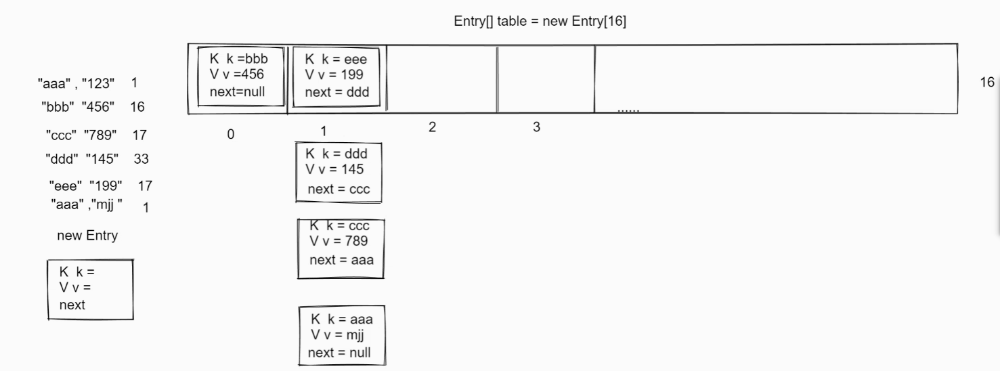

<title>04 集合相关原理,Map的使用</title>

# 一、Map

<callout emoji="⚠️">
双列集合的顶层接口
特点: 每次存储都是存储一对元素, 称为**键值对集合**, **键不能重复**, 值可以重复, Set其实就是用的Map的左边的键
作用: 解决有对应关系数据的存储, 比如,字符对应的个数, 歌手对应投票
</callout>

**体系结构:**

<callout emoji="⚠️">
Map(接口)

HashMap(实现类)

LinkedHashMap(实现类)

 TreeMap(实现类)

特点: 所有Map集合的特点都是由键决定的, 值只不过是一个附属品

HashMap和LinkedHashMap键的去重:  可以hashcode()以及equals方法有关系

TreeMap的去重: 可以按照键排序, 那么我们要么设置自然排序,要么设置比较器排序, 去重根据比较的值是否为0有关系
</callout>

##  Map常用功能:

| 返回值 | 方法名参数 | 作用 |
|-|-|-|
| V | put(K key, V value) |  存入键值对象 如果键重复则替换值, 返回旧值,否则返回null |
| V | get(Object key); | 根据键获取对应的值 |
| V | remove(Object key) | 根据键删除键值对, 返回键对应的值 |
| int | size(); | 返回集合的键值对个数 |
| boolean | containsKey(Object key); | 判断是否包含某个键 |
| boolean | containsValue(Object value); | 判断是否包含某个值 |

常用方式演示:

```TypeScript
    private static void demo() {
        //创建Map集合
        Map<String,String> m = new HashMap<>();
        //添加元素
        m.put("张作霖","东北");
        m.put("张学友","北京");
        m.put("周杰伦","上海");
        m.put("王力宏","上海");
        System.out.println(m.size());
        System.out.println(m);
//        m.clear();
//        System.out.println(m);
        System.out.println(m.get("张作霖"));
        m.remove("张学友");
        System.out.println(m);
        System.out.println(m.containsKey("周杰伦"));
        System.out.println(m.containsValue("上海"));
    }
```

```Java
特点：
    （1）一次存一对元素
    （2）左边称为键，右边称为值，map集合也叫键值对集合，键不能重复，值可以重复，Set集合都是使用Map的键的部分！！！
作用：存储有键值对关系的数据
体系：
    Map<K,V>
        HashMap<K,V>
            LinkedHashMap<K,V>
    TreeMap<K,V>
常用功能：
    CRUD
```

##  **Map集合的遍历:**

### 第一种:  根据键找值

Set<K> keySet()  获取键的Set集合

Map遍历方法1演示：

```TypeScript
public class Test {
    public static void main(String[] args) {
        //创建Map集合
        Map<String,String> m = new HashMap<>();
M        //添加元素
        m.put("张作霖","东北");
        m.put("张学友","北京");
        m.put("周杰伦","上海");
        m.put("王力宏","上海");
        //取出单列键
        Set<String> keys = m.keySet();
        //遍历键
        for (String key : keys) {
            //通过键取出值
            String value = m.get(key);
            System.out.println(key + ":\t" + value);
        }
    }
```

### 第二种: 根据键值对对象遍历

Set<Map.Entry<K,V>> entrySet() 得到所有的键值对节点对象的Set集合

Map遍历方法2演示：

```TypeScript
public class Test {
    public static void main(String[] args) {
        //创建Map集合
        Map<String,String> m = new HashMap<>();
        //添加元素
        m.put("张作霖","东北");
        m.put("张学友","北京");
        m.put("周杰伦","上海");
        m.put("王力宏","上海");
        //通过键值对方式遍历集合
        Set<Map.Entry<String,String>> entries = m.entrySet();
        entries.forEach( entry -> System.out.println(entry.getKey() + "::" + entry.getValue()));
    }
```

### 第三种: jdk8的遍历方式

*default void forEach(BiConsumer<? super K,? super V> action)  采用lambda方式简化遍历*

lambda方式 forEach方式遍历map集合演示：

```TypeScript
public class Test {
    public static void main(String[] args) {
        //创建Map集合
        Map<String,String> m = new HashMap<>();
        //添加元素
        m.put("张作霖","东北");
        m.put("张学友","北京");
        m.put("周杰伦","上海");
        m.put("王力宏","上海");
        //forEach遍历集合
        m.forEach((key ,value) -> System.out.println(key + "::" + value));
    }
```

<callout emoji="✏️">
因为采用的内部类，所以访问外部类的局部变量的时候，局部变量会被final修饰，不能被修改
</callout>

##  **综合案例:**

1. 键盘录入一个字符串,求每一个字符出现的次数

```Java
public class Test {
    public static void main(String[] args) {
        Scanner sc = new Scanner(System.in);
        System.out.println("请输入一个字符串");
        String s = sc.next();

        Map<Character,Integer> map = new HashMap<>();
        for (int i = 0; i < s.length(); i++) {
            //获取字符
            char c = s.charAt(i);
            //判断字符是否在map集合中
            if (map.containsKey(c)){
                //存在 数量加1
                map.put(c,map.get(c)+1);
            }else
                //不存在 创建字符 并设置为1
                map.put(c,1);
        }
        //遍历打印集合
        map.forEach((key,value) -> System.out.println(key + "::" + value));
    }
}
```

## 二 、集合原理

迭代器遍历集合的原理：

<callout emoji="🎹">
当我们调用iterator（）方法的时候，其实底层创建一个该接口的实现类对象，初始化一个指针，默认值为0
当我们调用hasNext（）的时候，其实就是判断了该指针是否指向末尾
当我们调用next（）方法的时候，会将指针往后移动一位，取出上一位的元素返回
</callout>

并发修改异常出现的原因

<callout emoji="👍">
当我们创建选代器对象的时候会维护一个expectedModCount，起初这个值和外部类的中的modCount是一致的，这个值记录的是集合的增删次数。
但是如果我们使用外部类集合的方法对其进行增删，则modCount会变化，但是expectedModCount不会变化，
这两个值一旦不一致就会出现并发修改异常
一旦采用外部类集合的方法进行增删，没有调整迭代器对象的cursor的值，会导致漏掉的情况
</callout>

凭什么使用迭代器的方法删除就可以完成操作呢？

<callout emoji="✏️">
迭代器的删除方法，也是采用外部类集合的方法进行删除的，但是删完后将cursor回退了，而且同步了expectedModCount和modCount的值
不会出现并发修改异常了
</callout>

```Java
掌握集合的工具类Collections
    static <T> boolean addAll(Collection<？ super T>c，T...elements) 将数组的元素都添加到集合中
    static void shuffle(List<?>list） 打乱集合的顺序
    static <T extends Comparable<? super T>>void sort(List<T> list)
    static <T> void sort(List<T> list, Comparator<? super T> c)
总结：
    基本数据类型对应的包装类，以及字符串已经实现了Comparable，内部有比较的方法
```

```Java
System工具类常用功能
static void arraycopy(object src,int srcPos,Object dest，int destPos,int length);
    拷贝数组
        src:源数组
        srcPos：源数组的起始索引
        dest：目标数组
        destPos：目标数组的起始索引
        length：拷贝的长度
static long currentTimeMillis()；//获取时间的毫秒值
    什么是时间毫秒值？？？
        距离时间原点到此刻时间的毫秒值
            什么是时间原点？？？
                1970-1-10:0:0对于东八区来说1970-1-18:0:0
    1天=24小时
    1小时=60分钟
    1分钟=60秒
    1秒=1000毫秒
    1毫秒=1000微秒
    1微秒=1000纳秒
static voidexit(int status);
    0代表正常终止
    !0代表异常终止
```


## 2.1 hash值

<callout emoji="❤️">
默认是根据真实地址算出来的伪地址
Object的hashcode()方法，默认被native关键字修饰了，这种方法称为本地方法，本地方法的方法体不是java语言写的是和其他语言交互的桥梁
C语言写的，根据真实地址算出来一个伪地址，我们称为hash值--->哈希值
</callout>

hash表：链表+数组

hash表内存图：


> 图注：图片展示了Java中Map的hash表内存图。图中显示一个长度为16的Entry数组，数组中部分位置存放着键值对，如K k = bbb，V v = 456，next = null等。左侧列出键值对“aaa”，“123”等，以及新创建的Entry对象。该图与上文介绍的hash表内存结构相关，直观呈现了hash表中数组+链表构成的存储方式，帮助理解将键的hashcode值与数组长度求“位&”运算得到索引，以及将键值封装Entry存入该位置等操作。

<callout emoji="🌰">
将算出键的hashcode值，然后和底层数组的长度求"位&"运算，得到一个索引
拿出该索引对应的节点Entry，如果当前索引的节点为null，证明该位置没有存放任何元素
将键和值，封装Entry节点，然后存入到该位置
如果该位置有节点，则会取出该位置的所有节点中的键，和要存储的键进行hashcode以及equals对比，但是有任何节点中两个都相同则判断为重复元素，会将节点中旧值替换成新值，但是键不变
</callout>

为啥没有索引

<callout emoji="⚠️">
 因为底层是数组+链表构成, 通过索引无法获取单个元素, 所以没有有索引的方法
</callout>

为啥不能重复

<callout emoji="⚠️">
存储元素的时候,会和对应索引的链表对比hash值和equals方法一旦发现都相同则判断重复元素不存!!!
</callout>

为啥无序

<callout emoji="⚠️">
存储的时候有自己的规则, 取出来的时候从0索引开始取的, 不能保证存储的数据和取出的顺序一致
</callout>

<callout emoji="🎨">
注意：
hash值在使用中为了增加检索效率 ，防止因链表过长而拖慢检索速度
添加 负载因子 0.75 元素个数/底层hash表长度的比例  默认进行二倍扩容

重新进行扩容后的位运算，来稀松链表分布 提高查询效率
</callout>

### 2.2 JDK7的hash表的原理：

<callout emoji="🎹">
首先会求出键的hash值，然后会>>>16位，然后和底层的hash表长度求位&运算得到一个索引
然后取出索引对应的节点，如果结果为null，证明该位置没有存放任何节点，则将键值对象封装成Entry节点，然后存入该位置即可
如果该位置有节点，则会取出该位置以及该位置下面的所有的节点中的键和要存储的键对比equals以及hashcode方法，除非某个键和要存储的键
hashcode以及equals都满足，则判断为重复元素，则将节点中旧值替换成新值结束，如果比完没有发现任何一个相同，则将键值封装成节点然后采用头插法，将节点存入到该位置，原来的头，挂在新节点的下面，添加完毕后，会检查是否超过了负载因子，如果超过了，就会触发扩容逻辑，默认2被扩容
扩容之后，所有的元素重新计算位置存放
</callout>


### 2.3红黑树：

规则：

<callout emoji="🏝️">
根节点是黑色
叶子节点叶子黑色的
两个红色不能相连
所有节点，到其所有叶子节点的简单路径上所有的黑色节点数量保持一致
</callout>

---
> 来源：飞书技术知识库（脱敏版） · 01 Java 语言核心 / 集合框架与 Map / 04 集合相关原理,Map的使用 · [原文](https://ccn8v2zngwsm.feishu.cn/wiki/ShHAwxyZ4iopkXkCIT6cKCy7nke)
