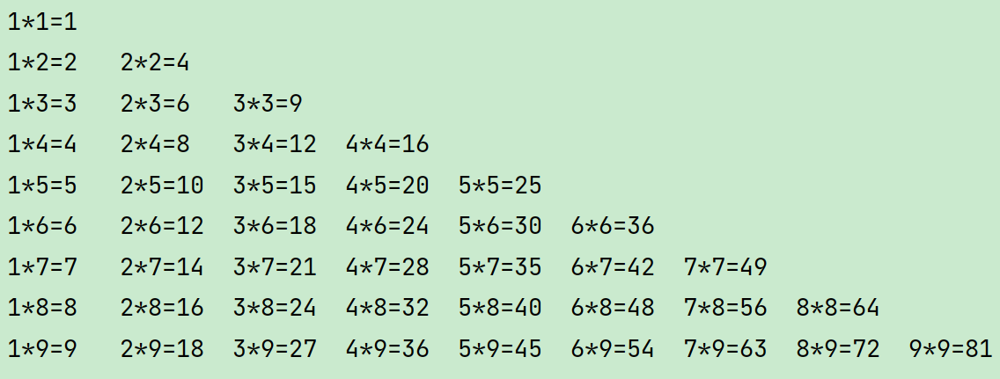

# 04 嵌套循环、数组、二维数组·笔记


## 课堂问答：嵌套循环与数组

**题目: 请选择正确的静态初始化数组方式**

A、int[] arr = {1, 2, 3};

B、String arr[] = {1, 1, 1};

C、int arr[] = {"1", "22", '3'};

D、int[] arr = new int[]{1, 2, 3};

E、int arr[] = new int[3]{1, 2, 3};

F、int arr[] = new int[]{1, 2, 3};

```Java
A、D、E
```

**题目: 看程序说结果，请不要提前运行**

**目标: 掌握引用数据类型变量的特点**

```Java
 public class Test03_02 {
     public static void main(String[] args) {
       int[] arr1 = {1,2,3,4,5};
       int[] arr2 = {5,6,7};
       int[] temp = arr1;

       System.out.println("通过temp取出arr1中的元素: ");

       for(int i = 0;i<temp.length;i++) {
         System.out.print(temp[i]+" ");
       }

       temp = arr2;

       System.out.println("通过temp取出arr2中的元素: ");

       for(int i = 0;i<temp.length;i++) {
         System.out.print(temp[i]+" ");
       }
     }
   }
```

```Java
通过temp取出arr1中的元素: 
1 2 3 4 5
通过temp取出arr2中的元素:
5 6 7
```

**题目:看程序说结果，请不要提前运行**

**目标: 掌握引用数据类型变量的特点**

```Java
   public class Test03_01 {
     public static void main(String[] args) {
       int[] arr1 = {1,2,3,4,5};
       int[] temp1 = arr1;
       int[] temp2 = arr1;
       System.out.println("通过temp1取出数组值: ");

       for(int i = 0;i<temp1.length;i++) {
         System.out.print(temp1[i]+" ");
       }
       System.out.println();
       System.out.println("通过temp2取出数组值: ");
       for(int i = 0;i<temp2.length;i++) {
         System.out.print(temp2[i]+" ");
       }
       System.out.println();
       temp1[2] = 9;

       System.out.println("通过temp1取出数组值: ");
       for(int i = 0;i<temp1.length;i++) {
         System.out.print(temp1[i]+" ");
       }
       System.out.println();
       System.out.println("通过temp2取出数组值: ");
       for(int i = 0;i<temp2.length;i++) {
         System.out.print(temp2[i]+" ");
       }
       System.out.println();
     }
   }
```

```Java
通过temp1取出数组值:
1 2 3 4 5
通过temp1取出数组值:
1 2 3 4 5
通过temp1取出数组值:
1 2 9 4 5
通过temp1取出数组值:
1 2 9 4 5
```

**题目:**

**如何访问数组的元素?**

**如何访问数组的长度？**

**数组的最大索引是多少？**

**访问不存在的索引会出现什么现象?**

**目标: 掌握数组的访问基本格式**

```Java
如何访问数组的元素?
通过索引访问数组
格式1：
    for(int i = 0;i < 数组名.length;i++){
        System.out.println(数组名[i]);
    }
格式2：
    数组名[索引值]
如何访问数组的长度？
格式：
    //返回值是数组的元素个数
    数组名.length
数组的最大索引是多少？
格式：
    //由于数组是从0开始的，所以最大索引应该是 元素个数 -1
    数组名.length - 1
访问不存在的索引会出现什么现象?
    会报错，提示超出索引界限
```

**题目:**

**请叙述数组出现的好处 ?**

**数组的静态初始化的格式以及元素的特点?**

**数组的动态初始化的格式以及元素的特点?**

**目标: 掌握数组的特点**

```Java
请叙述数组出现的好处 ? 
    数组可以按顺序存储多个相同类型的数据
    数组通过索引可以快速访问和修改任意位置的元素
    数组便于使用循环批量处理数据
    数组提高代码的可读性和维护性
    内存空间连续，访问效率高
数组的静态初始化的格式以及元素的特点? 
简写格式：
    数组类型[] 数组名 = {元素1,元素2,...元素n}
完整格式：
    数组类型[] 数组名 = new 数组类型[]{元素1,元素2,...元素n}
元素特点：
    数组长度由大括号中元素个数决定
    元素类型必须与声明的数组类型一致
    初始化时直接为每个元素赋具体值
    一旦初始化完成，长度就固定不变
数组的动态初始化的格式以及元素的特点?
格式：
    数组类型[] 数组名 = new 数组类型[数组长度]
特点：
    只指定数组长度，不指定具体元素值
    系统会自动为数组元素分配默认值：
    整数类型（byte、short、int、long）：0
    浮点类型（float、double）：0.0
    字符类型（char）：'\u0000'（空字符）
    布尔类型（boolean）：false
    引用类型：null
    数组长度在创建时确定，不可改变
```

**循环嵌套概念: 循环中又包含循环。**

例如: 两者三天每天说五次"我爱你"

```Java

// 连续3天
for(int i = 0; i < 3; i++) { 
    // 每天5次 
    for(int j = 0; j < 5; j++) {
        System.out.println("我爱你"); 
    } 
} 

private static void loveEveryDay() {
    for (int i = 0; i < 3; i++) {
        System.out.print("第" + (i+1) + "天：");
        for (int j = 0; j < 5; j++) {
            System.out.print("我爱你！\t");
        }
        System.out.println();
    }
}

```

**特点: 特点外部循环每循环一次，内部循环会全部执行完一轮。**  
**1.题目: 在控制台使用 \* 打印出5行7列的矩形**  
\*\*\*\*\*\*\*  
\*\*\*\*\*\*\*  
\*\*\*\*\*\*\*  
\*\*\*\*\*\*\*  
\*\*\*\*\*\*\*\`

```Java
private static void matrixPrint() {
    //打印行
    for (int i = 0; i < 5; i++) {
        //打印列
        for (int j = 0; j < 7; j++) {
            //单行打印
            System.out.print("*" + " ");
        }
        //换行
        System.out.println();
    }
}
```

**2.题目: 在控制台使用 \* 打印出5行5列的阶梯如下**  
\*  
\*\*  
\*\*\*  
\*\*\*\*  
\*\*\*\*\*

```Java
private static void matrixPrint2() {
    //行
    for (int i = 0; i < 5; i++) {
        //列 控制列数不大于行 实现递增
        for (int j = 0; j <= i; j++) {
            //打印单行个数
            System.out.print("* \t");
        }
        //行满换行
        System.out.println();
    }
}
```

**题目: 请使用嵌套循环在控制输出九九乘法口诀表，如下图所示：**



> 温馨提示: **\t**可以实现制表符的书写, 也就是键盘中tab键的效果

```Java
private static void mulNum() {
    //控制行 增长
    for (int i = 1; i <= 9; i++) {
        //控制列的最大值随着行增长
        for (int j = 1; j <= i; j++) {
            //打印输出每列 样式
            System.out.print(j + "*" + i + "=" + (j * i) + "\t");
        }
        //列满换行
        System.out.println();
    }
}
```

**题目: 下面哪个可以正确的获取数组a的第三个元素**

**目标: 掌握访问数组的基本格式**

A、a(3)

B、a[3]

C、a(2)

D、a[2]

```Java
D
```

**题目: 现有一个小数数组{12.9,53.54,75.0,99.1,3.14}。请编写代码，找出数组中的最小值并打印。**

**目标: 掌握数组的遍历以及和流程控制等综合应用**

```C++
private static void numPrint() {
    //定义小数类型数组
    double[] arr = new double[]{12.9,53.54,75.0,99.1,3.14};
    //定义最小值存储变量 初始值设置arr数组中索引为0的第一个元素
    double min_num = arr[0];
    //循环遍历数组
    for (int i = 0; i < arr.length; i++) {
        //判断遍历当前元素 和定义最小值大小
        if (arr[i] < min_num)
            //当前遍历元素小于 变量存储值，则执行替换当前变量值
            min_num = arr[i];
    }
    //打印输出
    System.out.println("最小值为：" + min_num);
}
```

**题目:**

**(1)定义一个长度为10的int类型数组，元素值使用随机数生成（范围为50-80）**

**(2)打印该数组中满足个位和十位不包含7的元素。**

**目标: 掌握数组的遍历以及和流程控制等综合应用**

```Java
private static void radomArray() {
    //定义长度为10的空数组
    int[] arr = new int[10];
    //调用随机数方法
    Random r = new Random();
    //遍历定义的空数组
    for (int i = 0; i < arr.length; i++) {
        //将随机范围为50-80的数 放入当前索引的数组位置，每轮放入一个
        arr[i] += r.nextInt(50,81);
        //打印检查
        System.out.print(arr[i] + "\t");
    }
    System.out.println();
    //循环遍历生成的随机数组
    for (int i = 0; i < arr.length; i++) {
        //定义变量并计算 当前索引元素的个位和十位的值
        int ge = arr[i] % 10;
        int shi = arr[i] /10 % 10;
        //判断个位和十位是否为7 
        if (ge != 7 && shi != 7)
            //个位十位均不满足为7 执行打印
            System.out.println(arr[i]);
    }
}
```

**题目:**

**定义一个数组其中包含多个数字。用自己的方式最终实现，奇数放在数组的左边，偶数放在数组的右边。（可以创建其他数组，不必须在原数组中改变）**

**目标: 掌握数组的遍历以及和流程控制等综合应用**

```SQL
private static void arrayLeftRight() {
    int[] arr = new int[]{3, 4,6,8,10,5, 7, 9, 9, 3, 4, 7};
    int left = 0;
    int right = arr.length - 1;
    while (left < right) {
        // 从左边找到第一个偶数
        while (left < right && arr[left] % 2 != 0) {
            left++;
        }
        // 从右边找到第一个奇数
        while (left < right && arr[right] % 2 == 0) {
            right--;
        }
        // 找到了，就交换
        if (left < right) {
            int temp = arr[left];
            arr[left] = arr[right];
            arr[right] = temp;
            left++;
            right--;
        }
    }
    for (int i = 0; i < arr.length; i++) {
        System.out.print(arr[i] + "\t");
    }
}
```

**题目:**

**某公司开发部5名开发人员，要进行项目进展汇报演讲，现在采取随机排名后进行汇报。**

**已知开发人员存放在数组中 String[] arr = { "张三", "李四", "王五", "赵六", "田七" };**

**目标: 掌握数组的遍历以及和流程控制等综合应用**

```Java
private static void nameRaking() {
    //定义字符串类型的数组 存放姓名
    String[] arr = { "张三", "李四", "王五", "赵六", "田七" };
    //调用随机数方法
    Random r = new Random();
    //循环遍历姓名数组
    for (int i = 0; i < arr.length / 2; i++) {
        //随机长度为0-4的索引
        int index = r.nextInt(5);
        //定义第三 变量 存储交换值 即当前遍历元素
        String name = arr[i];
        //将当前元素赋 随机索引元素值
        arr[i] = arr[index];
        //将当前元素值放回 随机索引位置
        arr[index] = name;
    }
    //循环遍历打印 该随机姓名数组
    for (int i = 0; i < arr.length; i++) {
        System.out.println(arr[i]);
    }
}
```

**题目:**

**需求某个数组有5个数据：10,20,30,40,50，请将这个数组中的数据进行反转。即：[10, 20, 30, 40, 50] 反转后 [50, 40, 30, 20, 10]请将代码区的数组进行反转。**

**目标: 掌握数组的遍历以及和流程控制等综合应用**

```C++
private static void reverseNum() {
    //定义数组
    int[] arr = new  int[]{10,20,30,40,50};
    //定义末尾索引
    int index = arr.length-1;
    for (int i = 0; i < arr.length; i++) {
        //判断是否索引是否发生碰撞
        if (i >= index)
            break;
        //当前元素赋值给 第三方变量
        int name = arr[i];
        //末尾索引元素值 赋值给当前元素赋 
        arr[i] = arr[index];
        //将当前元素值放回 末尾索引位置
        arr[index] = name;
        //末尾索引 向左推进
        index--;
    }
    //循环打印列表
    for (int i = 0; i < arr.length; i++) {
        System.out.println(arr[i]);
    }
}
```

题目: 某班级学生的Java考试成绩是：99, 100, 62, 15, 48, 65, 98, 99, 5, 59.5, 75; 请统计及格学生总人数。

**目标: 掌握数组的遍历以及和流程控制等综合应用**

```C++
private static void scorePeopleNum() {
    //定义数组
    double[] arr = new double[]{99, 100, 62, 15, 48, 65, 98, 99, 5, 59.5, 75};
    //定义计数变量
    int count = 0;
    //循环遍历成绩数组
    for (int i = 0; i < arr.length; i++) {
        //判断成绩是否及格 大于等于60为及格
        if (arr[i] >= 60){
            System.out.println("成绩及格：" + arr[i]);
            //及格则累加
            count++;
        }
    }
    //打印及格人数
    System.out.println("有：" + count + "人及格");
}
```

**题目: 需求某歌唱比赛，需要开发一个系统：可以录入6名评委的打分，录入完毕后立即输出平均分做为选手得分。**

**目标: 掌握数组的遍历以及和流程控制等综合应用**

```Java
private static void scorePeopleSong() {
    //调用键盘录入方法
    Scanner sc = new Scanner(System.in);
    //定义长度为6的数组
    double[] arr = new double[6];
    //循环遍历数组
    for (int i = 0; i < arr.length; i++) {
        //提示成绩输入
        System.out.println("请输入评分：");
        //键盘录入成绩放入当前索引的元素位置
        arr[i] = sc.nextInt();
    }
    //定义变量 接收累加值
    double count = 0;
    //循环遍历成绩数组
    for (int i = 0; i < arr.length; i++) {
        //累加元素值
        count += arr[i];
    }
    //打印计算平均成绩
    System.out.println("平均成绩为：" + count / 6);
}
```

**题目: 某部门5名员工的销售额分别是：16、26、36、6、100，请计算出他们部门的总销售额。**

**目标: 掌握数组的遍历以及和流程控制等综合应**

```C++
private static void allMoney() {
    //定义数组
    int[] arr = new int[]{16,26,36,6,100};
    //定义累加存储变量
    int count = 0;
    //循环遍历列表
    for (int i = 0; i < arr.length; i++) {
        //累加额度
        count +=arr[i];
    }
    //打印输出额度
    System.out.println("总销售额度为：" + count);
}
```

---
> 来源：飞书技术知识库（脱敏版） · 01 Java 语言核心 / 基础语法与流程控制 / 04 嵌套循环、数组、二维数组·笔记 · [原文](https://ccn8v2zngwsm.feishu.cn/wiki/MsAdwDfRQi14azkY29zcnVSonRc)
