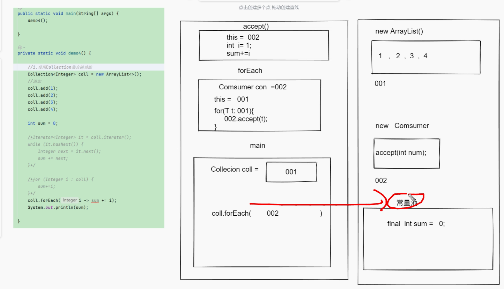

<title>03 Collection</title>

# 一、 Collection

Collection 是单列集合的顶层接口

## **1.1  体系结构:**

Collection(接口)

List(接口)

ArrayList(实现类)

LinkedList(实现类)

Set(接口)

HashSet(实现类)

LinkedHashSet(实现类)

TreeSet(实现类)

**特点:**

<callout emoji="📙">
List:  有序, 有索引, 可以重复 

有序:指的是存储的顺序和取出的顺序一致

 Set:

HashSet:  无序,无索引,不能重复

LinkedHashSet: 有序,无索引,不能重复

TreeSet: 排序, 无索引,不能重复
</callout>


## **1.2 Collection提供的常见功能**

| 返回值 | 方法名以及参数 | 解释方法 |
|-|-|-|
| **`boolean`** | **`add(E e)`**  | **添加元素** |
| `boolean` | `addAll(Collection<? extends E> c)`  | 将另外一个集合的元素添加到本集合中 |
| `void` | `clear()`  | 清空集合 |
| **`boolean`** | **`contains(Object o)`**  | **判断集合中是否包含某个元素** |
| **`boolean`** | **`remove(Object o)`**  | **根据内容删除元素** |
| **`int`** | **`size()`**  | **求出集合的长度** |
| `boolean` | `isEmpty()`  | 判断集合长度是否为0 |

## **1.3 单列集合遍历**

### 1.3.1  迭代器遍历: 是一种通用遍历集合的方式

Collection的遍历方式一：迭代器遍历

迭代器是用来遍历集合的专用方式（数组没有迭代器），在Java中迭代器的代表是Iterator

Collection集合获取迭代器的方法

| 方法名称 | 说明 |
|-|-|
| Iterator<E> **iterator()** | 返回集合中的迭代器对象，该迭代器对象默认指向当前集合的第一个元素 |

Iterator迭代器中的常用方法

| 方法名称 | 说明 |
|-|-|
| boolean hasNext() | 询问当前位置是否有元素存在，存在返回true，不存在返回false |
| E next() | 获取当前位置的元素，并同时将选代器对象指向下一个元素处。 |

**迭代器使用步骤:**

**第一步: 先获取迭代器**

Collection接口中提供获取迭代器功能

| `Iterator<E>` | `iterator()`  | 获取迭代器对象的方法 |
|-|-|-|

**第二步: 使用迭代器功能迭代元素**

| `boolean` | `hasNext()`   | 判断是否还有元素未取出,如果有则返回true  |
|-|-|-|
| `E` | `next()`   | 取出元素, 并且指针往后移动 |
| void | remove() | 删除元素 |

```TypeScript
public class Test {
    public static void main(String[] args) {
        dome01();
    }
    /**
     * 示例方法：演示如何使用迭代器遍历集合
     */
    private static void dome01() {
        // 创建一个ArrayList集合对象，用于存储字符串元素
        Collection<String> coll = new ArrayList<>();
        // 向集合中添加三个字符串元素
        coll.add("hello");
        coll.add("world");
        coll.add("java");
        // 获取集合的迭代器对象
        Iterator<String> it = coll.iterator();
        // 使用迭代器遍历集合并打印每个元素
        while (it.hasNext()) {  // 判断是否还有下一个元素
            String str = it.next();  // 获取下一个元素
            System.out.println(str); // 打印元素值
        }
    }
}
```

通过迭代器删除集合元素：

```TypeScript
public class Test {
    public static void main(String[] args) {
        Collection<String> coll = new ArrayList<>();
        coll.add("sdde");
        coll.add("seed");
        coll.add("vss");
        coll.add("dddd");
        Iterator<String> it = coll.iterator();
        while (it.hasNext()){
            String next = it.next();
            if (next.length() == 3) {
                it.remove();
            }
        }
        System.out.println(coll);
    }
}
```

使用迭代器的注意事项:

<callout emoji="🧥">
注意事项：
①使用迭代器遍历集合的时候不能采用集合的方法进行增删，否则会出现并发修改异常
java.util.ConcurrentModificationException
②取一次只能删一次，必须先取才能删除
迭代器遍历集合如何删除元素？
采用迭代器的方法来删除即可
即：在使用迭代器遍历集合的时候不能采用集合方法进行增删, 应该采用迭代器的方法进行增删
</callout>

### **1.3.1 增强for循环**


格式：

```Java
for（数据类型 变量名：数组|集合）{
}
```

案例：

```TypeScript
public class ForTest {
    public static void main(String[] args) {
        Collection<String> coll = new ArrayList<>();
        coll.add("seed");
        coll.add("vss");
        coll.add("dddd");
        for (String s : coll) {
            System.out.println(s);
        }
    }
}
```

注意事项：

<callout emoji="📌">
(1)迭代器的注意事项他都有
(2)由于看不到迭代器对象，不能做删除操作
</callout>

快捷方式：

<callout emoji="🦄">
集合.for
数组.for
</callout>

### **1.3.2 forEach方式遍历:**

解jdk1.8的新式遍历方式,底层采用依然是迭代器, 是迭代器的简化书写

格式：

```Java
default void forEach(Consumer<? super T> action)
```

案例：

```TypeScript
public class ForTest {
    public static void main(String[] args) {
        Collection<String> coll = new ArrayList<>();
        coll.add("seed");
        coll.add("vss");
        coll.add("dddd");
        coll.forEach(s -> System.out.println(s));
    }
```

注意事项：

<callout emoji="🎼">
(1）迭代器有的注意事项他都有
(2) 增强for注意事项他都有
(3) 采用forEach遍历集合的时候不能对方法中局部变量进行修改，因为被final修饰
</callout>

内存图：


> 图注：这是Java集合遍历中forEach方式的内存示意图，用于说明该遍历方式的原理。图中左侧是main方法的代码逻辑，创建了存储1、2、3、4的ArrayList集合和Consumer对象；中间梳理了方法调用流程，main方法调用了Collection对象（编号001）的forEach方法（编号002），该forEach会调用accept方法；右侧的内存区域显示，forEach遍历集合时，内部类访问了main方法的局部变量sum，图中标注该变量为“常量类”，且sum被final修饰，借此体现foreach遍历集合的相关注意事项，即不能修改方法的局部变量。

<callout emoji="🎹">
*原因:*
***内部类访问局部变量****的时候,其实是访问不到的, 因为****两个方法, 有独立的空间****, 为啥能访问到?*  
***因为jvm给局部变量加了final关键字****, 让这个局部变量移到堆中的****常量池****中, 所以我们才能访问到,但是确定不能改变了!!!*
</callout>

## 1.4 List

### 1.4.1 List接口特有功能


| 返回值类型 | 方法名参数 | 作用 |
|-|-|-|
| `void` | `add(int index, E element)`  | 根据索引添加, 原索引以及之后的索引位置的元素往后顺延 |
| `E` | `remove(int index)`   | 根据索引删除, 该索引之后的元素会往前顺延,返回被删除的元素 |
| `E` | `get(int index)`  | 根据索引获取元素 |
| `E` | `set(int index, E element)`  | 根据索引修改元素,返回旧元素 |

演示list的特有功能:

```TypeScript
public class ForTest {
    public static void main(String[] args) {
        ArrayList<String> list = new ArrayList<>();
        list.add("abc");
        list.add("one");
        list.add("seed");
        list.add("bule");
        list.add("red");
        System.out.println(list.remove(0));
        System.out.println(list.set(1, "see"));
        System.out.println(list.get(3));
        System.out.println(list);
    }
```

### **1.4.2  LinkedList的特有功能:**

链表由于数据结构不同, 提供了针对首尾的特有功能, 功能列表如下:

| 返回值 | 方法名 | 作用 |
|-|-|-|
| E | getFirst() |  获取头节点的元素 |
| E | getLast() | 获取尾节点的元素 |
| E | removeFirst() | 删除头节点的元素并返回 |
| E | removeLast() | 删除尾节点的元素并返回 |
| void | addFirst(E e) | 将元素添加到头节点 |
| void | addLast(E e) | 将元素添加到尾节点 |

演示LinkedList的特有功能

```Java
/*
    演示List的特有功能
 */
public static void main(String[] args) {
    // 创建一个 LinkedList 对象，LinkedList 是 List 接口的一个实现类
    LinkedList<String> list = new LinkedList<>();
    // 使用 addFirst 方法将元素添加到链表的开头
    list.addFirst("ssr");
    // 使用 addLast 方法将元素添加到链表的末尾
    list.addLast("aaa");
    list.addLast("abb");
    list.addLast("abc");
    // 打印链表的第一个元素，
    System.out.println(list.getFirst());
    // 打印链表的最后一个元素，
    System.out.println(list.getLast());
    // 移除并返回链表的第一个元素
    System.out.println(list.removeFirst());
    // 移除并返回链表的最后一个元素
    System.out.println(list.removeLast());
    // 打印当前链表的所有元素
    System.out.println(list);
}
```


## 1.5 set

<callout emoji="🧥">
**Set是Collection的第二个大体系, Set集合没有任何的特有功能, 所有的功能都来源于Colleciton**
常见实现类: HashSet , LinkedHashSet, TreeSet
**特点:** 每一个常用的Set集合特点都不太一样

**HashSet:  无序, 不能重复, 无索引**

**LinkedHashSet: 有序, 不能重复, 无索引**

**TreeSet: 可以排序, 不重复, 无索引**

要求我们存储的自定义类型的对象必须设置**排序规则**

去重：只和比较的值是否为0有关系

两种设置方式：

(1)  自然排序，让元素内部本身具有比较的功能

让自定义类型去实现Comparable接口，必须重写compareTo(T t)方法，在里面写出比较规则
</callout>

<callout emoji="🌰">
**HashSet**和**LinkedHashSet**的去重跟对象的hashcode()以及equals()的方法有关，想要对自定义对象去重需要重写这两个方法
</callout>

### **1.5.1 HashSet和LinkedHashSet去重演示：**

```Java
    //在学生类中重写hashcode()以及equals()方法 才能实现HashSet的自动去重
    @Override
    public String toString() {
        return "Student{" +
                "name='" + name + '\'' +
                ", age=" + age +
                '}';
    }

    @Override
    public boolean equals(Object o) {
        if (o == null || getClass() != o.getClass()) return false;
        Student student = (Student) o;
        return age == student.age && Objects.equals(name, student.name);
    }
    @Override
    public int hashCode() {
        return Objects.hash(name, age);
    }
}

public class Test {
    public static void main(String[] args) {
        Set<Student> stu = new HashSet<>();
        stu.add(new Student("小美",18));
        stu.add(new Student("小王",19));
        stu.add(new Student("小张",20));
        stu.add(new Student("小王",19));
        for (Student student : stu) {
            System.out.println(student);
        }
    }
}

```

LinkedHashSet：有序，不重复，无索引

LinkedHashSet去重和HashSet一致。

### 1.5.2 TreeSet：

<callout emoji="👍">
**TreeSet: 可以排序, 不重复, 无索引**

要求我们存储的自定义类型的对象必须设置**排序规则**

**去重：只和比较的值是否为0有关系**

两种设置方式：

(1)  自然排序，让元素内部本身具有比较的功能

让自定义类型去实现Comparable接口，必须重写compareTo(T t)方法，在里面写出比较规则

缺点：

（1）比较的规则和类之间耦合过高，万一这个是别人提供的，我们无法修改源码，就无法添加比较规则

（2）比较规则只能写一个，不能写多个！！！

（2）**比较器排序**，设置比较器用来比较元素

创建Comparator<T>接口实现类对象，必须重写compare（T t1,Tt2）方法，在里面写出比较规则

TreeSet(Comparator<T> com);  //创建TreeSet集合的时候设置比较器比较
</callout>

<callout emoji="🍰">
排序相关的问题：

(1) 如何降序排序？

让右边－左边

(2) 如何多条件排序？

第一比较结果不着急返回，

判断如果是0，则记录第二条件的比较结果

以此类推

...

(3) 小数排序的问题？？？

可以采用Double的静态方法compare方法进行比较小数，得到一个整数的比较结果
</callout>

**方法1 自然排序演示：**

```TypeScript
public class Teacher implements Comparable<Teacher>{
    private String name;
    private int age;
    private int salary;
    private int height;
    private int weight;
    @Override
    public int compareTo(Teacher o) {
        //重写比较方法 根据年龄比较
        return o.age - this.age;
    }


public class Test {
    public static void main(String[] args) {
        demo2();
    }

    private static void demo2() {
        Set<Teacher> tea = new TreeSet<>();
        tea.add(new Teacher("小王",19,8000,180,78));
        tea.add(new Teacher("小刚",16,6000,170,68));
        tea.add(new Teacher("小赵",20,7000,168,77));
        tea.add(new Teacher("小胡",19,4000,165,78));
        tea.forEach(teacher -> System.out.println(teacher));
    }
```

方法2 **比较器排序 演示：**

```Java
//Teacher类无添加重写比较方法
public class Test {
    public static void main(String[] args) {
        demo3();
    }

    private static void demo3() {
        Set<Teacher> tea = new TreeSet<>(((o1, o2) -> o1.getHeight() - o2.getHeight()));
        tea.add(new Teacher("小王",19,8000,180,78));
        tea.add(new Teacher("小刚",16,6000,170,68));
        tea.add(new Teacher("小赵",20,7000,168,77));
        tea.add(new Teacher("小胡",19,4000,165,78));
        tea.forEach(teacher -> System.out.println(teacher));
    }

```

**解决了第一种方式的所有缺点**

## 1.6 Collections的介绍

<callout emoji="🌟">
集合的工具类, 里面的方法都是静态的
</callout>

### 1.6.1 排序功能介绍:

<callout emoji="⚠️">
*//自然排序(了解一下)*  
*static <T extends Comparable<? super T>>void sort(List<T> list)*  
 *//比较器排序*  
*static void sort(List<T> list, Comparator<T> com)*
</callout>


### 1.6.2 可变参

<callout emoji="⚠️">
*可变参:  
    本质上是数组, 用来解决数据类型一致, 但是参数个数不确定的情况, 是jdk5出现的新特性  
格式:  
    数据类型...数组名  
好处:  
    对于调用者很友好, 可以传参更方便, 可以传入单个,0个,多个,甚至数组都行!!!  
缺点:  
    方法的参数列表中可变参数只能有一个, 而且只能放在最后一个位置*
</callout>

---
> 来源：飞书技术知识库（脱敏版） · 01 Java 语言核心 / 集合框架与 Map / 03 Collection · [原文](https://ccn8v2zngwsm.feishu.cn/wiki/NR2XwIJleiMNdukapiGcPKgTnhf)
