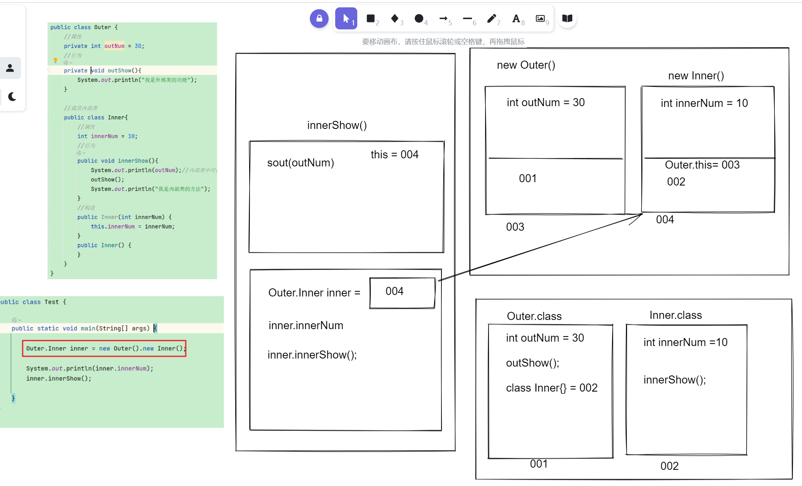

<title>01 接口,内部类,lambda</title>

# 一、接口

概念：

接口是一种特殊的数据结构, 跟类是同一级别, 用来弥补单继承不足的技术, 可以定义规则规范

## 1.1 定义格式以及使用:

```Java
// JDK1.5的接口
public interface 接口名{
    常量
    抽象方法
}

//JDK1.8的接口
public interface 接口名{
    常量
    抽象方法
    默认方法
    静态方法
    私有方法(jdk9)
}
//如何使用接口
public class 实现类  implements 接口1,接口2....{
    //对接口的所有的抽象方法进行重写
}
```

> 接口的注意事项
> 
> 1.接口不能直接实例化
> 
> 2.接口中的成员变量默认被public static final 修饰，我们称为常量
> 
> 3.接口中定义方法默认被public abstract修饰，抽象方法不能有方法体

## 1.2 接口作用:

> 作用：
> 
> 1.可以给类其他身份，弥补单继承的不足，将一系列会xxx的事物归类，限制这类事物的行为，方便找出一类会Xxx的事物
> 
> 2.可以结合接口多态实现解耦，在多个实现类中做灵活的切换
> 
> 3.提取共性的行为：行为使用接口来表达，不会打破原来的继承体系
> 
> 4.将多个类的共性的数据抽取到父类中，父类更擅长抽取共同的属性


## 1.3  JDK8以及之后对接口的增强

**默认方法**

```Java
格式:
[public] default 返回值类型 方法名(参数列表){
    方法体;
    return 返回值;
}
```

**使用场景:**

*当多接口的多个实现类进行接口升级的时候, 要添加统一的功能时才有机会用到*


**静态方法:**

```Java
静态方法:
    格式:
        [public] static 返回值类型 方法名(参数列表){
            方法体;
            return 返回值;
        }
    使用场景:
        和类中的静态方法一致
    注意事项:
        只能接口名访问, 不能通过实现类访问,为啥???
            因为一个类可以实现多个接口, 这多个接口中可能含有同名的静态方法, 如果拿实现类去调用,不知道该走这多个接口哪个接口中的静态方法了!!!
```

**私有方法(jdk9才有的):**

```Java
private  返回值类型 方法名(参数列表){
    方法体;
    return 返回值;
}
private static 返回值类型 方法名(参数列表){
    方法体;
    return 返回值;
}
作用:
    抽取多个默认方法或者静态方法的共性内容, 防止实现类直接调用该方法,因为这个方法仅仅只是功能共性内容不是单独的功能被调用没有意义
```

## 1.4 接口的注意事项

1. *一个类可以继承一个父类, 可以实现多个接口*
2. *当多个接口的默认方法冲突了, 我们实现类必须重写这个冲突的默认方法*

     *接口名.super ---> 可以区分哪个接口中的内容!!!*

1. *当接口的默认方法和父类的方法冲突了, 就近原则,走父类的功能*
2. *接口和类的关系是实现关系,支持多实现, 接口和接口的关系是继承关系, 而且还支持多继承*

# 二、内部类

将一个类定义在另外一个类的内部称为内部类。

**格式:**

```Java
public class 外部类{
    public class 内部类{
    }
}
```

**注意**: 内部类也是类, 跟普通类定义格式, 类中定义的内容都一致

**好处**: 内部类可以直接使用外部类的东西甚至私有的


## **2.1 成员内部类**

直接使用

```Java
外部类.内部类  对象名 = new 外部类().new 内部类();
```

间接使用  
    *在外部类方法中创建内部类对象然后使用内部类功能和对象*

相较于间接使用 直接使用无需创建对象就能直接使用外部类的私有成员变量和方法

内存解析：



**内部类对象可以访问外部类的东西的原因：**

> **内部类对象可以访问外部类的东西的原因是, 内部类对象中维护了外部类对象的地址, 而且在由于内部类**
> 
> **可以使用外部类的东西, 所以在初始化内部类的时候必须先初始化外部类对象**

## 2.2 静态内部类

```Java
public class Outer{
    public static class Inner{
    }
}
```

特点: **静态内部类**只能访问外部类**静态**相关的东西!!!!

## **2.3 匿名内部类(重点!!!)**

```Java
作用：
    简化子类或者实现类的创建的
语法：
    new 已知类|已知接口（对参数赋值）{
        对方法进行重写
    }
本质：创建了一个已知类或者已知接口子类或者实现类对象
```

创建了已知类或者已知接口的子类对象(实现类也叫子类)

注意事项:

*(1) 匿名内部类也是类, 会在磁盘中行为物理.class文件*  
*(2) 匿名内部类本质创建一个已知类或者已知接口的子类对象*  
*(3) 当我们重写的方法超过4个时候不建议使用匿名内部类*  
*(4) 当我们重写方法过于复杂, 内容比较多, 也不建议使用内部类*  
*(5) 当子类对象很多地方都要使用的时候, 不建议使用匿名内部类,复用性很差*

# 三、 lambda

用来简化**函数式接口**的**匿名内部类**的书写的,也是简化**子类的创建**

## 3.1 作用：

lambda简化"函数式接口"的匿名内部类书写

## 3.2 什么是函数式接口？

<callout emoji="🌰">
***有且仅有一个****抽象方法的接口我们称为函数式接口, 跟****其他内容无关，***jdk提供一个注解专门用于检测是否是正确的函数式接口@FunctionalInterface
</callout>

## 3.3 完整格式

```Java
    （抽象方法的参数列表）->{
        抽象方法的重写
    }
```

**可推导可省略**，我们创建子类的格式固定，唯一不同的是对函数式接口的**唯一抽象方法重写**不一样。

## 3.4 简化格式：

```Java
(1)抽象方法的参数类型可以省略
(2)当参数只有一个的时候()可以省略
(3)当方法体只有一句的时候{}可以省略，{}一旦省略return和;也需要省略
```

**快捷方式：**

Alt + 回车 光标放在匿名内部类的子类 可以快速实现匿名内部类和lambda的互转

## 3.5 Lambda和匿名内部类的区别

```Java
（1）匿名内部类适合所有的子类的创建，而Lambda只适合函数式接口
（2）匿名内部类会在磁盘中生成物理的cLass，但是lambda不会，基于内存创建的对象，会比匿名内部类效率稍微高一点
```

# 四、代码块

<callout emoji="🏕️">
就是用来放代码的容器
</callout>

## 4.1 构造代码块（了解即可）

```Java
格式：{代码}
位置：在类中方法外
特点：每创建一次对象走一次，并且先于构造函数执行
作用：抽取多个构造函数中的共性内容
```

## 4.2 静态代码块（记住特点）

```Java
格式：static {代码}
位置：类中方法外
特点：随着类的加载而加载且只会加载一次
作用：加载一次性的内容或者一次性的操作可以放在静态代码块中
```

## 4.3 局部代码块（了解）

```Java
格式：{代码}
位置：在方法内定义
特点：随着方法调用而执行
作用：区分多个局部变量重名的情况
```

## 4.4 同步代码块（讲多线程才会讲）

---
> 来源：飞书技术知识库（脱敏版） · 01 Java 语言核心 / 接口、内部类与 Lambda / 01 接口,内部类,lambda · [原文](https://ccn8v2zngwsm.feishu.cn/wiki/Unvbw6wn0iNc7zkpZfIcPN09nwd)
