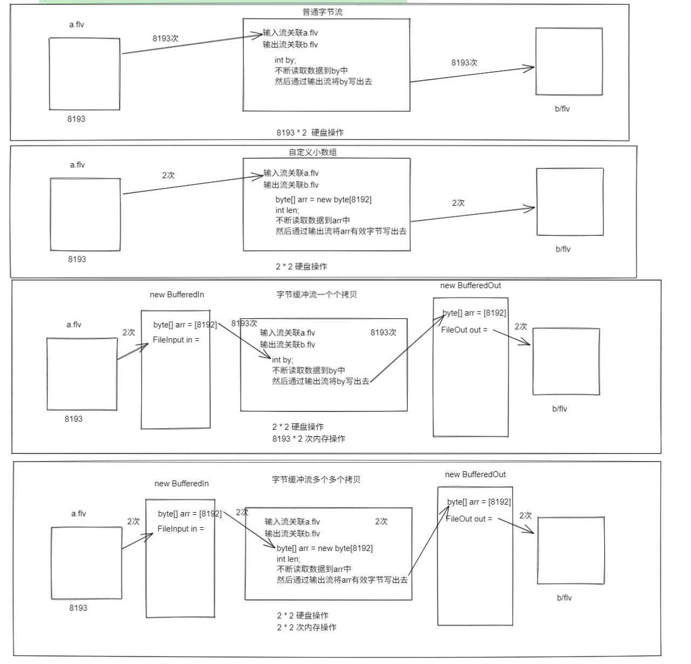
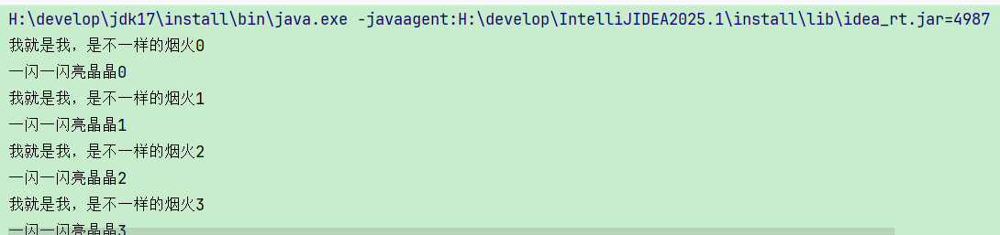
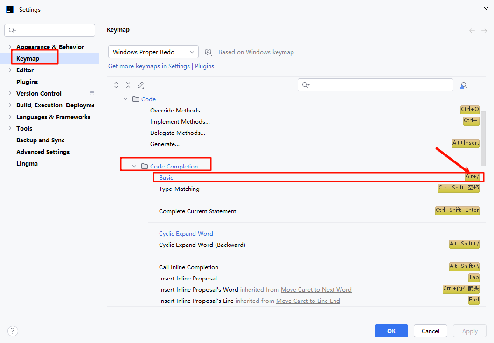

# 06 IO, 线程

## 一 、IO

### 字符流

####  编码表的故事

<callout emoji="⚠️">
*ASCII: 单个字节*  
*GB2312---> GBK: 双字节*  
*unicode(万国码)---> 四个字节编码*  
    *utf-32: 很浪费空间*  
    *utf-16: 很浪费空间*  
    *utf-8: 解决浪费空间*  
*乱码产生的原因:*  
    *编解码参照码表不一致导致乱码问题*  
    *在unicode中, 中文大部分占三个字节*
</callout>

####  **编码和解码**

**将字符串的内容参照码表转成字节的动作叫做编码**

<callout emoji="🧥">
*字符串 ---> 字节数组:* ***编码***  
    ***编码: 将自己能看懂变成看不懂的***  
    *byte[] getBytes(); //采用平台默认码表编码*  
    *byte[] getBytes(String charsetName); //采用平台指定码表编码*
</callout>

**将字节的内容参照码表转成字符串的动作叫做解码**

<callout emoji="🧥">
  
*字节数组 ---> 字符串:* ***解码***  
    ***解码: 将看不懂变成看懂***  
    *String(byte[] arr); //采用默认码表解码*  
    *String(byte[] arr, int start, int len);//采用默认码表解码一部分内容*  
    *String(byte[] arr, int start, int len,String charsetName);//采用指定码表解码一部分内容*
</callout>


####   字符输出流

作用: 将程序中的数据以字符的方式写到磁盘中

构造:

```Java
FileWriter(File file)
创建文件输出流以写入由指定的 File对象表示的文件。

 FileWriter(String name) 推荐!!!!!!!!!
创建文件输出流以指定的名称写入文件。

FileWriter(File file, boolean append)
创建文件输出流以写入由指定的 File对象表示的文件。

FileWriter(String name, boolean append)
创建文件输出流以指定的名称写入文件。
```

功能:

```Java
void write(int by);    写单个字符
void write(char[] arr);    写多个字符
void write(char[] arr, int start, int len); 从start索引开始写, 写len个, 写多个字符的一部分
void write(String str); 写字符串
void write(String str,int start, int len); 写字符串一部分
void flush(); 刷新缓冲区, 将其编码成字节 然后通过底层的字节流写到磁盘
void close(); 关闭资源,在关闭之前会执行一次flush()
flush()和close()区别???
     flush()之后流继续可以使用的
     close() 流就会关闭, 不能在使用
```

演示: 

```Java
private static void demo1() throws IOException {

    /*
        FileWriter(String name)
            创建文件输出流以指定的名称写入文件。
            (1) 创建一个输出流对象
            (2) 如果关联的文件不存在则创建, 但是底层采用的是createNewFile来做的, 所以必须保证文件所在的文件夹存在,否则会报
            java.io.FileNotFoundException: day06_File_Recursion_IO\a\a\a\a.txt (系统找不到指定的路径。)
            (3) 如果文件存在则会清空文件内容
     */
    FileWriter fw = new FileWriter("day07_io_thread/a.txt");
    fw.write('梅');
    char[] arr = {'a', 'b', 'c'}; //char[] arr
    fw.write(arr);
    fw.write(arr, 1, 2);
    fw.write("字符串真好");
    fw.write("字符串真好", 3, 2);
    //fw.flush();
    fw.close();
}
```

续写方式创建字节输出流

```Java
private static void demo2() throws IOException {
    /*
     FileOutputStream(String name, boolean append)
            创建文件输出流以指定的名称写入文件。
            (1) 创建了输出流
            (2)  如果关联的文件不存在则创建, 但是底层采用的是createNewFile来做的, 所以必须保证文件所在的文件夹存在,否则会报
            java.io.FileNotFoundException: day06_File_Recursion_IO\a\a\a\a.txt (系统找不到指定的路径。)
            (3) 如果文件存在, 则续写

     */
    FileWriter fos = new FileWriter ("day06_File_Recursion_IO/a.txt",true);
    fos.write("你好");
    fos.close();
}
```


####  字符输入流

作用: 将磁盘中的数据以字节的方式读到程序中

构造:


```Java
FileReader(String name);
FileReader(File name);

必须保证要读取的文件存在才行, 否则会报java.io.FileNotFoundException: day06_File_Recursion_IO\a\a\a.txt (系统找不到指定的路径。)
```

功能:

```Java
int read(); 第一次读一个字符, 返回读到的字符 ,一般不用,效率很低很低!!!
int read(char[] arr); 一次读多个字符, 返回读取的有效个数
void close(); 关闭资源
```

案例:

```Java
private static void demo3() throws IOException {

    /*
        FileInputStream:
            构造:
                FileReader (String name);
                FileReader (File name);
            必须保证要读取的文件存在才行, 否则会报java.io.FileNotFoundException: day06_File_Recursion_IO\a\a\a.txt (系统找不到指定的路径。)
            功能:
                int read(); 第一次读一个字节, 返回读到的字节 ,一般不用,效率很低很低!!!
                int read(char[] arr); 一次读多个字节, 返回读取的有效个数
                void close(); 关闭资源

     */

    FileReader fr = new FileReader("day07_io_thread/a.txt");

    char[] arr = new char[1024*8];

    int len;
    while ((len = fr.read(arr))!=-1){
        System.out.println(new String(arr,0,len));
    }

    fr.close();

    /*while (true) {
        int ch = fr.read();
        if (ch == -1) {
            break;
        }
        System.out.println((char)ch);
    }*/


}
```


注意:

<callout emoji="⚠️">
***字符串和字符数组的互转:***  
      *字符串转字符数组*  
          *char[] toCharArray();*  
      *字符数组转字符串*  
          *new String(char[] arr);*  
          *new String(char[] arr, int start, int len);*
</callout>

####  字节缓冲流(了解)


核心内容:

```Java
BufferedInputStream
    构造:
        BufferedInputStream(InputStream in);
    功能:
        跟FileInputStream一样
BufferedOutputStream
    构造:
        BufferedOutputStream(OutputStream in);
    功能:
        跟FileOutputStream一样
```

演示1:

```Java
private static void demo8() throws IOException {
    //输入流关联源  alt  + 1 可以展开或者打开左侧侧边栏
    BufferedInputStream bis = new BufferedInputStream(new FileInputStream("C:\\Users\\Lenovo\\Desktop\\颈椎操.flv"));
    //输出流关联目的地
    BufferedOutputStream bos = new BufferedOutputStream(new FileOutputStream("day07_io_thread/b.flv"));
    long start = System.currentTimeMillis();
    int len;
    byte[] arr = new byte[1024 * 8];
    while ((len = bis.read(arr)) != -1) {
        bos.write(arr, 0, len);
    }
    long end = System.currentTimeMillis();
    System.out.println(end - start);
    bis.close();
    bos.close();

}
```

演示2：

```Java
private static void demo01() throws IOException {
    FileWriter f = new FileWriter("/day06/test.txt");
    f.write("aaaaa");
    int[] arr = {1,2,3,4,5};
    f.write(Arrays.toString(arr),0,3);
    f.close();
}
```

不太常用的原因:

 他的出现是为了提高复制文件的效率, 但是没有自定义小数组的快, 原因如下图:


> 图注：图片展示了字符缓冲流中读写文件的流程。上方为读文件流程，先读入文件a.flv，再通过缓冲区写入文件b.flv；中间为写文件流程，先写入文件b.flv，再通过缓冲区读取文件a.flv；下方为读写文件流程，先读入文件a.flv，再通过缓冲区写入文件b.flv。每个流程均标注了读写次数，如读文件流程为2次，写文件流程为2次，读写文件流程为2 * 2次。该图与上下文介绍的字符缓冲流相关，直观呈现了其读写文件的操作步骤。

#### 字符缓冲流(重点!!!)

*作用：*

<callout emoji="🎨">
    *(1)提高读写效率，内置一个缓存数据，但是提高效率我们自定义小数组也很快*  
    *(2)真正的作用提供了一些特有的功能简化读写数据*
</callout>

核心内容:

```Java
输入流：
    BufferedReader
        构造:
            BufferedReader(Reader in);
        功能:
            跟FileReader一样
            String readLine(); //一次读一行, 返回一行数据, 但是不读换行符!!!
        特有功能：
            String readLine();以"行"为单位读取字符内容，不读取换行符
输出流：
    BufferedWriter
        构造:
            BufferedWriter(Writer out);
        功能:
            跟FileWriter一样
            void newLine(); // 根据操作系统写换行符
                window: \r\n
                linux: \n
                mac: \r
```

演示缓冲字符流的使用

```Java
private static void demo02() throws IOException {
    BufferedWriter w = new BufferedWriter(new FileWriter("./a.txt"));
    w.write("独处时我将会无比快乐。");
    w.newLine();
    w.write("拥有自由、书籍、鲜花和月亮的人怎会不快乐？");
    w.newLine();
    w.write(" ---奥斯卡·王尔德-");
    w.newLine();
    w.close();
    BufferedReader r = new BufferedReader(new FileReader("day06/a.txt"));
    String line;
    while ((line = r.readLine())!=null){
        System.out.println(line);
    }
}
```


##### 综合练习

题目: 现在已知一个乱序的出师表的文章, 请利用所学习IO流以及之前的技术, 将正确顺序出师表存入文件

```Java
2.先帝创业未半而中道崩殂，今天下三分，益州疲弊，此诚危急存亡之秋也。然侍卫之臣不懈于内，忠志之士忘身于外者，盖追先帝之殊遇，欲报之于陛下也。诚宜开张圣听，以光先帝遗德，恢弘志士之气，不宜妄自菲薄，引喻失义，以塞忠谏之路也。
1.出师表
3.宫中府中，俱为一体，陟罚臧否，不宜异同。若有作奸犯科及为忠善者，宜付有司论其刑赏，以昭陛下平明之理，不宜偏私，使内外异法也。
5.将军向宠，性行淑均，晓畅军事，试用于昔日，先帝称之曰能，是以众议举宠为督。愚以为营中之事，悉以咨之，必能使行阵和睦，优劣得所。
4.侍中、侍郎郭攸之、费祎、董允等，此皆良实，志虑忠纯，是以先帝简拔以遗陛下。愚以为宫中之事，事无大小，悉以咨之，然后施行，必能裨补阙漏，有所广益。
9.愿陛下托臣以讨贼兴复之效，不效，则治臣之罪，以告先帝之灵。若无兴德之言，则责攸之、祎、允等之慢，以彰其咎；陛下亦宜自谋，以咨诹善道，察纳雅言，深追先帝遗诏。臣不胜受恩感激。
7.臣本布衣，躬耕于南阳，苟全性命于乱世，不求闻达于诸侯。先帝不以臣卑鄙，猥自枉屈，三顾臣于草庐之中，咨臣以当世之事，由是感激，遂许先帝以驱驰。后值倾覆，受任于败军之际，奉命于危难之间，尔来二十有一年矣。
8.先帝知臣谨慎，故临崩寄臣以大事也。受命以来，夙夜忧叹，恐托付不效，以伤先帝之明，故五月渡泸，深入不毛。今南方已定，兵甲已足，当奖率三军，北定中原，庶竭驽钝，攘除奸凶，兴复汉室，还于旧都。此臣所以报先帝而忠陛下之职分也。至于斟酌损益，进尽忠言，则攸之、祎、允之任也。
10.今当远离，临表涕零，不知所言。
6.亲贤臣，远小人，此先汉所以兴隆也；亲小人，远贤臣，此后汉所以倾颓也。先帝在时，每与臣论此事，未尝不叹息痛恨于桓、灵也。侍中、尚书、长史、参军，此悉贞良死节之臣，愿陛下亲之信之，则汉室之隆，可计日而待也。
```

代码:

```TypeScript
private static void demo03() throws IOException {
    BufferedReader r = new BufferedReader(new FileReader("day06/csb.txt"));
    List<String> list = new ArrayList<>();
    String line;
    while ((line = r.readLine())!=null){
        list.add(line);
    }
    r.close();
        list.sort(((o1, o2) -> {
            int number1 = Integer.parseInt(o1.substring(0, o1.indexOf(".")));
            int number2 = Integer.parseInt(o2.substring(0, o2.indexOf(".")));
            return Integer.compare(number1,number2);
        }));
    for (String s : list) {
        System.out.println(s);
    }
    BufferedWriter w = new BufferedWriter(new FileWriter("day06/csb.txt"));
    String line1;
    for (String s : list) {
        w.write(s);
        w.newLine();
    }
    w.close();
}
```


## 二、线程


### 2.1  概念

**什么是线程? 什么是进程?**

<callout emoji="🌷">
**线程**: 是进程中一条执行路径,一个执行单元
**进程**: 程序运行之后, 操作系统会为程序分配独立的内存空间, 这个独立的内存空间就是就是进程, 每一个进程都自己的编号, 我们称为进程ID,也叫做PID, 可以通过任务管理结束进程, 其实结束进程就是释放了为该程序分配的内存空间
</callout>


**什么是并发? 什么是并行?**

<callout emoji="🌷">
**并发**: 单位时间片"交替"执行
**并行**: 单位时间片"同时"执行
</callout>


**为啥要学习线程???(也就是线程的作用)**

<callout emoji="🌷">
(1) 可以让用户肉眼看到程序"同时"执行多个任务, java程序基于并发执行!!!
(2) 我们所有的代码都是被**线程**在执行!!!
</callout>

### **2.2 线程创建**

**第一种:** 

<callout emoji="⚠️">
步骤:

1. 定义一个类继承Thread
2. 重写run方法
3. 将要执行代码放到run方法中
4. 创建Thread的子类对象
5. 调用start方法开启线程
</callout>

第一种代码演示：

```Java
public class MyThread extends Thread{
    @Override
    public void run() {
        for (int i = 0; i < 100; i++) {
            System.out.println("一闪一闪亮晶晶");
        }
    }
}


private static void demo01() {
    //第一种
    //1.创建Thread的子类
    MyThread myThread = new MyThread();
    //2.启动线程
    myThread.start();
}
```

***第二种：***

<callout emoji="⚽">
    *步骤：*  
        *(1) 定义一个类实现RunnabLe接口*  
        *(2) 重写run方法*  
        *(3) 将执行的任务代码放入到run方法中*  
        *(4) 创建实现类对象*  
        *(5) 创建Thread的对象，将runnable实现类传入*  
        *(6) 调用thread的start方法开启线程*
</callout>

第二种代码演示：

```Java
public class MyThread extends Thread{
    @Override
    public void run() {
        for (int i = 0; i < 100; i++) {
            System.out.println("一闪一闪亮晶晶" + i);
        }
    }
}

public class MyRunnable implements Runnable {
    @Override
    public void run() {
        for (int i = 0; i < 100; i++) {
            System.out.println("我就是我，是不一样的烟火" + i);
        }
    }
}
    private static void demo01() {
        //第一种
        //1.创建Thread的子类
        MyThread myThread = new MyThread();
        //2.启动线程
        myThread.start();

        //第二种：
        //1.创建Runnable的实现类对象
        MyRunnable myRunnable = new MyRunnable();
        //2.创建Thread对象将任务传递进去
        Thread thread = new Thread(myRunnable);
        thread.start();
    }
}
```

运行后打印重叠，出现并发现象：


> 图注：这是线程运行后的输出结果，呈现出明显的并发执行的特征。图中输出的内容包含两组交替的字符串，一组是“我就是我，是不一样的烟火”搭配从0到3的数字序号，另一组是“一闪一闪亮晶晶”搭配对应的数字序号，两组内容交错打印，顺序无规律，直观印证了文档中提到的“运行后打印重叠，出现并发现象”，体现了多线程执行时任务交替推进的效果。

###   2.3 线程的方法

```Java
void start() 开启线程
String getName()   获取线程的名字
void setName(String name)  设置线程的名字
static void sleep(long millis)  让当前线程处于睡眠状态, 参数接受的毫秒为单位
static Thread currentThread() 可以动态获取当前正在执行代码的线程对象
void join() 加入到另外一个线程的线程栈中运行  
```

方法：

```TypeScript
    /*
        static Thread currentThread()
        第一种创建线程和第二种创建线程的对比:
            (1) 第一种
                优点: 由于是Thread的直接子类, 可以直接使用Thread中的功能
                缺点: 线程和任务绑定比较紧密,耦合度高, 如果一个类已经继承其他类不能再继承Thead类
            (2) 第二种(推荐!!!, 推荐你使用线程池)
                优点: 线程和任务是分离, 解耦合, 而且不会有单继承的问题
                缺点: 由于不是Thread的直接子类, 所以不能直接使用Thread功能, 但是可以间接使用Thread.currentThread()拿到线程对象使用线程的功能
     */
    private static void demo3() {

        new Thread(){
            @Override
            public void run() {
                for (int i = 0; i < 10; i++) {
                    System.out.println(getName()+":打印"+i);
                }
            }
        }.start();

        new Thread(new Runnable() {
            @Override
            public void run() {
                for (int i = 0; i < 10; i++) {
                    System.out.println(Thread.currentThread().getName()+":打印"+i);
                }
            }
        }).start();
    }

```


### 2.4 多线程操作共享数据的安全问题

多线程操作共享数据为啥会出现线程安全???

<callout emoji="🌷">
因为一条线程在对数据操作的期间, 可能会被其他线程抢夺cpu的执行权, 对数据进行再次操作, 导致安全问题
</callout>

例如有线程安全问题的卖票案例:

```Java
public class SellTicket implements Runnable{
    // 总票数，初始为1000张
    private int ticket = 1000;
    
    @Override
    public void run() {
        // 无限循环售票
        while (true){
            // 使用this对象作为锁，保证线程安全
            synchronized (this) {
                // 检查是否还有余票
                if (ticket <= 0) {
                    // 无票则退出循环
                    break;
                }
                try {
                    // 模拟售票耗时操作
                    Thread.sleep(100);
                } catch (InterruptedException e) {
                    // 处理睡眠中断异常
                    throw new RuntimeException(e);
                }
                // 售出一张票，票数减1
                ticket--;
                // 打印售票信息：线程名称 + 售票详情 + 剩余票数
                System.out.println(Thread.currentThread().getName() + "卖了一张票" + "还剩余" + ticket + "张");
            }
        }
    }
}
```

```TypeScript
public class Test {
    public static void main(String[] args) {
        // 创建售票任务对象，作为共享资源
        SellTicket sellTicket = new SellTicket();

        // 创建并启动抖音售票线程，传入售票任务和线程名称
        new Thread(sellTicket,"抖音").start();

        // 创建并启动美团售票线程，传入相同的售票任务和线程名称
        new Thread(sellTicket,"美团").start();

        // 创建并启动猫眼售票线程，传入相同的售票任务和线程名称
        new Thread(sellTicket,"猫眼").start();
    }
}
```

如何解决多线程操作共享数据的安全问题???

**第一种: 同步代码块**

格式:

```Java
synchronized(锁){
    需要被同步的代码
}
```

<callout emoji="🌷">
作用: 
同*步代码块中的代码只允许被一条线程执行，即该空间中的操作就只能有一条线程，除非执行完后，其他才有机会*
*执行流程:* 
*一旦线程进入,锁就会处于关闭状态, 其他线程则进不来, 只有当进入代码块的线程执行完任务, 锁才会被打开, 其他线程才有机会执行*
注意事项: 
*锁对象可以是任意对象, 但是必须保证锁的"****唯一****"才行*
</callout>


**第二种:同步方法(了解!!!)**

格式:

<callout emoji="🌷">
修饰符 synchronized 返回值类型 方法名(参数列表){

方法体;

return 返回值;
}
</callout>

缺点:

<callout emoji="🌷">
(1) 一旦加锁就锁住了整个方法, 不能锁住部分代码
(2) 锁对象是写死的, 用户不能自定义, 不能锁住不同空间的代码

普通成员方法的锁对象是this

静态的成员方法锁对象是该类字节码对象
</callout>

那些被淘汰的类:

<callout emoji="🌷">
Vector(ArrayList),Hashtable(HashMap)：
Vector: *他是ArrayList的前身, ArrayList是jdk1.2才出来的*
Hashtable: *他是HashMap的前身, HashMap也是1.2才出来的*

他们虽然是线程安全, 但是效率比较低

Hashtable和HashMap的区别???

*Hashtable是线程安全的, HashMap线程不安全的*  
*Hashtable不能存储null键和null值,但是HashMap可以存储null键和null值*
</callout>

多线程环境使用安全的集合怎么办???

<callout emoji="🌷">
**我们依然采用不安全的集合，但是可以使用Collections.synchronizedXxx(不安全的集合)** 方法，得到安全的集合, 但是底层还是在用老集合对象操作, 不过在外面加了同步代码块
</callout>


**第三种: JDK5出现的Lock锁机制(了解!!!)**

目的: 之前的锁对象用户不能看不到关锁和开锁的动作

使用步骤:

<callout emoji="🌷">
1. 会创建Lock锁的实现类对象
*Lock lock = new ReentrantLock();*
1. 会使用锁对象的关锁和开锁的方法
void lock()
void unlock();
</callout>

*缺点:*

<callout emoji="🌅">
（1）必须自己维护锁对象
（2）必须手动开锁和关锁
（3）还必须将开锁的代码放到finalLy保证其一定执行才行
</callout>

<callout emoji="🌷">
*必须自己维护锁, 不能用现成的锁, 必须保证锁的唯一性*  
*锁的释放必须放到finally中保证释放锁的动作一定会走!!!否则一旦出了异常锁就会处于永远锁住的状态*
</callout>


### 2.5 线程池

作用:

<callout emoji="🌷">
 解决线程频繁创建和销毁问题, 提高线程的利用率, 开辟线程是非常耗费系统资源以及费时间的操作
</callout>

线程池的创建:

工具类创建:(了解)

<callout emoji="🌷">
*Executors工具类*  
    *static ExecutorService newCachedThreadPool()*  
        *缺点:*  
            *① 没有上限 ,导致内存溢出的问题, 没有核心线程, 全部临时线程, 用完60秒后销毁, 线程的复用性很差*  
    *static ExecutorService newFixedThreadPool(int nThreads)*  
        *缺点:*  
            *① 只有规定核心线程数量, 其他的临时线程存活的时间是0秒, 一旦用完立即销毁, 只有这个核心的线程的能够被复用!!!*
static ExecutorService Executors.newFixedThreadPoodl (int poreSize);

缺点：

创建一个固定长度的线程池，不能继续扩容
</callout>

**自己创建: (掌握)**

```Java
ThreadPoolExecutor(
    int corePoolSize,   //规定核心线程数量, 不管线程忙于闲一直存在
    int maximumPoolSize, // 线程池中线程的最大数量, 临时线程:扩容的线程
    long keepAliveTime, // 临时线程空闲存活的时间
    TimeUnit unit, // 存活的时间单位
    BlockingQueue<Runnable> workQueue,//阻塞队列, 用来存储多余的任务
    ThreadFactory threadFactory, //创建线程的工厂
    RejectedExecutionHandler handler //拒绝策略
)
```

案例:

```Java
public class Test {
    public static void main(String[] args) {
        ThreadPoolExecutor tpe = new ThreadPoolExecutor(
                3,//核心线程数量
                3,//大线程数量
                20,//临时线程存活的时间
                TimeUnit.SECONDS,//线程存活的时间单位
                new LinkedBlockingQueue<>(2),//任务队列
                Executors.defaultThreadFactory(),//创建线程的工厂
                new ThreadPoolExecutor.CallerRunsPolicy()//拒绝策略
        );
        tpe.submit(copyTask("day06/test/a.txt", "day06/src/cn/itcast/homework/demo06/a.txt"));
        tpe.submit(copyTask("day06/test/b.txt", "day06/src/cn/itcast/homework/demo06/b.txt"));
        tpe.submit(copyTask("day06/test/c.txt", "day06/src/cn/itcast/homework/demo06/c.txt"));

        tpe.shutdown();
    }
        private static Runnable copyTask(String src, String dest){
            return () -> {
                File sourceFile = new File(src);
                long total = sourceFile.length(); // 文件总字节数
                long copied = 0;
                NumberFormat percentFormat = NumberFormat.getPercentInstance();
                percentFormat.setMinimumFractionDigits(2);
                // 缓冲区
                byte[] buffer = new byte[1];

                try (InputStream in = new FileInputStream(sourceFile);
                     OutputStream out = new FileOutputStream(dest)) {

                    int len;
                    while ((len = in.read(buffer)) != -1) {
                        out.write(buffer, 0, len);
                        copied += len;

                        double ratio = total == 0 ? 1.0 : (copied * 1.0 / total);
                        System.out.println(Thread.currentThread().getName()
                                + " 复制 " + sourceFile.getName() + " ：" + percentFormat.format(ratio));

                        // 进度条效果
                         Thread.sleep(100);
                    }
                } catch (Exception e) {
                    throw new RuntimeException("复制失败: " + src + " -> " + dest, e);
                }
            };
        }
    }
```

线程池常见的问题:

```Java
什么时候会扩容临时线程???
    当核心线程都在工作, 并且队列已满, 才会触发扩容临时线程的机制
验证临时线程销毁时间???
    验证成功
什么时候触发拒绝策略???
    当核心线程以及临时线程以及队列都满的时候会触发拒绝策略???
    策略有几种???
        new ThreadPoolExecutor.AbortPolicy() 直接拒绝并报异常
        new ThreadPoolExecutor.DiscardPolicy() 直接拒绝不报异常,静默处理
        new ThreadPoolExecutor.DiscardOldestPolicy() 直接拒绝队列中等待最久的任务, 加入新任务,不抛异常
        new ThreadPoolExecutor.CallerRunsPolicy() 不拒绝, 自己处理不了, 让主线程处理!!!
```

### 2.6 线程的状态


<callout emoji="🌷">
*NEW(新建)*  
    *当线程创建出来, 但是未调用start的状态*  
*RUNNABLE(可运行)*  
    *调用start方法, 具备被cpu执行的状态*  
*BLOCKED(阻塞)*  
    *cpu正在执行当前线程, 但是遇到锁对象进不去执行不了的状态!!!*  
*WAITING(无限等待)*  
    *无线等待, 线程遇到锁对象的wait方法, 线程处于无限等待, 必须通过锁的notify()或者notifyAll()唤醒才行,唤醒后处于RUNNABLE状态*  
*TIMED_WAITING(计时等待)*  
    *计时等待, 线程遇到sleep(long time); wait(long time), 到时间后线程会自动转成RUNNABLE状态*  
*TERMINATED*  
    *线程终结状态, 终止状态*
</callout>


### ide代码提示快捷方法修改

进入设置如下图修改：


> 图注：图片展示了IntelliJ IDEA中Keymap设置界面。左侧导航栏选中“Keymap”。右侧Keymap设置区域，搜索框内显示“Code Completion”。下方“Code Completion”选项下，有“Basic”选项，其右侧有“Alt+Enter”快捷键标识。该图片与文档中“ide代码提示快捷方法修改”内容相关，直观呈现了在IntelliJ IDEA中修改代码提示快捷键的操作界面及“Alt+Enter”快捷键位置。


线程状态

---
> 来源：飞书技术知识库（脱敏版） · 01 Java 语言核心 / Stream、IO 与多线程 / 06 IO, 线程 · [原文](https://ccn8v2zngwsm.feishu.cn/wiki/CZWmwHFisiKQWtkVS1WcOAUPnQf)
