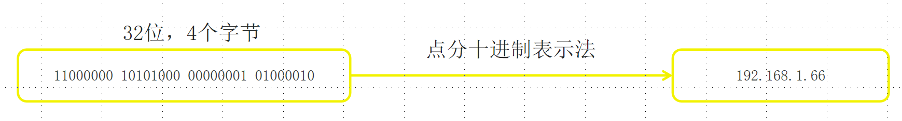
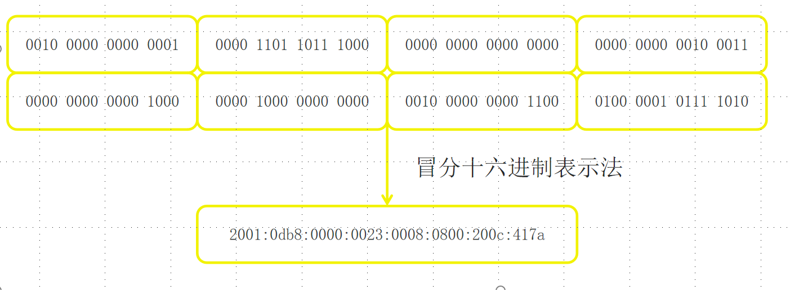
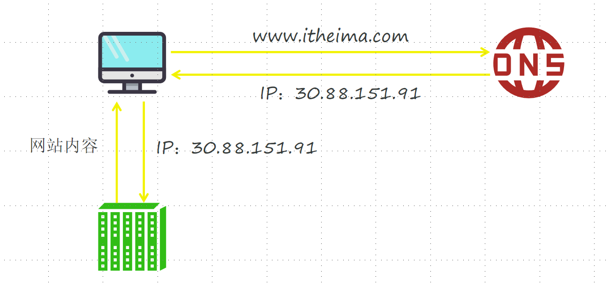
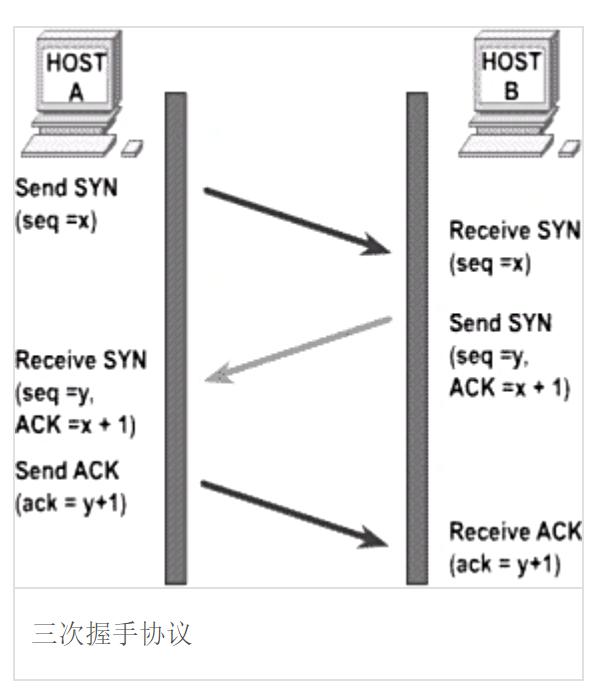
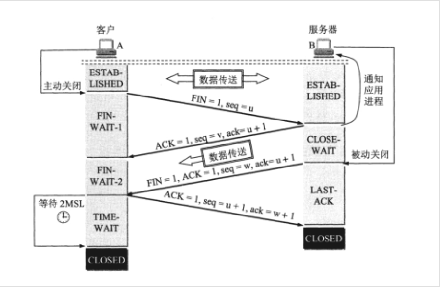

# 06 网络编程

## Java解决精准小数和超大值方法

```Java
BigDecimal :
    1.金融行业或者对小数精准要求高的场景，
    2.还可以解决过大整数的问题
得到对象：
    BigDecimaL（doublevaL）//不建议使用，因为还是走小数的计算逻辑，约等于！！！
    BigDecimaL（StringvaL）//推荐使用I
    BigDecimal static BigDecimaL（double vaL);//最推荐使用的
功能：
    BigDecimal add(BigDecimal val);
    BigDecimal subtract(BigDecimal val);
    BigDecimal multiply(BigDecimal val);
    BigDecimal divide(BigDecimal val);
    BigDecimal divide(BigDecimal val, int scale, int roundingMode);
    BigDecimal divide(BigDecimal val, int scale, RoundingMode roundingMode)
```

演示：

```Java
import java.math.BigDecimal;
import java.math.RoundingMode;

public class BigDecimalTest {

    public static void main(String[] args) {

        /**
         * 【一】BigDecimal 创建方式
         * 1. new BigDecimal(double) —— 不推荐，因为 double 本身不精确
         * 2. new BigDecimal(String) —— 推荐
         * 3. BigDecimal.valueOf(double) —— 最推荐（内部会规避 double 精度问题）
         */

        // 不推荐：double 构造，会引发精度问题
        BigDecimal bd1 = new BigDecimal(0.1);
        System.out.println("bd1(不推荐): " + bd1); // 可能输出 0.10000000000000000555

        // 推荐：使用字符串构造
        BigDecimal bd2 = new BigDecimal("0.1");
        System.out.println("bd2(推荐): " + bd2); // 输出 0.1

        // 最推荐：valueOf
        BigDecimal bd3 = BigDecimal.valueOf(0.1);
        System.out.println("bd3(最推荐): " + bd3); // 输出 0.1


        /**
         * 【二】常用方法：加 add、减 subtract、乘 multiply、除 divide
         */
        BigDecimal a = new BigDecimal("10.5");
        BigDecimal b = new BigDecimal("2.3");

        // 加法
        BigDecimal addResult = a.add(b);
        System.out.println("加法结果: " + addResult); // 12.8

        // 减法
        BigDecimal subResult = a.subtract(b);
        System.out.println("减法结果: " + subResult); // 8.2

        // 乘法
        BigDecimal mulResult = a.multiply(b);
        System.out.println("乘法结果: " + mulResult); // 24.15

        /**
         * divide 默认要求“能整除”，不能整除会报 ArithmeticException
         * 解决：指定 scale（小数位数） + 舍入模式
         */
        // 保留 2 位小数，使用四舍五入
        BigDecimal divResult = a.divide(b, 2, RoundingMode.HALF_UP);
        System.out.println("除法结果(四舍五入，2位小数): " + divResult);


        /**
         * 【三】超大整数处理
         * BigDecimal 可处理超出 long 范围的数
         */
        BigDecimal bigInt1 = new BigDecimal("9999999999999999999999999999");
        BigDecimal bigInt2 = new BigDecimal("8888888888888888888888888888");

        BigDecimal bigAdd = bigInt1.add(bigInt2);
        System.out.println("超大整数相加: " + bigAdd);


        /**
         * 【四】设置精度（scale）与舍入策略
         */
        BigDecimal number = new BigDecimal("3.1415926");

        BigDecimal scaled = number.setScale(3, RoundingMode.HALF_UP);
        System.out.println("保留3位小数(四舍五入): " + scaled); // 3.142

        BigDecimal scaledDown = number.setScale(3, RoundingMode.DOWN);
        System.out.println("保留3位小数(直接截断): " + scaledDown); // 3.141


        /**
         * 【五】推荐写法总结
         *
         * BigDecimal.valueOf(xx)  —— 精度安全
         * new BigDecimal("xx") —— 字符串构造最稳定
         * 避免 new BigDecimal(double)
         */
    }
}

```


## 一 、网络编程

概述:

<callout emoji="🌷">
网络编程主要是实现设备和设备之间在网络中数据的**收发**
</callout>

### 1.1 网络编程的三要素

#### 1.1.1 IP (Internet Protocol)

<callout emoji="🌷">
全称”**互联网协议地址**”，是分配给上网**设备的唯一标识**。
目前，被广泛采用的IP地址形式有两种：IPv4、IPv6。    
</callout>

**IPv4:** (Internet Protocol version 4)

采用的32位二进制进行编码, 我们采用"点分十进制" 描述IPv4

如图:



**IPv6:** (Internet Protocol version 6)

它使用128位地址，号称可以为地球上的每一粒沙子编号。

IPv6分成8段，每段每四位编码成一个十六进制位表示， 每段之间用冒号（:）分开，将这种方式称为**冒分十六进制**


如图:




**IP域名**（Domain Name）

是互联网中用于将域名转换为对应IP地址的分布式命名系统。它充当了互联网的“电话簿”，将易记的域名映射到数字化的IP地址，使得用户可以通过域名来访问网站和其他网络资源。

如图转换:



**公网IP & 内网IP**

公网IP也叫做原始IP, 也叫做固定IP , 可以在互联网上直接传输数据的网络地址

内网IP,又叫做局域网IP, 是局域网络分配的IP, 一般是以192.168开头的IP的IP


**本机IP如何描述?**

127.0.0.1、localhost：代表本机IP，只会寻找当前程序所在的主机


**IP常用命令 ?**

ipconfig：查看本机IP地址。

ping IP地址：检查网络是否连通。


**IP对象** 

InetAddress是专门封装IP地址的对象

如何将点分十进制的ip地址转成IP对象???

```Java
public static void main(String[] args) throws UnknownHostException {
    //1.将点分十进制的ip转成ip对象
    InetAddress byName = InetAddress.getByName("192.168.13.254");

    System.out.println(byName.getHostName());
    System.out.println(byName.getHostAddress());

}
```

#### 1.1.2 端口 (port)

用来标记正在计算机设备上运行的应用程序，被规定为一个 16 位的二进制，范围是 0\~65535。

可以简单理解是程序在设备中的编号


分类:

<callout emoji="🌷">
周知端口：0\~1023，被预先定义的知名应用占用（如：HTTP占用 80，FTP占用21） 
注册端口：1024\~49151，分配给用户进程或某些应用程序。
动态端口：49152到65535，之所以称为动态端口，是因为它一般不固定分配某种进程，而是动态分配。
</callout>

注意：

<callout emoji="🌷">
我们自己开发的程序一般选择使用注册端口，且一个设备中不能出现两个程序的端口号一样，否则报错
</callout>

#### 1.1.3 协议(protocol)

网络上通信的设备，事先规定的连接规则，以及传输数据的规则被称为网络通信协议

协议主要的目的是为了让全球所有上网设备都能互联互通，而指定的统一标准


**开放式网络互联标准：OSI网络参考模型**

<sheet sheet-id="hQ34cV" token="WkZnszpYWhTUfDtKW4RcMrkFnt6"></sheet>

其中传输层是我们传输的基本准则是UDP和TCP


UDP(User Datagram Protocol)：用户数据报协议。

<callout emoji="🌷">
面向无连接、不可靠通信。
不事先建立连接，数据按照包发，一包数据包含：自己的IP、端口、目的地IP、端口和数据（限制在64KB内）等。
发送方不管对方是否在线，数据在中间丢失也不管，如果接收方收到数据也不返回确认，故是不可靠的 。
</callout>

TCP协议(Transmission Control Protocol) ：传输控制协议

<callout emoji="🌷">
面向连接、可靠通信。
TCP的最终目的：要保证在不可靠的信道上实现可靠的数据传输。
TCP主要有三个步骤实现可靠传输：三次握手建立连接，传输数据进行确认，四次挥手断开连接。
</callout>

**三次握手: 主要的目的是确保通信的双方收发消息都是没问题的（全双工）**

*口语版:*

<callout emoji="🌷">
*第一次: 客户端发送一个询问消息,  哥我发的消息你能看到吗???*  
*第二次: 服务端, 收到消息, 告知客户端收到了,然后发送一个询问消息,问老弟你能收到吗?*  
*第三次: 客户端发送收到*
</callout>

*专业版:*

<callout emoji="🌷">
*第一次:客户端发送syn包, 询问服务器, 并且自己处于 syn_send状态*  
*第二次:服务器收到syn包,并且发送ack包,  并且需要发送syn询问, 自己处于syn_receive状态*  
*第三次: 客户端收到服务的syn+ack包, 发送ack确认收到进行连接*
</callout>



**四次挥手: 确保通信的双方收发消息都已经完成,处理完毕在断开**

口语版:

<callout emoji="🌷">
*第一次: 客户端发送结束标记给服务器, 哥我该说的话说完了*  
*第二次: 服务器收到消息, 告知客户端收到, 但是你需要等一会我还没处理完*  
*第三次: 服务器处理完毕, 发送断开请求, 我处理完了, 你可以断开了*  
*第四次: 客户端收到断开消息的指示, 断开链接*
</callout>

专业版:

<callout emoji="🌷">
*(1) 客户端发送fin给服务器, 自己处于fin_wait1状态*  
*(2) 服务器发送ack确认, 将客户端的fin_wait1的状态转为fin_wait2状态*  
*(3) 服务器发送fin给客户端, 自己处于LAST_ACK状态*  
*(4) 客户端收到fin, 发送ack确定断开*
</callout>

如图:




### 1.2 UDP

DatagramSocket 是封装UDP协议 + 端口 + IP基于udp传输协议的类

构造:

```Java
DatagramSocket();  创建UDP,使用随机端口
DatagramSocket(int port); 创建UDP,使用指定端口
```

方法:

```Java
void  send(DatagramPacket dp);  发送数据包
void reveice(DatagramPacket dp); 接受数据包
void close();
```

DatagramPacket  是封装数据包的类

构造

```Java

封装了数据, 数据的有效长度, 发送的ip地址, 发送的端口信息,用于发送
DatagramPacket(byte[] data, int length, InetAddress address, int port); 

封装了数据, 数据的有效长度, 用于接受数据
DatagramPacket(byte[] data, int length); 
```

#### 案例1: 一发一收

```Java
public class Receiver {
    public static void main(String[] args) throws Exception {
        //1.创建UDP的socket对象
        DatagramSocket ds = new DatagramSocket(10086);
        //2.接受消息
        DatagramPacket dp = new DatagramPacket(new byte[1024],1024);
        //阻寨方法，没有数据就会一直等
        System.out.println("我准备接受数据");
        ds.receive(dp);
        System.out.println("接受到数据了");
        //3.拆包
        byte[] data = dp.getData();
        int length = dp.getLength();
        //4.解码
        System.out.println(new String(data,0,length));
        //5.关闭资源
        ds.close();
    }
}
```

```Java
public class Sender {
    public static void main(String[] args) throws Exception {
        //1.创建UDP的socket对象
        DatagramSocket ds = new DatagramSocket();
        String data = "hello udp 小美君";
        byte[] arr = data.getBytes();
        DatagramPacket dp = new DatagramPacket(arr,arr.length, InetAddress.getByName("127.0.0.1"),10086);
        //2.发送数据
        ds.send(dp);
        //3.关闭释放资源
        ds.close();
    }
}
```

#### 案例2: 多发多收 

```Java
import java.io.IOException;
import java.net.*;
import java.util.Scanner;
//发送端
public class Sender {

    public static void main(String[] args) throws IOException {
        //1.创建UDPSocket发送消息
        DatagramSocket ds = new DatagramSocket();
        //2.希望用户输入什么发送什么,而且不断的发送
        Scanner sc = new Scanner(System.in);
        while (true) {
            String s = sc.next();
            //将接受的数据转成字节
            byte[] bytes = s.getBytes();
            ds.send(new DatagramPacket(bytes, bytes.length, InetAddress.getByName("127.0.0.1"),10086));
        }
    }
}
```

```Java
import java.io.IOException;
import java.net.DatagramPacket;
import java.net.DatagramSocket;
import java.net.SocketException;
//接受端
public class Receiver {

    public static void main(String[] args) throws IOException {
        DatagramSocket ds = new DatagramSocket(10086);

        DatagramPacket dp = new DatagramPacket(new byte[1024],1024);
        //不断的接受
        while (true){
            ds.receive(dp);
            //解包
            byte[] data = dp.getData();
            int length = dp.getLength();
            System.out.println(new String(data,0,length));

        }

    }
}
```

#### 案例3: 同时收发

```Java
package cn.itcast.udp.demo02;

import java.io.IOException;
import java.net.DatagramPacket;
import java.net.DatagramSocket;
import java.net.InetAddress;
import java.util.Scanner;

public class Test {
    public static void main(String[] args) throws Exception {

        // 创建 DatagramSocket，绑定本机端口 10086
        // 此程序用于接收来自 Test1 发送的数据，同时也可以发送数据
        DatagramSocket ds = new DatagramSocket(10086);

        // ==========================================================
        // 线程1：发送数据（从键盘输入读内容，然后发到 127.0.0.1:10010）
        // ==========================================================
        new Thread(new Runnable() {
            @Override
            public void run() {
                Scanner sc = new Scanner(System.in); // 键盘输入读取工具

                while (true) {
                    try {
                        // 从键盘读取一个字符串，遇到空白符结束
                        String data = sc.next();

                        // 将字符串转换成字节数组，用于 UDP 发送
                        byte[] arr = data.getBytes();

                        // 创建 UDP 数据包：
                        // arr: 发送的数据
                        // arr.length: 数据长度
                        // 127.0.0.1: 本机
                        // 10010: 目标端口号（即 Test1 的接收端口）
                        DatagramPacket dp = new DatagramPacket(
                            arr,
                            arr.length,
                            InetAddress.getByName("127.0.0.1"),
                            10010
                        );

                        // 使用 DatagramSocket 发送数据包
                        ds.send(dp);

                    } catch (IOException e) {
                        // 出现异常时，包装为 RuntimeException 抛出
                        throw new RuntimeException(e);
                    }
                }
            }
        }).start();

        // ==========================================================
        // 线程2：接收数据（监听本机 10086 端口的 UDP 数据）
        // ==========================================================
        new Thread(new Runnable() {
            @Override
            public void run() {

                // 创建一个用于接收数据的缓冲区
                byte[] arr = new byte[1024];

                // 创建接收数据包对象，UDP 数据到来后会写入 arr
                DatagramPacket dp = new DatagramPacket(arr, arr.length);

                while (true) {
                    try {
                        // 阻塞等待接收数据（直到有数据到来）
                        ds.receive(dp);

                        // 获取有效的数据部分
                        byte[] data = dp.getData();
                        int length = dp.getLength();

                        // 将字节数组转换成字符串并打印
                        System.out.println(new String(data, 0, length));

                    } catch (IOException e) {
                        throw new RuntimeException(e);
                    }
                }
            }
        }).start();
    }
}

```

```Java
package cn.itcast.udp.demo02;

import java.io.IOException;
import java.net.DatagramPacket;
import java.net.DatagramSocket;
import java.net.InetAddress;
import java.util.Scanner;

public class Test1 {
    public static void main(String[] args) throws Exception {

        // 创建 DatagramSocket，指定本机接收端口为 10010
        // 本程序既能发送数据，又能接收数据
        DatagramSocket ds = new DatagramSocket(10010);

        // -------------------------
        // 线程1：负责发送消息
        // -------------------------
        new Thread(new Runnable() {
            @Override
            public void run() {
                Scanner sc = new Scanner(System.in); // 用于读取键盘输入
                while (true) {
                    try {
                        // 从控制台读取要发送的内容（遇到空白分隔符结束）
                        String data = sc.next();
                        byte[] arr = data.getBytes(); // 将字符串转为字节数组

                        // 构造数据包：内容、长度、目标IP、目标端口
                        DatagramPacket dp = new DatagramPacket(
                                arr,
                                arr.length,
                                InetAddress.getByName("127.0.0.1"), // 目标地址为本机
                                10086                                  // 目标 UDP 端口
                        );

                        // 通过 DatagramSocket 发送数据
                        ds.send(dp);
                    } catch (IOException e) {
                        throw new RuntimeException(e);
                    }
                }
            }
        }).start();

        // -------------------------
        // 线程2：负责接收消息
        // -------------------------
        new Thread(new Runnable() {
            @Override
            public void run() {
                // 定义一个用于接收数据的字节数组
                byte[] arr = new byte[1024];
                DatagramPacket dp = new DatagramPacket(arr, arr.length); // 接收包

                while (true) {
                    try {
                        // 阻塞等待接收数据
                        ds.receive(dp);

                        // 获得接收到的数据内容和长度
                        byte[] data = dp.getData();
                        int length = dp.getLength();

                        // 输出接收到的字符串
                        System.out.println(new String(data, 0, length));
                    } catch (IOException e) {
                        throw new RuntimeException(e);
                    }
                }
            }
        }).start();
    }
}

```

### 1.3 TCP

服务器端: ServerSocket

构造:

```Java
ServerSocket(int port) 创建服务器端Socket,监听指定端口
```

方法:

```Java
Socket accept() 接受客户端连接, 并且创建Socket于客户端socket进行对话, 该方法是一个阻塞方法,客户端不连接则死等

```

客户端: Socket

构造:

```Java
Socket(String host, int port) 创建客户端, 链接ip为host, 端口为port的服务器
```

方法:

```Java
OutputStream getOutputStream() 写数据给服务器
InputStream getInputStream()   输入流读取服务器的数据
```

#### **案例1:  tcp实现一发一收**

```Java
import java.io.InputStream;
import java.io.OutputStream;
import java.net.ServerSocket;
import java.net.Socket;

public class Server {
    public static void main(String[] args) throws Exception {

        // 1. 创建服务器端 ServerSocket，监听 10086 端口
        ServerSocket ss = new ServerSocket(10086);
        System.out.println("服务器已启动，等待客户端连接...");

        // 2. accept() 等待客户端连接（阻塞方法，没有客户端就一直卡住）
        Socket socket = ss.accept();
        System.out.println("客户端已连接！");

        // 3. 获取输入流，读取客户端发来的消息
        InputStream in = socket.getInputStream();
        byte[] buffer = new byte[1024];
        int len = in.read(buffer); // 读取数据（阻塞）
        String msg = new String(buffer, 0, len);
        System.out.println("收到客户端消息：" + msg);

        // 4. 获取输出流，发送消息给客户端
        OutputStream out = socket.getOutputStream();
        out.write("服务器已收到消息！".getBytes());

        // 5. 关闭资源（实际开发中一般不关闭，为简化演示）
        socket.close();
        ss.close();
    }
}

```

```Java
import java.io.InputStream;
import java.io.OutputStream;
import java.net.Socket;

public class Client {
    public static void main(String[] args) throws Exception {

        // 1. 创建 Socket，连接服务器 127.0.0.1:10086
        Socket socket = new Socket("127.0.0.1", 10086);
        System.out.println("已连接服务器！");

        // 2. 获取输出流，发送数据给服务器
        OutputStream out = socket.getOutputStream();
        out.write("你好服务器，我是客户端".getBytes());

        // 3. 获取输入流，接收服务器返回的数据
        InputStream in = socket.getInputStream();
        byte[] buffer = new byte[1024];
        int len = in.read(buffer); // 阻塞等待服务器回复
        String msg = new String(buffer, 0, len);
        System.out.println("服务器回复：" + msg);

        // 4. 关闭 Socket
        socket.close();
    }
}

```

#### **数据流的介绍:**

作用: 可以在读写数据的时候,以自己的分隔符的方式将数据分离, 不会出现两帧数据混在一起的情况

数据输出流:

构造:

```Java
DataOutputStream(OutputStream in);
```

特有方法:

```Java
void writeXxx(Xxx xx); 直接写出指定类型的数据, 并且写出分隔符

其中写字符串的是:
void writeUTF(String str)
```

例如:

```Java
import java.io.DataOutputStream;
import java.io.FileOutputStream;
import java.io.IOException;

public class DataOutputDemo {
    public static void main(String[] args) throws IOException {

        // 创建 DataOutputStream，包装文件输出流
        DataOutputStream out = new DataOutputStream(new FileOutputStream("data.dat"));

        // 写入各种类型的数据，DataOutputStream 会自动加分隔符（格式）
        out.writeInt(123);           // 写一个整数
        out.writeDouble(3.14);       // 写一个小数
        out.writeBoolean(true);      // 写一个布尔值
        out.writeUTF("你好世界");     // 写 UTF 字符串（重点）
        // 关闭流
        out.close();
        System.out.println("数据写入完成！");
    }
}

```


#### 案例2: 实现多发多收

```Java
import java.io.DataInputStream;
import java.io.DataOutputStream;
import java.io.IOException;
import java.net.Socket;
import java.util.Scanner;

public class Client {
    public static void main(String[] args) throws IOException {
        //创建客户端连接服务器
        Socket socket = new Socket("192.168.20.122",10086);
        //获取到听筒和话筒
        DataInputStream in = new DataInputStream(socket.getInputStream());
        DataOutputStream out = new DataOutputStream(socket.getOutputStream());
        //不断发送消息
        Scanner sc = new Scanner(System.in);
        while (true){
            String next = sc.next();
            out.writeUTF(next);
        }
    }
}
```

```Java
import java.io.DataInputStream;
import java.io.DataOutputStream;
import java.io.IOException;
import java.net.ServerSocket;
import java.net.Socket;

public class Server {
    public static void main(String[] args) throws IOException {
        //创建ServerSocket对象
        ServerSocket ss =  new ServerSocket(10086);
        //获取Socket对象
        System.out.println("等待连接...");
        Socket socket = ss.accept();
        System.out.println("连接成功...");

        //得到听筒和话筒
        DataInputStream in = new DataInputStream(socket.getInputStream());
        DataOutputStream out = new DataOutputStream(socket.getOutputStream());
        //不断的收消息
        while (true){
            String s = in.readUTF();
            System.out.println(s);
        }
    }
}
```

#### 案例3: 实现群聊

(1) 创建聊天任务类,主要负责接收消息, 转发消息给其他用户

```Java
import java.io.DataInputStream;
import java.io.DataOutputStream;
import java.io.IOException;
import java.net.Socket;
import java.util.Scanner;

public class Client {
    public static void main(String[] args) throws IOException {

        // 1. 连接到服务器（目标 IP：127.0.0.1，端口：10086）
        Socket socket = new Socket("127.0.0.1", 10086);

        // 2. 建立数据输入输出流，用于发送与接收 UTF 字符串
        DataInputStream in = new DataInputStream(socket.getInputStream());
        DataOutputStream out = new DataOutputStream(socket.getOutputStream());

        // ==============================
        // 线程1：从键盘读取并发送消息给服务器
        // ==============================
        new Thread(new Runnable() {
            @Override
            public void run() {
                try {
                    Scanner sc = new Scanner(System.in);
                    System.out.print("请输入昵称进入聊天室：");
                    // 发送昵称给服务器
                    String nickname = sc.next();
                    out.writeUTF(nickname);
                    while (true) {
                        // 从键盘读取输入内容
                        String data = sc.next();
                        // 发送 UTF 字符串到服务器
                        out.writeUTF(data);
                    }
                } catch (IOException e) {
                    throw new RuntimeException(e);
                }
            }
        }).start();

        // ==============================
        // 线程2：接收服务器转发的消息并打印
        // ==============================
        new Thread(new Runnable() {
            @Override
            public void run() {
                while (true) {
                    try {
                        // 从服务器读取消息
                        String s = in.readUTF();
//                        String nowTime = TimeUtils.getNowTime();
                        // 输出消息
//                        System.out.println("\t\t\t\t" + nickname + nowTime);
                        System.out.println(s);
                    } catch (IOException e) {
                        throw new RuntimeException(e);
                    }
                }
            }
        }).start();
    }
}
```

(2) 创建服务器, 接受客户端的链接

```Java
import java.io.DataInputStream;
import java.io.DataOutputStream;
import java.io.IOException;
import java.net.ServerSocket;
import java.net.Socket;
import java.util.ArrayList;
import java.util.List;

public class Server {
    public static void main(String[] args) throws IOException {

        // 1. 创建服务器端 ServerSocket，监听端口 10086
        ServerSocket ss = new ServerSocket(10086);

        // 存放所有已连接的客户端 socket，实现群聊转发功能
        List<Socket> list = new ArrayList<>();

        while (true) {

            // 2. 等待客户端连接（阻塞式）
            Socket socket = ss.accept();

            // 3. 将新的客户端加入 list 管理
            list.add(socket);

            // ==============================
            // 为每个客户端启动一个线程进行通信
            // ==============================
            new Thread(new ServerRunnable(socket,list)).start();
        }
    }
}
```

（3）取出服务端的run方法单独建类，封装起来

```Java
import javaServerRunnable .io.DataInputStream;
import java.io.DataOutputStream;
import java.io.IOException;
import java.net.Socket;
import java.time.LocalDateTime;
import java.util.List;

public class ServerRunnable implements Runnable {
    private Socket socket;
    private List<Socket> list;
    private String nickname;

    ServerRunnable(Socket socket, List<Socket> list) {
        this.socket = socket;
        this.list = list;
    }

    @Override
    public void run() {
        try {
            // 获取该客户端的输入输出流
            DataInputStream in = new DataInputStream(socket.getInputStream());
            DataOutputStream out = new DataOutputStream(socket.getOutputStream());
            //
            String nickname = in.readUTF();
            this.nickname = nickname;
             System.out.println(nickname + "已进入聊天室" + "当前聊天室人数为：" + list.size() + "人");


            while (true) {
                // 读取当前客户端发送来的消息
                String data = in.readUTF();
                // 服务器端打印收到的信息（用于调试）
                System.out.println(data);
                // 将消息广播给所有客户端
                for (Socket socket1 : list) {
                    if (socket1 != socket) {
                        DataOutputStream clients = new DataOutputStream(socket1.getOutputStream());
                        String nowTime = TimeUtils.getNowTime();
                        // 输出消息
                        clients.writeUTF("\t\t\t\t" + nickname + nowTime);
//                        clients.writeUTF(nickname);
                        clients.writeUTF("\t\t\t\t"  + data);
                    }
                }
            }
        } catch (IOException e) {
            list.remove(socket);
            System.out.println(nickname + "已退出聊天室,目前聊天室的人是:" + list.size() +"人");
        }
    }
}
```

（4）创建当前时间管理类

```Java
import java.time.LocalDateTime;
import java.time.format.DateTimeFormatter;

public class TimeUtils {
    private TimeUtils() {
    }
    public static String getNowTime() {
        LocalDateTime now = LocalDateTime.now();
        DateTimeFormatter dtf = DateTimeFormatter.ofPattern("yyyy-MM-dd HH:mm:ss");
        return now.format(dtf);
    }
}
```

### 1.4 JDK的时间相关的类

1. *LocalDate 年月日*
2. *LocalTime 时分秒*
3. *LocalDateTime 年月日时分秒*

时间相关的操作:

#### *1.4.1 表示当前时间*

```Java
LocalDateTime   LocalDateTime.now(); // 时间类中提供了静态方法可以获取当前时间
```

#### 1.4.2 *表示指定时间*

```Java
LocalDateTime   LocalDateTime.of(年,月, 日, 时,分,秒); //可以直接填入时间相关的内容
LocalDateTime   LocalDateTime.of(LocalDate ld, LocalTime lt);//可以填入年月日对象以及时分秒对象
```

例如:

```Java
private static void demo4() {
    //创建时间表示指定时间
    LocalDateTime of = LocalDateTime.of(2025, 12, 13, 0, 0, 0);
    //创建时间表示当前时间
    LocalDateTime now = LocalDateTime.now();
}

```

#### 1.4.3  *调整时间|获取某个部分的时间*

```Java
LocalDateTime plusXxx(int xxx); 给某一个时间字段加时间

LocalDateTime minusXxx(int xxx); 给某一个时间字段减时间

LocalDateTime withXxx(int xxx); 修改某一段时间的值

int getXxx(int xxx); 获取时间某一部分的值
```

例如:

```Java
/*
表示当前时间
    static LocalDateTime now();
 */
private static void dome01() {
    LocalDateTime now = LocalDateTime.now();
    System.out.println(now);
}
/*
表示指定时间
    static LocalDateTime of(int year,int month, .....);
 */

private static void dome02() {
    LocalDateTime localDateTime = LocalDateTime.of(1999, 12, 28, 4, 20, 30);
    System.out.println(localDateTime);

}
/*
调整时间以及获取时间的每一份
    LocalDateTime  plusXxx(int amount);//加上
    LocalDateTime  minusXxx(int amount);//减去
    LocalDateTime  withXxx(int value); //修改指定时间
    int   getXxx(); //获取指定时间
 */
private static void dome03() {
    //获取当前时间
    LocalDateTime now = LocalDateTime.now();
    //获取当前时间加1小时
    LocalDateTime localDateTime = now.plusHours(1);
    System.out.println(localDateTime);
    //获取当前时间加1天
    LocalDateTime localDateTime1 = now.plusDays(1);
    System.out.println(localDateTime1);
    //获取当前时间减去3天
    LocalDateTime localDateTime2 = now.minusDays(3);
    System.out.println(localDateTime2);
    //获取当前时间修改小时为10
    LocalDateTime localDateTime3 = now.withHour(10);
    System.out.println(localDateTime3);
    //获取当前 小时 时间
    int hour = localDateTime3.getHour();
    System.out.println(hour);
}
```


#### 1.4.4 时间之间的互转

```Java
LocalDateTime
    LocalDate toLocalDate(); 将LocalDateTime转成LocalDate
    LocalTime toLocalTime(); 将LocalDateTime转成LocalTime
    static LocalDateTime of(LocalDate ld, LocalTime lt); 将LocalDate 和LocalTime 合并成LocalDateTime 
```

#### 1.4.5 *时间和字符串互转*

时间模式对象:*DateTimeFormatter*

```Java
static DateTimeFormatter ofPattern("yyyy-MM-dd HH:mm:ss") 可以通过静态方法指定时间模式得到时间模式对象
```

功能:

```Java
LocalDateTime功能:
    String  时间对象.format(时间模式); 将时间对象参照指定模式转成字符串
    static LocalDateTime parse(字符串时间, 模式); 将字符串时间, 通过指定模式转成时间对象
    要求字符串的模式和时间模式对象吻合才能解析
```

```Java
    /*
将时间对象和字符串进行互转
    DateTimeFormatter //时间格式
        static ofPattern("");
            yyyy: 年
            MM: 月
            dd: 日
            HH: 时
            mm: 分
            ss: 秒
    String时间 ---> 日期对象
       static LocalDateTime parse(字符串时间, 时间模式);
    日期对象 ---> String时间
       String  format(时间模式);
     */
    private static void dome04() {
        DateTimeFormatter dtf = DateTimeFormatter.ofPattern("yyyy-MM-dd HH:mm:ss");
//        LocalDateTime now = LocalDateTime.now();
        String str = "1999-12-28 04:30:30";
        //String时间 ---> 日期对象
        LocalDateTime parse = LocalDateTime.parse(str, dtf);
        System.out.println(parse);
        //日期对象 ---> String时间
        String format = parse.format(dtf);
        System.out.println(format);
    }
/*
时间的转换
   LocalDateTime ---> LocalDate
     LocalDate  toLocalDate();//转换当前时间 为 年月日
   LocalDateTime ---> LocalTime
     LocalTime  toLocalTime(); //转换当前时间 为 时分秒
   static LocalDateTime of(LocalDate ld, LocalTime lt);
特点:
   所有修改以及设置,原时间不变, 返回新的时间对象
*/
   private static void dome06() {
       // 1. 获取当前的日期时间
       LocalDateTime now = LocalDateTime.now();
       System.out.println("当前 LocalDateTime: " + now);

       // 2. LocalDateTime ---> LocalDate （只保留年月日）
       LocalDate date = now.toLocalDate();
       System.out.println("转换后的 LocalDate: " + date);

       // 3. LocalDateTime ---> LocalTime （只保留时分秒）
       LocalTime time = now.toLocalTime();
       System.out.println("转换后的 LocalTime: " + time);

       // 4. 使用 LocalDate + LocalTime 重新组合成 LocalDateTime
       LocalDateTime rebuild = LocalDateTime.of(date, time);
       System.out.println("重新组合的 LocalDateTime: " + rebuild);

       // 5. 验证原对象不变性（now 并未改变）
       System.out.println("原 LocalDateTime 是否改变: " + now);
   }
```

#### 1.4.6 时间间隔

*Period: 擅长求间隔的年月日, 只能年月日才行*

```Java
Period static between(小时间, 大时间);
方法:
     int getYears();  获取间隔的年
     int getMonths(); 获取间隔的月
     int getDays(); 获取间隔的日
```

*Duration:擅长求间隔时分秒日,底层只是算出了秒的间隔, 其他都转的, 要求你的时间必须有秒的单位*

```Java
Duration static between(小时间, 大时间);
    toSeconds(); 求出间隔总秒
    toDays(); 求出间隔总天数
    toXxx(); 求出间隔总xxx
    ...
```

案例: 求自己活了多少天???

```Java
/*
计算时间和时间之间的间隔
    Period: 擅长求出间隔的年月日
         Period  static between(时间1, 时间2);
            getXxx() 获取间隔的每一部分
         注意事项: 只能填入年月日的时间对象
    Duration: 擅长求出间隔的日时分秒毫秒
        Duration  static between(时间1, 时间2);
            toXxx() 得到一个总量
        注意:
            必须有秒参与才行, 否则会报错
 */
private static void dome05() {
    // 带时间的格式
    DateTimeFormatter dtf = DateTimeFormatter.ofPattern("yyyy-MM-dd HH:mm:ss");
    // 1. 当前时间
    LocalDateTime now = LocalDateTime.now();
    // 2. 出生时间
    String str = "1999-12-28 04:30:30";
    LocalDateTime birthDateTime = LocalDateTime.parse(str, dtf);

    // ------------------- Duration：总天数-------------------
    Duration duration = Duration.between(birthDateTime, now);
    long days = duration.toDays();
    System.out.println("Duration 计算的总天数（向下取整）: " + days);
    // ------------------- Period：年月日间隔 -------------------
    // 日期部分
    LocalDate birthDate = birthDateTime.toLocalDate();
    LocalDate today = now.toLocalDate();

    Period period = Period.between(birthDate, today);
    int years = period.getYears();
    int months = period.getMonths();
    int dayPart = period.getDays();
    System.out.println("Period 计算的结果: " +
            years + " 年 " + months + " 个月 " + dayPart + " 天");
    // ------------------- “纯总天数” -------------------
    long totalDays = ChronoUnit.DAYS.between(birthDate, today);
    System.out.println("从生日到今天一共活了: " + totalDays + " 天（按日期算）");
}
```

## 踩坑：LocalTime 时间格式化报错

时间问题

错误原因 1：使用包含日期的格式化器格式化 LocalTime（核心错误）

错误代码：

```Java
DateTimeFormatter dtf = DateTimeFormatter.ofPattern("yyyy-MM-dd HH:mm:ss");
String onehours = dtf.format(localTime1);

```

`localTime1` 是一个 **LocalTime** 对象：

```Java
LocalTime localTime1 = localTime.plusHours(1);
```

LocalTime 只有时间（时分秒），不包含日期（年月日）

但要求的格式器包含日期部分：yyyy-MM-dd

LocalTime 无法填补日期字段 → 格式化失败 → 抛异常

错误原因 2：格式化器与时间类型不匹配

| 时间类 | 含内容 | 允许的格式 |
|-|-|-|
| **LocalDateTime** | 日期 + 时间 | ✔ 可以用 `yyyy-MM-dd HH:mm:ss` |
| **LocalDate** | 日期 | ✔ 只能用日期格式（不能含时间） |
| **LocalTime** | 时间 | ✔ 只能用时间格式（不能含日期） |

错误代码使用了 **LocalTime + 日期格式** → 类型不匹配 → 报错

错误原因 3：格式化器复用场景错误

错误代码`dtf` 是给 `LocalDateTime` 用的：

```Java
String nowTime = dtf.format(now);  // 正确

```

后来却拿它格式化 `LocalTime`：

```Java
String onehours = dtf.format(localTime1);  // 错误

```

⚠️ 同一个 formatter 可以多次使用，但必须用于**正确的类型**。  
格式化了错误的类型 → 报错。

---
> 来源：飞书技术知识库（脱敏版） · 01 Java 语言核心 / 网络编程 / 06 网络编程 · [原文](https://ccn8v2zngwsm.feishu.cn/wiki/IUc4wQZjgioZe0kWv5uc3vOqnYc)
